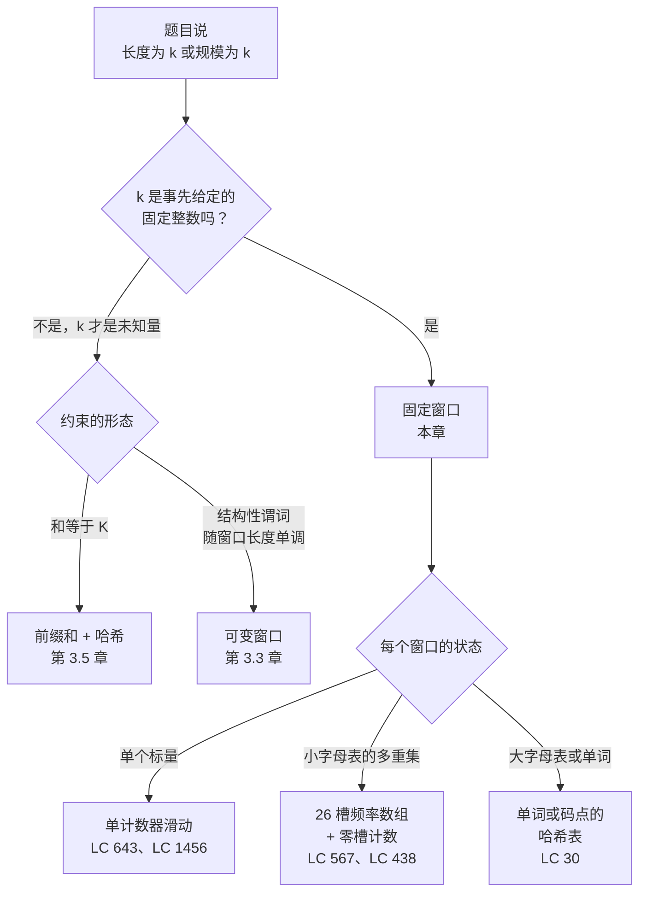

# 滑动窗口：固定长度

一个长度 100,000 的整数数组，一个长度 4 的窗口。题目要求任意连续 4 个元素切片的平均值的最大值。最诚实的第一次尝试是遍历每个起始下标，把后面四个数加起来，除以四，留下最好的那个。它是对的。它也在做 99,997 次四个数求和的活，大约 400,000 次加法，而正确答案只需要 100,003 次。

本章讲的戏法就是把这个数拉回到前一个数。前面两章，[双指针：相向而行](./00-two-pointers-opposite.md) 与 [双指针：同向而行](./01-two-pointers-same-direction.md)，练的是同一块肌肉：两个下标走一个数组，每轮做 O(1) 的活，总量被数组长度封顶。固定窗口保留这块肌肉，换掉问题。两个指针不再相向收敛，也不再互相追赶；它们步调一致地前进，彼此正好相隔 `k`，关注的对象是它们中间那段切片。

## 暴力解法为何大半是白做功

看看暴力法实际算了什么。从下标 0 开始的窗口覆盖 `nums[0..3]`。从下标 1 开始的窗口覆盖 `nums[1..4]`。这四个数里有三个是同一个。暴力法照样把它们重新加一遍。

```python
# 暴力：O(n*k) —— 我们要替换掉的东西
def find_max_average_brute(nums, k):
    best_avg = float('-inf')
    for i in range(len(nums) - k + 1):
        avg = sum(nums[i:i+k]) / k
        if avg > best_avg:
            best_avg = avg
    return best_avg
```

毛病不在循环体里。毛病在于每次调用 `sum(nums[i:i+k])` 都把上一轮已经加过的 k-1 个数又加了一遍。在长度 100,000 的数组上取 k=4，就是大约 400,000 次加法，而 100,000 次就够了。

盯着这份冗余看一会儿，修法自己就浮出来了。先用笨办法算一次第一个窗口的和。要拿下一个窗口的和，就把从左边掉出去的元素减掉，把从右边进来的元素加上。一次减法，一次加法，跟 k 有多大无关。循环跑 n-k 次，每轮 O(1)，总量 O(n)，与 k 无关。

LC 643 里还藏着一个很小的归约，它让本章的招牌题比题目名字显得简单。**因为 k 是正常数，平均值最大的窗口就是和最大的窗口；我们解这个整数问题，最后只除一次。** 题名里的 "average" 是装饰。整段滑动过程中只跟踪整数和；把除法推迟到 return 语句。这件事的重要性会超出速度本身。

## 模式

两个阶段。先在 `nums[0..k-1]` 上建出第一个窗口。然后滑动。

```python
def find_max_average(nums, k):
    window_sum = sum(nums[:k])     # 建窗阶段：一趟 O(k)
    best_sum = window_sum
    for r in range(k, len(nums)):  # 滑动阶段：每个下标一步 O(1)
        window_sum += nums[r] - nums[r - k]
        if window_sum > best_sum:
            best_sum = window_sum
    return best_sum / k
```

**Solution** — Python（[Java](./02-sliding-window-fixed/lc-643/sol.java) · [C++](./02-sliding-window-fixed/lc-643/sol.cpp) · [Go](./02-sliding-window-fixed/lc-643/sol.go)）

```python
# LC 643. Maximum Average Subarray I
from typing import List


def find_max_average(nums: List[int], k: int) -> float:
    """LC 643. Maximum average over all length-k subarrays.

    Track the running sum across the slide. Postpone the division by k
    until the end so the float division runs once on the maximum sum.
    """
    n = len(nums)
    window_sum = sum(nums[:k])
    best_sum = window_sum
    for r in range(k, n):
        window_sum += nums[r] - nums[r - k]
        if window_sum > best_sum:
            best_sum = window_sum
    return best_sum / k
```

循环体里有两处值得留意。

滑动是*一个*表达式：`window_sum += nums[r] - nums[r - k]`。把它拆成"先加进来的、再减出去的"读起来更清楚，算术完全一样。两种都行。别写成两条语句再引入临时变量；写着写着自己就忘了赋值号哪边是哪边。

比较用的是整数和，不是浮点平均值。循环里我们从不做除法。前面那个归约在这里真的在干活：`argmax(sum / k)` 和 `argmax(sum)` 一致，因为 k > 0，所以我们留着整数和，比整数。浮点除法只在最后对获胜者做一次。

> [!IMPORTANT]
> 触发这个模式的信号，是题干里出现*"of length k"*、*"of size k"*，或*"every contiguous subarray of length exactly k"*。凡是窗口宽度事先给定、而不是在搜索过程中找出来的，都算。[^1] 如果 k 才是未知量，你要的是另一章：由谓词驱动窗口伸缩时看 [滑动窗口：可变长度](./03-sliding-window-variable.md)，由求和目标驱动时看前缀和加哈希的组合（第 3.5 章）。

## 四个基本操作

整个模式的表面就是四个操作：建初始状态、加进进入窗口的元素、去掉离开窗口的元素、判断当前窗口是不是新的最优。不同题目只是特化同样的四个槽位。名字很重要：第 3.3 章和第 3.5 章会直接复用这套词汇，不再重讲。

| 题目 | `init_state` | `slide_in(state, x)` | `slide_out(state, x)` | `observe(state)` |
|---|---|---|---|---|
| LC 643 — 最大平均值 | `sum = 0` | `sum += x` | `sum -= x` | `sum`（最后除一次 k） |
| LC 1456 — 最多元音数 | `cnt = 0` | `cnt += is_vowel(x)` | `cnt -= is_vowel(x)` | `cnt` |
| LC 567 — 字符串排列 | `freq = [0]*26` | `freq[x] += 1` | `freq[x] -= 1` | `freq == target_freq` |
| LC 30 — 单词串联子串 | `wordCount = {}` | `wordCount[token] += 1` | `wordCount[token] -= 1` | `wordCount == words_freq` |

遇到固定窗口的题，要干的活就是填这四格。骨架一模一样。[^2] 上表里有三行值得细看，因为它们正是本章 CORE 梯度上的三道题，而且状态一层比一层丰富。

**LC 643（Maximum Average Subarray I）** 是能想到的最简特化。每个窗口的状态塌缩成一个整数。`slide_in` 就是 `+= x`。`slide_out` 就是 `-= x`。`observe` 读这个整数，最后把那段只做一次的除法套在最终答案上。LC 643 不需要比这更多的东西。

**LC 1456（Maximum Number of Vowels in a Substring of Given Length）** 是 LC 643 前面加了一个谓词。状态仍然是一个计数器。唯一区别是 `slide_in(s, x)` 在 x 是元音时加 1、否则加 0；`slide_out` 对称。Java/C++/Go 的实现把 `is_vowel` 的判断挪成 static inline，于是滑动的代码编译出来跟 LC 643 是同一段汇编。算法一致，原语不同。

**LC 567（Permutation in String）** 是第一行状态不再是标量的题。窗口的"状态"是一个 26 槽的频率数组，每个小写字母一个计数。`slide_in` 和 `slide_out` 各改一个槽。难的是 `observe`：天真的答案是 `Arrays.equals(freq, target_freq)`，每次滑动 O(26)。真正管用的优化单独占一节，见下文。

## 实例推演：LC 643 在 `[2, 1, 5, 1, 3, 2, 1, 4]` 上取 `k = 3`

在下标 0..2 上建第一个窗口：`2 + 1 + 5 = 8`。于是 `window_sum = 8`，`best_sum = 8`。这个窗口的平均值是 8 / 3 ≈ 2.67。

滑动。丢掉 `nums[0] = 2`，加进 `nums[3] = 1`。`8 - 2 + 1 = 7`。比 8 小；最优仍是 8。

再滑。丢掉 `nums[1] = 1`，加进 `nums[4] = 3`。`7 - 1 + 3 = 9`。比 8 大；最优变成 9。**这就是答案。** 平均值是 9 / 3 = 3.0；胜出的窗口是下标 2..4 上的 `[5, 1, 3]`。

后面三次滑动只是确认。`[1, 3, 2]` 和为 6。`[3, 2, 1]` 和为 6。`[2, 1, 4]` 和为 7。都到不了 9。数组到头；返回 `9 / 3 = 3.0`。

一共六个窗口。五次滑动，每次一减一加，外加三次没有刷新最优的整数比较。建窗是三次加法。整个跑下来，在八元素数组上共十一次加法和五次比较。下面的组件把每一步都做成动画。

> **Interactive widget:** [滑动窗口（固定长度 + 可变长度）](../../../dsa/widgets/w-09-sliding-window-expansion.yml)（面板 `panel-a`）—— 在网站上渲染；YAML 规格描述了各个关键帧。

*静态回退：六个窗口的和依次是 `[8, 7, 9, 6, 6, 7]`；滚动最大值在建窗后停在 8，第二次滑动时跳到 9，之后一直保持 9 到结尾。*

## 如何识别这个模式



*动手写代码之前先跑一遍这棵决策树：先在更大的窗口家族里定位固定窗口，再挑出跟题目匹配的状态形状。*

## 实际开销

| 变体 | 时间 | 空间 | 说明 |
|---|---|---|---|
| 单计数器（LC 643、LC 1456） | O(n) | O(1) | 每个窗口一个整数状态。最干净的情形。 |
| 频率表，小字母表（LC 567、LC 438） | O(n) | O(σ) | 小写字母时 σ = 26。用定长数组，别用哈希表。 |
| 频率表，大字母表（LC 30） | O(n × L) | O(m) | L = 单词长度，m = 目标里的不同键数。滑动按 L 为步长成块前进。 |
| 暴力 | O(n × k) | O(1) | 错的那个答案；被我们替换掉的东西。 |

摊还论证是标准套路。每个输入元素在进入窗口时被加进滚动聚合值恰好一次，离开时被移除恰好一次。每个元素两笔账，对 n 个元素求和，总量 O(n)。CLRS 第 16 章（摊还分析，§16.1）用同样的论证逐字讲了栈的 push/pop；滑动是同一个形状，只是把 `push` 和 `pop` 换成了 `add` 和 `subtract`。[^3]

## 频率表滑动：从每次 O(σ) 到 O(1)

LC 567 是四个基本操作那张表开始回本的地方。每个窗口的状态是一个 26 槽整数数组，每个小写字母一个计数。`slide_in` 把一个槽加一；`slide_out` 把一个槽减一。到这里为止，这就是 LC 643 的模板，只是把一个整数换成了数组。

天真的 `observe` 逐个槽比较两个 26 槽数组：

```python
# 天真版：每次滑动 O(26)，总计 O(26n)
def check_inclusion_naive(s1, s2):
    if len(s1) > len(s2):
        return False
    k = len(s1)
    target = [0] * 26
    window = [0] * 26
    for c in s1:
        target[ord(c) - ord('a')] += 1
    for i in range(k):
        window[ord(s2[i]) - ord('a')] += 1
    if window == target:
        return True
    for r in range(k, len(s2)):
        window[ord(s2[r]) - ord('a')] += 1
        window[ord(s2[r - k]) - ord('a')] -= 1
        if window == target:           # ← 这里的 O(26) 比较
            return True
    return False
```

正确。在 LC 567 的时限之内。渐进上是 O(σ × n)，其中 σ = 26；对固定字母表来说技术上就是 O(n)，但一旦你把这套模板搬到 Unicode 或单词多重集上，它立刻塌掉。

优化是一个 `zeros` 计数器。维护一个*差值*数组 `diff[c] = window_freq[c] - target_freq[c]`，同时记录当前有多少个槽是零。窗口匹配当且仅当 `zeros == 26`。每次槽更新都是 O(1)：加一、减一、以及一次变号检查，把 `zeros` 加一或减一。每次滑动的检查塌缩成 `if zeros == 26`。完整代码在同目录的 `sol.py` 里，用一个 `update` 辅助函数，返回 +1（该槽刚好变成零）、-1（该槽刚好离开零）、或 0（没有跨越）。[^4] 整段滑动的总代价是 O(n)，与 σ 无关；字母表大小只体现在差值数组那 O(σ) 的空间上。

这个套路会反复出现。只要 `observe` 天真是多槽比较、而滑动每步只改动少数几个槽，一个增量的匹配计数就能把 observe 压到 O(1)。LC 438（同一个算法，不同的输出形状）逐字继承了这一手。

## 模式失效的场景

单计数器和 26 槽频率这两个变体覆盖了面试轮换里的大部分固定窗口题。LC 30 把模板撑到更难的地带。

**单词多重集滑动（LC 30）。** 匹配单位是整个单词，不是字符。窗口按 `wordLen` 为增量滑动，你要跑 `wordLen` 台并行的滑动状态机，每个起始偏移一台。LC 30 是本章的 Hard 台阶，是有原因的：表面看起来像 LC 567（在 s 里找一个窗口，内容匹配某个目标多重集），但多重集的键换了形状，盲目把 26 槽模板套到 LC 30 上的人会重复计数。[^5] 同目录的文件覆盖 LC 643、LC 1456 和 LC 567；LC 30 的完整实现留给你自己写，它是 CORE 梯度的一部分。

**辅助结构（LC 239、LC 480）。** 当每个窗口的聚合值是"最大值"或"中位数"时，你需要单调双端队列或双堆结构。这些题确实存在，但分别归单调栈与队列那一章（第 4 部分）和堆那一章（第 6 部分）管。这里提一句只为把边界划清楚；别在滑动窗口这一章里教双端队列。

## 两个最容易踩的坑

> [!WARNING]
> **在循环里算平均值。** LC 643 的第一反应是在滑动里写 `if window_sum / k > best_avg`。在 Java、C++、Go 里，对不能整除的和做整数除法会朝零截断，于是 LC 的标准样例输入 `[1, 12, -5, -6, 50, 3]` 配上 `k = 4` 会返回 `12` 而不是 `12.75`。修法：跟踪整数和，只在 return 语句上除一次。2023 年有用户在 Stack Overflow 上报告了这个具体的 bug；被采纳答案的诊断是"你转成浮点数转得太早了"。[^6] 即便在 `/` 就是浮点除法的 Python 里，在循环内比较浮点数也会累积舍入误差，而且比整数比较慢。同样的修法适用。这就是前面那个归约在真正干活：k 是正常数时，最大和与最大平均值给窗口的排序完全一致，所以我们只在答案上做一次除法。

> [!WARNING]
> **建窗与滑动的交界处差一。** 建窗覆盖下标 `0..k-1`。第一次滑动加进下标 `k`、移除下标 `0`。所以滑动循环从 `r = k` 开始，循环体读的是 `window_sum += nums[r] - nums[r - k]`。常见错误：把滑动从 `r = k + 1` 开始，悄无声息地跳过第一个滑动窗口。另一个常见错误是从 `r = 0` 开始，想用 `if` 把建窗阶段当作特例塞进去；这能跑，但把两阶段结构糊掉了，并且稳定地引入另一种差一错误。信自己写的滑动窗口代码之前，先在纸上拿标准输入走一遍第一次迭代。

第三个坑值得简单点一句：在 LC 567 / LC 438 上每次滑动都重新比较整个频率数组。它是对的，也能在时限内通过，但它是每次滑动 O(σ) 而不是 O(1)。第二次刷到这个模式时再去拿 `zeros` 计数器，第一次不用。

## 题目梯度

### 核心（三题全做才算掌握本章）

- [LC 643 — Maximum Average Subarray I](https://leetcode.com/problems/maximum-average-subarray-i/) [简单] • fixed-window ★
- [LC 567 — Permutation in String](https://leetcode.com/problems/permutation-in-string/) [中等] • fixed-window + char-count
- [LC 30 — Substring with Concatenation of All Words](https://leetcode.com/problems/substring-with-concatenation-of-all-words/) [困难] • fixed-window + word-multiset

### 进阶（可选）

- [LC 1456 — Maximum Number of Vowels in a Substring of Given Length](https://leetcode.com/problems/maximum-number-of-vowels-in-a-substring-of-given-length/) [中等] • fixed-window
- [LC 438 — Find All Anagrams in a String](https://leetcode.com/problems/find-all-anagrams-in-a-string/) [中等] • fixed-window + char-count

LC 643 是本章的招牌题（★），也是实例推演和组件动画讲的那道。LC 1456 是最温和的第二遍：同样的模板，不同的 `slide_in` 谓词。LC 438 就是 LC 567 换了个返回类型；`zeros` 计数器优化逐字搬得过去。

## 后续衔接

可变长度的表亲是 [滑动窗口：可变长度](./03-sliding-window-variable.md)。它保留滑动的摊还戏法和四个基本操作这套词汇；`init_state`、`slide_in`、`slide_out`、`observe` 都能带过去，但窗口现在按谓词伸缩（至多 K 个不同字符的最长子串；覆盖目标多重集的最短窗口）。本章的固定 k 是容易的那一半。难的那一半是判断*什么时候*收缩。

如果窗口长度是未知量、但约束是一个求和目标，目的地换成前缀和加哈希那一章。同样的 O(n) 界，不同的状态，同样四个基本操作，只是复用在累积和数组而不是滑动窗口上。

## 参考文献

[^1]: Pat Reynolds, "Sliding Window Technique: A Comprehensive Guide," LeetCode Discuss study guide, 2023. <https://leetcode.com/discuss/study-guide/3722472/Sliding-Window-Technique:-A-Comprehensive-Guide>.

[^2]: AlgoMap, "Sliding Window: Variable Length + Fixed Length," 2024. <https://algomap.io/lessons/sliding-window>.

[^3]: Cormen, Leiserson, Rivest, Stein, *Introduction to Algorithms*, 4th ed., MIT Press, 2022, Chapter 16 §16.1 (Aggregate analysis).

[^4]: Algomaster.io, "Find All Anagrams in a String" (LC 438 walk-through). <https://algomaster.io/learn/dsa/find-all-anagrams-in-a-string>.

[^5]: codinginterview.com, "30. Substring With Concatenation Of All Words," 2025. <https://www.codinginterview.com/problems/substring-with-concatenation-of-all-words/>.

[^6]: User question, "Why does my code return 12 instead of 12.75 for Leetcode problem #643?" Stack Overflow, July 2023. <https://stackoverflow.com/questions/76660197/leetcode-643-maximum-average-subarray-i>.
