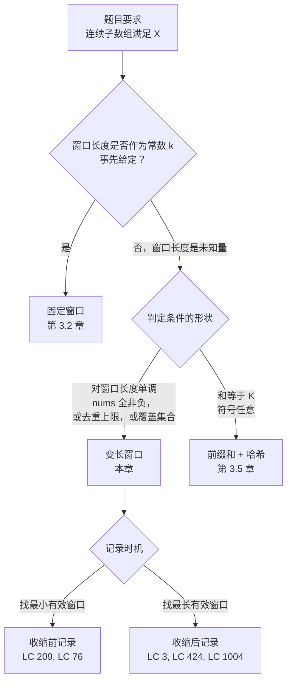

# 滑动窗口：变长窗口

给定字符串 `"pwwkew"`，找出不含重复字符的最长子串长度。答案是 3，落在 `"wke"`（下标 2..4）。最诚实的第一次尝试是枚举每一对 `(l, r)`，逐字符走一遍这段切片，留下最长的那段无重复的。当 `n = 50,000` 时，这大概是 `10^9` 次切片检查，每次还要花 `O(n)` 扫描，早已超出时限，稳稳进入那种你盯着屏幕怀疑自己漏了什么的处境。

你漏掉的是：这些切片大多数与相邻切片共享字符，而且正确答案每一步最多只增长一个字符。[固定长度滑动窗口](./02-sliding-window-fixed.md)在 `k` 作为题面给定参数时引入了这个技巧：先用 `O(k)` 建好第一个窗口，然后每次滑入一个元素，代价 `O(1)`。本章是更难的那一半。窗口长度成了*未知量*；由内层收缩循环判断窗口什么时候长得太过了。三道经典题——*最长无重复字符子串*、*和至少为 target 的最短子数组*、*包含 t 全部字符的最小窗口*——其实是同一个算法，只是收缩条件不同。这句话就是本章的全部内容。

## 为什么暴力解法浪费了大部分工作

LC 3（Longest Substring Without Repeating Characters）是最干净的示例。样例输入 `s = "pwwkew"`，期望输出 `3`。最诚实的第一次尝试：

```python
# 暴力：最坏 O(n^2) —— 我们要替换掉的就是它
def length_of_longest_substring_brute(s):
    best = 0
    for i in range(len(s)):
        seen = set()
        for j in range(i, len(s)):
            if s[j] in seen:
                break
            seen.add(s[j])
            best = max(best, j - i + 1)
    return best
```

外层循环固定起始下标。内层循环往右延伸，直到撞上重复字符就退出。这是对的。在 `"pwwkew"` 上它大约做 18 次比较；在一个长度为 50,000、字符全不相同的字符串上，它大约要做 `n^2 / 2 = 1.25 × 10^9` 次，这正是 LeetCode 上那种失败模式：样例测试全过，大用例直接挂掉。

盯着暴力解法从 `i = 0` 开始在 `"pwwkew"` 上的行为。它扫过 `p, w, w`，在第二个 `w` 处停下。`i = 1` 时，它扫过 `w, w`，立刻停下。到 `i = 2`，内层循环扫过 `w, k, e, w`，在第二个 `w` 处停下。内层循环*重新扫描*了它已经证明无重复的那些字符，而且扫了三遍。这就是冗余所在。暴力解法在外层循环的迭代之间什么都不记得。

解决办法就是记住。一个窗口、两个指针 `l` 和 `r`，再加一份状态（频率计数器，或最近出现位置表），记录此刻 `nums[l..r]` 范围内有哪些字符。把 `r` 往右推一格；新字符如果破坏了判定条件，就推进 `l` 直到条件重新成立。窗口的收缩与扩张并不对称，但两个指针都只向右移动，且各自都被 `n` 约束。所有迭代加起来的总工作量是 `O(n)`。

这种压缩只有在窗口内的量随窗口变化表现可预测时才成立。对 LC 3 来说，「无重复字符」对*收缩*是单调的：移走一个字符只可能修好一处违规，绝不可能制造违规。对 LC 209 来说，「区间和」对*扩张*是单调的，但前提是 `nums[i] >= 0`。一旦任何元素可能为负，这个技巧就崩了。我们在常见陷阱里会回到这一点。

## 模式

两个指针 `l` 和 `r`，定义下标区间 `[l, r]` 上的闭区间窗口。外层 for 循环每次把 `r` 推进一格，同时把新元素累积进窗口状态。内层 while 循环在某个*收缩条件*成立时推进 `l`。骨架如下：

```python
def variable_window(s):
    l = 0
    state = empty_state()
    answer = identity                                 # 求最长用 0，求最短用 +inf
    for r in range(len(s)):
        state = expand_step(state, s[r])              # r 始终前进
        while shrink_condition(state):
            answer = record(answer, l, r, state)      # 求最短窗口：在收缩前记录
            state = shrink_step(state, s[l])
            l += 1
        answer = record(answer, l, r, state)          # 求最长窗口：在内层循环之后记录
    return answer
```

外层循环跑 `n` 次。内层 while 循环在所有外层迭代中的总次数不超过 `n`，因为 `l` 单调不减且上界为 `n`。CLRS 第 17 章 §17.1 把这叫聚集分析（aggregate analysis）；栈上 `MULTIPOP` 的那个示例用的是同一套记账方式，每个栈元素至多入栈一次、出栈一次。[^1]

招牌实例是把 LC 3 写成收缩循环的形式，也就是固定窗口模板最自然的扩展：

```python
def length_of_longest_substring(s):
    counts = {}
    l = 0
    best = 0
    for r, ch in enumerate(s):
        counts[ch] = counts.get(ch, 0) + 1
        while counts[ch] > 1:
            counts[s[l]] -= 1
            l += 1
        if r - l + 1 > best:
            best = r - l + 1
    return best
```

**解法** — Python（[Java](./03-sliding-window-variable/lc-3/sol.java) · [C++](./03-sliding-window-variable/lc-3/sol.cpp) · [Go](./03-sliding-window-variable/lc-3/sol.go)）

```python
# LC 3. Longest Substring Without Repeating Characters
from collections import Counter


def length_of_longest_substring(s: str) -> int:
    """LC 3（最近索引跳跃写法）。

    对每个新字符，如果它在索引 `prev` 出现过，且这个 `prev` 落在当前
    窗口内（`prev >= l`），就把 l 一步跳到 prev + 1，代价 O(1)。否则
    只推进 r。`last[ch] >= l` 这个守卫的作用，是防止窗口之外的过期
    记录引发错误跳跃。
    """
    last: dict[str, int] = {}
    l = 0
    best = 0
    for r, ch in enumerate(s):
        if ch in last and last[ch] >= l:
            l = last[ch] + 1
        last[ch] = r
        if r - l + 1 > best:
            best = r - l + 1
    return best


def length_of_longest_substring_shrink(s: str) -> int:
    """LC 3（显式收缩循环写法）。

    固定窗口模板的「自然扩展」：维护一张频率计数器；一旦新字符
    的计数超过 1，就一步步收缩 l，直到那个重复消失。
    摊还界与最近索引跳跃写法相同，都是 O(n)，
    但单步最坏情况更差。
    """
    counts: Counter[str] = Counter()
    l = 0
    best = 0
    for r, ch in enumerate(s):
        counts[ch] += 1
        while counts[ch] > 1:
            counts[s[l]] -= 1
            l += 1
        if r - l + 1 > best:
            best = r - l + 1
    return best
```

> [!IMPORTANT]
> 收缩条件就是那个枢纽。三道 CORE 题目里，外层的扩张步骤形状完全相同，变的只有收缩条件。LC 3：*当新字符在窗口内构成重复时*（收缩到重复消失）。LC 209：*当和 >= target 时*（仍然满足阈值，收缩以求更小的窗口）。LC 76：*当窗口已经覆盖 t 的全部字符时*（仍然覆盖，收缩以求更小的覆盖）。当你遇到一个状态单调的连续子数组问题时，配方是：先定收缩条件，再决定在收缩前还是收缩后记录，最后把状态填进去。

## 四个基本操作，再加一个新要素

[固定长度滑动窗口](./02-sliding-window-fixed.md)引入了四件套的说法：`init_state`、`slide_in`、`slide_out`、`observe`。变长窗口用同样的四个操作，只多一个新要素：窗口必须满足的**不变量**（invariant），以及不变量被破坏时触发的**收缩触发器**。第五列才是让这个模式「变长」的东西。

| 问题 | `init_state` | `slide_in(state, x)` | `slide_out(state, x)` | `observe(state)` | 不变量 |
|---|---|---|---|---|---|
| LC 3 — 最长无重复 | `last_index = {}` | `last_index[x] = r` | （跳跃式；没有收缩循环） | `r - l + 1` | 窗口内每个字符都不重复 |
| LC 209 — 和 ≥ target 的最短 | `sum = 0` | `sum += x` | `sum -= x` | `sum`，满足阈值时记录长度 | 有效之前 `sum < target` |
| LC 76 — 最小覆盖窗口 | `freq = Counter()` | `freq[x] += 1` | `freq[x] -= 1` | 匹配时记录长度 | 所需字符全部被覆盖 |
| LC 424 — 替换预算 | `freq` 表、`mx` | `freq[x] += 1`；更新 `mx` | `freq[x] -= 1` | `r - l + 1` | `(r - l + 1) - mx <= k` |

第一列按本章的难度顺序排列，不是 LC 题号顺序。骨架完全一样，活都在填这五行五列上。

## 实例推演：LC 3 在 `"pwwkew"` 上

窗口从空开始：`l = 0`、`last = {}`、`best = 0`。按收缩循环写法（更贴近四个基本操作的模板，也更好讲）走一遍。

`r = 0, ch = 'p'`。加入窗口：`counts['p'] = 1`。没有重复，无需收缩。记录长度 1；`best = 1`。

`r = 1, ch = 'w'`。`counts['w'] = 1`。没有重复；记录长度 2；`best = 2`。

`r = 2, ch = 'w'`。`counts['w'] = 2`。*判定条件被破坏。*收缩：丢掉 `s[0] = 'p'`，`counts['p'] = 0`，`l = 1`。`counts['w']` 仍然是 2；再收缩：丢掉 `s[1] = 'w'`，`counts['w'] = 1`，`l = 2`。条件恢复。记录长度 1；`best` 保持 2。

`r = 3, ch = 'k'`。`counts['k'] = 1`。记录长度 2；`best` 不变。

`r = 4, ch = 'e'`。`counts['e'] = 1`。记录长度 3；`best = 3`。**这就是答案。**最优子串是 `"wke"`。

`r = 5, ch = 'w'`。`counts['w'] = 2`。收缩：丢掉 `s[2] = 'w'`，`counts['w'] = 1`，`l = 3`。条件恢复。记录长度 3；`best` 不变。

字符串结束，返回 3。配套组件把这个过程逐帧演示出来，`r = 2` 和 `r = 5` 处的收缩阶段被拆成独立的步骤，好让你看清优化将要替换掉的到底是哪些工作。

> **Interactive widget:** [滑动窗口（固定 + 变长）](../../../dsa/widgets/w-09-sliding-window-expansion.yml)（面板 `panel-b`）— 在网站上有渲染版本；YAML 规格文件描述了关键帧。

*静态回退说明：窗口先长到长度 2（`"pw"`），然后在 `r = 2` 处一次收缩把它压回长度 1；再长到长度 3（`"wke"`），在 `r = 4` 处定下最优值；在 `r = 5` 处再来一次收缩加扩张，得到同样长度的 `"kew"`。三次记录事件更新 `best`，依次爬到 1 → 2 → 3。*

## 实际开销

| 变体 | 时间 | 空间 | 备注 |
|---|---|---|---|
| LC 3（收缩循环写法） | 摊还 O(n) | O(min(n, σ)) | σ = 字母表大小；对抗性输入下单步最坏为 O(n) |
| LC 3（最近索引跳跃写法） | 摊还 O(n) | O(min(n, σ)) | 单步最坏为 O(1) |
| LC 209（和 ≥ target，全非负） | O(n) | O(1) | 聚集分析：`l` 总共最多推进 n 次 |
| LC 76（最小覆盖） | O(m + n) | O(σ) | `m = \|t\|`，`n = \|s\|`。`have/required` 计数器让每一步保持 O(1)。 |
| LC 76，字母表固定 | O(m + n) | O(1) | 如果键是 128 字节的 ASCII，σ 就退化成常数。 |

具体到 LC 76，正是那个整数计数器把算法从 `O(m × |t|)`（每步做一次完整的哈希表相等比较）拉低到 `O(m + n)`。没有它，内层检查每轮都要比对两张哈希表；有了它，每一步最多做一次表自增、一次表自减、一次整数比较。

LC 3 的第一行藏着一个细节。收缩循环写法是摊还 `O(n)`，但单步最坏是 `O(n)`，这个差距是真实存在的。状态上的一点小改动就能把它抹平。

### 最近索引跳跃：从收缩循环到一次赋值

收缩循环写法好讲，因为它与四件套模板精确对应。但它也浪费。看看 `"pwwkew"` 上 `r = 2` 时发生了什么：内层循环先丢掉 `'p'`，再丢掉 `'w'`，然后退出。两步收缩，才到达那个让重复不再是重复的索引 `l = 2`。目的地本来可以用 `O(1)` 算出来，我们却走了两步。

修正办法是本章杠杆率最高的技巧。不用频率计数器，改成维护 `last_index` 表：每个字符映射到它在 `s` 中最近出现的位置。当 `r` 读到一个此前在索引 `prev` 出现过的字符，就把 `l` 直接推到 `prev + 1`。一次赋值。收缩循环消失了。

```python
def length_of_longest_substring(s):
    last = {}
    l = 0
    best = 0
    for r, ch in enumerate(s):
        if ch in last and last[ch] >= l:
            l = last[ch] + 1
        last[ch] = r
        if r - l + 1 > best:
            best = r - l + 1
    return best
```

守卫条件 `last[ch] >= l` 是必须的，也正是大多数「几乎对了」的提交翻车的地方。把 `"pwwkew"` 处理到索引 5 之后，`last['p'] = 0`。这条记录*过期了*。字符 `'p'` 已经不在窗口内，因为 `l` 早就越过了 0。如果后面某轮又遇到 `'p'`，无条件的跳跃 `l = last['p'] + 1 = 1` 会把 `l` 往*回*推，退进算法已经丢弃的地盘。守卫的意思是：只有当上一个索引落在*当前*窗口内时才跳跃。没有它，只要字符串里出现某个字符隔一段距离后又重复，窗口就会被破坏；有它，过期记录会被静默忽略，并在下一次赋值时被覆盖。

复杂度论证没变。两种写法按聚集分析都是摊还 `O(n)`：每个字符只被读一次，`l` 总共最多推进 `n` 次。变的是单步最坏情况。收缩循环写法在病态输入上（比如 50,000 个互不相同的字符，再接一个与首字符相同的重复字符）会把整个窗口一个字符一个字符地排干，为一次重复付 `O(n)`。最近索引跳跃写法只付 `O(1)`。LC 3 的 LeetCode 讨论帖记录了这个确切的失败：朴素的收缩循环在隐藏的对抗性用例上超时，跳跃写法则不会。[^2]

> **Interactive widget:** [Longest Substring Without Repeating Characters (LC 3) — 最近索引跳跃](../../../dsa/widgets/e-LC003-longest-substring.yml) — 在网站上有渲染版本；YAML 规格文件描述了关键帧。

*组件在同一个 `"pwwkew"` 上走一遍最近索引跳跃写法，把 `r = 2` 和 `r = 5` 处的两次跳跃呈现为单次跳转。第 7 步暴露出那条此时已过期的 `last['p'] = 0` 记录——在更长的输入上，守卫防的就是它。*

## 变长窗口在滑动窗口家族中的位置



*读者跑一次的决策树，用来把连续子数组问题映射到本章的某个子模式上。*

## 模式失效的场景

骨架不变。变的是状态、收缩条件和记录时机。四个子模式基本覆盖了面试轮换里所有的变长窗口问题。

**带和阈值的最小窗口（LC 209）。**数值阈值，输入非负。在仍满足阈值时收缩；每次收缩前记录长度。套到 `target = 7, nums = [2, 3, 1, 2, 4, 3]` 上，窗口扩张四次达到和 8 ≥ 7，记录长度 4，然后收缩到跌破阈值，再扩张两次，把答案一路压到 2。执行轨迹的结构与 LC 3 相同，只是把「重复消失」换成了「和跌破 target」。

**带基数上限的最大窗口（LC 3、LC 904、LC 340）。**判定条件在扩张时失败（出现重复，或不同字符数超过 `K`）。在违规时收缩；在内层循环退出后、违规已清除时记录长度。LC 904（Fruit Into Baskets）就是「至多 `K` 种不同字符的最长子数组」在 `K = 2` 时的实例；参数化的 LC 340 在付费墙后面，不在题目梯度里。

**带有限修正预算的最大窗口（LC 424、LC 1004）。**窗口自由生长；收缩条件是预算被超支。LC 424（Longest Repeating Character Replacement）有一个干净的单调追踪技巧：`mx`（本轮运行中*曾经出现过*的最大字符频率）是一个非递减标量，窗口收缩时不需要为正确性去更新它，因为我们关心的是 `n - l`，而不是每步重算的最大值。[^3] LC 1004（Max Consecutive Ones III）是同一思路的二进制数组版本：最多把 `K` 个 0 翻成 1，求最长连续段。

**带覆盖集判定的最小窗口（LC 76）。**本章最难的变体。状态是两张字符计数表（`window` 和 `need`）加一对整数 `(have, required)`。判定条件是「窗口按重数覆盖了 `t` 的每个字符」；在仍然覆盖时收缩，每次收缩前记录。`have == required` 这个计数器是让内层检查保持 `O(1)` 的关键，本节余下部分解释原因。

### `have == required`：从 O(σ) 覆盖检查到 O(1)

LC 76 要求 `s` 中包含 `t` 所有字符（含重复）的最短子串。对 `s = "ADOBECODEBANC", t = "ABC"`，答案是 `"BANC"`。若 `t = "AABC"`，答案需要*两个* `A`；窗口 `"BAC"` 虽然三种字母都齐，仍不合格。

朴素的覆盖检查每轮逐槽比对两张哈希表：每步 O(|t|)，总共 O(m × |t|)。优化办法是用一个整数计数器 `have`，统计 `t` 中有多少个*不同*字符当前在窗口内的计数已达到或超过其需求。窗口覆盖 `t` 当且仅当 `have == required`，其中 `required = len(need)` 是 `t` 中不同字符的个数。

增量和减量的守卫是不对称的，把它们搞错是 LC 76 最常见的 bug。**只在 `window[c]` *恰好变成*等于 `need[c]` 时增加 `have`**，用 `==`，不是 `>=`。**只在 `window[c]` *严格跌破* `need[c]` 时减少 `have`**，用 `<`，且是在原地减量*之后*判断，不是 `<=`。这种不对称编码了 `have` 的含义：一个被需要的字符，计数严格高于需求时和恰好等于需求时一样算覆盖，所以当 `need['A'] = 2` 时再加第四个 `'A'` 并不改变覆盖状态；只有朝任一方向跨过边界的那一刻才改变。

每一步最多做一次表自增、一次表自减、一次整数比较，全是 `O(1)`。无论 `t` 多长，总代价都是 `O(m + n)`。[^4]

## 三个最容易踩的坑

> [!WARNING]
> **在有正有负的数组上硬套滑动窗口。**算法会跑完，但在含 `nums[i] < 0` 的输入上返回错误答案。提交能过样例（样例往往只有正数），却死在隐藏用例上。判断是否该换招的信号：如果约束里没写 `nums[i] >= 0`，滑动窗口就不适用。LC 209 的「和 >= target」不变量要求区间和随窗口长度单调，而这只在输入非负时成立。LC 560 那篇被引用最多的 Medium 文章专门有一节叫「Why Does Sliding Window Not Work?」，就是因为太多读者在注意到判定条件在有正有负的输入上不单调之前就伸手去用了。[^5] 这种情况请改用[前缀和 + 哈希表组合](./05-prefix-sum-hash.md)。

> [!WARNING]
> **LC 76：用 `>=` 而不是 `==` 去增加 `have`。**对 `t = "aab"`，窗口 `"a"` 已经把 `window['a'] = 1 >= need['a']` 当成 `== 1` 来处理，于是错误地宣称已覆盖。输出里就会少一个必需的 `a`。只在 `window[c]` *变成*等于 `need[c]` 的那一刻，增加 `have` 一次。减量侧的对偶规则：在原地减量*之后*按严格 `<` 减少，不是 `<=`。两个运算符中任意一个写反，重复字符的处理就会静默失效。

> [!WARNING]
> **LC 3 最近索引跳跃：忘了 `last[ch] >= l` 守卫。**没有守卫，只要某个字符在 `l` 已经越过它上次出现位置之后又重复，`l = last[ch] + 1` 就会往*回*跳进已丢弃的地盘。在 `"abba"` 上，处理索引 3 的 `'a'` 时 `last['a'] = 0`、`l = 2`，无守卫的跳跃会把 `l` 设成 1，这是错的；`l` 应当保持 2。这个 bug 是静默的：算法跑完，返回一个偏大的答案（长度 3，而正确答案是 2）。守卫只是条件里多一项，却是区分正确提交与错误答案的那一行。

## 题目梯度

### 核心（三题全做才算掌握本章）

- [LC 3 — Longest Substring Without Repeating Characters](https://leetcode.com/problems/longest-substring-without-repeating-characters/) [中等] • variable-window-with-distinct-cap ★
- [LC 209 — Minimum Size Subarray Sum](https://leetcode.com/problems/minimum-size-subarray-sum/) [中等] • variable-window-monotone-shrink
- [LC 76 — Minimum Window Substring](https://leetcode.com/problems/minimum-window-substring/) [困难] • variable-window-with-counter-map

### 进阶（可选）

- [LC 424 — Longest Repeating Character Replacement](https://leetcode.com/problems/longest-repeating-character-replacement/) [中等] • variable-window-with-replacement-budget
- [LC 1004 — Max Consecutive Ones III](https://leetcode.com/problems/max-consecutive-ones-iii/) [中等] • variable-window-with-flip-budget

LC 3 是本章的招牌题（★），也是两个组件都在演示的那道。LC 209 是「仍满足条件就收缩」这一形状最干净的示例；LC 76 算法上最难，也是本章的收尾大戏。CORE 三题横跨中等、中等、困难。变长窗口模式没有标准的简单题，因为 LC `sliding-window` 标签下的那些「简单」题（LC 219、LC 643、LC 1652）全是固定窗口，都放在[固定长度滑动窗口](./02-sliding-window-fixed.md)里了。frontmatter 里的 `no-easy-canonical` 策展标记如实记录了这一点；这不是题目梯度的缺口，而是这个模式的性质。

## 后续衔接

当数组含负数、而问题是「和为 K 的子数组」时，让变长窗口成立的那个单调性就消失了。解法是[前缀和 + 哈希表组合](./05-prefix-sum-hash.md)：同样 `O(n)` 的界，不同的状态，不同的机制，同样的四个基本操作词汇用在累积和数组上，而不是滑动窗口上。

当每个窗口的聚合量是「最大值」或「中位数」而不是计数器时，窗口状态就需要单调双端队列或双堆结构。这类题确实存在（LC 239、LC 480），那两个数据结构分别归[单调栈与单调队列](../../../dsa/part-4-stack-queue-patterns/01-monotonic-deque.md)和[堆](../../../dsa/part-6-trees-heaps/04-heaps-priority-queues.md)章节管；变长窗口的脚手架正是它们赖以搭建的底座。

## 参考文献

[^1]: Cormen, Leiserson, Rivest, Stein, *Introduction to Algorithms*, 4th ed., MIT Press, 2022, Chapter 17 §17.1 (Aggregate analysis).

[^2]: aadymanda, "Sliding Window Pattern," LeetCode discussion thread, 2024. <https://leetcode.com/discuss/post/6901308/sliding-window-pattern-by-aadymanda-jq9f/>.

[^3]: Top-voted solution thread for LC 424, LeetCode discussion. <https://leetcode.com/problems/longest-repeating-character-replacement/solutions/>.

[^4]: doocs/leetcode mirror, "76. Minimum Window Substring." <https://github.com/doocs/leetcode/blob/main/solution/0000-0099/0076.Minimum%20Window%20Substring/README_EN.md>.

[^5]: Yumin Lee, "LeetCode 560: Subarray Sum Equals K," Medium, 2022-10-10. <https://yuminlee2.medium.com/leetcode-560-subarray-sum-equals-k-9eb688e43534>.
