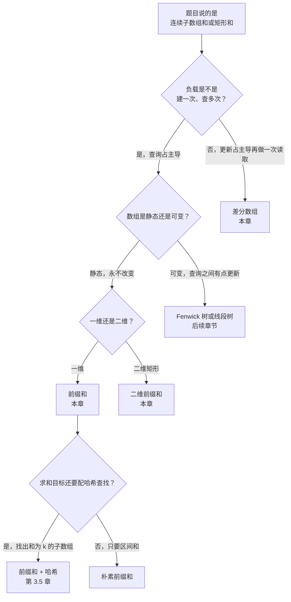
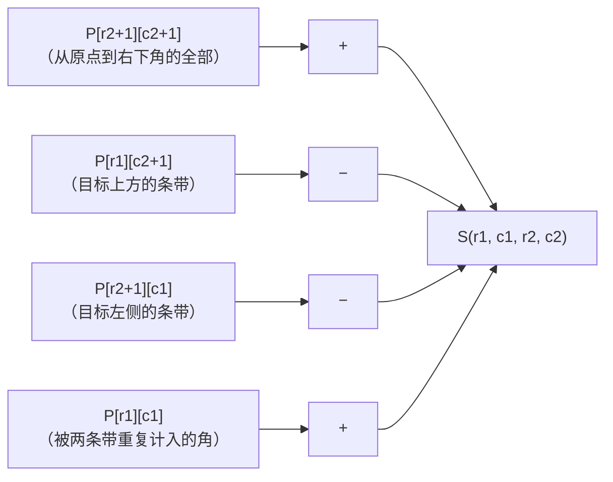
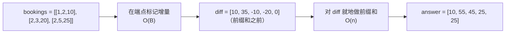

# 前缀和与差分数组

数组里有一万个整数，要对它做一万次区间求和查询。老实的第一版会在每次查询时循环遍历那段切片。这大约是 `10^4 × 10^4 = 10^8` 次加法，慢到在 LeetCode 上会超时，也慢到任何把它发上线的生产服务都得先准备好迎接一个糟糕的周末。把同一份工作量降到约 `2 × 10^4` 次操作的办法，不过是多一个数组，再加每次查询一次减法。

本章讲的就是这个技巧和它的三个近亲。一维原语（建一次、查多次）是主线。基于容斥的二维扩展，能以与矩形大小无关的常数代价回答矩形求和；1984 年的一篇 SIGGRAPH 论文把它叫作*积分图*（summed-area table），Viola-Jones 人脸检测就跑在它上面。反方向——大量区间*更新*之后做一次*读取*——是差分数组。三者共享同一趟构建和同一个算术恒等式。已有三篇姊妹章节把读者领到这里：[双指针：相向两端](./00-two-pointers-opposite.md)、[滑动窗口：固定长度](./02-sliding-window-fixed.md)、[滑动窗口：可变长度](./03-sliding-window-variable.md)。它们讲的技术都要求窗口内的那个量随窗口长度单调。前缀和对付的正是它不单调的情况。

## 为什么暴力解法浪费了大部分工作

标准的入门题是 LC 303（Range Sum Query - Immutable）。形状是：一个 `init(nums)`，里面建好你想要的任何数据结构；然后一连串 `sumRange(left, right)` 调用，每次返回 `nums[left..right]`（含两端）的和。老实的第一版把数组存着，每次重算：

```python
class NumArray:
    def __init__(self, nums):
        self.nums = nums

    def sumRange(self, left, right):
        return sum(self.nums[left:right + 1])      # 每次查询 O(r - l + 1)
```

任何输入都算对。拿 LC 的样例 `nums = [-2, 0, 3, -5, 2, -1]` 和三次查询去跑，它立刻给出 `[1, -1, -3]`。可一旦按 LC 真正写着的约束压测（`n <= 10^4`，"最多会调用 `10^4` 次 sumRange"），最坏情况下它要做大约 `n × Q = 10^8` 次加法。这正是朴素解开始在隐藏用例上超时的量级。

盯住暴力法在重复算的东西。第 1 次查询求 `nums[0..2]`。第 3 次查询求 `nums[0..5]`，其中包含同样的前三个元素。第 2 次查询求 `nums[2..5]`，和第 3 次查询共有四个元素。被重复的工作，恰好就是我们一遍遍走过的那些部分和。把每个部分和*一次性*算出来存好，区间求和就塌缩成一次减法。

恒等式是这样。把 `prefix[i]` 定义为 `nums` 前 `i` 个元素的和，

```text
prefix[i] = nums[0] + nums[1] + ... + nums[i-1]
```

那么 `nums[l..r]`（含两端）的和就是 `prefix[r+1] - prefix[l]`。两次读取，一次减法，与 `r - l + 1` 无关。建表 `O(n)`，每次查询 `O(1)`。总代价从 `O(n × Q)` 变成 `O(n + Q)`。

## 模式

两个阶段。一趟扫描建好前缀数组，之后每次查询就是一次减法。

```python
def build_prefix(nums):
    n = len(nums)
    prefix = [0] * (n + 1)              # 长度 n+1；prefix[0] = 0 是哨兵
    for i in range(n):
        prefix[i + 1] = prefix[i] + nums[i]
    return prefix


def range_sum(prefix, l, r):
    return prefix[r + 1] - prefix[l]    # nums[l..r]，含两端
```

**Solution** — Python ([Java](./04-prefix-sums/lc-303/sol.java) · [C++](./04-prefix-sums/lc-303/sol.cpp) · [Go](./04-prefix-sums/lc-303/sol.go))

```python
# LC 303. Range Sum Query - Immutable
from typing import List


class NumArray:
    """LC 303。O(n) 构造；O(1) 回答 sumRange。

    不变式：对 i ∈ [0, n]，prefix[i] = nums[0] + nums[1] + ... + nums[i-1]。
    区间和 nums[l..r]（含两端）= prefix[r+1] - prefix[l]。
    """

    def __init__(self, nums: List[int]) -> None:
        n = len(nums)
        # prefix 长度为 n + 1；prefix[0] = 0 是空和哨兵。
        self.prefix = [0] * (n + 1)
        for i in range(n):
            self.prefix[i + 1] = self.prefix[i] + nums[i]

    def sumRange(self, left: int, right: int) -> int:
        return self.prefix[right + 1] - self.prefix[left]
```

这段代码里有三个细节，撑起了本章剩下的部分。

前缀数组的长度是 `n + 1`，**不是** `n`。多出来的那一格是 `prefix[0] = 0`，即**空和哨兵**。这是承重的技巧。没有它，公式就得为 `l = 0` 单开一个分支（`if l == 0: return prefix[r]`），而任何人写这个分支，有一半概率是错的。有了哨兵，一个恒等式覆盖所有区间。下一章往哈希表里塞 `{0: 1}` 作为初始项时，需要的正是同一个洞察：哨兵让边界情况不必写分支就能成立。

> [!IMPORTANT]
> **那条差一规则，只写一遍。** `prefix[0] = 0`。`prefix[i]` 是 `nums[0..i)` 的和，右端开（从 0 开始数，共 `i` 个元素）。`nums[l..r]`（含两端）的区间和是 `prefix[r+1] - prefix[l]`，**不是** `prefix[r] - prefix[l]`，也**不是** `prefix[r] - prefix[l-1]`。那个 `+1` 出现在闭端点 `r` 上；下端点 `l` 是我们要保留的那段切片的起点，所以它是减数。公开文献里两种约定并存（1-indexed 的 `prefix[R] - prefix[L-1]`；0-indexed 的 `prefix[r+1] - prefix[l]`）。它们只差一个平移，是等价的；选定一种，永不混用。本手册通篇用 0-indexed 形式。[^1]

构建循环是 `for i in range(n): prefix[i+1] = prefix[i] + nums[i]`。写下标是 `i + 1`，读下标是 `i`。把这两个搞混，就会把上一个前缀写回它自己身上，悄悄产出一个整体左移的结果。

Java、C++、Go 的参考实现把前缀累加器加宽成 `long` / `long long` / `int64`。LC 303 给出的边界让最坏情况的求和还塞得进 32 位，但本章的约定是：对对抗性输入默认防溢出，不去逐个情况推敲。Python 的整数是任意精度，不需要转型。

## 如何识别这个模式

动手写代码之前先跑一遍的决策树：



*四路分叉：一维前缀、二维前缀、差分数组，以及"其实你要的是下一章，或者一棵树"。静态是那个关键词。每一次更新都会让前缀数组作废。*

## 实例推演：LC 303 的标准样例

widget 的标准输入是 `nums = [3, -1, 4, 1, 5, -9, 2, 6]`，附带一次 `sumRange(2, 5)` 查询。前缀只建一次，从左往右走。构建完成后 prefix = `[0, 3, 2, 6, 7, 12, 3, 5, 11]`，九项，比输入多一项。查询随后触发一次，两次读取给出答案。

真正要紧的那一刻的算术：`prefix[r + 1] - prefix[l] = prefix[6] - prefix[2] = 3 - 2 = 1`。这就是 `nums[2..5] = [4, 1, 5, -9]` 的和。答案是 `1`。这段切片里有个 `-9`，正是滑动窗口会失效的那种正负混合输入。前缀和不在乎。

> **Interactive widget:** [前缀和（累积 + 区间查询）](../../../dsa/widgets/w-10-prefix-sum-cumulative.yml) — 在网站上渲染；YAML 规格描述了关键帧。

*静态回退：第 1 行是 `nums = [3, -1, 4, 1, 5, -9, 2, 6]`；第 2 行从左往右填出前缀 `[0, 3, 2, 6, 7, 12, 3, 5, 11]`；高亮的那次查询读取 `prefix[6] - prefix[2] = 3 - 2 = 1`。*

## 开销

| 变体 | 时间 | 空间 | 说明 |
|---|---|---|---|
| 一维前缀构建 | O(n) | O(n) | 一趟，每个下标一次加法 |
| 一维区间查询（构建后） | O(1) | 每次查询 O(1) | 两次读取，一次减法 |
| 二维前缀构建 | O(m × n) | O(m × n) | 每格三次读取，一次写入 |
| 二维矩形查询（构建后） | O(1) | 每次查询 O(1) | 四次读取，三次加法 |
| 差分数组，B 次更新 + 1 次读取 | O(B + n) | O(n) | 前缀和原语的反向用法 |
| 暴力区间求和 | O(n × Q) | O(n) | 错误答案；被我们替换掉的那个 |

一维的界一段话就够论证。`prefix[i+1] = prefix[i] + nums[i]` 从左往右求值，恰好做 `n` 次加法，所以构建是 `O(n)`。每次区间查询是两次数组读取加一次减法，都是常数时间。`Q` 次查询合计 `O(n + Q)`。暴力法是 `O(n × Q)`，在 `n = Q = 10^4` 时，这就是"够快"和"超时"的差别。[^2]

二维的界是同样的论证在每个维度上各跑一次，递推里有容斥，查询里有四个角。下面两节依次讲二维与差分数组。

## 二维前缀和：四角容斥

LC 304（Range Sum Query 2D - Immutable）把同样的形状抬到矩阵上。给定一个 `m × n` 矩阵，和一连串"求以 `(r1, c1)` 与 `(r2, c2)` 为角（含两端）的矩形之和"的查询，建一次前缀表，然后每次查询用四次读取作答。

前缀表的维度是 `(m + 1) × (n + 1)`。顶行 `P[0][*]` 和最左列 `P[*][0]` 全是零（同一个空和哨兵，现在沿两个轴各来一份）。`P[i+1][j+1]` 存的是左上角 `(0, 0)`、右下角 `(i, j)`（含两端）这个矩形里所有格子的和。

构建递推：

```text
P[i+1][j+1] = matrix[i][j] + P[i+1][j] + P[i][j+1] - P[i][j]
```

每个格子加上自己，加上正上方那条带（`P[i][j+1]` 覆盖第 `0..i-1` 行、第 `0..j` 列的全部），再加上正左方那条带（`P[i+1][j]` 覆盖第 `0..i` 行、第 `0..j-1` 列）。这两条带在一个子矩形上重叠：第 `0..i-1` 行、第 `0..j-1` 列的那些格子，恰好就是 `P[i][j]`。不减掉它就会重复计数。三项容斥。

矩形查询是同一个四角恒等式：

```text
S(r1, c1, r2, c2) = P[r2+1][c2+1] - P[r1][c2+1] - P[r2+1][c1] + P[r1][c1]
```

符号推导比背下来容易。从原点到 `(r2, c2)` 的大矩形是 `P[r2+1][c2+1]`。我们减掉目标上方和左侧的两条带：第 `0..r1-1` 行（即 `P[r1][c2+1]`）和第 `0..c1-1` 列（即 `P[r2+1][c1]`）。这两条带在从原点到 `(r1-1, c1-1)` 的角部子矩形上重叠，于是把它加回来：`P[r1][c1]`。加、减、减、加。

一个实例把符号定下来。取 4×5 的矩阵：

```text
matrix = [[3, 0, 1, 4, 2],
          [5, 6, 3, 2, 1],
          [1, 2, 0, 1, 5],
          [4, 1, 0, 1, 7]]
```

查 `S(1, 1, 2, 3)`，也就是 2×3 的格子块 `[[6, 3, 2], [2, 0, 1]]`，期望和是 `14`。从建好的前缀表里取出的四个角是 `P[3][4] = 28`、`P[1][4] = 8`、`P[3][1] = 9`、`P[1][1] = 3`，于是 `28 - 8 - 9 + 3 = 14`。从原点到 `(2, 3)` 的大矩形覆盖 `5 + 6 + 3 + 2 + 1 + 2 + 0 + 1 + 3 + 0 + 1 + 4 = 28`。减掉上方那条带（第 0 行、第 0..3 列），它和为 `8`。减掉左侧那条带（第 0..2 行、第 0 列），它和为 `9`。两次减法都把 `(0, 0)` 这个值为 `3` 的角格减掉了，所以要加回来。加、减、减、加，四个数字各自对应容斥的几何含义。

下面的 Mermaid 图画出这次四角取值：



*把四角公式写开来：减掉两条"多余"的带，再把被两条带都认领过的那个角加回来。*

构建时的偏移陷阱就是一维版本警告过的那个，只是翻倍了。查询里含端点的角要加 `+1`（因为那是哨兵平移过的一侧）；而作为减数的角在各自轴上**不**加 `+1`。写成 `P[r2][c2] - P[r1][c2] - P[r2][c1] + P[r1][c1]`、漏掉四个含端点角上的 `+1` 平移，是二维里第二常见的 bug。[^3] Crow 1984 年在 SIGGRAPH 的论文给出了驱动这项技术的主结果："任意矩形区域上的求和只需恰好四次数组引用，与区域大小无关。"[^4] 计算机视觉后来把同一个表改名为*积分图*，Viola-Jones 人脸检测每帧要评估上百万个 Haar 型矩形特征，就因为每一个只要四次读取。

## 差分数组：反方向

同一个原语反着跑。假设负载不是"建一次、查多次"，而是"大量区间更新，然后把每个格子读一次"：给下标 `0..2` 加 `+10`，给下标 `1..2` 加 `+20`，给下标 `1..4` 加 `+25`，然后要最终的数组。急切的做法在每次更新时循环区间，`B` 次更新、长度 `n` 的数组要付 `O(B × n)`。在 `B = n = 10^4` 时，又回到了我们想逃掉的那个 `10^8`。

解法是在边界上标记*变化*，而不是去碰每个格子。维护一个 `diff` 数组。对每次更新 `(l, r, delta)`，写下 `diff[l] += delta` 和 `diff[r+1] -= delta`。所有更新做完后，对 `diff` 就地做前缀和。结果*就是*最终数组。

```python
def apply_updates(updates, n):
    diff = [0] * n                          # 长度 n；diff[i] 是下标 i 处的变化
    for l, r, delta in updates:
        diff[l] += delta
        if r + 1 < n:                       # 处理最右格情况的守卫
            diff[r + 1] -= delta
    for i in range(1, n):                   # 就地做同一个前缀和原语
        diff[i] += diff[i - 1]
    return diff
```

总代价 `O(B + n)`。每次更新两次写入（若更新覆盖到末尾，只写一次）。最后一趟 `O(n)`。只要 `B` 与 `n` 同量级，就胜过 `O(B × n)`。

反方向为什么成立：向量 `[0, ..., 0, +δ, 0, ..., 0, -δ, 0, ..., 0]`（`+δ` 在下标 `l`，`-δ` 在下标 `r+1`）的累积和，恰好是 `[0, ..., 0, δ, δ, ..., δ, 0, ..., 0]`，那一段 `δ` 落在 `[l..r]`（含两端）上。把 `B` 次这样的更新叠起来，线性性保证一趟前缀和就还原出正确答案。

这就是本章的主线归约，明确写出来：

> 静态数组上的区间查询，一旦预计算了累积和，就变成 O(1) 查表。反方向——先做区间更新、最后读一次——改成在差分数组上操作，每次更新塌缩到 O(1)。两者都建立在同一个对偶上：`prefix(diff(arr)) = arr`。静态是那个关键词：查询*之间*的任何一次更新都会让前缀数组作废。查询与更新交错的动态数组，用 Fenwick 树或线段树（第 11 部分）。

LC 1109（Corporate Flight Bookings）是差分数组的教科书题。预订以 1-indexed 的闭区间 `[first, last, seats]` 给出；输入 `bookings = [[1,2,10], [2,3,20], [2,5,25]]`、`n = 5` 时，答案是 `[10, 55, 45, 25, 25]`。从 1-indexed 闭区间到 0-indexed 右端开的换算是 `l = first - 1`、`r + 1 = last`。姊妹文件里的参考实现保留了 `if last < n` 这个守卫，于是当预订覆盖到数组最后一个航班时，`diff[last] -= seats` 这次写入会被抑制。这个越界情况是 LC 1109 第二常见的 bug，仅次于下标换算里的差一错误。[^5]



*LC 1109 上的差分数组形状；前缀和原语的反方向，同样的单趟代价。*

## 模式失效的场景

**前缀异或（LC 1310、LC 1734）。** XOR 是自己的逆运算，所以 `prefix[r+1] XOR prefix[l] = XOR(nums[l..r])`。同一个形状，换了运算符。XOR 构成阿贝尔群，每个元素都是自己的逆，这正好是这项技术支持区间查询所需的代数性质。

**带后缀扫描的前缀积（LC 238）。** 整数乘法一旦遇到零就没有干净的逆，而 LC 238 明令禁止除法。解法是两次互补的扫描：从左往右维护前缀积，*同时*从右往左维护后缀积；下标 `i` 的答案是 `prefix[i] * suffix[i+1]`，两侧都排除了 `i` 处的元素。两次扫描，合计 `O(n)`。标准模式里"减掉切片之前的前缀"这一步，因为运算符没有逆可用，变成了"把两半乘起来"。

### LC 363：二维前缀和 + 二分查找（困难档）

LC 363（Max Sum of Rectangle No Larger Than K）是本章的困难档，也是伪装成一道题的整整一章。二维前缀和只是其中一个原料，二分查找才是包袱抖响的地方。技术如下：

固定顶行 `r1` 与底行 `r2`。对每个固定对，以 `(r1, c1, r2, c2)` 为界的任意矩形求和都变成一个一维问题：定义 `colSum[c] = P[r2+1][c+1] - P[r1][c+1] - P[r2+1][c] + P[r1][c]`，矩形和就是 `Σ colSum[c1..c2]`，它本身又是对滚动累积 `S[c]` 做一次前缀和减法。于是问题塌缩成：在这一行带内的所有 `(c1, c2)` 对中，找最大的、`<= K` 的 `S[c2+1] - S[c1]`。

没有 `<= K` 约束时，答案就是 Kadane。*有*了约束，就要维护一个"迄今见过的前缀和"的有序集合；对每个 `S[c2+1]`，找最小的 `S[c1] >= S[c2+1] - K`（Java 里是 TreeSet 的 `ceiling`，C++ 里是 `std::set::lower_bound`，Python 里是 `sortedcontainers` 的 `SortedList.bisect_left`）。这就是那个二分查找。总代价 `O(m² × n × log n)`。姊妹文件里没有 LC 363。本章教的是二维前缀和那一半；"在有序前缀和上二分"那一半够分量，LC 363 值得单独一篇题解精讲。

**前向引用：Fenwick 树与线段树。** 数组可变、点更新与区间查询交错时，静态前缀数组会逼着每次更新重建一遍。Fenwick（树状数组）与线段树把部分前缀信息存进树结构，让更新*和*查询都是 `O(log n)`。Wikipedia 把 Fenwick 树记作前缀和的动态推广。[^6] 这两者我们都不在这里实现，它们都属于后面的章节。

## 三个最容易踩的坑

> [!WARNING]
> **前缀数组长度是 `n + 1`，不是 `n`。** 这是那种不出声的 bug。把 `prefix = [0] * (n + 1)` 写成 `[0] * n`，循环 `prefix[i+1] = prefix[i] + nums[i]` 会在最后一轮下标越界。更糟的是 C++ 里 `std::vector<int> prefix(n)` 属于未定义行为，在 debug 构建里还可能看着能跑。心智模型：`prefix` 比 `nums` 多*一格*，多出来的那格是最前面的零。

> [!WARNING]
> **查询是 `prefix[r + 1] - prefix[l]`，不是它的变体。** 面试提交里会出现三种差一形态，只有一种是对的：`prefix[r+1] - prefix[l]`（对）。`prefix[r] - prefix[l]`（丢掉了下标 `r` 处的元素）。`prefix[r] - prefix[l-1]`（把 1-indexed 约定套到 0-indexed 数组上；凡是 `l > 0` 的输入都能跑，`l = 0` 时失效，因为 Python 里 `prefix[-1]` 是错的格子，别处则直接越界）。信任何一段自己写的前缀和代码之前，先在纸上走一个标准输入。

> [!WARNING]
> **二维容斥：`+1` 偏移只加在含端点的角上。** 标准公式是 `P[r2+1][c2+1] - P[r1][c2+1] - P[r2+1][c1] + P[r1][c1]`。两个含端点的角（右下 `(r2, c2)`）在各自轴上都要加 `+1` 平移。作为减数的角（左上 `(r1, c1)`）**不**加 `+1`，因为它们是目标的*开*边界，在目标矩形上方一行、左侧一列。漏掉任何一个 `+1`，小输入上都看不出来，一到行或列真的起作用的 boss 用例就崩。

## 题目梯度

### 核心（三题全做才算掌握本章）

- [LC 303 — Range Sum Query Immutable](https://leetcode.com/problems/range-sum-query-immutable/) [简单] • prefix-sum-1d-precompute ★
- [LC 304 — Range Sum Query 2D Immutable](https://leetcode.com/problems/range-sum-query-2d-immutable/) [中等] • prefix-sum-2d-rectangle-query
- [LC 363 — Max Sum of Rectangle No Larger Than K](https://leetcode.com/problems/max-sum-of-rectangle-no-larger-than-k/) [困难] • prefix-sum-2d-with-binary-search *(参考实现：仅 Python)*

### 进阶（可选）

- [LC 1109 — Corporate Flight Bookings](https://leetcode.com/problems/corporate-flight-bookings/) [中等] • difference-array-range-update
- [LC 238 — Product of Array Except Self](https://leetcode.com/problems/product-of-array-except-self/) [中等] • prefix-product-and-suffix-product

LC 303 是本章的招牌题（★），也是"建一次、查多次"这个形状最干净的示范。LC 304 把同一个恒等式抬到二维矩形上，练的是容斥的偏移；如果你能不查资料在纸上推出四角公式，本章就算成功了。LC 363 是真的难。二维前缀和是必要条件而非充分条件；真正让它变困难的是"在有序前缀和上二分"那一步，这类题值得解一次、过段时间再回来看。LC 1109 是本章反方向最干净的示范，LC 238 则是运算符没有逆时会出现的前缀加后缀变体。

## 后续衔接

自然的延伸是[前缀和 + 哈希表的组合](./05-prefix-sum-hash.md)。当问题变成"统计和等于 K 的子数组"、输入又有正有负时，光靠前缀和无法在 `O(n)` 内枚举 `(l, r)` 对。哈希表这一层把已见过的每个前缀值都存下来，每一步用 `O(1)` 找回缺失的那个下标。同一个原语，更丰富的状态。下一章开头的那个占位初始项 `{0: 1}`，就是本章的空和哨兵，只是换了地方住在哈希表里。

数组一旦可变，一旦点更新与区间查询交错，静态前缀数组就不够用了。Fenwick 树和线段树接手；两者都在后面的章节。

## 参考文献

[^1]: USACO Guide, "Introduction to Prefix Sums," Silver tier. <https://usaco.guide/silver/prefix-sums>.

[^2]: USACO Guide, "Introduction to Prefix Sums," 与 [^1] 同一来源。

[^3]: USACO Guide, "More on Prefix Sums," Silver tier. <https://usaco.guide/silver/more-prefix-sums>.

[^4]: Crow, Franklin C., "Summed-area tables for texture mapping," SIGGRAPH '84 Proceedings, ACM Digital Library. <https://dl.acm.org/doi/10.1145/800031.808600>.

[^5]: LeetCode（经 leetcode.ca 镜像），"1109 - Corporate Flight Bookings," 发布于 2018-12-13。 <https://leetcode.ca/2018-12-13-1109-Corporate-Flight-Bookings/>.

[^6]: Wikipedia contributors, "Prefix sum," 最后编辑于 2026-03-04。 <https://en.wikipedia.org/wiki/Prefix_sum>.
