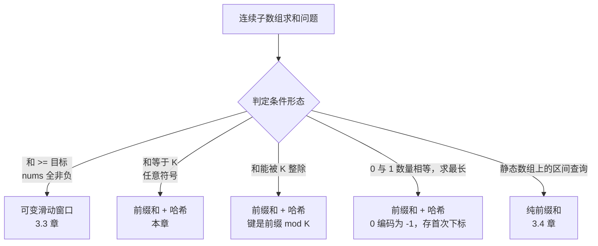

# 前缀和 + 哈希表组合

三个模式之前，你还在用两个下标遍历数组，每步做 O(1) 的事。现在这两个下标被一个更奇怪的东西取代了：一张以数组的*聚合值*为键的哈希表。算法见过的每一个运行和——全部、同时、O(1) 查得。吸收了这个技巧的模式是面试轮换里被问得最多的子数组计数变体，它正好架在前两章各自失效的那道缝上。

[可变滑动窗口（sliding window）](./03-sliding-window-variable.md) 要求 `nums[i] >= 0`，才能保证运行和随窗口长度单调。只要有一个元素可能为负，这套技术就会给出错答案。[前缀和与差分数组](./04-prefix-sums.md) 把区间和化简成一次减法 `prefix[r+1] - prefix[l]`，但单靠它只能回答针对*固定* `(l, r)` 的查询；要数清有多少个 `(l, r)` 满足 `sum = k`，逐个枚举仍然是 `O(n²)`。本章讲的就是把这两块拼起来之后发生的事：一个线性时间的算法，既能处理正负混合的输入，又不用枚举就能把配对数量数出来。

## 暴力解法为何不够

典型题目是 LC 560，*Subarray Sum Equals K*。给定整数数组 `nums` 和一个整数 `k`，返回和等于 `k` 的连续子数组个数。样例：`nums = [1, 1, 1]`，`k = 2`。有两个子数组的和为 2：`nums[0..1]` 和 `nums[1..2]`。答案：2。

最诚实的第一次尝试是枚举每一个 `(l, r)`，逐个元素累加求和，命中就加一。

```python
# 暴力解法：O(n^2)——我们要替换掉的东西
def subarray_sum_brute(nums, k):
    count = 0
    for i in range(len(nums)):
        running = 0
        for j in range(i, len(nums)):
            running += nums[j]
            if running == k:
                count += 1
    return count
```

每种输入上都对。可 LC 560 给的界是 `n <= 2 × 10^4`，最坏情况大约要做 `4 × 10^8` 次操作，在隐藏用例上稳稳超时。用前缀和查表能把每对配对的内部开销从 O(n) 压到 O(1)，总量因此剪到 `O(n²)`——同样的渐进复杂度，常数更小，`n` 一大还是太慢。

真正通向 O(n) 的那个技巧，是意识到我们根本不需要枚举这些配对。我们只需要数它们。

## 一次跟踪看清滑动窗口为何在负数上失效

取 `nums = [1, -1, 1, 1]`，`k = 2`。暴力枚举所有子数组：

| 子数组 | 元素 | 和 |
|---|---|---|
| `[0..0]` | `[1]` | 1 |
| `[0..1]` | `[1, -1]` | 0 |
| `[0..2]` | `[1, -1, 1]` | 1 |
| `[0..3]` | `[1, -1, 1, 1]` | 2 ✓ |
| `[1..1]` | `[-1]` | -1 |
| `[1..2]` | `[-1, 1]` | 0 |
| `[1..3]` | `[-1, 1, 1]` | 1 |
| `[2..2]` | `[1]` | 1 |
| `[2..3]` | `[1, 1]` | 2 ✓ |
| `[3..3]` | `[1]` | 1 |

两次命中：`[0..3]` 和 `[2..3]`。正确答案是 2。现在跑一遍朴素的可变滑动窗口：右指针扩张，和超过 k 就收缩左指针。

```text
state = (l, r, sum, hits)
init: (0, -1, 0, 0)
r = 0: sum = 1.  不等于 2；不动。           state (0, 0, 1, 0)
r = 1: sum = 0.  不等于 2；不动。           state (0, 1, 0, 0)
r = 2: sum = 1.  不等于 2；不动。           state (0, 2, 1, 0)
r = 3: sum = 2.  命中。                     state (0, 3, 2, 1)
       收缩 l = 1，sum = 2 - 1 = 1。        state (1, 3, 1, 1)
       sum < 2；退出收缩。
结束。reported = 1。
```

窗口找到了 `[0..3]`，收缩时越过下标 1 处的 `-1`，然后再也回不来。`[2..3]` 是隐形的：等 `r` 走到 3，算法追踪的窗口起点只剩 `l = 0`（收缩之后是 `l = 1`），没有任何机制能重新发现从 `l = 2` 开始的子数组。[^1] 这套技术一路跑完，返回 1 而不是 2。

解法是别再维护单一窗口。改为累积算法见过的所有前缀和，每一步都问哈希表：之前那些前缀里，有没有哪个和当前前缀相距 `k`？两个不同的前缀值相差 `k`，夹在它们中间的子数组和就是 `k`，中间发生了什么无关紧要。

## 归约

[前缀和与差分数组](./04-prefix-sums.md) 给了你那条挑大梁的恒等式：

```text
range_sum(l, r) = prefix[r + 1] - prefix[l]
```

令 `range_sum(l, r) = k`，再解出 `prefix[l]`：

```text
prefix[r + 1] - prefix[l] = k    iff    prefix[l] = prefix[r + 1] - k
```

本章到此就讲完了。`r` 从左往右走，对每个新的 `r`，“有多少个以 `r` 结尾的子数组和为 `k`”这个问题就变成“前面有多少个前缀值等于 `prefix[r + 1] - k`”。把见过的每个前缀存成一张哈希表 `{前缀值: 计数}`，答案 O(1) 就能查出来。总计：O(n)。

算法的形状随之而来。一趟遍历。一个运行和。一张哈希表。循环体三行：用当前元素推进运行和，在哈希里查 `running - k`，把新的运行和对应的计数加一。

## 模式

```python
def subarray_sum(nums, k):
    counts = {0: 1}                    # 空前缀种子；承重，不能省
    prefix = 0
    answer = 0
    for x in nums:
        prefix += x
        answer += counts.get(prefix - k, 0)         # 先查，后插入
        counts[prefix] = counts.get(prefix, 0) + 1
    return answer
```

**解法** — Python（[Java](./05-prefix-sum-hash/lc-560/sol.java) · [C++](./05-prefix-sum-hash/lc-560/sol.cpp) · [Go](./05-prefix-sum-hash/lc-560/sol.go)）

```python
# LC 560. Subarray Sum Equals K
from collections import defaultdict
from typing import List


def subarray_sum(nums: List[int], k: int) -> int:
    """LC 560. 统计和等于 k 的连续子数组个数。

    不变量：在下标 i（含）处，以 i 结尾且和为 k 的子数组个数等于
    counts[prefix - k]，其中 prefix 是截至 i 的运行和。对所有 i 累加这个量。
    """
    counts: defaultdict[int, int] = defaultdict(int)
    counts[0] = 1  # 空前缀种子：让从下标 0 开始的子数组能被命中
    prefix = 0
    answer = 0
    for x in nums:
        prefix += x
        # 先查再插入当前前缀；否则 k=0 的输入会把当前下标
        # 和它自己配对（一个空子数组）。
        answer += counts[prefix - k]
        counts[prefix] += 1
    return answer
```

在进入实例推演之前，有两行值得先说清楚，因为初学者栽的正是这两行。

第一行是 `counts = {0: 1}`。哈希表一开始就不是空的，里面有一条：前缀值 0 对应计数 1。理由是那个空前缀哨兵。在[前缀和与差分数组](./04-prefix-sums.md)里，`prefix[0] = 0` 表示零个元素的和，也就是空前缀。当下标 `r` 处的运行和第一次等于 `k`，匹配的子数组是 `nums[0..r]`，它对应 `prefix[r + 1] - prefix[0] = k`，于是这次查表问的是“我见过值为 0 的前缀吗？”答案是见过，而且恰好一个。种子 `{0: 1}` 就是那条空前缀记录，作用等同前缀和数组里 `prefix[0] = 0` 那一格。把这个种子去掉，所有从下标 0 开始的子数组都会被漏数。

跟踪一下就看得见。拿 `nums = [1, 1, 1]`、`k = 2`，*不加*种子（`counts = {}`）跑一遍。`i = 1` 时 `prefix = 2`，查的是 `2 - 2 = 0`。此时 counts 是 `{1: 1}`，查不到，答案停在 0。正确的子数组 `nums[0..1]` 就这么无声无息地丢了。加上种子重跑：同一步查到 `counts[0] = 1`，答案变成 1，循环走完拿到正确答案 2。少一条记录，答案就错。

第二行是顺序：先查，后加。我们数的是 `l <= r` 的子数组 `nums[l..r]`。之前的前缀对应 `l = 0, 1, ..., r`；当前前缀对应 `l = r + 1`，是个空子数组。先插入会让算法在 `k = 0` 时把当前下标和它自己配成一对，重复计数。这个顺序不是风格选择；反过来写，任何 `k = 0` 的输入都会得到错答案。

> [!IMPORTANT]
> 种子 `{0: 1}` 不是优化。它就是[前缀和与差分数组](./04-prefix-sums.md)里的空前缀哨兵，只是搬进了哈希表。在标准样例输入上，它就是答案 1 与答案 2 之间的差别。自己写的前缀和加哈希代码，先在纸上走一遍四步跟踪再信它。[^2]

## 四个基本操作

[固定尺寸滑动窗口](./02-sliding-window-fixed.md) 引入了“四个基本操作”这套词汇，[可变滑动窗口](./03-sliding-window-variable.md) 又加了一列不变量。同样的列名沿用到本章，只有一处形状变化：`slide_out` 这一步无事可做，因为算法是单趟、只追加的。运行聚合里什么也不会被移出。把这一点明确说出来，是看清这个模式与它旁边两个窗口模式差异的最干净方式。

| 问题 | `init_state` | `slide_in(state, x)` | `slide_out(state, x)` | `observe(state)` |
|---|---|---|---|---|
| LC 560 和等于 k | `seen = {0: 1}; running = 0` | `running += x`；查 `running - k`；`seen[running] += 1` | （不收缩——只追加） | 运行中的答案计数 |
| LC 974 和对 k 取模 | `seen = {0: 1}; running = 0` | `running = (running + x) mod k`；查 `running`；`seen[running] += 1` | （不收缩） | 运行中的答案计数 |
| LC 525 连续 0/1 数组 | `seen = {0: -1}; balance = 0` | `balance += (1 if x else -1)`；查 `balance` 找最早的 `l` | （不收缩） | 最长长度 |

整个家族里 `slide_out` 这一列都是“不收缩”，因为前缀和加哈希*不是*窗口。窗口有左右两条边，都会前进；`slide_out` 更新的是左边界。这个模式只有右边界。运行聚合单调增长，哈希吸收每一个历史状态，从不丢弃。这种不对称也是空间开销从 O(1)（两个窗口模式）变成 O(n)（本章）的原因：这张表什么都留着。

LC 525 是唯一看起来不太一样的那一行。哈希把前缀值映射到每个值*第一次*出现的下标，而不是计数，因为问题问的是“最长”而不是“多少个”。四个基本操作照样适用，只是 `seen` 和 `observe` 换了形状。

## 实例推演：LC 560，`nums = [1, 1, 1]`，`k = 2`

初始：`counts = {0: 1}`，`prefix = 0`，`answer = 0`。

**下标 0，x = 1。** `prefix = 1`。查 `prefix - k = -1`。不在 counts 里。`answer` 仍是 0。插入：`counts = {0: 1, 1: 1}`。

**下标 1，x = 1。** `prefix = 2`。查 `prefix - k = 0`。*命中；就是种下的那条。* `counts[0] = 1`，所以 `answer += 1 → 1`。子数组 `nums[0..1] = [1, 1]` 的和为 2。插入：`counts = {0: 1, 1: 1, 2: 1}`。

**下标 2，x = 1。** `prefix = 3`。查 `prefix - k = 1`。命中；`counts[1] = 1`。`answer += 1 → 2`。子数组 `nums[1..2] = [1, 1]` 的和为 2。插入：`counts = {0: 1, 1: 1, 2: 1, 3: 1}`。

数组走完。返回 2。

widget 动画演示的正是这段跟踪，并特意在第 9 步（种下的 `{0: 1}` 产生第一次命中的那一刻）停住。就是这一步让那条占位记录回了本。

> **Interactive widget:** [前缀和 + 哈希表组合](../../../dsa/widgets/w-35-prefix-sum-hash-combo.yml) — 在网站上渲染；YAML 规范描述了各个关键帧。

*静态回退图：运行前缀依次为 `[1, 2, 3]`；每次查表的键依次为 `[-1, 0, 1]`；答案棘轮一样往上走 `0 → 1 → 2`。两次命中，都发生在之前某个前缀值正好等于当前 `prefix - k` 的下标上。第一次命中花的正是种下的 `{0: 1}`；没有它，答案会停在 1。*

## 这个组合在子数组求和家族里的位置



*连续子数组求和类问题落到你面前时，先跑一遍这棵决策树。正负混合那一支就是本章的触发条件；其余几支属于邻近章节。*

## 实际开销

| 变体 | 时间 | 空间 | 备注 |
|---|---|---|---|
| 最优情况 | O(n) | O(1) | 一趟；循环无条件执行 |
| 平均 | O(n) 期望 | O(n) | 按 CLRS 11.2，哈希插入与查询每步 O(1) 期望[^3] |
| 最坏情况 | O(n²)（理论） | O(n) | 对抗性冲突；标准测试输入上观察不到 |
| 摊还 | O(n) | O(n) | n 次插入、n 次查询，各摊还 O(1) |
| 暴力解法 | O(n²) | O(1) | 那是错答案；我们替换掉的东西 |

和同一家族里的纯可变滑动窗口对比：

| 方案 | 时间 | 空间 | 适用条件 |
|---|---|---|---|
| 可变滑动窗口 | O(n) | O(1) | 所有 `nums[i] >= 0` 且目标判定单调 |
| 前缀和 + 哈希 | O(n) 期望 | O(n) | 数组正负混合，或目标为“精确相等”/“可整除”/“奇偶性” |

滑动窗口在空间上赢过这个组合（O(1) vs. O(n)），但只在窗口单调性成立的那一小类问题上成立。这个组合是更通用的工具，代价是一个常数因子的空间。

## 模式失效的场景

骨架在整个家族里不变。变的是哈希的键，以及哈希映射到什么。三个有名字的变体基本覆盖了面试轮换里的全部；第四个偶尔出现。

### 模数编码：从和等于到和可被 K 整除（LC 974）

LC 974 问有多少个子数组的和能被 `k` 整除。归约只有一行：两个模 `k` 余数相同的前缀，其差是 `k` 的倍数。把查表的键换成运行前缀对 `k` 取模的结果，算法其余部分完全一样。

```python
def subarrays_div_by_k(nums, k):
    counts = {0: 1}
    prefix = 0
    answer = 0
    for x in nums:
        prefix = (prefix + x) % k          # 键 = 余数
        answer += counts.get(prefix, 0)
        counts[prefix] = counts.get(prefix, 0) + 1
    return answer
```

Python 的 `%` 对负数被除数也返回非负余数，正合算法需要。Java、C++、Go 都向零截断，所以那几个语言里等价的一行要写成 `prefix = ((prefix + x) % k + k) % k`。同目录下的对应文件带了这个按语言区分的兜底。

### 首次出现下标代替计数：从多少个到最长（LC 525）

LC 525 要找 0 和 1 数量相等的最长连续子数组。把 `0 → -1` 编码，问题就变成“和为 0 的最长子数组”，也就是“两个下标的前缀值相同”。此时哈希为每个前缀值存*第一次*出现的下标，而不是计数；查中时 `observe` 报告 `i - first_seen[prefix]`。某个前缀值一旦记录过就不再覆盖；第一次出现才能把间距拉到最大。

种子记录在形状变化后依然保留：`first_seen = {0: -1}`。下标 `-1` 是 `nums[0]` 之前的虚拟位置，所以覆盖整个 `nums[0..i]` 且前缀和为 0 的子数组报告的长度是 `i - (-1) = i + 1`，正确。

### 长度受限：首次出现下标加间距检查（LC 523）

LC 523 把两个变体叠在一起。哈希键是模 `k` 的余数（模数编码变体），哈希为每个余数存第一次出现的下标（最长长度变体），并且只有下标间距至少为 2 时才记一次命中。脚手架一样，变的是哈希映射到什么、记录条件检查什么。

### 奇偶编码：数奇数（LC 1248）

LC 1248 问有多少个子数组恰好含 `k` 个奇数。把每个元素映射成它的奇偶性（奇数 1，偶数 0），问题就归约为在编码后的数组上“数出和等于 `k` 的子数组”，也就是 LC 560 那个经典形式。值得点一句：LC 1248 也有纯可变滑动窗口解法，因为编码后的数组非负，而所有值非负时“和等于 k”是可单调收缩的；见[可变滑动窗口](./03-sliding-window-variable.md)。两个正确算法，一道 Medium。一旦点出奇偶编码，前缀和这套框架就是更干净的归约。

## 两个最容易踩的坑

> [!WARNING]
> **忘记 `counts = {0: 1}`。** 丢掉种子，所有从下标 0 开始的子数组都会被漏数。标准测试 `nums = [1, 1, 1], k = 2` 会返回 1 而不是 2。这个 bug 是静默的：算法跑完，返回一个*大多数*时候都对的值，因为大多数子数组并不从下标 0 开始。LC 560 的隐藏用例会抓住它。

> [!WARNING]
> **输入正负混合时伸手去用滑动窗口。** 本章前面那段“滑动窗口为何失效”的跟踪就是标准示范。触发判断只有一句话：如果约束里没写 `nums[i] >= 0`，那么对“和等于 k”这类问题滑动窗口不适用。换成本章的算法。Yumin Lee 的 LC 560 文章专门有一节叫“Why Does Sliding Window Not Work?”，正是因为太多读者在注意到判定在正负混合输入上并不单调之前，就先伸手拿了它。[^4]

第三个坑也值得点一句：查表放在自增*之后*而不是之前。这个 bug 只在 `k = 0` 时露头；算法把当前下标和它自己配成一对，每个前缀零都被重复计数。先查，后加。

## 题目梯度

### 核心（三题全做才算掌握本章）

- [LC 560 — Subarray Sum Equals K](https://leetcode.com/problems/subarray-sum-equals-k/) [中等] • prefix-sum-hashmap-equality ★
- [LC 974 — Subarray Sums Divisible by K](https://leetcode.com/problems/subarray-sums-divisible-by-k/) [中等] • prefix-sum-hashmap-modulo
- [LC 525 — Contiguous Array](https://leetcode.com/problems/contiguous-array/) [中等] • prefix-sum-hashmap-encoded

### 进阶（可选）

- [LC 523 — Continuous Subarray Sum](https://leetcode.com/problems/continuous-subarray-sum/) [中等] • prefix-sum-hashmap-modulo-with-index
- [LC 1248 — Count Number of Nice Subarrays](https://leetcode.com/problems/count-number-of-nice-subarrays/) [中等] • prefix-sum-hashmap-parity

LC 560 是本章的招牌题（★），也是最干净的正负混合示范。核心三题分别练哈希键的三种承重变体：恒等（LC 560）、取模（LC 974）、以及 `+1/-1` 编码后的首次出现下标（LC 525）。五道题全在 Medium，这很诚实：这个模式在面试轮换里没有经典的 Easy 或 Hard。题目注册表里本章的 `single-difficulty-band` 策展标记记下的正是这一点——这是模式本身的属性，不是梯度有缺口。

## 后续衔接

本章是指针 / 窗口 / 前缀这一族的最后一站。五章之前，[对撞双指针](./00-two-pointers-opposite.md) 引入两个下标在数组上行走，每轮做 O(1) 的工作。经过[同向双指针](./01-two-pointers-same-direction.md)、[固定尺寸滑动窗口](./02-sliding-window-fixed.md)、[可变滑动窗口](./03-sliding-window-variable.md) 和[前缀和与差分数组](./04-prefix-sums.md)，下标始终还是下标，但它们跟踪的状态每一步都更厚：一个计数器、一个多重集、一个累积数组。本章的这个组合，是下标彻底消失的那一刻。哈希表以数组的派生值为键，算法提出的问题，任何双指针写法都回答不了。

从这里分出三条路。

当每个窗口的聚合是“最大值”或“最小值”而不是和时，承担这份工作的是单调双端队列；那是下一章，[单调栈与队列](../../../dsa/part-4-stack-queue-patterns/01-monotonic-deque.md)。原则不变：累积一个每步 O(1) 就能查询的状态。变的只是数据结构的形状。

当同一套前缀加哈希的技巧跑在*树*上而不是数组上时，“运行前缀”变成“从根到当前节点的和”，用 DFS 栈维护，再加一张所有根到当前节点之和的哈希表。LC 437（Path Sum III）是 LC 560 的树版：同样用 `{0: 1}` 给根路径做种子，同样先查后插，额外还要在递归回退时把当前节点的贡献从哈希里撤掉。那个算法的形状和本章这个互为回声；它住在[树](../../../dsa/part-6-trees-heaps/00-binary-tree-fundamentals.md) 那一章，你会一眼认出来。

当数组变成可变的、点更新与区间查询交替出现时，静态前缀数组就不够用了，因为每次更新都会让 O(n) 的预计算表作废。Fenwick 树（树状数组）和线段树接手，更新和查询都是 O(log n)，代价是要维护一棵树结构。那一章在 Part 11 等你。

## 参考文献

[^1]: Yumin Lee, "LeetCode 560: Subarray Sum Equals K," Medium, 2022-10-10. <https://yuminlee2.medium.com/leetcode-560-subarray-sum-equals-k-9eb688e43534>.

[^2]: LeetCode community discussion, "Prefix Sum Problems" study guide. <https://leetcode.com/discuss/study-guide/4023666/prefix-sum-questions-to-practice>.

[^3]: Cormen, Leiserson, Rivest, Stein, *Introduction to Algorithms*, 4th ed., MIT Press, 2022, Chapter 11 §11.2 (Hash Tables).

[^4]: Yumin Lee, "LeetCode 560: Subarray Sum Equals K," Medium, 2022-10-10，与 [^1] 同源。
