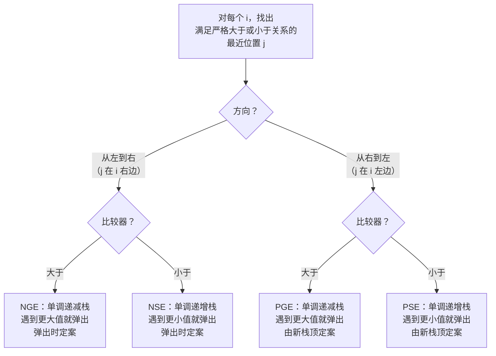

# 单调栈

一个长度十万的整数温度数组。对每一天，求出要等多少天才有一个更暖的日子。老实的第一版是两层嵌套循环：对每一天，向前扫到温度超过当天为止。在本章那个八天的例子上它跑得好好的。放到 LeetCode 真实测试上就死了，因为最坏输入是单调递减——每天都要扫到末尾，总共一百亿次比较，判题器早在答案打印出来之前就把它掐掉了。

本章讲的就是把它压到两万次栈操作的那一行改动。干这件事的数据结构你早就见过，就是栈，只多加了一条规则：栈中相邻位置上的值，从底到顶读过去，始终保持单调。任何会破坏这条规则的压入，前面都跟着零次或多次弹出，把规则恢复回来。被弹出的那些元素，恰好就是答案此刻已经确定的那些。

## 如何识别这个模式

只有两个条件同时成立，单调栈才是正确答案。[^1] 其一：问题问的是，对数组里的每个位置 `i`，*值大于（或小于）`nums[i]` 的最近位置 `j` 是哪个？* 其二：数组按位置顺序从一端到另一端线性处理。只满足其中一个不够。哈希表能回答“按值最近”，但不带位置顺序。线段树能回答“区间查询”，但没有逐元素的最近语义。两者的交集，才是单调栈的设计目标。



*四路划分：先选方向（从左到右扫，解决“下一个”答案；从右到左扫，解决“上一个”），再选比较器（更大用递减栈，更小用递增栈）。四个变体共用同一套账：每个下标压一次、最多弹一次；变的只有不等号和定案的时机。*

读完题面的第一遍，有三类信号短语能把这个模式标出来。*“next greater”*、*“next warmer”*、*“next bigger”* 就是 NGE 的字面形态；LC 496、LC 503、LC 739 都是这么表述的。直方图里的 *“largest rectangle”* 是“前一个更小 + 后一个更小”的组合，也正是本章那道 Hard 招牌题的来源。*“stock span”*，或者任何写成“对每一天，数出之前连续满足 X 的天数”的问题，是流式数据上的“前一个更大”形态。这些表述只要和“只扫数组一趟”的约束同时出现，单调栈就是把运行时间从 O(n²) 降到 O(n) 的那个优化。

前置章节是[栈与调用栈类比](../part-1-linear-data-structures/05-stacks.md)，它介绍了 LIFO 抽象数据类型，以及 O(1) 的 `push`、`pop`、`peek`。本章在上面加了**一条单调性不变量**：栈中相邻位置上的值构成单调序列。两章是分层的一对。把 1.5 当地基，把 4.0 当作压在地基上的纪律。

## 为什么暴力解法会超时

暴力法是本能的第一反应。对每个下标，向右扫到找到更暖的一天为止。

```python
# 暴力解法：O(n^2) —— 这就是我们要替换掉的东西
def daily_temperatures_brute(temps):
    n = len(temps)
    answer = [0] * n
    for i in range(n):
        for j in range(i + 1, n):
            if temps[j] > temps[i]:
                answer[i] = j - i
                break
    return answer
```

小输入上完全正确。放到严格递减、长度十万的数组上就是灾难：外层每一轮都把内层循环跑到末尾，比较总数接近 `n²/2`，大约五十亿次。LC 739 的时限是两秒。[^2] 错了四秒的答案，仍然是错的答案。

冗余摆在眼前。内层循环停在索引 `j` 回头看索引 `i` 时，它在重算上一轮外层循环早就开头的那份工作。轮次之间没有任何记忆。修法是给算法一份记忆。

把数组倒过来想。从左往右走。见过但还没定案的下标——还在等一个更暖日子的那些——会累积起来。每来一个新值，你就检查它能不能给某些等待者定案。能的话，把它们弹出、写下答案、继续。这份等待名单就是一个栈，而且按构造，栈上的值单调递减：任何时候来值会破坏这个顺序，违规的那些条目先被弹出。

整个模式就这些。比普通栈多出的认知负担只有两行：存**下标**（不是值），并且在比较成立时用 **while** 弹（不是只 `if`）。

## 模式

模板十二行。初始化一个空栈和一个全零的答案数组。对每个新下标，当栈顶的值更小时持续弹出，每弹出一个下标，就用导致这次弹出的下标给它定案。把新下标压入。循环结束时还留在栈上的下标没有更暖的一天，它们的答案槽按构造保持为零。

```python
def daily_temperatures(temperatures):
    n = len(temperatures)
    answer = [0] * n
    stack = []  # 存下标的单调递减栈
    for i, t in enumerate(temperatures):
        while stack and temperatures[stack[-1]] < t:
            j = stack.pop()
            answer[j] = i - j
        stack.append(i)
    return answer
```

**解法** — Python（[Java](./00-monotonic-stack/lc-739/sol.java) · [C++](./00-monotonic-stack/lc-739/sol.cpp) · [Go](./00-monotonic-stack/lc-739/sol.go)）

```python
# LC 739. Daily Temperatures
from typing import List


def daily_temperatures(temperatures: List[int]) -> List[int]:
    """LC 739. Returns days-until-warmer for each day; 0 if none."""
    n = len(temperatures)
    answer = [0] * n
    stack: List[int] = []  # 存下标的单调递减栈
    for i, t in enumerate(temperatures):
        while stack and temperatures[stack[-1]] < t:
            j = stack.pop()
            answer[j] = i - j
        stack.append(i)
    return answer
```

这段循环体里有三处值得注意。

栈里存的是**下标**，不是值。值只差一次解引用（`temperatures[stack[-1]]`）。下标一旦压进去，就无法从值反推回来，因为不同的两天完全可以气温相同。存值是单调栈最常见的 bug；leetcopilot.dev 的速查表把它排在五个之首。[^3]

弹出用的是 `while`，不是 `if`。一个 76 的来值可能一次给五个等待中的日子定案，只要这五天的气温都更低。内层循环每轮外层迭代跑零次或多次，然后恰好压入一次。正是这个结构让下一段的摊还论证成立。

比较是**严格**小于。`temperatures[stack[-1]] < t` 只在等待中的值严格更小时弹出；气温相同的等待日不算更暖，所以留在栈上。LC 739 说的是 “warmer”，是严格的。其他变体会反过来：LC 901 Online Stock Span 用 `<=`，因为它对 span 的定义是非严格的。不等号要跟题目里严格/非严格的定义对上；选错的话，重复值会被过早弹出。

## 为什么总工作量仍是线性的

内层的 `while` 看起来会让它变成 O(n²)。并不会。每个下标恰好被压入栈一次，来自外层循环每轮末尾那一次压入。每个下标最多被弹出一次，因为弹出后不会再有东西重新进栈。因此栈操作总数上界是 2n，每次都是 O(1)。外层循环里与栈无关的工作也是每轮 O(1)。总计 O(n)。

这是 *Programming Pearls* 给摊还分析举的标准例子：一个线性时间的扫描算法，每个元素的摊还代价是常数，尽管任何单轮迭代最多可能弹 k 次。[^4] CLRS 第 16 章把同一套论证发展成聚合分析框架的示范例，它也是为动态数组倍增辩护的那个势能论证。[^5] 空间上界同样是 O(n)：最坏情况是严格递减的输入，一次弹出都不触发，每个下标最后都留在栈上。输出数组再占一份 O(n)。

## 实例推演

输入用的是 LC 739 的标准例子：`temperatures = [73, 74, 75, 71, 69, 72, 76, 73]`。[^6]

前三天各自立刻弹出自己的前驱。73 被压入；74 弹出 73，`answer[0] = 1`；75 弹出 74，`answer[1] = 1`。此时栈里是 `[2]`，答案数组读作 `[1, 1, 0, 0, 0, 0, 0, 0]`。

接下来两天不触发任何弹出。71 比 75 小，进栈。69 比 71 小，也进栈。栈变成 `[2, 3, 4]`。答案槽一个都没动。

第 5 天是干活的地方。值 72 弹出下标 4（值 69），`answer[4] = 1`；接着弹出下标 3（值 71），`answer[3] = 2`；然后停下，因为下标 2 的值是 75，更大。压入 5。栈是 `[2, 5]`。

第 6 天是戏剧性的时刻。值 76 弹出下标 5，`answer[5] = 1`；接着弹出下标 2，`answer[2] = 4`。下标 2 在栈上等了四天，就为等一个比 75 大的值，76 终于来了。这个四天的距离，正是栈里存值而不存下标时你无法还原的那个数。压入 6。栈是 `[6]`。

第 7 天的值是 73，比 76 小。不弹出，只压入。栈是 `[6, 7]`。循环结束。下标 6 和 7 保留 `answer[i] = 0` 的默认值；数组里它们都没有更暖的一天。

> **Interactive widget:** [单调栈（下一个更大元素扫描）](../../../dsa/widgets/w-11-monotonic-stack.yml)（面板 `default`）—— 在网站上渲染；YAML 规格描述各关键帧。

*静态回退：第 4 天之后栈长到 `[2, 3, 4]`，在第 5 天触发第一条弹出链之前达到峰值；第 6 天那次戏剧性的定案，是在等了四天之后打印出 `answer[2] = 4`。*

最终答案：`[1, 1, 4, 2, 1, 1, 0, 0]`。八次压入，六次弹出，两个下标留在栈上。栈操作总计 14 次，稳稳落在 2n = 16 的摊还上界之内。

## 最大矩形：哨兵弹出技巧

LC 84 Largest Rectangle in Histogram 是本章的招牌题。[^7] 直方图是一排等宽、整数高度的柱子；答案是能嵌进这个轮廓的最大轴对齐矩形面积。对 `heights = [2, 1, 5, 6, 2, 3]`，答案是 10。矩形跨下标 2 和 3 两根柱子，高 5，宽 2。[^8]

算法就是单调栈，相对 LC 739 改两处。栈是**非递减**而不是递减：新柱子到来时，只要栈顶*更高*就弹出，因为每根被弹出的柱子，它的矩形此刻右侧已被限住（被更矮的来值），左侧也被限住（被新的栈顶，或者栈空时被数组左边界）。定案时算面积 `h * w`，其中 `w = i - newTop - 1`，即由左侧新栈顶和右侧来值下标界定的开区间的宽度。

```python
def largest_rectangle_area(heights):
    ans = 0
    stack = []  # 存下标的非递减栈
    n = len(heights)
    for i in range(n + 1):
        cur = 0 if i == n else heights[i]
        while stack and heights[stack[-1]] > cur:
            h = heights[stack.pop()]
            w = i if not stack else i - stack[-1] - 1
            if h * w > ans:
                ans = h * w
        stack.append(i)
    return ans
```

**解法** — Python（[Java](./00-monotonic-stack/lc-84/sol.java) · [C++](./00-monotonic-stack/lc-84/sol.cpp) · [Go](./00-monotonic-stack/lc-84/sol.go)）

```python
# LC 84. Largest Rectangle in Histogram
from typing import List


def largest_rectangle_area(heights: List[int]) -> int:
    """LC 84. Returns max rectangle area in histogram."""
    ans = 0
    stack: List[int] = []  # 存下标的非递减栈
    n = len(heights)
    for i in range(n + 1):
        cur = 0 if i == n else heights[i]
        while stack and heights[stack[-1]] > cur:
            h = heights[stack.pop()]
            w = i if not stack else i - stack[-1] - 1
            if h * w > ans:
                ans = h * w
        stack.append(i)
    return ans
```

新东西是循环范围。它跑到 `n`（含），最后一步 `cur = 0`。下标 `n` 上那根幽灵般的零高度柱子就是**哨兵**。没有它，严格递增的输入如 `[1, 2, 3, 4, 5]` 在主循环里一次弹出都不触发。每根柱子都比前一根高，栈只会一路长上去，函数返回 `ans = 0` 而不是正确的 9。哨兵保证剩下的每根柱子在函数返回前都被弹出，因为幽灵 0 比任何可能的柱高都矮。

宽度公式值得慢下来看。弹掉下标 `j` 的柱子之后，高度 `heights[j]` 的矩形右边界是 `i`（开区间：`i` 是导致弹出的那个，严格更矮，不属于这个矩形），左边界是新的栈顶（同样是开区间，因为新栈顶严格更矮——栈在 `j` 之前、不含 `j` 的范围内维持了非递减不变量）。矩形占据开区间 `(newTop, i)`，含 `i - newTop - 1` 个下标。如果弹出后栈空，左边界就是数组左边界，即下标 `-1`，于是 `w = i - (-1) - 1 = i`。把这里写成 `i - newTop` 而不是 `i - newTop - 1`，就是那个经典的差一（off-by-one）bug；LC 84 官方题解把它记为反复出现的提交失败。[^8]

摊还论证原样搬过来。每根柱子压入一次、最多弹出一次。总工作量 O(n)，和 LC 739 完全一样，尽管定案函数更肉。

## 实际开销

| 变体 | 时间 | 空间 | 说明 |
|---|---|---|---|
| 下一个更大值扫描（LC 496、LC 739） | O(n) | O(n) | 每个下标压一次、最多弹一次。输出数组占 O(n)。 |
| 环形数组上的下一个更大值（LC 503） | O(n) | O(n) | 迭代到 2n，取下标用 `i mod n`；只在第一趟压入。 |
| 带哨兵的最大矩形（LC 84） | O(n) | O(n) | `i == n` 处的哨兵把剩余柱子冲干净。因为要算面积，常数是 LC 739 的两倍；渐近相同。 |
| m × n 二进制矩阵上的最大矩形（LC 85） | O(m × n) | O(n) | 逐行构建直方图，每行跑一次 LC 84。 |
| 暴力解法 | O(n²) | O(1) | 错误答案；被我们替换掉的那个。 |

这套摊还论证就是 CLRS 用来分析栈 push/pop 的那一套：把整个运行过程中内层循环的有限工作聚合起来，每次压入和弹出各记一次账，得出无论输入形状如何，总操作数都不会超过 2n。[^5] *Programming Pearls* 第 8 栏把它当作“聚合分析为何是序列算法不可省略的推理”的标准例证。[^4]

对 LC 84 来说，这个上界在整数溢出意义上也刚好卡死。高度最大 10⁴、数组长度最大 10⁵，矩形面积上限是 10⁹，能放进有符号 32 位整数（`2^31 - 1 ≈ 2.15 × 10⁹`）。不需要提升到 `long`；在 Java、C++、Go 里用 `int` 都是对的。

## 两个最容易踩的坑

> [!WARNING]
> **存值而不是存下标。** 栈里装的是 `temperatures[i]` 而不是 `i`。在 LC 739 上，答案会变成“更暖的那个温度值”，而不是“还要等几天才更暖”，而且仅凭值无法还原下标，因为不同的日子可以气温相同。修法：永远存下标。值只差一次解引用（`temperatures[stack[-1]]`）；下标是不可复原的。CP-Algorithms 的标准表述和 leetcopilot.dev 的模式指南都把它列为最常见的单调栈 bug。[^3]

> [!WARNING]
> **LC 84 的宽度差一。** 弹出之后写 `w = i - stack[-1]`，算出的宽度比真实值大 1，因为新的栈顶本身就是更矮的柱子，*不*属于被弹出的那个矩形。提交会拿到几乎正确、但每个测试用例都差一列的输出。矩形占的是开区间 `(newTop, i)`，含 `i - newTop - 1` 个下标；公式就是这个。walkccc 的参考实现写得明明白白：`w = stack.empty() ? i : i - stack.top() - 1`。[^7]

第三个 bug 值得简短提一下：把四个方向搞混。NGE、PGE、NSE、PSE 共用同一套模板结构，只是不等号和扫描方向不同。背下一个模板的人经常用错，因为维度标签活在写代码的人脑子里，不在代码里。修法：把四路划分写成注释放在函数顶部。方向是“从左到右扫解决 next 答案；从右到左扫解决 previous 答案”。比较器是“递减栈在遇到更大值时弹出；递增栈在遇到更小值时弹出”。

## 两个值得一看的近亲

LC 84 往上推广一维就得到 LC 85 Maximal Rectangle：一个二进制矩阵，答案是最大的全 1 矩形。归约的做法是，把每一行当作一个直方图的底，其中第 `r` 行第 `c` 列的列高，是以 `(r, c)` 结尾的连续 1 的个数。对每行的直方图跑一次 LC 84，同时记全局最大值。总代价 O(m × n)，而且可证最优，因为输入的每个格子至少要被看一次。

LC 503 Next Greater Element II 是加了环形转折的 LC 739。数组首尾相接；`nums[n-1]` 的下一个更大元素可能是 `nums[0]`。标准技巧是迭代到 `2n - 1`，查下标时用 `i mod n`，但只在 `[0, n)` 范围内压入真实下标。第二趟的存在是为了给等待中的下标定案，不是为了加新的。这样每个真实下标在栈上最多出现一次，O(n) 的上界保住了。

两道题都在本章的进阶梯度上。它们一字不改地复用本章模板，各自只改动一点；除了实例推演已经装进脑子的东西，没有新知识要学。

LC 42 Trapping Rain Water 值得在这里简短提一句，尽管它归[双指针：两端相向](../part-3-pointers-window-prefix/00-two-pointers-opposite.md)所有。LC 42 的单调栈解法弹出的是水层此刻两侧都已限住的柱子；它是两种教科书解法之一，也是个好用的交叉验证。如果你已经吃透了上面的四路划分，从栈的角度推出 LC 42 只要十分钟。把双指针解法留作主打，把栈解法当作“同一个问题能被多个视角解掉”的确认。

## 题目梯度

### 核心（三题全做才算掌握本章）

- [LC 496 — Next Greater Element I](https://leetcode.com/problems/next-greater-element-i/) [简单] • monotonic-stack-next-greater
- [LC 739 — Daily Temperatures](https://leetcode.com/problems/daily-temperatures/) [中等] • monotonic-stack-next-greater
- [LC 84 — Largest Rectangle in Histogram](https://leetcode.com/problems/largest-rectangle-in-histogram/) [困难] • monotonic-stack-rectangle ★

### 进阶（可选）

- [LC 503 — Next Greater Element II](https://leetcode.com/problems/next-greater-element-ii/) [中等] • monotonic-stack-next-greater-circular
- [LC 85 — Maximal Rectangle](https://leetcode.com/problems/maximal-rectangle/) [困难] • monotonic-stack-rectangle-2d

LC 84 是本章的招牌题（★），在附录 C 有专门的题解交互组件。LC 739 是 LC 496 之后最温和的第二遍：同一套模板，定案函数从“导致弹出的那个下标上的值”换成“到导致弹出的那个下标的距离”。LC 503 逼你处理倍增技巧和“只在第一趟压入”的细节；LC 85 逼你做逐行直方图归约。

## 后续衔接

下一章[单调双端队列](../../../dsa/part-4-stack-queue-patterns/01-monotonic-deque.md)把这条单调性不变量从“栈的一侧单调”拉成“滑动窗口内双端队列的两侧都单调”。LC 239 Sliding Window Maximum 是它的标准题；那个数据结构不变量和本章装进脑子的完全一样，只是换了一种访问形态。如果 4.0 让你觉得干净，4.1 会有种“还是那招，只是多了两个指针要盯”的感觉。

子数组最小值之和类问题（LC 907）把本章“前一个更小 + 后一个更小”的组合延伸成贡献计数。它们放在第 9 部分动态规划里，因为闭式求和是更难的那一半。数据结构这一半你已经有了。

## 参考文献

[^1]: software.land, "Monotonic Stack: Equality Nuances and Pattern Templates," <https://software.land/monotonic-stack/>.

[^2]: LeetCode, "739. Daily Temperatures," <https://leetcode.com/problems/daily-temperatures/>.

[^3]: leetcopilot.dev, "Monotonic Stack Cheat Sheet for Beginners," <https://web.archive.org/web/20260418063725/https://leetcopilot.dev/blog/monotonic-stack-cheat-sheet-for-beginners>.

[^4]: Jon Bentley, *Programming Pearls*, 2nd ed., Addison-Wesley, 2000, Column 8 ("Algorithm Design Techniques").

[^5]: Cormen, Leiserson, Rivest, Stein, *Introduction to Algorithms*, 4th ed., MIT Press, 2022, Chapter 16 §16.1 (Aggregate analysis) and §16.3 (The potential method).

[^6]: CP-Algorithms, "Stack: Applications" (translated from e-maxx.ru), <https://cp-algorithms.com/data_structures/stack_queue_modification.html>.

[^7]: walkccc, "84. Largest Rectangle in Histogram," LeetCode Solutions, <https://walkccc.me/LeetCode/problems/84/>.

[^8]: LeetCode official editorial, "84. Largest Rectangle in Histogram," <https://leetcode.com/problems/largest-rectangle-in-histogram/editorial/>.
