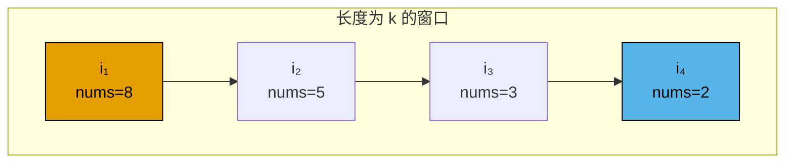
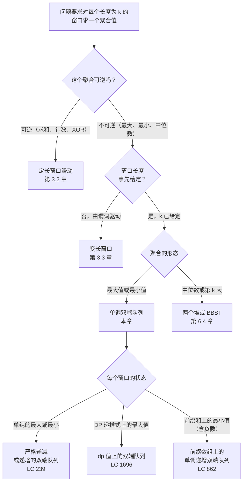

# 单调双端队列

一个长度十万的整数数组，一个长度 3 的窗口。题目要求窗口沿数组一路走过去时，每一个连续 3 元切片上的最大值，一共 99,998 个答案。老实的第一版是外层遍历每个起始下标，内层扫三个数取最大。它能跑。在 10⁵ 元素的输入上大约做 3 × 10⁵ 次比较；把窗口长度提到 k = 50,000，就是 5 × 10⁹ 次，大概要跑半个小时。

LC 239（Sliding Window Maximum，困难）给的约束是 `1 <= nums.length <= 10^5` 和 `1 <= k <= nums.length`。这些约束就是专门用来打死暴力解法的。它们同样打死第二直觉——堆：堆只省下一个对数因子，却死在删除过期元素所需的簿记上。修法是专为这个问题造一个数据结构：一个按单调递减维护的双端队列（deque），队头永远是答案，过期候选自己把自己挤出去。

## 为什么最直白的做法会被约束条件打死

先说暴力。

```python
# 暴力解法：O(n*k) —— 这就是我们要替换掉的东西
def max_sliding_window_brute(nums, k):
    out = []
    for i in range(len(nums) - k + 1):
        out.append(max(nums[i:i+k]))
    return out
```

任何输入上都正确。撞到 LC 239 的上界就超时。问题不在循环本身，而在于每一个 `max(nums[i:i+k])` 都把上一轮已经扫过的 k-1 个数又扫了一遍。窗口只滑了一个元素，三个数里有两个原地没动，暴力法还是把它们重新检查了一遍。

上一章训练出的本能是摊还：留一个滚动聚合值，每次滑动 O(1) 更新。这招在[滑动窗口：固定长度](../part-3-pointers-window-prefix/02-sliding-window-fixed.md)里管用，因为那个聚合是求和，而求和可逆——要移除离开的元素，减掉就行。把这套用到最大值上，轮子当场飞出去。当前窗口的最大值从左边滑出去时，你手上没有任何关于次大值的记录。你知道答案走了，但不知道顶上来的是谁。最大值不可逆。

堆解决了查询，没解决簿记。每个进入的元素压进大顶堆，看一眼堆顶拿答案，堆顶过期就弹。peek 是 O(1)，pop 是 O(log k)。麻烦在*过期检测*：堆顶下标落在当前窗口之外时，丢掉再 peek，这没问题；但你还得防止堆无限长下去，因为那些永远不会成为最大值的元素会一直躺在堆底。标准做法是存 `(value, index)` 二元组，peek 时惰性弹出。总时间 O(n log k)。n = 10⁵、k = 5 × 10⁴ 时大约 170 万次堆操作。LC 239 能过。代价是我们本来不必付的那个对数因子。

单调双端队列的代价是零。整趟运行里，每个下标进队一次、出队一次；摊到每次滑动是 O(1)，总共 O(n)，与 k 无关。这是一个“对的数据结构打赢对的算法”的题形。

## 不变量

存下标，不存值。让双端队列按 `nums[idx]` *严格递减* 排列。于是每一步都有三件事成立：

1. 队头下标就是当前窗口的 argmax。
2. 队列里每个下标都比 `i - k` 新，所以队头永远落在窗口内。
3. 下标个数最多 k 个。

第一条是承重的那条。为什么队头是最大值？因为严格有序：队列里其他每个下标的 `nums[idx]` 都更小。任何*不在*队列里的下标，都是被某个更晚、更大的值从队尾弹掉的，也就是说必然存在一个还活着的下标压过它。于是最大值一定在队列里，而在队列里，按构造它就在队头。



*双端队列按值严格递减保存候选下标。队头（橙色）是当前窗口的最大值。队尾（蓝色）是刚来、还没被谁压过的那个。中间的每个下标都是未来的最大值：更老的都走光之后，它就顶上队头。*

这条不变量正是 4.1 要教、而前置章节故意不教的东西。[队列、双端队列与环形缓冲](../part-1-linear-data-structures/06-queues-deques.md)讲的是数据结构本身：两端 O(1) 压入弹出。[滑动窗口：固定长度](../part-3-pointers-window-prefix/02-sliding-window-fixed.md)讲的是可逆聚合上的窗口聚合模式。单调双端队列是两者之间的桥：一个*不可逆*的窗口聚合（最大值），靠维护一个见证结构而不是单个值，变得便宜。

## 模式

每个下标四步，按这个顺序执行：

1. **清队头（drop-front）。** 队头下标如果已经老出窗口（`dq.front() <= i - k`），弹掉它。
2. **弹队尾（pop-tail）。** 只要队尾的值 `<=` 新元素，就弹掉它。新元素活着的时候，这个队尾永远不可能是窗口最大值。
3. **压入（push）。** 追加新下标。队列重新变成严格递减。
4. **输出（emit）。** 第一个窗口满了之后（`i >= k - 1`），把 `nums[dq.front()]` 追加到输出。

```python
from collections import deque

def max_sliding_window(nums, k):
    dq = deque()  # 存下标；nums[dq[0]..dq[-1]] 严格递减
    out = []
    for i, x in enumerate(nums):
        if dq and dq[0] <= i - k:
            dq.popleft()
        while dq and nums[dq[-1]] <= x:
            dq.pop()
        dq.append(i)
        if i >= k - 1:
            out.append(nums[dq[0]])
    return out
```

**解法** — Python（[Java](./01-monotonic-deque/lc-239/sol.java) · [C++](./01-monotonic-deque/lc-239/sol.cpp) · [Go](./01-monotonic-deque/lc-239/sol.go)）

```python
# LC 239. Sliding Window Maximum
from collections import deque
from typing import List


def max_sliding_window(nums: List[int], k: int) -> List[int]:
    """Return the maximum of every contiguous window of size k.

    Invariant: dq stores indices in strictly decreasing order of nums[index].
    The front index is therefore always the argmax of the current window.
    Indices, not values, so the head's age is checkable against i - k.
    """
    dq: deque[int] = deque()
    out: List[int] = []
    for i, x in enumerate(nums):
        # 丢掉已经滑出窗口左边界的下标。
        if dq and dq[0] <= i - k:
            dq.popleft()
        # 维持递减单调性：任何小于等于 x 的队尾值都被它压过。
        while dq and nums[dq[-1]] <= x:
            dq.pop()
        dq.append(i)
        if i >= k - 1:
            out.append(nums[dq[0]])
    return out
```

两个细节专咬第一次写的人。

队列装的是*下标*，不是值。两个理由。一是过期判定：比较 `dq[0] <= i - k` 需要下标可见。存 `(value, index)` 二元组也能用，但内存翻倍；只存值则根本没法做过期检测，因为重复值里你分不清哪份是旧的。二是值会重复。`nums = [5, 5, 5, 5, 5]` 是合法输入，严格不等式弹出规则（`<=`）保证只有最新那一份活下来，而你想追踪的正是它的年龄。

弹出规则是 `<=`，不是 `<`。用 `<`，两个相等的值都会留在队列里，结果对，但浪费。用 `<=`，平局一到，旧的那份立刻被挤出去，因为它永远赢不了新的那份，而且它先过期。全等输入上，队列在长度 1 和长度 0 之间来回摆；严格递减输入上，它会一路长到 k，然后清队头负责所有淘汰。两个极端各自压测同一台机器的不同部件。

## 实例推演：LC 239，`[1, 3, -1, -3, 5, 3, 6, 7]`，k = 3

期望输出是 `[3, 3, 5, 5, 6, 7]`，8 元素数组上共六个窗口。

建窗阶段先把第一个窗口填满。到 `i = 2` 时，队列里装的是 `nums[0..2] = [1, 3, -1]` 中还相关的候选下标。那个 1 在 `i = 1`、3 到来并压过它的时候就被弹掉了。所以队列是 `[1, 2]`，对应值 `[3, -1]`，第一次输出返回 `nums[1] = 3`。

有意思的是第三次输出，`i = 4`，值 `5`。三件事必须按顺序发生。见证者——下标 1、值 3——已经过期，清队头触发一次。接着新值 5 压过队列里还剩下的所有东西（下标 2 的 `-1`、下标 3 的 `-3`），弹队尾触发两次，队列清空。压入新下标。输出。答案从 `[3, 3]` 变成 `[3, 3, 5]`。一次迭代里四步全用上了。

八次迭代下来：8 次压入、6 次队尾弹出、2 次队头清除、6 次输出。合计十六次 O(1) 操作。下面的交互组件把每一步重放一遍。

> **Interactive widget:** [单调双端队列（滑动窗口最大值）](../../../dsa/widgets/w-12-monotonic-deque.yml)（面板 `default`）—— 在网站上渲染；YAML 规格描述了各个关键帧。

*静态版本：整趟运行中队列的轨迹是 `[1] → [3] → [3,-1] → [3,-1,-3] → [-1,-3] → [-1] → [] → [5] → [5,3] → [3] → [] → [6] → [] → [7]`，在 i = 2、3、4、5、6、7 处输出，得到 `[3, 3, 5, 5, 6, 7]`。每个下标在队列里恰好出现一次。*

## 如何识别这个模式

单调双端队列的触发条件很窄、很具体。三个条件必须同时成立。



*把单调双端队列和邻居区分开的决策树。本章与第 3.2 章的分界线是可逆性；本章与第 6.4 章的分界线是聚合是不是顺序统计量形态。*

这个模式往一个方向泛化出去，值得知道。任何形如 `dp[i] = nums[i] + max(dp[j] for j in [i-k, i-1])` 的 DP 递推，都是 `dp` 数组上的滑动窗口最大值，也就是说双端队列能把它从 O(nk) 降到 O(n)。LC 1696（Jump Game VI）是标准例子。识别的诀窍是先写出递推式，再看内层那个 `max` 是在一个长度 k 的窗口上取的，而窗口里都是你已经算过的值。到这一步，同一台机器就适用了，只是 `dp[i]` 顶替了 `nums[i]` 的位置。

## 实际开销

| 方案 | 时间 | 空间 | 说明 |
|---|---|---|---|
| 单调双端队列 | O(n) | O(k) | 整趟运行中每个下标压入一次、弹出一次。 |
| 带惰性删除的大顶堆 | O(n log k) | O(n) | 存过期条目；一直弹到堆顶落在窗口内。写起来简单，跑起来慢。 |
| 双指针 + 扫描 | O(nk) | O(1) | 就是暴力法。撞到 LC 239 的约束上界就超时。 |
| 稀疏表（预计算 RMQ） | O(n log n) 预处理，O(1) 查询 | O(n log n) | 在离线、定数组的最大值查询上占优；在流式窗口上输给双端队列。 |

摊还上界就是教科书里的计费论证，也是本章的核心证明。[^1] 给每次迭代记两单位账：一单位给无条件的压入，一单位给最多一次的清队头。最坏情况下弹队尾循环在单次迭代里没有上界（严格递减的输入末尾跟上一个巨大值，一次弹掉 k-1 个），但每个被弹出的下标此前都恰好被压入过一次。所以所有迭代的弹队尾次数加起来不可能超过压入总数，也就是 n。于是：n 次压入、最多 n 次弹队尾、最多 n - k + 1 次清队头，每次都是 O(1)。总工作量 O(n)。

这与 CLRS 第 16 章 §16.1 分析动态数组倍增代价和栈 push/pop 用的是同一个论证，有时叫*聚合方法*（aggregate method）。[^2] 单次迭代的*最坏情况*是 Θ(k)——清队头加上 k-1 次弹队尾，出现在队列里所有东西同时死掉的那种罕见迭代上；但这次迭代前面有 k-1 次便宜的、负责压入的迭代。把 n 次加起来，就是 O(n)。

空间上界与 n 无关。队列里每个下标都满足 `i - dq.front() < k`，所以任何时刻队列最多装 k 个下标。输出数组另外贡献 O(n - k + 1) = O(n) 空间；表格里的 O(k) 只是队列本身。

## 模式失效的场景

### 窗口最小值：翻转不等号

滑动窗口最小值是同一个算法，比较方向翻成 `>=`。队列从严格递减变成严格*递增*，队头照样是答案。别另写一个函数。你的语言支持的话就用 `cmp` 参数化，否则写一个 `min_sliding_window`，复制结构、把那一处比较取反。LC 1438（Longest Continuous Subarray With Absolute Diff Less Than or Equal to Limit）需要两个方向并行跑：一个队列盯窗口最大，另一个盯窗口最小，谓词是 `max - min <= limit`。

### 前缀和上的单调递增双端队列（LC 862）

当题目是“和至少为 K 的最短子数组，且数组含负数”时，滚动和不再单调，前缀和上的二分就不成立。双端队列这套还在，只是作用在前缀和数组上，而不是直接作用在输入上。维护一个存前缀和下标、单调递增的队列。对每个 `r`：只要 `prefix[r] <= prefix[dq.back()]` 就从队尾弹（这些条目永远做不了最优左端点）；然后只要 `prefix[r] - prefix[dq.front()] >= K` 就从队头弹（这是一个合法子数组，记下长度并前进，因为从这里出发没有更短的了）。摊还论证的形状和 LC 239 一样：每个下标进队、出队各至多一次。[^3] 变数在于：含负数的数组，前缀和本身不单调，所以弹队尾要比较前缀和的值，不是下标。

### 什么时候双端队列是错的工具

滑动窗口*中位数*（LC 480）需要完全不同的结构：通常是用大小配平的两个堆，或者一个有序多重集。双端队列依赖“能丢掉被压过的候选”这个能力；在最大值语义下，*当前更大*的值压过更小的。中位数语义下，没有任何值压过别的值。只要元素进出足够多，每个值都可能变成中位数。聚合是顺序统计量形态时，去找[堆](../../../dsa/part-6-trees-heaps/04-heaps-priority-queues.md)。

## 两个最容易踩的坑

> [!WARNING]
> **存值而不是存下标。** 第一次尝试的本能是把 `nums[i]` 而不是 `i` 放进队列。压入弹出逻辑照样能跑，但过期检测断了。给定 `nums = [5, 5, 5, 5, 5]` 和 `k = 3`，每个条目都是同一个值；你分不清哪个 `5` 最老，也就不知道什么时候该清队头。修法：全程存下标，只在输出时读 `nums[dq[0]]`。Java 样例用 `Deque<Integer>` 形式，这一点很直观；Python 里队列元素类型松散，初学者可能写成 `dq.append(x)` 而不是 `dq.append(i)`，能过好几个测试用例，然后在重复值密集的那个上崩掉。

> [!WARNING]
> **弹队尾时用 `<` 而不是 `<=`。** 元素互不相同的输入上两者都对。有平局的输入上，`<` 把重复值留在队列里，`<=` 把旧的那份挤出去。这个 bug 表现为队头过期：一个值和当前值相等的老下标赖在队头，过期后被清除，*而它身后还坐着一份同样值的活副本*。当前这次输出是对的，但下一次迭代时队头下标是那个活副本，它携带的*有效年龄是错的*，于是后面某次清队头在不该触发的时候触发了。修法是在入队方向用严格不等式弹出规则；本章参考实现用 `<=` 就是这个原因。

第三个坑值得简短提一句：C++ 里用无符号大小类型给队列下标，并在 `size_t i` 上算 `dq.front() <= i - k`，当 `i < k` 时会下溢，静悄悄地把清队头检查变成“队头永远过期”。参考 C++ 实现把 `i` 保持为 `int`，正是这个原因。Python、Java、Go 这类默认有符号整数的语言绕过了这个问题。

## 题目梯度

### 核心（做出即可算掌握本章）

- [LC 239 — Sliding Window Maximum](https://leetcode.com/problems/sliding-window-maximum/) [困难] • monotonic-deque-window-extremum ★

### 进阶（可选）

- [LC 1696 — Jump Game VI](https://leetcode.com/problems/jump-game-vi/) [中等] • monotonic-deque-over-dp
- [LC 862 — Shortest Subarray with Sum at Least K](https://leetcode.com/problems/shortest-subarray-with-sum-at-least-k/) [困难] • monotonic-deque-over-prefix-sums

LC 239 是本章的招牌题（★），实例推演和交互组件演的也是它；这个模式没有经典的 Easy 题，所以核心档只有一道（`ladder_curation_flag: no-easy-canonical`）。LC 1696 是最干净的第二遍：写出 DP 递推式，认出内层 `max` 是 `dp` 数组上的滑动窗口最大值，把本章算法套进去。LC 862 是前缀和的变奏：同一台机器，换一个数组，再加上窗口最小值用的单调递增变体。

## 后续衔接

本部分的下一个模式是[最小/最大栈](./02-min-max-stack.md)，它解决一个相关但不同的问题：“在无界的压入弹出流上追踪当前的极值”。同样的单调性直觉，不同的形状：是栈而不是带窗口的数组，而且单调结构活在一条并行的栈里，而不是数据结构本身。更深一层的桥通向[堆](../../../dsa/part-6-trees-heaps/04-heaps-priority-queues.md)：堆把顺序统计量问题从最大值最小值推广到第 k 大、中位数和带权变体，那是单调双端队列够不到的领域。

## 参考文献

[^1]: cp-algorithms, "Minimum stack / Minimum queue — Queue modification (method 2)." <https://cp-algorithms.com/data_structures/stack_queue_modification.html>.

[^2]: Cormen, Leiserson, Rivest, Stein, *Introduction to Algorithms*, 4th ed., MIT Press, 2022, Chapter 16 §16.1 (Aggregate analysis).

[^3]: Project Nayuki, "Sliding window minimum/maximum algorithm." <https://www.nayuki.io/page/sliding-window-minimum-maximum-algorithm>.
