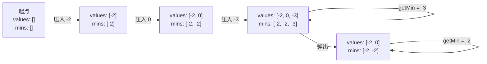
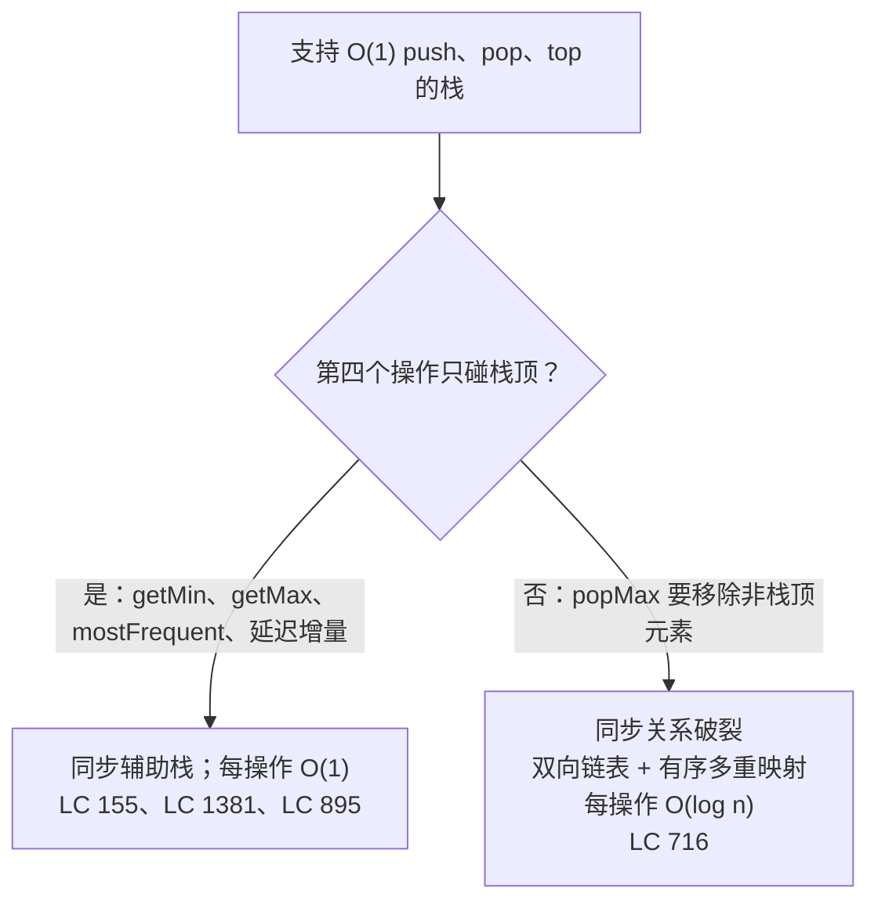

# 最小栈与最大栈

一个栈支持 O(1) 的 `push`、`pop` 和 `top`。这时面试官加了第四条要求：`getMin` 返回当前栈里最小的值，同样要 O(1)。存一个 `min` 字段、在 push 时更新它，能走完大半路，直到当前最小值被弹出的那一刻。这时字段只能从剩下的元素里重算新的最小值，也就是一趟线性扫描。每次弹掉的正好是当前最小值，常数时间的保证就破一次。

本章的整个问题就是上面这一段。修法比题目本身还老。在《Algorithms》里，Sedgewick 和 Wayne 把它列为 Exercise 1.3.58，提示只有一句：*“维护两个栈，一个装所有元素，另一个装最小值。”*[^1] 这句提示*就是*设计手法。**在值栈旁边钉一个平行的辅助栈，两者同步更新，于是任意时刻的聚合值就是辅助栈的栈顶。** 在动态最小值上想通这一点之后，同一套手法可以推广到动态最大值、动态求和、对底部 k 个元素的延迟批量更新，以及至今出现最频繁的元素。每种应用改的是辅助栈的形状；钉住这个思路不变。

招牌题是 LC 155 Min Stack，最经典的示范。另外两道应用（LC 1381 用延迟增量辅助栈，LC 895 用频率分桶辅助栈）把这套手法推进到聚合值不再是一个整数的领域。还放了一道进阶题（LC 716 Max Stack，Premium）来标出这套手法停止适用的边界。单调栈家族住在隔壁的[单调栈与双端队列](./01-monotonic-deque.md)，本章和那一章的分界，是*增强*一个栈和从栈里*淘汰*元素的差别。

## 面试官要的那套 API

LC 155 要求一个整数栈上有四个操作，全部 O(1)：

| 操作 | 返回 |
|---|---|
| `push(val)` | 无；压入 `val` |
| `pop()` | 无；移除栈顶 |
| `top()` | 仍在栈上的最近一次压入的值 |
| `getMin()` | 当前栈中的最小值 |

`top()` 和 `getMin()` 回答的是两个不同的问题。`top()` 问的是新旧。`getMin()` 问的是聚合。普通栈已经能用 O(1) 做 `top()`，因为栈顶就在数组的一端；普通栈*不能*用 O(1) 做 `getMin()`，因为最小值可能待在中间的任何位置。有意思的设计选择是：push 的时候存什么，才能让 pop 永远不用扫描。

> [!IMPORTANT]
> **归约：** 维护一个平行栈，存“每个深度上的当前最小值”。每次压入 `val`，把 `min(prev_min, val)` 压进辅助栈。每次 pop，两个栈一起弹。辅助栈的不变量 `mins[i] == min(values[1..i])` 由 push 时的递推关系和 pop 时的同步动作共同维持，所以 `getMin()` 永远是辅助栈的栈顶。这套手法叫**辅助栈归约**，因为聚合查询被归约成对一个钉在主结构上的平行结构做一次 peek。

辅助栈记录的只有每个历史深度上的当前最小值。值栈缩短，辅助栈跟着缩短；两次 push 之前成立的那个最小值——字段重扫式设计得重新算一遍的那个值——在被弹出的那一帧消失的瞬间，就已经露在辅助栈的栈顶了。

## 为什么单个 `min` 字段行不通

按顺序压四次：`-2`、`0`、`-3`、`5`。四次压完，当前最小值是 `-3`。现在 pop。值栈的栈顶是 `5`；剩下的值是 `[-2, 0, -3]`；当前最小值还是 `-3`。到目前为止字段式设计没问题。

再 pop 一次。栈顶是 `-3`；剩下的值是 `[-2, 0]`；当前最小值变成 `-2`。那个字段刚才还是 `-3`，现在不重扫剩余元素就没法知道 `-2`。没有任何代数上的递推能把一个被弹出的元素还原成上一个当前最小值，因为上一个最小值可能是它下面的任何一个元素。[^2]

镜像式设计在第二次 push 时就把 `-2` 明确记了下来，所以当第三帧（把最小值拉到 `-3` 的那一帧）被弹出时，辅助栈的新栈顶正好就是答案。不需要重算。代价是每个元素多存一个整数，换来的是两个栈上无条件的 pop。

## 设计

两个栈。任何时刻长度相同。push 同时更新两者；pop 同时缩短两者；查询 peek 对应的那一个。

```python
class MinStack:
    def __init__(self):
        self.values = []
        self.mins = []

    def push(self, val):
        self.values.append(val)
        current = val if not self.mins else min(self.mins[-1], val)
        self.mins.append(current)

    def pop(self):
        self.values.pop()
        self.mins.pop()

    def top(self):
        return self.values[-1]

    def getMin(self):
        return self.mins[-1]
```

**解法** —— Python（[Java](./02-min-max-stack/lc-155/sol.java) · [C++](./02-min-max-stack/lc-155/sol.cpp) · [Go](./02-min-max-stack/lc-155/sol.go)）

```python
# LC 155. Min Stack
#           重复最小值探测、全同值探测都通过。
from typing import List


class MinStack:
    """LC 155 Min Stack with O(1) push, pop, top, getMin via mirrored aux stack."""

    def __init__(self) -> None:
        self.values: List[int] = []
        self.mins: List[int] = []

    def push(self, val: int) -> None:
        self.values.append(val)
        # min(prev, val) 把重复的最小值保留在辅助栈上。
        # 写成严格的 `val < self.mins[-1]` 是经典 bug；见本章常见陷阱。
        current = val if not self.mins else min(self.mins[-1], val)
        self.mins.append(current)

    def pop(self) -> None:
        self.values.pop()
        self.mins.pop()

    def top(self) -> int:
        return self.values[-1]

    def getMin(self) -> int:
        return self.mins[-1]
```

值得盯着看的是 `current = val if not self.mins else min(self.mins[-1], val)` 这一行。`min(prev, val)` 这种写法会把重复的最小值保留在辅助栈上，这一点比看上去重要。写成严格的 `if val < self.mins[-1]: self.mins.append(val)` 是经典 bug。当前最小值的重复副本永远进不了辅助栈，两个栈长度开始漂移，弹一次之后辅助栈报的就是过期的值。

两个栈上的 pop 都是无条件的。没有“这次 pop 有没有改变最小值”的分支；辅助栈的前一个元素*就是*新的最小值，因为每次 push 都把它写了进去。正因为如此，同步论证才站得住。CLRS §10.1 直接给出栈的数组实现：一个整数 `S.top` 指向最近插入的槽位，push 写在 `S[S.top + 1]` 并加一，pop 读 `S[S.top]` 并减一。[^3] 镜像式设计就是两个这样的三元组，同步索引。四个操作都还是 O(1)。

Java 实现用 `Deque<Integer> stack = new ArrayDeque<>()`，而不是 `java.util.Stack`；这个遗留类继承自带同步的 `Vector`，即使在单线程代码里，每次 push 和 pop 也都要交一遍锁的税。Sedgewick 和 Wayne 写道：*“Java 有一个内置的库叫 Stack，但你应该避免使用它”*；Oracle 的 JDK 21 Javadoc 在 `ArrayDeque` 上原话写着：*“用作栈时，这个类很可能比 `Stack` 更快。”*[^4] C++ 实现用 `std::stack<int>`，它是架在 `std::deque` 上的容器适配器，接口有意比底层容器窄（不能迭代、不能随机访问），于是 LIFO 契约由类型来强制，而不是靠约定。Go 没有原生栈；切片惯用法（`append` 入栈，`s = s[:len(s)-1]` 出栈）是标准形态，用在栈上不会踩坑，因为两个操作都在尾部进行。

## 走一遍标准序列

把 LC 155 的示例走一遍：push `-2`、push `0`、push `-3`、`getMin`、pop、`top`、`getMin`。期望输出：`-3`，然后 `0`，然后 `-2`。



*三次 push、一次查询、一次 pop、两次查询。注意第二次 push 在辅助栈上记的是 `-2`（不是 `0`），因为 `min(-2, 0) = -2`。正是这条记录在 `-3` 被弹出之后活了下来，让 `getMin` 不用重算就能返回 `-2`。*

值栈和辅助栈永远长度相同。辅助栈的栈顶永远是值栈此刻的当前最小值。这两条不变量加起来，就是本章的全部内容。

## 实际开销

| 操作 | 时间 | 空间 | 说明 |
|---|---|---|---|
| `push(val)` | O(1) | 每元素多一个 int | 两次写入（values append、mins append）。 |
| `pop()` | O(1) | — | 两次列表尾部修改，两个栈都无条件。 |
| `top()` | O(1) | — | 一次 peek。 |
| `getMin()` | O(1) | — | 对辅助栈做一次 peek。 |
| n 次操作总计 | O(n) | O(n) | 辅助栈让常数翻倍；渐进阶不变。 |

空间成本是每次 push 多一个辅助整数，存储从 `n` 个字涨到 `2n` 个字。在基于比较的模型里，对于 O(1) 的 `getMin` 要求，这是可证明最优的：没有辅助结构时，pop 之后的 `getMin` 必须重扫剩余的值，最坏情况是 `Omega(n)`。[^2] Sedgewick 的 algs4 Exercise 1.3.58 指定的正是这个设计，并直接断言了常数时间界。[^1]

有个机巧的变体想用一个栈把空间减半：存 `val - cur_min`，每当差值为负就更新 `cur_min`。这个设计是真的，出现在 LC Discuss 的高票帖里，也确实有 bug。在有符号 32 位上，当 `val = INT_MIN`、`cur_min = INT_MAX` 时，差值会溢出。LC 155 的输入范围恰好是 `[-2^31, 2^31 - 1]`，也就是说这个溢出在合法输入上就能触发。[^5] 镜像双栈设计每次 push 多付一个整数，从构造上就不会溢出。付这点存储，换正确性。

## 扩展辅助栈：延迟更新与频率分桶

最小栈的设计依赖聚合值的一个性质：存在递推 `agg[i+1] = f(agg[i], val)`，而且这个递推能扛住 pop，因为前一个值可以从辅助栈的 `top()` 取回。最小值、最大值、求和、某个键的计数都满足这一点。两道 LeetCode 题把这套手法推进到辅助栈不再是一个平行整数的领域。

### 对底部 k 个元素做延迟增量（LC 1381）

LC 1381 要求栈支持 `inc(k, val)`：给底部 `k` 个元素每个都加上 `val`。朴素做法是 `for i in range(min(k, len(values))): values[i] += val` 循环，每次调用 O(k)。LC 1381 的约束（`1 <= k, maxSize <= 1000`，最多 1000 次调用）让朴素解也能过，但本章要教的是辅助栈钉住这套手法，不是卡时限。

辅助栈换了角色。它不再记录过去 push 的聚合值，而是记录*留给未来 pop 去应用的待处理更新*。维护一个与值栈等长的平行数组 `inc_aux`，初值全零。`inc(k, val)` 把 `val` 写到 `inc_aux[min(k, len) - 1]`，一次 O(1) 写入，`k` 多大都一样。增量停在边界下标上，休眠着，直到 pop 走到那里。

```python
def push(self, x):
    if len(self.values) < self.max_size:
        self.values.append(x)
        self.inc_aux.append(0)

def pop(self):
    if not self.values:
        return -1
    i = len(self.values) - 1
    result = self.values[i] + self.inc_aux[i]
    if i > 0:
        self.inc_aux[i - 1] += self.inc_aux[i]   # 向下传递
    self.values.pop()
    self.inc_aux.pop()
    return result

def increment(self, k, val):
    if not self.values:
        return
    i = min(k, len(self.values)) - 1
    self.inc_aux[i] += val
```

pop 的时候，被弹下标上的待处理增量会在 pop 返回之前加到它的前一个下标上，所以增量会继续作用于还在栈上的元素。不变量：`inc_aux[i]` 是尚未应用到 `values[0..i]`、并且会在元素被逐个弹到 `i` 时延迟施加的累计增量。[^6] 每个操作做常数次写入；四个操作都是 O(1)。

这套手法的形状和 LC 155 一模一样。一个平行辅助结构，同步钉在值栈上，承担那些本来会逼出线性扫描的工作。唯一的结构差异是工作的*方向*：LC 155 的辅助栈记录过去的聚合值，在查询时读；LC 1381 的辅助栈记录待处理的更新，在弹出时读。不变的是同步。

### 频率分桶与动态最大值（LC 895）

LC 895 把辅助结构再往前推一步。`pop()` 必须返回至今出现最频繁的元素，次数相同时按新近程度破平（最近一次压入的那个最高频值胜出）。没有任何作用在单个整数上的递推能表达“最频繁”。弹掉一个非最高频的值只会局部改变频率格局，但弹掉最高频的值可能改变谁是最高频，而从剩下的栈里重算这件事是 `Omega(n)`。

辅助结构变成两个映射加一个动态变量：

- `freq[v]`：值 `v` 当前的计数。一个哈希表。
- `group[k]`：在某个 push 时计数达到 `k` 的那些值组成的栈。一个哈希表套栈。一个被压入三次的值会同时出现在 `group[1]`、`group[2]` 和 `group[3]` 里。
- `maxFreq`：至今触及过的最大计数。一个整数。

```python
def push(self, val):
    self.freq[val] = self.freq.get(val, 0) + 1
    f = self.freq[val]
    if f > self.maxFreq:
        self.maxFreq = f
    self.group.setdefault(f, []).append(val)

def pop(self):
    val = self.group[self.maxFreq].pop()
    self.freq[val] -= 1
    if not self.group[self.maxFreq]:
        self.maxFreq -= 1
    return val
```

push 增加该值的频率，把它追加到新频率对应的计数桶，必要时抬升 `maxFreq`。pop 从 `group[maxFreq]` 里读（即最大计数上最近的那个值，顺带白送了按新近程度破平），把频率减一，如果该桶空了就把 `maxFreq` 减一。[^7] 每个操作做常数次哈希表和栈操作。

技巧在动态变量 `maxFreq` 上。没有它，pop 就得在 `group` 里*找*最大的非空键，而这不是哈希表上的 O(1) 操作。把最大值跟踪成一个整数，只在自己的桶空了时才减一，这就是辅助栈钉住手法往上抬一层：动态聚合值还是一个整数，但它索引的结构更丰富了。

三道题摆在一起：

| 题目 | 辅助结构形状 | 维护的聚合值 |
|---|---|---|
| LC 155 Min Stack | 一个平行的 int 栈 | 每个深度上的当前最小值 |
| LC 1381 CustomStack | 一个存待处理更新的平行 int 栈 | 每个下标上的累计延迟增量 |
| LC 895 FreqStack | 两个哈希表 + 一个动态整数 | 最频繁元素，同频按新近程度破平 |

三道题，一套手法。辅助结构的*形状*跟着聚合值的复杂度走；*钉住*这件事——push、pop、查询都与主结构同步——是不变的。

## 这套技术在哪里失效

LC 716 Max Stack 看起来是 LC 155 的兄弟：同样四个操作，把 `min` 换成 `max`。本来是的，只多了一条要求。LC 716 还要 `popMax()`，不管最大值在哪儿都把它从栈里移除，重复时返回最近的那一份。

同步辅助栈做不到这一点。从值栈里移除一个非栈顶元素是 O(n) 的拼接；无论辅助栈记了什么，都绕不开这次拼接，因为值栈必须保持其余每个元素的位置不变。LC 716 的标准解法完全放弃平行栈设计，改用双向链表（尾部 O(1) push 和 pop）加一个有序多重集合，把每个值映射到承载它的链表节点。`popMax` 用 O(log n) 读出多重集合的最后一个键，用 O(1) 移除最近的那个匹配节点，再用 O(log n) 抹掉多重集合里的条目。[^8]



*边界：只作用于栈顶的第四种操作属于本章；需要移除非栈顶元素的，跳到另一族设计，并付 O(log n) 的代价。*

这条边界比 LC 716 本身更重要。面试题只要问“给栈加一个 O(1) 的增强操作”，就先看这个操作碰什么。如果它只读取或移除栈顶，辅助栈手法就在桌上。如果它伸到中间去，答案就是另一种数据结构，这道题也已经离开了本章。

## 五个容易出错的地方

> [!WARNING]
> **辅助栈 push 的判断用了严格的 `<`，丢掉重复最小值。** 经典 bug。代码写成 `if val < self.mins[-1]: self.mins.append(val)`，“为了省空间”，但值栈仍然无条件 push，pop 却无条件弹两个栈。`push(0); push(1); push(0); pop()` 之后，辅助栈只剩一个元素而值栈还剩两个，长度漂移，`getMin` 返回 `mins[-1]` 上碰巧是什么就是什么。修法：每次值栈 push 都压入 `min(prev, val)`（等价地，用 `<=`）。LC 155 官方题解明确写清了重复最小值这条不变量。[^9]

> [!WARNING]
> **用 `java.util.Stack` 而不是 `ArrayDeque`。** 程序是对的，但每个操作都要交同步税，任何一线公司的代码评审都会挑出来。`Stack` 继承自 `Vector`，那个最初的同步动态数组；每次 push 和 pop 都要获取 `this` 上的内置锁。Sedgewick 和 Wayne 说得很清楚；Oracle 说得很清楚；*Effective Java* 说得很清楚。`Deque<Integer> stack = new ArrayDeque<>()` 是唯一正确答案。[^4]

> [!WARNING]
> **单栈差值法溢出。** 那种“省空间”的设计，把 `val - cur_min` 存在一个栈上，差值为负时更新 `cur_min`，在有符号 32 位上，当 `val` 是 `INT_MIN`、`cur_min` 是 `INT_MAX` 时会崩。LC 155 的约束范围恰好允许这种输入。付那个辅助整数，保住正确性。镜像双栈设计没有溢出路径。[^5]

> [!WARNING]
> **LC 1381 写成即时 `for` 循环。** 朴素的 `inc(k, val)` 就是 `for i in range(min(k, len)): values[i] += val`，一次 O(k) 调用。它能在 LC 1381 的时限内通过。它也把本章要教的东西废掉了：延迟辅助结构把 O(k) 的写入变成边界下标上的一个 O(1) 标记，传播成本每次 pop 只付一次。约束规模掩盖了渐进差异；设计手法没有。

> [!WARNING]
> **LC 895 少了 `maxFreq` 这个动态变量。** 候选人把 `pop()` 写成“在 `group` 里找最大的非空键，弹它”，忘了“在哈希表里找最大的键”本身就是随不同键数量线性的操作。把 `maxFreq` 维护成一个动态整数，需要时在 push 时加一，只在桶空了时在 pop 时减一。LC 895 官方题解强调了这一点；少了它，最坏情况下每次 pop 是 O(n)。[^7]

## 和单调栈模式搞混

先接触过单调栈的读者，有时会想把那套纪律套到 LC 155 上：新值比当前栈顶小才 push，否则替换栈顶。这会破坏 LC 155 的 `top()` 契约。`top()` 必须返回最近压入的值，而不是当前最小值，替换栈顶还会把值栈弄坏。

两个模式只在一个维度上有差别。增强栈模式（本章）让两个栈同步，不做淘汰；每一次 push 都被记录，每一次 pop 都弹两个。单调栈模式（[单调栈与双端队列](./01-monotonic-deque.md)）只保留一个栈，并且做淘汰；违反单调不变量的 push 会先把冒犯者弹掉，再让新元素落位。增强栈保留每一次 push；单调栈丢弃违规者。如果值栈必须在任意 push 历史上正确回答 `top()`，你在本章。如果栈的用途是为每个输入暴露“右边下一个更小的元素”，你在 4.1。

## 题目梯度

### 核心（三题全做才算掌握本章）

- [LC 155 — Min Stack](https://leetcode.com/problems/min-stack/) [中等] • stack-with-aux-min-stack ★
- [LC 1381 — Design a Stack With Increment Operation](https://leetcode.com/problems/design-a-stack-with-increment-operation/) [中等] • stack-with-lazy-aux-increment *（参考实现：仅 Python）*
- [LC 895 — Maximum Frequency Stack](https://leetcode.com/problems/maximum-frequency-stack/) [困难] • stack-with-frequency-bucket-aux *（参考实现：仅 Python）*

### 进阶（可选）

- [LC 716 — Max Stack](https://leetcode.com/problems/max-stack/) [困难] • stack-with-doubly-linked-list-and-multimap *（Premium；本章手法停止适用的边界案例）*

这个模式没有对应的标准 Easy 题；栈上 O(1) 的辅助聚合查询，结构上就是 Medium 起步。LC 155 是脊梁，也是梯度里唯一带四语言验证过的参考代码的题；LC 1381 和 LC 895 的 Python 草稿内联在上文正文里。LC 716 锁了 Premium，只作为进阶题列出，让本章能指出同步辅助栈在哪条边界上失效。

## 后续衔接

增强栈模式的自然后继在两章之外。[表达式求值](./03-expression-evaluation.md)把一个值栈和一个运算符栈配对：又是两个同步的栈，但更新规则不同，而且多了一台处理运算符优先级的更复杂的状态机。[用栈实现队列](./04-queue-from-stacks.md)保留同步思路并把它反过来：两个栈靠一个压入、另一个弹出，复现 FIFO 队列的契约。

再远一些，Part 13 里的 LRU 和 LFU 缓存是同一套辅助结构钉住思路，只是复杂度高一层：双向链表钉在哈希表上，上面再叠一层淘汰策略。而 LC 1381 的延迟增量辅助栈，是延迟传播模式最简单的场景，那个模式在 Part 11 里驱动带区间更新的线段树。同一套手法，更丰富的辅助结构，更难的不变量。

## 参考文献

[^1]: Robert Sedgewick and Kevin Wayne, *Algorithms*, 4th ed., Addison-Wesley, 2011.

[^2]: Stack Overflow, "Design a stack such that getMinimum() should be O(1)," canonical Q&A. <https://stackoverflow.com/questions/685060/design-a-stack-such-that-getminimum-should-be-o1>.

[^3]: Cormen, Leiserson, Rivest, Stein, *Introduction to Algorithms*, 4th ed., MIT Press, 2022.

[^4]: Oracle Java SE 21 API documentation, `java.util.ArrayDeque<E>`. <https://docs.oracle.com/en/java/javase/21/docs/api/java.base/java/util/ArrayDeque.html>.

[^5]: LeetCode Discuss, top-voted thread on LC 155 single-stack-with-diffs overflow. <https://leetcode.com/problems/min-stack/discuss/49014/Java-accepted-solution-using-one-stack>

[^6]: leetcode.ca, "1381. Design a Stack With Increment Operation" problem mirror. <https://leetcode.ca/all/1381.html>.

[^7]: LeetCode, "Maximum Frequency Stack" official editorial, problem 895. <https://leetcode.com/problems/maximum-frequency-stack/editorial/>.

[^8]: doocs/leetcode mirror, "716. Max Stack" problem README. <https://github.com/doocs/leetcode/blob/main/solution/0700-0799/0716.Max%20Stack/README_EN.md>.

[^9]: LeetCode, "Min Stack" official editorial, problem 155. <https://leetcode.com/problems/min-stack/editorial/>.
