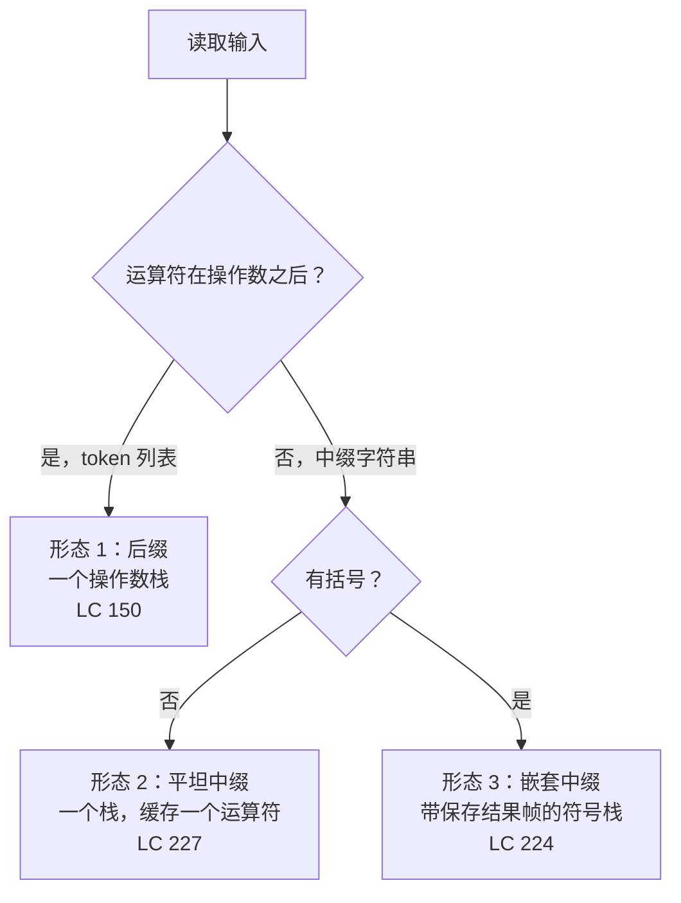

# 表达式求值与解析

`(1+(4+5+2)-3)+(6+8)` 是 LeetCode 224 递给你的第一个例子。这串字符十六个字符长，答案是 23，而最直觉的算法（从左往右读，边读边加）也能凑出 23——纯属巧合。换下一个例子试试，`- (3 + (4 + 5))`。从左到右扫描得到 12。正确答案是 -12。

只要括号或运算符优先级一进场，字符到达的顺序就不再等于算术应当发生的顺序。从左往右读 `3 + 5 * 2`，你仍然得先算乘法。读 `1 - (4 + 5)` 时，`-` 必须再等两个字符，它的右操作数才存在。有些活必须被**挂起**，存放在某处，等其余输入到齐了再继续。

那个“某处”就是栈。整章就讲这一句观察。

## 你会遇到的三种输入形态

本章只教一个心智模型——把运算符优先级解析器实现成一台栈机器——但它穿过三种乍看不同、底下用同一套机械的输入形态。先看输入。形态本身就告诉你该用哪个算法。

**形态 1：后缀表达式。** 运算符跟在它的操作数后面。`["2","1","+","3","*"]` 表示 `(2+1)*3`。它以 token 列表的形式交到你手里，而不是带括号的字符串。

**形态 2：带优先级的平坦中缀。** 形如 `"3+5*2"` 的字符串。没有括号；多种运算符混在一起，结合强度不同。从左到右的扫描顺序和你应当求值的顺序不一致。

**形态 3：带括号的中缀。** 形如 `"(1+(4+5+2)-3)+(6+8)"` 或 `"- (3 + (4 + 5))"` 的字符串。现在你得像挂起整个子表达式那样，一直等到右括号出现。

后缀最简单，括号最难。本章按这个顺序走：先 LeetCode 150（形态 1），再 LeetCode 227（形态 2），最后 LeetCode 224（形态 3）。每一道只在前一种形态的栈纪律上加一个想法。



*本章装进你脑子里的决策树：先给输入分类，算法自己就选出来了。*

## 为什么栈是合适的形状

回头看一眼[栈与调用栈的类比](../part-1-linear-data-structures/05-stacks.md)。栈是**被挂起的工作**对应的数据结构：一件事暂时做不完就压进去，轮到它了再弹出来。Knuth 在 [TAOCP 第 1 卷 §2.2.1](https://www-cs-faculty.stanford.edu/~knuth/taocp.html)（“Stacks, Queues, and Deques”）里就把这个框架定为他所称的信息结构（Information Structures）的基底。[^1]

表达式解析是它的经典用例。当你读到 `3 + 5 *` 时，`+` 还不能开火。它的右操作数要等你弄清楚这个 `5` 到底是 `+` 的右操作数还是 `*` 的左操作数，才算完整已知。解析器把做到一半的活压进栈，稍后再回来。后缀表达式靠把运算符写在操作数*之后*来回避这份悬念：读运算符时操作数已经就位。中缀表达式则逼你挂起。

栈之所以是合适的形状，还有第二个原因：它和递归是同一个形状，只是摊到了明面上。当你写一个递归解析器，文法里有 `expr → term (('+'|'-') term)*` 和 `term → factor (('*'|'/') factor)*`，调用栈记录的正是哪个子表达式还在飞行中。把调用栈换成一个数组，就得到本章给出的迭代版本。[第 7 部分](../part-7-recursion-backtracking/)的递归和这里的迭代解析器，是同一台机器的两种编码。[^2]

## 形态 1：LeetCode 150，后缀表达式

输入：一个 token 列表，每个运算符都跟在它的两个操作数后面。算法：一个栈，扫一遍。

```python
def eval_rpn(tokens):
    stack = []
    for t in tokens:
        if t in ("+", "-", "*", "/") and len(t) == 1:
            b = stack.pop()
            a = stack.pop()
            if t == "+":
                stack.append(a + b)
            elif t == "-":
                stack.append(a - b)
            elif t == "*":
                stack.append(a * b)
            else:
                stack.append(int(a / b))
        else:
            stack.append(int(t))
    return stack[0]
```

**Solution** — Python ([Java](./03-expression-evaluation/lc-150/sol.java) · [C++](./03-expression-evaluation/lc-150/sol.cpp) · [Go](./03-expression-evaluation/lc-150/sol.go))

```python
# LC 150. Evaluate Reverse Polish Notation
from typing import List


def eval_rpn(tokens: List[str]) -> int:
    """Single-stack postfix evaluator. Truncate-toward-zero on division."""
    stack: List[int] = []
    for t in tokens:
        if t in ("+", "-", "*", "/") and len(t) == 1:
            b = stack.pop()
            a = stack.pop()
            if t == "+":
                stack.append(a + b)
            elif t == "-":
                stack.append(a - b)
            elif t == "*":
                stack.append(a * b)
            else:
                # int(a / b) 向零截断；a // b 是向下取整，会出错。
                # 例如 7 / -3（LC 期望 -2；向下取整会给出 -3）。
                stack.append(int(a / b))
        else:
            # 操作数：能处理 "-11" 这样的负数字面量，因为上面的运算符
            # 分支要求 len(t) == 1。
            stack.append(int(t))
    return stack[0]
```

整个算法：数字进栈，运算符消费最近的两个数，用结果替换它们。走一遍 `["2","1","+","3","*"]` 就明白为什么对。压 2。压 1。读到 `+`：弹 1，弹 2，压 3。压 3。读到 `*`：弹 3，弹 3，压 9。栈里是 9。结束。这个归约干净到你能感到 HP 为什么在 1972 年推出 [HP-35](https://www.hpmuseum.org/hp35.htm) 时选了[逆波兰记号](https://en.wikipedia.org/wiki/Reverse_Polish_notation)输入。没有括号，没有优先级规则，也没有关于求值顺序的编辑决策；敲键的顺序*就是*求值的顺序。[^3]

> [!WARNING]
> **Python 的 `//` 是向下取整，不是向零截断。** LeetCode 150 明确写着“两个整数相除应向零截断”。对 `7 / -3`，那是 -2。Python 的 `7 // -3` 向下取整，给出 -3。修法是 `int(a / b)`：先转 float 相除，再由 `int()` 向零截断。在 LC 150 的 32 位操作数范围内，这个 float 中间量不会有精度损失。Java、C++ 和 Go 默认的 `/` 运算符本来就是向零截断，无需特殊处理。PEP 238 在 Python 3 里把真除法与向下取整除法分开，正是为了让这个差别在源码层面可见。[^4]

操作数解析里还藏着第二个坑：token `"-11"` 是负整数字面量，不是运算符 `-` 后面跟 `11`。检查 `if t in ("+", "-", "*", "/")` 对 `"-11"` 会正确返回 False（集合成员判断是精确相等），但换成 `if "-" in t` 就是*子串*成员判断，`"-11"` 和 `"-"` 都会命中。永远按精确 token 判断；上面代码里的 `len(t) == 1` 保险是双保险。

## 形态 2：LeetCode 227，带优先级的平坦中缀

输入：形如 `"3+5/2"` 的字符串。运算符优先级混合；无括号；允许空白。

朴素直觉是用一个累加器按扫描顺序应用运算符：读 3，看到 `+`，读 5，累加成 8，看到 `/`，读 2，累加成 4。返回 4。正确答案是 5（3 + 5/2，整数截断）。从左到右是错的，因为 `*` 和 `/` 的结合比 `+` 和 `-` 更紧。

修法是一个栈加一个缓存的运算符。不变式如下：扫描过程中，你用变量 `op` 记住*上一个*运算符，用 `num` 缓存当前数字的各位。当你读到下一个运算符（或到达字符串末尾）时，`op` 告诉你拿 `num` 做什么：

- `+`：压入 `num`。
- `-`：压入 `-num`。
- `*`：弹出栈顶，乘以 `num`，再压回。
- `/`：弹出栈顶，整除 `num`，再压回。

扫描结束后，把栈求和。`+` 和 `-` 的情况是*延后*的：它们把带符号的操作数压进去，让最后那次求和去解决。`*` 和 `/` 的情况是*即时*的：立刻生效，消费并替换栈顶。正是这一点给了 `*` 和 `/` 更高的结合强度——它们在被推翻之前就已经开火了。

```python
def calculate(s):
    stack = []
    num = 0
    op = "+"  # 虚拟的前导运算符
    n = len(s)
    for i, ch in enumerate(s):
        if ch.isdigit():
            num = num * 10 + (ord(ch) - ord("0"))
        if (not ch.isdigit() and ch != " ") or i == n - 1:
            if op == "+":
                stack.append(num)
            elif op == "-":
                stack.append(-num)
            elif op == "*":
                stack.append(stack.pop() * num)
            else:  # /
                top = stack.pop()
                stack.append(int(top / num))
            num = 0
            op = ch
    return sum(stack)
```

**Solution** — Python ([Java](./03-expression-evaluation/lc-227/sol.java) · [C++](./03-expression-evaluation/lc-227/sol.cpp) · [Go](./03-expression-evaluation/lc-227/sol.go))

```python
# LC 227. Basic Calculator II
from typing import List


def calculate(s: str) -> int:
    """One-stack precedence-by-deferral evaluator.

    Defer + and - by pushing signed operands; apply * and / immediately by
    replacing the top of the stack. Final answer is sum(stack).
    """
    stack: List[int] = []
    num = 0
    op = "+"  # 虚拟的前导运算符
    n = len(s)
    for i, ch in enumerate(s):
        if ch.isdigit():
            num = num * 10 + (ord(ch) - ord("0"))
        if (not ch.isdigit() and ch != " ") or i == n - 1:
            if op == "+":
                stack.append(num)
            elif op == "-":
                stack.append(-num)
            elif op == "*":
                stack.append(stack.pop() * num)
            else:  # '/'
                top = stack.pop()
                # int(top / num) 向零截断；// 会向下取整。
                stack.append(int(top / num))
            num = 0
            op = ch
    return sum(stack)
```

走一遍 `"3+5/2"` 说服自己。虚拟的前导 `+` 让第一个数字干净地吐出：i=1 时读到 `+`，`op` 是 `+`，压 3。缓冲变成 5。i=3 时读到 `/`，`op` 是 `+`，压 5。缓冲变成 2。i=4（最后一个字符）时循环同样会吐出：`op` 是 `/`，弹 5，压 `int(5/2) = 2`。栈里是 `[3, 2]`。和为 5。

有两个细节撑起了缓存运算符的设计。第一，多位数规则：`"12+34"` 必须是 46，不是 1+2+3+4。`num = num * 10 + digit` 这个累加器一直收数字，直到某个非数字字符把数字关掉。第二，逐字符的 `if (not ch.isdigit() ...) or i == n-1` 吐出条件让字符串末尾不必特殊处理：当循环的最后一个字符是数字时，第二个子句强制用缓存的运算符把缓存的数字吐出去。

> [!IMPORTANT]
> 处理形态 2 的教科书做法是[调度场算法](https://en.wikipedia.org/wiki/Shunting_yard_algorithm)，Edsger Dijkstra 在 1961 年 Stichting Mathematisch Centrum 的报告 MR 34/61《ALGOL 60 Translation》里发表它，当时是他在 X1 ALGOL 60 翻译器里的一个无名子程序。[^5] 调度场用两个栈：一个存放后缀 token 的输出队列，一个存放待定运算符的运算符栈；每当新来的运算符优先级更低或相等（左结合）就弹出运算符栈。它管用。它也比上面那个单栈版本长，因为它在求值之前先做一次到后缀的*转换*。单栈的延迟压入把转换折叠进了求值：`op` 缓冲就是运算符栈，只占一个槽位，因为优先级写死的平坦中缀从来不需要更多。

## 形态 3：LeetCode 224，括号与一元负号

输入：一个含 `+`、`-`、括号的字符串，可能还有位于开头或括号后、表示一元取负的 `-`。没有 `*` 和 `/`（那是 LC 772，收费题）。

括号是新东西。当你读到 `(` 时，你手上的活还没完。你有一个部分结果和一个待定符号，后者*作用于即将到来的整个子表达式*，你得把两者都搁到一边，等匹配的 `)` 出现，在一个全新的帧里求里面的值，再回来合并。

管用的形状是：一个存 `(saved_result, saved_sign)` 对的栈。遇到 `(`，把两者压进去，然后重置到新帧（`result = 0, sign = +1`）。遇到 `)`，把里面折回去：`result = saved_result + saved_sign * result`。括号之间，`+` 和 `-` 一边累加进 `result` 一边更新 `sign`；数字走 `num` 累加器，方式和 LC 227 一样。

```python
def calculate(s):
    stack = []
    result = 0
    num = 0
    sign = 1
    for ch in s:
        if ch.isdigit():
            num = num * 10 + (ord(ch) - ord("0"))
        elif ch == "+":
            result += sign * num
            num = 0
            sign = 1
        elif ch == "-":
            result += sign * num
            num = 0
            sign = -1
        elif ch == "(":
            stack.append(result)
            stack.append(sign)
            result = 0
            sign = 1
        elif ch == ")":
            result += sign * num
            num = 0
            result *= stack.pop()  # 被保存的符号
            result += stack.pop()  # 被保存的运行结果
    result += sign * num
    return result
```

**Solution** — Python ([Java](./03-expression-evaluation/lc-224/sol.java) · [C++](./03-expression-evaluation/lc-224/sol.cpp) · [Go](./03-expression-evaluation/lc-224/sol.go))

```python
# LC 224. Basic Calculator
from typing import List


def calculate(s: str) -> int:
    """Sign-stack iterative evaluator for +/- with parentheses and unary minus.

    On '(', push (saved_result, saved_sign) and reset to a fresh frame.
    On ')', fold the inner result back: result = saved_result + saved_sign * result.
    """
    stack: List[int] = []
    result = 0
    num = 0
    sign = 1  # +1 或 -1
    for ch in s:
        if ch.isdigit():
            num = num * 10 + (ord(ch) - ord("0"))
        elif ch == "+":
            result += sign * num
            num = 0
            sign = 1
        elif ch == "-":
            result += sign * num
            num = 0
            sign = -1
        elif ch == "(":
            stack.append(result)
            stack.append(sign)
            result = 0
            sign = 1
        elif ch == ")":
            result += sign * num
            num = 0
            result *= stack.pop()  # 被保存的符号
            result += stack.pop()  # 被保存的运行结果
        # 空白字符：跳过
    result += sign * num
    return result
```

仔细走一遍 `"- (3 + (4 + 5))"`。开头那个 `-` 把 `sign` 设为 `-1`（二元减号分支跑了，但 `result` 和 `num` 都是 0，唯一留下来的效果就是符号更新）。`(` 压入 `(0, -1)` 并重置到新帧。外层括号内：读 3，然后 `+` 把 3 吐进内层结果并把符号重置为 1。缓存 4。读到 `(`，压 `(3, 1)`，重置。里面：4，然后 `+`，然后 5。右括号把 5 吐进最内层结果（现在是 9），弹出保存的 `1` 相乘（9 还是 9），弹出保存的 3 相加（12）。现在回到外层括号，`result = 12`。右括号弹出最初的 `-1` 相乘（-12），弹出最初的 0 相加（-12）。答案：-12。

一元负号的处理是最漂亮的部分。二元 `-` 和一元 `-` 走同一条代码路径。之所以管用：在输入开头或紧跟 `(` 之后，`result` 是 0、`num` 也是 0，所以 `-` 分支里那句 `result += sign * num` 是空操作。只有 `sign := -1` 的更新活下来，而这正是一元负号该做的事。[^6]

本章的招牌题是 LC 224，因为它对这个模式要求最多：优先级（只有一层，括号与否）、跨嵌套分组的状态挂起，以及一元运算符。如果你能把它写成迭代版，把它扩成递归下降（形态 3 再加上 `*` 和 `/`）只是小改动。调用栈干的就是这里显式 `(saved_result, saved_sign)` 栈干的事。

## 实际开销

| 变体 | 时间 | 空间 | 为什么 |
|---|---|---|---|
| 后缀（LC 150） | O(n) | O(n) | 每个 token：一次压栈，或一次弹两次加一次压栈。 |
| 延迟压入的中缀（LC 227） | O(n) | O(n) | 每个字符：最多一次压栈；最后的 `sum` 是 O(栈大小) ≤ O(n)。 |
| 带括号的符号栈（LC 224） | O(n) | O(d)，d = 嵌套深度 | 每个 `(` 压两个 int；匹配的 `)` 弹出它们。d ≤ n。 |
| 递归下降 | O(n) 时间，O(d) 递归深度 | O(n) | 每个 [LL(1) 预测解析器](https://en.wikipedia.org/wiki/Recursive_descent_parser)一次线性扫描；深度 = 语法树深度。[^2] |

四种的均摊论证是同一个。每个输入字符只读一次。每个操作数最多压一次、弹一次。每个运算符最多消费一次。在连续数组实现的栈上，压栈和弹栈都是 O(1)。[^1] 总工作量是线性的；总空间受同时存在的最大栈深约束，对算术表达式来说最坏情况就是括号嵌套深度。

关于 LC 224 在 Python 里的栈深，有个小提醒：迭代形态用的是显式列表，没问题。同一道题若改用递归下降，就会用 Python 的调用栈，默认上限 1000 帧。LeetCode 的 `s.length ≤ 3 × 10^4` 允许嵌套深度达到约 15,000，远高于默认值。如果要用 Python 写递归解析器，在模块顶部抬高一次上限：`sys.setrecursionlimit(10**6)`。Java、C++ 和 Go 在 LC 的量级上不受影响。Java 的 `-Xss` 实际能给约 10^4 帧，Linux/macOS 上 C++ 主线程约 10^5，Go 的 goroutine 栈会自动增长。

## 常见陷阱

> [!WARNING]
> **平坦中缀上忽略了运算符优先级。** 对 `"3+5*2"` 返回 16（因为你先算了 `+`）是 LC 227 第一次尝试的经典 bug。修法就是上面那个缓存运算符的模式：延后 `+` 和 `-`，即时应用 `*` 和 `/`。如果你发现自己想上两个栈（操作数栈加运算符栈），退一步想想。四个算术运算符、优先级写死的场景，一个栈加一个 `op` 变量就够了。两栈的调度场是对的，只是更长。

> [!WARNING]
> **一元负号跨括号丢失。** 如果解析器把开头的 `-` 当成空操作，或当成需要左操作数的二元运算符，`"-(3+4)"` 会返回 7 而不是 -7。符号栈形态凑巧做对了：即使 `result` 和 `num` 都是零，`-` 分支也会更新 `sign := -1`，随后那个 `(` 把这个符号存进保存帧里。提交前用 `"- (3 + (4 + 5))"` 测一下你的 LC 224 解法；这个用例在隐藏测试集里，不在可见示例里。

> [!WARNING]
> **多位数被拆成单个数字。** `"12+34"` 返回 10 而不是 46，说明解析器把每一位都当独立操作数压了进去。永远要累加：字符是数字时 `num = num * 10 + (ch - '0')`；只在遇到非数字非空白字符或输入结束时才把 `num` 吐出去。

## 题目梯度

### 核心（三题全做才算掌握本章）

- [LC 150 — Evaluate Reverse Polish Notation](https://leetcode.com/problems/evaluate-reverse-polish-notation/) [中等] • stack-postfix-evaluation
- [LC 227 — Basic Calculator II](https://leetcode.com/problems/basic-calculator-ii/) [中等] • stack-precedence-deferral
- [LC 224 — Basic Calculator](https://leetcode.com/problems/basic-calculator/) [困难] • stack-sign-state ★

### 进阶（可选）

- [LC 394 — Decode String](https://leetcode.com/problems/decode-string/) [中等] • stack-recursive-on-stack
- [LC 1106 — Parsing A Boolean Expression](https://leetcode.com/problems/parsing-a-boolean-expression/) [困难] • recursive-descent

核心题里没有简单档。最简单的栈式解析题 LC 20 Valid Parentheses 是个没有运算符语义的退化解析器，它住在[栈与调用栈的类比](../part-1-linear-data-structures/05-stacks.md)里，不在这里。LC 224 是本章的星号题（★），因为三种形态的模式在这里汇合。LC 772 Basic Calculator III 是自然的延伸（括号加四个运算符），但在 LeetCode 上收费；免费的替代路径是把 LC 224 和 LC 227 都做掉，然后机械地把它们融合起来。

LC 394 和 LC 1106 是本章的回报。LC 394 把算术换成字符串重复：`"3[a2[c]]" → "accaccacc"`。形状和 LC 224 一样（遇到左括号压状态，遇到右括号折回来），只是状态从 `(saved_result, saved_sign)` 换成了 `(count, partial_string)`。就是那一刻你会意识到，本章讲的其实不是计算器。LC 1106 进一步推广到 N 元布尔运算符，到这里迭代形态开始吃力，递归下降是更干净的答案；这也是通往[第 7 部分](../part-7-recursion-backtracking/)以及课程后面文法驱动解析的桥。

## 后续衔接

下一章[用栈实现队列](./04-queue-from-stacks.md)在另一个场景里复用了双栈组合的心智模型：两个栈串起来模拟一个队列。同样的物理原语，不同的不变式。

再往外走，[第 7 部分 递归与回溯](../part-7-recursion-backtracking/)会以调用栈作为显式运算符栈，重访本章的机械。一旦你吃透了 LC 224 的迭代符号栈为什么管用，同一个解析器的递归下降变体就是五分钟的练习。每个文法非终结符变成一个函数；函数调用边界就是原来 `(` 的压栈；函数返回就是原来 `)` 的弹栈；递归就是机制本身。Dragon Book 在 §4.4 把这件事奉为定论。[^2]

## 参考文献

[^1]: Donald E. Knuth，《计算机程序设计艺术》第 1 卷：《基本算法》第 3 版，Addison-Wesley，1997，§2.2.1 “Stacks, Queues, and Deques”，pp.

[^2]: Alfred V. Aho、Monica S. Lam、Ravi Sethi、Jeffrey D. Ullman，《编译原理：原理、技术与工具》第 2 版（龙书），Pearson，2007，§4.4 “Top-Down Parsing”，pp.

[^3]: 《HP-35 Operating Manual》，Hewlett-Packard，1972；HP Computer Museum 馆藏，见 <https://www.hpmuseum.org/hp35.htm>。

[^4]: Guido van Rossum 与 Moshe Zadka，“PEP 238: Changing the Division Operator,” 2001 年 3 月，<https://peps.python.org/pep-0238/>

[^5]: Edsger W. 最初描述如今被称为[调度场算法](https://en.wikipedia.org/wiki/Shunting_yard_algorithm)的那份报告

[^6]: LeetCode 社区 LC 224 最高票解法帖，符号栈迭代形态，<https://leetcode.com/problems/basic-calculator/solutions/>。
