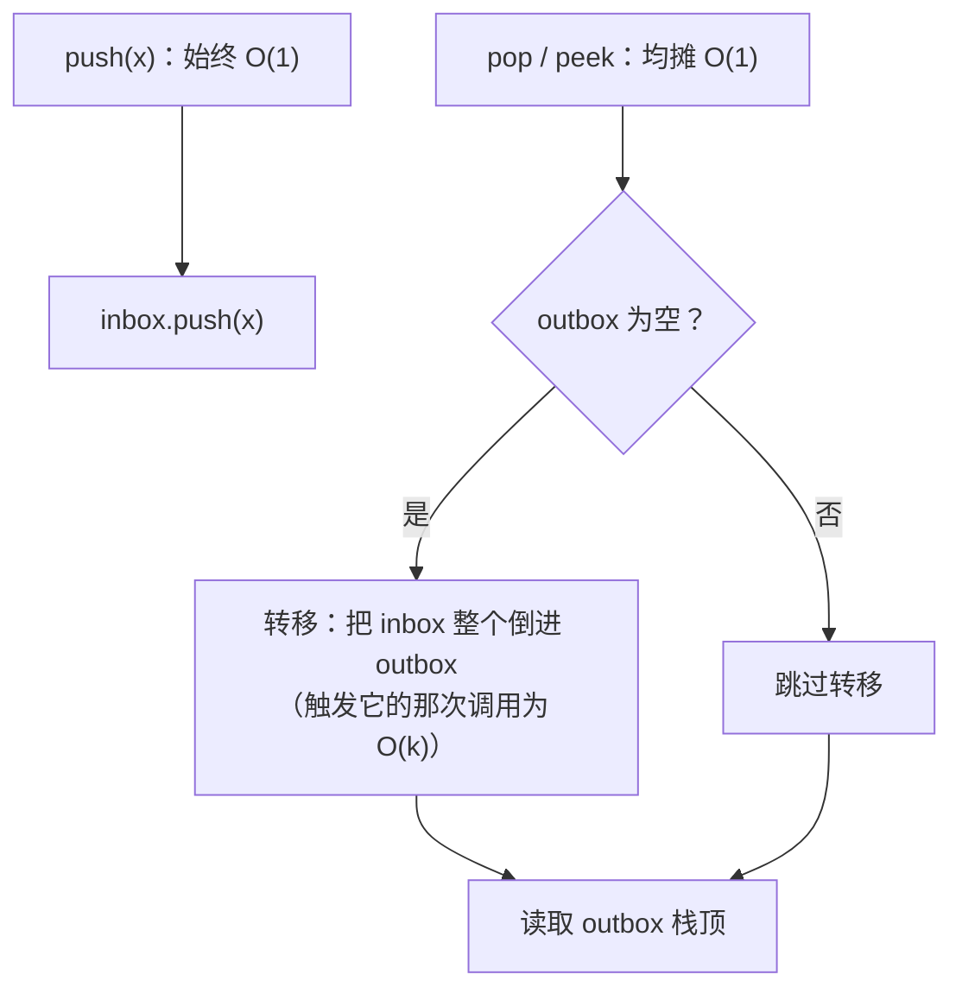

# 用栈实现队列

后进先出（LIFO）的栈和先进先出（FIFO）的队列看起来正好相反。栈的 push 和 pop 永远动栈顶；队列的入队和出队动的是两端。所以 LC 232 问的那个问题初读之下应该像是不可能的：*只允许用栈操作当原语，实现一个队列*。没有 `popleft`，没有 `dequeue`，没有双向链表，没有随机访问。只有栈上的 `push`、`pop`、`peek`、`isEmpty`。评分标准还会轻描淡写地补一句：四个队列操作都要跑到均摊 O(1)——这让本来听着无解的问题又无解了一倍。

诀窍在于：LIFO 反转两次就是 FIFO。把进来的元素放到一个栈上。有人要 FIFO 的队头时，把这个栈整个倒到第二个栈上。顺序反了过来，第一个栈的栈底变成第二个栈的栈顶。此后队头就从第二个栈上读。这次倒腾在当次很贵，但每个元素在它于队列里的整个生命周期中只为自己那次倒腾付一次账，成本一平均就是个常数。这套均摊分析就是本章的全部内容。Robert Tarjan 1985 年的论文 *Amortized Computational Complexity* 正是把这套记账框架形式化的地方；用两个栈实现队列是它的招牌练习，也是每个问 LC 232 的面试官都指望你口头讲一遍的题。[^1]

## 你欠调用方的 API 契约

写代码之前先把契约钉死。LC 232 的题面给你一个类 `MyQueue`，四个方法：[^2]

| 方法 | 返回值 | 作用 |
|---|---|---|
| `push(int x)` | 无 | 把 `x` 加到队列尾部 |
| `pop()` | 队头元素 | 移除并返回队头 |
| `peek()` | 队头元素 | 返回队头但不移除 |
| `empty()` | `bool` | 当且仅当队列里没有元素时为 true |

约束落在实现上，不在接口上。类内部，你只能对自己持有的栈调用 `push`、`peek`、`pop`、`size`、`is_empty`。你想留多少状态都行；题面并不限制辅助内存。于是问题被塑形成了：什么样的辅助状态，只通过栈接口来操作，能让上面那四个方法跑到均摊 O(1)？

## 双栈组合

维护两个栈，分别叫 `inbox` 和 `outbox`。



*这套组合。push 永远落在 inbox。pop 和 peek 从 outbox 读；outbox 为空时，转移把 inbox 整个抽干，于是 inbox 的栈底变成 outbox 的栈顶，也就是 FIFO 的队头。*

不变式短到可以直接背下来。**任何时刻，队列从队头到队尾的内容是：`outbox` 自顶向下读，再接上 `inbox` 自底向上读。** 等价的说法：只要 outbox 非空，FIFO 队头就坐在 `outbox` 的栈顶；FIFO 队尾则坐在 `inbox` 的栈顶。只有 outbox 为空*且*调用方来要队头时才发生转移；转移会把 inbox 彻底抽干，而 outbox 一旦开始对外服务就不再被碰。

```python
class MyQueue:
    def __init__(self):
        self.inbox = []
        self.outbox = []

    def push(self, x):
        self.inbox.append(x)        # 始终 O(1)

    def _transfer(self):
        while self.inbox:
            self.outbox.append(self.inbox.pop())

    def pop(self):
        if not self.outbox:
            self._transfer()
        return self.outbox.pop()    # 均摊 O(1)

    def peek(self):
        if not self.outbox:
            self._transfer()
        return self.outbox[-1]      # 均摊 O(1)

    def empty(self):
        return not self.inbox and not self.outbox
```

**解法** — Python（[Java](./04-queue-from-stacks/lc-232/sol.java) · [C++](./04-queue-from-stacks/lc-232/sol.cpp) · [Go](./04-queue-from-stacks/lc-232/sol.go)）

```python
# LC 232. Implement Queue using Stacks
from typing import List


class MyQueue:
    """LC 232. FIFO via two LIFO stacks (inbox/outbox), amortized O(1) per op.

    Push always lands on inbox. Pop and peek always read from outbox; when
    outbox is empty they drain inbox into it once, reversing the order so
    the bottom of inbox becomes the top of outbox -- the FIFO front.
    """

    def __init__(self) -> None:
        self.inbox: List[int] = []
        self.outbox: List[int] = []

    def push(self, x: int) -> None:
        self.inbox.append(x)  # 始终 O(1)

    def _transfer(self) -> None:
        # 把 inbox 倒进 outbox；只在 outbox 为空时调用，以保住
        # “outbox 反转再拼上 inbox” 这个 FIFO 顺序。
        while self.inbox:
            self.outbox.append(self.inbox.pop())

    def pop(self) -> int:
        if not self.outbox:
            self._transfer()
        return self.outbox.pop()  # 均摊 O(1)

    def peek(self) -> int:
        if not self.outbox:
            self._transfer()
        return self.outbox[-1]  # 均摊 O(1)

    def empty(self) -> bool:
        return not self.inbox and not self.outbox
```

代码里有三个小地方在真正干活。

`_transfer` 是私有的，只从 `pop` 和 `peek` 内部调用。它*不*从 `push` 里调用。这个区分就是整个均摊成本论证；我们待会儿回来讲。搞反了（每次 push 都急切转移，让 outbox 永远保持 FIFO 顺序），设计就退化成 n 次操作共 O(n²)。LC 232 最常见的错误答案正是这个急切版本。

`peek` 会改动 inbox/outbox 的切分，尽管队列的可观测内容并没有变。在 C++ 里，`peek()` 方法不能标 `const`，因为这次调用可能执行 `transfer()`，而它会写两个栈。把 `peek` 当成纯读，在这个设计里就是正确性 bug；用户视角的读是纯的，实现内部的读不是。

`empty` 要同时检查两个栈。几次 pop 之后，outbox 可能空了，而 inbox 还装着队列的内容；只看 outbox 的 `empty` 就是在撒谎。双栈切分是内部记账，队列是否为空是两者的合取。

## 每次出队的均摊 O(1)

这是本章的承重结论，也是面试官等着你口头推导的那一条。教科书上有三种推导方式，都出自 Tarjan 1985 年的论文：**聚合法（aggregate method）**、**记账法（accounting method）**、**势能法（potential method）**。[^1] 三种都得到同一个答案；其中聚合法是多数读者最容易先吃进去的那个。

### 聚合法论证

任取一段长度为 `n` 的用户操作序列：push、pop、peek，顺序随意。跟踪单个元素从进入队列到离开队列的全过程。

它被压进 inbox 一次：一次栈操作。

如果某次 pop 或 peek 在转移时正好在 inbox 上碰到它，它会被从 inbox 弹出一次、压进 outbox 一次：又两次栈操作——但前提是转移发生在用户那次 `pop` 本会把它取走之前。有些元素一辈子都碰不上转移（用户在任何转移被触发之前就把它们 pop 掉了；不过在这个设计里这不可能，因为 pop 读的是 outbox，每个被 pop 的元素都必定经过 outbox）。

用户最终把它出队时，它被从 outbox 弹出一次：再一次栈操作。

每个元素在队列里的整个生命周期，总共**最多四次栈操作**。用户 push 时一次，转移时两次，用户 pop 时一次。（peek 相当于 pop 减去最后那次 outbox 弹出：只看不取的元素最多三次。）

在 `n` 次用户操作上，栈操作总量被 `4n` 限住。以动态数组为底的栈，单次栈操作是 O(1)：这是 CLRS §10.1 对数组实现上的 `PUSH` 和 `POP` 给出的结论，§17.4 又把翻倍扩容的成本均摊掉，所以连触发扩容的 push 也是均摊 O(1)。[^3] 总成本：整个序列 O(n)。每次用户操作的均摊成本：O(1)。单次调用的最坏情况是 O(k)，k 为转移触发那一刻 inbox 的大小，但那次昂贵的调用由它之前那些便宜的 push 预先付过账了。

> [!IMPORTANT]
> LC 232 面试官在等的那句口头回答：*“每个操作都是均摊 O(1)；单次 pop 的最坏情况是转移触发时的 O(n)；n 次操作的总工作量不超过 4n 次栈操作，因为每个元素只被压进 inbox 一次、最多转移一次、被从 outbox 弹出一次。”* 这句话要逐字背熟。这是 LC 232 电话筛里唯一一句能让面试官确认你懂均摊的回答。

### 记账法论证

给每次用户 `push` 记 2 个信用点，每次 `pop` 记 2 个，每次 `peek` 记 1 个。一个信用点用于支付眼前那次栈操作的成本（inbox 的 push，或者 outbox 的 pop，或者 outbox 的 peek）。push 的第二个信用点*存在元素自身上*。它预付费地待在那儿，等未来的那次转移。

当这个元素终于等来转移时，那要花两次栈操作：一次 inbox 弹出、一次 outbox 压入。两次都由元素从最初的 push 调用随身带来的存款支付。转移不向触发它的那次用户操作借信用点；触发者只为自己付费。[^4]

n 次用户操作累计记入的信用点：最多 2n。实际消耗的信用点：最多 2n（没有元素被转移超过一次，没花掉的存款就留在还在队列里的元素身上）。信用点余额从不为负，这正是记账法成立的形式条件。均摊成本：每次用户操作最多 2 个信用点，也就是 O(1)。

记账法的推导比聚合法更机械，但结论一样，而且带出一个不错的心智模型：你每次 push 都在悄悄为将来把该元素搬到 outbox 的那次转移预付费用。下面的交互组件把信用点余额画成每个栈帧旁边的小徽标，你能看着存款在 push 时一点点堆起来，在转移那一刻取现。

## 实例推演：LC 232 的标准序列

跟踪 `push(1), push(2), peek, pop, empty`。inbox 和 outbox 全程按自底向上书写。

初始状态：`inbox = []`，`outbox = []`。

`push(1)`：把 1 追加进 inbox。inbox 现在是 `[1]`。信用点余额：1（元素 1 身上存了 1 个信用点）。

`push(2)`：把 2 追加进 inbox。inbox 现在是 `[1, 2]`。信用点余额：2。

`peek`：outbox 为空，于是触发转移。从 inbox 弹出 2 压进 outbox；再从 inbox 弹出 1 压进 outbox。inbox 现在为空；outbox 自底向上是 `[2, 1]`。四次栈操作由事先存下的信用点付清。outbox 的栈顶是 1，也就是 FIFO 队头。**返回 1。**

`pop`：outbox 非空，不转移。弹出 outbox 的栈顶，也就是 1。outbox 现在是 `[2]`。**返回 1。**

`empty`：inbox 为空，outbox 是 `[2]`。**返回 false。**

总共六步：一次初始化，两次 push，一次与 peek 合并的转移，一次便宜的 pop，一次查询。交互组件逐步播放，每一步都同时展示 inbox/outbox 状态和旁边的信用点余额徽标。

> **交互组件：** [用两个栈做均摊队列（LC 232）](../../../dsa/widgets/w-12-amortized-queue-via-stacks.yml)（面板 `default`）——在网站上渲染；YAML 规格文件描述了各个关键帧。

*静态回退：六步之中，inbox 依次经过 `[]`、`[1]`、`[1, 2]`、`[]`、`[]`、`[]`；outbox 依次经过 `[]`、`[]`、`[]`、`[2, 1]`、`[2]`、`[2]`；信用点余额升到 2，在转移时跌回 0，之后一直是 0。*

## 实际开销

| 操作 | 时间 | 空间 | 说明 |
|---|---|---|---|
| `push(x)` | 最坏 O(1) | 合计 O(n) | 永远只有一次 inbox push。 |
| `pop()` | 均摊 O(1)，最坏 O(n) | 合计 O(n) | 最坏情况出现在 inbox 装了 n 个元素、outbox 又刚被清空时。 |
| `peek()` | 均摊 O(1)，最坏 O(n) | 合计 O(n) | 触发条件与 pop 相同。 |
| `empty()` | O(1) | O(1) | 两次判空；从不触发转移。 |

无论用户怎么交错 push 和 pop，均摊上界都成立。`push, pop, push, pop, ...` 交替是让转移触发得最频繁的负载：每次 pop 都引发一次单元素转移。每次 pop 的均摊成本依然是 O(1)，因为与之配对的那次 push 已经存下了支付这次单元素转移的信用点。上面的聚合论证不依赖负载形状；`4n` 这个上界是通用的。

> [!NOTE]
> 单次调用的最坏情况对真实系统是有意义的，尽管它不改变均摊上界。有延迟上限要求的队列（实时调度器、带硬截止时间的 UI 线程）不能原样用这个设计，因为一次 pop 调用可能卡住 O(n)。解法是彻底换一种数据结构（环形缓冲区，或者最坏 O(1) 的双端队列），而不是在双栈设计上打补丁。面试官偶尔会追问“怎么把它做到最坏 O(1)？”；正确答案是“我不做，我会换一种结构”，而不是“我把均摊做得更狠”。

## 逆问题：用队列实现栈（LC 225）

镜像问题——*只允许用队列原语实现一个栈*——听起来像是同一个问题倒着跑。大体上是，但有一处结构性的弯折，而这正是本章把两道题放在一起讲的全部理由：让 LC 232 每个操作都均摊 O(1) 的惰性转移技巧，在 LC 225 上没有对应物。

原因如下。在 LC 232 里，转移翻转顺序：从 inbox 栈顶弹出、压进 outbox，inbox 的栈底就成了 outbox 的栈顶。两次翻转复合等于恒等，所以 LIFO 反转两次得到 FIFO。在 LC 225 里，候选的那个操作是 FIFO 的反转，但 FIFO 接 FIFO 不翻转任何东西，它只是保持原有顺序。不存在类似的惰性转移，一跑起来就能把队列内容变成 LIFO 顺序。翻转的代价只能显式支付，而且每次操作都要付。

标准而紧凑的答案用一个队列，每次 push 时轮转：

```python
from collections import deque

class MyStack:
    def __init__(self):
        self.q = deque()

    def push(self, x):
        self.q.append(x)
        # 轮转，让刚压入的元素落到队头。
        for _ in range(len(self.q) - 1):
            self.q.append(self.q.popleft())

    def pop(self):
        return self.q.popleft()  # O(1)

    def top(self):
        return self.q[0]         # O(1)

    def empty(self):
        return not self.q
```

push 先把 `x` 从队尾入队，再把队列轮转 `size - 1` 次，让 `x` 落到队头。轮转的代价是 `size - 1` 对入队/出队，也就是每次 push O(n)。pop 和 top 是对队头的 O(1) 读取。双队列变体用一个额外队列的存储，换来便宜的 push 和 O(n) 的 pop；复杂度并没有变好，只是换了一端来付账。[^5]

> [!IMPORTANT]
> 当面试官在同一轮里把 LC 232 的均摊论证搬到 LC 225 上问时，正确答案是：*“这个构造在结构上不对称：我能选择让哪一端承担线性成本（push 或 pop），但没法让两端都均摊 O(1)，因为 LC 232 的惰性转移技巧没有 FIFO 对偶。”* 连续问这两道题的面试官，通常是在看你有没有注意到这处不对称。

## 设计失效的场景

> [!WARNING]
> **每次 push 都急切转移。** LC 232 最常见的错误答案是这样：压进 inbox 之后立刻把 inbox 抽干倒进 outbox，让 outbox 永远是 FIFO 顺序、pop 永远 O(1)。均摊在这里崩了，因为 inbox→outbox 的转移发生在每次 push 上，而不是每个元素一次。`n` 次 push 与 `n` 次 pop 交错的对抗性负载，总成本是 O(n²)。惰性不变式——*“只在 outbox 为空且请求来自服务侧操作时才转移”*——就是整个均摊技巧。没有它，双栈队列严格劣于一个带轮转指针的单栈。

> [!WARNING]
> **C++ 里给 `peek` 标 `const`。** 因为 `peek()` 可能调用 `transfer()`，而后者会写两个栈，在 C++ 里把它标成 `const` 会直接编译报错。参考实现故意不加这个限定符。别顺着本能把它加回去：peek 不改变队列的可观测状态，但会改变实现的内部切分，这两件事不是一回事。`pop()` 同理——它显然改 outbox，但在转移时也会改 inbox。

> [!WARNING]
> **用 Java 的 `Stack` 而不是 `ArrayDeque`。** `java.util.Stack` 继承自 `Vector`，所以每次 `push` 和 `pop` 都要获取 `this` 上的内置监视器，单线程代码里也一样。Sedgewick 与 Wayne 的 algs4 §1.3 说得很干脆：“Java 有个内置库叫 Stack，但你应当避免使用它。”Oracle 自己在 JDK 21 里对 `ArrayDeque` 的 Javadoc 写着：“这个类当作栈使用时很可能比 `Stack` 更快。”[^6] 正确写法是 `Deque<Integer> inbox = new ArrayDeque<>()`，`push`、`pop`、`peek` 都在头部操作。用 `Stack` 的 LC 232 提交能过 LC 的测试脚手架，但光靠语法检查就过不了 Tier-1 代码评审。

> [!WARNING]
> **把均摊 O(1) 和最坏 O(1) 混为一谈。** 面试中段，候选人说 LC 232 是“每次操作 O(1)”，面试官问“单次 pop 的最坏成本是多少？”除了“转移触发时是 O(n)；在整个操作序列上是均摊 O(1)”以外的任何回答都拿不到这一分。只背“O(1)”而不带限定语，是 LC 232 上出现频率最高的翻车点。把整句话背熟；面试官在你说完复杂度之后一停顿，就把它端出来。

## 题目梯度

### 核心（两题全做才算掌握本章）

- [LC 232 — Implement Queue using Stacks](https://leetcode.com/problems/implement-queue-using-stacks/) [简单] • queue-via-two-stacks ★
- [LC 225 — Implement Stack using Queues](https://leetcode.com/problems/implement-stack-using-queues/) [简单] • stack-via-two-queues *（参考实现：仅 Python）*

LC 232 是本章的招牌题（★），也是实例推演和交互组件所演示的那道。LC 225 是那个把 LIFO-from-FIFO 与 FIFO-from-LIFO 之间的结构不对称暴露出来的反转；它进核心，是因为不对称本身就是这课的内容，不是因为轮转代码难写。这个模式在写作时没有标准的 Hard 题。自然的候选（LC 1172 Dinner Plate Stacks；LC 1670 Design Front Middle Back Queue）归别的章节，而在本章的框架下——用一种 ADT 的原语构造另一种 ADT——没有对应的 Hard 题。frontmatter 因此带着 `ladder_curation_flag: no-hard-canonical`。

若要看 push 和 pop 发生在前、中、后三端的双端队列式扩展，见[队列、双端队列与环形缓冲](../part-1-linear-data-structures/06-queues-deques.md)，LC 1670 归那一章。若要看把均摊 O(1) 与最坏 O(1) 摆在一起对照的定容环形缓冲 FIFO，见[动态数组内部机制](../part-1-linear-data-structures/01-dynamic-array-internals.md)，LC 622 归那一章。

## 后续衔接

两个结构钉在一起的组合方式，在更高难度上还会反复出现：一个是[最小/最大栈](./02-min-max-stack.md)，那里用一个辅助栈跟踪运行中的聚合值来加强主栈；另一个是 Part 13 设计梯度顶端的 LRU 与 LFU 缓存，那里把双向链表钉在哈希表上，得到 O(1) 的 `get`、`put` 以及淘汰。本章的均摊框架（按元素在整个生命周期里数操作次数，除以操作总数，得到均摊上界）也是证明伸展树、动态表翻倍扩容、带路径压缩的并查集上界的同一件工具。Tarjan 1985 年的论文在同一个五页的小节里提出了上述全部分析；本章只是它最小的练习之一，也是把这项技术第一次内化掉最容易的地方。[^1]

## 参考文献

[^1]: Robert E. Tarjan, "Amortized Computational Complexity," *SIAM Journal on Algebraic and Discrete Methods*, Vol. 6, No. 2, April 1985, pp. 306-318. <https://doi.org/10.1137/0606031>.

[^2]: LeetCode problem 232, "Implement Queue using Stacks." <https://leetcode.com/problems/implement-queue-using-stacks/>.

[^3]: Cormen, Leiserson, Rivest, Stein, *Introduction to Algorithms*, 4th ed., MIT Press, 2022.

[^4]: Gayle Laakmann McDowell, *Cracking the Coding Interview*, 6th ed., CareerCup, 2015.

[^5]: LeetCode problem 225, "Implement Stack using Queues." <https://leetcode.com/problems/implement-stack-using-queues/>.

[^6]: Oracle Java SE 21 API documentation, `java.util.ArrayDeque<E>`. <https://docs.oracle.com/en/java/javase/21/docs/api/java.base/java/util/ArrayDeque.html>
