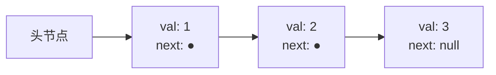

# 链表基础：哨兵、指针重连与双向链表设计

打开 OpenJDK 里的 `java.util.LinkedList`，看 `linkBefore` 方法。它带着一个特例：*如果前驱为 null，说明这是第一个节点，于是更新 head 引用；否则把新节点接进链里*。CLRS §10.2 告诉你，这个特例可以白白删掉。在真正的头节点前面插一个假节点，把它的 `next` 当作头，前驱就永远不会是 null。重连变成两条赋值。`if (f == null)` 分支消失了。

这个假节点就是哨兵（sentinel），而且这项技术不只用于链表：任何数据结构，只要代码里要判断"我是不是在边界上"，都能用。第 5 部分大半内容都站在它上面。5.1 章的反转、5.2 章的按组反转、5.4 章的合并构造器、5.5 章 LRU 缓存的双向链表骨架：这些算法读起来都更干净，因为边界情况的活由哨兵干了，否则代码得自己干。你现在读的这一章，就是一次性把这份账付掉的地方。[^1]

接口约定很小。一个节点存一个值，外加一根指向下一节点的指针。链表是一串以 null 结尾的节点。空链表就是没有真实节点的链表，在哨兵设计里它是一个 `next` 为 null 的哑节点。五个公开操作：按索引读、头部插入、尾部插入、任意位置插入、任意位置删除。招牌题是 LeetCode 上的 *Design Linked List*（LC 707），能干净地做出来，就证明你真正吃透了这一章讲的东西。

## 链表是什么

节点就是把一个值和一个指针打包在一起：

```python
@dataclass
class ListNode:
    val: int
    next: Optional["ListNode"] = None
```

这就是全部的结构定义。链表是一条链：`head -> node -> node -> ... -> null`。遍历链就是一个 `while curr != null` 循环。没有索引，没有 `arr[i]`，没有连续的内存块。要找到第三个元素，你得从头节点走，三次指针解引用。



*三个节点，三次堆分配，节点之间三根指针。随机访问是 O(n)；给定前驱做中间插入是 O(1)。数组做的正好是相反的取舍。*

这个取舍正是链表存在的原因。动态数组（[动态数组内部机制](../part-1-linear-data-structures/01-dynamic-array-internals.md) 一章）靠在一块连续缓冲区上按下标寻址拿到 O(1) 随机访问，代价是中间插入 O(n)：右边每个元素都得往后挪一格。链表把这份契约倒过来。没有缓冲区要挪，所以只要手里有指向前驱的指针，中间插入和中间删除都是 O(1)。又没有连续布局，所以读第 k 个元素要 k 次解引用，而最坏情况下每次解引用取回的那条缓存行，跟上一行毫无关系。[^2]

这份缓存代价是真实的。CLRS §10.2 用算法语言摆这个对比；工程现实是：在存 8 字节 int 的 `std::vector<int>` 里，十六个相邻元素共享一条 64 字节缓存行，所以遍历大约每读十六次才取一次内存。在 `std::list<int>` 里，每个节点都是自己的一次堆分配，节点散落在堆各处，遍历大约每读一次就取一次内存。在两种表示都正确的那些负载上，数组实测比链表快十倍到二十倍。[^3]

那链表什么时候赢？当操作是*在中间接上一段*、*从中间摘掉一段*，或者*把两个链表在端头拼起来*，而且手里已经拿着指向正确位置的指针时。LRU 缓存（5.5 章）就是标准案例：它必须在 O(1) 内淘汰最久未使用的条目，又在 O(1) 内把刚访问的条目提到最前，而哈希表直接指向对应的节点，两个操作都不需要走链。链表是唯一能不做均摊就让这两个动作都是 O(1) 的数据结构。

## 四个基本操作

这一章的每个操作都是四种形状之一。先把 `prev` 指针走到位置 k，然后做其中一件：

- **在 `prev` 之后插入**：`node.next = prev.next; prev.next = node;`
- **删除 `prev` 之后的节点**：`prev.next = prev.next.next;`
- **从头走 `curr` 读取**：`for k steps: curr = curr.next;`
- **在尾部追加**：把 `prev` 走到最后一个节点，然后在它之后插入。

这两行插入就是全部机制，而且两行的顺序要紧。先快照前向链接；再改前驱的 `next`。顺序颠倒，第二行读到的就是第一行刚砸掉的那个指针，新节点指向自己，链的其余部分成了孤儿。这一点我们在陷阱一节还会回来说。

删除只有一行，因为被摘下来的节点自己走出了链：`prev.next = prev.next.next` 直接把旧的 `prev.next` 跳过去。在有垃圾回收的语言里，这个孤儿节点会在下一轮 GC 时消失。在 C++ 里，你先把指针存下来，重连之后再 `delete victim;`；析构函数在对象销毁时走链，也是同一个道理。

这四个基本操作的共同点是前驱指针。插入需要 `prev`，因为新节点必须接在*某个东西之后*。删除需要 `prev`，因为摘掉一个节点改的是上游的 `next`，不是节点自己。读取只需要 `curr`，但产出 `curr` 的索引走法和产出 `prev` 的走法是同一个循环，差一步而已。

麻烦的情形是 `prev` 会是 null，也就是操作落在头部。没有哨兵，代码就得为它单开一条分支。*如果是在头部插入，就设 `head = node`，把 `node.next` 接到旧 `head`。否则走 `prev`，做正常的重连。* 两条路径，两套正确性论证，两个可以藏 off-by-one 的地方。OpenJDK 的 `LinkedList` 就带着这条分支；它不得不带，因为 Java 标准库比"把哨兵存在数据结构内部"这个惯例更早。[^1]

## 哨兵：一个节点抹掉头部特例

多分配一个节点，归数据结构自己所有，放在真正的头节点之前。叫它 `dummy`。有真实元素时它的 `next` 指向第一个真实元素，链表为空时指向 null。`val` 字段不用。

```python
class MyLinkedList:
    def __init__(self) -> None:
        self.dummy: ListNode = ListNode(0)
        self.length: int = 0
```

现在 `prev = dummy` 是每个带下标的操作都成立的起点。在索引 0 插入就是 `prev = dummy`；在索引 k 插入就是 `prev = dummy` 之后再前进 k 步。两种情况下操作的主体完全一样。空链表的不变量——链表没有真实节点——就是 `dummy.next == null`，而重连 `prev.next = node` 在它上面不需要任何检查就能工作。[^1]

> [!IMPORTANT]
> **哨兵不是权宜之计，它就是设计。** 只要自然写出来的代码要在"这是不是头节点？"上分支，就该想到它。同一个思路——在边界上多留一格，让边界情况不再特殊——出现在 LRU 缓存的两个双向哨兵（头与尾）上，出现在 5.2 章按 K 组反转时每组的局部哑节点上，也出现在 5.4 章构造合并链表用的 `dummy.next` 模式上。CLRS §10.2 在 *Sentinels* 这个小标题下介绍了这项技术，并指出：只要边界条件把事情搞复杂了，用哨兵就是有效的手段。[^1]

代价是有的。每个链表多一次分配，每次遍历从 `dummy` 而不是第一个真实节点出发。在 64 位 JVM 上，这就是每个链表 32 到 40 字节，外加每个带下标的操作多一次解引用。[^4] 这份代价小到生产级数据结构会常规地付它；只有在长度不到十个元素的链表上跑微基准时，无哨兵设计才更快——而那个规模本来就该用数组。

本章教的半哨兵形式，只在头节点前面放哑节点。没有尾哨兵，也没有单独的尾指针。这意味着 `addAtTail` 要走完整条链。带两个哨兵（头与尾）的完整双向形式能让尾部操作 O(1)，代价是每个节点的指针开销翻倍，而且每次重连从两条赋值变成四条。5.5 章会引入它，因为 LRU 缓存要求 O(1) 的尾部淘汰；本章不引入，因为半哨兵形式在教学上更干净，而 LC 707 的契约把带下标的操作当作主要操作。

## 设计链表：LC 707

五个操作，一个数据结构。契约是：`get(i)` 返回索引 `i` 处的值，`i` 越界返回 `-1`；`addAtHead(v)` 和 `addAtTail(v)` 是便利包装；`addAtIndex(i, v)` 插入新节点，使新节点的下标成为 `i`；`deleteAtIndex(i)` 删除索引 `i` 处的节点。插入允许 `i == length`（这就是追加的目标位置）；删除不允许（位置 `length` 上没有节点）。负下标和越界下标，在修改方法上是静默的空操作，在 `get` 上返回 `-1`。[^5]

每个方法体都坍缩成一句话："把 `prev` 走到位置 `i - 1`（`i == 0` 由哨兵兜住），然后做标准重连。"

```python
class MyLinkedList:
    def __init__(self) -> None:
        self.dummy: ListNode = ListNode(0)
        self.length: int = 0

    def get(self, index: int) -> int:
        if index < 0 or index >= self.length:
            return -1
        curr = self.dummy.next
        for _ in range(index):
            curr = curr.next
        return curr.val

    def addAtIndex(self, index: int, val: int) -> None:
        if index < 0 or index > self.length:
            return
        prev = self.dummy
        for _ in range(index):
            prev = prev.next
        node = ListNode(val, prev.next)
        prev.next = node
        self.length += 1

    def deleteAtIndex(self, index: int) -> None:
        if index < 0 or index >= self.length:
            return
        prev = self.dummy
        for _ in range(index):
            prev = prev.next
        prev.next = prev.next.next
        self.length -= 1
```

**解法** — Python（[Java](./00-linked-list-fundamentals/lc-707/sol.java) · [C++](./00-linked-list-fundamentals/lc-707/sol.cpp) · [Go](./00-linked-list-fundamentals/lc-707/sol.go)）

```python
# LC 707. Design Linked List
"""LC 707 Design Linked List，哨兵驱动的单链表。

哑头节点消除了"头节点 / 中间节点"的分支：每次插入和
删除都指向一个非空的前驱 `prev`，所以索引 0 处和索引 k
处的连线方式完全一样。
"""

from dataclasses import dataclass
from typing import Optional


@dataclass
class ListNode:
    val: int
    next: Optional["ListNode"] = None


class MyLinkedList:
    def __init__(self) -> None:
        self.dummy: ListNode = ListNode(0)
        self.length: int = 0

    def get(self, index: int) -> int:
        if index < 0 or index >= self.length:
            return -1
        curr = self.dummy.next
        for _ in range(index):
            curr = curr.next  # type: ignore[union-attr]
        return curr.val  # type: ignore[union-attr]

    def addAtHead(self, val: int) -> None:
        self.addAtIndex(0, val)

    def addAtTail(self, val: int) -> None:
        self.addAtIndex(self.length, val)

    def addAtIndex(self, index: int, val: int) -> None:
        if index < 0 or index > self.length:
            return
        prev = self.dummy
        for _ in range(index):
            prev = prev.next  # type: ignore[assignment]
        node = ListNode(val, prev.next)
        prev.next = node
        self.length += 1

    def deleteAtIndex(self, index: int) -> None:
        if index < 0 or index >= self.length:
            return
        prev = self.dummy
        for _ in range(index):
            prev = prev.next  # type: ignore[assignment]
        prev.next = prev.next.next  # type: ignore[union-attr]
        self.length -= 1
```

两行插入和一行删除是仅有的修改动作。剩下的全是索引走位。`length` 字段是索引合法性的唯一真相。`length` 和真实链长之间一旦漂移，就会得到静默的错答案，所以参考实现把每次计数器更新都放在和重连同一层的语句范围内，让代码评审在三行 diff 里同时看到两处改动。

在一条新链表上走一遍 LC 707 的操作序列：

1. `addAtHead(1)` 走到 `addAtIndex(0, 1)`。`prev = dummy`。分配节点 1；重连；length = 1。链：`dummy -> 1`。
2. `addAtTail(3)` 走到 `addAtIndex(1, 3)`。`prev` 走一步到节点 1。分配节点 3；重连；length = 2。链：`dummy -> 1 -> 3`。
3. `addAtIndex(1, 2)`。`prev = dummy`；前进一次到节点 1。分配节点 2，`next = node 3`；重连 `prev.next = node 2`；length = 3。链：`dummy -> 1 -> 2 -> 3`。
4. `get(1)` 返回 2。
5. `deleteAtIndex(1)`。`prev = dummy`；前进一次到节点 1。记下 `victim = node 2`；重连 `prev.next = victim.next`；length = 2。链：`dummy -> 1 -> 3`。
6. `get(1)` 返回 3。

> **交互式组件：** [链表指针重连](../../../dsa/widgets/w-13-linked-list-pointer-rewiring.yml)（面板 `panel-a`）—— 在网站上渲染；YAML 规格里描述了各个关键帧。

*静态回退：组件的四个关键帧分别渲染空哨兵状态、头尾两次插入之后的链、节点 2 被接在节点 1 与节点 3 之间时刚完成中间插入的链，以及中间删除之后回到 `dummy -> 1 -> 3` 的链。*

这遍追踪让人看见的是：第 1 步（头部插入）和第 3 步（中间插入）是*同一个操作*。同样的前驱类型（一个是哨兵，一个是真实节点，但都不是 null）。同样的两行重连。同样的长度更新。看着第 1 步和第 3 步接连发生的读者，已经把这一章吃进去了。

## 第二种形状：哑头构造器

哨兵还有第二种活法，不限于给一个链表看守头节点。*Add Two Numbers*（LC 2）给你两个按逆序存放数字的链表，要你把它们的和也作为链表返回。[^6] 在把两个输入都走完之前，你不知道答案有多长；没有尾指针，你也无法 O(1) 地往链尾追加。修法还是同一个把戏：在本地分配一个哑节点，用尾指针往前走，无条件追加，最后返回 `dummy.next`。

```python
def addTwoNumbers(l1, l2):
    dummy = ListNode()
    tail = dummy
    carry = 0
    while l1 is not None or l2 is not None or carry:
        v1 = l1.val if l1 is not None else 0
        v2 = l2.val if l2 is not None else 0
        carry, digit = divmod(v1 + v2 + carry, 10)
        tail.next = ListNode(digit)
        tail = tail.next
        if l1 is not None:
            l1 = l1.next
        if l2 is not None:
            l2 = l2.next
    return dummy.next
```

**解法** — Python（[Java](./00-linked-list-fundamentals/lc-2/sol.java) · [C++](./00-linked-list-fundamentals/lc-2/sol.cpp) · [Go](./00-linked-list-fundamentals/lc-2/sol.go)）

```python
# LC 2. Add Two Numbers
"""两个链表同步遍历，处理进位传播。哑头节点让每次迭代都能
无条件追加；`return dummy.next` 跳过哨兵。
"""

from dataclasses import dataclass
from typing import Optional


@dataclass
class ListNode:
    val: int = 0
    next: Optional["ListNode"] = None


class Solution:
    def addTwoNumbers(
        self,
        l1: Optional[ListNode],
        l2: Optional[ListNode],
    ) -> Optional[ListNode]:
        dummy = ListNode()
        tail = dummy
        carry = 0
        while l1 is not None or l2 is not None or carry:
            v1 = l1.val if l1 is not None else 0
            v2 = l2.val if l2 is not None else 0
            total = v1 + v2 + carry
            carry, digit = divmod(total, 10)
            tail.next = ListNode(digit)
            tail = tail.next
            if l1 is not None:
                l1 = l1.next
            if l2 is not None:
                l2 = l2.next
        return dummy.next
```

两点要注意。循环条件是 `l1 != null OR l2 != null OR carry`：进位是终止条件的一部分，因为 `[5]` 加 `[5]` 得到 `[0, 1]`，那个进位在两边都走完之后还得留着。返回的是 `dummy.next`，不是 `dummy`。返回哑节点本身，结果链表就会以一个多余的 `0` 开头，后面才跟真实数字。命名本身就在强制这套纪律：局部变量叫 `dummy`（不叫 `head`），`return dummy.next` 读起来就是*跳过哨兵，返回真正的头*。[合并两个/k 个有序链表](./04-merging-linked-lists.md) 里的合并构造器，以及 [堆](../../../dsa/part-6-trees-heaps/04-heaps-priority-queues.md) 里由堆驱动的 k 路归并，都复用了这个模式。

如果链表真的像一个单向迭代器那样用——读出每个值、拿它做点什么——那就是 *Convert Binary Number in a Linked List to Integer*（LC 1290）。每个节点存 0 或 1；链表是最高位在前的二进制表示；答案是那个整数。[^7] 一趟搞定：

```python
def getDecimalValue(head):
    result = 0
    curr = head
    while curr is not None:
        result = (result << 1) | curr.val
        curr = curr.next
    return result
```

**解法** — Python（[Java](./00-linked-list-fundamentals/lc-1290/sol.java) · [C++](./00-linked-list-fundamentals/lc-1290/sol.cpp) · [Go](./00-linked-list-fundamentals/lc-1290/sol.go)）

```python
# LC 1290. Convert Binary Number in a Linked List to Integer
"""单趟遍历，边读边累积。每个节点存 0 或 1；把结果左移一位，
再或上当前这一位。
"""

from dataclasses import dataclass
from typing import Optional


@dataclass
class ListNode:
    val: int
    next: Optional["ListNode"] = None


class Solution:
    def getDecimalValue(self, head: Optional[ListNode]) -> int:
        result = 0
        curr = head
        while curr is not None:
            result = (result << 1) | curr.val
            curr = curr.next
        return result
```

`while curr != null` 是第 5 部分最常见的形状。从 5.1 起的每一章都用它开头写函数。`result = (result << 1) | curr.val` 是唯一的算术；其余全是走链。

## 实际开销

索引走位主导一切。每个带 `index` 参数的方法，运行时间都与索引成正比，因为走位器必须走过 `index` 个节点才能到达前驱。

| 操作 | 最坏时间 | 最好时间 | 空间 |
|---|---|---|---|
| `get(i)` | O(i) | i = 0 时 O(1) | O(1) |
| `addAtHead(v)` | O(1) | O(1) | O(1) |
| `addAtTail(v)` | O(n) | O(n) | O(1) |
| `addAtIndex(i, v)` | O(i) | i = 0 时 O(1) | O(1) |
| `deleteAtIndex(i)` | O(i) | i = 0 时 O(1) | O(1) |
| 整体结构 | n/a | n/a | O(n) |

半哨兵设计（哨兵在头节点之前，没有尾指针）正是头部插入和头部删除能做到 O(1) 的原因：分支没了，但没有单独的尾指针，所以尾部操作要付一次 O(n) 的走链。CLRS §10.2 证明了这些界：LIST-INSERT 和 LIST-DELETE 在查找步骤之后各自只做常数次指针重连，所以耗时由查找步骤主导。[^1] 把 `addAtTail` 提到 O(1) 的教科书式升级是加一个尾指针；5.5 章会重新引入它，因为 LRU 缓存要求 O(1) 的尾部淘汰，而且根本不做索引访问。

空间上界是 `n + 1` 个堆节点（`n` 个真实节点加哨兵），再加一个长度计数器的常数。每节点的空间由指针字段主导。在开启压缩对象指针的 64 位 JVM 上，一个带一个 int 和一个引用的 `ListNode` 每节点占 32 到 40 字节，是同样载荷的 `int[]` 的三到四倍。[^4] Python 里用 `dataclass` 装饰的节点每个实例大约 56 字节。C++ 里朴素的 `struct ListNode { int val; ListNode* next; }` 是 16 字节。Go 里 `int` 加指针的结构体也是 16 字节。这些常数在你要决定用链表还是数组时才重要；决定之后，它们就是噪音。

## 设计何时改变

本章这套写法的三个变体会在第 5 部分后面以及更远处出现。前两个复用你刚学到的东西；第三个是 OpenJDK 出货的无哨兵形式，本章把它当作反例来引用。

**完整的双向哨兵设计（5.5 章）。** 两个哨兵，`head` 和 `tail`。每个节点同时带 `prev` 和 `next`。插入是四条赋值而不是两条：`node.prev = head; node.next = head.next; head.next.prev = node; head.next = node`。删除是两条：`node.prev.next = node.next; node.next.prev = node.prev`。四条赋值的插入比两条的难吃透；5.5 章有 LRU 缓存来支撑这份代价。没有理由，就不要付。

**无哨兵的单链表（OpenJDK 风格）。** 用一个可为空的 `first` 和 `last` 引用代替哨兵。`addAtIndex(0, ...)` 这条路径要分支：`if (length == 0) head = node; else { node.next = head; head = node; }`。分支本身很小，但它会在每个修改方法上累积，而且每个评审者都得重新推导边界上的正确性。OpenJDK 的 `java.util.LinkedList` 就是这套设计，代价是 `linkFirst`、`linkLast` 和 `unlink` 里的 `if (f == null)` 分支。[^1] 如果你发现自己写的行数是上面哨兵版参考实现的两倍，那你就是不小心落到了这套设计上。

**循环链表（此处只提及，不展开）。** 尾节点的 `next` 指向一个真实节点而不是 null。遍历用 `curr != head_after_one_loop` 而不是 `curr != null`。约瑟夫问题和轮转调度器是它的天然用户；识别环这个算法问题归 [环检测](./03-cycle-detection.md) 管，那里 Floyd 的龟兔指针算术用 O(1) 额外空间干这活。

跳表和展开链表是真实的数据结构，出现在 Redis 有序集合和少数专用引擎里。[^8] 它们和其余概率型结构一起放在第 11 章；本章提一句，是为了让你知道它们存在。

## 常见误区

> [!WARNING]
> **在修改*之后*才快照 `prev.next`。** 把重连的顺序写反——`prev.next = node; node.next = prev.next;`——第二行读到的就是第一行刚砸掉的指针。`node.next` 变成 `node` 自己。新节点成了一个单元素环；链的其余部分成了孤儿；LC 的测试框架会超时，报出一堆栈溢出风格的失败。正确的形状*永远*是 `node.next = prev.next; prev.next = node;`：先快照，再修改。半哨兵设计防不住这个；这是单链表的通用陷阱，也是 [反转模式](./01-reversal-patterns.md) 里反复出现的那个框架。

> [!WARNING]
> **改了链，没改长度计数器。** 重连是操作里看得见的部分；`length += 1` 和 `length -= 1` 是记账，进不了"这段代码在干什么"的心智模型。漏了它们，后面的 `get` 就会走过链表末尾（Java/C++ 里 NPE；Python 里是静默的错答案，`None.next` 只在访问时才抛）。把 `length` 当成数据结构不变量的一部分：每个修改链的方法，都在同一层的语句范围里修改 `length`。

> [!WARNING]
> **插入与删除的边界不对称。** 插入允许 `index == length`（追加）；删除不允许（位置 `length` 上没有节点）。插入用 `index >= length` 就把尾部追加拒掉了；删除用 `index > length` 就接受了越界删除，重连时 NPE。参考实现把这个不对称的守卫放在每个方法的第一行，让人不可能在没看见它的情况下读完方法体。CLRS §10.2 的 LIST-INSERT 和 LIST-DELETE 伪代码用的是同样的不对称检查。[^1]

> [!WARNING]
> **在构造器函数里返回 `dummy` 而不是 `dummy.next`。** 在 *Add Two Numbers* 和每一个哑头构造器里，结果都是 `dummy.next`。函数末尾最近被命名的局部变量就是哑节点，`return dummy` 是本能反应；bug 表现为结果链表开头多一个 `0`。把局部变量命名为 `dummy` 而不是 `head`，就是强制这套纪律的手段。

> [!WARNING]
> **Go 里修改状态的方法用了值接收者。** `func (l MyLinkedList) AddAtHead(val int)`（值接收者）改的是本地副本，返回后原始的 `MyLinkedList` 没变。后续 `Get` 会报 `-1`，尽管 `AddAtHead` 明明被调用过。任何修改数据结构的方法都必须用指针接收者（`*MyLinkedList`）。正常代码里 Go vet 能抓到这个；LC 判题环境是静默的，因为判题器一律通过指针调用方法。[^9]

## 题目梯度

### 核心（三题全做才算掌握本章）

- [LC 1290 — Convert Binary Number in a Linked List to Integer](https://leetcode.com/problems/convert-binary-number-in-a-linked-list-to-integer/) [简单] • linked-list-traversal
- [LC 707 — Design Linked List](https://leetcode.com/problems/design-linked-list/) [中等] • linked-list-sentinel ★
- [LC 2 — Add Two Numbers](https://leetcode.com/problems/add-two-numbers/) [中等] • linked-list-traversal-with-carry

### 进阶（可选）

- [LC 138 — Copy List with Random Pointer](https://leetcode.com/problems/copy-list-with-random-pointer/) [中等] • linked-list-deep-copy
- [LC 1019 — Next Greater Node In Linked List](https://leetcode.com/problems/next-greater-node-in-linked-list/) [中等] • linked-list-as-iterator

> [!NOTE]
> **这个梯度上没有 Hard 档。** LC 题库里唯一经典的 Hard 链表设计题是 [LC 432 — All O\`one Data Structure](https://leetcode.com/problems/all-oone-data-structure/)，它是会员锁定的，按章节梯度规则不能进 CORE。Hard 档的链表延伸题都在别处：[LC 25 — Reverse Nodes in K-Group](https://leetcode.com/problems/reverse-nodes-in-k-group/) 属于 [按 K 组反转](./02-reverse-in-groups-k.md)，[LC 23 — Merge K Sorted Lists](https://leetcode.com/problems/merge-k-sorted-lists/) 属于 [堆](../../../dsa/part-6-trees-heaps/04-heaps-priority-queues.md)，[LC 146 — LRU Cache](https://leetcode.com/problems/lru-cache/) 属于 [LRU 缓存](./05-lru-cache.md)。

## 后续衔接

[反转模式](./01-reversal-patterns.md) 复用了 `ListNode` 定义和"先快照"的规则；prev/curr/next 三指针重连是同一个形状，只不过用在每个节点上，而不是一次一个节点。[环检测](./03-cycle-detection.md) 丢掉哨兵，因为 Floyd 的龟兔算法推理的是原始的后继函数。[合并两个/k 个有序链表](./04-merging-linked-lists.md) 沿用 *Add Two Numbers* 的哑头构造器模式，把它当作合并的基本操作。而 [LRU 缓存](./05-lru-cache.md) 引入本章只是提到的双向哨兵设计：两个哨兵、四条赋值的插入、两端都 O(1)。同样的节点类型，四种不同的纪律。

## 参考文献

[^1]: Cormen, Leiserson, Rivest, Stein, *Introduction to Algorithms*, 4th ed., MIT Press, 2022. OpenJDK 的 `java.util.LinkedList<E>` 源码（[github.com/openjdk/jdk](https://github.com/openjdk/jdk/blob/master/src/java.base/share/classes/java/util/LinkedList.java)）

[^2]: Robert Sedgewick and Kevin Wayne, *Algorithms*, 4th ed., Addison-Wesley, 2011.

[^3]: Ulrich Drepper, "What Every Programmer Should Know About Memory," 2007 ([akkadia.org/drepper/cpumemory.pdf](https://www.akkadia.org/drepper/cpumemory.pdf)

[^4]: Aleksey Shipilev, "Compressed References (32-bit Object Pointers in 64-bit JVM)," [shipilev.net/jvm/objects-inside-out](https://shipilev.net/jvm/objects-inside-out/)

[^5]: LeetCode 707, "Design Linked List," [leetcode.com/problems/design-linked-list](https://leetcode.com/problems/design-linked-list/).

[^6]: LeetCode 2, "Add Two Numbers," [leetcode.com/problems/add-two-numbers](https://leetcode.com/problems/add-two-numbers/)

[^7]: LeetCode 1290, "Convert Binary Number in a Linked List to Integer," [leetcode.com/problems/convert-binary-number-in-a-linked-list-to-integer](https://leetcode.com/problems/convert-binary-number-in-a-linked-list-to-integer/).

[^8]: William Pugh, "Skip Lists: A Probabilistic Alternative to Balanced Trees," CACM 33(6), June 1990, pp. 668-676. Pugh 的跳表原始论文在 [15721.courses.cs.cmu.edu](https://15721.courses.cs.cmu.edu/spring2018/papers/08-oltpindexes1/pugh-skiplists-cacm1990.pdf)。

[^9]: Go documentation, "Effective Go," [go.dev/doc/effective_go#pointers_vs_values](https://go.dev/doc/effective_go#pointers_vs_values)
