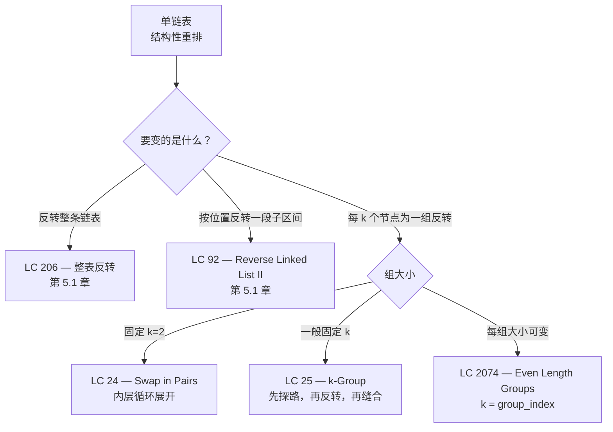

# 每 k 个一组反转

LC 25 是标准面试题库里最难的链表题。给定 `1 -> 2 -> 3 -> 4 -> 5` 和 `k = 2`，返回 `2 -> 1 -> 4 -> 3 -> 5`。末尾的 `5` 原地不动，因为剩下这段不足 k 个。取 `k = 3` 时，同一个输入变成 `3 -> 2 -> 1 -> 4 -> 5`。它的追问——*“能不能只用 O(1) 额外内存？”*——才是这题被评为 Hard 的原因：递归被排除之后，每个“差一点就成了”的写法，都在组与组之间的接缝处藏着一个细微 bug。

本章要说的是：LC 25 就是三个小的机械阶段，叠在[反转模式](./01-reversal-patterns.md)之上。你已经会用 prev/curr/next 反转单链表；也已经知道为什么一个哑节点哨兵能在头部钉住稳定的句柄，见[链表：单链表、双链表、哨兵](./00-linked-list-fundamentals.md)。新东西是跨边界的那点指针运算——一边是已经反转好的前缀，一边是即将被反转的那一组。三行代码的顺序写错，链表要么被截断，要么成环，要么悄悄给你一个错答案。

## 为什么“先反转、再检查”会悄悄毁掉链表

刚做完 LC 206，肌肉记忆就是上来就反转。小输入上看着没问题。下面把这个错误动作写出来：

```python
# 错误：先反转再检查。会破坏尾部不足 k 的那一组。
def reverse_k_group_wrong(head, k):
    dummy = ListNode(0, head)
    group_prev = dummy
    while group_prev.next is not None:
        # 最多反转 k 个节点。链表提前结束就停。
        prev = None
        curr = group_prev.next
        original_head = curr
        count = 0
        while curr is not None and count < k:
            nxt = curr.next
            curr.next = prev
            prev = curr
            curr = nxt
            count += 1
        # 现在重新接回。但如果 count < k 呢？我们已经反转过了。
        group_prev.next = prev
        original_head.next = curr
        group_prev = original_head
    return dummy.next
```

拿 `k = 3` 跑 `1 -> 2 -> 3 -> 4 -> 5`。第一组三个节点，干净地反转成 `3 -> 2 -> 1 -> ...`。第二组只剩两个节点（`4 -> 5`），可内层循环照样反转它找到的东西，于是它们翻成 `5 -> 4`。最终链表是 `3 -> 2 -> 1 -> 5 -> 4`。错答案。LC 25 的约定是：剩下的节点“should remain as is”。[^1] 把 4 和 5 翻过来的那两行，破坏了这个约定。

这个 bug 是结构性的，不是算错。算法在还不知道这一组是否满员时，就先把反转做了。内层循环一旦跑起来，想还原指针就得把后缀再走一遍——到那时，你花了 O(k) 的工夫去修 bug，而不是花 O(k) 的工夫去检查前提条件。

修法只有一句话：先往前数 k 个，*然后*再反转。这次前探很便宜（不碰任何 `next` 指针），而且有决定性（它明确告诉你该不该进入反转阶段）。整章内容都从这一个决定推出来。

## 模式

每一组都按顺序走三个阶段。**探路（peek）**：从当前组的前一个节点往前走 k 步；如果中途走到头，就结束——后缀不动，直接返回。**反转（reverse）**：确认整组齐了，在这 k 个节点上跑 prev/curr/next，但把 `prev` 的初值设成组*之后*那个节点，而不是 `None`，这样反转区间最右边的节点在被改写的那一刻，就已经指向尚未处理的后缀。**缝合（stitch）**：把已处理的前缀接到新的组头，游标移到新的组尾，然后重复。

5.0 章那个哑节点，是让第一组也能走同一套逻辑的关键。没有它，第一组的反转就得写一个特判分支，直接改 `head` 而不是改 `group_prev.next`，本章也就得把笔墨花在那个分支上，而不是花在接缝的机械操作上。[^2]

```python
def reverse_k_group(head, k):
    dummy = ListNode(0, head)
    group_prev = dummy

    while True:
        kth = _kth_after(group_prev, k)
        if kth is None:
            break                       # 后缀不足 k 个；原样保留
        group_next = kth.next

        # 内层反转：prev 的初值取 group_next，新的组尾
        # 的 next 指针就会自动落到未处理的后缀上。
        prev = group_next
        curr = group_prev.next
        while curr is not group_next:
            nxt = curr.next
            curr.next = prev
            prev = curr
            curr = nxt

        # 重新缝合：原来的组头现在是组尾。
        new_group_tail = group_prev.next
        group_prev.next = kth
        group_prev = new_group_tail

    return dummy.next


def _kth_after(node, k):
    curr = node
    while curr is not None and k > 0:
        curr = curr.next
        k -= 1
    return curr
```

**解法** — Python（[Java](./02-reverse-in-groups-k/lc-25/sol.java) · [C++](./02-reverse-in-groups-k/lc-25/sol.cpp) · [Go](./02-reverse-in-groups-k/lc-25/sol.go)）

```python
# LC 25. Reverse Nodes in k-Group
from typing import Optional


class ListNode:
    def __init__(self, val: int = 0, nxt: "Optional[ListNode]" = None) -> None:
        self.val = val
        self.next = nxt


def reverse_k_group(head: Optional[ListNode], k: int) -> Optional[ListNode]:
    """LC 25：每 k 个一组反转链表；末尾不足 k 个的那段保持原样。

    迭代实现，O(n) 时间，O(1) 额外空间。哑节点哨兵在结果上钉住一个稳定的
    句柄，让第一组不必特判就能反转。group_prev 是当前组前面那个节点；
    _kth_after 先往前探 k 个节点，确认整组存在之后才动任何指针；
    它返回 None 就说明后缀不足 k 个，
    循环随即结束。
    """
    dummy = ListNode(0, head)
    group_prev = dummy

    while True:
        kth = _kth_after(group_prev, k)
        if kth is None:
            break
        group_next = kth.next

        prev: Optional[ListNode] = group_next
        curr: Optional[ListNode] = group_prev.next
        while curr is not group_next:
            nxt = curr.next
            curr.next = prev
            prev = curr
            curr = nxt

        new_group_tail = group_prev.next
        group_prev.next = kth
        group_prev = new_group_tail

    return dummy.next


def _kth_after(node: ListNode, k: int) -> Optional[ListNode]:
    """返回严格位于 `node` 之后第 k 个节点；不足 k 个则返回 None。"""
    curr: Optional[ListNode] = node
    while curr is not None and k > 0:
        curr = curr.next
        k -= 1
    return curr
```

缝合阶段的行序没有商量余地。`new_group_tail = group_prev.next` 必须*在* `group_prev.next = kth` *之前*保存，因为接回这一步会覆盖掉下一行要读的那个指针。把这两行对调，`group_prev` 就前进到新的组头而不是新的组尾，下一轮迭代的接缝就缝到了错的地方。

### 三个阶段即三个基本操作

| 阶段 | 读 | 写 | 返回什么 |
|---|---|---|---|
| **探路**（`_kth_after`） | k 个 `next` 指针 | 无 | `kth` 节点；不足则 `None` |
| **反转**（内层循环） | k 个 `next` 指针 | k 个 `next` 指针 | 新的组头（存在 `prev` 里） |
| **缝合** | 1 个指针（`group_prev.next`） | 2 个指针（接回 + 游标前进） | 无 |

每组的开销合计：读 2k 次指针，写 k+2 次指针。走完 `floor(n/k)` 个整组再加一次探路失败，算法对每个 `next` 指针最多读两次、最多写 n 次。时间 O(n)；空间 O(1)，与 n、k 都无关。[^3]

## 如何识别这个模式



*本章与它的前置章节一共覆盖五种子模式。先挑方言，再填三个阶段。*

## 实例推演：LC 25 在 `1 -> 2 -> 3 -> 4 -> 5` 上取 k = 2

下面的交互组件在标准输入上动画演示二十五步。先看完整的一轮探路—反转—缝合，再看第二轮，最后看让循环终止的那次探路失败。有两帧最见功夫：第 7 步，接缝把 `dummy.next = 2` 重新缝好；第 21 步，游标走出表尾，算法把节点 5 原样留下。

> **Interactive widget:** [链表指针重连](../../../dsa/widgets/w-13-linked-list-pointer-rewiring.yml)（面板 `panel-c`）—— 在网站上渲染；YAML 规格里描述了各个关键帧。

*二十五步全程追踪。阶段划分：初始化（第 0 步）、第一次探路（1-3）、第一次反转（4-6）、第一次缝合（7-9）、第二次探路（10-12）、第二次反转（13-15）、第二次缝合（16-18）、最后一次探路失败（19-22）、终止（23-24）。第 22 步把末尾的节点 5 置灰，标记它未被触碰。*

下面用文字逐阶段走一遍，只讲那几个值得花笔墨的瞬间。**第 0 步：** dummy 指向 1；group_prev 就是 dummy。**步骤 1-3：** 从 dummy 往前探两个节点，落在节点 2 上，确认整组齐了。**步骤 4-6：** prev 的初值取节点 3（也就是 `group_next`），curr 从节点 1 开始，两轮迭代依次改写 `1.next = 3`、`2.next = 1`。**第 7 步是关键接缝。** 接回 `dummy.next = 2`。原来的组头（节点 1）现在成了组尾，group_prev 前移到那里。此时链表是 `dummy -> 2 -> 1 -> 3 -> 4 -> 5`。**步骤 10-18：** 第二组重复同一套三阶段循环，结束时是 `dummy -> 2 -> 1 -> 4 -> 3 -> 5`。**步骤 19-21：** 第三次探路。游标走到节点 5，再走到 `null`。只剩一个节点，不足 k=2。算法不改任何指针就退出循环，节点 5 留在原地。

要是整套流程看懂了，偏偏 `prev = group_next` 这一行没想通，就单独把第二组再放一遍，盯住第 13 步。两轮迭代之后，新的组尾（节点 3）的 `next` 指针指向节点 5——*自动指过去的*。内层循环里没有任何一行写过这个指针；它是从初值继承来的。初值要是设成 `prev = None`，节点 3 就悬在 `null` 上，后缀整个丢了。这就是内层循环*不能*照抄 LC 206 那个循环的原因，也是本章没法并进 5.1 的原因。

## 实际开销

| 写法 | 时间 | 空间 | 说明 |
|---|---|---|---|
| 迭代（标准写法） | O(n) | O(1) | 每个 `next` 指针最多读两次、最多写一次。 |
| 递归 | O(n) | O(n/k) | 每组一个栈帧。过不了 LC 25 的追问；n = 5000、k = 1 时有栈溢出风险。[^3] |
| LC 24（k=2 展开） | O(n) | O(1) | 每组内层循环只跑一次，可以写成三条显式赋值。 |
| LC 92（按位置取子区间） | O(n) | O(1) | 只有一组，按索引而不是按组序定位。 |

说句实在话：递归版就是六行 Python，面试官要是没提 O(1) 那个追问，写了也能过。可他一旦问出口，迭代版就是唯一答案。LC 25 的题面本身把这个追问写明了，所以这里把迭代版定为标准写法。[^1]

迭代版的 O(1) 界来自 CLRS §10.2 关于链表遍历的一般结论：`LIST-INSERT` 和 `LIST-DELETE` 各是 O(1)，所以 n 次这样的操作合起来是 O(n)，与这些操作怎么交错无关。[^4] Knuth 的 TAOCP 第一卷 §2.2.3 给出了它所依赖的指针操作代数；本章同时继承这两个结论。[^5]

## 模式失效的场景

### LC 24：k = 2 展开

k 固定为 2 时，内层反转每组只跑一次。整个内层循环塌成三条显式赋值——不需要 `prev`、`curr`、`nxt` 那套簿记：

```python
# k = 2 的特例（LC 24）。每组三次指针写入，没有内层循环。
def swap_pairs(head):
    dummy = ListNode(0, head)
    group_prev = dummy
    while group_prev.next and group_prev.next.next:
        a = group_prev.next
        b = a.next
        a.next = b.next       # a 指向这一对之后
        b.next = a            # b 回指 a（完成交换）
        group_prev.next = b   # 把这一对接回链表
        group_prev = a        # 前进到新的组尾
    return dummy.next
```

同一个哑节点，同一个接缝。`a.next = b.next; b.next = a; group_prev.next = b` 这三行，就是通用内层循环只跑一次时的展开形式。多数面试教程都先讲 LC 24 再讲 LC 25，原因正在这里：没有循环挡着，动作编排看得一清二楚。

### LC 92：按位置反转子区间

LC 92 一趟扫过去，反转位置 `left` 到 `right` 之间的节点。这里只有一组，边界由下标给出，而不是由组号推出来。探路阶段变成“先走到位置 `left - 1` 设定 `group_prev`，再往前走 `right - left + 1` 个节点找到 `kth`”。反转与缝合两个阶段完全一样。[^2]

### 递归版 k 组：更短，但丢掉了追问

```python
# 递归写法。O(n) 时间，O(n/k) 空间（递归栈）。
# 过不了 LC 25 的 O(1) 额外内存追问。
def reverse_k_group_recursive(head, k):
    kth = _kth_after_head(head, k - 1)
    if kth is None:
        return head
    rest = reverse_k_group_recursive(kth.next, k)
    # 反转当前范围内的前 k 个节点。
    prev = rest
    curr = head
    for _ in range(k):
        nxt = curr.next
        curr.next = prev
        prev = curr
        curr = nxt
    return prev
```

六行业务逻辑，没有哑节点，没有接缝。漂亮。可在问了追问的那场面试里，它也是错的。值得知道，因为 NeetCode 和 AlgoMaster 的题解里都出现过它。

## 三个最容易踩的坑

> [!WARNING]
> **没确认整组齐了就先反转。** 这是本章性价比最高的一个坑。`1 -> 2 -> 3 -> 4 -> 5` 取 k=3，边数边反转的实现会得到 `3 -> 2 -> 1 -> 5 -> 4`——一个错答案，尾部不足 k 的那组照样被翻了。修法是：在任何指针被改写之前，把 k 步探路完整做完。前探是 O(k)，且不碰任何 `next` 指针，所以这份保险很便宜。参考实现强制了这个顺序：`_kth_after` 在内层反转循环启动*之前*就返回或失败。[^2]

> [!WARNING]
> **把 `prev` 初始化成 `None`，而不是 `prev = group_next`。** 把 LC 206 的反转模板原样搬过来，到这里就崩了。整表反转里 `prev = None` 是对的，因为新的表尾确实没有后继。k 组反转里，新的组尾是有后继的：未处理后缀的起点。初值取 `prev = None`，反转区间最右边那个节点的 `next` 就落成 `None`，后缀被截断。小输入上这个 bug 是哑的——被截断的后缀恰好为空；一旦 `n > k` 就露出来。等价的修法是：初值仍取 `prev = None`，跑完反转后，在内层循环之后显式写上 `original_group_head.next = group_next`。[^2]

> [!WARNING]
> **把 `new_group_tail` 的保存放在接回之后，而不是之前。** 缝合阶段的行序是 `new_group_tail = group_prev.next; group_prev.next = kth; group_prev = new_group_tail`。把前两行对调，`new_group_tail` 读到的就是接回之后的值（也就是 `kth`，新的组头），于是 `group_prev` 前进到新组头而不是新组尾。下一轮迭代便从错误的节点往前探，结果取决于输入形状：要么漏掉接缝，要么成环。参考实现那三行是一份契约，顺序才是它们能工作的原因。[^2]

## 题目梯度

### 核心（三题全做才算掌握本章）

- [LC 24 — Swap Nodes in Pairs](https://leetcode.com/problems/swap-nodes-in-pairs/) [中等] • k-group-reversal-fixed-pair
- [LC 25 — Reverse Nodes in k-Group](https://leetcode.com/problems/reverse-nodes-in-k-group/) [困难] • k-group-reversal-iterative-with-peek-ahead ★
- [LC 1721 — Swapping Nodes in a Linked List](https://leetcode.com/problems/swapping-nodes-in-a-linked-list/) [中等] • linked-list-fast-pointer-kth-from-anchor

### 进阶（可选）

- [LC 2074 — Reverse Nodes in Even Length Groups](https://leetcode.com/problems/reverse-nodes-in-even-length-groups/) [中等] • k-group-reversal-variable-window
- [LC 92 — Reverse Linked List II](https://leetcode.com/problems/reverse-linked-list-ii/) [中等] • sub-range-reversal-by-position

LC 25 是本章的招牌题，也是 O(1) 空间的标准目标。核心题里没有简单题，因为“探路—反转—缝合”这套完整机制没有对应的经典简单题；只练内层反转阶段的 LC 206 归[反转模式](./01-reversal-patterns.md)那一章。

## 后续衔接

下一章是[环检测](./03-cycle-detection.md)，用的是 Floyd 龟兔算法，属于另一种指针玩法（两个指针以不同速度走，不改指针指向）。本章练的接缝处理，在[合并链表](./04-merging-linked-lists.md)里会再用到——那里每步合并要缝两条接缝而不是一条；在[LRU 缓存](./05-lru-cache.md)里还会再出现一次——双链表在头尾两端同时改指针，把接缝这套思路推广成每次操作两条接缝。

## 参考文献

[^1]: LeetCode, "25. Reverse Nodes in k-Group" (Hard). <https://leetcode.com/problems/reverse-nodes-in-k-group/>.

[^2]: NeetCode, "25. Reverse Nodes In K Group — Explanation". <https://www.neetcode.io/solutions/reverse-nodes-in-k-group>.

[^3]: AlgoMonster, "25. Reverse Nodes in k-Group" — "Time and Space Complexity" section. <https://algo.monster/liteproblems/25>.

[^4]: Cormen, Leiserson, Rivest, Stein, *Introduction to Algorithms*, 4th ed., MIT Press, 2022, §10.2 "Linked lists".

[^5]: Knuth, *The Art of Computer Programming*, Volume 1: *Fundamental Algorithms*, 3rd ed., Addison-Wesley, 1997, §2.2.3 "Linked Allocation".
