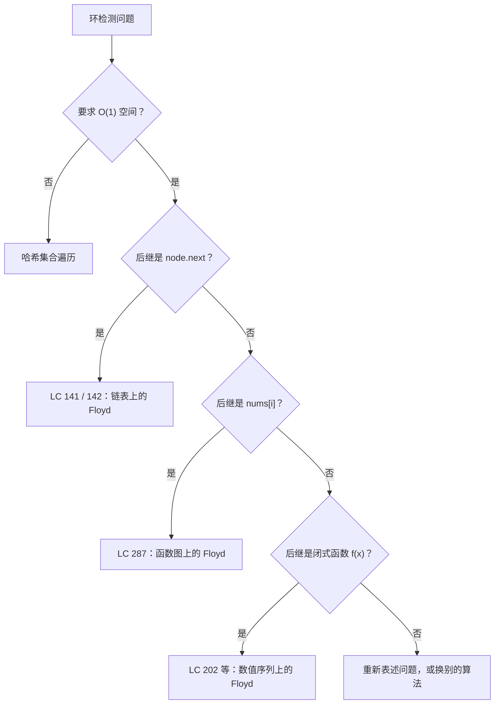

# 环检测（Floyd 龟兔算法）

一条 10 万个节点的单链表。某个节点的 `next` 指针可能指回链表中。找出环从哪儿开始，或者证明根本没有环。难点在于：你只有两个指针大小的变量，别的什么都没有。没有哈希集合，没有访问过的节点列表，也不能复制输入。

这个约束就是本章的全部内容。最自然的答案是拿一个哈希集合记下见过的指针，而这个答案要为一个本可以用 O(1) 空间解决的问题多付 O(n) 内存。O(1) 的解法是 Floyd 龟兔算法。它分两个阶段跑，第二阶段依赖一段模运算——本书这一部分里最漂亮的三行证明。

## 何时该用它

信号很窄，也很好认：一个确定性的后继序列，可能最终会重复，再加上一条禁止线性额外内存的约束。有三种输入形态会发出这个信号。一种是单链表，它的尾节点可能指回某个内部节点（LC 141、LC 142）。一种是长度 `n+1` 的整数数组 `nums`，取值落在 `[1, n]`，把它当作函数 `i → nums[i]`，由鸽巢原理可知它的轨道里必然出现重复（LC 287）。还有一种是由显式后继函数构造出的数值序列，比如各位数字平方和映射（LC 202）。[^1] 三者都归约成同一件事：迭代 `f`，判断轨道是否成环，成环就指出入口。一个算法，三种输入方言。

门口的保安是 **O(1) 辅助空间**这一条。哈希集合用 O(n) 时间和 O(n) 空间判定存在性；LC 287 明确堵掉这条路，它要求常数级额外空间*并且*禁止修改数组。Floyd 只持两个指针大小的变量，从不复制输入，所以从构造上就满足这个界。没有这条约束时，哈希集合短六行、也更清楚；只有当约束逼你的时候才用 Floyd。[^2]

## 如何识别这个模式



*挑选合适环检测工具的决策流程。三个末端上的 Floyd 分支是同一个十行算法，只是 `successor(x)` 的实现不同。*

## 为什么显而易见的解法浪费 O(n) 内存

按一个没太留神的面试官的思路走一遍 LC 141（Linked List Cycle，简单）。维护一个 `seen` 集合；每访问一个节点，检查是否来过；来过就返回 true；走到 null 就返回 false。能跑。六行。

```python
# 暴力解法：O(n) 时间、O(n) 空间——面试书最先印出来的答案。
def has_cycle_brute(head):
    seen = set()
    node = head
    while node is not None:
        if node in seen:
            return True
        seen.add(node)
        node = node.next
    return False
```

每个输入上都对。哪个输入上都不会超时。问题出在哈希集合：它随链表长度线性增长，而 LC 142 最硬的那个追问（`Could you solve it using O(1) memory?`）正好卡在这一条上。修法就藏在链表自身的结构里。

如果存在环，链表形状就是希腊字母 ρ：一条柄（从 `head` 到环入口的前缀）加一个圈（环本身）。两个跑者以不同速度在这条跑道上跑，最终一定会在圈里相遇，因为快的那位每步都在把差距缩小一格。两个指针大小的变量，不用哈希集合。


*带环的链表形状像字母 rho：从 `head` 到环入口有一段长度 `a` 的前缀，之后是一个长度 `L` 的环。阶段 1 的相遇点在入口之后 `b` 步。阶段 2 的推导 `a = k*L - b` 才是把“相遇点”变成“入口”的关键。*

## 阶段 1：检测是否存在环

两个指针都从 `head` 出发。慢指针每步前进一个节点，快指针每步前进两个。一直重复到 fast（或 `fast.next`）为 null，此时链表无环，收工；或者到 slow 与 fast 指向同一个节点，此时存在环。

```python
def has_cycle(head):
    slow, fast = head, head
    while fast is not None and fast.next is not None:
        slow = slow.next
        fast = fast.next.next
        if slow is fast:  # 比的是指针身份，不是值相等
            return True
    return False
```

**题解** — Python（[Java](./03-cycle-detection/lc-141/sol.java) · [C++](./03-cycle-detection/lc-141/sol.cpp) · [Go](./03-cycle-detection/lc-141/sol.go)）

```python
# LC 141. Linked List Cycle
from typing import Optional


class ListNode:
    __slots__ = ("val", "next")

    def __init__(self, val: int) -> None:
        self.val = val
        self.next: Optional["ListNode"] = None


def has_cycle(head: Optional[ListNode]) -> bool:
    """LC 141: return True iff the list contains a cycle, else False."""
    slow = head
    fast = head
    while fast is not None and fast.next is not None:
        slow = slow.next
        fast = fast.next.next
        if slow is fast:  # 比的是指针身份，不是值相等
            return True
    return False
```

为什么会终止？两个指针都进入长度为 `L` 的环之后，fast 每次迭代恰好比 slow 多前进一格，因为 fast 走两步、slow 走一步。`L` 环内的最大间距是 `L - 1`，所以 slow 刚进环之后最多再迭代 `L - 1` 次就撞上。slow 在第 `a` 步进环（`a` 就是前缀长度）。合计最多 `a + L - 1` 次迭代，即 O(n)。[^3]

如果链表无环，fast 会一路走到尽头。最多 `⌈n/2⌉` 次迭代后，要么 fast 为 null，要么 `fast.next` 为 null。循环退出，函数返回 false。同样是 O(n) 的界。

> [!IMPORTANT]
> **比的是指针身份，不是值相等。** 比较 `slow is fast`（Python），等价于 Java 引用类型上的 `slow == fast`，或 C++、Go 里的指针 `==`，判断的是两个变量是否持有同一个内存地址。一条无环的 `[1, 1, 1, 1, 1]` 链表有五个互不相同的节点，值都是 1；若写成 `slow.val == fast.val`，第一次迭代就会误报有环。算法依赖的是“哪个节点”，不是“什么值”。

## 阶段 2：定位环的入口（LC 142）

阶段 1 确认了环存在，同时把 slow 和 fast 停在环内的*某个*节点上。这个节点几乎从来不是环入口，而 LC 142 要的恰恰是入口。阶段 2 就是把“相遇”变成“入口”的那一步算法。

把 slow 重置到 `head`，fast 原地不动。然后两个指针都以速度 1 前进，直到再次相遇。相遇的那个节点就是环入口。

```python
def detect_cycle(head):
    slow, fast = head, head
    # 阶段 1：检测环是否存在。
    while fast is not None and fast.next is not None:
        slow = slow.next
        fast = fast.next.next
        if slow is fast:
            # 阶段 2：定位环入口。两个指针都以速度 1 前进。
            slow = head
            while slow is not fast:
                slow = slow.next
                fast = fast.next
            return slow
    return None
```

**题解** — Python（[Java](./03-cycle-detection/lc-142/sol.java) · [C++](./03-cycle-detection/lc-142/sol.cpp) · [Go](./03-cycle-detection/lc-142/sol.go)）

```python
# LC 142. Linked List Cycle II
from typing import Optional


class ListNode:
    __slots__ = ("val", "next")

    def __init__(self, val: int) -> None:
        self.val = val
        self.next: Optional["ListNode"] = None


def detect_cycle(head: Optional[ListNode]) -> Optional[ListNode]:
    """LC 142: return the node where the cycle begins, or None if no cycle."""
    slow = head
    fast = head
    # 阶段 1：检测环是否存在。
    while fast is not None and fast.next is not None:
        slow = slow.next
        fast = fast.next.next
        if slow is fast:  # 比的是指针身份，不是值相等
            # 阶段 2：定位环入口。重置 slow，之后两者同速前进。
            slow = head
            while slow is not fast:
                slow = slow.next
                fast = fast.next
            return slow
    return None
```

这样做有效。有效的原因是全章最不显然的一步，下一节专门讲它。

### 为什么相遇点正好对齐起点

设 `a` 为从 `head` 到环入口的距离，`L` 为环长，`b` 为从入口到阶段 1 相遇点的距离（沿遍历方向度量）。

阶段 1 结束时，slow 走了 `a + b` 步。按速度 2 的规则，fast 走了两倍，即 `2(a + b)` 步。但 fast 还在环里绕了若干整圈，把这个圈数记为 `k`，`k ≥ 1`。于是 fast 的总行程是 `a + b + k·L`。把 fast 行程的两种表达式令其相等，得到

`2(a + b) = a + b + k·L`

化简得

**`a = k·L - b`**

这个等式就是两阶段论证的全部。从几何上读它：从相遇点出发（它在环内、入口之后 `b` 步），再走 `a` 步，等于绕 `k - 1` 整圈再加上 `L - b` 步，恰好落回入口。换句话说，从 `head` 走 `a` 步按定义就到入口。[^4]

所以把一个指针重置到 `head`、两个都以速度 1 前进，再走恰好 `a` 步后两者都会站在环入口；在这之前它们不可能撞上，因为 slow 还在前缀上（尚未进环），fast 还在环里（尚未到入口）。它们第一次重合的位置就是入口。

拿本章的标准输入跑一遍，感受一下这个代数：`[1, 3, 2, 0, -4]`，`pos = 2`，所以尾节点指回索引 2。五个互不相同的节点，环长 3。这里 `a = 2`、`L = 3`、`b = 1`、`k = 1`。代入：`a = k·L - b` 变成 `2 = 1·3 - 1`。算术在这组具体数字上对得上，而上面的符号论证保证了它对每条带环链表都成立。

## 实例推演：在 `[1, 3, 2, 0, -4]`、`pos = 2` 上跑 LC 142

> **Interactive widget:** [Floyd 龟兔算法（环检测）](../../../dsa/widgets/w-14-floyd-cycle.yml) —— 在网站上渲染；YAML 规格文件描述了关键帧。

*Floyd 两阶段在标准输入上的运行。第 3 步是阶段 1 的终点（两指针在索引 3、值 0 处相遇）；第 4 步把 slow 重置回头节点；第 6 步拿到答案（两指针同时落在索引 2，即环入口）。总共七步。先自己走一遍，再读下面的文字。*

起始阶段是两次迭代：slow 走 `head → idx 1 → idx 2`，fast 走 `head → idx 2 → idx 4`。第 2 步之后两个指针都已经在环内；第 3 步它们在索引 3（值 0）相遇，即入口之后一步，所以 `b = 1`。第 4 步的重置把 slow 放回头节点，fast 不动。再两次同速前进，两者在索引 2 重合，那是环入口，值 2。返回该节点。

## 实际开销

| 变体 | 时间 | 空间 | 说明 |
|---|---|---|---|
| 阶段 1（检测是否存在环） | O(n) | O(1) | 两指针都进环后，最多 `a + L - 1` 次迭代。 |
| 阶段 2（定位环入口） | O(n) | O(1) | 恰好 `a` 次迭代；slow 走前缀，fast 再走 `a` 步环内节点。 |
| 合计（LC 142，两阶段） | O(n) | O(1) | Joux 2009 §7.1.1 把该界正式表述为 `O(λ + μ)` 次操作、`O(1)` 存储。[^5] |
| 哈希集合基线 | O(n) | O(n) | 六行。约束允许时就用它。 |
| Brent 算法（替代方案） | O(n) | O(1) | 平均比 Floyd 少约 36% 的函数求值次数；Pollard rho 分解的标准做法，不是 LC 面试的标准答案。[^6] |

`n` 是算法访问到的互不相同节点数，按 Knuth 的记法即 `μ + λ`，其中 `μ` 是前缀长度，`λ` 是环长。在 LC 141 / 142 的输入上，按题目约束它不超过 `10^4`。在 LC 287 上不超过 `10^5`。

## Brent 算法简述

Floyd 是正典，因为证明短、代码只有十行，而且从 Knuth 起每本算法入门教材都讲它。[^7] Brent 算法（Brent 1980）用另一套机制达到同样的界：让龟原地不动，等兔的行程翻倍，再把龟瞬移到兔所在的位置。它直接求出环长 `λ`，不需要阶段 2，平均调用后继函数 `f` 的次数比 Floyd 少约 36%。[^6]

当 `f` 很贵时这一点就重要了：密码学哈希、Pollard rho 映射 `f(x) = x² + c (mod n)`、伪随机生成器的状态转移。而在 LC 面试的范围里，`f` 就是 `node.next`，代价为零，Brent 那点常数级优势不值得多背一套心智负担。知道它存在即可；默认还是用 Floyd。

## 模式失效的场景

各子模式之间唯一变化的东西是后继函数 `f`。两阶段的骨架完全相同。

**链表。** `f(node) = node.next`。LC 141 只做阶段 1；LC 142 是完整算法。

**把整数数组当作函数图（LC 287）。** `f(i) = nums[i]`。设定是：`nums` 长度为 `n+1`、取值落在 `[1, n]`，由鸽巢原理必有两个下标共享同一后继；这就迫使函数图里出现环；环的入口就是重复的那个值。索引 0 不可能是重复值（取值在 `[1, n]`，不在 `[0, n-1]`），所以 0 落在前缀上，阶段 2 照样能走到入口。实现上只换一处：`slow = nums[slow]`，`fast = nums[nums[fast]]`。

**后继函数有闭式表达的数值序列（LC 202）。** `f(n) =` `n` 的各位十进制数字的平方和。这里根本没有数据结构，“节点”就是当前的整数值。从种子开始迭代，若到达 1，输入就是快乐数；否则轨道会在非 1 的值之间循环，Floyd 不必存储访问过的前缀就能检测出来。

**带方向约束的变体（LC 457 Circular Array Loop）。** 同样的速度 1 / 速度 2 机制，外加两个提前终止条件：跳跃方向变号意味着方向不一致（不是合法环）；一步自环（`nums[i]` 是 `n` 的倍数）同样不合格。基础骨架不变，只是停止条件更严。

## 三个最容易踩的坑

> [!WARNING]
> **阶段 2 里 fast 仍然按速度 2 前进。** LC 142 上最常见的 bug。作者把阶段 1 的循环体直接拷过来，忘了把 `fast = fast.next.next` 改成 `fast = fast.next`。阶段 1 看着没问题；阶段 2 返回的是环内某个并不是入口的节点。`a = k·L - b` 的推导只在阶段 2 两指针同速时成立；把 fast 的速度加倍会破坏这个代数，相遇点也就失去意义。[^8]

> [!WARNING]
> **忘了 `fast.next != null` 的短路判断。** 循环守卫必须按这个顺序写：`fast != null && fast.next != null`。写成 `fast.next != null && fast != null` 会在判空之前先解引用 `fast`，在任何无环输入上产生 `NullPointerException`（Java）、`AttributeError`（Python）、段错误（C++）或空指针 panic（Go）。环检测必须在“没有环”的输入上也是安全的。

> [!WARNING]
> **返回相遇点而不是环入口。** 只用阶段 1 解决了 LC 141、然后把同一份代码提交到 LC 142 的人，会在 `[3, 2, 0, -4]`、`pos = 1` 上挂掉。阶段 1 的相遇点在环内，但一般并不落在入口；阶段 2 是把“相遇”变成“入口”的那一步。修法是机械的（补上阶段 2），但这个 bug 会出现，恰恰因为阶段 1 *看起来*已经成功了。

## 题目梯度

### 核心（三题全做才算掌握本章）

- [LC 141 — Linked List Cycle](https://leetcode.com/problems/linked-list-cycle/) [简单] • floyd-tortoise-hare-existence
- [LC 142 — Linked List Cycle II](https://leetcode.com/problems/linked-list-cycle-ii/) [中等] • floyd-tortoise-hare-entry ★
- [LC 287 — Find the Duplicate Number](https://leetcode.com/problems/find-the-duplicate-number/) [中等] • floyd-tortoise-hare-functional-graph

### 进阶（可选）

- [LC 202 — Happy Number](https://leetcode.com/problems/happy-number/) [简单] • floyd-tortoise-hare-on-number-sequence
- [LC 457 — Circular Array Loop](https://leetcode.com/problems/circular-array-loop/) [中等] • floyd-tortoise-hare-with-direction-filter

核心三题覆盖简单与中等，没有困难题。候选池里不存在以 Floyd 龟兔算法为标准解的困难 LC 题；最接近的困难题要么锁在别的章节（LC 23 基于堆，归在[堆](../../../dsa/part-6-trees-heaps/04-heaps-priority-queues.md)那一章），要么用的是完全不同的算法（LC 25 是迭代改指针）。本章带着 `no-hard-canonical` 这个选题标记发布，而不拿相邻模式的题来凑数。

## 后续衔接

双指针这套设置在[链表反转](./01-reversal-patterns.md)里会接着用，那里是同样的三指针节奏，只不过目的换成原地改指针，而不是检测环。LC 287 的函数图视角会在[拓扑排序](../../../dsa/part-8-graphs/04-topological-sort-kahn.md)里再次出现：DAG 里的后继指针可以套用同一套“边迭代边检测”的心智模型。区别在于找到环之后你做什么：在 8.4 里，环是矛盾；在这里，环就是答案。

## 参考文献

[^1]: Wikipedia，“Cycle detection”条目，*Algorithms / Floyd's tortoise and hare* 一节。该条目梳理了这三种输入形态，并指出这个算法并未出现在 Floyd 已发表的工作里。<https://en.wikipedia.org/wiki/Cycle_detection>.

[^2]: LeetCode 第 287 题：Find the Duplicate Number。约束包含 “must use only constant extra space” 与 “must not modify the array”，两条合起来从构造上就排除了哈希集合这一基线解法。<https://leetcode.com/problems/find-the-duplicate-number/>.

[^3]: CP-Algorithms，“Tortoise and Hare Algorithm (Linked List cycle detection)”，*Why does it work* 一节，其中给出了 `slowDist = a + xL + b`、`fastDist = a + yL + b` 的显式推导。<https://cp-algorithms.com/others/tortoise_and_hare.html>.

[^4]: Donald E. Knuth，*The Art of Computer Programming* 第 2 卷 *Seminumerical Algorithms*，第 3 版，Addison-Wesley，1997。

[^5]: Antoine Joux，*Algorithmic Cryptanalysis*，CRC Press，2009，§7.1.1 “Floyd's cycle-finding algorithm”，pp.

[^6]: Richard P. Brent，“An improved Monte Carlo factorization algorithm”，*BIT Numerical Mathematics* 20(2)，1980，pp. 176-184。文中报告相比 Floyd 平均减少约 36% 的函数求值次数，用在 Pollard rho 分解上整体加速约 24%。<https://doi.org/10.1007/BF01933190>.

[^7]: MIT Algorithm Wiki，“Floyd's tortoise and hare algorithm (Cycle Detection)”，运行时间分析 O(λ + μ)、空间 O(1)，并给出教科书式的两阶段形态。<https://web.archive.org/web/20240816115115/https://algorithm-wiki.csail.mit.edu/wiki/Floyd's_tortoise_and_hare_algorithm_(_Cycle_Detection)>.

[^8]: LeetCode Discuss 上关于 LC 142 的讨论帖，把阶段 2 里 fast 仍按速度 2 前进这个 bug 列为“通过阶段 1、但入口输出错误”的提交中最常见的 off-by-two 错误，此处经由 labuladong 的注释版讲解引用。<https://labuladong.online/en/algo/leetcode/linked-list-cycle-ii/>.
