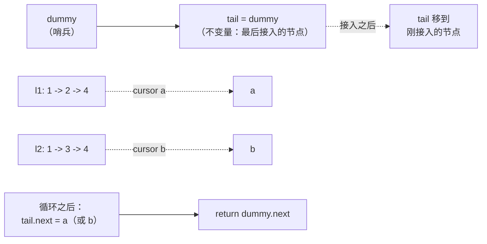

# 合并链表

两条有序链表 `[1, 2, 4]` 和 `[1, 3, 4]`，任务是把它们合成一条有序链表 `[1, 1, 2, 3, 4, 4]`，而且不新建任何节点。最后那句才是全部难点。数值本身不难。难的是指针手术——走两个游标，把更小的那个头接到输出链上，同时不丢掉答案的头——第一次见到 LC 21 的人，半小时就卡在这里。

头指针之所以是麻烦：你写下第一个 `if` 的瞬间就有了两个分支，而两个分支都想设置答案的头。于是你写 `if head is None: head = small; else: tail.next = small`，特例吃掉半个函数，而 bug 的面积恰好就是那行只在其中一个分支里初始化了 head 的代码。本章的全部技巧，就是用顶上的一行让这个问题消失：`dummy = ListNode(0); tail = dummy`。头有了名字。`dummy.next` 就是答案。每一次迭代长得都一样，首节点特例不见了，归并塌缩成一句话：比较两个头，接上更小的那个，推进对应游标。[^1]

本章把归并讲两遍。前半部分比较双链表归并（LC 21）的**递归与迭代**两种写法。同一个算法，同样的复杂度，但其中一个要为每个节点在调用栈上占一帧，另一个一分不付。后半部分推广到 *k* 条链表（LC 23），比较**分治与堆**两种归并。两者都跑 O(N log k)；差别在于为这个上界各自付出了什么，而资深面试官会问你喜欢哪个、为什么。

## 一张图看懂哑节点机制



*不变量：`tail` 始终指向最后接入的节点，`dummy.next` 是答案的头。循环之后的那次赋值，用一次指针写就把活下来的游标整段接上。*

循环之后的收尾，正是内层循环能在一个游标走空时立刻停下的原因。活下来那条游标的剩余部分，相对已合并的前缀本来就有序；按构造，它每个值都严格大于（或等于）循环已经输出过的任何值。所以把它整段接到 `tail.next` 上，O(1) 就完事，不用再遍历一遍。忘了这行，输出会被悄悄截断；这种 bug 能通过两边等长的样例，却在一条输入占绝对多数时立刻失败。[^2]

## LC 21：迭代归并

样例 `l1 = [1, 2, 4]`，`l2 = [1, 3, 4]`。两个游标都在各自头部，tail 在哑节点上。比较 `1 <= 1`，接上 `l1` 的节点，推进 `a`。比较 `2 <= 1`？否，接上 `l2` 的 1，推进 `b`。比较 `2 <= 3`，接上 `l1` 的 2，推进 `a`。比较 `4 <= 3`？否，接上 `l2` 的 3，推进 `b`。比较 `4 <= 4`，接上 `l1` 的 4，推进 `a`。现在 `a` 为空；循环之后的收尾把 `tail.next` 指向 `b`，也就是 `[4]` 那个节点，结束。输出：`[1, 1, 2, 3, 4, 4]`。

```python
def merge_two_lists_iterative(l1, l2):
    dummy = ListNode(0)             # 哨兵；永不返回，.next 才是答案
    tail = dummy                    # 不变量：tail 指向最后接入的节点
    a, b = l1, l2
    while a is not None and b is not None:
        if a.val <= b.val:          # 用 `<=` 保证归并稳定：相等时 l1 胜出
            tail.next = a
            a = a.next
        else:
            tail.next = b
            b = b.next
        tail = tail.next
    tail.next = a if a is not None else b   # 一次 O(1) 接入，把剩下那段整个挂上
    return dummy.next
```

**解法** — Python ([Java](./04-merging-linked-lists/lc-21/sol.java) · [C++](./04-merging-linked-lists/lc-21/sol.cpp) · [Go](./04-merging-linked-lists/lc-21/sol.go))

```python
# LC 21. Merge Two Sorted Lists
"""Two implementations of LC 21:

`merge_two_lists_iterative` is the chapter's preferred form: dummy node
plus a tail pointer, splice the smaller head, advance that cursor, drain
the survivor in one pointer assignment. O(n + m) time, O(1) auxiliary.

`merge_two_lists_recursive` is the textbook recursive form. Same time
bound, but O(n + m) recursion-stack space; the iterative form is what
ships in interviews.
"""
from __future__ import annotations
from typing import Optional


class ListNode:
    """LeetCode's standard singly-linked list node."""

    __slots__ = ("val", "next")

    def __init__(self, val: int = 0, nxt: "Optional[ListNode]" = None) -> None:
        self.val = val
        self.next = nxt


def merge_two_lists_iterative(
    l1: Optional[ListNode], l2: Optional[ListNode]
) -> Optional[ListNode]:
    """Iterative dummy-node + tail-pointer merge. Stable: l1 wins on ties."""
    dummy = ListNode(0)             # 哨兵；永不返回，.next 才是答案
    tail = dummy                    # 不变量：tail 指向最后接入的节点
    a, b = l1, l2
    while a is not None and b is not None:
        if a.val <= b.val:          # 用 `<=` 保证归并稳定：相等时 l1 胜出
            tail.next = a
            a = a.next
        else:
            tail.next = b
            b = b.next
        tail = tail.next
    tail.next = a if a is not None else b   # 一次 O(1) 接入，把剩下那段整个挂上
    return dummy.next


def merge_two_lists_recursive(
    l1: Optional[ListNode], l2: Optional[ListNode]
) -> Optional[ListNode]:
    """Textbook recursive form. O(n + m) recursion stack; prefer iterative."""
    if l1 is None:
        return l2
    if l2 is None:
        return l1
    if l1.val <= l2.val:
        l1.next = merge_two_lists_recursive(l1.next, l2)
        return l1
    l2.next = merge_two_lists_recursive(l1, l2.next)
    return l2
```

`<=`（而不是 `<`）做的事比看上去多。相等时胜出的是 `l1`，这就保住了两个输入中等值键的相对次序。这正是 CLRS §2.3.1 里的**稳定归并（stable-merge）不变量**，也是归并排序的数组归并所依赖的同一个性质。[^3] LC 21 的判题只看数值，所以 `<` 和 `<=` 都能过。可一旦在这个原语之上搭归并排序（第 2.3 章的 LC 148 就是这么干的），归并排序的稳定性主张就取决于往下三层函数调用处的那个比较符。把这句注释写下来。未来的你会读到它。

任何时刻同时在飞的指针有三个：`dummy`、`tail`，以及 `(a, b)` 中的一个。辅助空间 O(1)，与输入规模无关。

## LC 21：递归归并

同一个算法，写成对两个头的递归：

```python
def merge_two_lists_recursive(l1, l2):
    if l1 is None:
        return l2
    if l2 is None:
        return l1
    if l1.val <= l2.val:
        l1.next = merge_two_lists_recursive(l1.next, l2)
        return l1
    l2.next = merge_two_lists_recursive(l1, l2.next)
    return l2
```

读一遍：任一条链表为空就返回另一条（循环之后那段收尾就藏在这里）。否则取出更小的头，把它的 `.next` 指向「剩下部分的归并结果」，然后返回它。信任递归（见[递归心智模型](../part-0-foundations/02-recursion-mental-model.md)）。函数在更小的子问题上做对了，而头部决策只是一次比较。

它比迭代版好看。没有哑节点，没有 tail，没有特例。递归的 base case 处理空链表；头指针由递归调用免费处理。

代价是藏起来的，而且不小。每次递归调用都是调用栈上的一帧。最坏情况，当一条链表占绝对多数、我们一路沿着它递归下去时，栈深会长到 `n + m`。LC 21 的约束是 `0 <= n, m <= 50`，永远不会爆栈。但 LC 148（Sort List）里同一个原语是归并排序的归并步骤，输入能到 50,000 个节点，那时一定会爆。Sedgewick 的《Algorithms》§2.2 直接点出这件事：递归版链表归并的栈空间是 Θ(n + m)，迭代版是 Θ(1)。[^4]

## 两者之间怎么选

| | 迭代 | 递归 |
|---|---|---|
| 时间 | Θ(n + m) | Θ(n + m) |
| 辅助空间 | Θ(1) | Θ(n + m) 调用栈 |
| 代码行数 | 11 | 8 |
| 读起来清爽 | 是，前提是有注释 | 是，不需要注释 |
| n = 50,000 时仍可用 | 能 | 栈溢出 |
| 用作归并排序的归并步骤 | 可以 | 不行（会爆栈） |

面试该交的是迭代版。递归代码换来的是追问「不错，那栈呢？」，而你回答这道追问的办法，还是把迭代版写出来。递归版用来证明你看懂了结构；上线的那个是迭代版。

这个模式在链表题里反复出现。递归的写法更短，跑得起来的是迭代的写法。输入上限只有几百个节点时（LC 21、LC 206），两种都行。输入上限到了几万（LC 148），迭代就是必须的。

## 实际开销（LC 21）

| 变体 | 时间 | 空间（辅助） |
|---|---|---|
| 迭代：哑节点 + tail | Θ(n + m) | Θ(1) |
| 递归 | Θ(n + m) | Θ(n + m) 调用栈 |

Θ(n + m) 是准确值，不是摊还值：循环每次迭代把一个游标推进一个节点、输出一个节点；任一游标走空循环即结束；循环之后的收尾只是一次指针赋值。两个输入里的每个节点都被访问恰好一次。没有任何输入能让迭代版做超过 `n + m - 1` 次比较；最好的情况（一条链表严格压过另一条）比较次数更少，剩下的那段由收尾以 O(1) 整段接上。[^2]

## 当两个变成 k 个

`mergeKLists` 接收一个含 *k* 条有序链表的数组，返回一条有序链表。LC 21 最朴素的推广是从左到右折叠：把 0 号和 1 号归并，结果再和 2 号归并，依此类推。好写。跑起来是灾难。

若每条链表有 *n* 个节点、一共 *k* 条，第二次归并是 Θ(2n)，第三次是 Θ(3n)，第 *k* 次是 Θ(kn)。总工作量是 Θ(n + 2n + 3n + ... + kn) = Θ(n · k²/2) = Θ(Nk)，其中 N = nk 是节点总数。放到 LC 23 的约束下（*k* 最多 10,000，N 最多 10,000），这是 10⁸ 次操作，远超 1 秒的预算。双链表的上界本来是完美的；顺序推广把它全扔了。[^5]

有两种算法能打到 Θ(N log k)、留在预算内。它们渐进上界相同，常数因子不同，其中一个更容易推理。

## LC 23：分治

把链表两两配对：`lists[0]` 与 `lists[1]` 归并，`lists[2]` 与 `lists[3]` 归并，依此类推。一轮之后剩 ⌈k/2⌉ 条链表。再两两配对。重复到只剩一条。

```python
def merge_k_lists_divide_conquer(lists):
    if not lists:
        return None
    while len(lists) > 1:
        merged = []
        for i in range(0, len(lists), 2):
            a = lists[i]
            b = lists[i + 1] if i + 1 < len(lists) else None
            merged.append(_merge_two(a, b))
        lists = merged
    return lists[0]
```

**解法** — Python ([Java](./04-merging-linked-lists/lc-23/sol.java) · [C++](./04-merging-linked-lists/lc-23/sol.cpp) · [Go](./04-merging-linked-lists/lc-23/sol.go))

```python
# LC 23. Merge k Sorted Lists
"""Two implementations of LC 23. Same O(N log k) bound, different
constants, different practical considerations.

`merge_k_lists_heap` keeps a min-heap of (val, list_index, node)
triples. Each of N nodes is pushed once and popped once; each heap op
is O(log k). Tiebreak on list_index keeps Python's heapq from comparing
ListNode references.

`merge_k_lists_divide_conquer` pairs lists up and merges in a
balanced binary tree. log k levels, O(N) work per level. Uses LC 21's
iterative merge as the leaf operation. O(log k) recursion stack
(versus O(k) heap memory) and no PriorityQueue dependency.
"""
from __future__ import annotations
import heapq
from typing import List, Optional


class ListNode:
    """LeetCode's standard singly-linked list node."""

    __slots__ = ("val", "next")

    def __init__(self, val: int = 0, nxt: "Optional[ListNode]" = None) -> None:
        self.val = val
        self.next = nxt


def _merge_two(a: Optional[ListNode], b: Optional[ListNode]) -> Optional[ListNode]:
    """The LC 21 iterative merge. Used as the leaf step of the d-and-c form."""
    dummy = ListNode(0)
    tail = dummy
    while a is not None and b is not None:
        if a.val <= b.val:
            tail.next = a
            a = a.next
        else:
            tail.next = b
            b = b.next
        tail = tail.next
    tail.next = a if a is not None else b
    return dummy.next


def merge_k_lists_heap(lists: List[Optional[ListNode]]) -> Optional[ListNode]:
    """Min-heap of cursors. O(N log k) time, O(k) auxiliary."""
    dummy = ListNode(0)
    tail = dummy
    heap: list = []
    for i, head in enumerate(lists):
        if head is not None:
            heapq.heappush(heap, (head.val, i, head))   # (val, idx, node) 三元组
    while heap:
        _val, idx, node = heapq.heappop(heap)
        tail.next = node
        tail = tail.next
        if node.next is not None:
            heapq.heappush(heap, (node.next.val, idx, node.next))
    tail.next = None    # 断开仍指向输入链表的尾部
    return dummy.next


def merge_k_lists_divide_conquer(lists: List[Optional[ListNode]]) -> Optional[ListNode]:
    """Pairwise merge tree. O(N log k) time, O(log k) recursion-stack space."""
    if not lists:
        return None
    while len(lists) > 1:
        merged = []
        for i in range(0, len(lists), 2):
            a = lists[i]
            b = lists[i + 1] if i + 1 < len(lists) else None
            merged.append(_merge_two(a, b))
        lists = merged
    return lists[0]
```

这段开销分析是本章最干净的。配对一共 ⌈log₂ k⌉ 层。每一层上，所有链表的每个节点都被访问恰好一次。第 0 层每对触到 2n 个节点，但这样的对有 k/2 个，2n · k/2 = N。每一层的算术都一样：每层总工作量 Θ(N)，一共 log k 层。合计：Θ(N log k)。[^5]

写成递推式：`T(k) = 2·T(k/2) + Θ(N)`。由主定理，这是 Θ(N log k)。

递归的辅助空间是 Θ(log k)（在这个迭代实现里，同样的量落在临时的 `merged` 列表上）。值得注意的是没有辅助数据结构：叶子步骤就是 LC 21 的迭代归并，它本身只占 O(1) 辅助空间。整个算法不用优先队列，除了链表头数组之外不占额外内存。

## LC 23：基于堆

维护一个含 *k* 个游标的最小堆，每条非空输入链表一个。每一步弹出头部值最小的游标，把那个节点接到输出链上，再把该游标的下一个节点（若非空）push 回堆。

```python
def merge_k_lists_heap(lists):
    dummy = ListNode(0)
    tail = dummy
    heap = []
    for i, head in enumerate(lists):
        if head is not None:
            heapq.heappush(heap, (head.val, i, head))   # (val, idx, node) 三元组
    while heap:
        _val, idx, node = heapq.heappop(heap)
        tail.next = node
        tail = tail.next
        if node.next is not None:
            heapq.heappush(heap, (node.next.val, idx, node.next))
    tail.next = None
    return dummy.next
```

上界：N 个节点各入堆一次、出堆一次。在 *k* 个元素的堆上，每次堆操作是 O(log k)。合计 2N · O(log k) = Θ(N log k)。[^3] [^5] 堆里最多只有 *k* 个条目（每条输入链表一个游标），所以辅助空间是 Θ(k)。

讲堆的那一章从第一原理证明了这个上界；这里直接用结论。CLRS §6.5 证明 `HEAP-EXTRACT-MIN` 和 `MIN-HEAP-INSERT` 在 *k* 个元素的堆上都是 O(log k)。[^3]

有一个细节，每个 Python 实现者第一次都会栽在上面：堆条目必须是 `(val, idx, node)`，不能是 `(val, node)`。当两个游标的头部值相等时，Python 的 `heapq` 会落到比较元组的第二个元素。写成 `(val, node)` 时，那个元素是 `ListNode`，于是抛 `TypeError: '<' not supported between instances of 'ListNode' and 'ListNode'`。链表下标字段确定性地打破平局，且每个游标唯一，因此比较器构成全序，`ListNode` 永远不会被拿去做大小比较。C++ 用裸指针时有同样的问题（比较结果由实现定义，意味着跨次运行结果不确定）；Java 里对应的惯用写法是 `Comparator.comparingInt(...).thenComparingInt(...)`。

## 分治与堆之间怎么选

| | 分治 | 基于堆 |
|---|---|---|
| 时间 | Θ(N log k) | Θ(N log k) |
| 辅助空间 | Θ(log k) 递归 / 临时数组 | Θ(k) 堆 |
| 常数因子 | 更低（每个节点不做堆调整） | 更高（每个节点一次上滤 + 下滤） |
| 缓存局部性 | 更好（沿链节点顺序归并） | 更差（堆的访问在数组里跳跃） |
| 外部依赖 | 无，复用 LC 21 的归并 | 标准库的优先队列 |
| 适应流式输入（链表在线到达） | 不能，配对需要一开始就看到所有头 | 能，新游标到达即入堆 |
| 代码行数 | ~12 | ~12 |

两个都对，两个都最优。分治在常数因子和缓存局部性上的优势，来自叶子步骤做的是纯顺序的指针追踪，每个节点没有堆的来回折腾。在多数输入上，LC 23 的分治解实测明显快于堆解，实践中有时差 2-3 倍。同样的渐进复杂度，完全不同的周期数。

链表增量到达时（你没法一次看到全部 *k* 个头），或者这次归并属于一条更长的流水线、那里本来就需要优先队列时，堆才是正确答案。就「给你 *k* 条链表，合起来」这种经典设定而言，分治是更干净的选择。

面试里两个都提。「我会先选分治，常数因子更小，也不需要优先队列；但堆的写法更通用，链表如果是在线到达的，我会用堆。」这个回答会换来下一个问题，通常是「好，那如果链表是无限的怎么办？」

## 实际开销（LC 23）

| 变体 | 时间 | 空间（辅助） |
|---|---|---|
| 顺序左折叠（错误答案） | Θ(N · k) | Θ(1) |
| 分治两两归并 | Θ(N log k) | Θ(log k) 递归 + Θ(k/2) 临时 |
| 游标最小堆 | Θ(N log k) | Θ(k) 堆 |

N 是 *k* 条输入链表的节点总数。Θ(N log k) 在比较模型下是紧的：Greene 1993 推导出堆写法需要 `2N · ⌊log k⌋` 次比较，分治写法严格低于 `N · ⌈log k⌉`；分治的比较次数略低，是因为归并树访问每个节点时，深度恰好等于它所属链表在树中的层级，而堆写法每次都要落到堆重平衡的根上。[^5]

## 两个最容易踩的坑

> [!WARNING]
> **忘了循环之后的收尾。** 内层循环在任一游标变空时立即结束，但活下来那条游标的剩余节点还需要接上。省掉 `tail.next = a if a is not None else b`，输出会被悄悄截断：它能通过两边等长的样例（`[1,2,3]` 对 `[4,5,6]` 恰好能过，因为 LC 的小输入下两边同时耗尽），却在「一条链表占绝对多数」的用例上失败。递归版让收尾变成隐式的（base case `if l1 is None: return l2` 干的是同一件事）；迭代版必须把它显式写出来。

> [!WARNING]
> **堆条目拿裸 `ListNode` 对象做比较。** 把 `(val, node)` push 进 Python 的 `heapq` 能用，直到两个游标撞上相同的头部值；这时 `heapq` 落到比较 `ListNode` 实例，抛 `TypeError`。C++ 会落到比较指针（顺序由实现定义，跨次运行不确定）。永远加一个平局决胜字段。链表下标是标准选择，因为每个游标唯一，比较器于是只在数值字段上构成全序。`ListNode` 是载荷，绝不是排序键。

## 题目梯度

### 核心（三题全做才算掌握本章）

- [LC 21 — Merge Two Sorted Lists](https://leetcode.com/problems/merge-two-sorted-lists/) [简单] • merge-two-sorted-lists-dummy-node ★
- [LC 86 — Partition List](https://leetcode.com/problems/partition-list/) [中等] • partition-list-dual-tail-dummy
- [LC 1669 — Merge In Between Linked Lists](https://leetcode.com/problems/merge-in-between-linked-lists/) [中等] • splice-list-into-list-anchor

### 进阶（可选）

- [LC 23 — Merge k Sorted Lists](https://leetcode.com/problems/merge-k-sorted-lists/) [困难] • k-way-merge-min-heap-of-cursors
- [LC 1171 — Remove Zero Sum Consecutive Nodes](https://leetcode.com/problems/remove-zero-sum-consecutive-nodes-from-linked-list/) [中等] • prefix-sum-on-linked-list-with-dummy

LC 23 是本章天然的 Hard，但它的完整讲解（含堆内部实现的深入探讨）在[堆](../../../dsa/part-6-trees-heaps/04-heaps-priority-queues.md)那一章。那里的主角是堆，我们在这里只把它列为进阶，避免游标这套讲法重复。LC 1171 是跨模式的进阶题，在链表上用了[前缀和 + 哈希表组合](../part-3-pointers-window-prefix/05-prefix-sum-hash.md)，靠哑节点把前缀和 0 锚在下标 -1 上。

## 后续衔接

这个归并原语还会作为链表归并排序的归并步骤，出现在[比较排序（一）](../part-2-search-sort/03-comparison-sorts-1.md)（LC 148，Sort List）。那一章交付的是归并排序算法本身；本章交付的是它所依赖的归并原语，而迭代版 O(1) 的辅助空间，正是让「在归并排序上做递归」在五万个节点的输入上还能跑得动的原因。

哑节点机制本身在 [LRU 缓存](./05-lru-cache.md)里又往前走了一步：双向链表的头部和尾部**都**放哨兵，于是每个链表操作都成了四行改动，任何地方都不再有头或尾的特例。同一个想法用两次；LRU 缓存模式才是生产系统真正在用的东西。

## 参考文献

[^1]: GeeksforGeeks，"Merge two sorted linked lists using Dummy Nodes"。<https://www.geeksforgeeks.org/dsa/merge-two-sorted-linked-lists-using-dummy-nodes/>。

[^2]: Wikipedia contributors，"Merge algorithm"，最后编辑于 2025 年。<https://en.wikipedia.org/wiki/Merge_algorithm>。

[^3]: Cormen, Leiserson, Rivest, Stein，*Introduction to Algorithms*，第 4 版，MIT Press，2022。

[^4]: Sedgewick and Wayne，*Algorithms*，第 4 版，Addison-Wesley / Princeton，2011。§2.2 "Mergesort"，在线地址 <https://algs4.cs.princeton.edu/22mergesort/>。

[^5]: Greene, William A.，"k-way Merging and k-ary Sorts"，Proc. 31st Annual ACM Southeast Conference，1993，pp. 127-135。<http://www.cs.uno.edu/people/faculty/bill/k-way-merge-n-sort-ACM-SE-Regl-1993.pdf>。
