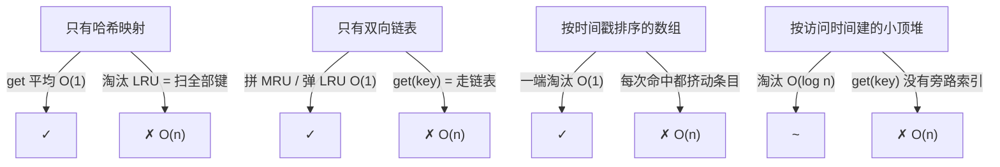
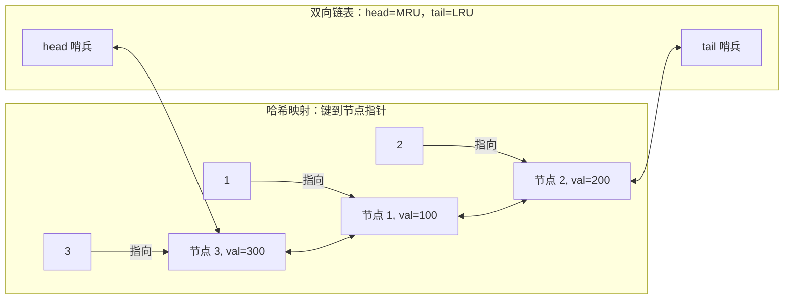

# LRU 缓存：哈希映射 + 双向链表

LeetCode 146 的题干里有两个字符，比整道题其余部分加起来更能吓住候选人：`O(1)`。`get` 和 `put` 都必须跑在常数时间里。把这个约束读两遍。缓存最多放 3,000 个条目，LRU 策略要求每次溢出时找出并淘汰最久没被碰过的那个条目，而要在给定时间界内走通这套契约，唯一的路是一种大多数候选人在遇到这道题之前从没亲手搭过的结构。

它之所以吓人，是因为显而易见的答案都差一点就成了。哈希映射能把 `get` 做到平均 O(1)，却根本不知道「最久未使用」是什么意思。换成双向链表，从尾部淘汰是 O(1)，可这时又没有办法根据 key 找到对应节点，除非走一遍链表。按访问时间戳排序？每次访问都是 O(n)。按访问时间建小顶堆？O(log n)。每一种单结构尝试都恰好在这两个操作里的一个上失守，而且失守在 API 里最要命的位置。解法是把两个结构接起来，让各自负责对方做不了的那个操作。

## 契约

三个操作，都要求期望 O(1)：

- `LRUCache(capacity)` — 创建一个最多容纳 `capacity` 个键值对的缓存。
- `get(key)` — 键存在就返回值，否则返回 `-1`。命中算一次使用。
- `put(key, value)` — 插入或更新。如果缓存已达容量且键是新的，淘汰最久没被碰过的条目。更新也算一次使用。[^3]

三个微妙之处让这道题比它的 API 看起来更难。第一：对已有键做更新，会把该条目提升为最近使用。`put(k, v)` 不是「写一个值」，而是「写一个值 *并且* 把这个条目标记为刚被碰过」。LC 的测试集对这点有强制校验；漏了它，容量为 1 附近的那组测试就过不去。[^3] 第二：淘汰挑的是最近使用顺序里 *尾部* 的那个条目，绝不会是调用方刚操作过的条目，哪怕那次操作是更新。第三：命中从不修改值，但永远修改最近使用顺序。一次 `get` 在调用方看来是读，对这个结构来说却是写。

## 为什么单一结构永远不够

把每种单结构的代价走一遍。

**只有哈希映射。** `get` 平均 O(1)。写入的 `put` 平均 O(1)。但「淘汰最久没被碰过的键」要求你知道是哪个键，而哈希映射没有顺序。你得扫描全部 `n` 个条目去找最老的时间戳。淘汰是 O(n)。

**只有双向链表。** 把最近碰过的节点拼到头部；淘汰时弹出尾部。给定节点指针，两者都是 O(1)。但 `get(key)` 得先 *找到* 那个节点，而链表不按 key 索引。走链表：O(n)。命中路径 O(n)。

**按时间戳排序的数组。** 从一端淘汰是 O(1)。`get(key)` 没有索引是 O(n)，按 key 二分是 O(log n)（而且现在你还得维护那份索引）。更糟的是：每次命中都把被碰的条目挪到一端，挤动中间每一个条目。每次访问 O(n)。

**按访问时间建的小顶堆。** 没有旁路哈希映射，`get` 仍是 O(n)。淘汰 O(log n)。这个结构比其他几个都更接近答案，但它让你想要的常数时间 `get` 付出了 log 的代价。

每一种尝试都恰好在一个操作上失守。双结构这个技巧的解法是：把每个操作交给天生擅长它的那个结构。



*每一种单结构都有一个操作做不到 O(1)。双结构把每个操作分派给天生擅长它的那一半。*

## 双结构

两块，用一条规则绑在一起。

一条**双向链表**按最近使用顺序存放条目。离 head 最近的节点是最近使用；离 tail 最近的节点是最久未使用。把一个节点拼到头部是四次指针赋值。从链表中任意位置摘除一个节点是两次指针赋值——*前提是你手里有那个节点的指针*。双向这个变体是要紧的：单链表没法在 O(1) 里删除 `x`，因为它没有办法拿到 `x.prev` 去重写它的 `next` 指针。[^1]

一张**哈希映射**把每个键映射到持有它的那个链表节点。不是映射到值，而是映射到 *节点*。这是承重的细节。`get(key)` 做一次映射查找，拿回来的就是它要拼到头部去的那个节点，不必走链表。LRU 契约的两半于是都塌缩成平均 O(1)：映射负责「按键查找」，链表负责「按最近使用顺序拼接与淘汰」。

两条不变量把两个结构绑在一起：

1. 映射和链表永远持有同一组键。每一次映射插入都配一次链表的 `add_to_front`。每一次映射删除都配一次链表的 `remove`。
2. 映射的值类型是 *节点指针*，绝不是面向用户的值。面向用户的值住在节点里面。



*映射里的每个键都指向链表里的一个节点。链表从左到右的顺序编码最近使用程度，MRU 在左，LRU 在右。映射负责查找，链表负责排序。*

[双向链表](./01-reversal-patterns.md) 那一章讲过本章默认你已经会的 prev/next 机制。[链表基础](./00-linked-list-fundamentals.md) 讲过哨兵，它们在这里又一次证明了自己的价值。链表永远持有两个算法从不碰的哑节点：MRU 之前一个 `head` 哨兵，LRU 之后一个 `tail` 哨兵。有哨兵，每次拼接、每次摘除都变成四次指针赋值，不用为「这是头节点吗」「这是尾节点吗」分支。没有哨兵，这些边界情况会翻倍，而且总有一个是错的。[^1]

## 四个操作

两个辅助函数做指针手术；`get` 和 `put` 组合它们。

```python
def _remove(self, node):
    node.prev.next = node.next
    node.next.prev = node.prev

def _add_to_front(self, node):
    node.next = self.head.next
    node.prev = self.head
    self.head.next.prev = node
    self.head.next = node
```

`_remove` 把任意节点从链表的任意位置摘下来：中间、末尾，都无所谓。两次写。`_add_to_front` 把一个节点拼到 head 哨兵后面。四次写。两个辅助函数都不判空，都不特判空链表。哨兵保证 `node.prev` 和 `node.next` 永远是真实节点，即使链表逻辑上持有零个条目（因为那时 `head.next == tail`，`tail.prev == head`）。

`get(key)` 是一次映射查找、一次摘除、一次拼接：

```python
def get(self, key):
    node = self.map.get(key)
    if node is None:
        return -1
    self._remove(node)
    self._add_to_front(node)
    return node.value
```

命中路径跑三个 O(1) 操作。按求和规则，总计 O(1)。[^1][^2] 未命中路径是一次 O(1) 查找加一次提前返回。

`put(key, value)` 有三条分支，顺序很重要：

```python
def put(self, key, value):
    node = self.map.get(key)
    if node is not None:
        node.value = value
        self._remove(node)
        self._add_to_front(node)
        return
    if len(self.map) == self.capacity:
        lru = self.tail.prev
        self._remove(lru)
        del self.map[lru.key]
    new_node = _Node(key, value)
    self.map[key] = new_node
    self._add_to_front(new_node)
```

按顺序读这三条分支。更新分支处理对已有键的 `put`：写入新值，然后拼到头部，因为更新也算一次使用。淘汰分支处理缓存已满时对新键的 `put`：读 `tail.prev`（有 tail 哨兵在，它永远是真实节点），把它从链表摘下，再从映射里删掉它的键。这一对删除的两半都必须跑，否则下一次 `get(evicted_key)` 会返回一个过期节点。插入分支随后创建新节点，把它拼到 head 后面。

淘汰分支跑在插入分支 *之前*，永远不在之后。先插入再淘汰，在容量等于 1 时可能把刚插入的节点当成 LRU，淘汰掉调用方真正想要的那个条目。这个 bug 很难触发，而且在容量 1 反复换入换出那个测试之外的地方全是静默的——这正是 LC 一定要放那个测试的原因。

完整的手写实现：

```python
from typing import Optional


class _Node:
    __slots__ = ("key", "value", "prev", "next")

    def __init__(self, key: int, value: int) -> None:
        self.key = key
        self.value = value
        self.prev: Optional["_Node"] = None
        self.next: Optional["_Node"] = None


class LRUCache:
    def __init__(self, capacity: int) -> None:
        self.capacity = capacity
        self.map: dict[int, _Node] = {}
        self.head = _Node(0, 0)
        self.tail = _Node(0, 0)
        self.head.next = self.tail
        self.tail.prev = self.head

    def _remove(self, node: _Node) -> None:
        node.prev.next = node.next
        node.next.prev = node.prev

    def _add_to_front(self, node: _Node) -> None:
        node.next = self.head.next
        node.prev = self.head
        self.head.next.prev = node
        self.head.next = node

    def get(self, key: int) -> int:
        node = self.map.get(key)
        if node is None:
            return -1
        self._remove(node)
        self._add_to_front(node)
        return node.value

    def put(self, key: int, value: int) -> None:
        node = self.map.get(key)
        if node is not None:
            node.value = value
            self._remove(node)
            self._add_to_front(node)
            return
        if len(self.map) == self.capacity:
            lru = self.tail.prev
            self._remove(lru)
            del self.map[lru.key]
        new_node = _Node(key, value)
        self.map[key] = new_node
        self._add_to_front(new_node)
```

**参考实现** — Python（[Java](./05-lru-cache/lc-146/sol.java) · [C++](./05-lru-cache/lc-146/sol.cpp) · [Go](./05-lru-cache/lc-146/sol.go)）

```python
# LC 146. LRU Cache
from typing import Optional


class _Node:
    __slots__ = ("key", "value", "prev", "next")

    def __init__(self, key: int, value: int) -> None:
        self.key = key
        self.value = value
        self.prev: Optional["_Node"] = None
        self.next: Optional["_Node"] = None


class LRUCache:
    def __init__(self, capacity: int) -> None:
        self.capacity = capacity
        self.map: dict[int, _Node] = {}
        # 头尾哨兵。head.next 是最近使用，tail.prev 是 LRU。
        self.head = _Node(0, 0)
        self.tail = _Node(0, 0)
        self.head.next = self.tail
        self.tail.prev = self.head

    def _remove(self, node: _Node) -> None:
        node.prev.next = node.next
        node.next.prev = node.prev

    def _add_to_front(self, node: _Node) -> None:
        node.next = self.head.next
        node.prev = self.head
        self.head.next.prev = node
        self.head.next = node

    def get(self, key: int) -> int:
        node = self.map.get(key)
        if node is None:
            return -1
        self._remove(node)
        self._add_to_front(node)
        return node.value

    def put(self, key: int, value: int) -> None:
        node = self.map.get(key)
        if node is not None:
            node.value = value
            self._remove(node)
            self._add_to_front(node)
            return
        if len(self.map) == self.capacity:
            lru = self.tail.prev
            self._remove(lru)
            del self.map[lru.key]
        new_node = _Node(key, value)
        self.map[key] = new_node
        self._add_to_front(new_node)
```

`_Node` 上的 `__slots__` 声明在 CPython 3.11 上每个节点省下约 56 字节，因为它抑制了每实例的 `__dict__`；这是热路径内部类的标准写法。C++ 版本用 `std::list::splice`，它是常数时间，并且明确保证被移动元素的迭代器仍然有效；正是这个保证让 `unordered_map` 可以存 list 迭代器，而不必在每次命中时重建。Go 版本在映射里存 `*lruNode` 指针而不是值，因为 Go 的映射值在读取时会被复制；存值会破坏映射条目和链表节点之间的同一性绑定。Java 版本用一个私有内部 `Node` 类直接照搬 Python 的结构。

## 生产级捷径掩盖了什么

每个标准库都备好了同一个数据结构。Python 的 `collections.OrderedDict` 按插入顺序保存条目，提供 `move_to_end(key, last=True)` 和 `popitem(last=False)`，两者都是 O(1)。[^5] Java 有 `LinkedHashMap`，构造参数 `accessOrder = true`，再加上一个可覆写的 `removeEldestEntry` 回调，把淘汰策略直接接进映射。C++ 没有内建；`std::list` 加 `std::unordered_map` 是标准写法。Go 的 `container/list` 加 `map[K]*list.Element` 是对应物。

生产环境的工程师会写 OrderedDict 版本。面试官听到「我会用 OrderedDict」，等于什么都没听到——他无法判断你是否理解底下那层结构。上面那份手写版才是面试的答案，因为面试官考的是你能不能自己把两个结构组合出来；它同样是任何 OrderedDict 这层太高层（非 Python 的服务、标准库不暴露的自定义不变量、你自己掌控的内存布局）的生产系统的答案。对 Python 或 Java 的生产代码来说，走捷径没问题；但真正让你过掉 LC 146、过掉 Meta、Amazon、Google 那些问同一道题的高级轮次的，是底下的机制。

> [!IMPORTANT]
> 如果面试官让你实现 LC 146，别去拿 `OrderedDict` 或 `LinkedHashMap`。面试官要的就是手写版。捷径是对的、快的，也是当场出局的。

## 走一遍标准序列

取容量 2，操作序列 `put(1,1), put(2,2), get(1), put(3,3), get(2), put(4,4), get(1), get(3), get(4)`。这是 LC 146 的样例。下面的 widget 可以刷过全部十步；正文只讲答案真正发生变化的那些时刻。

构建过程平淡无奇：`put(1,1)` 再 `put(2,2)`，节点 2 落在头部，节点 1 落在尾部。第一个有意思的时刻是第 3 步，`get(1)` 命中。节点 1 从尾部位置摘下，拼到头部。节点 2 滑向尾部。这次命中改写了淘汰顺序。

那次提升决定了第 4 步。`put(3,3)` 发现缓存满了。tail 的前驱哨兵交回 LRU，而由于第 3 步的提升，现在 LRU 是节点 2，于是第 4 步淘汰节点 2，不是节点 1。把同一序列去掉第 3 步再跑一遍，被淘汰的就是节点 1。余下的推演是机械的：被淘汰的键未命中，活着的键命中，每次命中都把最近使用顺序挪一个位置。

> **Interactive widget:** [LRU 缓存（哈希映射 + 双向链表）](../../../dsa/widgets/w-15-lru-cache.yml) —— 在网站上渲染；YAML 规格描述了各个关键帧。

*静态降级图：十个关键帧，哈希映射那一行和双向链表那一行并排。每一步高亮活动节点、适用时即将淘汰的节点，以及操作后的 MRU 与 LRU。*

## `put` 的状态机

`put` 在代码里有三条不同的路径，走哪一条取决于映射的状态和当前大小：

```mermaid
stateDiagram-v2
    [*] --> CheckMap: put(k, v)
    CheckMap --> UpdatePath: 键在映射中
    CheckMap --> InsertPath: 键不在映射中
    UpdatePath --> WriteValue: node = map[k]
    WriteValue --> Splice: node.value = v
    Splice --> Done: remove(node); add_to_front(node)
    InsertPath --> CheckSize: 检查 size 与 capacity
    CheckSize --> Evict: size == capacity
    CheckSize --> CreateNode: size < capacity
    Evict --> RemoveLRU: lru = tail.prev
    RemoveLRU --> DeleteFromMap: remove(lru); del map[lru.key]
    DeleteFromMap --> CreateNode
    CreateNode --> AddNew: map[k] = new_node
    AddNew --> Done: add_to_front(new_node)
    Done --> [*]
```



*更新并提升、插入不淘汰、插入并淘汰，是三条路径。两者都触发时，淘汰永远跑在插入之前；正是这个顺序让容量为 1 的情形正确。*

## 实际开销

每个操作都是平均 O(1)，前提是映射上满足简单均匀哈希。

| 操作 | 时间 | 空间 | 依据 |
|---|---|---|---|
| `get(key)`（命中或未命中） | 平均 O(1) | O(n) | CLRS §10.2（双向链表 O(1) 拼接）+ §11.2 定理 11.1（链地址哈希平均 O(1)）[^1][^2] |
| `put(key, value)`（更新路径） | 平均 O(1) | O(n) | 一次映射查找 + 摘除 + 拼接；三个 O(1) 步骤之和 |
| `put(key, value)`（插入，不淘汰） | 平均 O(1) | O(n) | 一次映射查找未命中 + 创建 + 拼接 + 映射插入 |
| `put(key, value)`（插入并淘汰） | 平均 O(1) | O(n) | 同上，外加对 `tail.prev` 的一次摘除和一次映射删除 |
| 对抗性哈希下的最坏情况 | O(n) | O(n) | 所有键冲突到同一个桶；CLRS §11.2 最坏界[^2] |

CLRS 第 10 章 §10.2 确立：给定节点指针，双向链表上的 `LIST-DELETE` 和 `LIST-INSERT` 各自跑在 O(1) 里，而 §10.2 的哨兵论证把空链表这个边界情况从每次拼接里去掉。[^1] CLRS §11.2 定理 11.1 确立：在简单均匀哈希下，链地址法的一次不成功查找期望耗时 `Theta(1 + alpha)`；定理 11.2 对成功查找给出同样的界。当负载因子 `alpha` 被常数封顶时（Java 的 `HashMap` 靠扩容把它压在 0.75 以下，Python 的 `dict` 类似），两个界都塌缩成平均 O(1)。[^2] 组合才是关键的步骤：一次 LRU `get` 是一次映射查找加一次双向链表摘除加一次双向链表拼接，三个 O(1) 步骤，总计 O(1)。

「平均」这个限定在 staff 级别是要紧的。能控制键、又知道哈希函数的攻击者，可以把所有键赶进同一个桶；链地址法的链于是变成一条链表，查找退化到每次 O(n)。Klink 和 Walde 在 2011 年针对 Python 和 Ruby 的 Web 框架演示了这一点；CPython 的回应是 PEP 456 和 SipHash，Java 的回应是把超过阈值的长链树化。撑着一个公开 API 的 LRU 缓存会继承这份暴露面，而缓解手段在哈希函数，不在缓存结构。

## LFU 与游标变体如何延展这个形状

双结构的想法可以推广。题目梯度上有两个近亲。

**LFU（LC 460）。** 淘汰维度换成访问频率，频率相同再按最近使用次序打破平局。朴素解维护一个按访问次数排序的小顶堆，每次操作付 O(log n)。Matani、Shah 和 Mitra 在 2010 年证明：把堆换成一条由 *频率桶* 组成的双向链表——每个桶本身又是该频率上条目组成的双向链表——就能让所有操作保持平均 O(1)。哈希映射做 `key -> 条目节点`，另一张旁路哈希映射做 `frequency -> 桶节点`。命中时，条目从当前频率桶摘下，拼进 `frequency + 1` 对应的桶；淘汰时弹出频率最小的那个桶的尾条目。[^4] LRU 是每个条目频率都为 1 的特例。

**浏览器历史（LC 1472）。** 同样是两种访问模式，但第二维度是 *位置*，不是最近使用次序。结构就是双向链表本身加一个 `current` 指针字段。`back(n)` 把 `current` 往回走 n 步，`forward(n)` 把它往前走 n 步，`visit(url)` 切断前进链（`current.next = new Node(url)`）。这次没有哈希映射，因为没有按键查找，只有游标移动。同样的双结构心智形状，不同的第二维度。

共同的教训：只要一道题对同一个集合上的两种不同访问模式都要求 O(1)，答案就是两个各自带状态的结构。LRU 的两种模式是按键查找和按最近使用淘汰。LFU 的是按键查找和频率桶移动。浏览器历史的是向前和向后的位置移动。这个模式比具体题目活得久。

## 常见误区

> [!WARNING]
> **淘汰之后忘了从映射里删除。** `put` 的淘汰分支做两件事，两件都必须跑：`_remove(tail.prev)` 和 `del map[lru.key]`。把链表当成「主」结构的人往往跳过第二步。于是下一次 `get(evicted_key)` 返回过期节点：有时碰巧是对的答案，有时是一个已经被复用到别的位置的节点，总归是一个等着合适测试输入来引爆的 bug。把映射和链表看成同一组键的对等所有者：每个操作要么同时插入两边，要么同时从两边删除。

> [!WARNING]
> **哈希映射里存的是值，不是节点指针。** Java 里写 `Map<Integer, Integer>` 看起来没错，因为它跟 API 对得上。它也是错的：`get(key)` 返回的是值，但拼接操作需要节点，而从值找不到节点。实现者于是退回去走链表找节点，代价 O(n)。映射的值类型必须是节点指针：Python 的 `dict[int, _Node]`、Java 的 `Map<Integer, Node>`、C++ 的 `unordered_map<int, list::iterator>`、Go 的 `map[int]*lruNode`。

> [!WARNING]
> **用单链表（或者 `java.util.LinkedList`）。** 设计看起来能跑，然后 `get(key)` 悄悄变成 O(n)，因为拼到头部那一步得从头部走到节点的前驱。Java 的 `LinkedList` 底层是双向的，但它不暴露对内部节点、且迭代器稳定的引用，所以无论拓扑如何，它的 `remove(Object)` 都是 O(n)。自己写一条带有显式 `prev` 和 `next` 字段的双向链表，或者用一个 API 保证迭代器稳定的结构（C++ `std::list`、Go `container/list`、Java `LinkedHashMap`）。

> [!WARNING]
> **忘了对已有键做 `put` 也是一次「使用」。** 「我只是改了它的值，那是写不是读」这个自然理解在这里是错的。LC 146 的测试集期望更新把节点拼到头部；漏了这点，下一次淘汰就会把刚更新的条目当成 LRU。[^3] 修法是更新分支里多一次拼接：`node.value = value; _remove(node); _add_to_front(node)`。

> [!WARNING]
> **容量为 1 时先插入再淘汰。** 容量为 1、缓存已满时，「先插入再淘汰以恢复容量」会让 `tail.prev` 就是刚插入的那个节点，淘汰步骤把它删掉。这次 put 之后缓存是空的。永远先淘汰，再插入。

## 题目梯度

### 核心（三题全做才算掌握本章）

- [LC 146 — LRU Cache](https://leetcode.com/problems/lru-cache/) [中等] • hash-map-plus-doubly-linked-list-cache ★
- [LC 460 — LFU Cache](https://leetcode.com/problems/lfu-cache/) [困难] • hash-map-plus-frequency-bucketed-dll
- [LC 1472 — Design Browser History](https://leetcode.com/problems/design-browser-history/) [中等] • doubly-linked-list-with-current-cursor

### 进阶（可选）

- [LC 1206 — Design Skiplist](https://leetcode.com/problems/design-skiplist/) [困难] • probabilistic-multilevel-linked-list

双数据结构这个模式没有标准的 Easy 档题；LC 705 和 LC 706（Design HashSet、Design HashMap）砍掉了链表那一半，而 LC 707（Design Linked List）本身就是 Medium。CORE+STRETCH 集合横跨 Medium / Hard / Medium / Hard，题目梯度带着 `core-emh-via-stretch` 这个策展标记，用来记录 Easy 档位的缺席。LC 432 (All O\`one Data Structure) 是第四个同形状的双结构题，登记在 [哈希冲突与负载因子](../part-1-linear-data-structures/04-hash-collisions.md) 名下；如果你想把 LFU 的机制再练一遍，去那里引它的频率桶变体。

## 后续衔接

淘汰策略是一个家族里的一个决策。LRU 按最近使用淘汰。LFU 按频率淘汰。ARC（Adaptive Replacement Cache，ZFS 在用）维护两条 LRU 链，根据观测到的访问模式在两者之间搬条目。W-TinyLFU（JVM 缓存库 Caffeine 背后的策略）用一个小准入过滤器加一份频率草图，在倾斜负载下把命中率撑住。Redis 把 `maxmemory-policy allkeys-lru` 和 `allkeys-lfu` 做成配置旋钮；Memcached 用 slab-LRU 混合；Linux 页缓存用两条链（活跃与非活跃）近似 LRU。[设计数据结构](../../../dsa/part-13-design-the-data-structure/00-lru-cache.md) 那篇讲规模化下的权衡，那里的问题不再是「用 O(1) 实现 LRU」，而是「这个负载想要哪种淘汰策略，为什么」。

你在这里做的指针手术（哨兵、`_remove`、`_add_to_front`，每次拼接四次指针赋值），就是 [反转链表](./01-reversal-patterns.md) 里那套手术，只是形状不同。链表机制是底座；那些章法（LRU、LFU、环检测、原地反转）是组合它的不同方式。底座一通，章法就不再像是各自独立的算法，而像是同一个基本操作的应用。

## 参考文献

[^1]: Cormen, Leiserson, Rivest, Stein, *Introduction to Algorithms*, 4th ed., MIT Press, 2022.

[^2]: CLRS, 4th ed., Chapter 11 §11.2 "Hash tables"，定理 11.1（简单均匀哈希下，链地址哈希表的一次不成功查找期望耗时 `Theta(1 + alpha)`）与定理 11.2（成功查找平均也是 `Theta(1 + alpha)`）。

[^3]: LeetCode, "146. LRU Cache" 题目。<https://leetcode.com/problems/lru-cache/>

[^4]: Ketan Shah, Anirban Mitra, Dhruv Matani, "An O(1) algorithm for implementing the LFU cache eviction scheme", arXiv:2110.11602（论文最初于 2010 年流传，2021 年挂到 arXiv）。可从 <https://arxiv.org/abs/2110.11602> 获取。

[^5]: Python 文档，`collections.OrderedDict.move_to_end` 与 `OrderedDict.popitem(last=False)`。可从 <https://docs.python.org/3/library/collections.html#collections.OrderedDict> 获取。
