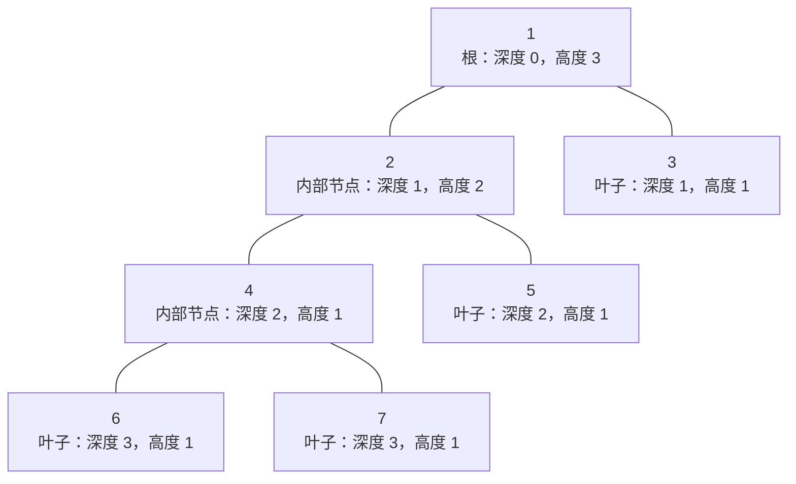
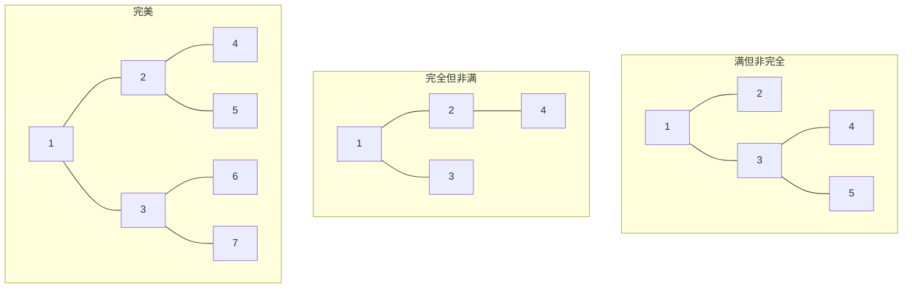
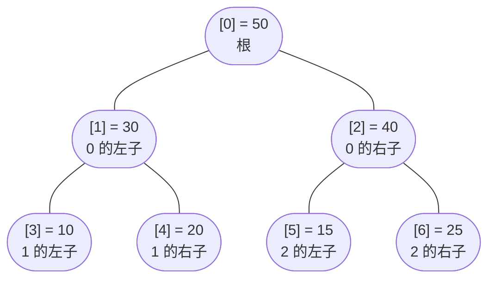

# 二叉树基础

CLRS 认为空树的高度是 0。有些 AVL 教材说是 -1。CMU 的 15-121 讲义说高度是"从某节点到最深叶节点的边数"；OpenDSA 说高度是"层数"。四种说法在各自的框架里都成立。可你要是在写代码写到一半时选错了那一种，`[3, 9, 20, null, null, 15, 7]` 这棵树的 `height(root)` 就会返回 2 而不是 3，然后你会用整场面试剩下的时间坚信 bug 出在别处。

第 6 部分用十一章讲树和堆。每一章都假设你清楚知道*高度*（height）在这本书里到底指什么。所以本章把术语钉死，定义二叉树能采取的两种物理表示，并先搭好那段只有一句话的递归模板——后面每一章都会把它拿走、弯折。以后哪一章写着*"见 6.0 对高度的定义"*，你就把这一章当词典翻回来。

## 二叉树是什么

二叉树要么是空的，要么是一个节点：里面装一个值，外加两棵分别叫左子、右子的二叉树。整个结构定义就这一句。定义里的递归不是教学花招，它就是数据结构本身。凡是看到二叉树题就伸手去拿递归，是因为你伸手去握的，正是类型里本来就长着的形状。[^2]

至少有一个子节点的节点是**内部节点**（internal）。没有子节点的是**叶节点**（leaf）。唯一没有父节点的是**根**（root）。

从根往下走到任意节点的路径有长度，这个长度就是该节点的**深度**（depth）。反过来，从某个节点往下走到它最深的后代叶子，最长的那条路径长度就是该节点的**高度**（height）。树的高度就是它根的高度。



*高度为 3 的树。节点 1 是根，深度 0；节点 3、5、6、7 是叶子；每个节点都同时带一个深度（从根往下走的距离）和一个高度（往下走到最深后代的距离）。节点 4 的高度是 1，因为它子树里最长的根到叶路径长度为 1。*

本书全书只用一套约定：高度数的是路径上的节点数，不是边数。空树高度 0。叶子高度 1。递推式是 `height(node) = 1 + max(height(left), height(right))`，其中 `height(null) = 0`。这与 LC 104 的题面、CLRS §10.4 和 OpenDSA 第 7.2 章都一致。[^1][^2] 网上别处的 AVL 章节常常换成按边计高度（那里空树高度为 -1）；我们明确不换，只有 6.6 章 AVL 树内部例外，因为那里教材的证明形状需要它。走到那一步时，我们会标注这次约定切换。

### 三种值得命名的形态限制

不是每棵二叉树都长一样。有三种有名字的形态会出现在算法证明和面试题里，把定义搞准很重要，因为它们不是同义词。

**满**（full）二叉树是每个内部节点都恰好有两个子节点的树。没有哪个节点只有一个左子或只有一个右子。

**完全**（complete）二叉树是每一层都从左到右填满、最底下一层可以不满但也从左往右填的树。二叉堆维护的就是这个形状，也是堆操作能写在一个扁平数组上的原因。

**完美**（perfect）二叉树既是满的*又是*完全的，所有叶子都在同一深度。高度为 `h` 的完美二叉树恰好有 `2^h - 1` 个节点。



*三种有名字的形态。满指每个内部节点都有两个子节点。完全指每一层从左到右填满。完美是两者兼具。满加完全推不出完美；上图中间那棵是完全但非满，最左边那棵是满但非完全。*[^9]

一棵树在 LC 意义（也是 AVL 意义）上是**平衡**（balanced）的，指的是每个节点左右子树的高度差不超过 1。平衡推不出完美，也推不出完全。一棵平衡树可以是上面任何一种形态，也可以一种都不是。LC 110 就是标准的"这棵树平衡吗"检查。

## 两种把树存进内存的方式

同一棵逻辑上的树，在程序里可以有两种不同的物理表示。挑哪一种，是任何树形问题的第一个设计决定。

### 指针表示：节点持有指向节点的指针

本部分除堆以外，所有题目的默认做法。每个节点是一个对象，带一个值，外加两个指向子节点的指针（或引用）。缺的子节点为 null。

```python
@dataclass
class TreeNode:
    val: int = 0
    left: Optional["TreeNode"] = None
    right: Optional["TreeNode"] = None
```

在 Java 里，`TreeNode` 是一个带 `int val`、`TreeNode left`、`TreeNode right` 的类。在 C++ 里是带裸指针和显式 `nullptr` 的 struct。在 Go 里是带 `*TreeNode` 字段的 struct。LeetCode 的树题全都递给你一个指针表示的根；题面里的层序数组（`[3,9,20,null,null,15,7]`）只是判题器序列化树所用的输入格式，不是内存里的形状。[^8]

树稀疏、节点会在运行时增删、遍历天然顺着指针结构走，这三种情况下指针表示更划算。代价是每个节点在载荷之外还得背 16 或 24 字节的指针开销，而且子节点落在分配器把它们放的地方，通常在缓存里离父节点很远。

### 数组表示：用下标运算定位节点

树是完全的（每一层从左到右填满）时，指针就是多余的。把节点按层编号，根从下标 0 开始。那么对下标为 `i` 的任意节点：

- 父节点在下标 `(i - 1) / 2`（整数除法）
- 左子节点在下标 `2*i + 1`
- 右子节点在下标 `2*i + 2`



*一棵存在扁平数组 `[50, 30, 40, 10, 20, 15, 25]` 里的完全树。指针是算出来的，不是存下来的：下标 4 的父节点是 `(4-1)/2 = 1`，下标 1 的子节点是 `2*1+1 = 3` 和 `2*1+2 = 4`。CLRS §6.1 用的是从 1 开始的下标，配 `2*i` 和 `2*i+1`；现代代码用 0 起始下标，配 `2*i+1` 和 `2*i+2`。*[^6]

树稠密、并且你只往下一个空位压、只从最后一个填过的位置弹，这时数组表示更划算。这恰好就是堆的约定。6.4 章会正经用上这个表示。第 6 部分其余的东西——BST、AVL 树、trie、线段树——你都想要指针，因为它们的平衡性质并不保证树是完全的。

## 后序遍历递归模板

下面这个形状能解掉第 6 部分几乎每一道二叉树题。招牌题是 LC 110 *Balanced Binary Tree*：给一棵树，如果每个节点左右子树的高度差都不超过 1 就返回 true。[^3]

直觉上你会直接写 `is_balanced(node)`：在每个节点算 `height(left)`、算 `height(right)`、比差值、再对两个子节点递归。它是对的，也比需要的慢。每个节点都要为自己后代的高度计算掏两次钱：一次是后代作为父节点被访问时，另一次是祖先穿过它重算高度时。

解法是只算一次高度，并让 height 函数多捎一条信息：一个哨兵值，意思是"停下，这棵子树不平衡"。高度非负，所以 `-1` 是自然值域里永远产出不出来的值。哪棵子树没通过平衡检查就从那里返回它，让它往上传播。

```python
def is_balanced(root):
    return height(root) != -1

def height(node):
    if node is None:
        return 0                          # 基本情况：空子树
    lh = height(node.left)
    if lh == -1:
        return -1                         # 失衡即短路
    rh = height(node.right)
    if rh == -1:
        return -1
    if abs(lh - rh) > 1:
        return -1                         # 在本节点做局部检查
    return 1 + max(lh, rh)                # 标准后序合并
```

**解法** — Python（[Java](./00-binary-tree-fundamentals/lc-110/sol.java) · [C++](./00-binary-tree-fundamentals/lc-110/sol.cpp) · [Go](./00-binary-tree-fundamentals/lc-110/sol.go)）

```python
# LC 110. Balanced Binary Tree
"""LC 110 Balanced Binary Tree, height-or-sentinel post-order recursion."""

from dataclasses import dataclass
from typing import Optional


@dataclass
class TreeNode:
    val: int = 0
    left: Optional["TreeNode"] = None
    right: Optional["TreeNode"] = None


def is_balanced(root: Optional[TreeNode]) -> bool:
    """Return True iff every node's left/right subtree heights differ by <= 1."""

    def height(node: Optional[TreeNode]) -> int:
        # 返回子树高度；只要有一个后代失衡就返回 -1。
        if node is None:
            return 0
        lh = height(node.left)
        if lh == -1:
            return -1
        rh = height(node.right)
        if rh == -1:
            return -1
        if abs(lh - rh) > 1:
            return -1
        return 1 + max(lh, rh)

    return height(root) != -1
```

有三条性质让这个模板可以复用。基本情况 `node is None` 返回一个单位值（`0`），父节点的合并步骤因此手上始终有定义良好的操作数；少了它，每处递归都得在调用点临时加 null 判断。后序的顺序——先左、再右、最后在本节点合并——才让父节点在决定任何事情之前先看到两个子树的结果；前序或中序都做不到。哨兵把两种返回模式折叠进一条通道，这一招你会在 BST 校验、AVL 重平衡触发、树形 DP 里反复用。

### 相关题目要改什么

同一个模板，换一两行，就能解掉本章梯度上其余每一道树递归题。

**LC 104, *Maximum Depth of Binary Tree***。把哨兵去掉；递推式就是没有中止条件的高度函数。[^4]

```python
def max_depth(node):
    if node is None:
        return 0
    return 1 + max(max_depth(node.left), max_depth(node.right))
```

**LC 236, *Lowest Common Ancestor of a Binary Tree***。返回类型从 `int` 变成 `TreeNode`。在每个节点，向两棵子树递归；两次调用都返回非 null，这个节点就是 LCA；否则把返回非 null 的那一侧往上传播。[^5]

```python
def lowest_common_ancestor(node, p, q):
    if node is None or node is p or node is q:
        return node
    left = lowest_common_ancestor(node.left, p, q)
    right = lowest_common_ancestor(node.right, p, q)
    if left and right:
        return node                           # 两个目标分处不同子树
    return left if left else right            # 把找到的那个往上传播
```

每个节点上的决策，形状和"高度或哨兵"完全一样：后序，在父节点合并。变的只是载体——每次调用返回什么。哨兵整数、节点引用、多个事实组成的元组、穿在辅助函数里的可变全局变量：第 6 部分剩下的每一种变体都只换载体，后序的主干不换。

## 实际开销

| 变体 | 时间 | 空间 | 说明 |
|---|---|---|---|
| 最优 LC 110（高度或哨兵） | O(n) | O(h) | 每个节点访问一次；递归栈深度受树高限制。[^1] |
| 暴力 LC 110（每节点重算高度） | O(n √n) 最坏 | O(h) | 比常被引用的 O(n²) 更紧。[^7] |
| LC 104 最大深度 | O(n) | O(h) | 纯后序合并。[^4] |
| LC 236 LCA | O(n) | O(h) | 单次走树；把找到的目标往上传播。[^5] |
| 平衡树高度 | h = ⌊log₂ n⌋ | — | 递归栈保持对数级。[^6] |
| 倾斜树（只有左链） | h = n - 1 | — | 递归栈深度等于输入深度；Python 就是在这里翻车的。[^11] |

其中两行值得细看。

### 暴力解法不是 O(n²)

面试辅导类题解常把"高度算两遍"的暴力解法写成 O(n²)。它不是。提前退出那句 `if abs(left - right) > 1: return False` 在一侧子树已经失败时会短路掉第二次递归调用，而递归结构又迫使后续调用里的深度彼此相关。Stack Overflow 上一份 2026 年 2 月经社区核验的分析构造了最坏输入形态（把右子树做成定深的路径），证明这个算法是 O(n √n)，而且是紧的。[^7] 证明归结为：设 `K` 是最坏路径上最长的嵌套左递归链，`N` 是节点总数，则 `N ≥ c₁ · K²`，总运行时间被 `c₂ · K · N ≤ c₂ · N · √(N/c₁)` 界住。

在面试现场这一点是有用的。带面试官走暴力版本时，把界报成 O(n √n)，然后补一句"但最优解用哨兵返回值能做到 O(n)"。懂紧界的面试官会注意到；不懂的至少学到点东西。

### 倾斜输入上的递归深度

LC 110 的输入上限是 5,000 个节点。CPython 默认的 `sys.getrecursionlimit()` 是 1,000。[^11] 一棵平衡的 5,000 节点树高度约 13，递归 13 层，没问题。一条倾斜的 5,000 节点左链会递归 5,000 层，抛 `RecursionError`。判题器两种形状都会测。

解法是 Python 解法开头加一行：

```python
import sys
sys.setrecursionlimit(10**6)
```

Java、C++、Go 不需要这个；它们默认的线程栈扛得住这个深度。本手册全项目范围的策略是：任何在树高上递归的 Python 解法，都在模块顶层设一次这个上限。LC 110 本身只有判题器喂你平衡输入时才可有可无；等你升到 6.2 的 Morris 遍历或 9.13 的树形 DP，这个调用就是不可省的。

## 五个最容易踩坑的地方

> [!WARNING]
> **把深度和高度搞混。** 深度是从根*往下到*该节点量的；高度是从该节点*往下到*最深后代量的。两个定义方向相反，一个递推式入口用一种、收尾用另一种，就会产出很难查的差一错误。选定"从节点起算的高度"、基本情况 `height(null) = 0`，然后到处都用它。[^1][^2]

> [!WARNING]
> **`height(null) = -1` 的 AVL 约定。** 有几本教材把高度定义成边数而不是节点数，于是空树高度是 -1 而不是 0。两套在各自内部都自洽。在一个函数里混用——基本情况抄一个来源、递推式抄另一个来源——结果会悄悄差一。讲 AVL 树那一章会刻意切换约定；在那之前，一律按节点计高度。[^10]

> [!WARNING]
> **把暴力 LC 110 报成 O(n²)。** 那是个松上界。紧的最坏情况是 O(n √n)，靠构造"右子树即路径"的输入证明。[^7] 要用松界就带上"松"这个限定词；否则懂紧结果的面试官会抓到这点不精确，并对你后面整套分析失去信心。

> [!WARNING]
> **在 Python 树题上忘了 `sys.setrecursionlimit`。** 5,000 节点的倾斜输入会撞上 1,000 帧的默认值并抛 `RecursionError`。在模块顶层设一次。别把这个调用塞进方法体里；它是进程级设置，摆在哪儿本身就说明你知道这件事。[^11]

> [!WARNING]
> **读 LC 输入格式时把 `null` 占位符当成真节点。** LeetCode 用层序加 `null` 占位来序列化树；数组 `[1,2,null,3]` 是一个根，带一个左子，左子的左子是 3，不是一棵 4 节点树。测试驱动如果把这些 `null` 标记当真节点入队，就会建出错误的树，你的算法就要在幽灵输入上失败一整轮。跳过 `null` 项；不要为它们推进 BFS 队列。[^8]

## 题目梯度

### 核心（三题全做才算掌握本章）

- [LC 110 — Balanced Binary Tree](https://leetcode.com/problems/balanced-binary-tree/) [简单] • tree-recursion-divide-and-conquer ★
- [LC 104 — Maximum Depth of Binary Tree](https://leetcode.com/problems/maximum-depth-of-binary-tree/) [简单] • tree-recursion-divide-and-conquer
- [LC 236 — Lowest Common Ancestor of a Binary Tree](https://leetcode.com/problems/lowest-common-ancestor-of-a-binary-tree/) [中等] • tree-recursion-with-combine-flags

### 进阶（可选）

- [LC 543 — Diameter of Binary Tree](https://leetcode.com/problems/diameter-of-binary-tree/) [简单] • tree-recursion-with-global-state
- [LC 100 — Same Tree](https://leetcode.com/problems/same-tree/) [简单] • tree-recursion-on-two-trees

LC 543 和 LC 100 之所以是进阶，是因为它们把后序模板往两个具体方向延伸：LC 543 把一个可变全局变量穿进高度辅助函数（这个形状放大到树形 DP 里就是 LC 124 *Maximum Path Sum*），LC 100 同步走两棵树（这个形状放大到 6.5 章就是 BST 结构校验）。

## 后续衔接

后序模板是第 6 部分的脊椎。[树遍历](./01-tree-traversals.md)把这份递归演成会动的动画，并引出"用栈迭代"的等价写法，再由 Morris 遍历替换成 O(1) 额外空间。[堆](./04-heaps-priority-queues.md)复用上面介绍的数组表示；[BST](./05-binary-search-trees.md)用 LC 100 的两树同步形状来校验 BST 有序不变量；[AVL 树](./06-avl-rotations.md)把 LC 110 的"高度或哨兵"思路提上去检测重平衡触发。更难的推广在更远处：LC 124 *Maximum Path Sum* 属于[树形 DP](../../../dsa/part-9-dynamic-programming/13-tree-dp.md)，LC 297 *Serialize and Deserialize Binary Tree* 属于下一章讲遍历的地方。

## 参考文献

[^1]: Cormen, Leiserson, Rivest, Stein, *Introduction to Algorithms*, 4th ed., MIT Press, 2022, Chapter 10 "Elementary Data Structures," §10.

[^2]: OpenDSA Project, *CS3 Data Structures and Algorithms*, Chapter 7.2 "Binary Trees: Definitions and Properties," <https://opendsa-server.cs.vt.edu/ODSA/Books/CS3/html/BinaryTree.html>.

[^3]: LeetCode 110, "Balanced Binary Tree," 简单。约束：节点数在 [0, 5000]，节点值在 [-10⁴, 10⁴]。<https://leetcode.com/problems/balanced-binary-tree/>.

[^4]: LeetCode 104, "Maximum Depth of Binary Tree," 简单。<https://leetcode.com/problems/maximum-depth-of-binary-tree/>.

[^5]: LeetCode 236, "Lowest Common Ancestor of a Binary Tree," 中等。<https://leetcode.com/problems/lowest-common-ancestor-of-a-binary-tree/>.

[^6]: Cormen, Leiserson, Rivest, Stein, *Introduction to Algorithms*, 4th ed., §6.1 "Heaps." 确立了数组下标的二叉树表示：PARENT(i) = ⌊i/2⌋, LEFT(i) = 2i, RIGHT(i) = 2i+1；exerc

[^7]: Stack Overflow Q79888747, "Is the brute-force solution for 'Is Binary Tree Balanced' really O(n^2) with early exit?" 采纳答案（2026 年 2 月，+50 悬赏）构造了最坏输入形态，并证明紧界是 O(n √n) 而不是 O(n²)。<https://stackoverflow.com/questions/79888747/is-the-brute-force-balanced-binary-tree-solution-really-on2-with-early-exit>.

[^8]: LeetCode，层序序列化，用 `null` 占位缺失节点。该约定在各树题的 Example 1 中都有说明。

[^9]: Alin Tomescu, "Complete vs. full vs. perfect binary trees," 个人博客，2026 年 2 月，<https://alinush.github.io/binary-trees>.

[^10]: Wikipedia, "Self-balancing binary search tree," <https://en.wikipedia.org/wiki/Self-balancing_binary_search_tree>.

[^11]: Stack Overflow Q72359503, "Maximum recursion depth exceeded when finding the depth of binary-search-tree." 记录了 CPython 默认 1,000 帧上限和标准修法 `sys.setrecursionlimit(...)`。<https://stackoverflow.com/questions/72359503/maximum-recursion-depth-exceeded-when-finding-the-depth-of-binary-search-tree>.
