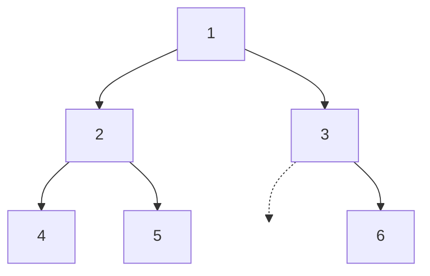
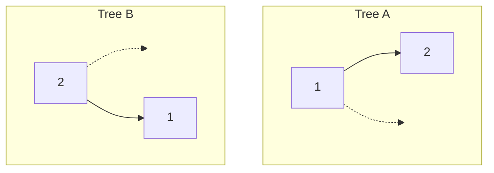

# 树的遍历：前序、中序、后序

你写过的每一个二叉树算法，都始于同一副五行骨架。空节点返回、递归左子树、递归右子树，再在这三行之间的某处调用一次 `visit(node)`。算法唯一要回答的问题，就是这次 visit 调用*放在哪儿*。

三个位置，三个名字，三件不同的工具对应三类不同的问题。把 `visit` 挪到最上面，算法在向下走的过程中就把根到叶的路径交给你。树复制、前缀表达式，以及把任意二叉树通过字符串来回转换的 LC 297 编解码器，用的都是这个结构。挪到中间，二叉搜索树的键就会按有序顺序输出，每次都是，不用额外干活。挪到最下面，每个节点在计算自己之前先看到两个子树的结果。所有树形 DP 和所有"子树聚合"类问题都建在这个底座上。三种写法的递归本身一模一样。你写 `visit` 的那一行，就是算法。

## 五行骨架

二叉树的深度优先遍历会按某种顺序访问根和两棵子树。三种顺序的名字就来自根被访问的位置：**前序**是根、左、右；**中序**是左、根、右；**后序**是左、右、根。[^1] 递归写法把这件事摆得很清楚。

```python
def preorder(node):
    if node is None:
        return
    visit(node)              # 根在子树之前
    preorder(node.left)
    preorder(node.right)


def inorder(node):
    if node is None:
        return
    inorder(node.left)
    visit(node)              # 根在两棵子树之间
    inorder(node.right)


def postorder(node):
    if node is None:
        return
    postorder(node.left)
    postorder(node.right)
    visit(node)              # 根在两棵子树之后
```

同一副骨架，一行代码的三个位置。三种情况下递归都会一路下探到最左的叶子；变的是在下探（或回溯）的哪个时刻，节点的值落进输出。

正因如此，三种顺序回答的是三个不同的问题。前序把每个节点*连同*通向它的路径一起交给你，因为父节点比两个孩子都先输出。中序在二叉搜索树上给出排好序的投影，因为对每棵子树，算法都在根之前输出整个左半部分、在根之后输出整个右半部分。后序在两棵子树都处理完之后才交出每个节点，这也是节点轮到自己时能看见子节点计算结果的全部办法。

## 标准树

本章每个例子走的都是同一棵六节点树，这里画一次，后面到处复用：



*本章的推演用树。前序得到 `[1, 2, 4, 5, 3, 6]`；中序得到 `[4, 2, 5, 1, 3, 6]`；后序得到 `[4, 5, 2, 6, 3, 1]`。三种顺序，三个答案，一棵树。*

把三种顺序对着这张图读一遍，规律自己就出来了。前序里，父节点的值在输出中永远早于它的任何一个子节点。中序里，每个节点都夹在自己左子树的全体和右子树的全体之间。后序里，每个父节点都晚于它的两个子节点。

## 中序遍历，四种语言

LC 94（*Binary Tree Inorder Traversal*）是本章的标准测试目标。递归写法连空树的基础情况一共五行。

```python
def inorderTraversal(root):
    out = []

    def dfs(n):
        if n is None:
            return
        dfs(n.left)
        out.append(n.val)              # 访问
        dfs(n.right)

    dfs(root)
    return out
```

**解法** — Python（[Java](./01-tree-traversals/lc-94/sol.java) · [C++](./01-tree-traversals/lc-94/sol.cpp) · [Go](./01-tree-traversals/lc-94/sol.go)）

```python
# LC 94. Binary Tree Inorder Traversal
#   [1,null,2,3] -> [1,3,2], [] -> [], [1] -> [1], [1,2,3,4,5,null,6] -> [4,2,5,1,3,6]
#.
from typing import List, Optional


class TreeNode:
    def __init__(self, val=0, left=None, right=None):
        self.val, self.left, self.right = val, left, right


def inorderTraversal(root: Optional[TreeNode]) -> List[int]:
    """递归中序。五行骨架，visit 放在中间那一行。"""
    out: List[int] = []

    def dfs(n: Optional[TreeNode]) -> None:
        if n is None:
            return
        dfs(n.left)
        out.append(n.val)         # 访问
        dfs(n.right)

    dfs(root)
    return out


def inorder_iterative(root: Optional[TreeNode]) -> List[int]:
    """迭代式中序，用显式栈。压左链、弹出、转向右子树。
    不变式：每次迭代之后，`cur` 指向下一棵要下探的子树；
    `stack` 里保存着每个已经下探过左子树、
    但自身值还没输出的节点。
    """
    out: List[int] = []
    stack, cur = [], root
    while cur is not None or stack:
        while cur is not None:
            stack.append(cur)
            cur = cur.left
        cur = stack.pop()
        out.append(cur.val)
        cur = cur.right            # 转向右子树
    return out


def preorder_iterative(root: Optional[TreeNode]) -> List[int]:
    """迭代式前序。先压右再压左，这样下一个弹出的是左。"""
    out: List[int] = []
    if root is None:
        return out
    stack = [root]
    while stack:
        n = stack.pop()
        out.append(n.val)
        if n.right is not None:
            stack.append(n.right)
        if n.left is not None:
            stack.append(n.left)
    return out


def postorder_iterative(root: Optional[TreeNode]) -> List[int]:
    """迭代式后序，用双栈 / 反转技巧：先构造根、右、左，
    再反转成左、右、根。
    """
    out: List[int] = []
    if root is None:
        return out
    stack = [root]
    while stack:
        n = stack.pop()
        out.append(n.val)
        if n.left is not None:
            stack.append(n.left)
        if n.right is not None:
            stack.append(n.right)
    out.reverse()
    return out
```

递归版本是简单的那一个。面试官的追问——*能不能不用递归？*——就写在 LC 94 的官方题解里，因为真实面试官确实会问。[^2] 迭代式中序模板在结构上就是同一副形状：Morris 遍历要消除的是它，BST 迭代器（LC 173）改造成有状态的 `next()` / `hasNext()` 组合的也是它。值得单独一节。

### 用显式栈实现迭代式中序遍历

递归写法把语言的调用栈当成数据结构。把这个拿走，栈就得你自己捧着。三份状态替代了递归的栈帧：

- 一个 `stack`，存放那些已经下探过左子树、但自身值还没输出的节点。
- 一个指针 `cur`，指向算法接下来该下探的那棵子树。
- 输出列表。

算法有两个互相咬合的循环。内层循环从 `cur` 出发走完整条左链，一路把每个节点压栈。左链到底之后，外层循环弹出栈顶、输出它的值，并把 `cur` 转到该节点的右子树。接着内层循环再跑一次，去走*那棵*子树的左链。

```python
def inorder_iterative(root):
    out, stack, cur = [], [], root
    while cur is not None or stack:
        while cur is not None:
            stack.append(cur)
            cur = cur.left
        cur = stack.pop()
        out.append(cur.val)
        cur = cur.right                # 转向右子树
```

不变式很短，值得背下来：*外层循环每迭代一次之后，`cur` 都指向下一棵要下探的子树；`stack` 里保存着所有左子树已处理完、但自身值还没输出的祖先。*[^3] 当 `cur` 为空且栈为空时，每条左链都下探过了，每个记录过的祖先都输出了，没有别的事可做。

> [!IMPORTANT]
> 转向那一步是 `cur = cur.right`，不是 `cur = None`。漏掉这句赋值，算法只走最左边那条脊，弹完最后一个节点后就退出外层循环（因为 `cur` 一直是空、栈也空了），任何右子树都不会被探索。输出就是这棵树的左脊，别的什么都没有。这是迭代式中序最常见、也最容易犯的 bug。

迭代式前序和后序都比迭代式中序短，因为两者都不需要沿左链下探。前序把 `[root]` 作为栈的初始内容，之后每次弹出就输出该节点并压入它的子节点：先右子节点，再左子节点，因为栈是后进先出，后压的落在顶上。后序是同一个循环，只把两个子节点的压栈顺序反过来，最后把整个输出反转。反转技巧产生的是 `root, right, left` 的走法，反转后得到 `left, right, root`，正是后序。两者都能塞进八行，都复用了显式栈这套机制，只少了"下探加转向"那套动作。

## 实际开销

每个节点恰好被访问一次，visit 的主体只做 O(1) 的工作，所以六种变体的总时间都是 Θ(n)。空间开销是调用栈（递归写法）或显式栈（迭代写法）的最大深度，两者在每一步都等于树高 `h`。

| 变体 | 时间 | 空间 | 上界何时咬人 |
|---|---|---|---|
| 递归式前 / 中 / 后序 | Θ(n) | Θ(h) 调用栈 | 平衡时 h = log n；退化时 h = n − 1 |
| 迭代式前 / 中 / 后序 | Θ(n) | Θ(h) 显式栈 | 栈上和递归写法是同一条链 |
| Morris 中序（第 6.2 章） | Θ(n) | Θ(1) 辅助空间 | 唯一的 Θ(1) 变体 |

要紧的是 `h`，不是 `log n`。CLRS 用对子树规模做归纳的方式证明时间上界：T(n) 覆盖左子树、根上的 O(1) 工作和右子树，T(0) = Θ(1)，加起来就是 Θ(n)。[^4] 空间上界等于最大递归深度，也就是最深的根到叶路径的深度。平衡树是 Θ(log n)。整棵向左或向右偏斜、每个父节点只有一个孩子的树，深度是 `n − 1`，而无论你写成递归还是用显式栈，调用栈都是同样那 `n − 1` 个帧。

LC 上的树遍历题都标着 `n <= 10^4`。Python 默认递归深度上限是 1000，所以这些题只要给一个完全右偏的输入，递归还没走完就会溢出。办法是在开头调用 `sys.setrecursionlimit(10**5)`，或者改用迭代写法——它不占 C 的调用栈，也就撞不上同一个上限。Java 和 C++ 在常见栈帧大小下，默认线程栈足以支撑 `n = 10^4` 的递归深度，但遇到刻意构造的输入，迭代写法仍然更稳。

## 实例推演：LC 297，二叉树的序列化与反序列化

LC 297（*Serialize and Deserialize Binary Tree*）是困难档的应用题，它让"选哪种遍历顺序"这件事真正承重。题目要求把一棵二叉树编码成字符串，再从字符串重建*同一棵树*，值相同，形状也相同。

你的第一反应可能是：把中序遍历输出成字符串。值的顺序干净，编码也短。拿两棵不同的树试试：



两棵树都产出中序字符串 `2, 1`。一棵是以 1 为根、只有左链的树；另一棵是以 2 为根、只有右链的树。编码丢掉了区分它们所需的结构信息。前序、中序、后序都会撞上同样的冲突：只要空子节点没在编码里明确写出来，不同的树就可能产生一模一样的遍历字符串。[^5]

解法是*带空标记的前序*。每个空子节点的位置都输出一个哨兵记号（`"#"` 就行）。这样编码描述的是树里的每一个位置，而不只是值，结构信息就能在往返中活下来。

```python
class Codec:
    NULL = "#"

    def serialize(self, root):
        out = []

        def dfs(n):
            if n is None:
                out.append(self.NULL)
                return
            out.append(str(n.val))             # 访问（前序）
            dfs(n.left)
            dfs(n.right)

        dfs(root)
        return ",".join(out)

    def deserialize(self, data):
        tokens = iter(data.split(","))

        def build():
            tok = next(tokens)
            if tok == self.NULL:
                return None
            node = TreeNode(int(tok))
            node.left = build()
            node.right = build()
            return node

        return build()
```

**解法** — Python（[Java](./01-tree-traversals/lc-297/sol.java) · [C++](./01-tree-traversals/lc-297/sol.cpp) · [Go](./01-tree-traversals/lc-297/sol.go)）

```python
# LC 297. Serialize and Deserialize Binary Tree
# Codec：前序 DFS + 用 "#" 作为空子节点的哨兵；反序列化是同形状的前序 DFS，
# 从遍历各个 token 的迭代器上读取。
from typing import Optional


class TreeNode:
    def __init__(self, val=0, left=None, right=None):
        self.val, self.left, self.right = val, left, right


class Codec:
    NULL = "#"
    SEP = ","

    def serialize(self, root: Optional[TreeNode]) -> str:
        """前序 DFS；每个位置输出值或 NULL 记号。"""
        out: list[str] = []

        def dfs(n: Optional[TreeNode]) -> None:
            if n is None:
                out.append(self.NULL)
                return
            out.append(str(n.val))               # 访问（前序）
            dfs(n.left)
            dfs(n.right)

        dfs(root)
        return self.SEP.join(out)

    def deserialize(self, data: str) -> Optional[TreeNode]:
        """同样的前序形状；每个位置消费一个 token。"""
        tokens = iter(data.split(self.SEP))

        def build() -> Optional[TreeNode]:
            tok = next(tokens)
            if tok == self.NULL:
                return None
            node = TreeNode(int(tok))
            node.left = build()
            node.right = build()
            return node

        return build()
```

序列化和反序列化是同一套递归的两个读取方向。序列化为每个位置输出一个 token——值或者 `"#"`——再按前序递归进子节点。反序列化按同样的顺序读 token，遇到值就建节点，然后用流里接下来的 token 递归建出左右子树。`"#"` 哨兵的作用是让反序列化能区分"这个位置有孩子"和"这个位置是空的"；没有它，迭代器就分不清下一个 token 属于当前节点的左子树还是右子树。

在标准的六节点树上，序列化得到 `1,2,4,#,#,5,#,#,3,#,6,#,#`。十三个 token，六个值，七个空。反序列化读 `1`，建节点，往左递归，读 `2`，建节点，往左递归，读 `4`，建节点，往左递归，读 `#`，返回空，再从 4 往右递归，读 `#`，返回空。此时递归回溯到 4，把 4 交还给它的父节点（2），2 再往右递归，5 上重复同样的形状。结构完整往返。

## 交互组件

> **Interactive widget:** [树遍历动画（DFS 前序 / 中序 / 后序 + BFS 层序）](../../../dsa/widgets/w-16-tree-traversal-animator.yml)（面板 `panel-a`）—— 在网站上渲染；YAML 规格里描述了各个关键帧。

*静态兜底：标准的 n = 6 树，分三个连续阶段。阶段 1（前序）输出 `[1, 2, 4, 5, 3, 6]`；根在子树之前，自顶向下。阶段 2（中序）输出 `[4, 2, 5, 1, 3, 6]`；左子树、根、右子树，正是 BST 排序投影的形状。阶段 3（后序）输出 `[4, 5, 2, 6, 3, 1]`；先两棵子树、再根，根最后被访问。递归栈那一列在每个阶段都随下探深度升降。*

## 值得掌握的变体

少数几种模式把基础的三序遍历扩展成面试官真正会问的那些题。

### 用两种遍历序列重建树

给算法前序加中序，或者中序加后序，它就能把原树重建出来。LC 105（前序 + 中序）和 LC 106（中序 + 后序）是两个标准实例。两个算法都从一种遍历里读*根的身份*（preorder[0] 或 postorder[−1] 永远是当前子树的根），从另一种遍历——中序——里读*分割位置*，也就是剩下的节点里有几个属于左子树、几个属于右子树。

朴素写法在每次递归调用时线性扫描中序数组去找分割位置。n 次递归调用、每次扫 O(n) 个元素，总共 O(n²)，在 LC 105 标明的 `n <= 3000` 上已经贴着超时线。标准优化是在递归之前先算一张 `value -> inorder index` 的哈希表，把查找从 O(n) 压到 O(1)，整体复杂度降到 O(n)。

> [!WARNING]
> 哈希表优化假设节点值互不相同。如果值可能重复，`value -> index` 映射就没法分辨哪一次出现才是当前的根，你只能退回 O(n²) 的线性扫描，或者换一套完全不同的不变式。LC 105 的约束部分明确写着 "all values are unique"；这条约束存在，就是为了让这个优化成立。

### 前序 + 后序*还不够*

很容易以为三种顺序里任取两种就能重建树。一般来说不行。前序 + 后序能钉住根的身份（preorder[0] = postorder[−1] = 根），却给不出左右分割位置，所以对任何只有一个孩子的节点，同一对 (preorder, postorder) 既描述"孩子在左"也描述"孩子在右"。有效的两对是前序 + 中序（LC 105）和中序 + 后序（LC 106）。中序在两者里都承重，因为它是唯一能线性划分左右子树的顺序。

例外是满二叉树，其中每个内部节点有 0 个或 2 个孩子。在这个约束下前序 + 后序*确实*够用，这正是 LC 889 的设定。它是真题，不是自相矛盾；干活的是那条约束。

### 用显式栈实现迭代式前序与后序

迭代式前序和后序都复用 §"用显式栈实现迭代式中序遍历"里的显式栈机制，只是没有下探加转向。`lc-94/sol.py` 里的 Python 文件把两者都写了，包括后序的双栈 / 反转技巧；Java、C++ 和 Go 的姊妹文件里是同样的形状。学它们的理由是务实的：在任何默认递归上限偏小的语言里（Python 是 1000），或者在面试官要求迭代写法的面试里，你希望三种迭代套路都在手上随时能写出来。

## 常见陷阱

> [!WARNING]
> **迭代式前序里先压左再压右。** 栈是后进先出。如果你先压 `n.left` 再压 `n.right`，下一个弹出的是 `n.right`，输出就成了根、右、左，恰好和你要的相反。想从后进先出的栈里拿到根、左、右，就先压右，让左落在栈顶。[^6]

> [!WARNING]
> **LC 297 的编码里漏掉空标记。** 只给非空节点输出值、把空节点整个跳过的 serialize，会丢掉区分"只有左链"和"只有右链"的结构信息。deserialize 往返出来的树值都对、形状不对，而且这个 bug 一直不响，直到测试框架比较的是结构而不是值。每个空位置都要输出哨兵。

还有第三个陷阱值得提一句：递归辅助函数每次调用都返回一个新列表、在每一层做拼接，是 O(n²)，因为每一层的拼接都要 O(n) 的工作。把同一个输出列表作为参数贯穿整个递归、往里 append；`lc-94/sol.{py,java,cpp,go}` 里的标准实现都是这个套路。

## 题目梯度

### 核心（三题全做才算掌握本章）

- [LC 94 — Binary Tree Inorder Traversal](https://leetcode.com/problems/binary-tree-inorder-traversal/) [简单] • dfs-inorder-recursive-and-iterative
- [LC 105 — Construct Binary Tree from Preorder and Inorder Traversal](https://leetcode.com/problems/construct-binary-tree-from-preorder-and-inorder-traversal/) [中等] • preorder-driven-tree-construction-with-inorder-index ★
- [LC 297 — Serialize and Deserialize Binary Tree](https://leetcode.com/problems/serialize-and-deserialize-binary-tree/) [困难] • preorder-with-null-markers

### 进阶（可选）

- [LC 144 — Binary Tree Preorder Traversal](https://leetcode.com/problems/binary-tree-preorder-traversal/) [简单] • dfs-preorder-recursive-and-iterative
- [LC 145 — Binary Tree Postorder Traversal](https://leetcode.com/problems/binary-tree-postorder-traversal/) [简单] • dfs-postorder-iterative-two-stack-or-reverse
- [LC 106 — Construct Binary Tree from Inorder and Postorder Traversal](https://leetcode.com/problems/construct-binary-tree-from-inorder-and-postorder-traversal/) [中等] • postorder-driven-tree-construction-with-inorder-index

LC 105 是本章的招牌题（★），因为它逼你说清楚每种顺序到底编码了什么，再用这句话把树重建出来。LC 94 锚定"迭代 + 栈"的模板；LC 297 把前序放到序列化的位置上，顺带说明空标记为何承重。

## 后续衔接

同一副三行骨架——加一点小改动——会在 Part 6 剩下的篇幅里反复出现。递归形状始终不变，变的只是真正干活的那一行。

Morris 遍历把本章的迭代式中序模板变成 Θ(1) 辅助空间的算法：临时改写空的右子指针把树串成线索，回溯时再改回来。下探加转向的机制照旧，显式栈没了，被线索指针本身顶替。那是下一章，用的还是本章这个组件外壳。

层序 BFS 用显式队列替代调用栈，按深度一层层访问，而不是先走左脊。同一棵标准树，不同的控制流形状；组件的 panel-b 直接把这个对比做成动画。求最短路径、右视图、按深度锯齿输出的树题，全都在 BFS 家族里。

把[前缀和 + 哈希表组合](../part-3-pointers-window-prefix/05-prefix-sum-hash.md)里那一手搬到树上，"滚动前缀"就变成"从根到当前节点的和"，在 DFS 栈上维护，再加一张记录所有"根到此处"之和的哈希表。LC 437（Path Sum III）是 LC 560 的树版：同样用 `{0: 1}` 给空路径做种子，只多一步簿记，在递归回溯时把当前节点的贡献从哈希表里去掉。递归是前序，清理是后序，一章讲完。

## 参考文献

[^1]: Cormen, Leiserson, Rivest, Stein. *Introduction to Algorithms*, 4th ed., MIT Press, 2022.

[^2]: LC 94 *Binary Tree Inorder Traversal* 的 LeetCode 官方题解，解法 2（"Iterating method using Stack"）。

[^3]: CLRS 第 4 版 §12.1 习题 12.1-3，用显式栈实现的非递归 Inorder-Tree-Walk。`lc-94/sol.py` 及其姊妹文件里那段下探加转向伪代码的出处。

[^4]: CLRS 第 4 版。

[^5]: algomaster.io，*Serialize and Deserialize Binary Tree*："如果在遍历时记录空标记（比如 'null' 或 '#'），我们就能捕获完整的结构。带空标记的前序遍历唯一确定一棵二叉树。" <https://algomaster.io/learn/dsa/serialize-and-deserialize-binary-tree>。

[^6]: simplyleet.com，*LeetCode 144 Binary Tree Preorder Traversal*，关于迭代写法："用栈时先压右孩子，这样左孩子会先于右孩子被处理。" <https://www.simplyleet.com/binary-tree-preorder-traversal>。
