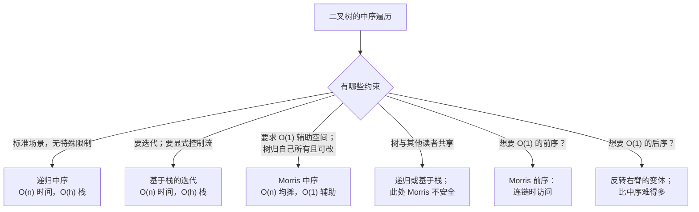

# Morris 遍历：用线索实现 O(1) 空间的中序遍历

1979 年，J. M. Morris 在 *Information Processing Letters* 上发表了一篇两页的论文，做了一件本该不可能的事：以中序走遍二叉树的每个节点，不用递归栈，不用显式栈，不用队列，不用父指针，只占两个指针大小的临时变量。这篇论文回答的是 Knuth 在《计算机程序设计艺术》（*The Art of Computer Programming*）里提出的问题：能不能不用辅助内存遍历二叉树？Morris 说能，诀窍是在下行时改树，在回程时复原。

这个诀窍有个名字，叫*线索化*（threading）：从每棵子树最右的后代临时连一条右指针回到当前节点，靠着这些线索当作返回路径走完整棵树，第二次访问到该节点时再把线索拆掉。[^1] 每条边被访问的次数是有界的。总代价：O(n) 时间，O(1) 辅助空间，函数进出时输入树逐位完全相同。[^2]

## 为什么调用栈上的 O(h) 在某些面试官眼里不算答案

[树的遍历：前序/中序/后序，递归与迭代](./01-tree-traversals.md)给过标准的中序遍历。递归写法靠调用栈，迭代写法靠显式栈。两者都是 O(h) 辅助空间，h 是树高。平衡树上 h 大致是 log n，没人在意。可树一旦退化成一路向左或一路向右的链，h 就等于 n，深度 1000 时递归中序就会撞爆 Python 的默认递归上限。[^3]

这里的经典题目是 LC 99，*Recover Binary Search Tree*。BST 里有两个节点被交换了，要求在不改变树结构的前提下恢复这棵 BST。标准的中序解法很短：中序遍历，盯住当前值掉到前一个值以下的那一刻，记下两个嫌疑节点，最后交换。当被交换的两个节点不相邻时，会出现两处违例而不是一处。[^4]

题目明确给出的追问是「你能用 O(1) 空间做到吗？」递归的 O(h) 版本答不上来，显式栈版本也答不上来。唯一能答「能」的标准算法就是 Morris。

## 为什么我们要替换掉这个显而易见的 O(h) 方案

递归基线就是每个读者都写过一百遍的东西。

```python
# 基线：递归中序，O(n) 时间、O(h) 辅助空间。
def inorder_recursive(root, out):
    if root is None:
        return
    inorder_recursive(root.left, out)
    out.append(root.val)
    inorder_recursive(root.right, out)
```

任何输入上都对。O(h) 的代价在源码里看不见，在生产里却极其显眼：一条 5 万个节点的左斜树（面试题里造得出来，真实世界的畸形树里很常见）会撞上调用栈默认值，程序在算法还没算错之前就先崩了。迭代写法把同样的 O(h) 塞进一个显式的 `TreeNode` 引用 `list`，代价一样，只是从栈内存挪到了堆内存。

要修好它，就得在不花 O(h) 内存的前提下记住「从左子树回来之后该回到哪」。听起来不可能。调用栈的全部意义就是记住这件事。出路是把答案写进树本身——写在一个当前为空、并在函数返回前会复原的指针字段里。

## 归约：给树穿线，再把线拆掉

任取一个左子树非空的节点 `curr`。`curr` 的中序前驱就是它左子树里最右的那个节点，记作 `pred`。按定义 `pred.right` 是空的，因为若 `pred` 有右孩子，那个孩子会更靠右，`pred` 就不是最右了。

这个空的右指针是白送的地皮。用它写下该回到哪里：

```text
pred.right = curr
```

然后向左下行。算法可以走完整个左子树而什么都不用记，因为当它最终抵达 `pred`、想往右迈步时，`pred.right` 不再指向虚空，而是指回 `curr`。这条线索就是返回地址。

当算法沿着线索第二次回到 `curr` 时，它知道这是第二次访问，因为内层找前驱的行走会停在一个 `right` 已经指回 `curr` 的节点上。这个特征不会认错：`pred.right == curr` 意味着「我来过这里，左子树已经走完，请把线索拆掉并访问我」。复原 `pred.right = null`，输出 `curr.val`，向右迈步。

外层每轮迭代只有两种情况。若 `curr.left` 为空，就没有左子树要处理，访问 `curr` 再向右迈步。否则找到前驱，要么安上线索，要么拆掉线索。整个算法就这么多。

## 模式

```python
def morris_inorder(root):
    out = []
    curr = root
    while curr is not None:
        if curr.left is None:
            out.append(curr.val)
            curr = curr.right
        else:
            # 找中序前驱：curr 左子树里最右的节点。
            pred = curr.left
            while pred.right is not None and pred.right is not curr:
                pred = pred.right
            if pred.right is None:
                pred.right = curr        # 安上线索，向左下行
                curr = curr.left
            else:
                pred.right = None        # 访问之前先拆掉线索
                out.append(curr.val)
                curr = curr.right
    return out
```

在实例推演之前，有两行值得单独说。

第一行是内层循环的守卫条件：`while pred.right is not None and pred.right is not curr`。删掉第二个子句，一旦存在线索，找前驱的行走就会死循环：它顺着线索回到 `curr`，再从 `curr` 往右下走（此时 `curr` 已经成了 `pred.right`），于是永远停不下来。LeetCode discuss 上社区维护的 bug 清单里，漏写 `pred.right != curr` 这个守卫排在本算法被报告问题数的第一位。[^5]

第二行是拆链分支里的顺序：`pred.right` 要在调用访问*之前*拆掉，不是之后。单线程执行时两种顺序输出一样。必须先把链拆掉，是因为 Morris 的论文对树的状态立了一个契约：任何打断算法的外部观察者，在每轮迭代之间的每个转换点看到的都是一棵结构已复原的树。调试器的一帧、一个日志回调、一个 panic handler，全都算。先访问再拆链会让树在访问那一刻处于已穿线的状态，这就破坏了「函数外看树不变」的保证，而这个保证正是 Morris 能用在生产代码里的理由。[^1]

> [!IMPORTANT]
> 遍历过程中树是被改动的。只读的调用方必须在调用 Morris 之前克隆一份，或者接受「树只有在函数返回时才复原」这一条，或者改用递归的 O(h) 写法。Pfaff 的 libavl 笔记把这一点讲得很直白：Morris 只适用于单线程，且树在调用期间完全归该算法独占。[^6] 如果遍历中途有另一个线程能读这棵树，它看到的就是一棵*已穿线*的树，某些名义上为空的右指针指向了祖先，任何假定标准二叉树形状的迭代器都会走偏。

## 实例推演：标准的 7 节点 BST

这棵树：

```text
        4
       / \
      2   6
     / \   \
    1   3   7
```

中序是 `[1, 2, 3, 4, 6, 7]`。六个节点，其中两个（2 和 4）有左子树，会走完整个「先连后拆」的流程。

第一轮从根（4）开始，`curr` 在 4。左子树非空，算法沿着这棵子树的右脊下行：2 → 3。节点 3 的右指针为空，于是安上线索 `3.right = 4`，向左下行。此时 `curr` 是 2。

节点 2 有左子树。找前驱的行走到 1（最右；`1.right` 为空）。安上线索 `1.right = 2`，向左下行。此时 `curr` 是 1。

节点 1 没有左子树。访问：输出 1。沿着线索向右回到 2。这条线索算是回本了。

现在第二次访问 2。找前驱的行走再跑一遍，发现 `1.right = 2`（就是我们安上的线索）。拆掉它。访问：输出 2。向右走到 3。

节点 3 没有左子树。访问：输出 3。沿着线索向右回到 4。

第二次访问 4。找前驱的行走到 3，`3.right = 4`（第一轮安上的线索）。拆掉它。访问：输出 4。向右走到 6。

右子树（6、7）自始至终没有左孩子，算法退化成一路向右：访问 6，向右到 7，访问 7，向右到 null。循环退出。输出：`[1, 2, 3, 4, 6, 7]`。

函数返回时，遍历中安上的两条线索都已消失。结束时的树与开始时的树逐位完全相同。

> **Interactive widget:** [Morris 中序遍历（线索化）](../../../dsa/widgets/w-17-morris-thread.yml) — 在网站上渲染；YAML 规格描述了各个关键帧。

*静态回退说明：第 0 步树完好，输出缓冲区为空。第 5 步两条线索共存（1 → 2 和 3 → 4），算法已下到节点 1 但还没访问它。第 14 步 1 → 2 这条线索已拆掉，算法刚沿着仍然存在的 3 → 4 线索回到节点 4。第 23 步所有线索都没了，输出为 `[1, 2, 3, 4, 6, 7]`。*

## 这个模式在整个遍历家族中的位置



*三条分支通向 Morris：需要 O(1) 辅助空间、调用期间独占这棵树、以及中序或前序语义。后序才是真正难缠的兄弟。*

## 实际开销

| 变体 | 时间复杂度 | 空间复杂度 | 说明 |
|---|---|---|---|
| 最好情况 | O(n) | O(1) | 一次外层遍历；`pred` 走过的边数总和有界 |
| 平均情况 | O(n) | O(1) | Morris 1979 §3 的分析[^1] |
| 最坏情况 | O(n) 均摊 | O(1) | 左斜树；论证见下文 |
| 递归基线 | O(n) | O(h) | 调用栈；退化树上为 O(n) |

空间上界是构造出来的。两个指针大小的变量，`curr` 和内层行走的 `pred`，再加上算法临时写入随后复原的那些右指针字段。没有栈帧，没有辅助数组，没有任何随 n 增长的东西。

时间上界是均摊的，不是逐点的，这个证明很重要，因为直觉上的逐点读法是错的。

*边计数论证。* 内层找前驱的行走沿着 `curr` 左子树的右脊下行，在左斜树上这是 Θ(h)。随手一读「n 轮迭代 × O(h) 内层工作」会得出 O(n h)，而在 h 等于 n 的左斜树上那就是 O(n²)。真正的 O(n) 上界来自把树中每条边在整个遍历中的访问次数记为一个有界常数。每条树边最多被碰三次：一次是外层循环沿它迈步，一次是安线索时内层找前驱的行走经过它，一次是拆线索时内层行走再次经过它。Stack Overflow 上的社区讨论把 Morris 原本的分析收紧到了正好这个界：整个遍历最多 3n 次边访问，总计 O(n)。[^7] 一条线索一旦被拆掉，那次行走经过的边就再也不会被碰到，因为 `curr` 已经进入它的右子树，再也不会回到左子树。

## 模式失效的场景

标准算法旁边住着三个有名字的变体。其中一个确实比另两个难，本章不掩饰是哪个。

### Morris 前序：挪动访问点，保留线索

前序在每个节点*先*于它的子树被访问。骨架与 Morris 中序完全相同，唯一的变化是 `out.append(curr.val)` 在*什么时候*跑。前序里访问发生在连链阶段——就在向左下行之前——因为那才是第一次遇到 `curr` 的时刻。拆链阶段不再访问，它唯一的任务是把线索撤掉。[^8] 复杂度相同，正确性论证相同，只是挪了一行。

### 反向 Morris：在 BST 上做降序遍历

把算法里所有的左和右互换。`pred` 变成 `curr` 右子树里最左的节点（即中序*后继*），线索从各子树最左节点的左孩子指回 `curr`。输出是逆中序序列：从大到小遍历一棵 BST，O(1) 辅助空间。[^9] 对称的证明，完全相同的界。

### Morris 后序要难得多

后序在每个节点*后*于它的两棵子树被访问。连链阶段（向左下行之前）和拆链阶段（左子树之后、右子树之前）都不是合适的访问时机。那个很诱人的类比「Morris 前序把访问点往一个方向挪，后序就往另一个方向挪」会推出一个错误的算法：得到的是逆前序（节点 → 右 → 左），不是后序（左 → 右 → 节点）。

网上标准教程们绕开了这个难题，改去对*镜像*树做 Morris 前序，把访问结果收进数组，最后反转数组。这样是对的，但把 O(1) 的目标毁了：数组本身就是 O(n)。[^10] 真正 O(1) 的 Morris 后序，需要在退出每棵左子树之后就地把一段右指针路径反转，也就是「反转右脊」技巧，它复杂到竞赛编程参考资料都把它当成独立算法来写。[^11] 如果面试官坚持要 O(1) 后序，答案是反转右脊那一版；多数面试官接受 O(h) 的显式栈后序作为合理折中。

## 两个最容易踩的坑

> [!WARNING]
> **忘了 `pred.right != curr` 这个守卫。** 内层循环条件里没有第二个子句，找前驱的行走会顺着线索回到 `curr`，再从 `curr` 向右下行（此时 `curr` 已是 `pred.right`），于是永远停不下来。写「找最右」最自然的方式是 `while pred.right is not None: pred = pred.right`，而最自然的写法就是 bug。守卫 `while pred.right is not None and pred.right is not curr` 既能停在「还没有线索」（第一次访问），也能停在「线索已经指回我了」（第二次访问）。LeetCode discuss 上本算法 bug 清单的第一名。[^5]

> [!WARNING]
> **在拆线索之前就访问。** 在拆链分支里，先跑 `pred.right = None`，再跑 `out.append(curr.val)`。单线程使用时两种顺序输出完全一样，但这个顺序关乎 Morris 承诺的契约：树的结构在每轮迭代之间的每个转换点看起来都必须没变。先访问再拆链会让树在外部观察者（调试器的一帧、一个日志回调、一个 panic handler）可能来检查的那一刻处于已穿线状态。如果你打算把 Morris 推广到「树不变」是字面承诺而不只是终态承诺的场合，那么正是「先拆链」这个顺序让这个承诺站得住。

第三个坑值得简单提一句。在 LC 99 上，「两处违例」这个模式并不显然。相邻交换的用例只产生一处中序违例；不相邻的交换产生两处。发现第一处违例就返回的代码能过 LC 的简单样例，却过不了隐藏用例。修法是在第一处违例时把 `first` 定下来，之后每遇一处违例就更新 `second = curr`，最后交换两者的值。下面面板里完整的 LC 99 实现就带着这个模式。

## 在 Morris 之上叠加 LC 99

```python
def recover_tree(root):
    """在 O(1) 空间内恢复一棵恰有两个节点被交换的 BST。"""
    first = second = prev = None
    curr = root
    while curr is not None:
        if curr.left is None:
            if prev is not None and curr.val < prev.val:
                if first is None:
                    first = prev
                second = curr
            prev = curr
            curr = curr.right
        else:
            pred = curr.left
            while pred.right is not None and pred.right is not curr:
                pred = pred.right
            if pred.right is None:
                pred.right = curr
                curr = curr.left
            else:
                pred.right = None
                if prev is not None and curr.val < prev.val:
                    if first is None:
                        first = prev
                    second = curr
                prev = curr
                curr = curr.right
    if first is not None and second is not None:
        first.val, second.val = second.val, first.val
```

**Solution** — Python ([Java](./02-morris-traversal/lc-99/sol.java) · [C++](./02-morris-traversal/lc-99/sol.cpp) · [Go](./02-morris-traversal/lc-99/sol.go))

```python
# LC 99. Recover Binary Search Tree

from typing import Optional


class TreeNode:
    __slots__ = ("val", "left", "right")

    def __init__(
        self,
        val: int = 0,
        left: "Optional[TreeNode]" = None,
        right: "Optional[TreeNode]" = None,
    ) -> None:
        self.val = val
        self.left = left
        self.right = right


class Solution:
    def recoverTree(self, root: Optional[TreeNode]) -> None:
        """在 O(1) 空间内恢复一棵恰有两个节点被交换的 BST。

        参考文献：J. M. Morris, 'Traversing binary trees simply and cheaply',
        Information Processing Letters 9(5):197-200, 1979.

        把 LC 99 的「两个嫌疑节点」模式叠在 Morris 中序之上：
        在访问这一步维护 prev；在第一处违例时定下 first；
        之后每处违例都更新 second；最后交换。
        """
        first: Optional[TreeNode] = None
        second: Optional[TreeNode] = None
        prev: Optional[TreeNode] = None

        curr = root
        while curr is not None:
            if curr.left is None:
                # 访问这一步。
                if prev is not None and curr.val < prev.val:
                    if first is None:
                        first = prev
                    second = curr
                prev = curr
                curr = curr.right
            else:
                # 找中序前驱：curr 左子树里最右的节点。
                pred = curr.left
                while pred.right is not None and pred.right is not curr:
                    pred = pred.right

                if pred.right is None:
                    pred.right = curr            # 安上线索，向左下行
                    curr = curr.left
                else:
                    pred.right = None            # 访问之前先拆掉线索
                    if prev is not None and curr.val < prev.val:
                        if first is None:
                            first = prev
                        second = curr
                    prev = curr
                    curr = curr.right

        if first is not None and second is not None:
            first.val, second.val = second.val, first.val
```

`recover_tree` 的结构就是 `morris_inorder` 的结构加一处：一个跨访问步骤携带的 `prev` 指针，以及每个访问点都跑一遍的违例捕获逻辑——`curr.left is None` 分支里跑一次，第二次访问分支里拆链之后也跑一次。两个访问点都必须各跑一次违例检查，因为两者都对应「我们即将把 `curr.val` 作为下一个中序值输出」。

## 题目梯度

### 核心（两题全做才算掌握本章）

- [LC 99 — Recover Binary Search Tree](https://leetcode.com/problems/recover-binary-search-tree/) [中等] • morris-inorder-with-state ★
- [LC 1305 — All Elements in Two Binary Search Trees](https://leetcode.com/problems/all-elements-in-two-binary-search-trees/) [中等] • morris-inorder-streaming-merge

### 进阶（可选）

- [LC 285 — Inorder Successor in BST](https://leetcode.com/problems/inorder-successor-in-bst/) [中等] • morris-inorder-with-state *（LC 会员题；免费替代是核心里的 LC 1305）*

LC 99 是本章的招牌题（★），也是 Morris 专属应用的典范：题目明确把 O(1) 空间作为追问加分项提出来，而这正是 Morris 存在的意义所对应的那个界。LC 1305 是最干净的练习——两个 Morris 游标并发跑、边跑边做流式归并，把辅助空间从 O(n₁ + n₂)（先收再并）压到 O(1)（不计输出数组）。[^12]

这个梯度被刻意放在同一个难度区间。本章的题目登记表为此挂着 `single-difficulty-band` 这条策展标记：标准 Morris 模式容不下任何 Easy 题（Easy 的树题用递归或显式栈迭代；促使人们用 Morris 的那个 O(1) 界在那个难度上根本不是约束），而名义上用到 Morris 的 Hard 题（LC 124 最大路径和、LC 297 序列化）都是把 Morris 垫在别的技术之下，归它们的主章节所有。

## 后续衔接

线索化的心智模型——临时借用已有的指针字段来编码返回路径信息——在树与堆这一部分后面还会出现两次。[二叉搜索树](./05-binary-search-trees.md)是自然的下一步：Morris 就是 BST 上的 O(1) 空间迭代，而多数需要 O(1) 空间的 BST 应用（区间查询、合法性校验、LC 99 恢复问题本身）都归到「带状态的 Morris」。[AVL 旋转](./06-avl-rotations.md)是同一族技术的极限情形：旋转天生会破坏线索，所以 Morris 不能在旋转中途暂停。本章不掩饰这两套想法为什么组合不起来。

## 参考文献

[^1]: Joseph M. Morris, "Traversing binary trees simply and cheaply," *Information Processing Letters* 9(5):197-200, 1979.

[^2]: Donald E. Knuth, *The Art of Computer Programming*, Volume 1: Fundamental Algorithms, 3rd ed., Addison-Wesley 1997, §2.3.1 "Traversing Binary Trees" pp.

[^3]: Python documentation, `sys.setrecursionlimit`. <https://docs.python.org/3/library/sys.html#sys.setrecursionlimit>.

[^4]: P.-Y. Chen, "99. Recover Binary Search Tree" (Approach 3: Morris), *walkccc/LeetCode*. <https://walkccc.me/LeetCode/problems/99/>.

[^5]: LeetCode community, "Mastering Morris Traversal: A Space-Efficient Technique for Inorder Tree Traversal." <https://leetcode.com/discuss/post/5300932/mastering-morris-traversal-a-space-effic-rxkt/>.

[^6]: Ben Pfaff, *An Introduction to Binary Search Trees and Balanced Trees*, Free Software Foundation, 2004 (the libavl reference).

[^7]: Jingguo Yao, "How is the time complexity of Morris Traversal O(n)?" Stack Overflow, 2016, with refinements through 2024. <https://stackoverflow.com/questions/6478063/how-is-the-time-complexity-of-morris-traversal-on>.

[^8]: GeeksForGeeks, "Morris traversal for Preorder," updated 2025-10-09. <https://www.geeksforgeeks.org/dsa/morris-traversal-for-preorder/>. The visit-during-link variant; same skeleton, one line moved.

[^9]: GeeksForGeeks, "Reverse Morris traversal using Threaded Binary Tree," updated 2025-07-11. <https://www.geeksforgeeks.org/dsa/reverse-morris-traversal-using-threaded-binary-tree/>.

[^10]: GeeksForGeeks, "Morris traversal for Postorder," updated 2025-10-08. <https://www.geeksforgeeks.org/dsa/morris-traversal-for-postorder/>.

[^11]: GeeksForGeeks, "Post Order Traversal of Binary Tree in O(N) using O(1) space," updated 2025-07-12. <https://www.geeksforgeeks.org/post-order-traversal-of-binary-tree-in-on-using-o1-space/>.

[^12]: LeetCode The Hard Way, "1305 — All Elements in Two Binary Search Trees (Medium)" editorial. <https://leetcodethehardway.com/solutions/1300-1399/all-elements-in-two-binary-search-trees-medium>.
