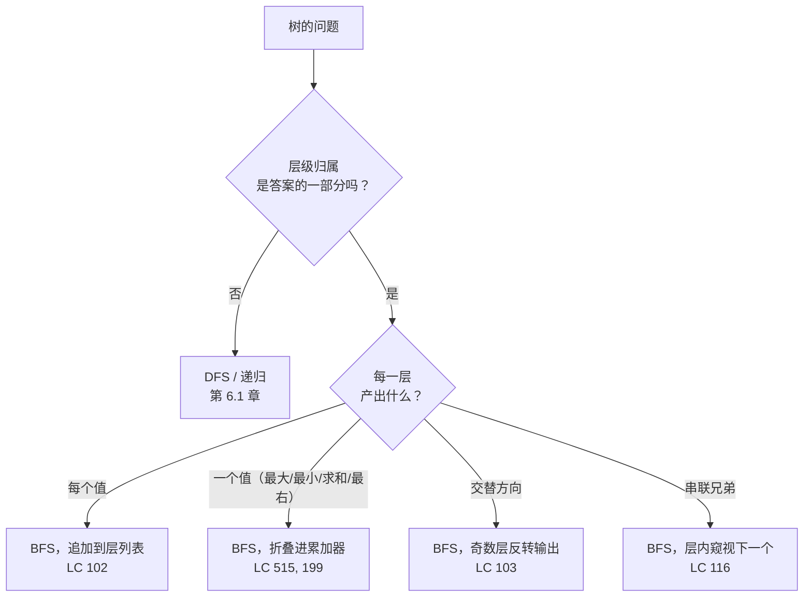
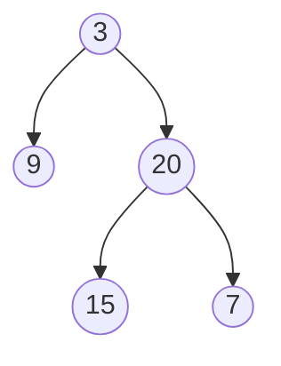

# 层序遍历：树上的 BFS

康拉德·楚泽（Konrad Zuse）1945 年就写下了广度优先搜索（breadth-first search），然后从未发表。十四年后，Edward F. Moore 独自把同一个算法重新推导了一遍——当时他正在找一个走出迷宫的最短路径。把他的算法与普通的队列遍历区分开来的那行代码，正是这行：

```python
level_size = len(queue)
```

就一行。它在任何子节点入队之前，先把队列*此刻*的节点数快照下来。这一个整数，就是把「访问每个节点」变成「按深度分组、按顺序访问每个节点，并一路保住层与层之间边界」的那一步。LC 上凡是要求按行做点什么的树题——收集、窥视、交替、串联、归约——最后都会用到这个快照。

上一章讲的是递归遍历：前序、中序、后序。它们沿深度走；隐式栈落在调用帧上；你得先到底，再爬回兄弟节点那里。本章讲的是同一棵树换个方向走会怎样。控制结构从递归调用栈换成显式的 FIFO 队列，问题也从「往哪个方向下」变成「我现在在第几层」。机制不同了。而该选哪一个，一旦你知道触发条件，其实并不微妙。

## 触发信号

当一道树题要为每一行产出一个值、要两行交界处的一个值、或要同一行上兄弟节点之间的关系时，就用层序 BFS。触发条件就这一条。[^1] 递归 DFS 是树的默认解法，只要答案局部于某条从根到节点的路径，它就一直是默认。只有当**层级归属本身就是答案的一部分**时，BFS 才配得上它的位置。

这个模式的中心是五道题，五道都是 LC 中等：LC 102（收集每个值）、LC 199（每层最右边的值）、LC 103（交替方向）、LC 116（用 `next` 指针把兄弟节点串起来）、LC 515（按层归约）。它们不是五个算法，而是一副外层骨架配五种不同的内层循环体。本章只讲一遍骨架，然后点明要改的是哪几处。

反面的信号同样干净。「找一条满足性质 X 的根到叶路径」是 DFS。「校验 BST 不变式」是 DFS。「自下而上算某个节点的直径或最大和」是后序 DFS。「序列化这棵树」则看面试官点哪个遍历。这些都不关心层级归属，都不是本章的题。

## 这个模式用在哪



*图注：只有当层级归属是答案的一部分时，BFS 才值得用；各变体之间改的只是内层循环体。*

## 为什么最直白的写法会丢掉层级

五分钟白板上写出来的最自然的 BFS 长这样：

```python
# 朴素 BFS —— 访问顺序正确，输出形状错误
def naive_bfs(root):
    if root is None:
        return []
    result = []
    queue = deque([root])
    while queue:
        node = queue.popleft()
        result.append(node.val)
        if node.left:  queue.append(node.left)
        if node.right: queue.append(node.right)
    return result
```

拿它跑 `[3, 9, 20, null, null, 15, 7]`，输出是 `[3, 9, 20, 15, 7]`。每个节点都访问到了，按层序，各一次。顺序是对的。但 LC 102 要的是 `[[3], [9, 20], [15, 7]]`——按层分组的取值，而这个版本把边界丢了。9 和 20 一出队，队列里剩下的 15 和 7 就跟它们并排待着，没有任何标记说「这些属于下一行」。深度曾经是个东西，这条信息已经溶掉了。

修法总得落在某处。补回去有两条路：在每层末尾入队一个哨兵 `None`，出队时盯着它；或者在每层开头把队列大小快照下来，正好弹出这么多节点，再考虑下一批。哨兵法能用，老教材的代码里常见；快照法更干净，因为它不需要额外类型、不需要额外分支、末尾也没有特例。快照胜出。CLRS 在 §20.2 讲了更一般的图 BFS[^2]；针对树的层快照改造，则是标准写法。

## 模式

```python
from collections import deque

def level_order(root):
    if root is None:
        return []
    result = []
    queue = deque([root])
    while queue:
        level_size = len(queue)              # 快照 —— 本章讲的都是这一行
        level = []
        for _ in range(level_size):
            node = queue.popleft()
            level.append(node.val)
            if node.left:  queue.append(node.left)
            if node.right: queue.append(node.right)
        result.append(level)
    return result
```

**解法** — Python（[Java](./03-level-order-traversal/lc-102/sol.java) · [C++](./03-level-order-traversal/lc-102/sol.cpp) · [Go](./03-level-order-traversal/lc-102/sol.go)）

```python
# LC 102. Binary Tree Level Order Traversal
from collections import deque
from typing import List, Optional


class TreeNode:
    def __init__(self, val=0, left=None, right=None):
        self.val = val
        self.left = left
        self.right = right


def level_order(root: Optional[TreeNode]) -> List[List[int]]:
    """LC 102：以「列表的列表」形式返回层序遍历结果。"""
    if root is None:
        return []
    result: List[List[int]] = []
    queue: deque = deque([root])
    while queue:
        level_size = len(queue)
        level: List[int] = []
        for _ in range(level_size):
            node = queue.popleft()
            level.append(node.val)
            if node.left is not None:
                queue.append(node.left)
            if node.right is not None:
                queue.append(node.right)
        result.append(level)
    return result
```

真正干活的是三行。外层 `while queue` 每层跑一次。`level_size = len(queue)` 那行把边界快照下来；本轮迭代里追加的子节点属于下一层，在外层循环转回来之前一直不可见。内层 `for _ in range(level_size)` 恰好消费快照那一刻队列上的那些节点，不多不少。其余都是记账。

关于 Python 的 `range(level_size)` 有个细节：这个整数只在循环开头求值一次，所以循环体里追加的子节点不会延长迭代次数。Java 的 `for (int i = 0; i < queue.size(); i++)` 正好相反：`queue.size()` 每次判断都会重算，于是不写快照的循环会悄悄把层边界并成一大趟。Java 版文件正是在循环外写 `int levelSize = queue.size()`，就为这个。

> [!IMPORTANT]
> `len(queue)` 快照不是风格选择。它就是把「按层序访问」和「访问并按层分组」区分开的那一行。没有它，子节点一入队，队列就把深度之间的边界溶掉了；有了它，边界在整个外层迭代里被保留成一个计数。

## 实例推演：LC 102 处理 `[3, 9, 20, null, null, 15, 7]`

树形：



*图注：LC 102 的示例树。三层，根是 3，子节点 9 和 20，20 的子节点是 15 和 7。*

构建阶段：根入队，快照 `level_size = 1`，3 出队、访问，把它的子节点 9 和 20 入队。第 0 层结束，结果是 `[[3]]`。下面的组件逐个单元格展示队列的演变，以及每次 `level_size` 快照时出现的边界条。

决定性的一刻在第 8 步。队列里是 `[9, 20]`，结果里是 `[[3]]`，算法快照 `level_size = 2`。接下来四次迭代，9 和 20 各自出队、被访问，20 的子节点 15 和 7 被追加到边界*后面*。内层循环结束时，队列是 `[15, 7]`，当前层是 `[9, 20]`。边界守住了；外层循环的下一轮会以一个新的 2 的快照再次看到它。

> **交互式组件：** [树遍历动画器（DFS 前/中/后序 + BFS 层序）](../../../dsa/widgets/w-16-tree-traversal-animator.yml)（面板 `panel-b`）—— 在网站上渲染；YAML 规格描述了各个关键帧。

*静态回退图：23 步之内，队列演变 [3] → [9, 20] → [15, 7] → 空。结果累积 [[3]] → [[3], [9, 20]] → [[3], [9, 20], [15, 7]]。边界条出现三次，每次都在一次 `level_size` 快照之后，守住正在处理的那一层与正在准备的那一层之间的界线。*

## 各变体之间改了什么

外层循环在梯度上这五道题里都一样。变的是两件事：内层循环往 `level` 里放什么，以及循环结束时往 `result` 里追加什么。

| 题目 | 内层循环体 | `result` 收集什么 |
|---|---|---|
| LC 102，层序遍历 | `level.append(node.val)` | `result.append(level)` |
| LC 515，每行最大值 | `level_max = max(level_max, node.val)` | `result.append(level_max)` |
| LC 199，右视图 | 仅在 `i == level_size - 1` 时追加 `node.val` | 每层最右的那个值 |
| LC 103，锯齿形 | 与 LC 102 完全相同 | 奇数行追加前先反转 `level` |
| LC 116，next 指针 | 通过 `queue[0]` 窥视层内下一个；设 `node.next = queue[0]`（最后一次迭代为 `None`） | 什么都不收集——副作用*就是*答案 |

LC 199 的「边界」框架最干净：一层上最右边的节点，就是在 `i == level_size - 1` 时出队的那个。层快照告诉你这一刻什么时候到来。没有它，「最右」无从定义：9 和 20 里哪个算「最右」取决于你在哪一层，而单看队列说不了这件事。

LC 103 有个坑。把「交替方向」读成「交替子节点的入队顺序」，在第 2 层及以后就会出错，因为 BFS 的入队顺序决定了下一层里哪些子节点属于哪个父节点；改动它就把父子关系搞坏了。要反转的是*输出*的那一层，不是入队顺序。等价做法：用 `collections.deque` 构建 `level`，奇数行用 `appendleft`。[^3]

LC 116 把层快照用到了极限。内层循环里，节点出队之后窥视 `queue[0]`。那就是*同一层*上的下一个节点，因为边界还在。到了这一层的最后一次迭代（`i == level_size - 1`），`queue[0]` 已经是某个访问过的节点的子节点，此时 `node.next` 应当设成 `None`。层快照告诉算法「这是当前层的最后一个节点」；没有它，窥视会悄悄跳到下一层，把兄弟关系跨行连起来。这道题还有一个 O(1) 额外空间的解法：在父层上沿已经串好的 `next` 指针走，去给子节点连线，LC 官方题解有讲；但教模式的还是 BFS 解法。[^4]

## 实际开销

| 变体 | 时间 | 空间 | 说明 |
|---|---|---|---|
| BFS 访问每个节点 | O(n) | O(w) | `w` = 任意单层上的最大节点数 |
| 最坏情况（完全二叉树） | O(n) | O(n/2) = O(n) | 底行占了半数的节点 |
| 退化成链的斜树 | O(n) | O(1) 额外 | 宽度始终是 1 |
| 构建 list-of-lists 输出 | O(n) | O(n) | 输出本身就是 n |

每个节点入队一次、出队一次，所以队列从头到尾正好执行 `2n` 次操作。每次操作在 `collections.deque`（Python）、`ArrayDeque`（Java）、架在 `std::deque` 上的 `std::queue`（C++），以及带 append 和头部丢弃的切片（Go）上，都是摊还 O(1)。在 `n` 个节点、`n - 1` 条边的树上，CLRS 的通用图 BFS 界 O(V + E) 收缩成 O(n)。[^2] 层快照每层多两次常数时间操作（读 `len(queue)`、分配 `level`）；退化斜树最多有 `n` 层，所以渐进开销不变。

在 LC 102 上杀掉朴素 Python 解法的那个坑，是拿 list 当队列。`list.pop(0)` 会把剩下每个元素左移一位，代价 O(width)。平衡树上总工作量变成 O(n × n/2) = O(n²)，标准的 10⁴ 节点隐藏用例会超时，而基于 deque 的 BFS 几十毫秒就跑完。[^5] 用 `collections.deque`，然后别再想这件事。Java 里的对应选择是 `ArrayDeque` 而不是 `LinkedList`：作为队列大约快三倍，因为它把元素存在环形数组里，而不是每次入队都分配一个节点，而且 JIT 会内联它的 `offer` 和 `poll` 路径。[^6]

## 两个最容易踩的坑

> [!WARNING]
> **忘了 `if root is None: return []`。** LC 102 写明的约束是 `0 <= number of nodes <= 2000`，所以空树是合法输入。没有这道守卫，第一次 `queue.append(root)` 就把一个 `None` 入队，内层 `popleft` 返回 `None`，`None.val` 在点解引用上抛异常。这是五分钟面试版 LC 102 实现里最常见的单个 bug。

> [!WARNING]
> **在 Java、C++ 或 Go 里把 `queue.size()` 读进内层循环。** Python 的 `range(level_size)` 只把那个整数求值一次，是安全的；Java 的 `for (int i = 0; i < queue.size(); i++)` 每次判断都重新求大小，于是循环体里追加的子节点会延长迭代次数，把层边界并成一大趟。在内层循环之前把大小快照进局部变量。C++ 的 `q.size()` 和 Go 的 `len(queue)` 是同一个形状：只快照一次，绝不在循环里读。

第三个坑值得提一句：在 LC 199 上，BFS 和 DFS 混着写的解法容易写、也容易坏。LC 199 有干净的 DFS 解法（先递归右边，第一次摸到某个此前没见过的深度时记下 `node.val`），也有干净的 BFS 解法（本章这个）；把两者的碎片拼起来，得到的代码只能过一部分用例。选一个。就本章而言，BFS 是自然的表达，因为层边界本来就在手上。

## 题目梯度

### 核心（三题全做才算掌握本章）

- [LC 102 — Binary Tree Level Order Traversal](https://leetcode.com/problems/binary-tree-level-order-traversal/) [中等] • bfs-level-order ★
- [LC 199 — Binary Tree Right Side View](https://leetcode.com/problems/binary-tree-right-side-view/) [中等] • bfs-level-order-rightmost
- [LC 103 — Binary Tree Zigzag Level Order Traversal](https://leetcode.com/problems/binary-tree-zigzag-level-order-traversal/) [中等] • bfs-level-order-alternating-direction

### 进阶（可选）

- [LC 116 — Populating Next Right Pointers in Each Node](https://leetcode.com/problems/populating-next-right-pointers-in-each-node/) [中等] • bfs-level-order-with-sibling-link
- [LC 515 — Find Largest Value in Each Tree Row](https://leetcode.com/problems/find-largest-value-in-each-tree-row/) [中等] • bfs-level-order-reduce

说实话：梯度上每道题都是 LC 中等。碰到层序的简单候选（LC 100 Same Tree、LC 101 Symmetric Tree、LC 104 Maximum Depth）已经归了[二叉树：结构与递归](./00-binary-tree-fundamentals.md)，那也确实是它们该待的地方。相邻的困难题 LC 297 Serialize and Deserialize 属于[树的遍历：前序、中序、后序](./01-tree-traversals.md)。留给本章的，在结构上就是单一难度带，注册表把它记成这个模式的一个属性，而不是缺口。五道中等题，一副骨架，五种内层循环体。

## 后续衔接

层快照这个技巧可以推广。把「树」换成「无权图」，加一个 `visited` 集合处理环，同一副外层骨架就成了无权图上最短路径的标准算法——只多一个新概念（[BFS 最短路径](../../../dsa/part-8-graphs/01-bfs.md)）。把「树」换成「网格」，用多个起点初始化队列，同一副骨架就成了多源 BFS，「腐烂的橘子」和「01 矩阵」这类题靠它在线上时间内解掉，不用 Dijkstra。这个模式是本章与第 8 章一大块内容之间的桥。

还有一个侧向的走法值得点一下。LC 116 的 `next` 指针技巧有一个 O(1) 额外空间的解法，沿父层已经串好的指针往下走；同一个观察也是 [Morris 遍历](./02-morris-traversal.md)里那个迭代式 O(1) 做法的基础。两个算法表面上毫无共同点，却都是同一个想法的应用：树里已经连好的指针，可以承担本该由显式辅助结构承担的工作。

## 参考文献

[^1]: LeetCode Discuss 学习指南，"Tree BFS Technique and Question Bank"（帖子 1805207，2024）。

[^2]: Cormen, Leiserson, Rivest, Stein，*Introduction to Algorithms*，第 4 版，MIT Press，2022，第 20 章 §20.2 "Breadth-first search"。

[^3]: BFS 本身约在 1945 年由 Konrad Zuse 在解决连通性问题时发现，但 Zuse 关于 Plankalkül 的手稿直到 1972 年才发表；Edward F. 见 [Wikipedia: Breadth-first search](https://en.wikipedia.org/wiki/Breadth-first_search)

[^4]: LeetCode 116，"Populating Next Right Pointers in Each Node"（中等）。

[^5]: Stack Overflow，"Level Order Traversal in python, Can we optimise it better?"（qid 69509897）。

[^6]: Stack Overflow，"Why is ArrayDeque better than LinkedList"（qid 6163166）。作为队列，`ArrayDeque` 比 `LinkedList` 大约快三倍，因为没有逐节点分配，缓存行为也更好；JIT 会内联它的 `offer` 和 `poll` 路径。java-performance.info（2023）用微基准佐证了这一点。
