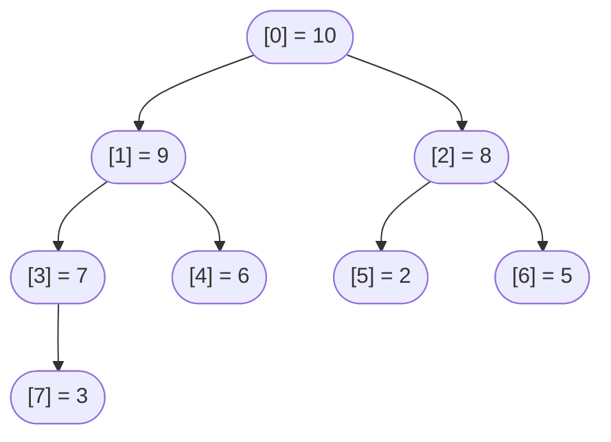
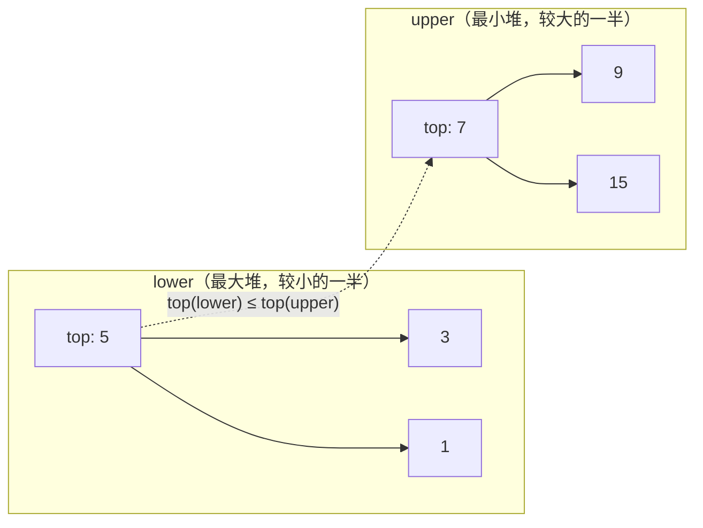

# 堆与优先队列

1964 年 6 月，J. W. J. Williams 在《Communications of the ACM》第 8 页发表了二叉堆（binary heap），把它藏在一个他称为 Algorithm 232（Heapsort）的排序程序里。半年后，同一期刊的 12 月号上，Robert Floyd 发表了 Algorithm 245（Treesort），只在建堆这一步埋了一处改动：不再把 `n` 个元素一个个插进空堆，而是自底向上建堆，从最后一个内部节点一路下滤回根。Williams 的建堆是 `O(n log n)`，Floyd 的是 `Θ(n)`。终态一样，之后的操作也一样，只是建堆从线性对数变成了线性。同一个终态下 `O(n log n)` 与 `Θ(n)` 的这道差距，是本章最难的一块数学，也是大多数人卡住的地方。

六十二年后，每个标准库都自带二叉堆。[^1] [^2] Python 的 `heapq`、Java 的 `PriorityQueue`、C++ 的 `std::priority_queue`、Go 的 `container/heap`。同一个抽象数据类型的四份实现，四套接口，背后都是 Williams 勾勒的“数组即隐式树”思路。面试题库已经收敛到三种形态：用有界堆求 top-K、K 路归并有序流、用双堆平衡两半求滑动中位数。只要认得出这三种形态、为每种挑对堆的变体，用同样五个基本操作就能解决二十来道不同的 LeetCode 题。

本章先讲基本操作（数组布局、上滤、下滤、push、pop、建堆），再反过来用它们解决 LC 215、LC 295 和 LC 23。机制部分在 §“堆到底是什么”到 §“线性时间建堆”之间；应用部分是后面三个实例推演。按顺序读，每一节都假设你读过前面那节。

## 堆到底是什么

二叉堆是一棵存在数组里的完全二叉树。完全性是结构上的：除最后一层外每层都满，最后一层从左往右填。有序性是局部的：最大堆里每个父节点都压过自己的孩子，最小堆里每个父节点都被孩子压过。没有全局顺序。兄弟之间不要求可比，堂兄弟之间毫无关系，第十大的元素可以待在根下面的任何位置。

数组布局是这结构便宜的原因。对下标 `i` 的节点（从 0 开始）：

- 父节点是 `(i - 1) / 2`
- 左孩子是 `2 * i + 1`
- 右孩子是 `2 * i + 2`

没有指针，没有按节点分配内存。树是隐式的；数组就是树。



*数组 `[10, 9, 8, 7, 6, 2, 5, 3]` 看作一棵完全二叉树。每个父节点都大于等于它的孩子，所以 10 坐在根上，pop_max 能在 O(1) 内把它取走。*

完全性把高度钉死在 `floor(log2 n)`，对任何 `n` 都成立。不存在树退化成链表的病态情况。一百万个元素的堆高度是 19，十亿个元素的高度是 29。高度就是 `O(log n)`、没有例外，这条上界让每个操作都便宜。

真正干活的是两个操作：上滤（sift-up）和下滤（sift-down）。两者都只走一条从根到叶的路径。最坏情况都是 `O(log n)`，因为路径长度就是树高。

## 两个基本操作

上滤在 push 之后跑。新元素追加到下一个空位，如果数组当前有 `n` 个元素，那就是下标 `n`，也就是最底层最靠左的空位。这次插入保住了完全性，却可能破坏有序性：新值也许比它的父节点大。上滤的处理办法是让新元素朝根走，只要父节点输了就交换。

```python
def sift_up(a, i):
    while i > 0:
        parent = (i - 1) // 2
        if a[parent] < a[i]:
            a[parent], a[i] = a[i], a[parent]
            i = parent
        else:
            return
```

下滤在 pop 之后跑。根就是要返回的那个值。把它拿走后留下一个洞，我们用最后一片叶子填进根的位置。这样保住了完全性，却可能从上往下破坏有序性：那片叶子也许比它的孩子小。下滤让这个值朝叶子方向走回去，每一层都和两个孩子中较大的那个交换，直到两个孩子都比它小（或者已经没有孩子）。

```python
def sift_down(a, i, n):
    while True:
        left, right, largest = 2 * i + 1, 2 * i + 2, i
        if left  < n and a[left]  > a[largest]: largest = left
        if right < n and a[right] > a[largest]: largest = right
        if largest == i:
            return
        a[i], a[largest] = a[largest], a[i]
        i = largest
```

两个循环都从起点走一条路，走到叶子或者走到已满足条件的位置为止。路径长度被树高 `floor(log2 n)` 限制。每次迭代都是常数工作（一次比较，可能加一次交换）。所以两个基本操作最坏都是 `O(log n)`，操作表里剩下的全是包在它们外面的一行代码。

> **Interactive widget:** [堆操作：push 后的上滤、pop 后的下滤](../../../dsa/widgets/w-18-heap-operations.yml)（面板 `default`）—— 在网站上渲染，YAML 规格里描述了关键帧。

*静态版：从最大堆 `[9, 7, 8, 3, 6, 2, 5]` 出发，push(10) 把 10 追加到下标 7，经过三次交换（10↔3、10↔7、10↔9）上滤到根。接着 pop_max() 返回 10，把最后一片叶子 3 移到根，再经过两次交换（3↔9、3↔7）下滤，堆恢复成起始形状。*

这个组件演示的是一个来回。注意上滤用了三次交换、下滤只用了两次：路径长度不同，因为新值从最后一片叶子进来、一路走到根，而被移上来的那片叶子从根出发，停在下标 3（这个位置已经没有孩子可违反）。两条路径都被 `log2(8) = 3` 限制，这就是 `O(log n)` 在这个规模下的含义。

## 完整操作表

有了上滤和下滤，其余操作都只是一层薄壳。push 追加后上滤；pop 把根与最后一片叶子交换、缩短数组、对新根下滤。peek 读 `a[0]`。replace 把 pop 和 push 合成一次下滤，值直接放在根上，省下一趟路径。

| 操作 | 时间 | 空间 | 作用 |
|---|---|---|---|
| `peek()` | `O(1)` | `O(1)` | 返回 `a[0]`。根永远是最值。 |
| `push(x)` | `O(log n)` | `O(1)` | 追加到下标 `n`，上滤。 |
| `pop()` | `O(log n)` | `O(1)` | 交换 `a[0]` 与 `a[n-1]`，去掉最后一个槽位，对新根下滤。 |
| `replace(x)` | `O(log n)` | `O(1)` | 把 `x` 放到根，下滤。一趟搞定，而不是先 pop 再 push。 |
| `heapify_by_insert(arr)` | `O(n log n)` | 额外 `O(1)` | 调用 `n` 次 push。朴素建堆。 |
| `heapify_by_floyd(arr)` | `Θ(n)` | 额外 `O(1)` | 下标从 `floor(n/2) - 1` 倒着走到 `0`，逐个下滤。线性建堆。 |

replace 这个操作值得单独点出来。Python 把它暴露成 `heapq.heapreplace(h, x)`，语义是“弹出最小值，再压入 x”，但实现上只是把新值放到根、做一次下滤。在流式热路径上（LC 703、LC 215），每个新元素都触发一次比较加替换，这时 `heapreplace` 比先 `pop` 再 `push` 快大约一倍，因为它省掉了一整趟下滤。[^3] Go 的 `container/heap` 用 `heap.Fix(h, 0)` 表达同一个意思，前提是你先原地改掉根。C++ 没有直接对应物，但 `pop` 接 `push` 能达到同样效果——标准库在优化时会把多余的那部分内联掉。

heapify_by_insert 和 heapify_by_floyd 这两行是同一个终态、两种做法。下一节讲为什么第二种更快。

## 线性时间建堆

从无序数组建堆的朴素做法，是把每个元素 push 进一个初始为空的堆。那是 `n` 次 push，每次最坏 `O(log n)`，合计 `O(n log n)`。Williams 1964 年的原始论文用的就是这个建堆方式，他那套完整排序总体也是 `O(n log n)`——对排序来说够用，因为取出阶段同样是 `O(n log n)`。

Floyd 注意到建堆这一步不必是 `O(n log n)`。在 Williams 之后半年，1964 年 12 月，Floyd 发表了自底向上建堆：从最后一个内部节点倒着走到根，每个位置调一次下滤。[^2]

```python
def floyd_build_max_heap(a):
    n = len(a)
    for i in range(n // 2 - 1, -1, -1):
        sift_down(a, i, n)
```

起始下标 `n // 2 - 1` 就是最后一个内部节点。它之后的每个下标都是叶子，而单元素的子树天然是合法堆。对每个内部节点倒序下滤，就把那棵子树上的堆性质修好了。等循环走到下标 0，下面所有子树都已合法，最后对根做一次下滤，整个堆就完成了。

这个做法是 `Θ(n)` 的证明，是本章最难的一块数学。[^4] 朴素直觉（`n` 次 `O(log n)` 的下滤，得 `O(n log n)`）作为上界没错，但渐近上不紧。紧的界来自一个观察：**大多数节点是叶子，大多数子树很短**。

一棵有 `n` 个节点的完全二叉树，在高度 `h` 上至多有 `ceil(n / 2^(h+1))` 个节点，高度从叶子往上量。一半节点是叶子（高度 0）。四分之一在高度 1。八分之一在高度 2。唯一的根在高度 `log2(n)`。

从高度 `h` 的节点发起一次下滤，最多做 `O(h)` 的工作，因为那就是它能走的最长路径。整个建堆的总工作量是对所有高度求和：

```text
Total work  =  Σ (over heights h from 0 to log2 n) of [ ceil(n / 2^(h+1)) · O(h) ]
            ≤  (n / 2) · Σ (h = 0 to ∞) [ h / 2^h ]
            =  (n / 2) · 2
            =  O(n)
```

级数 `Σ h / 2^h` 收敛到 2，这是微积分里标准的算术-几何和。所以整个自底向上建堆最多做 `n` 个单位的工作，尽管根上那次最坏情况的下滤要花 `log2(n)` 次交换。数学之所以成立，是因为**贵的下滤很少**：只有一个节点处于最大高度。便宜的那些调用（叶子零工作；高度 1 的内部节点最多一次交换）主导了整个和。

Sedgewick 与 Wayne 用记账法把这个界进一步收紧到 `≤ n` 次交换：把每个高度 `k` 的节点映射到一条长度 `k` 的唯一“先左后右”路径，所有节点的路径长度之和被 `n` 界住。[^5] 两种证明结论一致：Floyd 方法的建堆是线性的，与输入无关。

循环下界 `n / 2 - 1` 是最容易错一位的地方。它是最后一个内部节点的下标，也就是最右边那个至少有一个孩子的节点。下标 `n - 1` 是数组最后一格，只要 `n > 0` 它就是叶子。下标 `n - 1` 的父节点是 `((n - 1) - 1) / 2 = (n - 2) / 2`，`n` 为偶数时等于 `n / 2 - 1`，`n` 为奇数时等于 `(n - 1) / 2`；在向下取整的整数除法下两个表达式的值相同。`for i in range(n // 2 - 1, -1, -1)` 是 CLRS 的规范写法，四份参考实现都一字不改地用它。[^4]

## 四种语言的惯用法分化

这一段是本章必须明说的部分。每个标准库都带了堆，但没有两个库的默认行为一样。

**Python 的 `heapq` 只有最小堆。** 标准库里没有最大堆选项；文档写得很明确，这个模块实现的是最小堆，需要最大堆行为时的常规绕法是压入取负后的值。[^6] `heapq.heappush(h, x)` 压入；`heapq.heappop(h)` 弹出最小值；`heapq.heapreplace(h, x)` 是合并后的弹出再压入。没有类包装，你操作的就是一个普通 Python 列表，堆性质靠外部维持。

**Java 的 `PriorityQueue` 默认是最小堆。** 默认自然序意味着最小的元素在队头；`offer` 插入，`poll` 移除队头，`peek` 读取队列头部。要最大堆，就往构造函数传 `Comparator.reverseOrder()`。批量构造函数 `new PriorityQueue<>(collection)` 走 Floyd 方法在 `O(n)` 内建好，而不是反复插入的 `O(n log n)`。

**C++ 的 `std::priority_queue` 默认是最大堆。** 这是那个坑：从 Python 或 Java 换到 C++，默认值是反的。`std::priority_queue<int>` 先返回最大的元素；要最小堆，得把 `std::greater<int>` 作为第三个模板参数传进去：`std::priority_queue<int, std::vector<int>, std::greater<int>>`。[^7] `std::make_heap` 是批量建堆的原语，跑在 `O(n)`，底下正是 Floyd 的算法。

**Go 的 `container/heap` 是一套协议，不是一个类型。** 你在自己的切片类型上实现五个方法的 `heap.Interface`（`Len`、`Less`、`Swap`、`Push`、`Pop`），由 `Less` 决定你拿到的是最小堆还是最大堆。[^8] `heap.Init(h)` 跑 Floyd 建堆；`heap.Push(h, x)` 和 `heap.Pop(h)` 是公开入口；`heap.Fix(h, i)` 在你直接改了下标 `i` 之后重新堆化，对流式替换这个模式来说比先 pop 再 push 更快。

这种分化会造出真 bug。一个背下“`heap.poll()` 在 Java 里返回最小值”的候选人，在 C++ 里顺手去写 `pq.top()`，拿到的是最大值。LC 215（第 K 大）的 Python 解法可以写成全部元素的最大堆（压入时取负），也可以写成大小为 K 的最小堆（不取负，根就是答案）；后者更简单也更快。同一题的 Java 版读起来最清爽的写法是大小为 K 的最小堆（正好是默认行为），但你把它誊到 C++ 时就得记得补 `std::greater<int>`。这些反转都不难修，难的是在面试压力下*不忘记*。

## 实例推演：LC 215, Kth Largest Element in an Array

> **题目要求。** 给定无序数组 `nums = [3, 2, 1, 5, 6, 4]` 和 `k = 2`，返回第二大的元素。这里答案是 5。

> **模式信号。** “找第 K 大”或“找 top K”，并且 `K << n`，就是有界堆形态。状态大小是 `K` 而不是 `n`；每一步触发的操作是淘汰，不是插入。

> **第一直觉（错的）。** 排序后返回 `nums[n - k]`。时间是 `O(n log n)`，额外空间 `O(1)`（如果语言的排序不是原地，则 `O(n)`），能过，但堆解法是 `O(n log k)`——只要 `k` 有界，渐近上就更好。

“大小为 K 的堆”这个思路第一遍读反直觉。要找第 k *大*，维护的是*最小*堆，不是最大堆。直觉是这样：每一步堆里装着目前见过的 k 个最大值，而根是这 k 个里最小的。新值来了就跟根比。新值更大，说明它属于 top-K，当前根（幸存者里最小的那个）被淘汰。新值更小或相等，它不可能进 top K，直接丢掉，堆一点不动。处理完 `n` 个值，根恰好就是第 k 大。

```python
def find_kth_largest(nums, k):
    heap = []
    for x in nums:
        if len(heap) < k:
            heapq.heappush(heap, x)
        elif x > heap[0]:
            heapq.heapreplace(heap, x)
    return heap[0]
```

**解法** — Python ([Java](./04-heaps-priority-queues/lc-215/sol.java) · [C++](./04-heaps-priority-queues/lc-215/sol.cpp) · [Go](./04-heaps-priority-queues/lc-215/sol.go))

```python
# LC 215. Kth Largest Element in an Array
# 堆解法，对应
# top-K 惯用法（大小为 k 的最小堆，溢出就淘汰）。快速选择才是
# 第 2.7 章的主算法；这里是堆的替代方案。
import heapq
from typing import List


def find_kth_largest(nums: List[int], k: int) -> int:
    """返回第 k 大的元素。大小为 k 的最小堆，根即答案。

    Time:  O(n log k)，平均与最坏情况。
    Space: O(k)。
    """
    heap: list[int] = []
    for x in nums:
        if len(heap) < k:
            heapq.heappush(heap, x)
        elif x > heap[0]:
            heapq.heapreplace(heap, x)        # 一步完成弹出再压入
    return heap[0]
```

在 `nums = [3, 2, 1, 5, 6, 4]`、`k = 2` 上走一遍：压 3（堆 = `[3]`）；压 2（堆 = `[2, 3]`，满）；1 < 2，跳过；5 > 2，heapreplace，堆 = `[3, 5]`；6 > 3，heapreplace，堆 = `[5, 6]`；4 < 5，跳过。根是 5。六个元素过了一遍，堆从未超过大小 2；六次读根，两次替换。

代价是 `O(n log k)`。`n` 个元素每个做一次 `O(1)` 的读根，最多一次 `O(log k)` 的替换。空间是堆本身的 `O(k)`。当 `k` 是很小的常数（前 5、前 10、前 100），`log k` 基本等于零，算法实际上就是线性的。当 `k` 是 `n / 2`，算法就是 `O(n log n)`，相对排序没有任何渐近优势。

**快速选择是另一条路，而且在[快速选择](../part-2-search-sort/07-quickselect.md)那一章是主算法。** 堆解法是 `O(n log k)`；快速选择平均是 `O(n)`。权衡：

| 方面 | 大小为 K 的堆 | 快速选择 |
|---|---|---|
| 平均时间 | `O(n log k)` | `O(n)` |
| 最坏时间 | `O(n log k)` | `O(n²)`（随机主元可缓解） |
| 空间 | `O(k)` | 原地 `O(1)`，递归 `O(log n)` |
| 流式输入 | 可以（单趟） | 不行（需要随机访问） |
| 在线更新 | 可以（见 LC 703） | 不行（新数据来了要重跑） |
| 稳定、保留数组 | 是（`nums` 不受影响） | 否（原地分区） |

输入能放进内存、位置不动时，快速选择在平均时间和空间上都赢。只要输入是流、数组必须保留、或者数据陆续到达就得给出当前的答案，堆就赢。LC 703（数据流中的第 K 大）是堆解法占绝对优势的最干净例子：你没法对还没见到的数据做快速选择。

对离线版本（LC 215，数组一开始就给全），面试官通常两种解法都接受，但更希望两个都看到，外加一句权衡。如果你对这数据结构熟，先上堆：它更短，也比带随机主元和三分区间的快速选择更不容易悄悄写错。

## 实例推演：LC 295, Find Median from Data Stream

> **题目要求。** 数字一个一个到达。每次到达之后，返回目前所有值的中位数。对数据流 `[1, 2, 3, 4]`，中位数序列是 `1.0, 1.5, 2.0, 2.5`。

> **模式信号。** “滑动中位数”“滑动第 k 百分位”“在线分位数”。任何每次插入之后都要一个分位数、又付不起每次都把整个流重排一遍的场景。

> **第一直觉（错的）。** 维护一个有序列表，每次 addNum 二分找插入点。找插入点是 `O(log n)`，但*往列表里插*这一步是 `O(n)`，因为右边所有元素都要挪。`n` 次添加累计 `O(n²)`，而 LC 295 的约束（最多 `5 * 10^4` 次 addNum 调用）正是照着打破这个做法来定的。

双堆技巧能解决它。把流切成两半：一个最大堆装较小的一半，一个最小堆装较大的一半。中位数被夹在两个堆顶之间。两堆一样大时，中位数是两个堆顶的平均；有一边更大时，中位数是那个更大堆的堆顶。



*两个堆把流分成两半，满足 `max(lower) ≤ min(upper)`。插入 `[1, 3, 5, 7, 9, 15]` 之后，中位数是 `(5 + 7) / 2 = 6.0`，从两个根上 O(1) 读出。*

两条不变量让这个结构成立：

1. **大小：** `0 ≤ len(lower) - len(upper) ≤ 1`。总数为奇数时 lower 多带一个；总数为偶数时两堆相等。
2. **顺序：** `top(lower) ≤ top(upper)`。下半部分里每个值都不大于上半部分的任何值。

难的是每次 addNum 都同时维持这两条不变量，而且中途不能出现某个瞬间破坏顺序不变量、被并发的 findMedian 观测到。最干净的惯用法是**先压再轮转**：无条件把新值压进 lower，然后把 lower 的堆顶移到 upper 以满足顺序不变量，如果此时 upper 比 lower 多了，再轮转一个回来修正大小不变量。

```python
class MedianFinder:
    def __init__(self):
        self.lower = []          # 最大堆（存负值）
        self.upper = []          # 最小堆

    def addNum(self, num):
        heapq.heappush(self.lower, -num)
        heapq.heappush(self.upper, -heapq.heappop(self.lower))
        if len(self.upper) > len(self.lower):
            heapq.heappush(self.lower, -heapq.heappop(self.upper))

    def findMedian(self):
        if len(self.lower) > len(self.upper):
            return float(-self.lower[0])
        return (-self.lower[0] + self.upper[0]) / 2.0
```

**解法** — Python ([Java](./04-heaps-priority-queues/lc-295/sol.java) · [C++](./04-heaps-priority-queues/lc-295/sol.cpp) · [Go](./04-heaps-priority-queues/lc-295/sol.go))

```python
# LC 295. Find Median from Data Stream
# 双堆技巧：下半部分用最大堆（存负值），上半部分用最小堆。
import heapq


class MedianFinder:
    """不变量：0 <= len(lower) - len(upper) <= 1；-lower[0] <= upper[0]。"""

    def __init__(self) -> None:
        self.lower: list[int] = []   # 最大堆，存 -value
        self.upper: list[int] = []   # 最小堆

    def addNum(self, num: int) -> None:
        # 先压再轮转：放进 lower，再把 lower 的堆顶移到 upper。
        heapq.heappush(self.lower, -num)
        heapq.heappush(self.upper, -heapq.heappop(self.lower))
        # 恢复大小不变量：lower 可以多带一个。
        if len(self.upper) > len(self.lower):
            heapq.heappush(self.lower, -heapq.heappop(self.upper))

    def findMedian(self) -> float:
        if len(self.lower) > len(self.upper):
            return float(-self.lower[0])
        return (-self.lower[0] + self.upper[0]) / 2.0
```

在流 `[1, 2, 3]` 上跟踪一遍：addNum(1) 把 -1 压进 lower，又把它弹出来推进 upper，然后因为 `len(upper) > len(lower)` 轮转回来；终态 lower=`[-1]`、upper=`[]`，中位数 1.0。addNum(2) 把 -2 压进 lower，弹出后压进 upper；终态 lower=`[-1]`、upper=`[2]`，中位数 (1 + 2)/2 = 1.5。addNum(3) 把 -3 压进 lower，弹出后压进 upper，再把 2 轮转回来；终态 lower=`[-2, -1]`、upper=`[3]`，中位数 2.0。

每次 addNum 三个操作，每个 `O(log n)`。findMedian 是两次 `O(1)` 读堆顶。`m` 次 addNum 总计 `O(m log m)`。在 `m = 5 * 10^4` 时，比有序列表做法好两个数量级。

另一个可选的数据结构是顺序统计树（用子树大小增强的平衡 BST），插入 `O(log n)`、读中位数 `O(log n)`。上界上渐近等价，但实际更慢；红黑树的常数大约是双堆的 3~5 倍，因为每次插入触及的缓存行更多、走过的条件分支也更多。双堆解法在面试压力下写起来还短得多。

要提醒的坑是 findMedian 里的浮点除法。Java 的 `(lower.peek() + upper.peek()) / 2` 返回 `int`；标准修法是 `/ 2.0`，把操作数推进 `double`。C++ 在两个堆顶都是 `int` 时有同样的陷阱。Python 和 Go 不受影响（Python 的 `/` 对整数永远是浮点除法；Go 参考实现里显式写了 `float64(...)` 转换）。这个 bug 是静默的（函数返回看起来合理的整数），也是讨论区里最常见的 LC 295 提交失败原因。

## 实例推演：LC 23, Merge k Sorted Lists

> **题目要求。** 给定 `k` 条有序链表，返回一条包含所有值的合并有序链表。例如 `[[1,4,5], [1,3,4], [2,6]]` 变成 `[1,1,2,3,4,4,5,6]`。

> **模式信号。** “合并 K 个有序流 / 链表 / 文件 / 迭代器”就是 K 路归并。堆里装的是*游标*（每条流一个），不是值，推进游标才是核心操作。

> **第一直觉（错的）。** 把所有链表拼起来再排序。那是 `O(N log N)`，`N` 是节点总数，它把输入*本来就有序*这个结构浪费掉了。知道每条输入有序能带来的收益，正好是那个可以省掉的 `log k / log N` 因子；`k = 100`、`N = 10^4` 时大约是 `7 / 13 ≈ 0.54×` 的比较次数。

用最小堆做 K 路归并是标准解法。初始化时把每条非空链表的头节点放进堆。然后反复：弹出最小的游标，把它的节点接到输出上，再把该游标的下一个节点压回堆。堆里任何时刻至多 `k` 个游标，所以每次 push 和 pop 是 `O(log k)`。总共 `N` 次弹出之后，代价是 `O(N log k)`。

```python
def merge_k_lists(lists):
    heap = []
    for i, head in enumerate(lists):
        if head is not None:
            heapq.heappush(heap, (head.val, i, head))
    dummy = ListNode()
    tail = dummy
    while heap:
        _, i, node = heapq.heappop(heap)
        tail.next = node
        tail = node
        if node.next is not None:
            heapq.heappush(heap, (node.next.val, i, node.next))
    tail.next = None
    return dummy.next
```

**解法** — Python ([Java](./04-heaps-priority-queues/lc-23/sol.java) · [C++](./04-heaps-priority-queues/lc-23/sol.cpp) · [Go](./04-heaps-priority-queues/lc-23/sol.go))

```python
# LC 23. Merge k Sorted Lists
# 用 K 个游标的最小堆做 K 路归并。元组第 2 位（链表下标）的
# 平局裁决是必须的：ListNode 不可比较，堆绝不能直接比较两个
# ListNode 对象。
import heapq
from typing import List, Optional


class ListNode:
    __slots__ = ("val", "next")

    def __init__(self, val: int = 0, nxt: Optional["ListNode"] = None):
        self.val, self.next = val, nxt


def merge_k_lists(lists: List[Optional[ListNode]]) -> Optional[ListNode]:
    """O(N log K)，其中 N 为节点总数，K 为链表条数。"""
    heap: list[tuple[int, int, ListNode]] = []
    for i, head in enumerate(lists):
        if head is not None:
            heapq.heappush(heap, (head.val, i, head))

    dummy = ListNode()
    tail = dummy
    while heap:
        _, i, node = heapq.heappop(heap)
        tail.next = node
        tail = node
        if node.next is not None:
            heapq.heappush(heap, (node.next.val, i, node.next))
    tail.next = None
    return dummy.next
```

元组 `(node.val, i, node)` 在四种语言里都是承重结构。中间那一位、链表下标 `i`，存在的意义是给两个游标值相同时做平局裁决。没有它，两个头节点比较相等时，Python 的堆会伸手去拿第三位，试图算 `node1 < node2`，而 `ListNode` 没有定义 `__lt__`，于是抛 `TypeError`。链表下标在构造上是唯一的（每条链一个游标），所以它总能在堆落到那个不可比较的比较之前把平局判掉。

C++ 和 Java 有同样的问题，机制不同。`std::priority_queue<ListNode*>` 用默认比较器时按*指针地址*排序，不按值，而指针地址跨运行不确定，于是重复键上的合并结果虽然值对、顺序却不确定，有时候碰巧对，有时候不对。[^9] 修法是显式传比较器：C++ 用 lambda（最小堆写 `[](ListNode* a, ListNode* b) { return a->val > b->val; }`），Java 用 `Comparator.comparingInt(n -> n.val)`。Go 最干净：`Less(i, j int) bool { return h[i].Val < h[j].Val }` 本来就是协议要求的写法。

分治的替代方案值得一提。把 K 条链表配成 K/2 对，每对用标准的双指针归并合并，对得到的 K/2 条结果重复，直到只剩一条。每一层合并处理全部 `N` 个节点，共 `log2(K)` 层，所以总代价 `O(N log K)`，与堆版本同一个渐近界。两者的差别在内存（堆是额外 `O(K)`；分治是 `O(log K)` 递归深度）和缓存行为（分治每层碰每个节点两次，对长链表更友好；堆每个节点只碰一次，但随机访问更多）。

实践上，LC 23 里面试官想看的是堆解法，因为它能立刻推广到*无限流*的 K 路归并（LC 23 的近亲：外部内存归并排序、B+ 树叶子合并、分布式日志合并）。分治要求所有输入有限、在内存里、开跑前就能访问；它和迭代器输入组合不起来。

## 常见误区

> [!WARNING]
> **ListNode 比较器陷阱（LC 23）。** 在 Java 里，`new PriorityQueue<ListNode>()` 能编译，但第一次有两个等值的头节点进堆时，运行期抛 `ClassCastException`，因为 `ListNode` 没有实现 `Comparable`。在 C++ 里，`std::priority_queue<ListNode*>` 按指针地址排序，重复值上的正确性是不确定的。在 Python 里，堆一旦伸手去拿值相同时元组的第三位，`heapq.heappush(h, node)` 就抛 `TypeError: '<' not supported between instances of 'ListNode' and 'ListNode'`。**永远显式传比较器。** Python 参考实现里的 `(val, index, node)` 元组正是为此存在：`index` 那一位是平局裁决者，堆永远不会去直接比较两个 `ListNode` 对象。[^9]

> [!WARNING]
> **双堆再平衡的顺序（LC 295）。** 先压再轮转这个惯用法（把 num 压进 lower；把 lower 的堆顶弹进 upper；若 upper 比 lower 多就轮转回来）是三个看起来都合理的写法里最干净的一个，也是唯一一个顺序不变量在每个可观测时刻都成立的。漏掉轮转回来那一步（`if len(upper) > len(lower)` 那一行）是经典失误；你保证了顺序，却没保证大小，findMedian 就会读错堆。修法是选定“先压再轮转”这个惯用法，四种语言都照它写，不要和“跟当前中位数比较、往对应一侧压”的另一种写法混着用。[^10]

> [!WARNING]
> **Java 的整数溢出比较器。** `(a, b) -> a.val - b.val` 是大多数学生第一反应会写的比较器，在两个值都非负或都有界时是对的。在对抗性输入上，`a.val = Integer.MIN_VALUE`、`b.val > 0`，减法会溢出回绕，比较器返回错误的符号。应当改用 `Comparator.comparingInt(n -> n.val)` 或 `Integer.compare(a.val, b.val)`。C++ 里如果你写成 `cmp = [](int a, int b) { return a - b > 0; }` 而不是 `return a > b`，同一个 bug 照样咬人。本章的参考实现全用安全写法。

> [!WARNING]
> **Floyd 的 `n / 2 - 1` 与 `n / 2`。** 建堆循环的下界是最后一个内部节点的下标，0 基数组里就是 `(n // 2) - 1`。从 `n // 2` 开始循环会多包含一个位置，越过最后一个内部节点，要么无害地空转，要么对叶子跑一次下滤（同样是空转）。从 `(n - 1) // 2` 开始循环在整数除法下数学等价，但读起来像另一个公式。CLRS 的规范写法是 `n // 2 - 1`，四份参考实现都用它。[^4]

> [!WARNING]
> **findMedian 里的浮点除法（LC 295）。** 当两个堆顶都是 `int` 时，`return (lower.peek() + upper.peek()) / 2;` 这一行在 Java 和 C++ 里返回 `int`。修法是 `/ 2.0` 把除数提升为浮点，或者显式转换：`(double)(lower.peek() + upper.peek()) / 2`。Python 的 `/` 对整数永远是浮点除法，所以这个 bug 在 Python 参考实现里不出现，但你一誊到 Java 或 C++，静默的整数截断 bug 就冒出来了。讨论区的报告把它列为 LC 295 第二常见的提交失败原因，仅次于再平衡那个 bug。

## 模式还能延伸到哪里

三个实例推演覆盖了三种不同形态（有界堆、双堆平衡两半、带游标的 K 路归并），但堆还有第四个角色我们没教：图算法里的**优先调度器**。Dijkstra 最短路用按暂定距离排序的最小堆；Prim 最小生成树用按边权排序的最小堆；Kruskal 把边排一次序（实际上是一次大的堆操作），再按序消费。这些用法在[Dijkstra 算法](../../../dsa/part-8-graphs/09-dijkstra.md)和[Prim 算法](../../../dsa/part-8-graphs/12-mst-prim.md)里。堆还是那个数据结构，只是调度策略不同。

值得预告的是**索引优先队列**，Dijkstra 需要它的 `decrease_key` 形式。标准堆支持 `push` 和 `pop`，但不支持“调低堆中已有元素的优先级”；你得先找到那个元素，而这是 `O(n)`，因为堆没有键到下标的地图。修法是维护一张并行的哈希表，从键映射到位置，每次交换都同步更新两处。Sedgewick 与 Wayne 的 `IndexMinPQ.java` 是标准参考实现；讲 Dijkstra 的那一章会走一遍这个变体。[^5] 斐波那契堆把渐近再推进一步（`decrease_key` 摊还 `O(1)`），代价是常数因子高得多，这也是没有生产级图库真的用它的原因；只有在输入大到装不进内存的规模上它们才划算。

d 叉堆（每个节点 `d` 个孩子而不是 2 个）是另一种优化：树更浅，`push` 变成 `O(log_d n)`，但 `pop` 变成 `O(d log_d n)`，因为下滤每层要和 `d` 个孩子比较。`m >> n` 的图上的 Dijkstra，4 叉堆可能明显快于二叉堆，因为稀疏边的情形里 push 次数远多于 pop。CLRS 习题 6.5-9 探讨了这个变体；在面试实践里它只是个脚注。[^4]

## 题目梯度

### 核心（三题全做才算掌握本章）

- [LC 703 — Kth Largest Element in a Stream](https://leetcode.com/problems/kth-largest-element-in-a-stream/) [简单] • min-heap-of-size-k-streaming
- [LC 347 — Top K Frequent Elements](https://leetcode.com/problems/top-k-frequent-elements/) [中等] • hash-map-counts-plus-heap
- [LC 23 — Merge k Sorted Lists](https://leetcode.com/problems/merge-k-sorted-lists/) [困难] • k-way-merge-min-heap-of-cursors ★

### 进阶（可选）

- [LC 295 — Find Median from Data Stream](https://leetcode.com/problems/find-median-from-data-stream/) [困难] • two-heap-running-median
- [LC 692 — Top K Frequent Words](https://leetcode.com/problems/top-k-frequent-words/) [中等] • heap-with-custom-comparator

LC 215 是刻意不在这个梯度里的。它的主归属是[快速选择](../part-2-search-sort/07-quickselect.md)，那一章要讲的是分区算法；本章把 LC 215 当作实例推演，是为了展示堆这个*替代方案*，而不是把它当本章的招牌题。想练手就用堆解一次；等 2.7 章讲到了，再用快速选择解一次。

## 后续衔接

堆接下来出现的地方是[Dijkstra 算法](../../../dsa/part-8-graphs/09-dijkstra.md)里的优先队列，那一章会补上我们上面推迟的 `decrease_key` 操作，以及支持它的索引优先队列变体。再往后，[Prim 最小生成树算法](../../../dsa/part-8-graphs/12-mst-prim.md)复用同一个最小堆结构，只是松弛规则不同。两章都假设你已经把本章的操作表当背景知识。

至于离线数组上的“第 K 大”，[快速选择](../part-2-search-sort/07-quickselect.md)才是正经拥有 LC 215 的那一章，它把带随机主元的平均情况 `O(n)` 分区论证走一遍。想把这套算法都放进面试工具包，就把两章连起来读。它们用不同的权衡解决同一个问题，而这种对比正是 Meta 和 Amazon 面试轮次爱问的类型。

## 参考文献

[^1]: J. W. J. Williams, "Algorithm 232 — Heapsort", *Communications of the ACM*, 7(6):347–348, June 1964.

[^2]: Robert W. Floyd, "Algorithm 245 — Treesort", *Communications of the ACM*, 7(12):701, December 1964. 自底向上 `Θ(n)` 建堆算法。可通过 [ACM Digital Library](https://cacm.acm.org/research/algorithm-245-treesort/) 获取。

[^3]: Python 文档，[`heapq` — Heap queue algorithm](https://docs.python.org/3/library/heapq.html)。

[^4]: Cormen, Leiserson, Rivest & Stein, *Introduction to Algorithms*（《算法导论》）, 4th ed., MIT Press, 2022.

[^5]: Robert Sedgewick & Kevin Wayne, *Algorithms*, 4th ed., Addison-Wesley, 2011. §2.4 "Priority Queues"：sink/swim 两个基本操作，以及“基于 sink 的建堆不超过 2n 次比较、不超过 n 次交换”这个命题——它通过记账法把 CLRS 的 `O(n)` 界收得更紧。同节的 `IndexMinPQ.java` 实现是 Dijkstra 所用索引优先队列的标准参考。 <https://algs4.cs.princeton.edu/24pq/>。

[^6]: Python 文档，[`heapq` — Heap queue algorithm](https://docs.python.org/3/library/heapq.html)。

[^7]: cppreference.com，[`std::priority_queue`](https://en.cppreference.com/w/cpp/container/priority_queue)。

[^8]: Go 标准库文档，[`container/heap`](https://pkg.go.dev/container/heap)。

[^9]: walkccc.me 的 LC 23 题解演示了标准的 `Comparator.comparingInt(n -> n.val)` Java 惯用法和 C++ lambda 比较器写法；默认比较器的 `PriorityQueue<ListNode>()` 上那个“ListNode 不可比较”的运行期失败，正是题解如此选择的隐含动因。 <https://walkccc.me/LeetCode/problems/23/>。

[^10]: labuladong，"Implementing Median Algorithm with Two Binary Heaps"。 <https://labuladong.online/algo/en/practice-in-action/find-median-from-data-stream/>。
