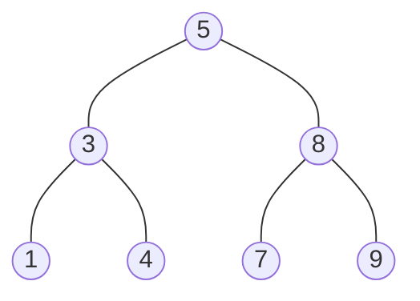
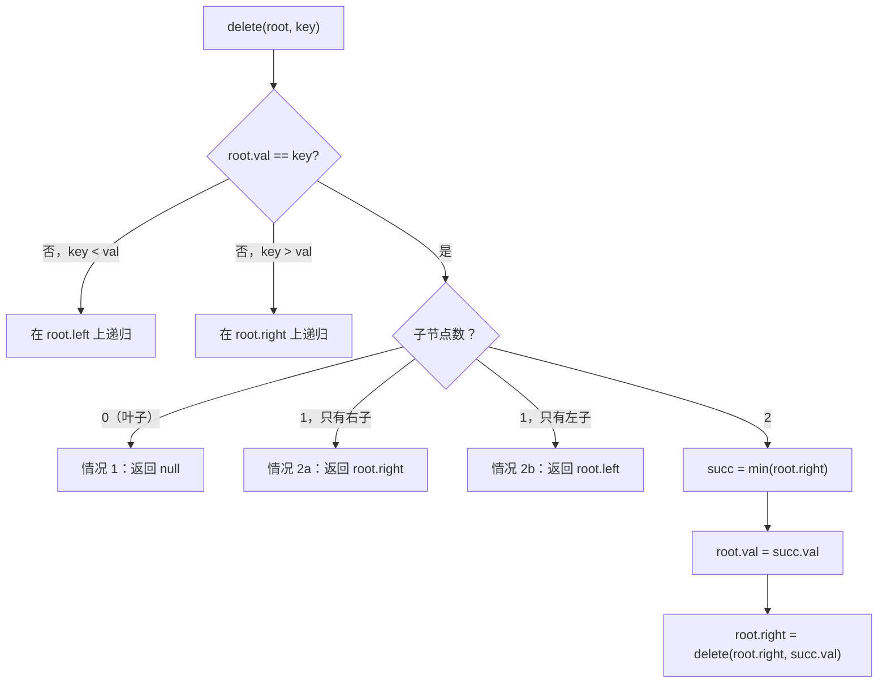

# 二叉搜索树

Java 的 `TreeMap`、C++ 的 `std::map`、.NET 的 `SortedDictionary` 全都建在红黑树上。没有一家把朴素二叉搜索树当公开类发布。原因就在本章：只要你能保证插入顺序不退化，朴素 BST 就是正确答案；一旦保证不了，它就是错误答案。Sedgewick 与 Wayne 在 `N` 个随机键上量过这个差距：平均路径长度约 1.39 lg N（百万键的树约 28 次比较），而有序输入的病态插入会把它拉到 N（百万键的树要百万次比较）。最好与最坏之间的这个倍数，正是 6.6 与 6.7 两章存在的全部理由。

本章先做的，是讲一棵不重平衡的树上怎么做这些操作：查找、插入、删除、校验，以及“中序遍历即有序迭代器”这个技巧。[^2] 这些机制之所以重要，是因为 6.6 与 6.7 里每一种平衡变体都继承它们；旋转不过是在本章讲的插入或删除*之后*做的一次结构修补。读完本章，*Validate Binary Search Tree*（LC 98）、*Insert into a Binary Search Tree*（LC 701）、*Delete Node in a BST*（LC 450）、*Search in a Binary Search Tree*（LC 700）读起来就是同一个算法的四个入口。[^1]

## “BST”到底约束了什么

二叉搜索树就是一棵多背了一条不变式的二叉树：对每个节点 `x`，`x.left` 里所有键都严格小于 `x.val`，`x.right` 里所有键都严格大于 `x.val`。本章讲的是*严格小于*那一版（不允许重复键）。CLRS §12.1 允许一侧用 `≤`，但严格形式让 `isValidBST` 和 `delete` 都成为不带平局分支的一条直路代码，所以 LC 上每一份参考实现都采用它。[^1]



*按 [5, 3, 8, 1, 4, 7, 9] 的顺序依次插入得到的标准树。中序遍历从左到右读出来就是 [1, 3, 4, 5, 7, 8, 9]；严格小于的不变式保证了这一点。*

让 BST 有用的一件事就是**中序遍历给出有序序列**。CLRS 定理 12.1 把它当作不变式的推论来证明：`INORDER-TREE-WALK(x.left)` 递归地先访问所有小于 `x` 的键，再访问 `x`，再访问所有大于 `x` 的键。[^1] 本章五个操作里有三个都能归到这一条：

- *校验 BST？* 看中序是否严格递增，或者在递归时顺手带上边界。
- *找第 k 小？* 按中序走，弹到第 k 个就停。
- *找两个 BST 节点的 LCA？* 找出第一个值落在两者之间的节点。

另外两个操作，查找和插入，靠的是另一条推论：把目标键跟节点值一比，你就能扔掉半棵树。于是每个操作是 `O(h)`，树平衡时是 `O(log n)`，不平衡时是 `O(n)`。先记住这一点，本章开篇和结尾都要拿它收口。

## 查找

一路往下走。每个节点上，目标等于当前值就结束；目标更小就走左子，更大就走右子。本章第一段内联代码：

```python
def search_bst(root, target):
    cur = root
    while cur is not None:
        if target == cur.val:
            return cur
        cur = cur.left if target < cur.val else cur.right
    return None
```

**解法** — Python（[Java](./05-binary-search-trees/lc-700/sol.java) · [C++](./05-binary-search-trees/lc-700/sol.cpp) · [Go](./05-binary-search-trees/lc-700/sol.go)）

```python
# LC 700. Search in a Binary Search Tree
from typing import Optional


class TreeNode:
    def __init__(
        self,
        val: int = 0,
        left: Optional["TreeNode"] = None,
        right: Optional["TreeNode"] = None,
    ) -> None:
        self.val = val
        self.left = left
        self.right = right


def search_bst(root: Optional[TreeNode], target: int) -> Optional[TreeNode]:
    """沿树向下比较键值；时间 O(h)，迭代空间 O(1)。"""
    cur = root
    while cur is not None:
        if target == cur.val:
            return cur
        cur = cur.left if target < cur.val else cur.right
    return None
```

迭代写法比递归写法更可取。Python 默认递归上限是 1000 帧；有序输入建出的 10 万键 BST 是一条 10 万层深的右链，递归版本会在算法崩掉之前先把解释器崩掉。迭代写法只多花 `O(1)` 空间，走的还是同一条路径。CLRS §12.2 两种写法都给了，并指出该上线的是迭代那版。[^1]

开销：`O(h)` 时间，`h` 是树高。常数额外空间。右链这种病态输入下最坏 `h = n`；随机键下期望 `h ≈ 1.39 lg n`。[^2]

## 插入

每个新键都落在叶子上。像查找那样往下走，遇到的第一个 `null` 空位就是新节点的位置。递归写法最干净：

```python
def insert_into_bst(root, val):
    if root is None:
        return TreeNode(val)
    if val < root.val:
        root.left = insert_into_bst(root.left, val)
    elif val > root.val:
        root.right = insert_into_bst(root.right, val)
    return root
```

**解法** — Python（[Java](./05-binary-search-trees/lc-701/sol.java) · [C++](./05-binary-search-trees/lc-701/sol.cpp) · [Go](./05-binary-search-trees/lc-701/sol.go)）

```python
# LC 701. Insert into a Binary Search Tree
from typing import Optional


class TreeNode:
    def __init__(
        self,
        val: int = 0,
        left: Optional["TreeNode"] = None,
        right: Optional["TreeNode"] = None,
    ) -> None:
        self.val = val
        self.left = left
        self.right = right


def insert_into_bst(root: Optional[TreeNode], val: int) -> TreeNode:
    """递到空槽位；新节点落在叶子上。CLRS §12.3。"""
    if root is None:
        return TreeNode(val)
    if val < root.val:
        root.left = insert_into_bst(root.left, val)
    elif val > root.val:
        root.right = insert_into_bst(root.right, val)
    # 重复键：什么都不做（严格小于的 BST 不变式）。
    return root
```

函数返回它被调用时那棵子树的根（可能是新的根）。这个细节是承重的。调用方传进来 `null`（空树）时，函数返回新节点；调用方必须把它*重新赋值*回去，写成 `root = insert_into_bst(root, 5)`，否则新树就丢了。Java、Python、C++、Go 都是按值传引用，在函数里改参数本身不会传回去。LC 701 的签名 `TreeNode insertIntoBST(TreeNode root, int val)` 就把这个约定写死了；每一份参考实现都照此返回。[^3]

重复键：本章的插入遇到相等键什么都不做，严格小于的不变式本来也不允许它出现。有些实现在相等时往右放（LC 701 的题解就这么写），但这会把 `isValidBST` 和 `kthSmallest` 复杂到面试代码不值得为这点灵活性买单的程度。[^3]

开销：`O(h)` 时间，常数额外空间。期望界与最坏界都跟查找一样。

## 删除：最容易写错的那种情况

这是机制上最需要小心处理的操作。按被删节点的子节点数分三种情况：



*按子节点数分三种情况。情况 1 和 2 是局部指针改写；情况 3 才是本章真正要讲的东西。*

情况 1 和 2 是机械操作。叶子直接消失（父节点的指针置 `null`）。只有一个孩子的节点被绕过（父节点的指针跳过它，直接接上它唯一的孩子）。指针的计算是局部的，一眼就能看出对错。

情况 3（两个孩子）才需要算法挑一个能保住 BST 不变式的替代值。答案是**中序后继**：右子树里最左的节点，也就是比被删值大的最小值。Hibbard 1962 年的算法靠*值复制*而不是重接节点身份来做：把后继的值拷进待删节点，再从右子树里递归删掉那个后继。[^5] 按构造，后继没有左孩子（它本来就是最左的），所以这次递归删除只会落到情况 1 或情况 2a，绝不会再进情况 3，终止性由此得到保证。

```python
def delete_node(root, key):
    if root is None:
        return None
    if key < root.val:
        root.left = delete_node(root.left, key)
    elif key > root.val:
        root.right = delete_node(root.right, key)
    else:
        if root.left is None and root.right is None:
            return None              # 情况 1：叶子
        if root.left is None:
            return root.right        # 情况 2a
        if root.right is None:
            return root.left         # 情况 2b
        succ = _min_node(root.right) # 情况 3：两个孩子
        root.val = succ.val
        root.right = delete_node(root.right, succ.val)
    return root
```

**解法** — Python（[Java](./05-binary-search-trees/lc-450/sol.java) · [C++](./05-binary-search-trees/lc-450/sol.cpp) · [Go](./05-binary-search-trees/lc-450/sol.go)）

```python
# LC 450. Delete Node in a BST
from typing import Optional


class TreeNode:
    def __init__(
        self,
        val: int = 0,
        left: Optional["TreeNode"] = None,
        right: Optional["TreeNode"] = None,
    ) -> None:
        self.val = val
        self.left = left
        self.right = right


def _min_node(node: TreeNode) -> TreeNode:
    while node.left is not None:
        node = node.left
    return node


def delete_node(root: Optional[TreeNode], key: int) -> Optional[TreeNode]:
    """三分支删除（Hibbard 1962）。CLRS §12.3 定理 12.4。"""
    if root is None:
        return None
    if key < root.val:
        root.left = delete_node(root.left, key)
    elif key > root.val:
        root.right = delete_node(root.right, key)
    else:
        # 定位到 x，且 x.val == key。
        if root.left is None and root.right is None:
            return None              # 情况 1：叶子
        if root.left is None:
            return root.right        # 情况 2a：只有右子
        if root.right is None:
            return root.left         # 情况 2b：只有左子
        succ = _min_node(root.right) # 情况 3：两个孩子
        root.val = succ.val
        root.right = delete_node(root.right, succ.val)
    return root
```

走一遍删掉标准树的根。交互组件会把过程演出来，文字这里点出做决定的那一刻。依次插入 [5, 3, 8, 1, 4, 7, 9] 建出树。要删 5：先定位到它（它在根上），看到有两个孩子，再沿右子树的左链找后继。到 8 往左走；到 7 停下，因为 7 没有左孩子，所以 7 就是后继。把 7 拷进根的值格。现在树里根是 7，*同时*原来右子树那个节点也是 7；递归调用按情况 2a 删掉重复的那个（原来的 7 有右孩子、没有左孩子，于是它的右孩子顶上它的位置）。之后的中序是 [1, 3, 4, 7, 8, 9]。有序。不变式活着。

> **交互组件：** [BST 操作与 AVL 旋转](../../../dsa/widgets/w-19-bst-rotations.yml)（面板 `panel-bst-ops`）——在网站上渲染；YAML 规格文件描述了各个关键帧。

*静态降级版：空树经七次插入长成 [5, 3, 8, 1, 4, 7, 9]；根被定位为情况 3 的目标；后继游走高亮 8，再高亮 7；选中 7；根的标签从 5 变成 7；原来的 7 按情况 2a 淡出；最终树是 [7, 3, 8, 1, 4, null, 9]，中序为 [1, 3, 4, 7, 8, 9]。*

开销：`O(h)` 时间。后继游走被右子树的高度（它本身 `≤ h`）限住，所以即便在情况 3，总工作量也只是路径长度的线性函数。

> [!WARNING]
> **情况 3 里不要把 `root` 重新指向后继对象。** 一个常见 bug 会把这支改写成 `root = succ; root.right = delete(root.right, succ.val)`，整棵左子树就此丢失。Hibbard 1962 的方法复制的是*值*，不是节点身份。保持指向 `root` 的结构指针不动；就地改 `root.val`；再对右子树递归，删掉那个如今重复的后继。上面那份参考实现正是这么组织的。[^5]

> [!WARNING]
> **Hibbard 删除在长期负载下是不对称的。** 永远挑右子树的后继（从不挑左子树的前驱），会在几千次插入/删除混合操作之后把树往左压偏。Sedgewick 与 Wayne 在 150 个节点的树上演示了这个经验性漂移：平均路径长度随时间从 ~1.39 lg N 涨向 √N。[^2] 在面试代码里这是已知的注意事项，不是要修的 bug；在生产里，这是 `TreeMap` 和 `std::map` 用红黑树而不是朴素 BST 的原因之一。[^4]

## 校验

*Validate Binary Search Tree*（LC 98）最常见的错解，是在每个节点上检查 `node.left.val < node.val < node.right.val`。这个写法能在 `[5, 1, 4, null, null, 3, 6]` 这棵树上通过，尽管 3 是 5 的深层右孙，比根还小，早已违反全局不变式。[^1] BST 的性质是“左子树里每个键都小于该节点”，不是“紧邻的左孩子小于该节点”。两者在深度 ≥ 2 时就分道扬镳了。

修法是带边界的递归：把 `(lo, hi)` 约束一路往下传，往左走收紧 `hi`，往右走收紧 `lo`。每个节点都必须严格满足 `lo < node.val < hi`：

```python
def is_valid_bst(root):
    def check(node, lo, hi):
        if node is None:
            return True
        if not (lo < node.val < hi):
            return False
        return check(node.left, lo, node.val) and check(node.right, node.val, hi)
    return check(root, float("-inf"), float("inf"))
```

**解法** — Python（[Java](./05-binary-search-trees/lc-98/sol.java) · [C++](./05-binary-search-trees/lc-98/sol.cpp) · [Go](./05-binary-search-trees/lc-98/sol.go)）

```python
# LC 98. Validate Binary Search Tree
from typing import Optional


class TreeNode:
    def __init__(
        self,
        val: int = 0,
        left: Optional["TreeNode"] = None,
        right: Optional["TreeNode"] = None,
    ) -> None:
        self.val = val
        self.left = left
        self.right = right


def is_valid_bst(root: Optional[TreeNode]) -> bool:
    """带边界的递归。每个节点必须严格落在 (lo, hi) 内。
    Sedgewick & Wayne 4e §3.2 算法 3.3。"""

    def check(node: Optional[TreeNode], lo: float, hi: float) -> bool:
        if node is None:
            return True
        if not (lo < node.val < hi):
            return False
        return check(node.left, lo, node.val) and check(node.right, node.val, hi)

    return check(root, float("-inf"), float("inf"))
```

边界会在第一个破坏它的深层节点上抓住全局违规。把失败案例从上往下走一遍：根 5 处边界是 `(-∞, +∞)`，没问题。往右走到 4，边界收紧成 `(5, +∞)`，而 `5 < 4` 为假，函数立刻返回 false，根本不用再往下走。

Java 的哨兵怎么选很讲究，值得单独说。用 `int` 配 `Integer.MIN_VALUE`/`Integer.MAX_VALUE`，会跟一个正好存着 `Integer.MIN_VALUE` 的合法节点撞车；LC 98 专门测了这种情况。[^6] Java 参考实现用装箱的 `Integer` 加 `null` 表示“这一侧无界”；C++ 用 `long long`（每个合法 `int` 都严格落在里面）；Go 用可为空的 `*int` 指针；Python 的 `float("-inf")` 原生就能用。同一个算法，四种不同的哨兵表面。

> [!WARNING]
> **`isValidBST` 里的 `int` 哨兵坑。** Java 版写成 `int lo = Integer.MIN_VALUE`，再遇上一棵树把 `Integer.MIN_VALUE` 当叶子，就会在一棵合法树上返回 false。叶子处的检查 `node.val > lo` 实际是 `Integer.MIN_VALUE > Integer.MIN_VALUE`，为假，于是函数拒绝了合法输入。用更宽的哨兵类型，或者传可为空的装箱类型。这个坑出现在 LC 98 每一个曾经存在过的讨论帖的置顶提醒里。[^6]

## 中序遍历即有序迭代器

当问题能归到“中序遍历给出有序序列”时，BST 就是答案。本章的两道进阶题是它的直接应用：*Kth Smallest Element in a BST*（LC 230）和 *Lowest Common Ancestor of a Binary Search Tree*（LC 235）。

第 k 小这种情况，用迭代中序走，弹到第 k 个就停：

```python
def kth_smallest(root, k):
    stack, cur, count = [], root, 0
    while cur is not None or stack:
        while cur is not None:
            stack.append(cur)
            cur = cur.left
        cur = stack.pop()
        count += 1
        if count == k:
            return cur.val
        cur = cur.right
```

提前退出是关键。先建完整中序列表再取下标是 `O(n)` 时间、`O(n)` 空间；带提前退出的迭代中序是 `O(h + k)` 时间、`O(h)` 空间，只要 `k` 相对 `n` 不大就胜过朴素写法。CLRS §12.1 里 `INORDER-TREE-WALK` 的运行时分析可以直接搬过来。[^1]

LCA 这种情况，靠的是 BST 自身的顺序。`p` 和 `q` 的最近公共祖先，就是第一个值落在 `[min(p, q), max(p, q)]` 区间里的节点。从根往下走：当前节点比区间小就往右，比区间大就往左，否则就找到了 LCA。`O(h)` 时间，迭代空间 `O(1)`。对比[二叉树基础](./00-binary-tree-fundamentals.md)里的通用树 LCA，那个必须做后序 DFS 回传子树命中信息：`O(n)` 时间，因为没有顺序可以用来剪枝。[^7]

## 实际开销

| 操作 | 时间（期望，随机键） | 时间（最坏，有序输入退化成链） | 空间（辅助） |
|---|---|---|---|
| `search` | Θ(log n)，平均约 1.39 lg n 次比较 | O(n) | O(1) 迭代 |
| `insert` | Θ(log n) | O(n) | O(h) 递归 |
| `delete`（任意情况） | Θ(log n) | O(n) | O(h) 递归 |
| `isValidBST` | O(n) | O(n) | O(h) 递归 |
| `kthSmallest` | O(h + k) | O(n + k) | O(h) 显式栈 |
| `lcaBST` | Θ(log n) | O(n) | O(1) 迭代 |

查找、插入、删除都是每层最多访问一个节点、从不回头：总工作量被根到被访问节点的路径长度限住，最多是 `h = height(T)`。[^1] 随机插入顺序下期望高度是 `Θ(log n)`，解出来平均约 1.39 lg n 次比较；这就是 Sedgewick 与 Wayne §3.2 的命题。[^2] 对抗性输入（有序、逆序、锯齿模式）会把高度压到 `n`，每个操作都退化到线性。

`O(n)` 最坏情况不是理论上的。把键 1、2、3、4、5 依次插进空 BST，你得到一条右链：形状和单链表一样，访问代价也一样是 `O(n)`。这正是 [AVL 旋转](./06-avl-rotations.md) 存在的全部理由：自平衡 BST 不管插入顺序如何都保持 `h ≤ 1.44 lg n`，把每个操作的 `O(log n)` 界拿回来。[^4] 红黑树（[红黑树](./07-red-black-overview.md)）用另一种办法达到同一目标，也是生产库实际发布的东西：`TreeMap`、`std::map`、`SortedDictionary`，全是红黑树，全因为朴素 BST 上的 Hibbard 删除在负载下会漂移。[^4]

## 后续衔接

顺理成章的下一步是 [AVL 旋转](./06-avl-rotations.md)，它加上高度平衡的修补，把最坏情况从 `O(n)` 拉回 `O(log n)`。再往后，[红黑树](./07-red-black-overview.md) 讲另一套平衡方案，每个生产级有序 map 实现用的都是它。如果你想看把 BST 的中序遍历*穿线*进树本身、从而拿回 `O(1)` 额外空间的那个技巧，那是 [Morris 遍历](./02-morris-traversal.md)，*Recover Binary Search Tree*（LC 99）归它管。

## 题目梯度

### 核心（全做才算掌握本章）

- [LC 700 — Search in a Binary Search Tree](https://leetcode.com/problems/search-in-a-binary-search-tree/) [简单] • bst-search
- [LC 701 — Insert into a Binary Search Tree](https://leetcode.com/problems/insert-into-a-binary-search-tree/) [中等] • bst-insert-recursive
- [LC 98 — Validate Binary Search Tree](https://leetcode.com/problems/validate-binary-search-tree/) [中等] • bst-bounded-recursion ★
- [LC 450 — Delete Node in a BST](https://leetcode.com/problems/delete-node-in-a-bst/) [中等] • bst-delete-three-case

### 进阶（可选）

- [LC 230 — Kth Smallest Element in a BST](https://leetcode.com/problems/kth-smallest-element-in-a-bst/) [中等] • bst-inorder-iterator
- [LC 235 — Lowest Common Ancestor of a Binary Search Tree](https://leetcode.com/problems/lowest-common-ancestor-of-a-binary-search-tree/) [中等] • bst-walk-down-lca

核心集跨简单 + 中等，没有困难。原因：按题目登记表的主归属规则，BST 相关的经典困难题都住在相邻章节。*Recover Binary Search Tree*（LC 99）归 [Morris 遍历](./02-morris-traversal.md) 那一章；树形 DP 那一族（LC 124、337、968）交给 9.13 章。本篇带着 `ladder_curation_flag: core-emh-via-stretch` 发布，这是在没有任何困难题契合本章词汇时，对 E/M/H 跨度要求所开的正式豁免口。[^1]

## 参考文献

[^1]: Cormen, Leiserson, Rivest, Stein, *Introduction to Algorithms*, 4th ed., MIT Press, 2022.

[^2]: Sedgewick, R. and Wayne, K., *Algorithms*, 4th ed., Addison-Wesley, 2011, §3.2 "Binary Search Trees", [algs4.cs.princeton.edu/32bst](https://algs4.cs.princeton.edu/32bst/).

[^3]: LeetCode 701, "Insert into a Binary Search Tree." 约束：树规模最大 10⁴ 个节点，所有节点值互不相同，待插入的值原本不存在。[leetcode.com/problems/insert-into-a-binary-search-tree](https://leetcode.com/problems/insert-into-a-binary-search-tree/)。

[^4]: Java Platform SE 21 *TreeMap* 文档，[docs.oracle.com/en/java/javase/21/docs/api/java.base/java/util/TreeMap.html](https://docs.oracle.com/en/java/javase/21/docs/api/java.base/java/util/TreeMap.html)

[^5]: Hibbard, T. N., "Some Combinatorial Properties of Certain Trees with Applications to Searching and Sorting", *Journal of the ACM* 9(1), pp. 13-28, 1962.

[^6]: LeetCode 98, "Validate Binary Search Tree." 经典失败案例 `[5, 1, 4, null, null, 3, 6]` 就是 LC 98 的示例 2。[leetcode.com/problems/validate-binary-search-tree](https://leetcode.com/problems/validate-binary-search-tree/)。

[^7]: LeetCode 235, "Lowest Common Ancestor of a Binary Search Tree." 时间 `O(h)`，迭代空间 `O(1)`；对比 LC 236（通用二叉树上的 LCA），它要 `O(n)` 时间、`O(h)` 空间，因为没有顺序可以用来剪枝。[leetcode.com/problems/lowest-common-ancestor-of-a-binary-search-tree](https://leetcode.com/problems/lowest-common-ancestor-of-a-binary-search-tree/)。
