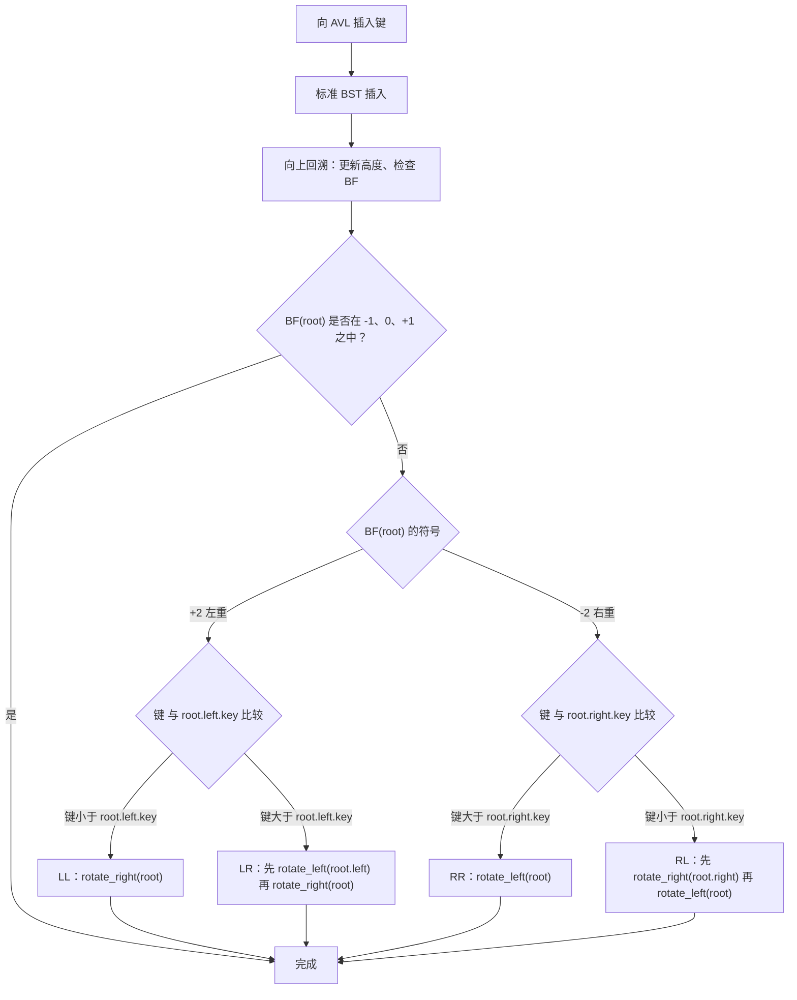
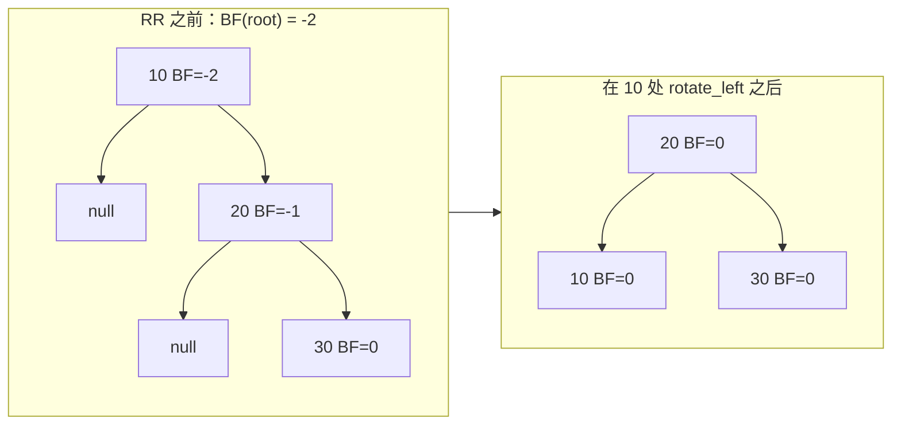

# AVL 树与旋转

把键 1、2、3、4、5、6、7 按这个顺序插进一棵普通二叉搜索树，你得到的是一条链表。七个节点，高度七，每次查找都是一次线性遍历。这棵「树」根本没有任何分叉，因为每个新键都落到最右边的叶子上。这就是 BST 背叛你的那一刻，也是这一章存在的全部理由。

Adelson-Velsky 和 Landis 在 1962 年给出了修复方案，只有短短四页，发表在 *Doklady Akademii Nauk SSSR* 上。[^1] 他们的想法是一条规则加四种旋转：在每个节点上，左右两棵子树的高度最多相差 1。守住这条不变式，树高就可以被证明限制在 `1.44 · log_2(n+2) - 0.328` 以内，[^2] 比完美平衡的二叉树差大约 44%，比链表好无穷倍。六十年过去，同一条「一规则四旋转」的设计仍然垫在你用过的每个标准库有序映射底下，只是方言略有不同：Java 的 `TreeMap`、C++ 的 `std::map`、Python 的 `sortedcontainers`。紧接着的下一章（[红黑树](./07-red-black-overview.md)）讲的就是那种方言。

这是一章硬骨头。四种旋转情形光看代码是看不出来的；LR / RL 这两种「双旋转」是多数读者第一次卡住的地方。把交互组件跑一遍。把追踪过程读两遍。动画本身就是这一章。

## AVL 树到底承诺了什么

普通 BST 保证中序遍历有序。它对高度不做任何承诺。AVL 的改进只加了一条约束，作用于每个节点：

> 左右两棵子树的高度最多相差 1。

把它写成一个数。定义节点 `x` 的**平衡因子（balance factor）**为

```text
BF(x) = height(x.left) - height(x.right)
```

其中 `height(nil) = 0`、`height(leaf) = 1`（这是本章采用的约定；你爱用哪种都行，但选定了就别再换。下面 5.2 节讲的就是不换的人会踩的 bug）。AVL 不变式要求每个节点都满足 `BF(x) ∈ {-1, 0, +1}`。一旦某个位置 `|BF| > 1`，这棵树就不再是 AVL，必须重新平衡。

一次插入最多让任何子树的高度变化 1，所以插完之后，只有新叶子的祖先有可能违反不变式。[^3] 沿递归栈从插入的叶子往回走，重算高度，检查 `BF`。第一个 `|BF| > 1` 的祖先就是要修的那个。用正确的旋转把它修好，这棵子树的树高就回到插入之前的值，于是再往上的祖先什么都察觉不到。[^3] 最后这句话是下一个断言的承重墙：无论树有多深，插入总共只做 O(1) 次旋转。[^4]

## 四个情形，两个问题就能定

找到失衡的祖先（下称 `root`）之后，问两个问题就能选对旋转：

1. **哪一边重？** 看 `BF(root)` 的符号。正数表示左重，负数表示右重。
2. **新键落在重的那一边的哪个位置？** 外侧子树（LL 或 RR）还是内侧子树（LR 或 RL）。

这样就得到一次四路分派：



*四种情形是同一个算法加一次四路分派，不是四个独立算法。`BF(root)` 的符号选出重的那一边，键相对于重子节点键的位置选出单旋转还是双旋转。*

四个情形的名字看着唬人，把它们当坐标读就明白了。**LL** 表示新键落在左孩子的左子树里。**LR** 是左孩子的右子树。**RR** 和 **RL** 是镜像。单旋转修「外侧」情形（LL、RR），那里重链是直的；双旋转修「内侧」情形（LR、RL），那里重链是弯的。

## 单旋转：LL 与 RR

绕 `y` 做一次右旋，就是把 `y` 的左孩子 `x` 抬上来，让它成为新的子树根。`y` 降级为 `x` 的右孩子。`x` 原来的右子树（下称 `t2`）改挂成 `y` 的新左子树。三条指针重连，两次高度更新，完事。

```python
def _rotate_right(y):           # 修 LL
    x = y.left
    t2 = x.right
    x.right = y
    y.left = t2
    _update_height(y)           # 先更新孩子
    _update_height(x)           # 再更新父节点
    return x                    # 新的子树根
```

两次高度更新的顺序有讲究。`x` 的新高度依赖 `y` 重算后的高度，所以要先更新 `y`。把顺序反过来，`x` 会留着过期高度，下一个祖先的 `BF` 计算就会静默地算错。不崩溃，不抛异常。树慢慢偏出平衡。（5.1 节讲的就是这个 bug 在实际项目里长什么样。）

`rotate_left` 是完全的镜像：把右孩子抬上来，父节点降下去，内侧子树重新挂载。完整实现在下面。



*RR 情形：按顺序插入 10、20、30。30 落位后，根 10 的 BF = -2；一次 `rotate_left` 把 20 抬到根，10 降到它的左孩子，30 留在右孩子。所有 BF 回到 0。LL 情形是它的完美镜像。*

## 双旋转：LR 与 RL

内侧情形更微妙。考虑插入 30、10、20：20 落位后，根 30 的 `BF = +2`（左重），而它的左孩子 10 的 `BF = -1`（右重）。两个符号不一致，此时绕 30 做一次右旋，得到的树*仍然*不平衡，只是弯向了另一边。

修法是两次旋转：

1. `rotate_left(root.left)`，把左子树从 LR 形状掰直成 LL 形状
2. `rotate_right(root)`，套用标准的 LL 修法

第 1 步之后，插入的键 20 已经被提升为 30 的左孩子，10 成了 20 的左孩子。现在这个配置就是 LL 情形（左孩子左重，符号一致），第 2 步就是你刚写过的那个 `rotate_right`。RL 是镜像：先对右孩子 `rotate_right`，再对根 `rotate_left`。

判别依据就是符号是否一致。`BF(root)` 和 `BF(child)` 同号是单旋转，异号是双旋转。[^5]

## 完整的插入例程

沿递归栈往回走，更新高度，分派：

```python
def insert(root, key):
    if root is None:
        return Node(key)
    if key < root.key:
        root.left = insert(root.left, key)
    elif key > root.key:
        root.right = insert(root.right, key)
    else:
        return root                                     # 重复键，忽略

    _update_height(root)
    bf = balance_factor(root)

    if bf >  1 and key < root.left.key:                 # LL
        return _rotate_right(root)
    if bf < -1 and key > root.right.key:                # RR
        return _rotate_left(root)
    if bf >  1 and key > root.left.key:                 # LR
        root.left = _rotate_left(root.left)
        return _rotate_right(root)
    if bf < -1 and key < root.right.key:                # RL
        root.right = _rotate_right(root.right)
        return _rotate_left(root)
    return root
```

**Solution** — Python ([Java](./06-avl-rotations/avl-insert/sol.java) · [C++](./06-avl-rotations/avl-insert/sol.cpp) · [Go](./06-avl-rotations/avl-insert/sol.go))

```python
# LC：无 —— 本章机制题（带重平衡的 AVL 插入）
from typing import Optional


class Node:
    __slots__ = ("key", "left", "right", "height")

    def __init__(self, key: int) -> None:
        self.key = key
        self.left: Optional["Node"] = None
        self.right: Optional["Node"] = None
        self.height = 1  # 叶子为 1；height(None) := 0


def height(node: Optional[Node]) -> int:
    return node.height if node is not None else 0


def balance_factor(node: Node) -> int:
    # BF > 0 表示左重；BF < 0 表示右重。
    return height(node.left) - height(node.right)


def _update_height(node: Node) -> None:
    node.height = 1 + max(height(node.left), height(node.right))


def _rotate_right(y: Node) -> Node:           # 修 LL
    x = y.left
    assert x is not None
    t2 = x.right
    x.right = y
    y.left = t2
    _update_height(y)
    _update_height(x)
    return x


def _rotate_left(x: Node) -> Node:            # 修 RR（右旋的镜像）
    y = x.right
    assert y is not None
    t2 = y.left
    y.left = x
    x.right = t2
    _update_height(x)
    _update_height(y)
    return y


def insert(root: Optional[Node], key: int) -> Node:
    """把 key 插入以 root 为根的 AVL 树；返回新的根。"""
    if root is None:
        return Node(key)
    if key < root.key:
        root.left = insert(root.left, key)
    elif key > root.key:
        root.right = insert(root.right, key)
    else:
        return root  # 重复键忽略

    _update_height(root)
    bf = balance_factor(root)

    if bf > 1 and root.left is not None and key < root.left.key:        # LL
        return _rotate_right(root)
    if bf < -1 and root.right is not None and key > root.right.key:     # RR
        return _rotate_left(root)
    if bf > 1 and root.left is not None and key > root.left.key:        # LR
        root.left = _rotate_left(root.left)
        return _rotate_right(root)
    if bf < -1 and root.right is not None and key < root.right.key:     # RL
        root.right = _rotate_right(root.right)
        return _rotate_left(root)
    return root
```

这个形状出自 CLRS 习题 13-3(c)。[^6] 先按普通 BST 插入，然后在回溯调用栈的路上重算高度，把第一个平衡因子变成 ±2 的祖先重新平衡。因为 `_update_height` 把新高度设成 `1 + max(left, right)`，而两个旋转原语都会调用它，所以每一层的高度字段都保持一致——前提是旋转函数返回新的根，并且你把这个返回值赋回给递归调用方。（5.4 节讲的就是忘了这一点的作者会踩的 bug。）

每次旋转里那三条指针重连就是整个机制。要背的是图，不是代码：孩子抬上来，父节点降下去，内侧子树重新挂载。图一旦在心里立住了，代码自己就写出来了。

## 观察全部四种情形

交互组件用手工调好的三节点插入序列，把四种旋转情形逐个演示一遍。每个预设都从空树开始，做三次插入，第三次插入恰好触发一种旋转情形。四种情形最终都收敛到同一个平衡形状（根 20，左 10，右 30，高度 2），这是「四种旋转情形是同一条出路的四条路径」最干净的视觉证明。

> **Interactive widget:** [BST 操作与 AVL 旋转](../../../dsa/widgets/w-19-bst-rotations.yml)（面板 `panel-avl`）—— 在网站上渲染；YAML 规格描述了各个关键帧。

*静态回退：四段 7 步序列，每种情形一段。RR（插入 10、20、30）：在 10 处一次 `rotate_left`，把 20 抬到根。LL（插入 30、20、10）：镜像，一次 `rotate_right`。RL（插入 10、30、20）：两次旋转，先 `rotate_right(30)` 再 `rotate_left(10)`。LR（插入 30、10、20）：镜像，先 `rotate_left(10)` 再 `rotate_right(30)`。四者的终点都是 root=20、left=10、right=30、BF(root)=0。*

最该盯住的是 RL 预设里的第 17 步：追踪在这里停在失衡状态上，`BF(10) = -2`、`BF(30) = +1`。这个符号不一致就是「单旋转救不了」的可见信号；第 18 步执行内侧旋转，*造出*符号一致；第 19 步执行外侧旋转，把它解决掉。

## 为什么树高能保持很小：斐波那契证明

本章唯一的承重断言是：AVL 的树高始终是 O(log n)。证明只有一段话，套用斐波那契递推，而且可以追回 1962 年的原始论文。[^1]

令 `T(h)` 表示高度为 `h` 的 AVL 树**最少**能有多少个节点。我们要说明的是 `T(h)` 增长得足够快，以至于相对于 `n` 而言 `h` 必须很小。

一棵高度为 `h` 的 AVL 树，其根的一棵子树高度为 `h-1`（正是它顶出了这个高度），另一棵子树高度至少为 `h-2`（因为子树高度最多相差 1）。要让节点总数最少，就把第二棵子树压到恰好 `h-2`。于是得到递推式

```text
T(h) = T(h-1) + T(h-2) + 1,    T(0) = 0,    T(1) = 1
```

这正是错开一位的斐波那契递推：`T(h) = F(h+2) - 1`，其中 `F` 是标准斐波那契数列。[^2] 把比内公式代入 `F(k)` 再整理，就得到高度上界

```text
h ≤ log_φ(n + 2) - 0.328
  ≤ 1.4404 · log_2(n + 2) - 0.328
```

其中 `φ = (1 + √5) / 2 ≈ 1.618` 是黄金比例，`1.4404 = 1 / log_2(φ)`。[^2] 对 `n = 1,000,000`，最坏情况的 AVL 高度约为 28，而完美二叉树的下界是 20。常数 1.44 很有名，它就是斐波那契证明算出来的结果，不是拍脑袋估的。

达到这个上界的树叫**斐波那契树**：高度为 `h` 的树，其左子树是高度 `h-1` 的斐波那契树，右子树是高度 `h-2` 的斐波那契树。它们是 AVL 树能取到的最坏形状，也是上界写成 `1.44 log n` 而不是 `log n` 的原因。

## 实际开销

| 操作 | 时间（最坏） | 空间 | 备注 |
|---|---|---|---|
| 查找 | `O(log n)` | 迭代 `O(1)`；递归 `O(log n)` | 与普通 BST 查找相同；因为高度有界而更紧。[^6] |
| 插入 | `O(log n)` | 递归 `O(log n)` | 一次 BST 下降、一次回溯；每次插入**总共 O(1) 次旋转**。[^4] |
| 删除 | `O(log n)` | 递归 `O(log n)` | 最坏情况多达 **O(log n) 次旋转**；重平衡可能向上传播。[^2] |
| 中序遍历 | `O(n)` | 栈 `O(h) = O(log n)` | 每个节点访问一次。[^6] |

这些上界里有两条需要证明。`O(log n)` 的查找与遍历上界直接来自上面的高度上界。插入只做 O(1) 次旋转这个结论出自 CLRS 习题 13-3(d)：在最深的不平衡祖先处重平衡之后，这棵子树的树高回到插入前的值，于是路径上再往上的祖先观察不到 `BF` 的变化，也就不会再触发旋转。[^4]

删除不一样。处理双孩子情形的中序后继交换做完之后，重平衡过的子树高度可能*减少* 1，而这个减少会一路向上传播。每个祖先都可能需要自己的一次旋转。一次删除的最坏情况是 `O(log n)` 次旋转，而一次插入只要 `O(1)` 次。[^2] 正是这种不对称，让本章把力气都花在插入上：四种旋转情形在插入和删除两个方向上是同一套，但插入才是这个算法显出道行的地方。

## AVL 与红黑树的对比

AVL 比红黑树平衡得更严格。AVL 的上界是 `1.44 log_2(n+2)`，红黑树的上界是 `2 log_2(n+1)`。[^7] 按比例算，最坏情况下 AVL 树比红黑树矮大约 28%。这让 AVL 的查找平均快上几个缓存行的访问。

代价落在写侧。红黑树容许的合法形状范围更宽，意味着插入和删除为了让树留在合法形状集合里所需做的工作更少，旋转与重新着色的摊还成本更低。[^7] 生产环境的有序映射实现几乎清一色选红黑树，原因就在这里：`java.util.TreeMap` 是红黑树；libstdc++ 的 `std::map` 是红黑树；`.NET` 的 `SortedDictionary` 是红黑树。AVL 出现在查找远多于写入的负载里，比如读多写少的有序索引、内存路由表，以及某些数据库内部结构。

下一章 [红黑树](./07-red-black-overview.md) 详细讲方言上的差异。请先读本章；旋转原语是原样搬过去的。

## 常见误区

> [!WARNING]
> **旋转之后忘了更新节点高度。** 写 `_rotate_left` 最自然的写法就是换指针然后返回。更新高度只是多出来的一行，很容易被跳过。少了这一行，被旋转过的节点会留着过期的 `height` 值，之后祖先上每一次 `balance_factor` 计算都读到错误的数字，树就静默地偏出平衡：不崩溃、不抛异常，只是随着插入越积越多，性能逐渐退化成 `O(n)`。修法是在每个旋转函数返回之前调用 `_update_height(child); _update_height(parent)`，顺序就是这个顺序：父节点的新高度依赖孩子重算后的高度。

> [!WARNING]
> **旋转返回了错误的节点。** 旋转函数返回的是和它被调用时传入的*不同*节点，这正是它的意义所在。递归调用方写的是 `root.left = insert(root.left, key)`，这只有在 `insert`（连带每次旋转）返回新子树根的时候才成立。一个改完指针却返回旧根节点的旋转，能干净地编译通过，前几次插入也不报错，然后在下一趟遍历走过去的时候把整棵旋转过的子树丢在地上。在每种语言里，调用点都要写 `root = rotate_X(root)`。上面给出的 Python、Java、C++、Go 参考实现，每个旋转函数都返回 `Node`；递归的 `insert` 总是把返回值赋回 `root.left` 或 `root.right`。

除了这两条之外的两个坑，等你把旋转看过足够多遍就很好记：为 `height(leaf)` 和 `height(nil)` 选一种约定并写清楚（本章用 Sedgewick 的 leaf=1、nil=0；CLRS 的 leaf=0、nil=-1 也能跑）；把四情形分派表读成 `(BF 的符号, 键的位置)`，而不是四个各自独立的算法。

## 后续衔接

本章这套 AVL 机制是下一章的地基。[红黑树](./07-red-black-overview.md) 把基于高度的不变式换成基于颜色的不变式，用略微松一点的平衡换更便宜的写入；它用的旋转原语就是本章的 `_rotate_left` 和 `_rotate_right`，一个字符都不改。再往后，你在应用代码里真正调用的那些生产级有序映射 API（Java `TreeMap`、C++ `std::map`、Python `sortedcontainers`）把红黑树的机制藏在 `floorKey`、`ceilingKey`、`subMap` 这类操作后面。等那一章上线之后，这些操作会在 [缓存与设计题](../../../dsa/part-13-design-the-data-structure/00-lru-cache.md) 里被练到。

这是一篇讲地基与机制的章节，所以不带题目梯度。AVL 树没有对应的 LeetCode 题；最接近的是 [LC 110 — Balanced Binary Tree](https://leetcode.com/problems/balanced-binary-tree/)（简单），它检验的是给定一棵树*是不是* AVL 平衡，而不是要你在插入过程中维持不变式。那道题归 [二叉树基础](./00-binary-tree-fundamentals.md) 管。掌握本章的标志是：拿到一个新的三节点插入序列，能自己推出四种旋转情形，并解释清楚高度上界——不是刷掉一道 LC。

## 参考文献

[^1]: G. 书目信息已与 [NIST 算法与数据结构词典的 AVL tree 条目](http://xlinux.nist.gov/dads/HTML/avltree.html) 交叉核对。

[^2]: 高度上界 `h ≤ 1.4404 · log_2(n+2) - 0.328` 是斐波那契树递推 `T(h) = T(h-1) + T(h-2) + 1` 的闭式结果，由 Donald E. 推出。经 [Wikipedia “AVL tree” 条目](https://en.wikipedia.org/wiki/AVL_tree) 交叉核对。

[^3]: 一次插入最多让任何子树的高度变化 1，所以只有被插入叶子的祖先有可能违反不变式；回溯循环要么在某次旋转执行后立刻结束，要么在某个节点的 BF 达到足以吸收这次高度变化的值时结束。[Wikipedia “AVL tree”](https://en.wikipedia.org/wiki/AVL_tree)

[^4]: Cormen, Leiserson, Rivest, Stein, *Introduction to Algorithms*, 4th ed.（MIT Press, 2022），习题 13-3(d)：AVL-INSERT 总共只做 O(1) 次旋转，因为在最深的不平衡祖先处重平衡之后，子树的树高回到插入前的值。标准解答见 [walkccc.me CLRS §13.3](https://walkccc.me/CLRS/Chap13/Problems/13-3/)。

[^5]: 用同号/异号来做分派，是四种情形最干净的表述方式。[Wikipedia “AVL tree”](https://en.wikipedia.org/wiki/AVL_tree)

[^6]: Cormen, Leiserson, Rivest, Stein, *Introduction to Algorithms*, 4th ed.（MIT Press, 2022）。

[^7]: AVL 树比红黑树平衡得更刚性；最大高度的渐近比值约为 AVL/RB ≈ 0.720，引自 Pfaff (2004) “Performance Analysis of BSTs in System Software,” Stanford。[Wikipedia “AVL tree”](https://en.wikipedia.org/wiki/AVL_tree)
