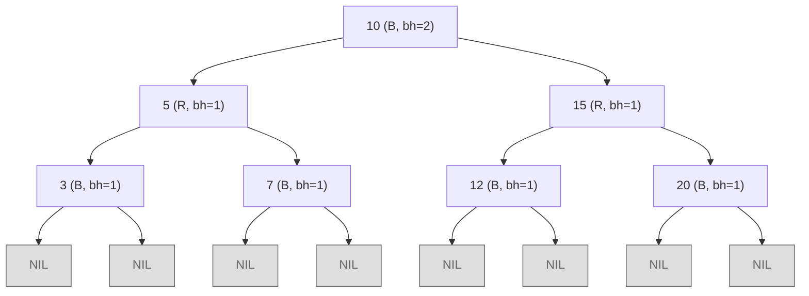
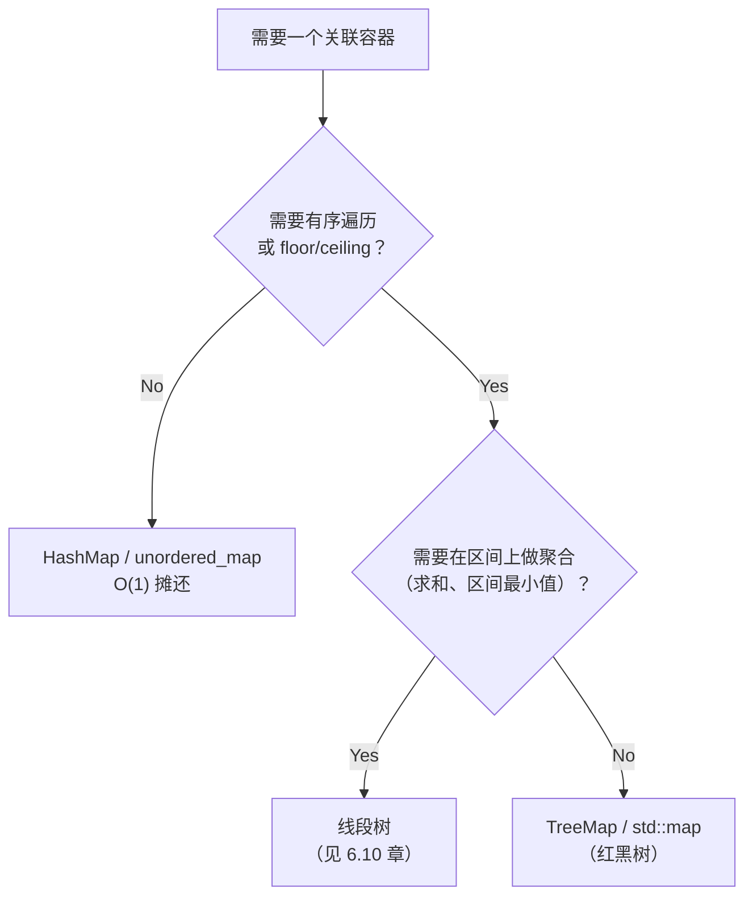

# 红黑树：概览

Java 的 `TreeMap`、C++ 的 `std::map`、Linux 内核的任务调度器，三者都坐在同一个数据结构上：红黑树。TreeMap 的 Javadoc 明确写了这一点，并把实现归功于 Cormen、Leiserson、Rivest 的《算法导论》。cppreference 说 `std::map` “通常实现为红黑树”，而每一份真正发布的 STL（libstdc++、libc++、MSVC）都确实如此。Linux 的完全公平调度器把每个可运行任务放进一棵按虚拟运行时间排序的红黑树，每次上下文切换取走最左节点。世界上最常被测试的三个代码库，出于同样的理由选了同一种平衡 BST。

往下读之前先给一句实在的提醒：从零写出一份正确的红黑树插入与删除，出了名地容易出 bug。CLRS 花了第 13 章讲它，还把删除拆成六种情况，没人靠记忆敲得出来。[^1] 本章不教这个。这里的目标更小、也更有用：钉住高度上界的那五条不变量、解释标准库为什么选 RB 的 AVL/RB 权衡，以及当面试题在 `O(log n)` 的插入删除之上还要 `O(log n)` 的 floor 和 ceiling 时，你该报出的那个库类型。读一遍你就能认出这个模式；哪天真的需要逐项列举情况，CLRS §13.3 和 §13.4 在那儿等着。

## 红黑树是什么

红黑树是一棵二叉搜索树，每个节点多带一位状态：颜色，红或黑。下面五条不变量合在一起，逼着树在每次插入和删除之后保持大致平衡，而再平衡的代价被树高限定住。

CLRS 第 13 章把不变量表述为 BST 有序规则之上的五个条件：[^1]

1. 每个节点是红的或黑的。
2. 根是黑的。
3. 每个叶节点（哨兵 `NIL` 节点）是黑的。
4. 如果一个节点是红的，它的两个孩子都是黑的。任何一条根到叶的路径上都不会连着出现两个红节点。
5. 对每个节点，从它到其子孙叶节点的每条简单路径都含相同数目的黑节点。这个数目就是该节点的*黑高*。

Wikipedia 和 Sedgewick & Wayne 去掉了第二条，因为任何操作结束时都可以把根重涂成黑，真正起约束的只剩四条。保留它时，分情况的证明会稍微干净一点；你教材用哪套框架就用哪套。[^2]



*一棵 7 节点的红黑树。根的黑高为 2，因为从根到每个 `NIL` 的路径都正好穿过两个黑节点；无连续红节点规则（不变量 4）加上黑高相等（不变量 5），共同限定了树高。*

这个数据结构源自 Rudolf Bayer 1972 年的“对称二叉 B 树”，那是 B 树的一个 4 阶特例。Leo Guibas 和 Robert Sedgewick 1978 年在 Xerox PARC 重新表述了它，起名红黑，据说是因为他们当时能用的激光打印机只有这两种颜色。[^2] 每棵红黑树都同构于一棵 2-3-4 树：一个黑节点带两个红孩子，对应单个 4-节点；重涂所做的颜色翻转，就是 B 树节点分裂在 RB 里的对应物。记住这层同构，是理解不变量为什么长成这个样子最省事的办法；过了这一步就不必再带着它。

## 一个不等式定下高度上界

每个读者都该带走的事实：含 `n` 个键的红黑树，高度 `h ≤ 2 log₂(n + 1)`。[^1] 换句话说，最长的根到叶路径最多是最短路径的两倍。

证明按 CLRS 引理 13.1 的路子勾勒：[^1]

- 由不变量 4，任何根到叶路径上至多一半节点是红的。
- 所以若根的黑高为 `bh(root)`，树高满足 `h ≤ 2 · bh(root)`。
- 以黑高为 `b` 的节点为根的子树，至少含 `2^b - 1` 个内部节点（对 `b` 归纳）。
- 因此 `n ≥ 2^{h/2} - 1`，整理得 `h ≤ 2 log₂(n + 1)`。

推论正是这些库类型能用的原因：查找、插入、删除都只沿一条根到叶路径下行或重涂，所以三者最坏情况都是 `O(log n)`。[^1] AVL 树在常数上确实更好。它的最坏高度约为 `1.44 log₂(n)`，是红黑上界的 0.72 倍左右，但 RB 更松的平衡在别处把钱赚了回来。[^3]

## 插入与删除：概览

完整的分类讨论属于 CLRS §13.3 和 §13.4。[^1] 三个事实足够你推理复杂度，也足够你读库源码时不迷路。

第一，两个操作都从一次普通的 BST 插入或删除开始。那部分没有变。

第二，再平衡的修正有界。一次插入至多需要两次旋转，加上一串朝根方向走的重涂。一次删除至多需要三次旋转，加上类似的重涂链。会向上传播的是重涂，旋转次数是常数。[^2]

第三，每次更新的摊还再平衡代价是 `O(1)`，这是 Tarjan 1985 年证明的结果，尽管任何单次操作最坏都可能是 `O(log n)`。[^4] AVL 树没有这个性质。Mehlhorn 和 Sanders 指出，AVL 的删除是摊还 `O(log n)`，因为删除后的再平衡可能沿树级联上爬。[^3] 正是这一处不对称，撑起了 JDK 和 C++ STL 押 RB 而不是 AVL 的理由：写多和读写混合的负载，在 RB 上付的再平衡开销更少。

## 选哪个库类型

挑一个关联容器的决策流程有三个真正的分支。



*第一个问题是有序性是否重要。第二个是你是否需要在区间上做聚合，而不只是查邻居。只有当两个答案合起来是“不需要聚合，但要有序”时，红黑树才胜出。*

四语言对照表是本章最有用的一张表。把每种语言的签名记牢；面试官很少在意你报哪一行，只在意你报得毫不犹豫。

| 语言 | 库类型 | 是否标准库 | 备注 |
|---|---|---|---|
| Java | `java.util.TreeMap`、`java.util.TreeSet` | 是（`java.util`） | 文档明确写为 RB；算法改编自 CLRS。[^5] |
| C++ | `std::map`、`std::set`、`std::multimap`、`std::multiset` | 是（`<map>`、`<set>`） | cppreference 称“通常实现为红黑树”；libstdc++、libc++、MSVC 都发 RB。[^6] |
| Python | `sortedcontainers.SortedDict`、`SortedList` | 否（第三方） | 内部**不是** RB 树；Grant Jenks 的实现是平方根分解的列表之列表，按缓存局部性调优。操作接口同为 `O(log n)`，机制不同。标准库没有 RB 支撑的有序映射。[^7] |
| Go | `github.com/google/btree` | 否（第三方） | 是 B 树，不是 RB，但它是 Go 主流里最接近的对应物。标准库没有有序映射类型；面试里的兜底方案是切片上的 `sort.Search` 加一个 `map[K]V`。 |

表里有两行值得单独标一下。Python 的 `SortedDict` 在面试里是正确答案（“`O(log n)` 操作、有序遍历、暴露 `bisect_left` / `bisect_right` 给你做 floor 和 ceiling”），但候选人如果声称它内部是红黑树，就等于白送面试官一个追问。准确的说法是：它给你同样的操作接口。Go 的位置类似：`google/btree` 是生产答案，但底下的数据结构是 B 树，不是 RB 树，而且在新硬件上，高阶 B 树的缓存局部性常常更占优。

API 的最小 Python 形态：

```python
from sortedcontainers import SortedDict

d = SortedDict()
for k, v in [(5, "five"), (1, "one"), (10, "ten"), (3, "three"), (7, "seven")]:
    d[k] = v

first = d.keys()[0]                           # 1
last = d.keys()[-1]                           # 10
floor4 = d.keys()[d.bisect_right(4) - 1]      # 3，<= 4 的最大键
ceiling4 = d.keys()[d.bisect_left(4)]         # 5，>= 4 的最小键
```

Java 的 `TreeMap` 把同样的操作暴露成具名方法：`firstKey()`、`lastKey()`、`floorKey(4)`、`ceilingKey(4)`。C++ 的 `std::map` 用 `begin()`、`rbegin()`、`upper_bound(4)` 再自减，以及 `lower_bound(4)`。Java 和 C++ 的参考实现放在本章的研究笔记里；本章要带走的是 API 的形状，不是那堆样板代码。

## 一段话讲清 AVL 与红黑树

两棵树都给你最坏 `O(log n)` 的查找、插入、删除。AVL 平衡得更死板，所以查找略快。Ben Pfaff 在 79 组真实测试里量了 AVL/RB 的比值，落在 0.677 到 1.077 之间，中位数 0.947，几何平均 0.910。[^8] RB 再平衡得没那么激进，所以更新更便宜，而且它的再平衡代价是摊还 `O(1)`，AVL 删除之后则是 `O(log n)`。[^3] 面试答案很短。只读或读多写少：AVL 靠一个小常数取胜。读写混合：RB 胜，因为它每次写做的工作更少。标准库选 RB，是因为通用的 `TreeMap` 和 `std::map` 默认面对的是混合负载，而读的常数劣化实测不到 10%。

## 更简单的变体：左倾红黑树

Sedgewick 2008 年的左倾红黑树是一个变体，要求每条红链接都向左倾。这条约束压缩了分类讨论，插入只需要 33 行 Java，而标准写法要 46 行。[^9] LLRB 把与 2-3 树的一一对应摆到明面上，教学上也更干净。它没有在生产中取代经典的 Guibas-Sedgewick 变体：Java 的 TreeMap 和 C++ STL 发的还是原版。需要知道 LLRB 存在的理由是，有些教材（尤其是 Sedgewick & Wayne 的 *Algorithms*，第 4 版）教的是它，而不是经典版本。[^9]

## 真正需要记住的东西

三件，按分量排：

- **高度上界。** `h ≤ 2 log₂(n + 1)`。查找、插入、删除都是最坏 `O(log n)`，因为每个操作只走一条根到叶路径。
- **库类型对照。** Java `TreeMap`、C++ `std::map`、Python `sortedcontainers.SortedDict`（带前提）、Go `google/btree`（带前提）。当面试题需要在 `O(log n)` 更新之上再加有序遍历与 floor、ceiling 时，就报这个类型。
- **一句话的 AVL 权衡。** AVL 更严格，读更快；RB 更松，写更便宜，每次更新摊还 `O(1)` 再平衡，而 AVL 删除之后是 `O(log n)`。标准库选了 RB。

逐项列举的插入删除逻辑不在这张清单上。CLRS §13.3 和 §13.4 管它，真需要的话，一个晚上就能读完其中一节。[^1]

## 后续衔接

当键是字符串、你要的是按长度计的 `O(L)` 查找而不是按数量计的 `O(log n)` 时，[Tries](./08-tries.md) 是天然的替代品。当问题需要对区间做*聚合*（求和、最小值、最大值）、而不只是 floor 和 ceiling 时，该伸手去拿的是[线段树](../../../dsa/part-6-trees-heaps/10-segment-tree.md)。而当你需要的唯一序关系就是最小或最大、不是任意邻居时，去的是[堆与优先队列](./04-heaps-priority-queues.md)。

## 参考文献

[^1]: Cormen, Leiserson, Rivest, Stein, *Introduction to Algorithms*（《算法导论》）, 4th ed., MIT Press, 2022.

[^2]: Wikipedia, “Red-black tree.” 引用用于*历史*一节（Bayer 1972 的“对称二叉 B 树”前身；Guibas 与 Sedgewick 1978 年在 Xerox PARC 的论文 “A Dichromatic Framework for Balanced Trees”）、四性质表述，以及有界旋转次数（每次插入 ≤ 2，每次删除 ≤ 3）。[en.wikipedia.org/wiki/Red-black_tree](https://en.wikipedia.org/wiki/Red%E2%80%93black_tree)。

[^3]: Mehlhorn, Kurt; Sanders, Peter. *Algorithms and Data Structures: The Basic Toolbox*, Springer, 2008, 第 7 章 “Sorted Sequences”, pp.

[^4]: Tarjan, Robert E. “Amortized Computational Complexity.” *SIAM Journal on Algebraic and Discrete Methods* 6(2):306-318, April 1985.

[^5]: Oracle, “Class TreeMap (Java SE 21 & JDK 21).” [docs.oracle.com/en/java/javase/21/docs/api/java.base/java/util/TreeMap.html](https://docs.oracle.com/en/java/javase/21/docs/api/java.base/java/util/TreeMap.html)。

[^6]: cppreference, “std::map.” [en.cppreference.com/w/cpp/container/map](https://en.cppreference.com/w/cpp/container/map)。

[^7]: Jenks, Grant. “Implementation Details — Sorted Containers documentation.” [grantjenks.com/docs/sortedcontainers/implementation.html](https://grantjenks.com/docs/sortedcontainers/implementation.html)。

[^8]: Pfaff, Ben. “Performance Analysis of BSTs in System Software.” Stanford University, June 2004. [stanford.edu/~blp/papers/libavl.pdf](http://www.stanford.edu/~blp/papers/libavl.pdf)。

[^9]: Sedgewick, Robert. “Left-leaning Red-Black Trees.” 2008. [sedgewick.io/wp-content/themes/sedgewick/papers/2008LLRB.pdf](https://sedgewick.io/wp-content/themes/sedgewick/papers/2008LLRB.pdf)。
