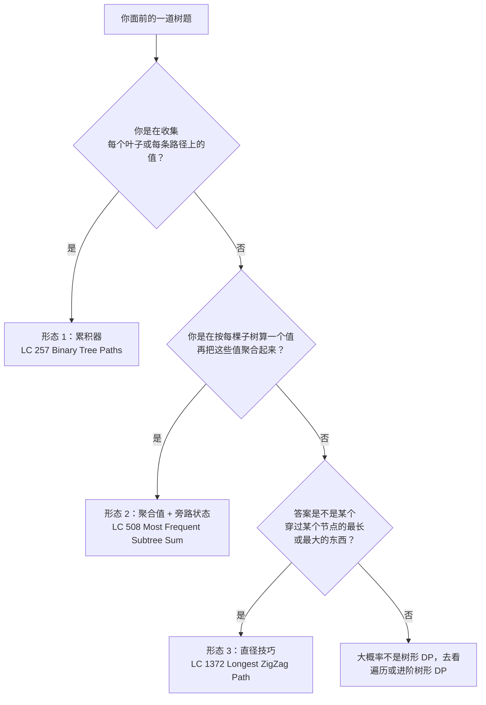
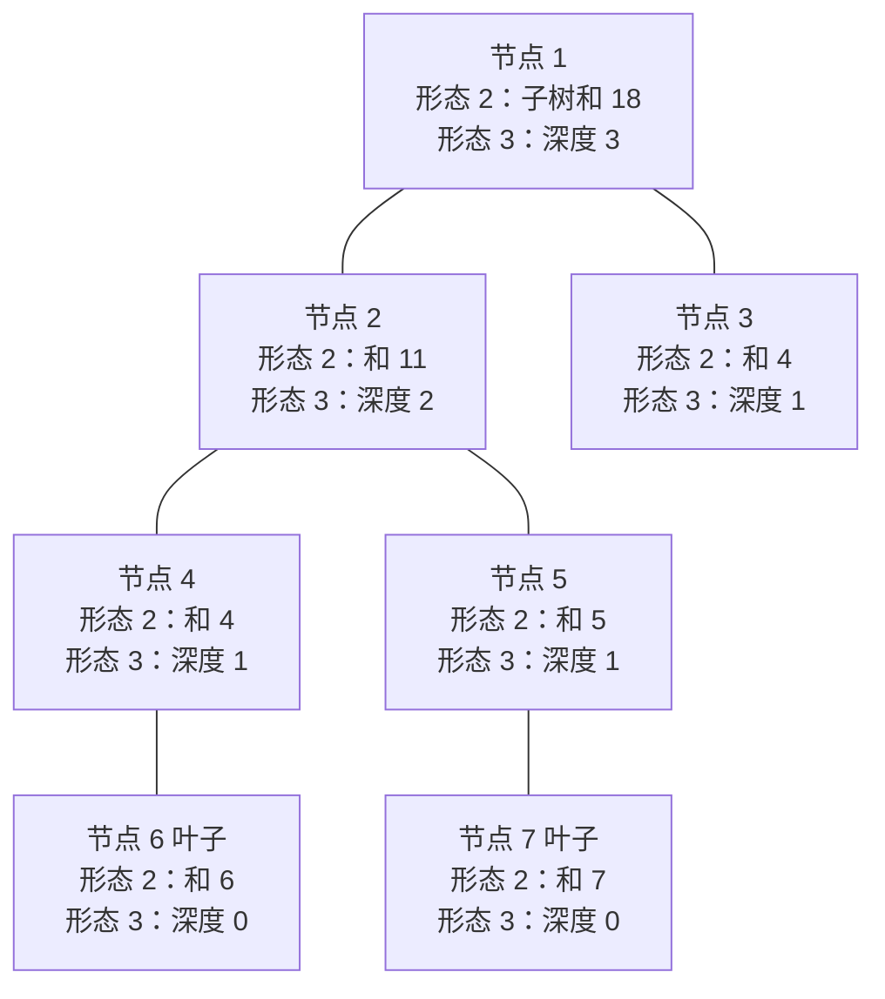

# 树形 DP 入门：后序遍历与旁路状态

往前数三章，树上每个递归辅助函数都只返回一样东西：一个高度、一个计数、一个布尔值。函数的返回值把答案沿调用栈往上传，包装函数在根节点调用辅助函数，然后把结果返回。干净。熟悉。到目前为止每道树题都能塞进去的形状。

LC 1372 打破了这个形状。这道题要的是二叉树里最长的*之字形*路径，也就是最长的一串节点，方向按左、右、左、右（或者右、左、右、左）交替，不重复同一方向。合理的第一反应是递归，返回“这个节点下面最长的之字形”，然后收工。这个直觉是错的，而它错在哪，正是本章的主题。一条路径*穿过*这个节点时能有的最长之字形，和父节点想把自己那条链接下去所需要的数，不是一个数。两个不同的数，只有一个返回位。递归必须把父节点要的东西给它，*同时*把答案记在别的地方，而那个“别的地方”不是返回值。

树形 DP 就是靠拆开通道来解决这类问题的一族递归。辅助函数的返回类型携带父节点用来合并的东西；一个闭包捕获的旁路状态携带全局答案。三种可复用的形态，几乎覆盖 LC 简单和中等里所有符合这个套路的题。本章把三种都讲一遍。更重的延伸——包括处理负子树、在树上编码状态机，以及 LC 124 Maximum Path Sum、LC 337 House Robber III 这类招牌难题——留给[进阶树形 DP](../../../dsa/part-9-dynamic-programming/13-tree-dp.md)。

## 这个模式何时适用

当一道题递给你一棵二叉树，而它的答案正好能由下面三种形态之一产出时，就上树形 DP。判断流程很短。



*本章讲三种形态。从每个孩子返回多件东西，是形态 2 与形态 3 的延伸，不是第四种形态；直径技巧返回元组时已经用上了这一手。*

这个套路在几种题上会失效：靠正负号翻转子树贡献的（LC 124 的 `max(0, gain)` 截断）；需要给每个节点挂状态机的（LC 337 House Robber III 的 `(rob, skip)` 二元组，LC 968 Binary Tree Cameras 的三状态 DP）；以及所谓“树”其实是有共享后代的图。那些属于别的章节。这里的三种形态刻意做得很小。把它们吃透，面试轮转里几乎每道困难树形 DP 题，读起来都只是其中一种形态加个小转折。

## 三个形态共用一套骨架

本章每种形态都是同一个后序辅助函数，只是三个旋钮不同：辅助函数返回什么、闭包捕获什么旁路状态、到叶子时做什么。骨架就是一个函数：

```text
function helper(node):
    if node is null:
        return identity_for_this_problem
    left_result  = helper(node.left)
    right_result = helper(node.right)
    combined = combine(node.val, left_result, right_result)
    side_state.record(combined)         # 或者什么都不做，取决于形态
    return what_parent_needs(combined)
```

这就是本章。下面三种形态的区别只在 `identity_for_this_problem`、`record` 干什么、`what_parent_needs` 返回什么。CLRS 习题 15-6“Planning a company party”是教科书里树形 DP 的经典练习，套的也是这套骨架：递推式 `C[x] = max(sum_children(C), x.conviv + sum_grandchildren(C))` 就是 `combine`，运行时间是 O(n)，因为每个节点只访问一次。[^1]



*一棵树，两种形态在每个节点上都算一遍。形态 2（LC 508 那种）返回子树和，并把每个值记进一个哈希计数器。形态 3（LC 543/LC 1372 那种直径技巧）返回每棵子树的深度，并用“穿过本节点”的合成值更新全局。*

## 形态 1：调用栈上的累积器

第一种形态最简单。答案是逐条路径收集的*集合*（每条根到叶的路径、每条满足某性质的路径），辅助函数把正在累积的集合通过参数往下传，到每个叶子时落笔。经典题是 LC 257 *Binary Tree Paths*。[^2]

LC 257 老实的第一版是暴力拼接：在每个节点，收集左子树的路径、右子树的路径，给每条前面接上当前节点的值，然后返回。正确。也慢，因为每次前插都要新建一个列表，总分配量被路径长度之和乘以递归深度卡住，是 `O(n·h)` 次分配，常数还很难看。

```python
# 暴力：每一层都把路径收集起来重建一遍
def binary_tree_paths_brute(root):
    if root is None:
        return []
    if root.left is None and root.right is None:
        return [str(root.val)]
    result = []
    for sub in binary_tree_paths_brute(root.left):
        result.append(f"{root.val}->{sub}")
    for sub in binary_tree_paths_brute(root.right):
        result.append(f"{root.val}->{sub}")
    return result
```

修法是反转方向。把正在走的路径通过参数*往下*传（一个下降时变长、上升时变短的列表），辅助函数每次撞到叶子就往闭包捕获的输出列表里写一笔。append 与 pop 这一对，正是让算法从“每层都带分配开销的 O(n·h)”变成 O(总路径长度) 的原因。

```python
def binary_tree_paths(root):
    out = []
    if root is None:
        return out

    def walk(node, path):
        path.append(str(node.val))
        if node.left is None and node.right is None:
            out.append("->".join(path))
        else:
            if node.left is not None:
                walk(node.left, path)
            if node.right is not None:
                walk(node.right, path)
        path.pop()  # 回溯，让兄弟节点看到干净的前缀

    walk(root, [])
    return out
```

**Solution** — Python（[Java](./09-tree-dp/lc-257/sol.java) · [C++](./09-tree-dp/lc-257/sol.cpp) · [Go](./09-tree-dp/lc-257/sol.go)）

```python
# LC 257. Binary Tree Paths
"""LC 257. 返回每一条根到叶的路径，形如 "->" 连接的字符串列表。

树形 DP 的形态 1：累积器挂在栈上。辅助函数把正在走的路径通过参数往下传，
到每个叶子时提交给闭包捕获的列表。上升时回溯，保证兄弟节点互不干扰。
"""
import sys
from dataclasses import dataclass
from typing import List, Optional


# DSH-04: 在模块顶层把递归上限抬一次，这样深树输入（LC 1372 上限 50,000
# 个节点；LC 257 最坏情况是同一种链状退化）不会撞上 CPython 默认的
# 1,000 帧天花板。
sys.setrecursionlimit(10**6)


@dataclass
class TreeNode:
    val: int = 0
    left: Optional["TreeNode"] = None
    right: Optional["TreeNode"] = None


def binary_tree_paths(root: Optional[TreeNode]) -> List[str]:
    out: List[str] = []
    if root is None:
        return out

    def walk(node: TreeNode, path: List[str]) -> None:
        path.append(str(node.val))
        if node.left is None and node.right is None:
            out.append("->".join(path))
        else:
            if node.left is not None:
                walk(node.left, path)
            if node.right is not None:
                walk(node.right, path)
        path.pop()  # 回溯，让兄弟节点看到干净的前缀

    walk(root, [])
    return out
```

`path.pop()` 这一行是承重的。忘了它，右兄弟就会看到左兄弟的路径接在自己后面，本该是 `"1->3->5"` 的地方吐出 `"1->2->4->5"` 这样的字符串。各语言套路一样：Java 用 `StringBuilder.setLength(saved)`，C++ 用 `path.resize(saved)`，Go 里 `path` 在每次递归调用时按值重新绑定。每种语言挑一种写法，然后守住它。

> [!IMPORTANT]
> 只有一个孩子为 null 的节点*不是*叶子。叶子的判断是 `node.left is None and node.right is None`，两个条件都要。偷懒写成“左孩子为 null 就是叶子”，在 `[1, null, 2]` 这样的树上会提前一层输出路径，返回 `["1"]` 而不是正确的 `["1->2"]`。

## 形态 2：后序返回聚合值，旁路状态做累积

第二种形态是本章花最多笔墨的一种。答案是*每棵子树的聚合值*（每棵子树的 sum、每棵子树的 size、全树出现次数最多的子树和），辅助函数在每个节点做两件事：返回父节点将要合并的聚合值，并把这个聚合值记进一个闭包捕获的集合。经典题是 LC 508 *Most Frequent Subtree Sum*。

LC 508 问的是：给定二叉树根节点，返回所有出现次数最多的子树和。样例：树 `[5, 2, -3]` 产生三个子树和（左叶子给 `2`，右叶子给 `-3`，整棵树给 `4`，因为 5 + 2 + -3），每个都只出现一次。平票。答案是任意顺序的 `[2, -3, 4]`。树 `[5, 2, -5]` 产生的和是 `2`、`-5`、`2`（因为 5 + 2 + -5 = 2），众数是 `2`，频次 2，答案是 `[2]`。

递推式自己会写出来。以 `node` 为根的子树和是 `node.val + sum(node.left) + sum(node.right)`，空树贡献 0。这就是 `combine`。新东西是 `record`：辅助函数每算出一个子树和，就以这个和为键给哈希计数器加一。递归结束时计数器的众数就是答案。

```python
def find_frequent_tree_sum(root):
    if root is None:
        return []
    counts = Counter()

    def subtree_sum(node):
        if node is None:
            return 0
        s = node.val + subtree_sum(node.left) + subtree_sum(node.right)
        counts[s] += 1
        return s

    subtree_sum(root)
    best = max(counts.values())
    return [s for s, c in counts.items() if c == best]
```

**Solution** — Python（[Java](./09-tree-dp/lc-508/sol.java) · [C++](./09-tree-dp/lc-508/sol.cpp) · [Go](./09-tree-dp/lc-508/sol.go)）

```python
# LC 508. Most Frequent Subtree Sum
"""LC 508. 返回所有并列出现次数最多的子树和。

树形 DP 的形态 2：后序返回聚合值，旁路累积器记下辅助函数产出的每个值。
辅助函数的返回值是父节点要的东西（子树和）；答案活在另一条通道里（一个
以递归过程中出现过的每个和为键的 Counter）。
"""
import sys
from collections import Counter
from dataclasses import dataclass
from typing import List, Optional


sys.setrecursionlimit(10**6)


@dataclass
class TreeNode:
    val: int = 0
    left: Optional["TreeNode"] = None
    right: Optional["TreeNode"] = None


def find_frequent_tree_sum(root: Optional[TreeNode]) -> List[int]:
    if root is None:
        return []

    counts: Counter[int] = Counter()

    def subtree_sum(node: Optional[TreeNode]) -> int:
        if node is None:
            return 0
        s = node.val + subtree_sum(node.left) + subtree_sum(node.right)
        counts[s] += 1
        return s

    subtree_sum(root)
    best = max(counts.values())
    return [s for s, c in counts.items() if c == best]
```

这道题之所以是*树形 DP* 而不只是普通递归，就在第二条通道。辅助函数的返回值（`s`）是它的父节点用来算自己子树和的东西。哈希计数器（`counts`）才是原问题答案待的地方。两条通道彼此独立。函数底部的包装代码根本不读 `subtree_sum(root)`，它读的是 `counts`。这个分离是本章的核心动作，也正是让那些从“每个递归辅助函数只有一个返回位”的章节读过来的人卡住的地方。

这里的合并步骤满足结合律（加法），所以递归顺序无所谓，分析也干净。每个节点访问一次，做 O(1) 工作外加一次摊还 O(1) 的哈希插入，总时间是 O(n)。[^3] 空间是 O(n) 给计数器（最坏情况下每个子树和都不同），加上 O(h) 给递归栈。

## 形态 3：直径技巧

第三种形态就是本章开头点名的那种。答案是“穿过某个节点的最长或最大的*某个东西*”，这个东西从任意节点往下延伸，可能在该节点拐弯、接着走进另一棵子树。辅助函数返回每棵子树向下的度量（一个深度、一条链长）；一个闭包捕获的全局变量每一步都用“穿过本节点”的合成值取最大。经典例子是 LC 543 *Diameter of Binary Tree*，[二叉树基础](./00-binary-tree-fundamentals.md) 一章把它当作进阶题引入过。[^1] LC 1372 *Longest ZigZag Path* 是同一形态，多一道褶。

LC 1372 要最长之字形路径。之字形是一串节点，每一步方向交替（左、右、左、右）。长度按节点数减一算，所以单个节点长度为 0。样例：在 `[1, null, 1, 1, 1, null, null, 1, 1, null, 1]` 上答案是 3（一条四节点路径，走右、左、右）。

在这里失效的直觉，和 LC 543 上失效的是同一个：递归，返回“这个节点下面最长的之字形”，然后从根上把这个数读出来。这个数是错的，因为最长的之字形*可能*穿过某个内部节点，一半往左下、一半往右下，根上的包装代码永远看不到它。

直径技巧一步就把这个直觉掰回来。让辅助函数返回*父节点*把自己那条之字形接下去所需要的链长。同时，辅助函数每访问一个节点，就用*穿过这个节点*的最长之字形更新闭包捕获的全局变量。两条通道。辅助函数的返回值是父节点的输入，全局变量是答案。LC 1372 有一处独有的细节：之字形带方向。往左走访问一个节点之后，下一步必须往右；往右走之后，下一步必须往左。所以辅助函数要返回*两个*数，每个进入方向一个。

```python
def longest_zig_zag(root):
    best = 0

    def helper(node):
        nonlocal best
        if node is None:
            return (-1, -1)
        _, left_right = helper(node.left)
        right_left, _ = helper(node.right)
        left_len  = left_right + 1   # 从左进入我、然后拐向右的之字形
        right_len = right_left + 1   # 从右进入我、然后拐向左的之字形
        local_best = left_len if left_len > right_len else right_len
        if local_best > best:
            best = local_best
        return (left_len, right_len)

    helper(root)
    return best
```

**Solution** — Python（[Java](./09-tree-dp/lc-1372/sol.java) · [C++](./09-tree-dp/lc-1372/sol.cpp) · [Go](./09-tree-dp/lc-1372/sol.go)）

```python
# LC 1372. Longest ZigZag Path in a Binary Tree
"""LC 1372. 返回二叉树中最长之字形路径的长度。

树形 DP 的形态 3（直径技巧），与形态 4（元组返回）复合使用。辅助函数返回
一个二元组 (left_extending, right_extending)，描述一条从上方进入本节点的
之字形链还能朝每个方向延伸多远。闭包捕获的全局变量每一步都用“穿过本节点”
的合成值取最大。最终答案活在全局变量里，不在辅助函数的返回值里——这个
拆分是本章的承重洞察。
"""
import sys
from dataclasses import dataclass
from typing import Optional, Tuple


sys.setrecursionlimit(10**6)


@dataclass
class TreeNode:
    val: int = 0
    left: Optional["TreeNode"] = None
    right: Optional["TreeNode"] = None


def longest_zig_zag(root: Optional[TreeNode]) -> int:
    if root is None:
        return 0

    best = 0

    def helper(node: Optional[TreeNode]) -> Tuple[int, int]:
        nonlocal best
        if node is None:
            return (-1, -1)  # 哨兵：没有可延伸的链
        # 每个孩子贡献的是以“另一个方向”结尾的那条链：
        # 从左进入我，接的是父节点那条向右延伸的链。
        _, left_right = helper(node.left)
        right_left, _ = helper(node.right)
        left_len = left_right + 1
        right_len = right_left + 1
        # 在构造返回元组之前先更新全局，这样 max 里从左到右的
        # 参数求值顺序永远不可能看到过期状态（见“两个最容易
        # 踩的坑”一节，副作用顺序）。
        local_best = left_len if left_len > right_len else right_len
        if local_best > best:
            best = local_best
        return (left_len, right_len)

    helper(root)
    return best
```

三个细节值得留下。第一，null 哨兵 `(-1, -1)`。给它加 1 得 0，正好是叶子的链长（单个节点，没走过边）。第二，辅助函数从每个孩子取的是*相反*方向的链：左孩子贡献 `left_right`，即那条以向右结尾的链（因为要从左进入我，你是从左边某个父节点下来的，接着走进我的左子树，在那里下一步必须往右）。右孩子按对称的道理贡献 `right_left`。第三，全局更新在每个节点都做，叶子也不例外。在这道题上跳过叶子更新无害，因为叶子给 `best` 贡献 0，但这个习惯值得留着；在相邻的题上，抓住答案的正是叶子那次更新。

本章被引用最多的 bug 也出在 LC 1372。读者看过直径套路，写下“显然”的那一行 `self.longest = max(self.longest, 1 + self.helper(node.left)[1])`。看着没问题。在样例输入 `[1, 1, null, 1, null, 1, null, null, 1]` 上返回 1 而不是 2。原因是 Python 的参数求值顺序：`max(a, b)` 先读 `a`，再算 `b`，然后比较。藏在 `b` 里的递归调用改了 `self.longest`。可 `self.longest` 早就被读进存放 `a` 的临时变量里了，改动发生在之后，所以 `max` 拿到的是过期数据。[^2]

> [!WARNING]
> 同一行既通过带副作用的递归调用读全局、又写全局时，先把递归结果赋给一个有名字的局部变量，再更新全局。省掉这一步，算法就依赖参数求值顺序，而这是个很脆的东西。Python 参考实现是明着这么做的：先算 `local_best = ...`，再和 `best` 比较。Java、C++、Go 有同样的求值风险，同样的修法。

## 实际开销

| 形态 | 时间 | 空间 | 说明 |
|---|---|---|---|
| 形态 1（LC 257 路径） | O(n + total path length) | O(n + total path length) | 渲染路径是主要开销；平衡树是 O(n log n)，退化成链是 O(n²) |
| 形态 2（LC 508 子树和） | O(n) 期望 | O(n + h) | 哈希计数器每次插入摊还 O(1)，最坏 n 个键 |
| 形态 3（LC 1372 之字形） | O(n) | O(h) | 每节点访问一次，O(1) 工作，无额外集合 |

变量定义：`n` 是节点数；`h` 是高度（平衡树 `O(log n)`，退化成链 `n - 1`）。[^3] 形态 1 的开销值得多解释一句。很多题解把 LC 257 报成 `O(n)`，这是把每个叶子的字符串渲染少算了。叶子最多 `O(n)` 个，每条路径最长 `h` 个字符，光渲染最坏就是 `O(n·h)`，在平衡输入上坍缩成 `O(n log n)`。实践中读者看到的是平衡树那个数。

递归栈空间值得单独提一句。CPython 默认上限是 1,000 帧。LC 1372 上限 50,000 个节点，最坏的链状输入要递归 50,000 层。Python 参考实现在模块顶层用 `sys.setrecursionlimit(10**6)` 把上限抬上去。[^4] Java、C++、Go 的默认栈更大（多数平台 1 MB 以上），但在对抗性测试数据上，同样的链状输入仍有爆栈风险。四份参考实现里的 `int[] best`、`int& best`、闭包捕获 `best` 这几种写法，是从另一个角度绕同一个问题：把全局挪出类字段（Python 里挪出 `self`），让辅助函数闭包住一个可变单元，没有每帧开销。

## 两个最容易踩的坑

> [!WARNING]
> **返回了错的通道。** 读者把直径技巧写对了，然后返回 `helper(root)` 而不是闭包捕获的全局。函数返回的是树的深度（或者根上那条向右延伸的链），不是直径。修法只有一行：先写辅助函数，再写包装，让包装返回全局。辅助函数的返回是给父节点的，包装的返回是给用户的。

> [!WARNING]
> **形态 1 忘了回溯。** 读者在下降路上 `path.append(node.val)`，递归，上升时忘了 `path.pop()`。右兄弟继承了左兄弟完整的到叶路径，输出里报出了树上根本不存在的路径。只要树比一条枝宽，这个 bug 立刻现形，修法正好一行。

第三个坑更隐蔽：假设“这棵树”可以是任意图。这里三种形态都依赖每棵子树与其他子树相互独立，这在树上成立，在有共享后代或有环的图上立刻崩。输入里有这两种情况，你要的章节在 [第 8 部分 图](../../../dsa/part-8-graphs/00-graph-representation.md)，不是这里。

## 题目梯度

### 核心（三题全做才算掌握本章）

- [LC 257 — Binary Tree Paths](https://leetcode.com/problems/binary-tree-paths/) [简单] • 形态 1 累积器
- [LC 508 — Most Frequent Subtree Sum](https://leetcode.com/problems/most-frequent-subtree-sum/) [中等] • 形态 2 聚合值 + 旁路状态
- [LC 1372 — Longest ZigZag Path in a Binary Tree](https://leetcode.com/problems/longest-zigzag-path-in-a-binary-tree/) [中等] • 形态 3 直径技巧 + 元组返回 ★

### 进阶（可选）

- [LC 250 — Count Univalue Subtrees](https://leetcode.com/problems/count-univalue-subtrees/) [中等] • 形态 2 加一个 `(is_univalue, value)` 元组返回 *(LeetCode Premium；核心里的 LC 508 是免费的形态 2 题)*

核心三题把三种形态各练一遍。本章的招牌题（★）是 LC 1372：元组返把形态 3（直径技巧）和形态 2、3 都朝那边弯的多件返回复合在一起，而副作用顺序那个坑就长在这道题上。LC 543 *Diameter of Binary Tree* 是更简单的直径技巧范例，归[二叉树基础](./00-binary-tree-fundamentals.md) 当进阶题；在那里做过的人，会认出 LC 1372 是同一形态外加一层方向追踪的转折。

梯度只跨简单和中等，到此为止。读者常问的困难树形 DP（LC 124 *Maximum Path Sum*、LC 337 *House Robber III*、LC 968 *Binary Tree Cameras*）都是在这三种形态上加正负值处理、状态机返回，或者两者都加。它们在[进阶树形 DP](../../../dsa/part-9-dynamic-programming/13-tree-dp.md)，本章有意不碰。`max(0, gain)` 截断、`(rob, skip)` 双状态返回、三状态相机 DP，该去拥有它们的那一章学。

## 后续衔接

自然的下一步是[进阶树形 DP](../../../dsa/part-9-dynamic-programming/13-tree-dp.md)。它有三道题直接延伸本章所讲：LC 124 *Maximum Path Sum* 是形态 3 加 `max(0, child_gain)` 截断，用来处理负子树；LC 337 *House Robber III* 是形态 2 加 `(rob_this, skip_this)` 二元组返回；LC 968 *Binary Tree Cameras* 是形态 2 加三状态返回。吃透了这里三种形态的读者，会看出每一道都是某一种形态加个小转折，递推式自己就写出来了。

更近的一步，[二叉搜索树](./05-binary-search-trees.md) 用非常相似的双通道模式做中序校验：辅助函数返回子树的 `(is_bst, min, max)` 元组，全局变量累积整棵树是不是 BST。同一套骨架，不同的合并步骤。[字典树](./08-tries.md) 则把后序模板用在完全不同的目的上（给一堆字符串建结构表示），但“递归进孩子、后序合并”这块肌肉记忆，正是让那章读起来熟悉而不是全新的原因。

## 参考文献

[^1]: Cormen, Leiserson, Rivest, Stein，*Introduction to Algorithms*，第 4 版，MIT Press，2022，习题 15-6“Planning a company party”。经 walkccc.me 的 CLRS 题解核对，<https://walkccc.me/CLRS/Chap15/Problems/15-6/>。

[^2]: Stack Overflow 问题 79298842，“Leetcode 1372: Why do these two code snippets give different results?”2024-12-21，trincot 的 +4 分回答，<https://stackoverflow.com/questions/79298842/leetcode-1372-why-do-these-two-code-snippets-give-different-results>。

[^3]: Cormen, Leiserson, Rivest, Stein，*Introduction to Algorithms*，第 4 版，第 10 章 §10.4“Representing rooted trees”（递归栈高度界）与第 11 章 §11.2（哈希表的期望 O(1) 操作）。OpenDSA *CS3 Data Structures and Algorithms* 第 7.3 章，<https://opendsa-server.cs.vt.edu/ODSA/Books/CS3/html/RecursiveDS.html>

[^4]: Python 3 文档，`sys.setrecursionlimit`，https://docs.python.org/3/library/sys.html#sys.setrecursionlimit。
