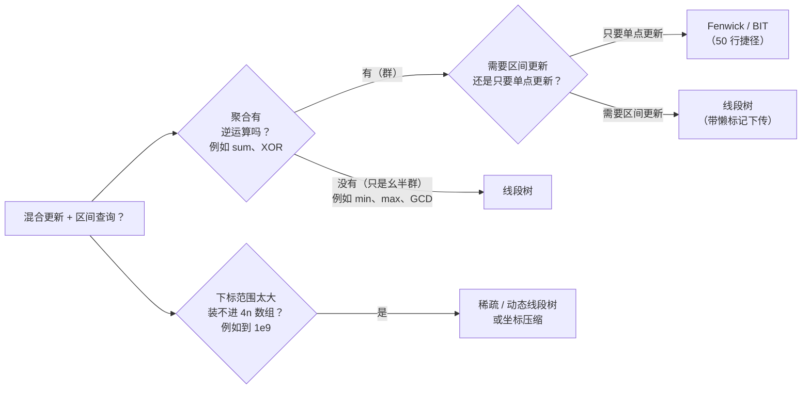
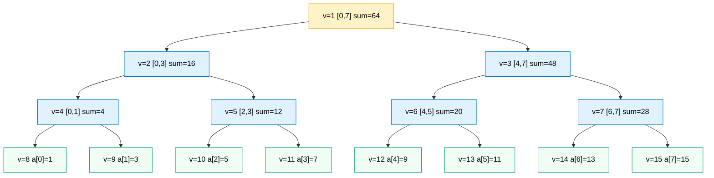

# 线段树

普通数组给你 O(1) 的单点更新和 O(n) 的区间求和。前缀和数组把这个权衡翻了过来：区间求和 O(1)，单点更新变成 O(n)，因为从 `i` 往右的每个前缀都得改。你随便挑一个，面试官只要在两个 `sumRange(l, r)` 之间插一次 `update(i, val)`，你的 O(1) 算法当场变成 TLE。

线段树（segment tree）就是那个拒绝二选一的数据结构。构建、单点更新、区间查询在同一份数组上全是 O(log n)，也只有这个界能扛住这种混合负载。代价是大约 4 倍于原数组的内存、一份递归的构建过程，还有一个第一次读谁也猜不到的“每层最多四个顶点”的证明。这是大多数读者会卡住的一章。交互组件就是这一章本身，跟着走两遍。

## 如何识别这个模式

更新和区间查询混在一起出现，就是触发信号。接下来该走哪条路，取决于聚合运算的性质，以及更新是单点还是区间：



*线段树是万能工具；树状数组（Fenwick tree）则是聚合存在逆运算、且只需要单点更新时，专门做前缀和的 50 行捷径。*

LC 307 *Range Sum Query - Mutable* 是招牌形态：一个构造函数、一个 `update(index, val)`、一个 `sumRange(l, r)`，三者交替调用。[^1] LC 731 和 LC 732（日历那两题）在同一副骨架上加了区间更新，以及作用在超大下标域上的 `max` 聚合。只有这两个变体才会牵出懒标记下传和动态分配。[^2]

树状数组（binary indexed tree，BIT）是值得提前点名的表亲。当聚合是一个带逆元的加法群（sum、XOR），*并且*只有单点更新时，BIT 用大约五十行做同样的事，常数更小，缓存也更友好。[^3] 一旦聚合失去逆元（min、max、GCD），或者更新变成整段的，BIT 就退场，由线段树接手。两句值得记住的口号：线段树是万能工具；BIT 是专用捷径。

## 存什么，存在哪

隐式数组布局是让后面所有内容成立的那一手。把树存在一个大小的 `4n` 的扁平数组 `t[]` 里。根在下标 1；顶点 `v` 的孩子在 `2v` 和 `2v + 1`，这正是 [堆与优先队列](./04-heaps-priority-queues.md) 里的堆布局。[^4] 真正*新*的地方是：每个顶点隐式地拥有原数组上一段连续下标 `[tl, tr]`。根拥有 `[0, n-1]`，左孩子拥有 `[0, n/2]`，右孩子拥有 `[n/2 + 1, n-1]`，如此不断二分，直到叶子各自覆盖一个元素。

区间不存在节点里。它是在递归过程中作为参数传下去的。正是这一手，让整棵树塞进一个扁平数组，节点上不做任何额外记录。

下面用数组 `[1, 3, 5, 7, 9, 11, 13, 15]`、以求和为聚合，画一张具体的图：



*每个顶点旁边标的是隐式数组下标 `v`；`v=8..15` 的叶子各装一个元素，内部顶点装部分和，根装总和 `64`。用的就是本章下面那个交互组件里的 `[1, 3, 5, 7, 9, 11, 13, 15]`。*

动手写代码之前，关于这个布局有两件事值得先钉死。第一，当 `n` 是 2 的幂时，树最多只有 `2n - 1` 个真实顶点，但规矩是开 `4n` 个槽位。等比数列求和 `1 + 2 + 4 + ... + 2^{ceil(log2 n) + 1} - 1 < 4n` 给出了安全上界，即使 `n` 不是 2 的幂，下标运算也不会越界。[^4] 收紧到 `2n` 能省内存，代价是右孩子下标要算成 `v + 2(mid - l + 1)` 而不是 `2v + 1`——这恰恰是读者在面试压力下最容易算错的那种算术。4 倍的开销是便宜的保险。

第二，“每层最多四个顶点”这个界是整章的承重墙。树的每一层，一次查询最多访问*四个*顶点，不管查询区间怎么跨中点。这就是查询是 O(log n) 而不是 O(n) 的原因。证明不长，下面的 §4 会走一遍；现在先信它，接着往下读。

## 构建

构建是后序遍历：先递归左边，再递归右边，最后把两个孩子的聚合值合并到父节点。

```python
def _build(self, nums, v, tl, tr):
    if tl == tr:
        self.tree[v] = nums[tl]
        return
    tm = (tl + tr) // 2
    self._build(nums, 2 * v, tl, tm)
    self._build(nums, 2 * v + 1, tm + 1, tr)
    self.tree[v] = self.tree[2 * v] + self.tree[2 * v + 1]
```

切分规则是每个读者至少写错一次的那一行。左孩子覆盖 `[tl, tm]`，右孩子覆盖 `[tm + 1, tr]`。边界下标 `tm = (tl + tr) // 2` 只属于左半边。代码里有三处用到这条规则：`_build`、`_update`、`_query`。三处必须一致，否则递归会漏元素，或者永远停不下来。

叶子基例在 `tl == tr` 时触发。此时顶点只覆盖一个下标，把这个值写进 `t[v]` 就返回，递归逐层弹回。内部节点走的是后序合并：轮到读孩子的时候，孩子早就填好了。

总工作量：`2n - 1` 个内部节点加叶子各被访问一次，每次合并都是常数时间，所以构建是 O(n)。[^4]

## 单点更新

`update(pos, new_val)` 沿着唯一包含 `pos` 的那条路径从根走到叶，改写叶子，再在回溯的路上逐层重新合并。

```python
def _update(self, v, tl, tr, pos, new_val):
    if tl == tr:
        self.tree[v] = new_val
        return
    tm = (tl + tr) // 2
    if pos <= tm:
        self._update(2 * v, tl, tm, pos, new_val)
    else:
        self._update(2 * v + 1, tm + 1, tr, pos, new_val)
    self.tree[v] = self.tree[2 * v] + self.tree[2 * v + 1]
```

每一层都把数组切成互不相交的顶点区间，所以 `pos` 在每层只落在唯一一个顶点里。下行时每层访问一个顶点，回溯时每层合并一次，树高是 `ceil(log2 n) + 1`。合计 O(log n) 的工作量、O(log n) 的递归栈。[^4]

## 区间查询

`query(l, r)` 是“每层四个顶点”那个证明真正生效的地方。函数访问覆盖 `[tl, tr]` 的顶点 `v` 时，只会发生三件事之一：

1. **查询区间为空**（`l > r`）。返回单位元（求和时为 0）。这是提前退出的守卫。
2. **查询区间与顶点区间完全重合**（`l == tl && r == tr`）。直接返回 `t[v]`。整个子树的答案就是它。
3. **查询区间跨过中点。** 拆成两半：进左孩子时把查询裁成 `[l, min(r, tm)]`，进右孩子时裁成 `[max(l, tm + 1), r]`，再把两个答案合并。

```python
def _query(self, v, tl, tr, l, r):
    if l > r:
        return 0
    if l == tl and r == tr:
        return self.tree[v]
    tm = (tl + tr) // 2
    return (self._query(2 * v, tl, tm, l, min(r, tm))
            + self._query(2 * v + 1, tm + 1, tr, max(l, tm + 1), r))
```

**题解** — Python（[Java](./10-segment-tree/lc-307/sol.java) · [C++](./10-segment-tree/lc-307/sol.cpp) · [Go](./10-segment-tree/lc-307/sol.go)）

```python
# LC 307. Range Sum Query - Mutable
from typing import List


class NumArray:
    def __init__(self, nums: List[int]):
        self.n = len(nums)
        self.tree = [0] * (4 * self.n)
        self._build(nums, 1, 0, self.n - 1)

    def _build(self, nums: List[int], v: int, tl: int, tr: int) -> None:
        if tl == tr:
            self.tree[v] = nums[tl]
            return
        tm = (tl + tr) // 2
        self._build(nums, 2 * v, tl, tm)
        self._build(nums, 2 * v + 1, tm + 1, tr)
        self.tree[v] = self.tree[2 * v] + self.tree[2 * v + 1]

    def update(self, index: int, val: int) -> None:
        self._update(1, 0, self.n - 1, index, val)

    def _update(self, v: int, tl: int, tr: int, pos: int, new_val: int) -> None:
        if tl == tr:
            self.tree[v] = new_val
            return
        tm = (tl + tr) // 2
        if pos <= tm:
            self._update(2 * v, tl, tm, pos, new_val)
        else:
            self._update(2 * v + 1, tm + 1, tr, pos, new_val)
        self.tree[v] = self.tree[2 * v] + self.tree[2 * v + 1]

    def sumRange(self, left: int, right: int) -> int:
        return self._query(1, 0, self.n - 1, left, right)

    def _query(self, v: int, tl: int, tr: int, l: int, r: int) -> int:
        if l > r:
            return 0
        if l == tl and r == tr:
            return self.tree[v]
        tm = (tl + tr) // 2
        return (self._query(2 * v, tl, tm, l, min(r, tm))
                + self._query(2 * v + 1, tm + 1, tr, max(l, tm + 1), r))
```

裁剪（`min(r, tm)` 和 `max(l, tm + 1)`）是每个读者都会写错的第二行。省掉它，孩子拿到的查询区间就伸出了孩子自己的顶点区间，`l == tl && r == tr` 的精确匹配永远不会命中，递归在每条路径上都一路下潜到叶子，界从 O(log n) 塌回 O(n)。[^4]

## 为什么查询是 O(log n)

“每层最多四个顶点”是本章唯一不显然的界，也是懂行的面试官最可能追问的那一个。[^4]

对树的层数做归纳。第 0 层只访问根。归纳假设：第 `k` 层最多访问四个顶点。这四个里，“内部”的那些（整段区间都严格落在 `[l, r]` 内的）会立刻走精确匹配返回，一次递归调用都不发。只有第 `k` 层最左和最右的两个被访顶点可能分裂，因为只有它们可能压着查询区间的边界。每个这样的顶点在第 `k + 1` 层最多裂成两个孩子。所以第 `k + 1` 层也最多四个。树共有 `ceil(log2 n) + 1` 层，访问顶点数因此被 `4 (log2 n + 1) = O(log n)` 界住。

让这个证明干净成立的是空区间守卫。当 `query(2v, tl, tm, l, min(r, tm))` 拿到一个右端被裁到左端之前、已经为空的查询时，它在 O(1) 内返回单位元，不再往下走。递归结构造出来的那些“半空”分裂，全被这个守卫吃掉，证明才成立。

## 实例推演：构建、更新、查询

8 个元素的数组 `[1, 3, 5, 7, 9, 11, 13, 15]`，然后 `update(3, 6)`（把下标 3 从 7 改成 6），然后 `sumRange(2, 5)`。期望答案是 `5 + 6 + 9 + 11 = 31`。

构建按后序遍历走完 30 步：n=8 的情况下有 8 次叶子赋值和 7 次内部合并，进入递归的“光晕”也各算一步，这样下行路径看得见。交互组件演示的就是这个过程。

更新走四层：下行 `v=1 → v=2 → v=5 → v=11`，把 `v=11` 的叶子从 7 改写成 6，回溯时逐层重新合并，`v=5` 变成 `5 + 6 = 11`，`v=2` 变成 `4 + 11 = 15`，`v=1` 变成 `15 + 48 = 63`。一共动了四个顶点，正好 `log2(8) + 1` 层。

查询在根上分裂：`[2, 5]` 跨过 `tm = 3`。左孩子拿到 `[2, 3]`，右孩子拿到 `[4, 5]`。左子树再递归一次，在 `v=5` 上精确匹配退出，返回 11。右子树在 `v=6` 上精确匹配退出，返回 20。递归里被切到查询区间外侧的那两半（`v=4` 和 `v=7` 的调用）撞上空区间守卫，常数时间返回 0。最终答案：`11 + 20 = 31`。

> **Interactive widget:** [线段树（构建 / 更新 / 查询）](../../../dsa/widgets/w-21-segment-tree.yml)（panel `default`）—— 在网站上渲染；YAML 规格描述了各个关键帧。

*静态备份：组件总共动画 48 步（30 步构建 + 9 步更新 + 9 步查询）。第 29 步构建完成，根上 `t[1] = 64`。第 38 步更新结束，下标 3 那条根路径上被触碰的四个顶点带着新的和值。第 47 步查询返回 31，命中的两个顶点 `v=5 (sum=11)` 和 `v=6 (sum=20)` 高亮为绿色，落到空分支上的 `v=4` 与 `v=7` 调用则变暗。*

“每层最多四个顶点”这个界在两个极端是松的。查 `sumRange(0, 7)` 在根上一步就结束：精确匹配，返回 64。查 `sumRange(3, 4)` 是最坏情况：每层都跨中点，下潜到两个叶子，合并两个单元素外加两次空区间退出。两个极端都是 O(log n)；证明界定的是大 O 底下那个常数。

## 实际开销

| 操作 | 时间 | 空间（额外） | 说明 |
|---|---|---|---|
| `build(nums)` | `O(n)` | 树本身 `O(n)`，递归 `O(log n)` | 主定理 `T(n) = 2 T(n/2) + O(1)`。[^4] |
| `update(pos, val)` | `O(log n)` | 递归 `O(log n)` | 根到叶的路径上每层一个顶点。 |
| `sumRange(l, r)` | `O(log n)` | 递归 `O(log n)` | 见上面的“每层四个顶点”证明。 |
| 树的存储 | 不适用 | `4n` 个槽位 | 安全上界；`2n` 也能做到，只是下标运算更绕。[^4] |

4 倍内存是隐式数组布局的代价。对 LC 307 的约束 `1 <= nums.length <= 3 * 10^4` 来说，Java 里是 120,000 个 int，离任何真正起作用的上限都远。时间界里的常数就是四顶点证明给出的 `4 log n`：`n = 30000` 时每次查询大约访问 60 个顶点；BIT 每次查询大约做 15 次前缀树更新，考虑到线段树每个顶点要多做几步操作，两者是可比的。这里的权衡是通用性，不是纯粹的常数速度。

关于教材覆盖范围说一句。CLRS 第 4 版（2022）并没有把数组实现的线段树当成一个有名字的数据结构来讲；最接近的是 §17.3 的区间树（interval tree），它给红黑树加料，用 O(log n) 回答穿刺查询（stabbing query），但不支持改写底层数组里的某个值。[^5] de Berg 等人的 *Computational Geometry* §10.3 讲的是几何形式的线段树（对 `n` 条存储区间建规范子集树，占 `O(n log n)` 空间），也就是维基百科描述的那个东西；它和本章这种竞赛风格的数组树是两种结构。[^6] 本章这种形态的权威原始资料是 CP-Algorithms。[^4]

## 结构变形时

本章这副骨架能装下的家族远不止求和查询。三个值得了解其形态的变体：

**min、max、GCD、XOR、模意义下的和。** 换掉合并函数和叶子单位元，你就得到 min 线段树、max 线段树或 GCD 线段树。求和：`merge = +`，单位元 0。求 min：`merge = std::min`，单位元 `+inf`。求 max：`merge = std::max`，单位元 `-inf`。骨架完全一样，只改两行。[^4] 这就是“幺半群上的线段树”这个推广：任何带单位元的结合二元运算，都能白拿这套结构。

**区间更新用懒标记下传。** 当更新作用在整段上（`add x to every a[l..r]`、`assign p to every a[l..r]`），每个内部顶点多带一个 `lazy[v]` 槽位，存着还没推给孩子的那次更新。在越过某个顶点继续递归之前，先调 `push(v)` 把懒缓冲往下一层倒：父节点待处理的更新应用到两个孩子身上，父节点的 lazy 槽位清空。诀窍在于更新*只有在整段区间都被覆盖时才落在节点上*；否则就把懒标记往下推，继续下潜。LC 731 *My Calendar II*（对 `[start, end)` 做区间 +1，再查最大重叠数）是招牌形态。[^2] 完整机制留给第 13 部分的高级数据结构章节；本章有这个轮廓就够了。

**下标域极大时用动态 / 稀疏树。** 当下标域是 `[0, 10^9]`、而真正被碰到的下标集合很小时，一上来就开 `4n` 个槽位是不可能的。动态变体在顶点第一次被访问时才用指针分配；CP-Algorithms 管这叫“隐式线段树”模式。[^4] LC 732 *My Calendar III* 直接需要它：坐标最大到 `10^9`，所以要么先把输入做坐标压缩，要么把树懒建出来。[^2] 本章只讲触发条件；深入的部分在第 13 部分。

## 常见误区

> [!WARNING]
> **开 `2n` 而不是 `4n`。** 读者数“树有 `2n - 1` 个顶点”（在 `n` 是 2 的幂、树为完美二叉树时确实成立），然后把它翻译成 `2n` 的分配。当 `n` 不是 2 的幂时，`2v + 1` 的右孩子递归可能超出 `2n`，构建过程直接段错误或者抛异常。办法就是 `tree = new int[4 * n]`；多出来的余量覆盖隐式数组的空隙。[^4]

> [!WARNING]
> **`tm` 和 `tm + 1` 的差一错误。** 左孩子覆盖 `[tl, tm]`（含 `tm`），右孩子覆盖 `[tm + 1, tr]`（含 `tr`）；边界下标 `tm` 只属于左半边。把 `build(2*v + 1, tm, tr)` 写成这样而不是 `build(2*v + 1, tm + 1, tr)`，两个孩子的区间就重叠一格，构建过程悄悄把那一格算两遍，查询结果全错。代码里有三处用这条规则（`build`、`update`、`query`）；三处都得一致。

> [!WARNING]
> **`query` 里漏掉 `min(r, tm)` / `max(l, tm + 1)` 的裁剪。** 递归调用交给孩子的查询区间伸出了孩子的顶点区间，`l == tl && r == tr` 的检查永远不成立，递归在每条路径上都下潜到叶子。结果：输入小的时候爆栈，输入大的时候查询退化成 O(n)。裁剪加空区间守卫，才给了“每层四个顶点”证明那些可以被吃掉的空半边。[^4]

> [!WARNING]
> **把 LC 307 当成 LC 303（不可变）那样，去用前缀和。** LC 303 训练读者用前缀和，题号就在 LC 307 前面一位；API 只差一个 `update` 方法。[^1] 前缀和的更新是 O(n)，因为从 `i` 往右的每个前缀都要改；LC 307 的测试集在更新密集的用例上直接超时。只要 API 同时有 `update` 和 `sumRange`，正确答案就是线段树或 BIT。

## 题目梯度

### 核心（三题全做才算掌握本章）

- [LC 307 — Range Sum Query - Mutable](https://leetcode.com/problems/range-sum-query-mutable/) [中等] • segment-tree-point-update-range-query ★
- [LC 731 — My Calendar II](https://leetcode.com/problems/my-calendar-ii/) [中等] • segment-tree-range-update-with-lazy *(参考实现：仅 Python)*
- [LC 732 — My Calendar III](https://leetcode.com/problems/my-calendar-iii/) [困难] • dynamic-segment-tree-range-update *(参考实现：仅 Python)*

### 进阶（可选）

- [LC 729 — My Calendar I](https://leetcode.com/problems/my-calendar-i/) [中等] • segment-tree-point-conflict-check
- [LC 218 — The Skyline Problem](https://leetcode.com/problems/the-skyline-problem/) [困难] • sweep-line-with-heap-or-segtree

最合适的 Easy 候选 LC 303 *Range Sum Query - Immutable* 已经划给 [前缀和与差分数组](../part-3-pointers-window-prefix/04-prefix-sums.md) 当招牌题了。[^1] 按登记表“每道 LC 只能在一个章节里作为 CORE 出现”的规则，本章只能是 M/M/H，并带上 `no-easy-canonical` 标记。也没有别的 Easy 题能真正讲清线段树相对前缀和的优势。

## 后续衔接

懒标记下传、可持久化线段树、动态 / 稀疏树、二维线段树的深入讲解，属于第 13 部分的高级数据结构章节；这里的信号是“触发条件你已经见过了，完整机制再往前一章”。更近的表亲是树状数组：只要聚合有逆元、更新又只有单点，开头那张决策流程图就指向它——代码更短，常数更小，适用面更窄。[堆与优先队列](./04-heaps-priority-queues.md) 和本章共用 §“存什么，存在哪”里的隐式数组布局技巧，这也是为什么堆那一章是本章的硬前置。

## 参考文献

[^1]: LeetCode 307，“Range Sum Query - Mutable”。约束：`1 <= nums.length <= 3 * 10^4`，`-100 <= nums[i] <= 100`，`update` 与 `sumRange` 的调用合计最多 `3 * 10^4` 次。[leetcode.com/problems/range-sum-query-mutable](https://leetcode.com/problems/range-sum-query-mutable/)

[^2]: LeetCode 731，“My Calendar II”（中等）与 LeetCode 732，“My Calendar III”（困难）。[leetcode.com/problems/my-calendar-ii](https://leetcode.com/problems/my-calendar-ii/)

[^3]: Peter M. [cp-algorithms.com/data_structures/fenwick.html](https://cp-algorithms.com/data_structures/fenwick.html)。

[^4]: CP-Algorithms，“Segment Tree”。 <https://cp-algorithms.com/data_structures/segment_tree.html>

[^5]: Cormen, Leiserson, Rivest, Stein, *Introduction to Algorithms*（《算法导论》），第 4 版，MIT Press，2022，§17.3“Interval trees”。CLRS 的区间树是在红黑树上加料得来的，用 O(log n) 回答穿刺查询；它和本章讲的数组实现线段树是两种结构。

[^6]: de Berg, M., van Kreveld, M., Overmars, M., Schwarzkopf, O., *Computational Geometry: Algorithms and Applications*，第 3 版，Springer-Verlag，2008，§10.3“Segment Trees”。那里的几何化表述：对 `n` 条存储区间建规范子集树，占 `O(n log n)` 空间，报告查询为 `O(log n + k)`，与本章的数组实现结构不同。
