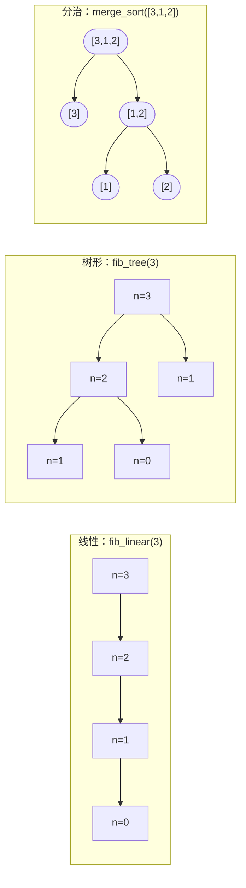

# 递归模式：线性、树形与分治

递归是大多数读者一碰就弹开的那一章，原因不是语法难。语法就是你在[递归的心智模型](../part-0-foundations/02-recursion-mental-model.md)里已经写过的那套：一个基准情形、一个递归情形、一个调用自己的函数。麻烦是后来才出现的。你写下 `def fib(n): return fib(n-1) + fib(n-2)`，眼看着它在 `fib(35)` 上磨蹭；你写下 `def fact(n): return n * fact(n-1)`，配上显而易见的基准情形，那个却瞬间跑完。纸面上形状一样，运行时的开销天差地别。屏幕上没有任何东西解释为什么。

落差就在形状上。不是*代码*的形状，而是代码展开成的*调用树*的形状。每帧只调用自己一次的函数，画出的是一条链。每帧自调用两次，画出的是二叉树。把输入对半分、对两半各自递归，画出的是平衡树，每个内部节点上还有合并工作。三种调用形状，三个复杂度类别，同一套 `def` 关键字。本章的全部任务，就是教会你看着一个递归函数、读出它画的是哪棵树——因为这正是线性时间算法和指数时间算法的差别，而两者常常只隔四行代码。

## “递归的形状”指什么

读递推式，不要读语法。看到一个递归调用时，先别管语言，把规模 `n` 处的开销和调用下降到的更小规模处的开销之间的关系写下来。这个关系就是递推式，它告诉你手上是三种形状里的哪一种。

| 递推式 | 形状 | 总开销 |
|---|---|---|
| `T(n) = T(n-1) + O(1)` | 线性（链） | `Theta(n)` |
| `T(n) = T(n-1) + T(n-2) + O(1)` | 树形 | `Theta(phi^n)`，指数级 |
| `T(n) = a*T(n/b) + f(n)`，`b > 1` | 分治 | 取决于主定理 |

Knuth 在 *The Art of Computer Programming* 第 1 卷 §1.2.8 里，把第二种形状——斐波那契递推式——当作树状递归的典范样本。[^1] 第三种形状是 Cormen、Leiserson、Rivest、Stein 在 *Introduction to Algorithms* 第 4 章讲的主定理家族。[^2] 第一种形状，是递归在结构上只是穿了一身栈帧外衣的 `for` 循环时得到的东西。

语法藏起来的关键区别：第二、第三种形状在函数体里都有*两个*递归调用。一眼看上去一模一样，其实不是。树状递归的子问题规模是 `n - 1`（减法式）；分治的子问题规模是 `n/2`、`n/3` 或 `n/b`（除法式）。主定理只适用于后者，不适用于前者。[^3] 维基百科的主定理条目正是为此专门在“Inadmissible equations”一节里点出这件事：人们总爱拿它去套斐波那契形状的递推式，然后得出错误答案。



*同一个小输入上的三种调用形状。线性塌缩成深度为 `n` 的一条链。树形在每个内部节点分叉，子问题规模每次减 1。分治也分叉，但子问题规模每一步减半，而且回卷时合并那一步要干实活。*

## 线性：每帧一次自调用

识别特征：函数体里只有一个递归调用，每次下降一个常数。递推式 `T(n) = T(n-1) + O(1)` 逐层相消后是 `Theta(n)` 时间。总帧数 `n`，栈深度 `n`，每帧合并工作 `O(1)`。阶乘是这个形状；用递归写的迭代式链表遍历是这个形状；递归版欧几里得 GCD 是这个形状；带累加器的斐波那契也是这个形状。

```python
def fib_linear(n: int, a: int = 0, b: int = 1) -> int:
    if n == 0:
        return a
    return fib_linear(n - 1, b, a + b)
```

`fib_linear(30)` 做 30 次递归调用，每次一个加法。`(a, b)` 这对累加器把正在推进的斐波那契对沿着链一路带下去，所以每帧的贡献是常数。递归树是一条路径：没有分叉，没有冗余，没有可优化掉的东西。

Erickson 的 *Algorithms* 在第 1 章直接给这个形状命了名：线性递归是一种伪装起来的尾递归写法，递归在一帧一帧地干 `for` 循环的活。[^4] 麻烦在于，这层伪装在不对的运行时里很贵。本章倒数第二节讲为什么。

## 树形：每帧两次自调用

函数体里有两个递归调用，各自下降一个常数。递推式 `T(n) = T(n-1) + T(n-2) + O(1)` 的特征方程和斐波那契数列本身一模一样；Knuth 的精确分析给出 `T(n) = O(phi^n)`，其中 `phi` 是黄金比例，约 `1.618`。[^1]

```python
def fib_tree(n: int) -> int:
    if n < 2:
        return n
    return fib_tree(n - 1) + fib_tree(n - 2)
```

`fib_tree(30)` 大约做 `phi^30` 次递归调用，160 万次上下。`fib_tree(35)` 约 `phi^35`，2400 万次。`fib_tree(50)` 没救。损失不在深度上——调用树的深度仍然只有 `n`。损失在*节点数*上。看上面那张图：`fib_tree(3)` 调了两次 `fib_tree(1)`；`fib_tree(4)` 会调两次 `fib_tree(2)`、三次 `fib_tree(1)`；`fib_tree(5)` 调两次 `fib_tree(3)`、三次 `fib_tree(2)`、五次 `fib_tree(1)`。冗余是复利式积累的。

两个值得点名的后果。第一：树状递归*不*等于指数递归。记忆化把每个子问题的答案在第一次算出时就缓存住，冗余随之塌掉，第二次访问 `fib_tree(2)` 是 `O(1)`，而不是再走一整棵子树。记忆化后的形式是 `Theta(n)` 时间，和线性版一样。9.0 章会正式建立从递归到记忆化的提升；这里只要注意到这个提升存在就够。

第二：树状递归的*深度*是线性增长，哪怕*工作量*是指数增长。峰值栈空间是 `Theta(n)`，不是 `Theta(phi^n)`。`fib_tree(35)` 那 2400 万次调用摊在时间上，不是摊在栈上。你不需要同时拥有 2400 万帧；你需要的是峰值深度上的 35 帧，加上整轮跑下来的 2400 万次调用。

深度与工作量这条分界线，是本章第二重要的读代码技能，仅次于递推式本身。它也是下一章的回溯为什么可行的原因：调用树在宽度上是指数的，在深度上却只有线性，所以栈始终有界，时间开销是一条路径一条路径付出去的。

## 分治：拆分、递归、合并

还是两个递归调用，但每个作用于规模为 `n/b` 的子问题（`b > 1`）。此外每个内部节点上还有实打实的合并工作 `f(n)`。递推式是 `T(n) = a*T(n/b) + f(n)`。实践里出现的绝大多数情形都由主定理覆盖。[^2][^3]

```python
def merge_sort(nums: list[int]) -> list[int]:
    if len(nums) <= 1:
        return nums[:]
    mid = len(nums) // 2
    left  = merge_sort(nums[:mid])
    right = merge_sort(nums[mid:])
    return _merge(left, right)
```

**Solution** — Python ([Java](./00-recursion-patterns/sol.java) · [C++](./00-recursion-patterns/sol.cpp) · [Go](./00-recursion-patterns/sol.go))

```python
# 第 7.0 章 —— 递归模式：线性、树形与分治
# merge_sort 的标准用例全部通过。
import sys
from functools import lru_cache
from typing import List

# CPython 默认递归限制是 1000；深轨迹和树状递归需要调高。
sys.setrecursionlimit(10**6)


# 形状 1：线性递归。每帧一次自调用，深度 n，工作量 O(n)。
# 尾递归形式；CPython 并不消除尾调用。
def fib_linear(n: int, a: int = 0, b: int = 1) -> int:
    """线性递归：T(n) = T(n-1) + O(1)。"""
    if n == 0:
        return a
    return fib_linear(n - 1, b, a + b)


# 形状 2：树状递归。每帧两次自调用；T(n) = T(n-1) + T(n-2) + O(1)。
# 总帧数 Theta(phi^n)，phi 是黄金比例（约 1.618）。
def fib_tree(n: int) -> int:
    """未记忆化的树状递归：没有缓存就是指数级。"""
    if n < 2:
        return n
    return fib_tree(n - 1) + fib_tree(n - 2)


# 形状 2 经记忆化压回线性。通往第 9.0 章的桥。
@lru_cache(maxsize=None)
def fib_memo(n: int) -> int:
    """树状递归 + 记忆化：每个子问题只算一次，总共 Theta(n)。"""
    if n < 2:
        return n
    return fib_memo(n - 1) + fib_memo(n - 2)


# 形状 3：分治。拆分、对两半递归、合并。
# T(n) = 2T(n/2) + Theta(n) -> 由主定理情形 2 得 Theta(n log n)。
def merge_sort(nums: List[int]) -> List[int]:
    """分治排序：对半拆、递归、归并。"""
    if len(nums) <= 1:
        return nums[:]
    mid = len(nums) // 2
    left = merge_sort(nums[:mid])
    right = merge_sort(nums[mid:])
    return _merge(left, right)


def _merge(left: List[int], right: List[int]) -> List[int]:
    out: List[int] = []
    i = j = 0
    while i < len(left) and j < len(right):
        if left[i] <= right[j]:
            out.append(left[i]); i += 1
        else:
            out.append(right[j]); j += 1
    out.extend(left[i:]); out.extend(right[j:])
    return out


# 本章的标准入口。
def fib(n: int) -> int:
    return fib_memo(n)
```

归并排序给出 `T(n) = 2*T(n/2) + Theta(n)`。两个递归调用各处理一半输入，归并那一步把两半各走一遍。主定理情形 2：`a = 2`、`b = 2`、`f(n) = n`，临界指数 `c_crit = log_2(2) = 1`，且 `f(n) = Theta(n^1)` 正好匹配，所以 `T(n) = Theta(n log n)`。那个 `log n` 因子是递归树的深度（`log_2 n` 层，因为每层输入减半）；每层的 `n` 因子是归并的工作量。乘起来就是 `n log n`。

另外三个值得认识的分治递推式。二分查找，`T(n) = T(n/2) + Theta(1)`：情形 2，`a = 1`，得 `Theta(log n)`。平衡二叉树遍历，`T(n) = 2*T(n/2) + Theta(1)`：情形 1，得 `Theta(n)`，因为常数量的合并被叶子数量压过去了。递归版二进制快速幂，`n` 为偶数时 `pow(x, n) = pow(x*x, n/2)`：情形 2，`a = 1`，得 `Theta(log n)`。这就是[面试数学](../part-0-foundations/04-math-for-interviews.md)里作为 Pow(x, n) 讲的那个算法。

把分治和树状递归区分开的，不是“两个递归调用”——两边都有。是规模缩减的方式。减法式（`n - 1`、`n - 2`）是树状递归；除法式（`n/2`、`n/3`）是分治。只有当子问题规模按倍数缩小时，才去拿主定理。

## 互递归与尾递归：值得命名的变体

还有两种形状，出现频率够高，值得有名字，但都不值得单独占一个 H2。

**互递归。** 函数 `A` 调用 `B`，`B` 调用 `A`，两边都有基准情形。经典例子是递归下降解析器：`parseExpr` 调 `parseTerm`，`parseTerm` 又调 `parseExpr`，文法规则最终落在词法单元上。终止性依然要求某个良序度量在每一次来回中都严格下降，通常是到目前为止消耗掉的输入长度。正确性证明需要对两个函数同时做归纳，因为不假设另一个正确，就证不出任何一个正确。

**尾递归。** 递归调用是最后一个动作，周围没有等着合并答案的工作：写 `return f(...)`，而不是 `return n * f(...)`。上面的 `fib_linear` 是尾递归，教科书里的 `factorial(n) = n * factorial(n-1)` 不是。做尾调用消除的编译器可以复用当前帧，而不新压一帧，把空间从 `Theta(n)` 降到 `Theta(1)`。Python、Java、Go 都不做这件事。Guido van Rossum 早在 2009 年就明确拒绝了在 CPython 里做尾调用消除：尾调用优化会破坏栈回溯，还会让“开发者写出依赖它的代码”而不可移植。[^5] Java 的 HotSpot 也不优化自尾递归。C++ 在 `-O2` 下可能做，但语言标准并不要求。

所以，在面试用得上的这些语言里，尾递归是一种写法选择，不是空间优化。把它当成偏重可读性的写法，一旦递归真会深到出问题，就改写成显式循环。

## 实际开销

三种形状的开销曲线各不相同，下面这张表里每一行都不是同一个算法的最好／平均／最坏情况，而是完全不同的算法。

| 形状 / 变体 | 时间 | 栈空间 | 出处 |
|---|---|---|---|
| 线性 `T(n) = T(n-1) + O(1)` | `Theta(n)` | `Theta(n)` | Erickson §1[^4] |
| 树形（未记忆化的斐波那契） | `Theta(phi^n)` | `Theta(n)` | Knuth Vol. 1 §1.2.8[^1] |
| 树形 + 记忆化 | `Theta(n)` | `Theta(n)` 缓存 + `Theta(n)` 栈 | CLRS Chapter 14[^2] |
| 分治 `T(n) = 2T(n/2) + Theta(n)`（归并排序） | `Theta(n log n)` | `Theta(n)` 辅助 + `Theta(log n)` 栈 | 主定理情形 2[^2][^3] |
| 分治 `T(n) = T(n/2) + Theta(1)`（二分查找） | `Theta(log n)` | `Theta(log n)` 栈 | 主定理情形 2，`a=1`[^2][^3] |
| 分治 `T(n) = 2T(n/2) + Theta(1)`（平衡遍历） | `Theta(n)` | `Theta(log n)` 栈（平衡） | 主定理情形 1[^2][^3] |

从这张表能推出三件事。

时间和深度是两个不同的数。树状递归在时间上爆炸（`phi^n`），深度却保持线性（`n`），因为调用树很宽但不高。线性递归的时间和深度相等，因为树就是一条路径。分治的深度是 `log n`，哪怕它的时间是 `n log n`，因为每一层输入都减半。

记忆化是树形和线性之间的那道提升。记忆化的斐波那契只做 `n` 次不同的子问题计算，第一次之后每次都是 `O(1)`，缓存里放 `n` 条记录。递归的形状没变，冗余被缓存掉了。这就是[从递归到记忆化](../../../dsa/part-9-dynamic-programming/00-dp-recursion-to-memo.md)的全部内容：看到子问题重复的树状递归，就把它提升成 `Theta(n)` 的记忆化版本。这是算法解题里杠杆最大的动作之一。

合并那一步才是分治不平凡的地方。线性和树状递归的合并是 `O(1)`：两个值相乘、两个值相加、两个值比较。分治的合并每层要做 `Theta(f(n))` 的工作。归并排序正是靠 `Theta(n)` 的归并，才比一条平坦的 `Theta(n)` 遍历多出那个 `log n` 因子。

> **Interactive widget:** [递归调用栈（阶乘；三种形状对比）](../../../dsa/widgets/w-01-recursion-call-stack.yml)（面板 `three_shapes`）—— 网站上渲染；YAML 规格描述了关键帧。

*静态回退版：三块调用栈面板并排演示。线性面板按顺序压入四帧，撞上基准情形，再弹回去。树形面板先压左子树、弹出，再压右子树、再弹出；每个基准情形彼此独立。分治面板拆分输入、递归，并在回卷路上展示显式的合并事件。这段轨迹是确定性的，与 Python 参考实现一致。*

把这个控件走两遍。注意线性面板任何时候都不会有多于一条分支活着。注意树形面板的右子树只在左子树完全返回之后才开始。注意分治面板的合并事件在回卷路上触发，位于两个子返回都完成之后。

## 各语言的栈深度

“尾递归是常数空间”这句话在面试里是陷阱而不是事实：你能用来交题的语言，每一门处理深递归的方式都不同，而且没有一门把尾调用消除当作保证。

CPython 的默认递归限制是 `1000`，可以用 `sys.getrecursionlimit()` 读出来。超过之后，Python 抛 `RecursionError`，这是 C 栈撞上 OS 限制之前的一道软护栏。真需要深度的轨迹，可以用 `sys.setrecursionlimit(10**6)` 把限制调高，但推到 `10**6` 以上就有 C 栈硬崩的风险，整个解释器直接挂掉，连 Python 层的异常都抛不出来。[^6] 如果题目确实需要深递归，在模块加载时设一次。能重构成循环的就重构。

Java 的 HotSpot 给每个线程分配自己的栈，大小由 `-Xss` 决定。默认值随平台不同，常见是 512 KB 到 1 MB，换算成帧数大约是 5,000 到 25,000 帧，取决于单帧大小。你会远早于 Python 的 `RecursionError` 撞上 `StackOverflowError`，而且前面没有软护栏。尾递归帮不上忙，HotSpot 不消除自尾调用。

C++ 取决于编译器和操作系统。Linux 主线程默认通常是 8 MB，Windows 默认 1 MB。单帧大小取决于局部变量。自尾递归在 `-O2` 下可能被优化掉，但标准不要求，所以别指望它。

Go 是异类。goroutine 栈一开始很小（8 KB 上下），需要时从堆上分段增长。实际深度上限取决于可用内存，而不是固定的栈大小。在 Go 里可以递归几百万帧深，运行时会一直给 goroutine 栈扩容，直到内存用完或撞上单 goroutine 上限（默认 1 GB）。这让 Go 对深递归代码很宽容；但这不等于 Go 有尾调用优化，它只是栈灵活。

> [!WARNING]
> **CPython 的递归限制是深度，不是工作量。** 一个 `fib_tree(35)` 的解法在 LeetCode 上超时，不是因为深度超过 `1000`（深度只有 `35`），而是因为总调用次数约 2400 万。调高 `sys.setrecursionlimit` 解决不了时间问题，只有记忆化能。深度是瓶颈时才去动 `setrecursionlimit`，总工作量是瓶颈时不要动。

> [!WARNING]
> **尾递归是表达上的糖，不是可移植的空间优化。** 在 Python、Java、Go 里写 `fib_linear(10000)` 都会在深度上爆栈，尽管这个函数只用常数量的*逻辑*状态。这三家运行时都不消除尾调用。如果递归深度可能超过几千层，改写成迭代循环。栈一溢出，递归什么也没换到。

## 练习题

基础章节的题目梯度故意做得稀疏。下面两道核心题分别覆盖树形和分治这两种形状——它们引入的行为，才是[递归的心智模型](../part-0-foundations/02-recursion-mental-model.md)用阶乘讲线性递归时没讲过的东西。招牌题是 LC 779，LeetCode 上最干净的树状递归中等题，递归结构本身就是整个解法。

线性形状的经典入门题是 [LC 509 Fibonacci Number](https://leetcode.com/problems/fibonacci-number/)，它归[递归的心智模型](../part-0-foundations/02-recursion-mental-model.md)当核心题。还没做的就在那里做，两种写法都写：线性递归形式（上面的 `fib_linear`，尾递归累加器）和树状递归形式，然后给两个实现计时对比。

### 核心

- [LC 779 — K-th Symbol in Grammar](https://leetcode.com/problems/k-th-symbol-in-grammar/) [中等] • tree-recursion ★
- [LC 932 — Beautiful Array](https://leetcode.com/problems/beautiful-array/) [中等] • divide-and-conquer

### 进阶

- [LC 247 — Strobogrammatic Number II](https://leetcode.com/problems/strobogrammatic-number-ii/) [中等] • tree-recursion *（LeetCode Premium；免费替代是 LC 22 Generate Parentheses，留给 Part 7 后面某一章）*
- [LC 87 — Scramble String](https://leetcode.com/problems/scramble-string/) [困难] • divide-and-conquer + memo

LC 779 走的是一棵行长度逐级翻倍的二叉树。递归每帧把 `k` 减半，问 `k` 落在上一行的左半还是右半；整个算法就这一句。深度 `n - 1`，每帧工作量常数，总时间 `Theta(n)`。递推式是 `T(n) = T(n-1) + O(1)`，和阶乘同一个形状，但让递归成为自然解法而不是装饰的，是*问题*本身的递归结构（行长度翻倍）。

LC 932 通过递归 `n/2` 再把两个变换过的半段拼起来，构造长度为 `n` 的漂亮数组。时间按归并排序的递推式是 `Theta(n log n)`，不同之处是每个内部节点上的工作是线性拼接而不是归并。承重的想法是那个数学洞察：把 `f(x) = 2x - 1` 和 `g(x) = 2x` 映射到漂亮数组上，漂亮性质仍然保持；递归负责把这个洞察变成算法。

LC 87 是从递归到记忆化的桥梁题。把字符串在每个位置切开递归划分，会生成指数级的搜索树；对 `(s1, s2)` 这一对做记忆化，就把它压到 `Theta(n^4)`。解两遍：先不带缓存，看着它超时，再带上缓存，感受一下[从递归到记忆化](../../../dsa/part-9-dynamic-programming/00-dp-recursion-to-memo.md)要形式化的那道提升。

## 后续衔接

[回溯基础](./01-backtracking-template.md)是递归加一步显式撤销。递归沿着选择树下探，像本章的树状递归形状，但在回卷路上，每一帧都撤销它在下降路上做的那个选择。这套“选择—探索—撤销”的纪律，正是回溯能探索指数级搜索空间、又不在兄弟分支之间泄漏状态的原因。带着本章的三种形状去读下一章：回溯是带撤销不变式的树状递归，不是跟这里无关的新模式。

[从递归到记忆化](../../../dsa/part-9-dynamic-programming/00-dp-recursion-to-memo.md)是从树状递归（子问题有冗余）到线性时间 DP 的正式提升。形状仍然是树状递归，冗余被缓存掉。动态规划的大部分内容，就是这道提升换着不同的戏服反复上演。

本章交出去的东西，就是这个形状区分。一旦你能读懂一个递推式并说出它画的是哪棵树，Part 7 的其余部分和整个 Part 9 读起来都不一样了。

## 参考文献

[^1]: Donald E. Table of contents: [oreilly.com/library/view/art-of-computer/9780321635754/toc.xhtml](https://www.oreilly.com/library/view/art-of-computer/9780321635754/toc.xhtml).

[^2]: Thomas H. Cormen, Charles E. Leiserson, Ronald L. Rivest, Clifford Stein, *Introduction to Algorithms*, 4th ed., MIT Press, 2022.

[^3]: Wikipedia, "Master theorem (analysis of algorithms)," last edited 27 February 2025. [en.wikipedia.org/wiki/Master_theorem_(analysis_of_algorithms)](https://en.wikipedia.org/wiki/Master_theorem_(analysis_of_algorithms)

[^4]: Jeff Erickson, *Algorithms*, 1st ed., 2019. Chapter 1 "Recursion," §§1.1-1.5; merge sort treated in Chapter 1 as the canonical divide-and-conquer example. [jeffe.cs.illinois.edu/teaching/algorithms](https://jeffe.cs.illinois.edu/teaching/algorithms/).

[^5]: Guido van Rossum, "Tail Recursion Elimination," *Neopythonic* blog, 22 April 2009. [neopythonic.blogspot.com/2009/04/tail-recursion-elimination.html](https://neopythonic.blogspot.com/2009/04/tail-recursion-elimination.html).

[^6]: Python documentation, `sys.setrecursionlimit`.
