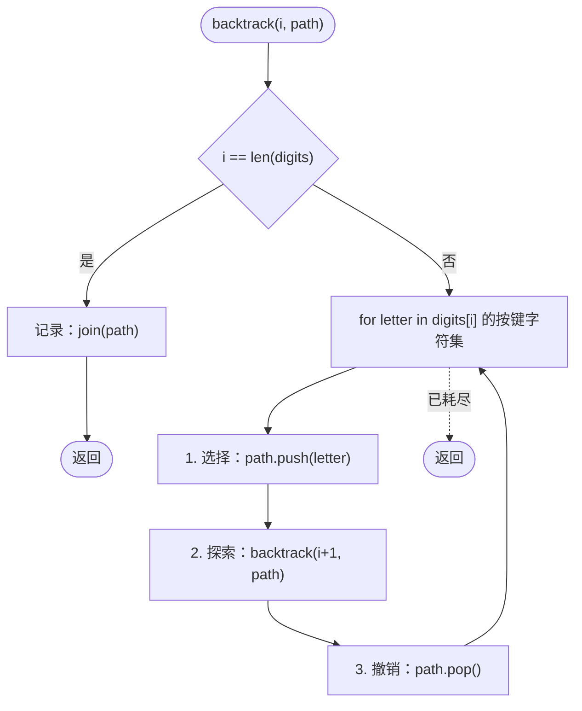
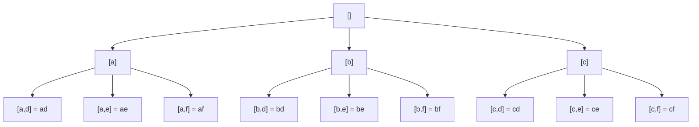

# 回溯模板

D. H. Lehmer 在 1950 年代的出版物里用上了“backtracking”这个词。他命名的这套做法比电子计算机还老，在数学消遣类论文里躺了十年，后来才在 Knuth 的书里占上一章。真正把这门技术变成可用算法的，是 TAOCP 第四卷 §7.2.2 里那句话：*“它会穷尽每一阶段的所有可能候选，但通常不必真的看很多候选，因为它能依据部分信息把其余的排除掉。”*

这句话有两半。前半是初学者做完第二道 LeetCode 就能顺手写出来的东西：外层循环套内层循环，内层再套一次递归调用，部分解不断变长，某个地方吐出一个叶子。后半是没人会主动想到的那一半，也正是把暴力变成一件有名字的事情的那一半。**一次只做一个选择**地把部分解建起来，并在其下分支耗尽的那一刻撤销这个选择，好让下一个分支看到同一个起始状态。三个动作：**选择（choose）**、**探索（explore）**、**撤销（unchoose）**。撤销才是纪律所在。本章讲的就是那个撤销。

## 回溯到底是什么

回溯是一种递归形状，不是一种算法。Knuth 的 TAOCP 第四卷 Fascicle 5 是标准参考，并把这一术语归到 Lehmer 名下。[^1] 这个形状是对决策树做一次深度优先遍历：下行时改状态，上行时恢复状态。Part 7 余下每一章都是这个形状的一个特化：子集、排列、组合和、单词搜索、N 皇后、数独。每个特化改的只是记录什么、什么算合法、下一步的选择前沿长什么样；没有一个动过那三个动作的骨架。

模板在三个条件同时成立时适用。输出是枚举式的（“返回所有 X”）。决策空间在结构上是一棵树，也就是两条不同的选择序列绝不会停在同一个部分状态，因此没有可记忆化的重复工作。约束检查很便宜，于是提前否决（剪枝）真的能省下工作量。

三个条件都成立时，回溯比暴力枚举快几个数量级。第一个不成立时，问题通常要的是图搜索（BFS 或 Dijkstra，状态空间是一张图，访问标记是全局的）。第二个不成立时，问题要的是动态规划（子问题重叠且最优子结构）。第三个不成立时，你只是在暴力解法上多绕了几步；算法正确，但一点也不比枚举整个空间快。

> [!WARNING]
> **在 DP 形态的问题上伸手去拿回溯，是本章最贵的错误。** 如果同一个部分状态能由两条不同的选择序列到达（字符串编辑、背包、方向敏感的网格路径），DP 才是对的工具，回溯只会白白慢上指数级。套模板之前先问一句：两条不同的选择序列会不会停在同一个剩余状态上？会，就记忆化；不会，才回溯。打家劫舍（House Robber，LC 198）就是那个经典的“看着像回溯、其实是 DP”的陷阱。

## 先看错误的模板

体会“撤销”为什么是纪律的最快方式，是先写一个*不带*撤销的模板，看输出怎么把自己弄坏。LC 17（Letter Combinations of a Phone Number）是最干净的演示。给定 `digits = "23"` 和标准手机键盘（`2 → "abc"`、`3 → "def"`），返回从每个数字对应的字符集里各取一个字母拼出的所有两位字符串：`["ad", "ae", "af", "bd", "be", "bf", "cd", "ce", "cf"]`。九个输出。决策树 3 × 3 地展开。

第一次尝试，照着大多数初学者写递归的样子：

```python
# 错误模板：按引用保存活动 path，没有撤销
KEYPAD = {"2": "abc", "3": "def"}

def letter_combinations_wrong(digits):
    result = []
    path = []

    def recurse(i):
        if i == len(digits):
            result.append(path)         # <-- 按引用保存
            return
        for letter in KEYPAD[digits[i]]:
            path.append(letter)         # 选择
            recurse(i + 1)              # 探索
            # 没有撤销
    recurse(0)
    return result
```

两个 bug，叠在一起。拿 `digits = "23"` 跑一遍。函数返回时，`path` 是 `["a", "d", "e", "f", "d", "e", "f", "d", "e", "f"]`（全是 choose，一次 pop 都没有），而 `result` 里是九个指向同一个列表的引用。输出：同一个乱串的九份拷贝，条条一模一样。补上撤销那一步（递归之后 `path.pop()`），`path` 会如愿停在 `[]`，但结果仍然是九个指向那个已经空掉的 `path` 的引用；输出从九个乱串变成九个空字符串。两个 bug 在初学者的提交里总是一起出现，因为它们其实是同一个误解说了两遍：写代码的人以为每个递归栈帧拥有自己那份 `path`，而实际上每一帧改的都是同一个共享列表。

两个修法，缺一不可。**存之前先快照**，让每条结果是自己的对象。**探索之后撤销**，让同一深度上的兄弟分支看到父级留给它的那条 path。错一个，答案就是错的；两个都错，故障表现更响，但诊断结论一样。

```python
# 正确模板
def letter_combinations(digits):
    if not digits:
        return []
    result = []
    path = []

    def backtrack(i):
        if i == len(digits):
            result.append("".join(path))   # <-- 快照
            return
        for letter in KEYPAD[digits[i]]:
            path.append(letter)            # 1. 选择
            backtrack(i + 1)               # 2. 探索
            path.pop()                     # 3. 撤销
    backtrack(0)
    return result
```

**解法** — Python（[Java](./01-backtracking-template/lc-17/sol.java) · [C++](./01-backtracking-template/lc-17/sol.cpp) · [Go](./01-backtracking-template/lc-17/sol.go)）

```python
# LC 17. Letter Combinations of a Phone Number
from typing import List


KEYPAD = {
    "2": "abc",
    "3": "def",
    "4": "ghi",
    "5": "jkl",
    "6": "mno",
    "7": "pqrs",
    "8": "tuv",
    "9": "wxyz",
}


def letter_combinations(digits: str) -> List[str]:
    """LC 17. Backtracking: each digit is one slot in the recursion tree."""
    if not digits:
        return []
    result: List[str] = []
    path: List[str] = []

    def backtrack(i: int) -> None:
        if i == len(digits):
            result.append("".join(path))
            return
        for letter in KEYPAD[digits[i]]:
            path.append(letter)        # 1. 选择
            backtrack(i + 1)           # 2. 探索
            path.pop()                 # 3. 撤销

    backtrack(0)
    return result
```

两份代码的差别是六个字符和一次方法调用。正确答案与错误答案的差别，则是整整一章。

## 三个操作

骨架有三个命名动作，顺序永远如此。

```text
function backtrack(path, choices_left):
    if is_complete(path):
        record(path)               # 快照；绝不要保存活动中的 path
        return

    for choice in choices_left:
        if not is_valid(path, choice):
            continue                # 剪枝

        path.push(choice)           # 1. 选择
        backtrack(path, next_choices(choices_left, choice))   # 2. 探索
        path.pop()                  # 3. 撤销
```

**选择（Choose）。** 挑一个满足单步约束的候选，压进部分解。这次 push 把 `path` 加长一个元素；单步约束由问题定义：排列里是尚未使用的下标，N 皇后里是不互相攻击的格子，数独里是不违反行、列、3×3 宫的取值。LC 17 的约束是平凡的：当前数字对应字符集里的每个字母都是合法选择。

**探索（Explore）。** 在加长后的 path 上递归。这次递归调用拥有该选择之下的整棵子树；它会走完那棵子树里的每个叶子，把能构成解的叶子输出，然后返回。这个调用运行期间，`path` 是*包含*该选择的。递归带着这个元素往下走，并且一路上都假定它在。

**撤销（Unchoose）。** 把该选择从 `path` 上弹出。执行完这一行，`path` 恰好回到与之配对的那次选择之前的状态。这件事之所以重要，是因为 for 循环的下一轮：同一深度的兄弟选择马上要登场，它期望看到的是第一个兄弟看到过的同一个起始状态。没有 pop，每个兄弟都继承前一个兄弟的残留；有了 pop，循环各轮之间互不相干。

Stanford CS106B 的讲义把这三个动作叫“choose / explore / unchoose”；Knuth 的 TAOCP 第四卷 Fascicle 5 叫“enter-level / try-value / back-up”；Skiena 的 *Algorithm Design Manual* §9.1 叫“construct candidates / recursive descent / clean up”。[^2][^1][^3] 同样的动作，三套词汇。本手册沿用 choose / explore / unchoose，因为它把承重的那个词——*unchoose*——摆成了一个读者必须亲手写进函数体的动词。

### 为什么“撤销”是必须守的纪律

撤销是初学者人人跳过、老手一律不动的那一行。它不干活：值在 choose 里进了 `path`，被递归读走，然后在 unchoose 里出来，在当前这一帧里看不到任何可观察的后果。第一次看函数体的人看到“push、递归、pop”，很自然会怀疑这个 pop 只是装饰。

pop 恰恰是让这个 for 循环成立的东西。兄弟选择共享一个父栈帧，共享父栈帧的 `path`，各自都需要同一个起始状态。choose 改了共享状态，只有 unchoose 把它改回去。explore 之下的递归带着该选择往下走，一路假定它在——这是对的，也正是我们想要的。可是兄弟分支还没开始，等它登场时，path 必须跟上一个兄弟跑之前一模一样。

不变式只有一句话：**`backtrack(...)` 进入时的 `path` 与 `backtrack(...)` 返回时的 `path` 逐字节相同。** 这是回溯实现最强的一条正确性检查，而且是肉眼可查的。把函数体走一遍：每个 push 在同一作用域、同一缩进层级、递归调用之后，都有一个配对的 pop。看到 push 没有 pop，实现就是坏的，而且坏得很安静：答案错，不抛异常，小输入上有时还是对的。

这个错误在从值传递语言转写过来时最常见。Python 的 list 是可变的引用；Java 的 `ArrayDeque` 是可变的引用；C++ 里按引用传入的 `std::vector` 是可变的引用；Go 的 slice 共享底层数组。忘了这一点，“我把 path 返回了呀”感觉上应该能行。它不行。Stack Overflow 那个帖子 *Leetcode 78: Subsets confused why duplicate subsets are generated* 是四十个不同的人撞上同一个 bug。[^4]

## 四个可调项

骨架不变。跨问题族，有四块地方需要定制：

| 可调项 | 变的是什么 | 子集 | 排列 | LC 17 |
|---|---|---|---|---|
| `is_complete` | 什么时候记录 | 每个节点 | 只在叶子（`len(path) == n`） | 只在叶子（`i == len(digits)`） |
| `record` | 存什么 | `path` 的快照 | `path` 的快照 | 把 `path` 拼成字符串 |
| `is_valid` | 剪枝谓词 | 恒为真（不剪枝） | 元素尚未使用 | 恒为真（各数字的字符集互不相交） |
| `next_choices` | 前沿形状 | 下标 `> start` | 未使用的元素（集合差） | `digits[i]` 的字母 |

Part 7 里的问题原样搬走骨架，只填这四格。子集在每个节点都输出，因为每条 path 的每个前缀本身就是一个合法子集；排列只在叶子输出，因为问题要的是全长的有序排列；LC 17 也只在叶子输出，因为要的是全长的组合。子集用 `start` 下标避免同一个子集以两种顺序被生成；排列用集合差（记录哪些元素已经在 `path` 里），因为顺序*确实*有关系，每个位置都是新的选择；LC 17 两个问题都没有，因为每个数字索引的是自己那套不相交的字符集。

这些变体各有自己的章节。[子集、组合与排列](./02-subsets-combinations-permutations.md) 讲三个经典枚举问题。[单词搜索与网格回溯](./05-word-search.md) 把骨架搬到二维网格上，那里 `path` 是一组已访问格子。[N 皇后与约束传播](./03-n-queens.md) 是骨架加一个重量级的 `is_valid` 和凶狠的剪枝。[划分与组合和](./02-subsets-combinations-permutations.md) 把 `next_choices` 当成“下一个切点”。骨架不变，格子不同。

## 以 `digits = "23"` 走一遍 LC 17

拿 `digits = "23"`、键盘 `{2: "abc", 3: "def"}` 把正确模板走一遍。递归下降到深度 2，输出，再爬回来。每一次选择都在同一深度上有一次配对的撤销。

```text
 0  进入              path=[]
 1    选择 'a'        path=['a']
 2      进入          path=['a']
 3        选择 'd'    path=['a', 'd']
 4          进入      path=['a', 'd']       输出 "ad"
 5        撤销 'd'    path=['a']
 6        选择 'e'    path=['a', 'e']       输出 "ae"
 7        撤销 'e'    path=['a']
 8        选择 'f'    path=['a', 'f']       输出 "af"
 9        撤销 'f'    path=['a']
10    撤销 'a'        path=[]
11    选择 'b'        path=['b']
12      ... 输出 "bd", "be", "bf"
13    撤销 'b'        path=[]
14    选择 'c'        path=['c']
15      ... 输出 "cd", "ce", "cf"
16    撤销 'c'        path=[]
```

把第 1 行和第 10 行对着读。第一个顶层分支选了 `'a'`；十行之后这次选择有了配对的撤销。中间，`'a'` 之下的子树跑完了（三次输出、三次 push、三次 pop），`path` 回到 `['a']`，最后一次 pop 再把它带回 `[]`。for 循环在第 11 行开始下一轮时，`path` 正是第 1 行该分支开始之前的样子。兄弟分支 `'b'` 和 `'c'` 与 `'a'` 完全同构，因为它们都从同一个状态出发。

> **Interactive widget:** [Backtracking decision tree](../../../dsa/widgets/w-22-backtracking-tree.yml)（面板 `panel-template`）— 在网站上渲染；YAML 规格描述了各个关键帧。

*静态回退：树 3 × 3 地展开到九个叶子；从根到叶的路径上每一次选择都有配对的撤销；每次回退时 path 少一个元素，直到该深度上的下一个兄弟开始。*

下面两张图用不同方式画同一段过程。流程图展示函数体的控制流；树展示这段过程走过的搜索空间。



*三个命名动作在 for 循环体内构成一个闭合三角；到了 for 循环之外，函数返回，调用方的撤销在上一层执行。*



*每个叶子是一次输出；一共九个叶子，因为 |digit-2-set| × |digit-3-set| = 3 × 3 = 9。深度优先遍历会把 A 的子树走完才开始 B；兄弟之间的那次撤销就是为这个准备的。*

## 实际开销

| 变体 | 时间 | 空间 |
|---|---|---|
| LC 17（`d` 位数字，最大分支因子 4，来自数字 7 和 9） | O(4^d × d) | O(d) 递归栈 + O(4^d × d) 输出 |
| `n` 个元素的子集（每个节点都输出） | O(n × 2^n) | O(n × 2^n) 输出 + O(n) 栈 |
| `n` 个元素的排列 | O(n × n!) | O(n × n!) 输出 + O(n) 栈 |
| 只做判定（“合法数独是否存在？”） | 剪枝后树的大小 × 每节点工作量 | O(深度)；输出是一个布尔值 |

对 LC 17 来说，`d` 是输入里的数字个数（LC 把它限制在 4）。每个叶子要花 `O(d)` 把字符串造出来；树最多有 `4^d` 个叶子、`(4^(d+1) - 1) / 3` 个节点，所以把每节点 `O(1)` 的选择/撤销在整棵树上求和，只有在叶子什么都不产出时才占主导。有字符串输出时，叶子的代价说了算。

通用界一句话：**运行时间是算法实际走过的搜索树大小 × 每节点工作量**，而实际走过的树有多大，取决于 `is_valid` 剪得有多狠。LC 17 的字符集互不相交，什么都不剪，算法走的是完整的笛卡尔积树。[N 皇后与约束传播](./03-n-queens.md) 里，`is_valid` 在递归之前就把大部分落点否掉了，算法走的树只是完整 `n!` 排列树的极小一部分。`n = 8` 时是 113 个节点对 40,320 个。[^3] 回溯算法的复杂度断言永远有两部分：最坏情况（完整的树，这是证明所界定的）和典型情况（剪枝后的树，这是实际跑的）。

空间上要把**输出空间**（结果列表）与**工作空间**（递归栈）分开。只吐一个布尔值的判定问题（*这个数独有解吗？*、*这张图三色可染吗？*），输出空间是 `O(1)`，算法总共跑 `O(d)`。枚举类问题里输出占主导，报输出才对。把两者混为一谈是面试里相当常见的一个破绽；Skiena 在 §9.1 直接点了这一条。[^3]

## 剪枝简述与后续指引

Knuth 那句话有两半。前半，穷尽每一阶段的所有候选，就是 choose/explore/unchoose 这个三角。后半，*“它能依据部分信息把其余的排除掉”*，就是**剪枝**，也叫约束传播。在递归之前否掉一个候选，该候选下的整棵子树就再也不会被访问。

LC 17 没有剪枝。每个数字的每个字母都是合法选择，所以 `is_valid` 就是恒等函数 `True`。真正靠剪枝吃饭的章节是 [N 皇后与约束传播](./03-n-queens.md)，那里的 `is_valid` 检查（任意两后不互攻）在 `n = 8` 时把树砍掉两个数量级以上；同一章里的数独求解器，行列宫约束也在递归触发之前否掉大部分候选。模板练熟之后，那两章是下一站。

能在毫秒级解出 `n = 12` N 皇后的回溯解，和会超时的回溯解，差别就在 `is_valid` 有多强。骨架一模一样。

## 三个最容易踩的坑

> [!WARNING]
> **存活动 path 而不是快照。** `result.append(path)` 追加的是引用，不是拷贝。`result` 里每一条最后都指向同一个列表，而递归返回后它是 `[]`（因为每次选择都做了撤销）。输出变成每个叶子一个空容器，而不是每个叶子一个不同的组合。每次记录都要快照：Python 用 `result.append(path.copy())` 或 `"".join(path)`；Java 用 `result.add(new ArrayList<>(path))`；C++ 用 `result.push_back(path)`（vector 的拷贝构造函数会处理）；Go 里 `path` 是 `[]byte` 时用 `result = append(result, string(path))`，是 `[]int` 时显式 `make + copy`。Go 变体叫得最响，因为这门语言没有默认不可变的兜底来救你。

> [!WARNING]
> **忘记撤销。** 同一深度的兄弟分支会看到刚探索完那个分支的残留。`path` 里堆着本该被 pop 掉的选择，输出的字符串或子集里带着不属于该分支的元素。症状：结果太多，或者结果内容不对。代码评审的启发式：for 循环体里每个 `path.push` 在同一缩进层级、递归之后都有配对的 `path.pop`。看到 push 没有 pop，实现就是坏的。

> [!WARNING]
> **在错误的树节点上记录。** 如果本章的问题在每个节点都输出（子集），而写代码的人抄了只在叶子输出的模板（`if len(path) == n: record`），那只有最大的结果会被输出：一个输出，而不是 `2^n` 个。如果问题在叶子输出（LC 17、排列），而写代码的人抄了每节点输出的模板，结果里就塞满重复项和半成品。修法是明确 `is_complete`：上面那张四格表就是判别器，弄错了在你拿输出个数去核对预期个数之前都是静默的。永远核对个数。

## 题目梯度

### 核心（基础/框架篇，只有一个锚点题）

- [LC 17 — Letter Combinations of a Phone Number](https://leetcode.com/problems/letter-combinations-of-a-phone-number/) [中等] • backtracking-template-cartesian-product ★

这是基础/框架篇，梯度刻意做得很短。LC 17 是最能干净地看见 choose/explore/unchoose 三角的题，没有子集排序或排列跳过的噪音。每个数字索引一套不相交的字符集，所以树是纯笛卡尔积。具体的问题族在接下来四章里，每章都原样继承模板、定制那四个可调项：[子集、组合与排列](./02-subsets-combinations-permutations.md) 管 LC 78 / 77 / 46 / 39，[单词搜索与网格回溯](./05-word-search.md) 管 LC 79 / 212，[N 皇后与约束传播](./03-n-queens.md) 管 LC 51 / 37，[划分与组合和](./02-subsets-combinations-permutations.md) 管 LC 131 / 698。

## 后续衔接

下一章是最自然的接续。[子集、组合与排列](./02-subsets-combinations-permutations.md) 拿这套模板走过三个经典枚举问题：每个前缀都是子集（LC 78），每个叶子恰好 `k` 个元素（LC 77、LC 39），每个元素出现在每一种顺序里（LC 46）。整章就是在为每一种填那张四格表。同一副骨架，三种不同的 `is_complete` 谓词，三种不同的 `next_choices` 形状。

再往后，[单词搜索与网格回溯](./05-word-search.md) 和 [N 皇后与约束传播](./03-n-queens.md) 把模板推进到剪枝真正开始吃饭的地带。尤其是 [N 皇后与约束传播](./03-n-queens.md)：那一章里 `is_valid` 干重活，算法实际走的搜索树与完整 `n!` 排列树几乎没有相似之处。

## 参考文献

[^1]: Donald E. Lehmer，1950 年代。 <https://www-cs-faculty.stanford.edu/~knuth/taocp.html>

[^2]: Stanford CS106B 第 11 讲，“Recursive Backtracking and Enumeration”。采用本章采纳的 choose / explore / unchoose 三动作框架；把“按引用撤销”的坑标为最常见的 bug。 <https://web.stanford.edu/class/cs106b/lectures/11-backtracking1/>

[^3]: Steven S. 把回溯定义为“系统地遍历一个搜索空间所有可能配置的方法”；N 皇后 113 对 40,320 的剪枝数字取自 §9.1 的实例推演。 <https://www3.cs.stonybrook.edu/~skiena/algorist/>

[^4]: Stack Overflow 帖，“Leetcode 78: Subsets confused why duplicate subsets are generated”。记录多位发帖人踩到的缺撤销 / 按引用存储 bug，最终浮出的正是本章教的同一个诊断。 <https://stackoverflow.com/questions/73074775/leetcode-78-subsets-confused-why-duplicate-subsets-are-generated>
