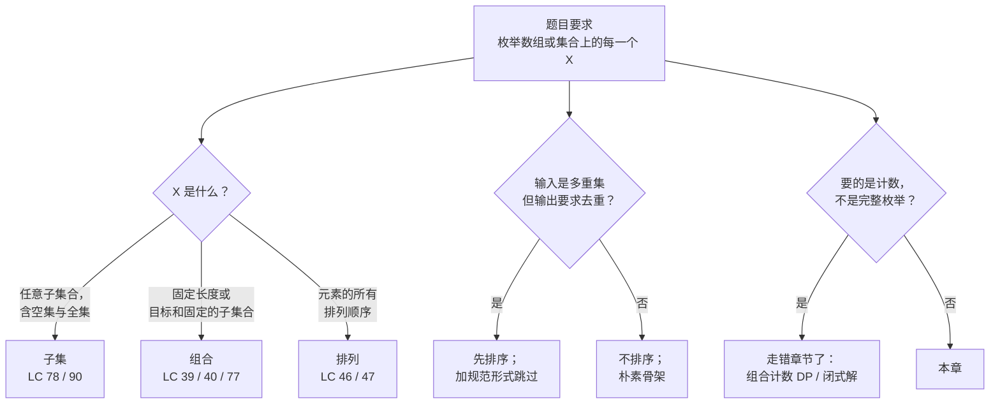
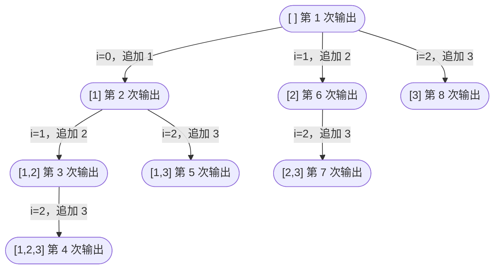

# 子集、组合、排列

数组 `[1, 2, 3]` 有八个子集：空集、三个单元素集、三个二元组，以及全集本身。同一个三元素数组有六个排列：`[1,2,3]`、`[1,3,2]`、`[2,1,3]`、`[2,3,1]`、`[3,1,2]`、`[3,2,1]`。把数组扩到五个元素，子集数量爬到 32，排列数量飙到 120。两种增长曲线背后不是同一个算法；`2^n` 和 `n!` 分道扬镳得很快。

三道题、三个不同的 LeetCode 页面——*Subsets*（LC 78）、*Permutations*（LC 46）、*Combination Sum*（LC 39）——背后是同一个递归。同样三行：选择、递归、撤销选择。三道题于是变成同一台机器上的三个旋钮：什么时候快照 path、什么算下一个元素、需不需要去重剪枝。[回溯模板](./01-backtracking-template.md) 在电话键盘扇出上讲过这套骨架，那里每个位置对应一套不同的字母表。本章把同一套骨架套到单个数组上，说明子集、排列、组合不是三副骨架，而是一副骨架配这三个旋钮的三种设置。

## 为什么一套骨架能覆盖三个问题

分开学过这三道题的人，往往会写三个独立函数，一题一个，把递归形状在文件之间复制粘贴，始终没看清形状其实一样。下面的练习就是本章的缩影：一份递归轮廓，三个旋钮用注释标出来。本章每一个具体算法，都是往这三个槽里填东西。

```python
def enumerate(items):
    result, path = [], []
    def dfs(...):
        if SNAPSHOT_RULE:                  # 旋钮 1：何时记录
            result.append(path.copy())
        for i in NEXT_AVAILABLE_RANGE:     # 旋钮 2：哪些元素还可用
            if SHOULD_PRUNE:               # 旋钮 3：去重 / 目标切断
                continue
            path.append(items[i])
            dfs(...)
            path.pop()                     # 撤销选择这一半不可省略
    dfs(...)
    return result
```

子集把旋钮 1 设成“每个节点”，旋钮 2 设成 `range(start, n)`，旋钮 3 不用。排列把旋钮 1 设成“只在叶子”（`len(path) == n`），旋钮 2 设成用 `used[]` 掩码过滤的 `range(0, n)`，旋钮 3 同样不用，除非出现重复元素。组合总和把旋钮 1 设成“target 减到零那一刻”，旋钮 2 设成 `range(start, n)`（或者*带复用*的 `range(start, n)`，递归时传 `i` 而不是 `i+1`），并用旋钮 3 砍掉剩余目标已经变负的分支。三道题、三种设置、一台机器。

## 在回溯家族里定位本章



*“枚举每一个 X”这类题的判定流程图。要计数或要最优解的题不在这里；本章管的是输出本身就是枚举结果的那种形状。*

“要计数”那条分支值得停一下。有多少个子集之和等于 `K`——完整枚举是 `2^n`，但只要计数就只是一个整数，而返回那个整数的线性 DP 解法（LC 416 Partition Equal Subset Sum、LC 494 Target Sum）在[第 9 部分](../../../dsa/part-9-dynamic-programming/00-dp-recursion-to-memo.md)。问题要的是数量却伸手去写回溯，是这个模式上最常见的框定错误。当输出是子集 / 排列 / 组合的完整列表时，你才在本章。

## 子集（LC 78）

题面很短。给一个元素互不相同的整数数组，返回它的所有子集，顺序任意。对 `nums = [1, 2, 3]`，答案有八个元素：`[]`、`[1]`、`[2]`、`[3]`、`[1,2]`、`[1,3]`、`[2,3]`、`[1,2,3]`。[^1]

最老实的第一版是枚举长度为 `n` 的所有二进制掩码，把置 1 的下标读出来。这样做可行，运行时间是 `O(n · 2^n)`，正好贴着下界（输出本身的规模就是 `Θ(n · 2^n)`，所以任何要产出完整枚举的算法，都必须碰到每个输出单元至少一次）。位掩码写法的问题在于它不泛化：输入一旦变成多重集（LC 90），或者题目一旦把子集大小限制在 `k`（LC 77），位掩码就变成在一个过大的搜索空间上做过滤，优雅立刻断掉。

递归把四种形态统一处理掉。下标 `start` 说的是：在这一层，你允许取的下一个元素是 `nums[start]`、`nums[start+1]`，或者更靠后的，绝不会是 `start` 之前的，否则你在已经选了 `[1, 2]` 之后还能选到 `[2, 1]`，每个子集都会被输出两遍。每进入一次调用就快照 `path`，然后遍历合法的下一个元素；对每一个，push、用 `start = i + 1` 递归、pop。push-递归-pop 这一套是[回溯模板](./01-backtracking-template.md) 里的骨架；这次新的东西是“进入即快照”。

```python
def subsets(nums):
    result, path = [], []
    def dfs(start):
        result.append(path.copy())   # 每个节点都快照
        for i in range(start, len(nums)):
            path.append(nums[i])
            dfs(i + 1)               # i+1 既防复用也防重排
            path.pop()
    dfs(0)
    return result
```

**解法** — Python（[Java](./02-subsets-combinations-permutations/lc-78/sol.java) · [C++](./02-subsets-combinations-permutations/lc-78/sol.cpp) · [Go](./02-subsets-combinations-permutations/lc-78/sol.go)）

```python
# LC 78. Subsets
from typing import List


def subsets(nums: List[int]) -> List[List[int]]:
    """LC 78. 用带 start 下标的 DFS 返回所有子集。"""
    result: List[List[int]] = []
    path: List[int] = []

    def dfs(start: int) -> None:
        result.append(path.copy())   # 每个节点都快照
        for i in range(start, len(nums)):
            path.append(nums[i])
            dfs(i + 1)               # i+1 既防复用也防重排
            path.pop()               # 撤销选择，以便回溯

    dfs(0)
    return result
```

> [!IMPORTANT]
> **每个节点都快照，不是每个叶子都快照。** 空集来自根节点的快照，那时循环一次都还没跑。单元素集来自深度 1 的快照，那一层的循环也还没跑。二元组和全集来自深度 2、3 的快照。每一次 `dfs(start)` 调用做的第一件事，在决定接下来取什么之前，就是把刚继承下来的半截路径记下来。把快照挪到循环体里，你就会漏掉每一个没有“后继选择”的子集——包括最致命的空集和全集。

在 `nums = [1, 2, 3]` 上的决策树展开就是交互组件动画演示的东西。它产出八个节点，与八个子集一一对应，按前序 DFS 走：



*每个节点对应一次 `dfs(start)` 调用；每个节点在进入时输出一个子集。边标签标出选中的下标 `i` 和追加的值。节点总数 = 2³ = 8。*

> **交互组件：** [回溯决策树](../../../dsa/widgets/w-22-backtracking-tree.yml)（面板 `panel-subsets`）——在网站上渲染；YAML 规格文件描述了各个关键帧。

*静态回退说明：快照在根节点为 `[]` 触发；最左分支一路构建 `[1] → [1,2] → [1,2,3]`，每层都做一次快照；算法回溯两次，然后在深度 1 取右边的兄弟，产出 `[1,3]`；同样的过程在以 `2` 和 `3` 为起始选择时重演一遍。共八次输出，按前序。*

快照触发 8 次；push 和 pop 各触发 7 次（每个非根节点一次）；递归深度始终不超过 3。`Θ(n · 2^n)` 这个界买到的就是这些：深度线性、宽度指数、每个输出恰好产出一次。

## 排列（LC 46）

题面形状一样，输出结构不同。给一个元素互不相同的整数数组，返回所有排列。对 `nums = [1, 2, 3]`，答案有六个元素：三个数所有长度为 3 的排法。[^2]

子集那套便宜的位掩码技巧搬不过来。`nums` 上的位掩码记录的是*哪些*值在子集里；它记不了*顺序*。排列是对顺序做枚举，不是对成员集合做枚举，所以骨架得跟踪哪些元素还可用，而不能靠在从左到右扫描里固定一个次序。

结构变化在第二个旋钮上。子集用 `start` 下标从左往右走数组，元素的下标同时兼作输出位置的标记。排列允许每一层挑*任意*未使用的元素，所以循环必须遍历整个数组 `[0, n)`，push 之前查一次 `used[]` 掩码。`used[]` 掩码就是替代 `start` 的那本账。只在 `path` 长度到 `n` 时快照。非叶节点不对应合法输出，因为按定义排列就是满长度的。

```python
def permute(nums):
    result, path = [], []
    used = [False] * len(nums)
    def dfs():
        if len(path) == len(nums):
            result.append(path.copy())   # 只在满长度的叶子上快照
            return
        for i in range(len(nums)):
            if used[i]:
                continue
            used[i] = True
            path.append(nums[i])
            dfs()
            path.pop()
            used[i] = False               # 撤销是一对：pop 并且清掩码
    dfs()
    return result
```

**解法** — Python（[Java](./02-subsets-combinations-permutations/lc-46/sol.java) · [C++](./02-subsets-combinations-permutations/lc-46/sol.cpp) · [Go](./02-subsets-combinations-permutations/lc-46/sol.go)）

```python
# LC 46. Permutations
# 机制见伪代码与 §5.3。
from typing import List


def permute(nums: List[int]) -> List[List[int]]:
    """LC 46. 用 used[] 掩码的 DFS 返回所有排列。"""
    result: List[List[int]] = []
    path: List[int] = []
    used: List[bool] = [False] * len(nums)

    def dfs() -> None:
        if len(path) == len(nums):
            result.append(path.copy())   # 只在满长度的叶子上快照
            return
        for i in range(len(nums)):
            if used[i]:
                continue                 # 元素已在 path 里，跳过
            used[i] = True
            path.append(nums[i])
            dfs()
            path.pop()                   # 撤销选择，以便回溯
            used[i] = False

    dfs()
    return result
```

`used[]` 掩码带着一条安静的不变式：任何时刻 `sum(used) == len(path)`，也就是当前栈帧的深度。push-并-标记、pop-并-清除这两对操作维持着它。常见的 bug 是撤销那一半忘了清 `used[i]`；算法照样跑下去，在兄弟分支上就是不会重新访问刚被清掉的元素，答案因此偏小（通常是 `n!/某个数`，从来不是完整计数）。`used[i] = False` 这行不是可选项。

> **交互组件：** [回溯决策树](../../../dsa/widgets/w-22-backtracking-tree.yml)（面板 `panel-perms`）——在网站上渲染；YAML 规格文件描述了各个关键帧。

*静态回退说明：起始选择 1 之下，算法产出 `[1,2,3]` 和 `[1,3,2]`；回退穿过深度 0 的栈帧时清掉 `used[0]`，把 1 释放出来供后面出现；起始选择 2 产出 `[2,1,3]` 和 `[2,3,1]`；起始选择 3 产出 `[3,1,2]` 和 `[3,2,1]`。共六个叶子——正好 `3!`。*

每个叶子的递归深度都恰好是 `n`；树是平衡的，每个内部节点的扇出是 `n - depth`。总工作量是 `Θ(n · n!)`：有 `n!` 个叶子，每个拷进 `result` 花 `O(n)`，内部节点的工作被叶子工作主导，因为叶子之上每一层贡献的都是严格更小的等比和。`n` 和 `!` 合起来给出那个残酷的扩展性：`n = 10` 时答案有 360 万个排列；`n = 12` 时有 4.79 亿个；到 `n = 15` 已经超过一万亿，任何回溯解法都是错的工具。LC 46 正是因为这个把 `nums.length` 卡在 6（720 个排列）。[^2]

## 组合总和（LC 39）

第三个实例引入了前两个没有的东西：*约束*。给一个正整数列表 `candidates` 和一个整数 `target`，返回所有加起来等于 `target` 的组合。每个候选数可以用无限次。对 `candidates = [2, 3, 6, 7]` 和 `target = 7`，答案是 `[[2, 2, 3], [7]]`。[^3]

结构变化在第三个旋钮上。子集和排列是无条件枚举；这里剩余目标已经变负的分支不可能成功，必须砍掉。这一刀正是*回溯*与*带过滤的暴力枚举*的区别：能往树里剪多深就剪多深，分支一旦不可行就把整棵子树放弃，绝不让一个注定失败的分支再长出节点。

第二个转折藏在递归调用里。LC 39 允许复用同一个候选数，所以在深度 `d` 选了 `candidates[i]` 之后，下一层的循环应该从 `i` 开始，不是 `i + 1`。传同一个下标递归，算法就会枚举 `[2]`、`[2, 2]`、`[2, 2, 2]`……直到累积目标掉到零以下或者正好落到零。传 `i + 1` 递归，你写的就是 LC 40，每个候选数只能用一次，同样输入下的答案只剩 `[[7]]`。

```python
def combination_sum(candidates, target):
    candidates.sort()                       # 排序让下面的提前 break 成立
    result, path = [], []
    def dfs(start, remaining):
        if remaining == 0:
            result.append(path.copy())      # 恰好命中目标时快照
            return
        for i in range(start, len(candidates)):
            if candidates[i] > remaining:
                break                       # 已排序：后面的也装不下
            path.append(candidates[i])
            dfs(i, remaining - candidates[i])  # 传 i 不是 i+1——复用
            path.pop()
    dfs(0, target)
    return result
```

**解法** — Python（[Java](./02-subsets-combinations-permutations/lc-39/sol.java) · [C++](./02-subsets-combinations-permutations/lc-39/sol.cpp) · [Go](./02-subsets-combinations-permutations/lc-39/sol.go)）

```python
# LC 39. Combination Sum
# 机制（递归时传 i 而不是 i+1，以允许复用）。
from typing import List


def combination_sum(candidates: List[int], target: int) -> List[List[int]]:
    """LC 39. 返回所有加起来等于 target 的候选数组合。允许复用。"""
    result: List[List[int]] = []
    path: List[int] = []
    candidates.sort()                           # 排序让下面的提前 break 成立

    def dfs(start: int, remaining: int) -> None:
        if remaining == 0:
            result.append(path.copy())          # 恰好命中目标时快照
            return
        for i in range(start, len(candidates)):
            if candidates[i] > remaining:
                break                           # 已排序：后面的也装不下
            path.append(candidates[i])
            dfs(i, remaining - candidates[i])   # 传 i 不是 i+1——复用同一元素
            path.pop()                          # 撤销选择，以便回溯

    dfs(0, target)
    return result
```

先排序是那个不显眼的优化。候选数有序之后，第一个超过 `remaining` 的 `candidates[i]` 就证明了后面每一个都超过它，于是循环可以 `break` 而不是 `continue`。在标准输入上这个剪枝只省下几次递归调用；在 `target = 500`、`candidates = [2, 3, 5, 7, 11, ...]` 这种输入上，它省掉的是几个数量级。[^3]

> **交互组件：** [回溯决策树](../../../dsa/widgets/w-22-backtracking-tree.yml)（面板 `panel-combos`）——在网站上渲染；YAML 规格文件描述了各个关键帧。

*静态回退说明：起始选择 2 之下，算法依次探索 `[2]`、`[2, 2]`、`[2, 2, 2]`（剪掉：remaining = 1，没有候选数装得下），退回 `[2, 2]`，挑 3 命中 `[2, 2, 3]`（快照），然后剪掉剩下的分支，因为后面每个候选数都超过残余值。起始选择 3 之下，子树探索过但没产出任何快照。起始选择 7 之下，算法在第一次 push 时就命中目标，输出 `[7]`。共两次快照，与 LC 39 的期望输出相符。*

工作量的一个合理上界是 `O(N^(T/M))`，其中 `N = |candidates|`、`T = target`、`M = min(candidates)`：每个递归分支最多 `N` 个孩子，深度被 `T/M` 限住，因为每次 push 至少把剩余量减少 `M`。这个界很松；因为剪枝很积极，多数输入上真实的递归树小得多。更紧的分析取决于具体的候选数，没有干净的闭式解。[^3]

## 出现重复元素时：LC 90 与 LC 47

把 `nums = [1, 2, 3]` 换成 `nums = [1, 2, 2]`，子集问题就变了。期望输出是六个不同子集，不是八个：`[]`、`[1]`、`[1, 2]`、`[1, 2, 2]`、`[2]`、`[2, 2]`。拿 LC 78 的算法跑 `[1, 2, 2]`，得到八个子集，其中 `[2]` 重复一份、`[1, 2]` 也重复一份。骨架没错；骨架套到多重集上就错了。

修法是两行。先给 `nums` 排序，然后在循环里加一条规范形式跳过：

```python
def subsets_with_dup(nums):
    nums.sort()                           # 排序把相等的值凑到一起
    result, path = [], []
    def dfs(start):
        result.append(path.copy())
        for i in range(start, len(nums)):
            if i > start and nums[i] == nums[i - 1]:
                continue                  # 规范形式跳过
            path.append(nums[i])
            dfs(i + 1)
            path.pop()
    dfs(0)
    return result
```

为什么成立，是本章里比较紧的组合论证之一。排序之后，每个不同的多重集恰好对应 `nums` 里唯一一条非递减的下标序列。跳过规则 `i > start and nums[i] == nums[i-1]` 说的是：*在这一层递归上，某个值 `v` 一旦被用作本层的选择，就拒绝再用同一个 `v` 开新分支。* 一段连续相等里的第一个是允许的（`i == start` 那一支绕过了跳过）；同一层里随后每一个相等值都被禁止。剪枝后的树对每个不同多重集恰好访问一种规范表示。[^4]

排列去重（LC 47）的判断条件形状必须变，因为那副骨架跟踪的是 `used[]` 而不是 `start`。正确的规则是 `if i > 0 and nums[i] == nums[i-1] and not used[i-1]: continue`。`not used[i-1]` 这一句才是真正不显然的地方。排序之后，两个相等的值 `nums[i-1]` 和 `nums[i]` 相邻。分两种情况。如果 `used[i-1]` 已经是 true，说明那个相等的兄弟在更外层已经被选走、此刻正在 `path` 里；那么 `nums[i]` 代表的是*另一个*重复实例，允许它延长 `path`。如果 `used[i-1]` 是 false，说明那个相等的兄弟在这一层还没用；那么先挑 `nums[i-1]` 还是先挑 `nums[i]` 会长出一模一样的子树，我们一律先挑最左边的相等值，跳过 `nums[i]`。同一个规范形式论证，按它所依附的骨架改了形状。[^5]

> [!WARNING]
> **两条去重跳过条件不能互换。** `if i > start and nums[i] == nums[i-1]` 对 start 下标那副骨架（子集、组合）是正确的。`if i > 0 and nums[i] == nums[i-1] and not used[i-1]` 对 used 掩码那副骨架（排列）是正确的。把 start 版粘进排列骨架，会悄悄漏掉合法排列；把 used 掩码版粘进子集骨架，会悄悄输出重复。骨架决定谓词。

## 三个最容易踩的坑

> [!WARNING]
> **按引用快照，而不是按值快照。** 这一族题里最常见的单个 bug。被快照的那个可变 list / slice / vector 是按引用塞进 `result` 的；之后每一次 push 或 pop 都同时改掉此前所有快照，因为它们共享同一块底层存储。结果是 `result` 里一列完全相同的条目，全都反映递归结束时 `path` 的样子（通常是空）。Python 用 `path.copy()`，Java 用 `new ArrayList<>(path)`，C++ 用 `result.push_back(path)`（push 时拷贝 vector），Go 用 `make([]int, len(path))` 加 `copy()`。Go 那版最容易看不出来，因为 slice header 在你不去追底层数组之前一点儿不像别名。

> [!WARNING]
> **在排列骨架里从 `start` 开始遍历。** 子集练出的肌肉记忆把 `start` 下标带进了排列函数。结果得到的是*组合*的输出，不是排列。对 `nums = [1, 2, 3]`，坏掉的算法输出 8 条（子集）而不是 6 条（排列）。结构差异恰恰就是 `start` 与 `used[]` 之间的取舍：子集把 `i` 从 `start` 往前推，以此禁止重排；排列让 `i` 从 0 遍历并配一个 `used[]` 掩码，以此允许每一层挑任意未使用元素。两者不能互换。

> [!WARNING]
> **LC 39：忘了递归时传 `i` 而不是 `i + 1`。** LC 39 允许复用；LC 40 不允许。两者之间那一行之差就是 `dfs(i, ...)` 对 `dfs(i + 1, ...)`。把 LC 40 那行粘进 LC 39，会漏掉所有带重复元素的组合（标准输入下的 `[2, 2, 3]`），算法能过几个样例，然后在隐藏用例上死掉。题面里读一遍“同一个数可以用任意多次”，该写哪一行就没有歧义了。

## 实际开销

| 变体 | 时间 | 辅助空间（输出之外） | 输出规模 |
|---|---|---|---|
| 子集（LC 78） | Θ(n · 2ⁿ) | O(n) 递归 + O(n) `path` | Θ(n · 2ⁿ) |
| 子集 II（LC 90） | O(n · 2ⁿ) 最坏情况 | O(n) | O(n · 2ⁿ) |
| 排列（LC 46） | Θ(n · n!) | O(n) 递归 + O(n) `used[]` + O(n) `path` | Θ(n · n!) |
| 排列 II（LC 47） | O(n · n!) 最坏情况 | O(n) | O(n · n!) |
| 组合总和（LC 39） | O(N^(T/M)) 松弛上界 | O(T/M) 递归深度 | 由输出规模界定 |

每一行的下界都与上界只差常数：*仅输出*就有最右列的规模，所以任何要产出完整枚举的算法，都必须碰到每个输出单元至少一次。面试里问“能不能比 `O(n · 2^n)` 更好”是个陷阱，除非发问者的意思是流式（一次 yield 一个子集，平均每个 `O(n)`）或者只计数（一个整数，某些情况下 `O(n)`，另一些更差——那是另一章）。[^1][^2]

实践上的结论是扩展性悬崖。子集约到 `n = 20` 还能做（一百万个）。排列约到 `n = 8`（四万个）。组合总和受输出规模约束，实践中剪枝很狠，但最小候选数很小、目标很大的最坏输入崩得一样快。*“能不能用 `O(n)` 代替 `O(n · 2^n)`？”*——不能，发问者要么误解了问题，要么在找计数 / DP 的框法。把界说出来，说清楚它为什么紧，然后往下走。

## 题目梯度

### 核心（三题全做才算掌握本章）

- [LC 78 — Subsets](https://leetcode.com/problems/subsets/) [中等] • subsets-backtracking ★
- [LC 46 — Permutations](https://leetcode.com/problems/permutations/) [中等] • permutations-backtracking
- [LC 39 — Combination Sum](https://leetcode.com/problems/combination-sum/) [中等] • combinations-backtracking-with-target

### 进阶（可选）

- [LC 90 — Subsets II](https://leetcode.com/problems/subsets-ii/) [中等] • subsets-with-duplicates
- [LC 47 — Permutations II](https://leetcode.com/problems/permutations-ii/) [中等] • permutations-with-duplicates

> [!NOTE]
> 纯子集 / 组合 / 排列骨架在 LeetCode 上结构性地只能落在中等带；LC 51 N-Queens 是最接近的困难题，但它教的是约束剪枝而不是枚举，而且它在下一章。frontmatter 里的 `single-difficulty-band` 策展标记如实记录了这一点。五道中等题是正确形状；硬塞一道简单或困难题进梯度，教的是错的东西。

## 后续衔接

下一章 [N 皇后与约束剪枝](./03-n-queens.md) 保留骨架，但把全部重量挪到旋钮 3 上。子集、排列、组合总和在简单谓词上剪枝（去重跳过、目标和切断）。N 皇后在几何约束上剪枝（同列与对角线冲突），递归树从 `n!` 缩到 `n = 8` 时的几千个节点，因为大多数分支在第 2、3 层就死了。同一副骨架。干活的全是剪枝谓词。

另一个方向是*能*加记忆化的那些枚举。当递归状态小到子树会重复（LC 698 Partition to K Equal Sum Subsets、LC 691 Stickers），骨架就长出一张记忆化表，变成位掩码 DP，后面在[第 9 部分](../../../dsa/part-9-dynamic-programming/00-dp-recursion-to-memo.md) 讲。本章这三道题是记忆化还谈不上*之前*的东西：完整枚举、没有重叠、输出即工作量。

## 参考文献

[^1]: Donald E. 子集生成的上界 Θ(n · 2ⁿ) 与递归树节点数对应，后者与幂集一一对应；输出规模下界与递归树上界只差常数。 <https://www-cs-faculty.stanford.edu/~knuth/taocp.html>

[^2]: Donald E. Knuth，*The Art of Computer Programming*，第 4A 卷，Addison-Wesley，2011，§7.2.1.2“Generating all permutations”（算法 L：字典序全排列）。

[^3]: walkccc.me LeetCode Solutions，*39. Combination Sum*，<https://walkccc.me/LeetCode/problems/39/>。

[^4]: Donald E. Knuth，*The Art of Computer Programming*，第 4A 卷，Addison-Wesley，2011，§7.2.1.3，字典序去重模式。

[^5]: cs.stackexchange 社区问答，“Math behind leetcode problem 47 permutations II”，<https://cs.stackexchange.com/questions/128337/math-behind-leetcode-problem-47-permutations-ii>。
