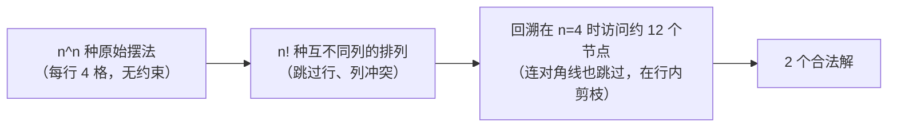
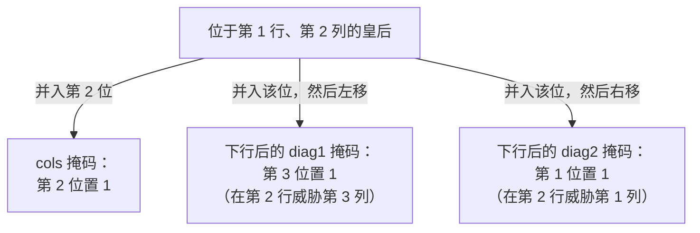

# N-Queens：剪枝与约束传播

1848 年，一位名叫 Max Bezzel 的德国国际象棋爱好者在《柏林象棋报》（*Berliner Schachzeitung*）上提出一个谜题：在棋盘上摆八个皇后，使任意两个都互不攻击。两年后 Franz Nauck 寄来一份统计，说共有 92 个不同的解；Carl Friedrich Gauss 亲手复核了这个数字，Glaisher 在 1874 年证明它已经是穷尽的结果。1972 年，Edsger Dijkstra 用同一个谜题演示他所谓的*结构化编程*（structured programming），在纸面上把一个深度优先回溯算法一步步走完。Knuth 的《计算机程序设计艺术》（*The Art of Computer Programming*）第 4 卷第 5 分册，在 Dijkstra 那场讲座近二十年之后，讲回溯的那一章仍然从 N-Queens 开篇，理由也一样：这个谜题是对「回溯究竟是什么」最干净的演示。

八皇后棋盘上，把八个皇后摆进 64 格，一共 4,426,165,368 种原始摆法。[^1] 其中恰好 92 种合法——这个 Bezzel 与 Nauck 的结果由 Gauss 手工验证、Glaisher 在二十年后穷尽确认。[^2] 大约每 4800 万种坏摆法才配得上一个好摆法，这个比例就是暴力枚举毫无希望、而必须靠约束跟踪的原因。本章是这个想法所能找到的最小载体：每行一个皇后，三个整数承载冲突状态，两次移位让每一次收缩与展开都成为一次位运算。Bezzel 提出原始谜题六十多年之后，Knuth 的 TAOCP §7.2.2 至今仍把 N-Queens 当作更广的 Algorithm X / Dancing Links 家族的引例。[^3]

## 为什么显而易见的做法走不通

LC 51（N-Queens）要求给出 `n` 个皇后在 `n × n` 棋盘上所有不同的摆法，任意两个不能同行、同列，也不能在两条对角线中的任意一条上。`n = 4` 时答案是两块棋盘；`n = 8` 时九十二块；`n = 9` 时三百五十二块。最诚实的第一次尝试，是枚举把 `n` 个皇后放进 `n²` 个格子的每一种方式，再把冲突的摆法筛掉：

```python
# 暴力：O(n^(2n)) —— 这就是要被替换掉的东西
from itertools import combinations

def solve_n_queens_brute(n):
    solutions = []
    squares = [(r, c) for r in range(n) for c in range(n)]
    for placement in combinations(squares, n):
        if is_legal(placement):
            solutions.append(placement)
    return solutions

def is_legal(placement):
    for (r1, c1), (r2, c2) in combinations(placement, 2):
        if r1 == r2 or c1 == c2:
            return False
        if abs(r1 - r2) == abs(c1 - c2):    # 同一条对角线
            return False
    return True
```

`n = 8` 时，`combinations(64, 8)` 是 4,426,165,368。单次筛选很快，但四十亿次迭代就是四十亿次迭代。提交在 `n = 6` 就超时，这个算法没有前途。

第一个让搜索空间塌下来的观察是结构性的，不是小聪明。每个*合法*摆法在每一行恰好放一个皇后，因为同一行的两个皇后会立刻互相攻击。于是不从 `n²` 个格子里挑 `n` 个，而是从 `n × n × ⋯ × n` 的笛卡尔积里给每行挑一个列号，同时省掉行冲突的判断。枚举量降到 `n^n`，`n = 8` 时是 `1.6 × 10⁷`：还是慢，但已经可做。

第二个观察切得更狠。在 `n^n` 的枚举里，不同行的两个皇后仍然可能同列。所以推进到*排列*搜索：每一行从 `0..n-1` 里挑一个*互不相同*的列。这是 `n!`，`8!` 是 `40,320`，比 `n^n` 快三个数量级。

第三个观察就是算法本身。我们不必先生成排列、*再*检查对角线，而是逐行生成排列，一旦冒出对角线冲突就*放弃*这个不完整的摆法。大多数不完整摆法在第 2、3 行就失败了，远不到白白干到第 7 行。



*n=4 的剪枝级联：`4^4 = 256` 种原始摆法塌到 `24` 个排列，再塌到 `~12` 个回溯节点，最后塌到 `2` 个解。到 n=8，同一条级联走的是 `1.6 × 10^7 → 40,320 → ~15,720 → 92`。*

## 模式

递归接一个行索引和三个整数位掩码，掩码记录哪些列、哪些对角线正被此前放下的皇后攻击。每一行先算出*未*被攻击的列，把皇后放在编号最小的可用列上，递归到下一行，然后迭代到下一个可用列。

```python
def solve_n_queens(n):
    solutions = []
    queens = [-1] * n

    def backtrack(row, cols, diag1, diag2):
        if row == n:
            solutions.append(['.' * c + 'Q' + '.' * (n - c - 1) for c in queens])
            return
        available = ((1 << n) - 1) & ~(cols | diag1 | diag2)
        while available:
            bit = available & -available             # 取出最低位的 1
            col = bit.bit_length() - 1
            queens[row] = col
            backtrack(row + 1,
                      cols | bit,
                      (diag1 | bit) << 1,
                      (diag2 | bit) >> 1)
            available &= available - 1               # 试下一个列

    backtrack(0, 0, 0, 0)
    return solutions
```

**解法** — Python（[Java](./03-n-queens/lc-51/sol.java) · [C++](./03-n-queens/lc-51/sol.cpp) · [Go](./03-n-queens/lc-51/sol.go)）

```python
# LC 51. N-Queens（以及只计数的兄弟题 LC 52. N-Queens II）
# （计数：1, 2, 92, 724 —— 与 OEIS A000170 一致）。
from typing import List


def solve_n_queens(n: int) -> List[List[str]]:
    """LC 51 -- return all distinct n-queens boards as char arrays."""
    solutions: List[List[str]] = []
    queens = [-1] * n

    def backtrack(row: int, cols: int, diag1: int, diag2: int) -> None:
        if row == n:
            solutions.append(['.' * c + 'Q' + '.' * (n - c - 1) for c in queens])
            return
        available = ((1 << n) - 1) & ~(cols | diag1 | diag2)
        while available:
            bit = available & -available             # 取出最低位的 1
            col = bit.bit_length() - 1
            queens[row] = col
            backtrack(row + 1,
                      cols | bit,
                      (diag1 | bit) << 1,
                      (diag2 | bit) >> 1)
            available &= available - 1               # 试下一个列

    backtrack(0, 0, 0, 0)
    return solutions


def total_n_queens(n: int) -> int:
    """LC 52 -- count-only variant; same recursion, no board built."""
    count = 0

    def backtrack(row: int, cols: int, diag1: int, diag2: int) -> None:
        nonlocal count
        if row == n:
            count += 1
            return
        available = ((1 << n) - 1) & ~(cols | diag1 | diag2)
        while available:
            bit = available & -available
            backtrack(row + 1,
                      cols | bit,
                      (diag1 | bit) << 1,
                      (diag2 | bit) >> 1)
            available &= available - 1

    backtrack(0, 0, 0, 0)
    return count
```

> [!IMPORTANT]
> 位掩码形式不是在某个「真正的」布尔数组算法之上叠的一层优化。整数 `cols`、`diag1`、`diag2` 本身就是算法。它们各自编码「*下一*行里哪些列被*此前*某行放下的皇后攻击」，而递归调用上的移位维持的正是这个不变量。布尔数组形式是一种翻译；位掩码形式才是那堂课。Wirth 在 1976 年的《算法与数据结构》（*Algorithms and Data Structures*）里给出了这个写法，[^4] Knuth 的 TAOCP §7.2.2 至今仍把它当作更广的 Algorithm X / Dancing Links 家族的引例。[^3]

四个基本操作这样落到递归上：

| 基本操作 | 是什么 | 为什么是 O(1) |
|---|---|---|
| `init_state` | 根调用时 `cols = diag1 = diag2 = 0` | 三个整数；不分配内存 |
| `available` | `((1 << n) - 1) & ~(cols \| diag1 \| diag2)` | 三次位运算 |
| `place` | `cols \| bit`、`(diag1 \| bit) << 1`、`(diag2 \| bit) >> 1` | 三次位运算；按值传给递归调用 |
| `undo` | （没有——掩码按值传递） | 递归调用里的改动永远到不了调用方 |

「没有 undo」这一行，是位掩码形式教给我们的、而数组形式会遮住的那一课。N-Queens 里所有常见的回溯 bug——下面陷阱里编了好几种——都是「忘了撤销」的变体。位掩码形式让这个 bug 字面上写不出来：没有共享的可变状态可以被搞坏。

## 实例推演：n = 4

棋盘起初是空的，三个约束掩码都是 0。搜索从第 0 行开始。

`row = 0`。四列都可用。放在 `(0, 0)`。此时 `cols = 0b0001 = 1`，`diag1 = 0b0010 = 2`（皇后所在的 `\\` 对角线在下一行威胁第 1 列），`diag2 = 0b0000 = 0`（皇后所在的 `/` 对角线会威胁第 -1 列，那在棋盘之外，右移把它丢掉了）。

`row = 1`。可用掩码是 `0b1111 & ~(1 | 2 | 0) = 0b1100`。第 2、3 列合法，第 0、1 列被封。放在第 2 列。

`row = 2`。可用是 `0b1111 & ~(0b0101 | 0b1100 | 0b0010) = 0b1111 & ~0b1111 = 0`。**四列全被封死。** 第一个死路。回退。

交互组件演的正是这段轨迹。本章的核心教学物件就是第 2 行那个死路时刻：三个掩码的并集 `5 | 12 | 2 = 15 = 0b1111` *就是*「没有一列能活」的证明，读者是在屏幕上看着整数算术发生，而不是从代码清单里读出来。

> **交互组件：** [N-Queens —— 在 n=4 上放置 / 攻击 / 回退](../../../dsa/widgets/w-23-n-queens.yml) —— 在网站上渲染；YAML 规格文件描述了各个关键帧。

*静态回退：搜索在 40 帧里走过 38 个算法上有意义的状态。两个解分别在第 15 帧和第 24 帧浮现（`[1, 3, 0, 2]` 和 `[2, 0, 3, 1]`）；四个死路在第 3、7、32、36 帧；其余都是放置与回退的步骤。两个合法配置互为镜像，在小棋盘上，N-Queens 的解普遍如此。*

交互组件每一帧都画三层彩色覆盖：`cols` 用朱红，`diag1` 用橙色，`diag2` 用紫红。被两个约束同时封住的格子会把两种颜色叠着显示。正是这一点让死路不只等于「搜索失败了」——读者看得见*为什么*。

## 位掩码移位详解

`cols` 掩码很直白：第 `c` 位为 1，当且仅当某个先放下的皇后占了第 `c` 列。对 `cols` 的位运算就是在一个整数上做算术，没有意外。

对角线掩码是需要顿一下才能内化的那一步。位于 `(r, c)` 的皇后控制 `\\` 对角线上所有 `(r + d, c + d)` 的格子，以及 `/` 对角线上所有 `(r + d, c - d)` 的格子。朴素做法是按常量给对角线编号——`\\` 用 `r - c`，`/` 用 `r + c`——再往一个 `2n - 1` 元素的数组里标格子。这能用，也正是下面陷阱里那个差一错误的来源。

位掩码的做法换了一套坐标系。它不问「这个皇后在哪条对角线上」，而问：「递归当前在第 `r` 行，第 `r` 行的哪些列正被放在第 `r' < r` 行的某个皇后攻击？」每个对角线方向只要一个整数。递归从第 `r` 行下到第 `r + 1` 行时，受 `\\` 攻击的列集合整体右移一位（因为 `\\` 对角线每下行一行就往右挪一列）。等价地说，*掩码*左移一位，第 `c` 位变成第 `c + 1` 位，正好是它在新行威胁的那一列。`/` 对角线下行时往左走，所以它的掩码右移。

这就是 `(diag1 | bit) << 1` 和 `(diag2 | bit) >> 1` 在做的事。先并入新皇后那一位，再把整个掩码往下传播一行。从任何一端移出去的位，代表对棋盘之外列的对角线威胁，它们静静消失——而这正是对的行为。

### 位掩码状态：从每次检查 O(N²) 到 O(1)

没有位掩码这一手时，每次调用 `is_legal(row, col)` 都要走一遍已放的皇后，对每个皇后查三个条件：同列、同 `\\` 对角线、同 `/` 对角线。已经放了 `r` 个皇后，就是每次尝试 `O(r)`；`n` 个候选列摆在那里，最坏每行 `O(n²)`。放到整个搜索里看，常数因子是要紧的：`n^n` 的拒绝步骤一样，但*每一个*被访问节点的代价都乘上了 `n`。

位掩码把三项检查合成 `available = ((1 << n) - 1) & ~(cols | diag1 | diag2)`。三个机器字上的三次 OR 与取反。然后内层循环只遍历*`available` 里为 1 的位*，用那个著名的 `bit & -bit` 惯用法取出最低位的 1——被封的列根本不进入考虑。

普通商用硬件上的实测：`n = 12`（14,200 个解）时，位掩码版本约 200 ms，布尔数组版本约 1 秒；`n = 14`（365,596 个解）时差距拉大到约 5 秒对约 30 秒。同一个算法类别，五到十倍的常数因子加速。Knuth 把这个写法归给 Wirth 1976 年的教材；[^4] 现代竞赛编程教程把它当作标准参考实现。[^5]



*每个约束掩码表达的都是「下一行里，被此前某行放下的皇后攻击的列」。递归调用上的移位把对角线威胁向下传播一行，这才让每一步的代价是 O(1) 而不是 O(n)。*

## 实际开销

| 变体 | 时间 | 空间（不含输出） |
|---|---|---|
| 暴力枚举 `combinations(n², n)` 再过滤 | O(n² choose n) | O(n) |
| 带对角线过滤的排列枚举 | O(n!) | O(n) |
| 用数组约束集的回溯 | O(n!) 最坏情况；剪枝让实际开销小得多 | O(n) |
| 用位掩码约束集的回溯（本章） | 同样的渐近量级；约 5–10 倍常数因子加速 | `queens` 数组 O(n) |

标准回溯器访问的精确节点数是 OEIS A319284，它超指数增长，但因为剪枝而比 `n!` 慢。[^6] 精确的*解*的个数是 OEIS A000170（1, 0, 0, 2, 10, 4, 40, 92, 352, 724, 2680, 14200, …），Simkin 在 2021 年证明它渐近于 `((1 ± o(1)) · n · e^{-α})^n`，其中 `α ≈ 1.942`。[^7]

对 LC 51 来说，主要开销在*输出物化*，不在搜索。`Q(n)` 个解，每个产出一个长度为 `n` 的列表、里面是 `n` 个字符的字符串，每个解 `O(n²)`。`n = 9`（LC 的硬上限）时，是 352 个解 × 81 个字符，约 28K 字符的输出，把搜索时间完全盖住。LC 52 是同一个算法，只把叶子从 `solutions.append(board)` 换成 `count += 1`，跑起来明显更快，因为叶子做的是 `O(1)` 工作而不是 `O(n²)`。搜索和输出是可分离的两件事；能在面试里指出这一点的人，等于在展示自己怎么想运行时。

## 模式失效的场景

本章的算法是穷尽的：它枚举每一个合法摆法。三个追问会换掉问题、逼出别的工具，而留心的面试官至少会问其中一个。

**「如果 `n = 1,000,000` 呢？」** 回溯在 `n` 大约超过 30 之后就不现实了。正确答案是极小冲突（min-conflicts）局部搜索：先随机按列各放一个皇后，然后反复挑一个所在行有冲突的皇后，把它挪到本列里冲突*最少*的那一行。Minton、Johnston、Philips 和 Laird 在 1992 年发表了它，并演示了秒级解出百万皇后的实例。[^8] Sosič 和 Gu 在 1994 年的后续工作把它推到工作站级硬件上一分钟解三百万皇后。[^9] 代价是正确性：极小冲突不完备，会卡在局部最优，因此需要随机重启。对*无约束*的 N-Queens 这没关系，因为 Bernhardsson 在 1991 年证明了对每个 `n ≥ 4` 解都存在，并给出了显式的闭式构造。[^10]

**「如果有些皇后已经预先摆好呢？」** 这是 *N-Queens 完成*（N-Queens completion）问题，它真的难。Gent、Jefferson 和 Nightingale 在 2017 年证明判定版本是 NP-Complete、计数版本是 #P-Complete。[^11] 同一个回溯算法照样能跑（递归起步时把预置掩码填好就行），但最坏情况下不存在多项式时间算法。这是面试里少见的角落：对「N-Queens 是 NP-Hard 吗？」的正确答案是三路区分——开放形式（找出任意一个解）是多项式时间可构造的；全找（LC 51）和计数（LC 52）是指数的，但小 `n` 可做；完成问题是 NP-Complete。

**「对称性呢？」** N-Queens 的每个解在棋盘旋转与镜像下最多有七个同伴。`n = 8` 时有 12 个基本解；其中十一个有全部八个变体，一个带旋转对称、轨道塌成四个，合起来给出经典的 92。[^2] 具体到 LC 52，把第 0 行的皇后限制在 `[0, ⌊(n+1)/2⌋ - 1]`，再把计数乘回去，就能拿到八倍加速。这个技巧很出名，也就多二十行记账；大多数提交跳过它，因为常数因子的收益抵不过代码复杂度。

## 三个最容易踩的坑

> [!WARNING]
> **Java 的对角线移位漏了 `>>>`。** Python 和 C++ 的参考实现写的是 `(diag2 | bit) >> 1`。Java 的 `>>` 在带符号整数上是*算术*右移，不是逻辑右移：高位为 1 时，符号扩展会用 `1` 填满高位，给约束掩码塞进一堆位于 `n` 之上很远列的幻影攻击。修法只有一个字符：写 `>>>` 而不是 `>>`。`lc-51/sol.java` 里的参考实现用的是 `>>>`。C++ 程序员不会想到这个区别，因为 C++ 代码通常用 `int` 掩码，小 `n` 时高位不会累积；但把 C++ 源码逐字搬过去的 Java 移植版，在 `n ≥ 12`、掩码大到要用整数上半部分时会静默给出错答案。

> [!WARNING]
> **数组形式里对角线下标差一。** 数组形式用 `boolean[2*n - 1]` 数组装两个对角线集合。`/` 反对角线可以干净地用 `r + c` 索引，范围是 `[0, 2n - 2]`。`\\` 对角线用 `r - c` 索引，范围是 `[-(n-1), n-1]`，所以需要一个 `+(n-1)` 偏移才能塞进数组。两条对角线里写对一条的人，常常忘了另一条的偏移，于是在任何行号小于列号的皇后上撞 `ArrayIndexOutOfBoundsException`。位掩码形式完全绕开这个问题：对角线被编码成*当前被攻击的列集合*，而不是槽位下标。

> [!WARNING]
> **在每次递归调用里构造棋盘字符串。** 一种「自然」的 Python 写法把部分棋盘一路传下去：`dfs(row + 1, board + ['.'*j + 'Q' + '.'*(n-j-1)])`。读起来很地道，但它在每个递归节点都分配一个长度为 `n` 的列表，不只是在该出解的叶子上。`n = 12` 时搜索访问约 10 万个节点、产出 14,200 个解；浪费的写法多分配了十倍的字符串，能在 `n = 8` 通过的提交在 `n = 12` 就超时。修法是维护一个可变的 `queens[row] = col` 数组，*只*在叶子物化棋盘，参考实现就是这么做的。LC 52 干脆连物化都不要。

## 题目梯度

### 核心（两题全做才算掌握本章）

- [LC 51 — N-Queens](https://leetcode.com/problems/n-queens/) [困难] • backtracking-row-column-diagonal ★
- [LC 52 — N-Queens II](https://leetcode.com/problems/n-queens-ii/) [困难] • backtracking-row-column-diagonal-count-only

### 进阶（可选）

- [LC 1219 — Path with Maximum Gold](https://leetcode.com/problems/path-with-maximum-gold/) [中等] • backtracking-grid-path-with-state-restore

LC 51 是本章的招牌题（★），也是交互组件演的那道。LC 52 是同一个算法，只把叶子从「产出棋盘」换成 `count++`；把它扔进进阶会掩盖「搜索与输出物化是可分离的两件事」。核心这一对都是 Hard。本章在同一模式上没有经典的 Easy 或 Medium 变体：去掉约束集，问题退化成排列枚举，那在[子集、组合、排列](./02-subsets-combinations-permutations.md)里；去掉攻击类约束，问题退化成网格遍历，那在[单词搜索](./05-word-search.md)里。frontmatter 里的 `single-difficulty-band` 策展标记如实记录了这一点。LC 1219 是本章的进阶，把同一套「做选择、递归、撤销」的纪律用到四方向网格行走上，也就搭到了下一章的地盘。

## 后续衔接

[数独求解器](./04-sudoku-solver.md) 是自然的后续。结构一模一样，都是逐行的约束传播加一小把位掩码，只是约束从「行 + 列 + 两条对角线」推广成「行 + 列 + 3×3 宫」。数独题目开局也不是空的，这让它成了*完成*变体而不是*找任意解*变体：算法相同，输入更难。[单词搜索](./05-word-search.md) 把回溯纪律带到另一个方向：带标记、递归、取消标记这套状态恢复的网格行走，上面那道 LC 1219 正是为它做准备。

## 参考文献

[^1]: "A000170: Number of ways of placing n nonattacking queens on an n × n board"，整数数列在线百科全书（OEIS）。数列：1, 1, 0, 0, 2, 10, 4, 40, 92, 352, 724, 2680, 14200, … 。4,426,165,368 这个原始摆法数来自 `C(64, 8)` 的精确计算。 <https://oeis.org/A000170>

[^2]: "Eight queens puzzle"，Wikipedia，最后编辑于 2026-04-09。关于以下内容的来源：Bezzel 1848 年发表于 *Berliner Schachzeitung*、Nauck 1850 年寄来的八皇后解、Gauss 确认 Nauck 的 92 个解、Glaisher 1874 年的穷尽证明、12 个基本解，以及 11×8 + 1×4 = 92 这个 D₄ 轨道分解。 <https://en.wikipedia.org/wiki/Eight_queens_puzzle>

[^3]: Donald E.，ISBN 0-134-67179-1。§7.2.2（"Backtrack Programming"）把 N-Queens 作为引例；§7.2.2.1 引入 Algorithm X / Dancing Links。 <https://www-cs-faculty.stanford.edu/~knuth/taocp.html>

[^4]: Niklaus Wirth，*Algorithms and Data Structures*（1976 年，2004 年更新），Oberon 版，ETH Zürich。其中 "Eight Queens Problem" 一节给出的正是本章参考实现所用的位掩码 + 移位写法。 <https://people.inf.ethz.ch/wirth/AD.pdf>

[^5]: P.-Y. Chen，"LeetCode Solutions: 51. N-Queens"，walkccc.me，2024-2026。经核对的 C++/Java/Python 实现，采用位掩码 + 移位写法；文中给出 `O(n · n!)` 的时间界。 <https://walkccc.me/LeetCode/problems/0051/>

[^6]: "A319284: Number of nodes visited by the n-queens backtracking algorithm"，整数数列在线百科全书（OEIS）。记录了精确节点数随 `n` 的变化，是更广的搜索树规模数列的对角线。 <https://oeis.org/A319284>

[^7]: Michael Simkin，"The number of n-queens configurations"，arXiv:2107.13460，2021。证明 `Q(n) = ((1 ± o(1)) · n · e^{-α})^n`，其中 `α` 在 1.939 与 1.945 之间。 <https://arxiv.org/abs/2107.13460>

[^8]: Steven Minton, Mark D. 最早的极小冲突论文；把该启发式用在 N-Queens 与哈勃空间望远镜调度上做了演示。 <https://doi.org/10.1016/0004-3702(92)90007-K>

[^9]: R. QS1/QS3/QS4 系列算法；QS4 能在一分钟内解出三百万皇后的实例。 <https://doi.org/10.1109/69.317698>

[^10]: B. Bernhardsson，"Explicit solutions to the N-queens problem for all N"，*ACM SIGART Bulletin*，vol. 2, no. 2, p. 7，1991 年 4 月。

[^11]: Ian P. 证明判定版 N-Queens 完成问题是 NP-Complete，计数版是 #P-Complete。 <https://doi.org/10.1613/jair.5512>
