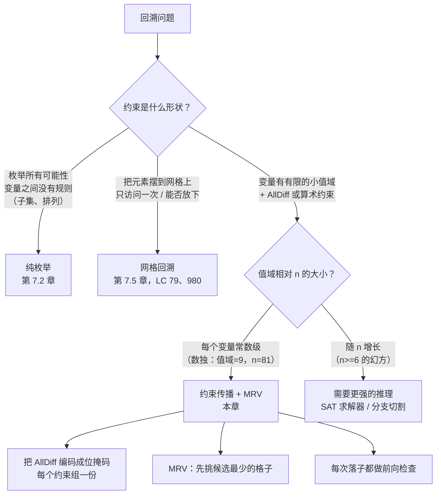

# 数独求解：约束传播与前向检查

把一个全空的 9x9 数独盘面填满，不同填法大约有 4 × 10^38 种。宇宙的年龄大约是 4 × 10^17 秒。就算每个 CPU 每秒检查十亿个盘面，暴力枚举也撑不到热寂。而 LeetCode 的判题器只给两秒。

经典题目是 LC 37 Sudoku Solver。给定一个部分填充的 9x9 盘面，有些格子放着 `'1'..'9'`，其余放着 `'.'`，要求原地修改盘面，让每一行、每一列、每一个 3x3 宫都恰好包含一遍 `'1'..'9'`。输入保证解唯一。老实的第一版做法是按行优先序扫格子，在每个空格上依次试 1 到 9，对行、列、宫做合法性校验，然后递归。它是对的。它在较难的隐藏用例上也会超时，而“正确”与“够快”之间的这段差距，正是本章的内容。两处改动——位掩码状态，外加一行变量排序启发式——就能把名义上有 9^81 个叶子的搜索树，压到在真实谜题上最多分支十六次。[^1]

## 数独难在哪：形式化视角

数独是教科书级的约束满足问题（constraint-satisfaction problem，CSP）。[^2] 输入给出 81 个*变量*（即格子），每个变量的值域是 `{1..9}`，外加 27 条 `AllDiff` 约束。每条 AllDiff 覆盖九个格子（一行、一列或一个 3x3 宫），要求这九个格子放齐九个数字且不重复。每个格子恰好与 20 个*同伴*（peer）共享约束：本行 8 个、本列 8 个，去掉行列重叠后本宫还有 4 个。在一个格子上落子，会原子性地把这个数字从这 20 个同伴的候选集中摘掉。

n×n 的一般版本是 NP 完全的，由 Yato 与 Seta 在 2003 年从拉丁方补全（Latin-square completion）归约证明。[^3] 对 LC 37 固定的 n = 9，最坏情况有界，但这个数字没什么用；9^81 仍然是 4 × 10^77。面试相关的问题不是“渐进上界是多少”，而是“最坏情况是 `n^(n²)` 的问题，凭什么配上对的启发式就能毫秒收工？”答案就是本章。

## 朴素解法，以及它为什么卡住

把算法剥到骨架：从左到右、从上到下扫盘面；在第一个空格上试 `'1'` 到 `'9'`；每试一个，检查落子是否合法（同行、同列、同宫不重复）；合法就递归；递归返回 false 就撤销，换下一个数字；九个数字都不行，就向调用方返回 false。

```python
# 暴力：行优先扫描，每个格子做一次 O(27) 的 isValid 检查。
# 正确，但在较难的 LC 37 输入上会超时。
def solve_sudoku_brute(board):
    def is_valid(r, c, ch):
        for i in range(9):
            if board[r][i] == ch or board[i][c] == ch:
                return False
            br, bc = 3 * (r // 3) + i // 3, 3 * (c // 3) + i % 3
            if board[br][bc] == ch:
                return False
        return True

    def backtrack(r, c):
        if r == 9:
            return True
        nr, nc = (r, c + 1) if c < 8 else (r + 1, 0)
        if board[r][c] != ".":
            return backtrack(nr, nc)
        for d in "123456789":
            if is_valid(r, c, d):
                board[r][c] = d
                if backtrack(nr, nc):
                    return True
                board[r][c] = "."
        return False

    backtrack(0, 0)
```

每次递归进入都白付两笔开销。第一，`is_valid` 要重扫 27 个格子（一行、一列、一宫），去找重复——而这些重复算法本来可以记住。第二，按行优先挑格子完全无视谜题的结构：只有一个合法数字的格子，和有七个合法数字的格子被同等对待，于是搜索会一直在这类“答案早已被逼死”的格子上盲目地一分为九。

Norvig 在他那套 95 道难题上量过这个差距：用对启发式，求解器平均访问 64 个搜索节点，分支从不超十六次。不用启发式，朴素顺序会让同样这些题冲到 10^5 个节点以上；他那道最难的测试题跑了 188.79 秒。[^1] 对面试的含义很直接。如果输入落在 LC 37 隐藏用例里偏简单的一端，朴素回溯能过。如果不在，你就等着 TLE。

## 这个模式在回溯家族里的位置



*三股力量——有界值域、组级别的 AllDiff、每格常数级的开销——让数独成为约束传播式回溯的教科书正例；而大 n 下的幻方补全则是教科书反例。*

## 模式

修法由三个能拼在一起的部件组成。每个都很小。合起来就把搜索压塌了。

**一：把 AllDiff 约束编码成位掩码。** 维护三个整型数组，`rows[9]`、`cols[9]`、`boxes[9]`。每个都是 9 位掩码，位 `d-1` 为 1 当且仅当数字 `d` 在该行、该列或该宫中仍然可用。每项初始化为 `0x1FF`（九个位全为 1）。对 `(r, c, d)` 处的每个已知数，把 `1 << (d-1)` 这一位从 `rows[r]`、`cols[c]`、`boxes[box(r,c)]` 中 XOR 掉。于是空格 `(r, c)` 的合法数字集合就是 `rows[r] & cols[c] & boxes[box(r,c)]`。一次 AND。常数时间。27 格重扫没了。

**二：先挑约束最紧的变量。** 每次递归进入时扫一遍空格，挑候选掩码中置位数最少的那个。Russell 与 Norvig 把这种排序叫“最小剩余值”（minimum remaining values）或“fail-first”，并证明它最小化了搜索子树的期望规模：先在离矛盾最近的变量上分支，矛盾就更早浮出水面，失败的分支也更短。[^4] 如果选中的格子候选数为零，这条递归已经死了，立刻返回 false，没有子节点可探。如果只有一个候选，落子是被迫的，根本不分支。如果多于一个，就只在这几个上分支。

**三：对称地撤销。** 位掩码状态跨递归调用共享；落子是把位 `XOR` 进去，撤销是把位 `XOR` 出来，两个操作互为精确逆运算。设置格子。把位从三个掩码里 XOR 出去。递归。递归成功就把 true 往上带；失败就把格子恢复成 `'.'`，把位 XOR 回三个掩码，试下一个候选。

```python
def solve_sudoku(board):
    ALL = 0x1FF
    rows = [ALL] * 9
    cols = [ALL] * 9
    boxes = [ALL] * 9
    box_index = lambda r, c: (r // 3) * 3 + (c // 3)

    for r in range(9):
        for c in range(9):
            if board[r][c] != ".":
                bit = 1 << (int(board[r][c]) - 1)
                rows[r] ^= bit; cols[c] ^= bit; boxes[box_index(r, c)] ^= bit

    def backtrack():
        # MRV：扫描空格，挑候选最少的格子。
        best, best_count, best_mask = None, 10, 0
        for r in range(9):
            for c in range(9):
                if board[r][c] != ".":
                    continue
                cand = rows[r] & cols[c] & boxes[box_index(r, c)]
                count = bin(cand).count("1")
                if count < best_count:
                    best, best_count, best_mask = (r, c), count, cand
                    if count <= 1:
                        break
            if best_count <= 1:
                break
        if best is None:
            return True              # 已解出
        if best_count == 0:
            return False             # 死路

        r, c = best
        b = box_index(r, c)
        cand = best_mask
        while cand:
            bit = cand & -cand                  # 最低置位
            cand ^= bit
            d = bit.bit_length()                # 数字 1..9
            board[r][c] = str(d)
            rows[r] ^= bit; cols[c] ^= bit; boxes[b] ^= bit
            if backtrack():
                return True
            rows[r] ^= bit; cols[c] ^= bit; boxes[b] ^= bit
            board[r][c] = "."
        return False

    backtrack()
```

**解法** — Python（[Java](./04-sudoku-solver/lc-37/sol.java) · [C++](./04-sudoku-solver/lc-37/sol.cpp) · [Go](./04-sudoku-solver/lc-37/sol.go)）

```python
# LC 37. Sudoku Solver
from typing import List


def box_index(r: int, c: int) -> int:
    """Map (row, col) to 3x3 box index 0..8 in row-major order."""
    return (r // 3) * 3 + (c // 3)


def solve_sudoku(board: List[List[str]]) -> None:
    """LC 37 Sudoku Solver, mutates board in place."""
    ALL = 0x1FF  # 位 0..8 -> 数字 1..9 可用
    rows = [ALL] * 9
    cols = [ALL] * 9
    boxes = [ALL] * 9

    for r in range(9):
        for c in range(9):
            ch = board[r][c]
            if ch != ".":
                bit = 1 << (int(ch) - 1)
                rows[r] ^= bit
                cols[c] ^= bit
                boxes[box_index(r, c)] ^= bit

    def backtrack() -> bool:
        # MRV：扫描空格，挑候选最少的格子。
        best = None
        best_count = 10
        best_mask = 0
        for r in range(9):
            for c in range(9):
                if board[r][c] != ".":
                    continue
                cand = rows[r] & cols[c] & boxes[box_index(r, c)]
                count = bin(cand).count("1")
                if count < best_count:
                    best_count = count
                    best = (r, c)
                    best_mask = cand
                    if count <= 1:
                        break
            if best_count <= 1:
                break
        if best is None:
            return True            # 没有空格 -> 已解出
        if best_count == 0:
            return False           # 前向检查发现死路

        r, c = best
        b = box_index(r, c)
        cand = best_mask
        while cand:
            bit = cand & -cand                # 最低置位
            cand ^= bit
            d = bit.bit_length()              # 1..9
            board[r][c] = str(d)
            rows[r] ^= bit
            cols[c] ^= bit
            boxes[b] ^= bit
            if backtrack():
                return True
            rows[r] ^= bit
            cols[c] ^= bit
            boxes[b] ^= bit
            board[r][c] = "."
        return False

    backtrack()
```

> [!IMPORTANT]
> 有三套惯用法在四个语言的标签页里反复出现，值得在这里点一次名。非零掩码的最低位是 `cand & -cand`（在所有语言里都能基于补码整数工作）。从单比特掩码取出数字值，Python 用 `bit_length()`，Java 用 `Integer.numberOfTrailingZeros(bit) + 1`，C++ 用 `__builtin_ctz(bit) + 1`，Go 用 `bits.TrailingZeros(uint(bit)) + 1`。候选集的 popcount 分别来自 `bin(x).count("1")`、`Integer.bitCount`、`std::bitset<9>(x).count()` 和 `bits.OnesCount`。同一个算法，四张符合各语言习惯的脸。

## 实例推演：4x4 迷你数独

9x9 的 LC 37 求解轨迹太长，手跟不上。一个 4x4 迷你数独——数字 `{1, 2, 3, 4}`，四个 2x2 宫——保留了约束的每一个结构特征，同时把轨迹压缩到 33 帧。谜题如下：

```text
. 2 . .
3 . . .
. . . 4
. . 1 .
```

载入四个已知数后，第 0、1、2、3 行的掩码分别是 `{1, 3, 4}`、`{1, 2, 4}`、`{1, 2, 3}`、`{2, 3, 4}`（每行各清掉一个数字）。列掩码和宫掩码同理更新。第一遍 MRV 扫描找到格子 `(0, 0)`，候选两个 `{1, 4}`——它的第 0 行允许 `{1, 3, 4}`，第 0 列允许 `{1, 2, 4}`，第 0 宫允许 `{1, 4}`，交集是 `{1, 4}`。这个两候选的格子，就是本题里算法真正分支的唯一一处。

试 `1`。XOR 把 `1` 从第 0 行、第 0 列、第 0 宫移除。下一次扫描找到格子 `(0, 3)`，候选恰好一个 `3`——被迫。放进去。连锁反应就此展开：随后每个格子都恰好只有一个合法数字，顺序是 `(0, 2)=4`、`(1, 1)=4`、`(1, 2)=2`、`(1, 3)=1`、`(2, 0)=2`、`(2, 2)=3`、`(2, 1)=1`、`(3, 0)=4`、`(3, 1)=3`、`(3, 3)=2`。十二次落子，零次回溯，整轮只有一次分支决策。

> **交互式组件：** [数独求解（约束传播 + MRV）](../../../dsa/widgets/w-24-sudoku-grid.yml) —— 在网站上渲染；YAML 规格里描述了各个关键帧。

*静态回退：四个已知数在初始时高亮；第一次 MRV 选格落在 `(0, 0)`，显示它的两个候选 `{1, 4}`；第 16 步的中途，盘面上半部分已填满，传播把剩余每个格子的候选都压到了一个；最后一帧显示填完的盘面 `1 2 4 3 / 3 4 2 1 / 2 1 3 4 / 4 3 1 2`。*

这段轨迹是 Norvig 那个观察的微缩版：一旦传播就位，条件良好的谜题上的搜索树就退化成一条链。[^1] 在 LC 37 的标准难题上，确实会有几次分支真正发生：算法猜一个，猜错，错到三十来层深，位掩码撤销把状态复原，然后试下一个候选。有效分支数始终停在个位数。

## 实际开销

| 变体 | 时间 | 空间 | 说明 |
|---|---|---|---|
| 朴素行优先 DFS，isValid 扫描 | 最坏情况可达 9^81；难题上典型约 10^5 个分支 | O(81) 递归 + O(1) 状态 | 每次尝试重扫 27 个格子；在 Norvig 难题集上超时 |
| 位掩码 + MRV（本章） | Norvig 95 题难题集平均 64 个搜索节点；显式分支 ≤ 16 | O(81) 递归 + O(27) 个整型 | LC 37 的天花板 |
| Knuth 的 Dancing Links / Algorithm X | 渐进复杂度相同；对抗性谜题上常数更快 | O(729 × 324) 双向链表环面矩阵 | 不适合面试；仅为完整性列出 |
| n × n 推广 | NP 完全 | O(n²) 状态 | Yato 与 Seta 2003 年从拉丁方补全的归约 |

三股力量压缩了实际搜索量。MRV 排序保证每次分支决策要么是被迫的（一个候选，不扇出），要么在当层可用的最小候选集上扇出。通过 `rows[r] & cols[c] & boxes[b]` 做的前向检查，在最后一个候选被排除的那一刻（掩码 `= 0`）就发现某格不可满足，而不是再往下递归几层才发现。而 9 元素值域上的 27 条 AllDiff 约束意味着每次落子都在常数时间内传播到最多 20 个同伴格子；在 Norvig 的“简单”盘面 1 上，传播在搜索开始之前就把剩余每个格子的候选压到一个数字。[^1]

### MRV：撑起整章的那一行

三个优化里，MRV 选格是承重的那一个。光有位掩码状态、没有 MRV、仍按行优先扫描，能把每格的内层检查从 27 次比较加速成一次掩码 AND，但搜索树的形状没变。这是常数因子级的改进；最坏情况的渐进复杂度并没有变。

MRV 改变的是实践中的渐进表现。论证就是 fail-first：如果一个格子只有一个合法数字，在那儿分支等于不分支。两个合法数字，它下面的最坏子树规模至多是最好情况的两倍。九个合法数字，它下面的最坏子树规模可以到九倍。先挑候选最少的格子，意味着算法每一次真正扇出的分支，扇出的都是该递归层可用的*最小*扇出。Russell 与 Norvig 证明这最小化了到下一次矛盾为止的期望工作量；直观地说，浅处发现的矛盾比深处发现的同一个矛盾省下更多搜索。[^4]

Norvig 的实测数字把这个论证坐实了。有 MRV，他的难题集平均 64 个搜索节点；没有它，同一套题平均要多出几个数量级，其中一道 188.79 秒。[^1] 买到这个加速的那一行，是空格扫描里的 `if count < best_count: best = (r, c)`。六个字符的条件判断，摆在向前检查的正确一侧，活儿就干完了。

### 纯约束传播，简述

有些数独盘面完全不需要分支就能解出，只靠反复应用一条推理规则：“某格只剩一个候选，就落子；传播；重复。”Norvig 2006 年的文章把这套做法称为 AC-3 加搜索，并且在搭出 MRV 求解器的同一篇文章里做了演示。[^1] 在简单盘面上，光 AC-3 阶段就能填满盘面；在难题上，传播把搜索空间压得足够小，后续由 MRV 驱动的回溯能在毫秒内找到答案。本章不实现这一层。相对实现成本，它在 LC 37 隐藏用例上的收益很小，而给 AC-3 写四语言参考实现只会成倍扩大表面积，却改变不了面试官期待看到的东西。想了解生产级做法的读者，应该把 [Norvig 的文章](https://norvig.com/sudoku.html) 从头读到尾；它至今仍是标准论述。

## 三个最容易踩的坑

> [!WARNING]
> **忘了在递归失败时撤销。** 这是数独题里最常见的 bug，多个 Stack Overflow 帖子里都有记录。[^5] 回溯模板要求三个阶段（落子、递归、撤销），而累了的作者会把它压成落子加递归。算法在第一个用例上一路跑到底，在第二个用例上把盘面弄坏，因为第一条成功路径碰巧把掩码留在了正确的状态上。修法是让落子与撤销保持对称：每个 `^= bit` 在失败分支里都有一个对应的 `^= bit`，每个 `board[r][c] = str(d)` 都有一个对应的 `board[r][c] = "."`。把参考代码里内层 while 循环的那四行读一遍，确认每个 XOR 都有它的孪生兄弟。

> [!WARNING]
> **宫下标公式 `(r // 3) * 3 + (c // 3)`。** 这一个表达式把 `(r, c)` 映射到 3x3 宫编号 `0..8`，数独里几乎所有差一错误都住在它的某个变体里。`r * 3 + c // 3`（忘了除 r）、`(r // 3) + (c // 3)`（相邻宫撞号）、Python 3 里的 `(r / 3) * 3 + (c / 3)`（得到浮点数；在掩码代码里少见，在算同伴下标时常见）。管用的心算检查：第 0、1、2 行是宫行 0；第 3、4、5 行是宫行 1；第 6、7、8 行是宫行 2。列按同样的方式分块。宫编号就是 `box_row * 3 + box_col`。如果心算 `box_index(2, 2) = 0`、`box_index(0, 3) = 1`、`box_index(8, 8) = 8` 这一组过不了，公式就是错的；按分块规则重写它。

> [!WARNING]
> **在 Java 里用 `PriorityQueue<Integer>` 按候选数跟踪空格。** Java 在每次 `offer` 和 `poll` 时都会自动装箱；内层循环为每一次比较分配一个 `Integer`，把垃圾回收压力塞进热路径。参考实现的做法是每次递归进入时对 81 个格子做一次平铺扫描。扫描看着贵——每次调用 81 格，深度最多 81 层——但多数层在遇到单候选格子时就短路，`count <= 1` 上的提前跳出把平均扫描长度压成一个小常数。`PriorityQueue<int[]>` 装箱更少，但自带分配开销，在 9x9 盘面上两者都赢不了平铺扫描。选扫描；只有真实输入证明不然，才去 profile。

## 题目梯度

本章配一条 2 题的梯度。约束传播式数独模式在有意义的难度上只有一道标准 LC 题，即 LC 37（Hard），而最接近的简单或中等邻居（LC 36 Valid Sudoku）只做校验，住在[哈希冲突与负载因子](../part-1-linear-data-structures/04-hash-collisions.md)里。

### 核心（做完才算掌握本章）

- [LC 37 — Sudoku Solver](https://leetcode.com/problems/sudoku-solver/) [困难] • constraint-propagation-backtracking ★

### 进阶（可选）

- [LC 980 — Unique Paths III](https://leetcode.com/problems/unique-paths-iii/) [困难] • grid-backtracking-with-state-encoding

LC 980 是另一种形状的回溯——把落子 / 递归 / 撤销模板用在网格遍历上，约束是“每个空格恰好访问一次”，而不是数字值域上的 AllDiff。它考验的正是本章教的“递归配撤销”纪律，只是这道题的状态编码是 `(remaining_count, current_position)` 这样一个二元组，而不是三个位掩码。

## 后续衔接

同一套 `place → recurse → unplace` 模板，马上会在[网格上的单词搜索](./05-word-search.md)里回归，那里的状态编码是已访问格子的位掩码，约束是路径成形而非 AllDiff。再往后，[拓扑排序](../../../dsa/part-8-graphs/04-topological-sort-kahn.md)展示了同一套 fail-first 推理在图上的样子：Kahn 算法挑下一个入度为零的节点，结构与数独求解器挑候选数最少的格子完全一致。约束传播只是其中一种形状；这个原理会推广。

## 参考文献

[^1]: Peter Norvig, "Solving Every Sudoku Puzzle," <https://norvig.com/sudoku.html>

[^2]: Stuart Russell 与 Peter Norvig，*Artificial Intelligence: A Modern Approach*，第 4 版（Pearson, 2021），第 5 章“Constraint Satisfaction Problems”，§5.1。全书索引见 <https://aima.cs.berkeley.edu/global-index.html>。

[^3]: Takayuki Yato 与 Takahiro Seta，"Complexity and Completeness of Finding Another Solution and Its Application to Puzzles," 2003。Wikipedia 的 [NP-completeness](https://en.wikipedia.org/wiki/NP-completeness)

[^4]: Russell 与 Norvig，AIMA 第 4 版，§5.3“Backtracking Search for CSPs”，讲前向检查与最小剩余值（fail-first）启发式，并给出证明梗概：在候选最……

[^5]: Stack Overflow，"Sudoku recursion with backtracking," <https://stackoverflow.com/questions/18191648/sudoku-recursion-with-backtracking>
