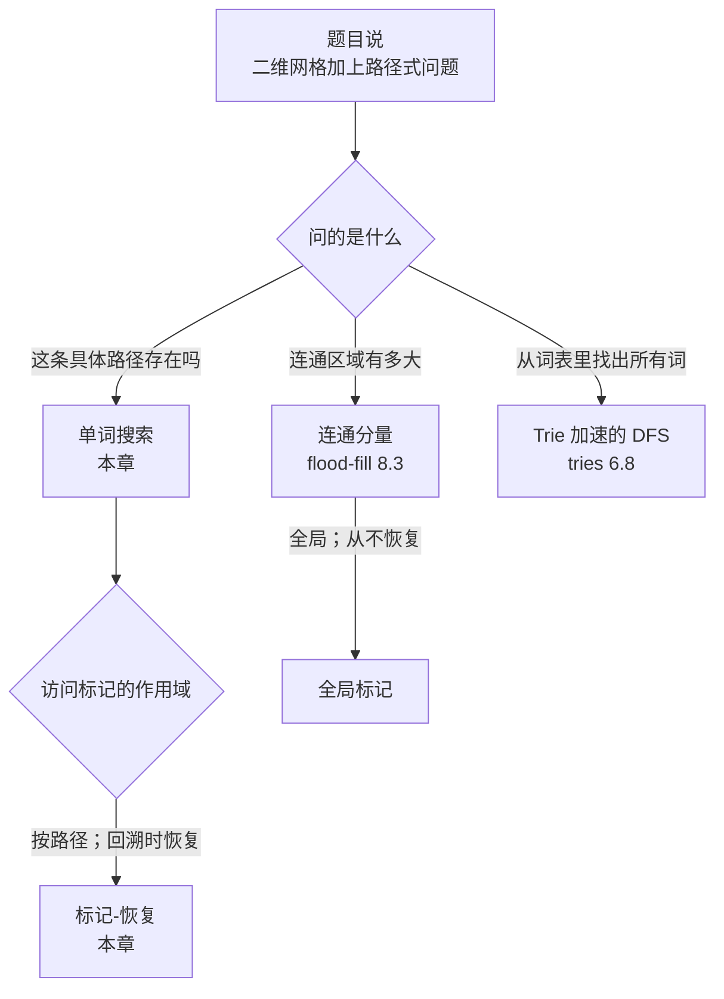
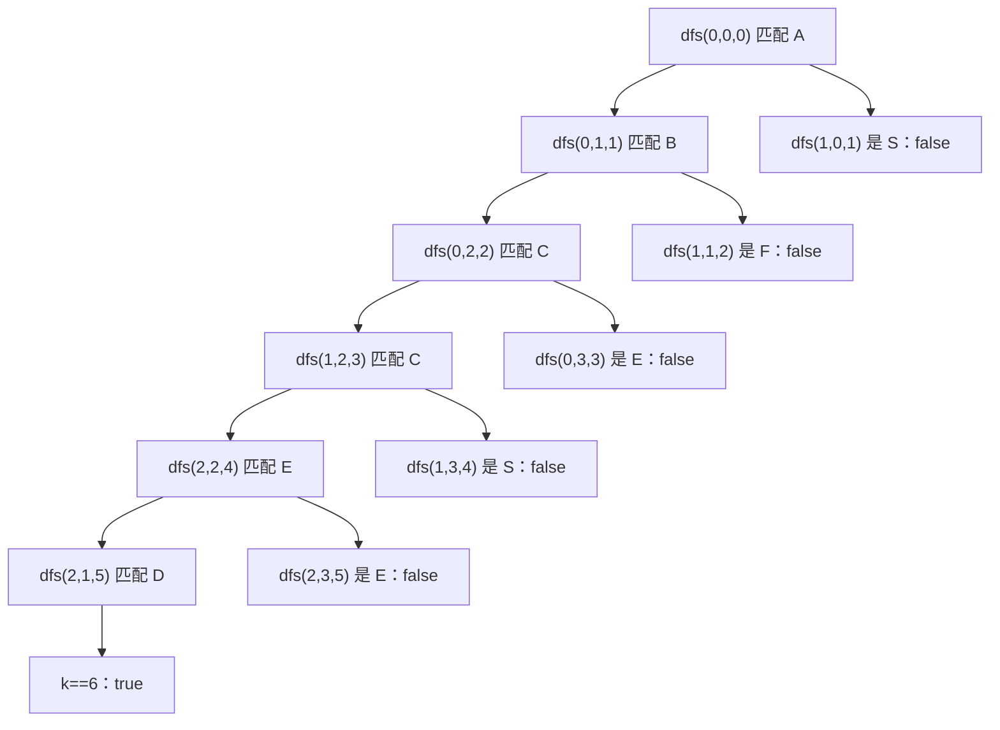
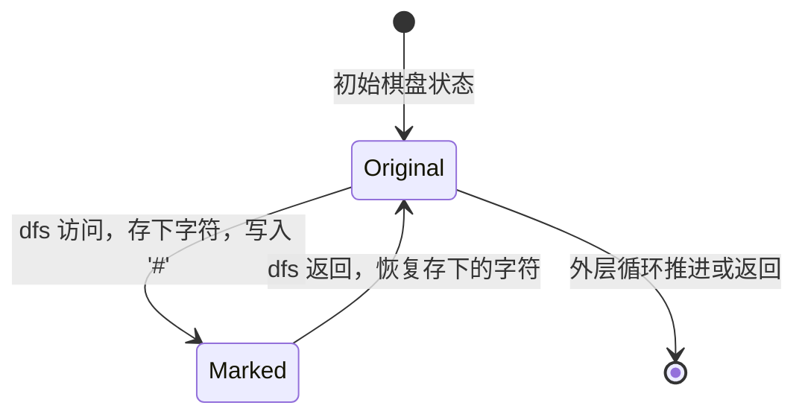

# 单词搜索与网格回溯

给定这个 3×4 的棋盘

```text
A B C E
S F C S
A D E E
```

和单词 `"ABCCED"`，判断这些字母能否拼出一条由 4-邻接格子组成、且每个格子都不重复使用的路径。答案是能：`(0,0) -> (0,1) -> (0,2) -> (1,2) -> (2,2) -> (2,1)` 正好读出这个单词。同一个棋盘上的 `"ABCB"` 答案是不能，因为唯一的 `B` 在 `(0,1)`，而约束要求每个格子最多用一次。这就是 LeetCode 79（Word Search），也就是本章。

[回溯模板](./01-backtracking-template.md) 给了你在递归树上做“选择—探索—撤销”的写法，树上每个节点是一个部分解。[数独求解器](./04-sudoku-solver.md) 把同一套模板搬到 9×9 网格上，其中的校验步骤问的是“这个数字在该行、该列、该宫格里放得下吗”。单词搜索是第三个网格实例，它带来一个新点子：已访问集合就长在棋盘里。递归之前往格子里写一个哨兵字符，递归返回时再写回去。不管搜索成功与否，收尾时的棋盘和开局时一模一样。

## 为什么直观解法会浪费你并不需要的内存

老实的第一版会另开一张与棋盘同形状的 `visited[][]` 布尔表，每次递归调用前把 `visited[r][c]` 置为 true，回来路上再清掉。

```python
# 暴力：O(m*n*4^L) 时间，O(m*n) 辅助空间 —— 我们要替换掉的写法
def exist_with_visited(board, word):
    rows, cols = len(board), len(board[0])
    visited = [[False] * cols for _ in range(rows)]

    def dfs(r, c, k):
        if k == len(word):
            return True
        if r < 0 or r >= rows or c < 0 or c >= cols:
            return False
        if visited[r][c] or board[r][c] != word[k]:
            return False
        visited[r][c] = True
        found = (dfs(r + 1, c, k + 1) or dfs(r - 1, c, k + 1) or
                 dfs(r, c + 1, k + 1) or dfs(r, c - 1, k + 1))
        visited[r][c] = False
        return found

    for r in range(rows):
        for c in range(cols):
            if board[r][c] == word[0] and dfs(r, c, 0):
                return True
    return False
```

算法是对的。冗余出在结构上，不在算法上：每次读 `board[r][c]` 都配着一次读 `visited[r][c]`，而每次写 `visited[r][c]` 本来都可以直接写 `board[r][c]`。两个平行数组，扛着本该合成一份的信息。在 LC 的约束下（`board` 最大 6×6，单词最长 15 个字符），这点 `O(m*n)` 辅助空间只是舍入误差；放到 1000×1000 的网格上，那就是白白多出一兆字节的记账开销，而算法根本不需要。

修法是把两个数组合成一个。挑一个绝不会与 `word` 中任何字符相同的哨兵字符，在递归调用前写进 `board[r][c]`，之后再恢复原字符。这样 `board[r][c] != word[k]` 这一处不匹配检查就兼了两职：既挡住字母不对的格子，也挡住当前路径上已经走过的格子——哨兵两者都不是。

## 模式

```python
def exist(board, word):
    if not board or not board[0] or not word:
        return False
    rows, cols = len(board), len(board[0])

    def dfs(r, c, k):
        if k == len(word):
            return True
        if r < 0 or r >= rows or c < 0 or c >= cols or board[r][c] != word[k]:
            return False
        saved = board[r][c]
        board[r][c] = "#"   # 原地标记已访问；哨兵永远不会匹配单词里的字符
        found = (dfs(r + 1, c, k + 1) or
                 dfs(r - 1, c, k + 1) or
                 dfs(r, c + 1, k + 1) or
                 dfs(r, c - 1, k + 1))
        board[r][c] = saved  # 回溯时恢复
        return found

    for r in range(rows):
        for c in range(cols):
            if board[r][c] == word[0] and dfs(r, c, 0):
                return True
    return False
```

**解法** — Python（[Java](./05-word-search/lc-79/sol.java) · [C++](./05-word-search/lc-79/sol.cpp) · [Go](./05-word-search/lc-79/sol.go)）

```python
# LC 79. Word Search
from typing import List


def exist(board: List[List[str]], word: str) -> bool:
    """LC 79 Word Search：`word` 能否作为一条 4-邻接格子路径出现在 `board` 上？"""
    if not board or not board[0] or not word:
        return False
    rows, cols = len(board), len(board[0])

    def dfs(r: int, c: int, k: int) -> bool:
        if k == len(word):
            return True
        if r < 0 or r >= rows or c < 0 or c >= cols or board[r][c] != word[k]:
            return False
        saved = board[r][c]
        board[r][c] = "#"   # 原地访问标记；哨兵永远不会匹配单词里的字符
        found = (dfs(r + 1, c, k + 1) or
                 dfs(r - 1, c, k + 1) or
                 dfs(r, c + 1, k + 1) or
                 dfs(r, c - 1, k + 1))
        board[r][c] = saved  # 回溯时恢复
        return found

    for r in range(rows):
        for c in range(cols):
            if board[r][c] == word[0] and dfs(r, c, 0):
                return True
    return False
```

递归一共六步，顺序固定，而绝大部分 bug 都出在顺序上。

1. **成功的基本情况：** `k` 等于 `len(word)` 时，每个字符都匹配上了。返回 true。
2. **边界检查：** `(r, c)` 跑出棋盘就返回 false。
3. **匹配且未访问检查：** `board[r][c] != word[k]` 就返回 false。哨兵 `'#'` 永远不等于任何字母，所以这一次比较同时排掉了字母不对的格子和已经走过的格子。
4. **标记：** 存下原字符，写入哨兵。
5. **向四个方向递归：** 四个 `||` 短路，第一个找到单词的方向赢，其余跳过。
6. **恢复：** 把原字符写回去。这一行不管递归成功还是失败都会执行；任何一条代码路径上，棋盘的收尾状态都与起始状态一致。

> [!IMPORTANT]
> 标记必须排在四个递归调用之前，恢复必须排在它们之后。先递归再标记，四个兄弟分支就会在格子仍未访问的状态下开跑，算法会心安理得地在同一条路径上重复用格子。把恢复塞进某个提前返回的分支，其他分支就都得替它还债。这套配方之所以死板，是因为它防的 bug 是静默的：答案错，但不崩。

这段结构顺带给出四条不变量，值得记住。`k` 始终是待匹配的*下一个*字符的下标，而不是当前路径的长度。任一方向成功时 `dfs` 立刻返回 true，外层 `||` 短路掉其余方向。四个递归调用是兄弟关系，不是嵌套；调用栈反映的是在单词里的深度，不是方向的广度。哨兵之所以安全，是因为 LC 79 保证棋盘里只有英文字母。[^1] 如果将来的变体放宽了字母表，就把哨兵换成一个带外字节，或者退回暴力版那张 `visited[][]`。

## 这个模式用在哪



*二维网格一出现在题干里，读者就跑一遍这棵决策树；“按路径”还是“全局”的区分，是这里最有用的一个分水岭。*

标记-恢复与全局标记这条分界线，就是这个模式的判别器。[连通分量](../../../dsa/part-8-graphs/03-connected-components.md) 把格子标为已访问后从不撤销，因为它问的是区域，不是路径。单词搜索标记格子，而且*必须*撤销，因为两个不同的起点可以在不同尝试里都合法地穿过同一个中间格。作用域搞错，你要么在本该成功的输入上返回 false（在路径问题上标记后不撤销），要么做指数级的重复劳动（在 flood-fill 上标记-恢复）。

## 实例推演：在 `"ABCCED"` 上跑 LC 79

外层循环按行主序扫描格子，`word[0] = 'A'` 的第一个匹配是 `(0,0)`。这次调用就是整个搜索的种子，也是唯一需要跟下去的一条；`dfs(0, 0, 0)` 一旦返回 true，外层循环就短路了。

`dfs(0, 0, 0)`。匹配：`'A' == 'A'`。存下 `'A'`，把 `(0,0)` 标成 `'#'`。先往下递归到 `(1,0)`。

`dfs(1, 0, 1)`。找 `'B'`。格子里是 `'S'`。不匹配：返回 false。没有落过标记，所以也不需要恢复。这是回溯第一次发生的地方，而它是靠提前返回隐式发生的。

接下来是 `dfs(-1, 0, 1)`。越界。false。然后 `dfs(0, 1, 1)` 找 `'B'`。格子里是 `'B'`。匹配。存下、标记 `(0,1) = '#'`。继续递归。

成功的那条路是：`(0,0)='A'` -> `(0,1)='B'` -> `(0,2)='C'` -> `(1,2)='C'` -> `(2,2)='E'` -> `(2,1)='D'`。每一步都在四个递归调用之前把当前格覆盖成 `'#'`，之后再恢复。在 `(2,1)` 匹配完 `'D'` 后，下一次调用的 `k = 6 = len(word)`，返回 true。四个 `||` 一路短路回到顶端。回溯时，六行恢复按相反顺序执行：`(2,1) <- 'D'`、`(2,2) <- 'E'`、`(1,2) <- 'C'`、`(0,2) <- 'C'`、`(0,1) <- 'B'`、`(0,0) <- 'A'`。棋盘与起始状态逐位相同。

第二步那个死胡同（`S != B` 不匹配）是便宜的那类回溯：匹配检查在标记之前触发，所以没有工作需要撤销。贵的那类发生在更深处。如果尝试走过 `(0,2) -> (1,2) -> (2,2) -> 又回到 (1,2)` 这样的路径，算法就必须发现“重访”；`dfs` 第三步里 `'#' != 'C'` 的检查正是抓它的手段。同一个检查既否掉错字母，也否掉格子已用的情况，这就是一个哨兵值够用的全部理由。



*成功那一次搜索的递归树；失败的分支用显式的“false”标注剪掉。从根到叶的路径，按顺序读出的就是走过的格子。*

## 实际开销

| 变体 | 时间 | 空间 | 说明 |
|---|---|---|---|
| LC 79，原地哨兵 | O(m × n × 4^L) | O(L) | 只有递归栈；棋盘本身兼任访问集合。 |
| LC 79，独立的 `visited[][]` | O(m × n × 4^L) | O(m × n) | 时间界相同；辅助访问表多出矩形这一项。 |
| 最好情况，`word[0]` 无匹配 | O(m × n) | O(1) | 外层守卫 `board[r][c] == word[0]` 让 `dfs` 根本没被调用。 |

`m * n` 是棋盘大小，`L = len(word)`。指数来自一棵深度为 `L` 的四叉递归树：每一步 dfs 最多分叉到四个邻居，而每条分支都能递归到深度 `L`。再乘上 `m * n` 个外层起点，就得到这个界。Sedgewick 教科书里的 DFS 界（访问顶点的时间正比于其度数之和）在这里不适用，因为本算法是按路径探索、不是按图探索；访问标记是递归局部的，同一个格子可以在不同起点下被重新走过。[^2]

这个界是紧的，不是悲观的。拿一个 6×6 全是 `'A'` 的网格，配一个 `"AAAAAAAAAAAAAAA"`（15 个字符）。每个格子都是合法的首字符。从每个起点出发，递归最多探索四个方向；每个方向的深层调用看到三个可走的邻居（父格现在已是 `'#'`）；如此一直到 `L` 层。walkccc 和 NeetCode 的参考都给出这个界，并把它称作 LC 79 的入场代价。[^3][^4] LC 的约束（`1 <= m, n <= 6`、`1 <= word.length <= 15`）是有意收紧的，因为单词级搜索不存在更快的算法。多词搜索是另一个问题，配另一个算法；那是 [Tries](../part-6-trees-heaps/08-tries.md)，其中 LC 212（Word Search II）展示了 trie 如何把 W 次单词搜索合并成一趟棋盘遍历，一旦没有任何候选词能延伸就立刻剪枝。

### 原地哨兵：从 O(m × n) 辅助空间到 O(L)

`visited[][]` 版和原地版的时间界相同。差别在空间，还在一个更微妙的地方：原地版的活动件更少，而活动件越少，把顺序搞错的机会就越少。下一节的四个 bug 里有三个，在访问位放在独立数组时更好写出来，因为代码里没有任何结构强制标记、递归、恢复必须活在同一段六行代码里。

空间的收益是真的，但在 LC 这种小棋盘上很有限。6×6 网格上辅助表是 36 个布尔值；递归栈最多 15 帧。这招之所以是标准面试答案，不是因为字节数，而是因为网格上的“标记—递归—取消标记”直接对应 [回溯模板](./01-backtracking-template.md) 里的“选择—探索—撤销”，不需要外部状态对象。棋盘*就是*状态，dfs *就是*状态机。



*格子状态机；每一次 Original 到 Marked 的转移，都在 dfs 栈帧弹出之前有一次对应的 Marked 到 Original。无论搜索成败，函数入口与出口处的棋盘逐位相同。*

## 模式失效的场景

LC 79 是严格形态：单个单词、4-邻接网格、是/否答案。面试轮换里会出现三种变形，而骨架在三种变形下都活着。

第一种放宽答案类型。LC 1219（Path with Maximum Gold）把“这条路径存在吗”换成“任意单条路径上最多能收集多少金子”；递归的返回从 `bool found = a or b or c or d` 变成 `int best = max(a, b, c, d) + this_cell_value`，其余完全一样。标记-恢复这一步不变，因为不重复访问的约束没变。

第二种放宽网格。LC 1306（Jump Game III）是一个线性数组，每个下标 `i` 最多两个邻居：`i + arr[i]` 和 `i - arr[i]`。四方向的 `||` 链缩成两方向，`(r, c)` 参数塌成单个下标，访问标记挪到独立的 `seen[]`，因为问题问的是“是否曾经可达”，不是“是否在单条路径上可达”——于是标记在整个运行期保留，没有恢复。这个差别值得记住：不重复访问的约束按路径生效时，你标记再恢复；按整次搜索生效时，你标记并保留。LC 1306 就摆在章节的 CORE 梯度里，正是为了这个对照。

第三种从一个单词推广到多个单词。LC 212（Word Search II）要求找出词表里所有在棋盘上出现的词，而朴素答案（每个词跑一遍 LC 79）在隐藏用例上超时。修法是 trie，它同时跨整张词表剪枝：dfs 与棋盘同步走 trie，一旦 trie 对下一个字符没有子节点，就放弃这条路径。算法上的新意是 trie，不是递归形状——这也是 LC 212 放在 [Tries](../part-6-trees-heaps/08-tries.md) 而不在这里的原因。

## 三个最容易踩的坑

> [!WARNING]
> **往回收的路上忘了恢复格子。** 搜索对它尝试的第一条合法路径给出正确答案，但对任何依赖“别的起点看到该格子未被访问”的路径都给出错误答案。症状：样例测试通过，第二个隐藏用例挂掉。修法是把 `board[r][c] = saved` 放在 `dfs` 最末尾、`return found` 之前。NeetCode 的题解把它列为第一条 pitfall：“forgetting to restore the original character after exploring all neighbors will permanently modify the board.”[^4] 一个快速自检是：在某个棋盘上跑完 `exist`，然后断言棋盘与输入快照逐字节相同；四份参考实现正是在验证工具里按这条性质测的。[^5]

> [!WARNING]
> **把标记放在递归调用之后而不是之前。** 四个递归调用在格子仍未访问的状态下就发射了，dfs 会在同一条路径上重复用这个格子，算法在本该要求格子互不相同的输入上返回 true。标准结构是 `saved = board[r][c]; board[r][c] = '#'; <四个递归调用>; board[r][c] = saved`。哨兵的写入发生在参数捕获之后、递归之前，绝不在之后。NeetCode 把它列为第二条 pitfall，名字是“checking visited before matching character”；把访问检查放到字符匹配检查之前，会造出同一类 bug。[^4]

> [!WARNING]
> **题干一出现“网格 + 路径”就伸手去写 BFS。** BFS 的标记是全局的，没有按路径的作用域，也没有天然的撤销步骤。它在[连通区域探索](../../../dsa/part-8-graphs/03-connected-components.md) 这种访问位本就全局的场合工作得很好。但它在单词搜索上失败，因为 LC 79 的“每格最多一次”是按路径算的，不是按整次遍历算的——两个不同的起点会在不同尝试里合法地想穿过同一个中间格。带 `(r, c, current_visited_set)` 状态包的 BFS 变体，队列规模是指数级的，到这一步，六行标记-恢复的 DFS 就是更好的选择。Stack Overflow 上有个帖子记录了一次 LC 79 的 BFS 尝试，它产生错误的访问顺序，并在 DFS 加回溯能返回 true 的用例上返回 false。[^6]

## 题目梯度

### 核心（三题全做才算掌握本章）

- [LC 463 — Island Perimeter](https://leetcode.com/problems/island-perimeter/) [简单] • grid-traversal-counting
- [LC 79 — Word Search](https://leetcode.com/problems/word-search/) [中等] • grid-backtracking-dfs ★
- [LC 1306 — Jump Game III](https://leetcode.com/problems/jump-game-iii/) [中等] • graph-backtracking-dfs

LC 79 是本章的招牌题（★），也是实例推演的对象。LC 463 在不含递归恢复的前提下打底行列双层循环和四邻居偏移量的写法；如果原地哨兵显得太机巧，从这题入手能落地。LC 1306 把骨架推广到非网格的邻居函数，并演示全局标记的情形，与本章讲的标记-恢复形成直接对照。本章的 `core-emh-via-stretch` 标记记录着：这个模式的招牌 Hard（LC 212，Word Search II）归 [Tries](../part-6-trees-heaps/08-tries.md) 所有，这里不重复；除此之外，这个模式没有别的 Hard 是以单词级网格回溯为主要教学点。

## 后续衔接

当题干从单个单词扩展到同一棋盘上的一张词表，逐词跑的做法会超时，答案是让 trie 与 dfs 同步走。[Tries](../part-6-trees-heaps/08-tries.md) 接手这一块，以 LC 212 为实例推演、以 trie 剪枝为算法核心；本章的递归形状原样搬过去即可。

当问题从“这条路径存在吗”转向“这个连通区域有多大”，访问标记的作用域就从按路径翻成全局，恢复步骤随之消失。那是[连通分量与 flood-fill](../../../dsa/part-8-graphs/03-connected-components.md)，标准演示是 LC 200。同样的外层循环，同样的四邻居递归，只是记账方式不同。

## 参考文献

[^1]: leetcode.ca 镜像，“79. Word Search,” 难度 Medium，棋盘只含英文字母，示例棋盘 `[['A','B','C','E'],['S','F','C','S'],['A','D','E','E']]` 配 `"ABCCED"` 返回 true，配 `"ABCB"` 返回 false。<https://leetcode.ca/all/79.html>.

[^2]: Robert Sedgewick and Kevin Wayne, *Algorithms*, 4th ed. (2011), §4.1 Undirected Graphs, “Depth-first search” 小节：DFS 标记与给定源点连通的所有顶点，时间正比于它们度数之和，预处理的时间与空间正比于 V + E。<https://algs4.cs.princeton.edu/41graph/>.

[^3]: walkccc/LeetCode, “79. Word Search,” 时间 `O(m*n*4^|word|)`，空间 `O(|word|)` 递归栈；C++/Java/Python 各版本都用原地哨兵标记的写法。<https://walkccc.me/LeetCode/problems/79/>.

[^4]: NeetCode, “79. Word Search — Explanation,” 三种解法（hash-set、visited 数组、原地修改），均为 `O(m * 4^n)` 时间和 `O(n)` 空间；pitfalls 一节列出 “Not Restoring the Cell After Backtracking” 与 “Checking Visited Before Matching Character”。约束 `1 <= board.length, board[i].length <= 5; 1 <= word.length <= 10`。<https://neetcode.io/solutions/word-search>.

[^5]: Jeff Erickson, *Algorithms* (1st ed., 2019), 第 2 章 “Backtracking” 讲的是按路径搜索、访问状态属于递归局部的做法，与访问标记长期保留的教科书 DFS 不同。<https://jeffe.cs.illinois.edu/teaching/algorithms/>.

[^6]: Stack Overflow，“Leetcode 79 Word Search issue with BFS”（2024 年 3 月），记录了一次 BFS 尝试，它产生错误的访问顺序，并在 DFS 加回溯能返回 true 的用例上返回 false。<https://stackoverflow.com/q/67894650>.
