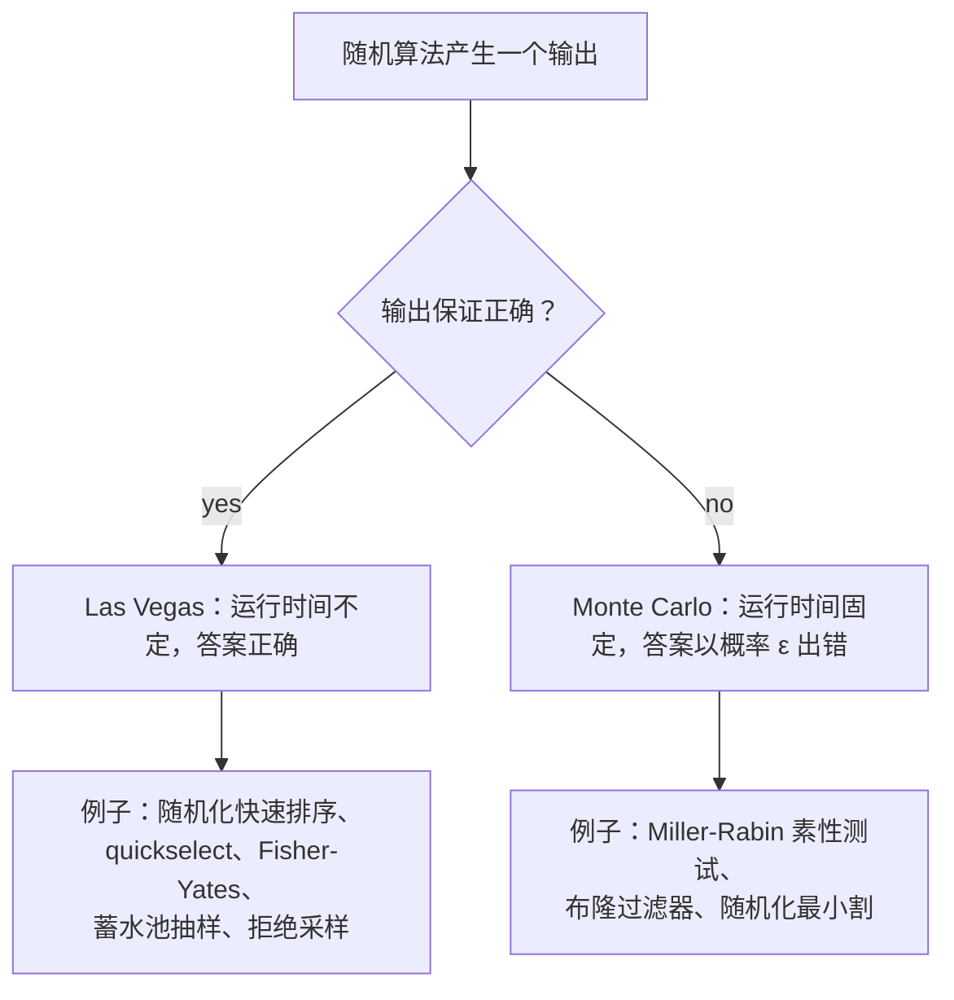
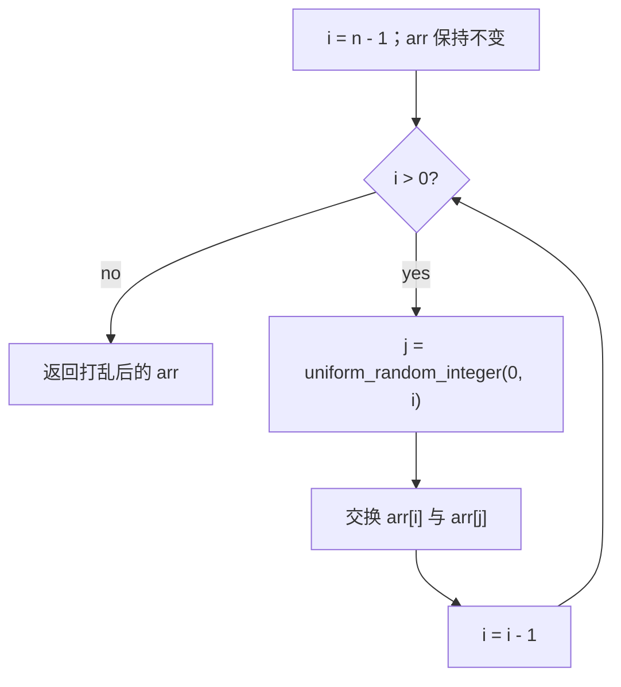
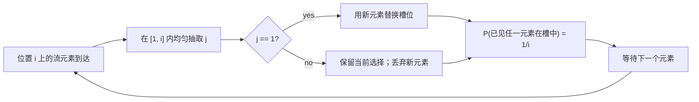

# 随机算法：Fisher-Yates、蓄水池抽样与拒绝采样

Knuth 在《The Art of Computer Programming》第二卷讲蓄水池抽样的那一节开头先坦白了一句：*"这个算法乍看不可靠，实际上甚至不正确。但仔细分析会发现它完全可信。"* 这个算法要从一条长度未知的流里均匀随机地抽出 `k` 个样本。只看代码、还没看数学推导时，读者的第一反应是对的：它看起来是坏的。其实不是。

本章有三个来自不同家族的问题共享这个性质。把一百万个元素的数组打乱，让每种排列等概率出现；在一条无法回退的流里，均匀随机地挑出某个目标值的一个下标；用一个不能重写的黑盒 `rand7()` 造出 `{1..10}` 上的均匀生成器。每个问题都有一个诱人的错误答案，和一个只有算完概率才显出正确的正确答案。本章把三种技术并排讲，因为技巧是同一个：少量额外的随机性，放在正确的位置，就能替代多得多的计算、内存或对 oracle 的访问。

## 分类：Las Vegas 与 Monte Carlo

随机算法沿单一维度分成两族：随机硬币背叛你时，坏掉的是答案还是运行时间？[^1]

**Las Vegas 算法**永远返回正确答案。随机性影响它跑多久；运气差时跑得更久，但输出始终正确。[Quickselect: linear-time selection](../part-2-search-sort/07-quickselect.md) 里的随机化快速排序和 quickselect 是典型例子。pivot 均匀随机；连续抽到坏 pivot 会让你在最坏情况下付出 `Theta(n^2)` 的工作量，但最后给出的答案仍然是第 k 小元素。

**Monte Carlo 算法**有固定的运行时间预算，却有很小的概率给出错误答案。Miller-Rabin 素性测试是教科书案例：跑 `k` 轮，每轮都判定为素数就认定它是素数，对合数输入接受 `4^(-k)` 的假阳性概率。确定性算法 AKS（Agrawal-Kayal-Saxena，2002）消除了这个误差，也证明了素性测试属于 P，但生产代码交付的是 Miller-Rabin，因为它的常数小大约三个数量级，而对任何实用的 `k`，其错误概率低于任何你愿意拿来类比的现实物理事件。[^2]



*区分两族的唯一维度。本章每个算法都是 Las Vegas：答案永远均匀，只有“多久给出答案”是概率性的（对 Fisher-Yates 和蓄水池抽样来说，连这一点都是确定的）。*

本章的三种技术（Fisher-Yates 洗牌、蓄水池抽样、拒绝采样）都属于 Las Vegas。Fisher-Yates 总是产出输入的一个排列；蓄水池抽样总是从流中返回 `k` 项；拒绝采样总是返回目标分布中的一个样本。随机性体现在*哪一种*排列、*哪* `k` 项、*要等多久*才被接受，从不在*输出是否有效*上。

事先知道算法属于哪一族，会改变你推理它的方式。对 Las Vegas，问题是“期望运行时间是多少？”对 Monte Carlo，问题是“失败概率是多少，我怎么把它压下去？”两个问题的答案不同，证明手法也不同。把两者混为一谈，是面试里碰到随机算法时最常见的混乱来源。

## Fisher-Yates：线性时间洗牌

LeetCode 384（Shuffle an Array）是教科书式的随机洗牌题。你有一个含 `n` 个整数的数组，以及一个必须返回某个排列的 `shuffle()` 方法；契约是 `n!` 种排列等概率出现。reset 方法返回原数组。两种调用交替进行。

错误答案看起来显然正确。遍历数组；在每个下标 `i` 处，把 `arr[i]` 与 `arr[rand(0, n-1)]` 交换。每个元素被碰一次；循环是 `O(n)`；随机性也撒进去了。这个实现给出的是非均匀分布。`n = 3` 时循环产生 `3^3 = 27` 条不同的执行路径，但只有 `3! = 6` 种排列；有些排列在这 27 条路径里出现五次，另一些出现四次。偏差小到一个随手的测试（“输出和输入不一样吗？”）发现不了，又大到让微软在 2009 年欧盟浏览器选票 bug 上栽了跟头：Internet Explorer 拿第三名的次数比随机预期更多。[^3]

修法只有一行。每一步只从*尚未洗过*的部分取随机下标，也就是还没被锁定的后缀。Durstenfeld 1964 年的改写让 `i` 从 `n-1` 递减到 `1`，从闭区间 `[0, i]` 均匀抽 `j`，然后交换。每个元素在 `i` 走到它那个下标的瞬间落到最终位置，之后再也不被碰到。证明是计数论证：执行路径恰好有 `n!` 条（`n` 种选择，然后 `n-1`，然后 `n-2`，一直到 `1`），每条路径对应一种排列；每一步抽的随机整数都是均匀的，因此每种排列恰好出现一次。[^4]

```python
import random
from typing import List


class Solution:
    def __init__(self, nums: List[int]):
        self.original = list(nums)

    def reset(self) -> List[int]:
        return list(self.original)

    def shuffle(self) -> List[int]:
        arr = list(self.original)
        for i in range(len(arr) - 1, 0, -1):
            j = random.randint(0, i)
            arr[i], arr[j] = arr[j], arr[i]
        return arr
```

**解法** —— Python（[Java](./06-randomized-algorithms/lc-384/sol.java) · [C++](./06-randomized-algorithms/lc-384/sol.cpp) · [Go](./06-randomized-algorithms/lc-384/sol.go)）

```python
# LC 384. Shuffle an Array
import random
from typing import List


class Solution:
    def __init__(self, nums: List[int]):
        self.original = list(nums)

    def reset(self) -> List[int]:
        return list(self.original)

    def shuffle(self) -> List[int]:
        arr = list(self.original)
        # Durstenfeld：i 从 n-1 递减到 1；j 在闭区间 [0, i] 内均匀抽取；
        # 交换 arr[i] 与 arr[j]。让分布均匀的正是这个闭区间的上界：
        # 把 i 从取值范围里去掉，就退化成 Sattolo 算法
        # （只产生单环排列）。
        for i in range(len(arr) - 1, 0, -1):
            j = random.randint(0, i)
            arr[i], arr[j] = arr[j], arr[i]
        return arr
```

随机抽取取到闭区间的上界，这就是整个算法。`random.randint(0, i)` 包含 `i`；`j == i` 的那次迭代把位置 `i` 的元素和自己交换，对数组是空操作，但却是数学所依赖的那次抛硬币。去掉上界，写成 `random.randint(0, i - 1)`，算法就变成 Sattolo 的，只产生 `(n-1)!` 种单环排列。每个元素都移动；没有元素回到原位。这个差一位（off-by-one）是洗牌实现里最常见的 bug；TheAlgorithms/JavaScript 仓库的 `bogoSort.js` 里那段 Fisher-Yates 例程一直带着它，到 2024 年底才修。[^5]



*Durstenfeld 循环。未洗过的前缀每轮缩短一个，洗过的后缀随之变长。交换完成的那一刻，位置 `i` 就被锁定。*

复杂度是 `Theta(n)` 时间和 `O(1)` 额外空间，两者都是紧的。任何均匀随机排列算法都至少要把每个元素读一遍（否则某些位置的分布就被输入固定了），所以 `Theta(n)` 是下界；Durstenfeld 用恰好 `n - 1` 次交换和 `n - 1` 次随机抽取达到它。CLRS 在 §5.3（`RANDOMIZE-IN-PLACE`，引理 5.5）里用未洗前缀的 `(i-1)`-排列上的循环不变式给出了形式化的均匀性证明。[^4]

> [!CAUTION]
> **朴素的 `swap with rand(0, n-1)` 洗牌看着均匀，其实有偏。** 偏差在 `n` 小时很小，不上直方图根本看不出来。用这个模式“洗牌”的生产代码有一个真实的边角案例：只要不同排列的数量有意义（扑克牌堆、A/B 测试分桶、加密密钥排列），缺掉的那部分就变得重要。修法是一个字符：`rand(0, i)` 而不是 `rand(0, n - 1)`。

## 蓄水池抽样：从无法回退的流中取样

LeetCode 398（Random Pick Index）设了陷阱。给定 `nums` 和目标值，返回该值出现位置中均匀随机的一个下标。数组可能非常大；`pick(target)` 调用很频繁。干净的答案——构造时把每个值都分桶，再在桶里均匀取一个——在数组能装进内存时管用。装不进内存时，当数组以无法索引的流的形式到来时，分桶方案就崩了。

蓄水池抽样是流式的对应物。只保留一个槽位。流逐个到达时，在第 `i` 项上以 `1/i` 的概率替换槽里的内容，以 `1 - 1/i` 的概率保留当前选择。处理完长度为 `n` 的整条流之后，槽里装着一个均匀随机的项；每个输入项最终落在槽里的概率恰好是 `1/n`。算法一趟扫完，额外空间 `O(1)`。Knuth 那段坦白说的就是这个算法。[^6]

```python
import random
from typing import List


class Solution:
    def __init__(self, nums: List[int]):
        self.nums = nums

    def pick(self, target: int) -> int:
        chosen_idx = -1
        match_count = 0
        for idx, value in enumerate(self.nums):
            if value != target:
                continue
            match_count += 1
            if random.randint(1, match_count) == 1:
                chosen_idx = idx
        return chosen_idx
```

```python
# LC 398. Random Pick Index
import random
from typing import List


class Solution:
    def __init__(self, nums: List[int]):
        self.nums = nums

    def pick(self, target: int) -> int:
        """蓄水池抽样，k = 1。一趟扫描，O(1) 额外空间。

        处理完第 i 个匹配（从 1 计数）之后，此前见过的每个匹配恰好以
        1/i 的概率是当前选择。技巧是：第 i 个匹配到来时，以 1/i 的概率
        替换当前选择；换句话说，当 randint(1, i) == 1 时就替换。
        第 i 个匹配之后，每个已见匹配仍在槽中的概率都恰好是 1/i。
        """
        chosen_idx = -1
        match_count = 0
        for idx, value in enumerate(self.nums):
            if value != target:
                continue
            match_count += 1
            # 以 1/match_count 的概率替换。
            if random.randint(1, match_count) == 1:
                chosen_idx = idx
        return chosen_idx
```

本章的蓄水池抽样参考实现只给 Python；四语言版本留给 LC 384，那里的标准测试要跑全部四种语言。这个算法可以干净地转写成 Java 的 `ThreadLocalRandom.current().nextInt(matchCount) == 0`、C++ 的 `std::uniform_int_distribution<>(0, matchCount-1)(rng) == 0`、Go 的 `rng.Intn(matchCount) == 0`；各语言表达“以概率 `1/i` 抛硬币”的惯用法，都是那个内层判断。



*`k = 1` 时对每个流元素做的蓄水池抽样。到目前为止见过的任意一项是当前选择的概率按 `1/i` 衰减；处理完 `n` 项之后，每个输入项的概率恰好是 `1/n`。*

### 为什么每项概率相同

只把算法当代码读，会怀疑早到的项一定累积了过多的概率。第 1 项一开始就在槽里；第 2 项以 `1/2` 的概率把它赶走；第 3 项以 `1/3` 的概率赶走槽里的东西。那么处理完 `n` 项之后，第 1 项岂不是被高估了？它有 `n - 1` 次存活机会，而第 `n` 项只有一次进入机会。数学说不会，而且证明很短。

**断言。** 算法处理完第 `i` 项之后，`{1, 2, ..., i}` 中的每一项在蓄水池槽里的概率恰好是 `1/i`。

**对 `i` 归纳证明。**

*基础情况*（`i = 1`）：算法无条件存入第 1 项。概率 `1 = 1/1`。✓

*归纳步。* 假设第 `i - 1` 步时断言成立：`{1, ..., i-1}` 中每一项当前在槽里的概率是 `1/(i-1)`。现在第 `i` 项到达。算法从 `{1, 2, ..., i}` 均匀抽 `j`，当且仅当 `j == 1` 时替换槽位。

新项进入槽的概率是 `Pr[j == 1] = 1/i`。新项 ✓。

对任意旧项 `x`，它要在第 `i` 步之后仍在槽里，需要两个事件同时发生：第 `i` 步之前它就在槽里（由归纳，先验概率 `1/(i-1)`），并且新的抽取没有把它赶走（概率 `1 - 1/i = (i-1)/i`）。两个事件独立：第 `i` 步运行之前蓄水池的状态已经固定，新的随机抽取是全新的。相乘：

$$
\Pr[x \text{ in slot after step } i] = \frac{1}{i-1} \cdot \frac{i-1}{i} = \frac{1}{i}.
$$

新项和每个旧项共享同一个概率 `1/i`。归纳闭合。∎

这个证明是本章的承重论证。没有它，算法读起来像迷信；有了它，`1/i` 这个不变式像一个不动点浮现出来：每一项、每一步，恰好 `1/i`。处理完 `n` 项之后，槽里是一个均匀随机的项，这正是契约要求的。

一般的 `k > 1` 情形完全一样，只做一点调整：第 `i > k` 项到达时，从 `{1, ..., i}` 均匀抽 `j`，若 `j <= k` 就把槽 `j` 换掉。同样的归纳照走，把所有地方的 `1/i` 换成 `k/i`；一项要同时满足两个条件才存活（先前在池中的概率 `k/(i-1)`，存活概率 `1 - 1/i`），得到 `k/(i-1) * (i-1)/i = k/i`。[^6]

复杂度是一趟扫完流，`k = 1` 时额外空间 `O(1)`，一般 `k` 时 `O(k)`。下界是 `Theta(n)`：任何允许第 `i` 项进入蓄水池的算法至少得读它，而算法必须读每一项才能给它机会。Vitter 1985 年的论文提出 Algorithm Z，通过按几何分布采样跳跃距离、按算法跳过若干项，达到期望 `O(k(1 + log(n/k)))` 时间；生产级流式系统（Apache DataSketches 的 reservoir sketch、BigQuery 的近似抽样）在 `n >> k` 时用 Algorithm Z，因为到了 PB 量级，常数很重要。[^6]

> [!IMPORTANT]
> **面试里出现的是单槽版本（`k = 1`）。** LC 398 和 LC 382（Linked List Random Node）都把 `k` 固定为 1。一般 `k` 的版本，是面试官提出要求*之后*你在白板上推导的那个。冷不丁推一般 `k`，你得记住 `j <= k` 比较的哪一边换掉哪个槽；而按上面的证明推 `k = 1` 是机械的，因为概率论证和代码一行对一行。

## 拒绝采样：丢弃错的，得到对的分布

LeetCode 470（Implement Rand10() Using Rand7()）是平台上最干净的拒绝采样题。你有返回 `{1, 2, ..., 7}` 均匀整数的 `rand7()`，要造出返回 `{1, 2, ..., 10}` 均匀整数的 `rand10()`。麻烦在于：对任何正整数 `k`，`7^k` 都不是 `10` 的倍数，所以无论怎么截断 `rand7()` 调用拼出的积，都得不到干净的 `{0, ..., 9}` 均匀分布。

朴素答案无视这一点。把两次 `rand7()` 调用合成 `{0, ..., 48}` 中的一个数，再对 10 取模。这是错的。余数 0 到 8 在 `{0, ..., 48}` 里各出现五次（余数 0 的计数：`0, 10, 20, 30, 40`），但余数 9 只出现四次（`9, 19, 29, 39`；49 那个候选不存在，因为和的最高值是 48）。`rand10 == 1` 的概率约为 `5/49 = 0.102`，不是 `0.1`。偏差很小，但在千万次抽样中看得见，也大到任何需要均匀性的平台（密码学洗牌、蒙特卡洛模拟、公平抛硬币实验）都不能交付它。

拒绝采样用丢弃坏结果的办法消除偏差。两次 `rand7()` 调用构成 49 个等概率结果。把它们映射到整数 `{1, 2, ..., 49}`。接受前 40 个，投影到 `{1, ..., 10}`（四个 1、四个 2，……，四个 10——均匀），然后*拒绝*后 9 个，从头重抽。被拒绝的那块区域是算法的安全阀；正是把这些结果扔掉，才让留下来的分布均匀。

```python
def rand10() -> int:
    while True:
        roll = (rand7() - 1) * 7 + rand7()
        if roll <= 40:
            return ((roll - 1) % 10) + 1
```

```python
# LC 470. Implement Rand10 Using Rand7


def rand7() -> int:
    """桩函数——面试题把它作为黑盒提供，返回 1..7 的
    均匀整数。真实评测环境会注入 LC 的版本。
    """
    raise NotImplementedError


def rand10() -> int:
    """两次 rand7 调用构成 49 个等概率结果。接受前 40 个
    （在 1..40 上均匀），投影到 1..10；拒绝 41..49 并重抽。
    每个被接受样本的期望调用次数 = 2 * 49 / 40 = 2.45。
    """
    while True:
        # 把 49 个结果无重叠地映射到 1..49；接受 1..40。
        roll = (rand7() - 1) * 7 + rand7()
        if roll <= 40:
            # 40 个结果均分成 10 组，每组 4 个。
            return ((roll - 1) % 10) + 1
        # roll 落在 41..49：拒绝，继续循环。
```

每个被接受的 `rand10()` 答案期望消耗 `2 / (40/49) = 49/20 = 2.45` 次 `rand7()` 调用。每轮外层迭代是两次 `rand7()` 调用；成功概率 `p = 40/49` 的几何分布期望值是 `1/p = 49/40 ≈ 1.225` 轮外层次数每次接受。[^7]

拒绝采样的通用形状是本章最简单的模式之一。你能从一个*容易*的分布（大集合上的均匀分布）采样，而你需要的是一个*困难*分布（小集合上的均匀分布）的样本。从容易的分布采样；结果落在目标子集里就接受，否则重抽。每个被接受样本的期望工作量是 `1/p` 轮外层迭代，`p` 是接受概率。

接受概率是有生产成本的。`p` 低会带来长尾延迟：迭代次数的 99 分位是 `ceil(log(0.01) / log(1 - p))`，随 `p` 趋近零而爆炸。对 LC 470 来说 `40/49` 是个甜点。更偷懒的方案（只用一次 `rand7()`，接受 1 到 5，双采样扩到 1 到 10）接受概率 `5/7 ≈ 0.714`，期望上烧掉更多 `rand7()` 调用。更精细的方案（三次 `rand7()` 给 343 个结果，接受前 340 个）`p = 340/343 ≈ 0.991`，但每次尝试要用三次 `rand7()`，每个接受样本期望 3.03 次调用，比 2.45 略差。在本章处理的小整数范围里，两调用、接受 40 的设计是局部最优。

## 与 quickselect 的联系

Las Vegas 这个思路（正确性固定、运行时间随机）在本手册最早以 quickselect 的随机化分区登场。[Quickselect: linear-time selection](../part-2-search-sort/07-quickselect.md) 那一章论证过：随机 pivot 不是性能优化，而是正确性修复——它把“在对抗性输入上退化成 `Theta(n^2)`”的算法变成在任意输入上期望 `Theta(n)` 的算法。同样的论证在这里反向成立：Fisher-Yates 是随机化分区的表亲，作用于整个数组，而不是一次一个 pivot。蓄水池抽样是“给我一个我无法完整存储的数组里的随机元素”的流式版本。拒绝采样是 `rand7 -> rand10` 与 Las Vegas 在精神上的共同点：失败模式是“再抽一次”，绝不是“给出错误答案”。

这个总括性质——正确性与随机性无关，运行时间以它为条件——正是 Las Vegas 算法可以放心上线的原因。往系统里灌最坏输入的对手打不坏答案，只能打坏延迟。生产系统会给 Las Vegas 算法配上超时兜底：`std::nth_element` 是随机化 quickselect，递归深度超过阈值时回退到堆排序；生产洗牌例程用 CSPRNG 跑 Fisher-Yates，让攻击者预测不了输出。这个框架是通用的；本章三种技术是通往它的三扇门。

## 常见陷阱

> [!WARNING]
> **那个差一位，造出的是 Sattolo 算法。** 写成 `random.randint(0, i - 1)` 而不是 `random.randint(0, i)` 会排除自交换，只产生 `(n-1)!` 种单环排列。每个元素都移动；结果在排列上不再均匀。用 `n = 3` 测：`[1, 2, 3]` 的均匀洗牌会产出全部六种排列，包括 `[1, 2, 3]` 本身；Sattolo 永远产不出恒等排列。闭区间的上界是必需项，不是可选项。

> [!WARNING]
> **PRNG 的周期和内部状态限制了可达分布。** 32 位状态的 PRNG 在播种后最多产生 `2^32 ≈ 43 亿` 条不同序列。`n = 13` 时 `13! ≈ 62 亿` 超过 `2^32`，所以不管 Fisher-Yates 循环写得多干净，32 位 PRNG 都到不了每一种排列。一副 52 张的牌，`52! ≈ 8 * 10^67`，任何 64 位 PRNG 都差得远。2000 年代线上扑克的洗牌 bug 能在毫秒级还原牌面，因为按种子生成的洗牌只覆盖了 `52!` 种牌局中的 40 亿种。应用处在对抗环境时，用 CSPRNG。[^8]

> [!CAUTION]
> **rand-from-rand 构造里的取模偏差。** `(rand7() + rand7() - 2) % 10 + 1` 产生非均匀分布，因为 `49 mod 10 != 0`。修法是拒绝采样，不是“多迭代几次”或者“用更大的乘积”。只要源范围的大小不是目标范围大小的倍数，取模就会给出有偏结果。规则是机械的：数结果；把破坏整除性的那段前缀或后缀拒掉；重抽。

> [!WARNING]
> **“拿整个数组的随机下标交换”这个洗牌 bug。** 实现 `for i in range(n): swap(arr[i], arr[rand(0, n-1)])` 看着像 Fisher-Yates，其实有偏：`n^n` 条执行路径对 `n!` 种排列。`n = 3` 时是 27 条路径分 6 种排列；有些出现五次，另一些四次。永远从*未洗过*的部分取随机下标（i 递减的写法用 `rand(0, i)`，i 递增的写法用 `rand(i, n-1)`）。递减形式是 CLRS §5.3 的规范形式，也是四份参考实现用的形式。[^4]

> [!WARNING]
> **测试里忘了给 RNG 定种子。** 经验性的“洗牌均匀吗？”测试必须跑在固定种子上，结果才可复现。LC 384 的四份参考实现是对 `[1, 2, 3, 4, 5]` 做 10,000 次洗牌、`seed = 42` 验证的；每个 `(值, 位置)` 格子落在 `2000 ± 150` 次。用 `random.shuffle(arr)` 加一句“输出不一样”的检查不是均匀性测试，而是“随机性存在吗”的测试——任何有偏洗牌也能通过。

## 题目梯度

LeetCode 上随机算法的标准题库是中等或困难；没有一道简单题能在本章要求的深度上教 Fisher-Yates、蓄水池抽样或拒绝采样。CORE 三题在 `no-easy-canonical` 收录标记下横跨中/中/难。

### 核心（三题全做才算掌握本章）

- [LC 384 — Shuffle an Array](https://leetcode.com/problems/shuffle-an-array/) [中等] • randomized-shuffle ★
- [LC 398 — Random Pick Index](https://leetcode.com/problems/random-pick-index/) [中等] • reservoir-sampling *（参考实现：仅 Python）*
- [LC 710 — Random Pick with Blacklist](https://leetcode.com/problems/random-pick-with-blacklist/) [困难] • rejection-sampling-with-remap *（参考实现：仅 Python）*

### 进阶（可选）

- [LC 470 — Implement Rand10() Using Rand7()](https://leetcode.com/problems/implement-rand10-using-rand7/) [中等] • rejection-sampling *（参考实现：仅 Python）*
- [LC 382 — Linked List Random Node](https://leetcode.com/problems/linked-list-random-node/) [中等] • reservoir-sampling-streaming

LC 710 是三题里最难的，它把拒绝采样和一个哈希重映射技巧配在一起：不在黑名单下标上重抽，而是把 `[0, n - |B|)` 里每个黑名单位置重映射到 `[n - |B|, n)` 里一个非黑名单位置，构造花 `O(|B|)`，之后每次取 `O(1)`。朴素的抽取-拒绝解法每次调用 `O(|B|)`，在最大的测试用例上超时。LC 380（Insert/Delete/GetRandom O(1)）被锁在第 1.4 章哈希冲突下，不属于本章的题目梯度；键数组加位置哈希这个结构撑起了 LC 710 的最优解，但本章只是顺带提到。

## 后续衔接

随机化这条线在 [Skip lists](../../../dsa/part-13-design-the-data-structure/00-lru-cache.md)（计划中）继续，那里按几何分布提升层级本身就是一次拒绝采样；也在 [Hash maps with universal hashing](../../../dsa/part-12-strings-pattern-matching/01-rabin-karp.md)（计划中）继续，那里从一个函数族里随机挑哈希函数，相当于在该族的下标集合上做一次 Fisher-Yates 抽取。分类里 Monte Carlo 那一侧（布隆过滤器、Miller-Rabin、随机化最小割）等确定性基线铺好之后，在第 13 部分专门讲。

## 参考文献

[^1]: Las Vegas / Monte Carlo 的区分是随机算法的标准分类，形式化表述见 CLRS 第 4 版（Cormen, Leiserson, Rivest, Stein，*Introduction to Algorithms*，MIT Press，2022）第 5 章 §5.3，以及 Wikipedia 的 [Randomized algorithm](https://en.wikipedia.org/wiki/Randomized_algorithm)

[^2]: Miller-Rabin 素性测试源自两篇论文：Gary L. Miller, "Riemann's hypothesis and tests for primality," *Journal of Computer and System Sciences*, 13(3):300-317, 1976（确定性，但以广义黎曼猜想为条件）；Michael O.

[^3]: Jeff Atwood, ["The Danger of Naïveté"](https://blog.codinghorror.com/the-danger-of-naivete/)

[^4]: Fisher-Yates 的 Durstenfeld 原地形式最早见于 Richard Durstenfeld, "Algorithm 235: Random permutation," *Communications of the ACM*, 7(7):420, July 1964（DOI: 10.1145/364520.364540）。

[^5]: Sattolo 算法是 Fisher-Yates 的差一位变体，只产生单环排列，见 [Wikipedia "Sattolo's algorithm"](https://en.wikipedia.org/wiki/Fisher%E2%80%93Yates_shuffle#Sattolo's_algorithm)。

[^6]: 蓄水池抽样的 Algorithm S 见 Donald E. Knuth，*The Art of Computer Programming*，Volume 2: *Seminumerical Algorithms*，3rd ed.，Addison-Wesley，1998，§3.4.2。

[^7]: 拒绝采样的期望迭代次数论证（接受概率为 `p` 时每个接受样本 `1/p` 轮迭代）由几何分布得出；结果见 CLRS 第 4 版附录 C 与 Wikipedia 的 [Rejection sampling](https://en.wikipedia.org/wiki/Rejection_sampling)

[^8]: PRNG 周期对可达排列数量的上限见 Wikipedia 的 [Fisher-Yates shuffle](https://en.wikipedia.org/wiki/Fisher%E2%80%93Yates_shuffle)
