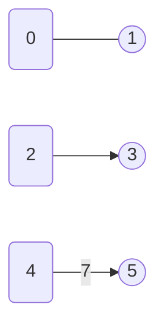
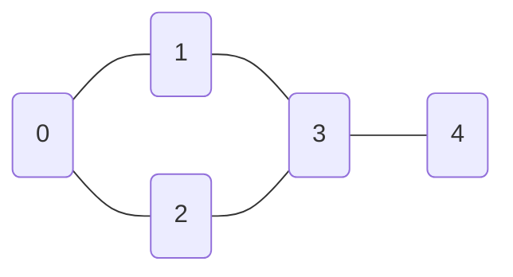

# 图的表示

一道 `n = 10^5` 个顶点的 LeetCode 题，按一种方式存图只占大约 1.6 MB，换另一种方式就要大约 10 GB。同一个图、同样的顶点、同样的边。在邻接表与邻接矩阵之间做选择，就是 Accepted 与 Memory Limit Exceeded 的差别，也是 Part 8 每一章都假设你已经做完的第一个决定。

本章先把菜单摆出来，再定下默认选项。代码里表示图有三种方式：邻接表、邻接矩阵、边列表。面试规模（`n ≤ 10^4`、边稀疏）的默认答案是邻接表。只有两种狭窄的例外，矩阵或原始边列表才配得上自己的位置。学完本章，Part 8 里每个遍历、最短路、最小生成树算法都把邻接表当输入，直接就能跑。

## 图例（Part 8 全篇通用）

Part 8 的每一章都用同一套 Mermaid 约定画图，读者不必在第 8.4 章重新学一遍 8.1 里已经学会的视觉语法。

- **空心圆** `(0)` 表示未访问的顶点。
- **实心圆** `((0))` 表示已访问的顶点（遍历过程中也可以是当前顶点）。
- **普通边**不带箭头，表示无向边。
- **带箭头的边** `-->` 表示有向边。
- 有权重时，权重写在边的标签上：`--|7|-->`。

图例画出来是这样：



*顶点 0 未访问，顶点 1 已访问；0-1 这条边是无向边。2-3 这条边是有向边。4-5 这条边有向，权重为 7。*

这就是全部词汇。8.1 到 8.12 章直接继承，不再重复解释。

## 三种表示

三种表示回答的是同样两个问题，只是方式不同：*u 的邻居有哪些？* 和 *u 到 v 有边吗？*

本章每一节都用同一个五顶点无向图。把这个图记牢：



*五个顶点，五条无向边。顶点 3 最连通（度为 3）；顶点 4 是叶子（度为 1）。遍历几章都拿这个图当标准输入。*

### 邻接表

一个长度为 `n` 的数组，每个元素是一条列表。下标 `u` 存放 u 的邻居。构建方式是走一遍输入的边列表，把每条边追加到它两个端点的列表里。

```python
def build_adjacency_list(n, edges, directed=False):
    adj = [[] for _ in range(n)]
    for u, v in edges:
        adj[u].append(v)
        if not directed:
            adj[v].append(u)            # 无向图：两个方向都加
    return adj
```

对上面那个标准图，结果是：

```text
adj[0] = [1, 2]
adj[1] = [0, 3]
adj[2] = [0, 3]
adj[3] = [1, 2, 4]
adj[4] = [3]
```

`neighbors(u)` 就是 `adj[u]`，遍历代价 `Θ(deg(u))`。`hasEdge(u, v)` 要线性扫一遍 `adj[u]`，最坏 `Θ(deg(u))`。建图 `Θ(V + E)`，空间 `Θ(V + E)`。Sedgewick 与 Wayne 的《Algorithms》第 4 版里那个 `Graph.java` 是标准实现；Javadoc 写明的 `Θ(E + V)` 空间和每个方法的 `Θ(1)` 界，正是本节推导出的结论。[^1]

### 邻接矩阵

一个 `n` 乘 `n` 的布尔矩阵。`M[u][v] = true`，当且仅当存在从 u 到 v 的边。无向图的矩阵是对称的。构建方式是先分配一个 `n × n` 的零矩阵，再为每条边翻一个位。

```python
def build_adjacency_matrix(n, edges, directed=False):
    M = [[False] * n for _ in range(n)]
    for u, v in edges:
        M[u][v] = True
        if not directed:
            M[v][u] = True
    return M
```

对那个标准图：

```text
    0 1 2 3 4
  ┌──────────
0 │ 0 1 1 0 0
1 │ 1 0 0 1 0
2 │ 1 0 0 1 0
3 │ 0 1 1 0 1
4 │ 0 0 0 1 0
```

`hasEdge(u, v)` 就是一次数组下标访问，`Θ(1)`。这正是矩阵存在的理由。代价的另一面：`neighbors(u)` 要扫一整行，`Θ(V)`，哪怕 `deg(u)` 很小也一样。建图代价固定是 `Θ(V^2)`，与边的数量无关，绝大部分花在清零上。空间同样是 `Θ(V^2)`。

### 边列表

最原始的输入：一个 `(u, v)` 元组数组（带权边是 `(u, v, w)`）。完全没有按顶点组织的结构。空间 `Θ(E)`。

```text
edges = [(0,1), (0,2), (1,3), (2,3), (3,4)]
```

`neighbors(u)` 要扫整个列表才能找出与 u 相连的边，每次查询 `Θ(E)`，做遍历完全没法用。`hasEdge(u, v)` 同样是 `Θ(E)` 扫描。边列表的价值出现在算法成批消费边、从不要邻居的场景：Kruskal 最小生成树按权重给边排序，一条一条喂给并查集；Bellman-Ford 按任意顺序把所有边松弛 `V - 1` 轮。这两类算法里，LeetCode 递给你的 `edges[][]` *就是* 可用的表示。

## 如何选择

决策规则一行就能写完：**默认用邻接表；只有图稠密、或者确实需要 `O(1)` 的边查询时才用邻接矩阵；只有要直接喂给 Kruskal 或 Bellman-Ford 时才用边列表。**

| 你看到的情况 | 该选什么 |
|---|---|
| `n ≤ 10^4`、边稀疏、主体是 BFS/DFS/Dijkstra | 邻接表（默认） |
| `n ≤ 500` 且大量 `hasEdge(u, v)` 查询，或者 `E ≈ V^2`（Floyd-Warshall、传递闭包、稠密图） | 邻接矩阵 |
| Kruskal 最小生成树、Bellman-Ford、以边为中心的流式处理、题目直接给 `edges[][]` 且从不问邻居 | 边列表 |

矩阵要配得上自己的位置，密度门槛大致是 `E ≈ V^2 / 2`。CLRS §22.1 说得很直白：*“邻接表为稀疏图（|E| 远小于 |V|^2）提供了一种紧凑的表示方式，通常也是首选。图稠密（|E| 接近 |V|^2）时，则优先用邻接矩阵。”*[^2]

真正起决定作用的是约束，不是渐进分析这套论证。LeetCode 给图论题设的上限是 `n ≤ 10^5`，在这个量级上邻接表大约占 `10^5 * 8 + 10^5 * 8 ≈ 1.6 MB` 内存；矩阵要 `(10^5)^2 = 10^{10}` 个格子，几十 GB。在 LeetCode 的规模下，矩阵远在时间复杂度成为问题之前就已经写不出来了。面试间里 `n` 小，矩阵才可行；即便那样，邻接表在任何遍历型算法上仍然占优，因为遍历代价对邻接表是 `Θ(V + E)`，对矩阵是 `Θ(V^2)`。

> [!IMPORTANT]
> 默认用邻接表。矩阵留给 `n ≤ 500`、内层循环里有 `O(1)` 边查询的题（Floyd-Warshall、传递闭包）。边列表留给 Kruskal 和 Bellman-Ford。Part 8 其他所有章节消费的都是邻接表。

## 实际开销

| 表示方式 | 建图时间 | 空间 | `neighbors(u)` | `hasEdge(u, v)` | `addEdge(u, v)` |
|---|---|---|---|---|---|
| 邻接表 | `Θ(V + E)` | `Θ(V + E)` | `Θ(deg(u))` | `O(deg(u))` | `Θ(1)` 摊还 |
| 邻接矩阵 | `Θ(V^2)` | `Θ(V^2)` | `Θ(V)` | `Θ(1)` | `Θ(1)` |
| 边列表 | `Θ(E)` | `Θ(E)` | `Θ(E)` | `Θ(E)` | `Θ(1)`（追加） |

*界值取自 CLRS §22.1 与 Sedgewick & Wayne 的 `Graph.java`。[^1][^2]*

关于这些数字有两点说明。邻接表 `addEdge` 的 `Θ(1)` 摊还代价，来自 Part 1 讲过的动态数组倍增：每次 push 摊还下来是常数，尽管有些 push 会触发底层重新分配。邻接表 `hasEdge` 的 `O(deg(u))` 最坏情况，如果把每个顶点的内层列表换成 `HashSet<Integer>`，平均会降到 `O(1)`；代价是常数级的额外空间。

## LC 1971：建邻接表，再遍历它

LC 1971（Find if Path Exists in Graph）是最简单的、必须走完一个完整来回的题。输入是 `n`、一个 `edges[][]` 数组、起点和终点；输出是路径是否存在。自然的解法：把边列表转成邻接表，然后从起点跑 BFS，直到到达终点或者把整个连通分量走完。

```python
from collections import deque

def valid_path(n, edges, source, destination):
    if source == destination:
        return True
    adj = [[] for _ in range(n)]
    for u, v in edges:
        adj[u].append(v)
        adj[v].append(u)                # 无向图：两个方向都加
    visited = [False] * n
    visited[source] = True
    q = deque([source])
    while q:
        u = q.popleft()
        for v in adj[u]:
            if v == destination:
                return True
            if not visited[v]:
                visited[v] = True
                q.append(v)
    return False
```

**解法** — Python（[Java](./00-graph-representation/lc-1971/sol.java) · [C++](./00-graph-representation/lc-1971/sol.cpp) · [Go](./00-graph-representation/lc-1971/sol.go)）

```python
# LC 1971. Find if Path Exists in Graph
# 用边集建邻接表，然后从 source 跑 BFS。建表是 O(V + E)，
# BFS 也是 O(V + E)。总时间与总空间都是 O(V + E)。
from collections import deque
from typing import List


def valid_path(n: int, edges: List[List[int]], source: int, destination: int) -> bool:
    if source == destination:
        return True
    adj: List[List[int]] = [[] for _ in range(n)]
    for u, v in edges:
        adj[u].append(v)
        adj[v].append(u)                       # 无向图：两个方向都加
    visited = [False] * n
    visited[source] = True
    q = deque([source])
    while q:
        u = q.popleft()
        for v in adj[u]:
            if v == destination:
                return True
            if not visited[v]:
                visited[v] = True
                q.append(v)
    return False
```

这段代码里有两处在干所有的活。第一处是建图：因为图是无向的，两个方向都要 `adj[u].append(v); adj[v].append(u)`。第二处是紧挨着邻接表分配的 visited 数组：`visited = [False] * n`。Part 8 的每个遍历都是把一个大小为 `V + E` 的 `adj` 和一个大小为 `V` 的 `visited` 配在一起用。CP-Algorithms 的参考 BFS 用的正是这个 `vector<vector<int>> adj; vector<bool> used(n);` 组合。[^3] visited 数组不是 BFS 的怪癖，它表示的是*遍历状态*，与*图本身*的表示并排放着。

遍历的具体机制归 8.1 章；本章确立的是这个契约。邻接表建图 `O(V + E)`，BFS 跑 `O(V + E)`，总计 `O(V + E)`。从 8.1 起，每一章都原样继承这个建图阶段，只把 BFS 的主体换成本章要讲的算法。

## 你会遇到的变体

下面每个维度都与"选列表、矩阵还是边列表"这个决定无关，它们可以叠加。

### 有向与无向

无向图把每条边的两个方向都推进邻接表；有向图只推起点到终点那一个方向。一个构造参数就把这事定了。Sedgewick 与 Wayne 正是为此分别提供了 `Graph` 和 `Digraph` 两个类；唯一的行为差异就是那第二次 push。[^1]

无向的情况有一笔不显眼的开销：每条边在邻接表的格子计数里出现两次，所以总格子数是 `2E`。大 O 意义下空间仍是 `Θ(V + E)`，但对内存紧张的题，这个常数因子是实打实的。

### 带权与不带权

带权图把内层格子的 `int` 换成 `(neighbor, weight)` 二元组。Python 里是元组 `(v, w)`；Java 里是长度为 2 的 `int[]`（`new int[]{v, w}`）或者一个小 `Edge` record；C++ 里是 `std::pair<int, int>`；Go 里是一个结构体字段。真正用权重的算法（Dijkstra、Bellman-Ford、Prim、Kruskal）总是消费这几种形状之一；不用权重的算法（BFS、DFS、单纯的可达性）直接忽略它。

陷阱是路径求和时的整数溢出。当 `V * max_w > 2^31`，`int` 累加器会回绕；乘法之前先提升到 `long`（Java）或 `int64`（Go）。

### 顶点编号：稠密整数与字符串

LeetCode 的标准输入格式是 `(n, edges)`，顶点已经标好 `0` 到 `n - 1`。这时邻接表就是 `List<List<Integer>>`（Java）、`vector<vector<int>>`（C++）、`[][]int`（Go）或 `List[List[int]]`（Python）：一个列表的数组，直接用顶点编号做下标。

输入给的是字符串 ID 时（LC 399 Evaluate Division、LC 721 Accounts Merge），有两个选择。要么保持 `Map<String, List<String>>` 结构，每次查询付一次哈希；要么读入时把字符串一次性重映射成稠密整数 `0..n-1`，下游全部用数组形状。重映射几乎总是值得的：并查集、BFS 的 visited 数组、DP 表要的都是数组下标，而不是字符串键。

### 隐式图

网格就是伪装起来的图。一个单词列表也一样，两个单词相差一个字符就算相连。为 `100 × 100` 的网格（10,000 个顶点、约 40,000 条边）显式建邻接表是浪费；邻居函数就是四行算术：

```python
def grid_neighbors(r, c, rows, cols):
    for dr, dc in ((-1, 0), (1, 0), (0, -1), (0, 1)):
        nr, nc = r + dr, c + dc
        if 0 <= nr < rows and 0 <= nc < cols:
            yield (nr, nc)
```

遍历算法并不关心邻居是来自 `adj[u]` 还是来自一个生成器。MIT 6.006 把这层讲得很明确：图算法是针对一个 `adj[u]` 访问器写的，任何能提供邻居的实现都能用。[^4] LC 200（Number of Islands）、LC 994（Rotting Oranges）、LC 127（Word Ladder）都是隐式图。

### 入边与出边一样容易

有些算法要沿边反向走（Kosaraju SCC、Tarjan SCC、"最少几个顶点能到达所有节点"）。两个选择：维护一份反向图的 `in_adj`，或者按需现算反向。两者都是 `Θ(V + E)`。

算法只需要入度计数时（Kahn 拓扑排序、LC 1557），一个大小为 V 的 `int[] in_degree` 就够了；不需要入边列表，也不需要反向图。LC 1557 是这件事最干净的样本，它在本章拿到进阶席位，恰恰因为答案根本不需要邻接表：

```python
def find_smallest_set_of_vertices(n, edges):
    in_degree = [0] * n
    for _, v in edges:                  # 只看终点
        in_degree[v] += 1
    return [u for u in range(n) if in_degree[u] == 0]
```

**解法** — Python（[Java](./00-graph-representation/lc-1557/sol.java) · [C++](./00-graph-representation/lc-1557/sol.cpp) · [Go](./00-graph-representation/lc-1557/sol.go)）

```python
# LC 1557. Minimum Number of Vertices to Reach All Nodes
# 在 DAG 里，一个顶点无法从任何其他顶点到达，当且仅当它的入度为 0。
# 答案就是入度为 0 的顶点集合。不需要邻接表；一个长度为 n 的 int[]
# 就够了。时间 O(V + E)，空间 O(V)。
from typing import List


def find_smallest_set_of_vertices(n: int, edges: List[List[int]]) -> List[int]:
    in_degree = [0] * n
    for _, v in edges:                         # 只看终点
        in_degree[v] += 1
    return [u for u in range(n) if in_degree[u] == 0]
```

这一课是："图的表示"也包括判断算法*最少*需要什么结构。有时是一个邻接表，有时只是一个整型数组。

## 常见误区

> [!WARNING]
> **无向图忘了加第二个方向。** LeetCode 上图论题最常见的 bug。读者对输入里的每条边只写 `adj[u].append(v)`，忘了在邻接表的视角下，一条无向边是*两条*记录。BFS 能找到边一侧的节点，却找不到另一侧；`validPath(0, 5)` 在一个示例清楚显示连通的图上返回 false。把 `directed` 标志接进构造函数，让它来定；不要在算法里事后分支。

> [!WARNING]
> **顶点编号稠密时还用 `Map<Integer, List<Integer>>`。** Python 玩家和 Java 老手的肌肉记忆是抄起一个以顶点为键的哈希表。输入给你 `0..n-1` 时，`int[][]` 或 `List<List<Integer>>` 在 LeetCode 判题机上快两到五倍：缓存局部性好，每次查询不哈希，不装箱。`Map<...>` 留给真正以字符串为键的题（LC 399、LC 721）。CP-Algorithms 正是因为这个原因只用 `vector<vector<int>>`。[^3]

> [!WARNING]
> **算法以边为中心，却去建邻接表。** Kruskal 最小生成树按权重排序边，用并查集扫一遍，全程没有 `adj`。Bellman-Ford 按任意顺序把所有边松弛 `V - 1` 轮，全程没有 `adj`。写 30 行建表代码之前，先问算法到底消费什么。如果答案是"某种顺序的边"，输入的边列表已经是正确的形状。

> [!WARNING]
> **遍历过程中修改邻接表。** Java 里是 `ConcurrentModificationException`，C++ 里是迭代器失效，Python 里是 "dictionary changed size during iteration"。修法不是加 try/catch，而是压根别改。Kahn 拓扑排序递减 `int[] inDegree`，从不碰邻接表本身；算法需要记住被删的边存在过，就用一个哨兵值做墓碑标记；确实要改的时候，先给邻居列表做一份快照再迭代。[^5]

## 题目梯度

本章在 `FOUNDATION_FRAMEWORK_EXEMPT` 名单上（DSH-15 豁免条款）：基础章节只带一两个示例锚点，不要求覆盖 简单/中等/困难 的跨度。真正的图论题从 8.1 章开始。

### 核心

- [LC 1971 — Find if Path Exists in Graph](https://leetcode.com/problems/find-if-path-exists-in-graph/) [简单] • graph-representation-build-and-traverse ★

### 进阶（可选）

- [LC 1557 — Minimum Number of Vertices to Reach All Nodes](https://leetcode.com/problems/minimum-number-of-vertices-to-reach-all-nodes/) [中等] • graph-in-degree-only

## 后续衔接

Part 8 的每个算法都拿本章建好的邻接表来跑。接下来是[广度优先搜索](./01-bfs.md)，邻接表最标准的消费者，基于队列的遍历，从起点出发按最短路顺序访问每个顶点。建图阶段就是你刚在 `validPath` 里写的那段；遍历的主体由 8.1 章来讲。

## 参考文献

[^1]: Robert Sedgewick and Kevin Wayne, *Algorithms*, 4th ed., Addison-Wesley, 2011, §4.1 "Undirected Graphs." <https://algs4.cs.princeton.edu/41graph/Graph.java.html>

[^2]: Cormen, Leiserson, Rivest, Stein, *Introduction to Algorithms*, 4th ed., MIT Press, 2022, Chapter 22 §22.1.

[^3]: CP-Algorithms（译自 e-maxx.ru），“Breadth-first search”。标准的 `vector<vector<int>> adj;` 邻接表配 `vector<bool> used(n);` 做访问标记；2024-10-13 更新。[cp-algorithms.com/graph/breadth-first-search](https://cp-algorithms.com/graph/breadth-first-search.html)。

[^4]: MIT 6.006 Spring 2020（Erik Demaine, Jason Ku, Justin Solomon），“Lecture 9: Breadth-First Search”。该课程的图论单元把图当作 `adj[u]` 访问器这一抽象，具体表示（set 对象、哈希字典、数组）在构造时选定。[ocw.mit.edu/courses/6-006-introduction-to-algorithms-spring-2020](https://ocw.mit.edu/courses/6-006-introduction-to-algorithms-spring-2020/resources/mit6_006s20_lec9/)。

[^5]: walkccc LeetCode mirror, "1557. Minimum Number of Vertices to Reach All Nodes." <https://walkccc.me/LeetCode/problems/1557/>
