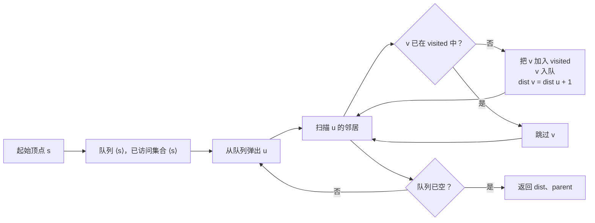
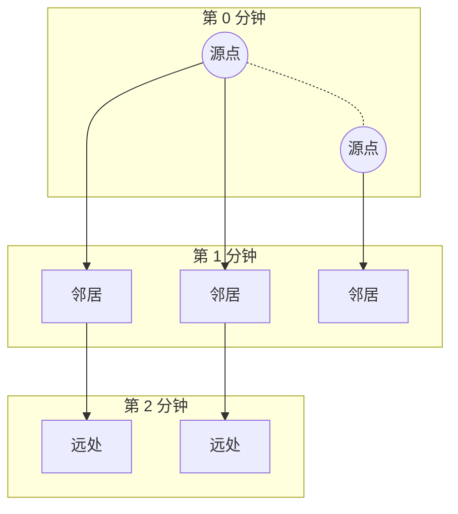

# 广度优先搜索

一个 3×3 的橘子网格。其中一个是烂的，八个是新鲜的，每分钟每个烂橘子都会把上下左右四个邻居传染成烂的。多少分钟之后不再有新鲜的？对 `[[2, 1, 1], [1, 1, 0], [0, 1, 1]]` 来说，答案是 4。对 `[[2, 1, 1], [0, 1, 1], [1, 0, 1]]` 来说，答案是 `-1`，因为有一个新鲜格子被墙隔开，永远走不到。

这就是 LC 994。它是本章的标准题设，也逼你正面面对 BFS 的真实样子：一个队列、一个已访问集合，以及同一个格子绝不入队两次的纪律。新鲜计数掉到零的那一刻，分钟数就出来了——听起来理所当然，直到你把它写成代码，才发现有无数种办法把计数写差一。

## 契约

两片状态，同步运转。

一个 **FIFO 队列**装算法已经发现、但还没展开的格子。FIFO 里的那个 F 在这里是干实活的：先压进去的格子先弹出来，这正是第二片状态能够成立的前提。

一个**已访问集合**（visited）装算法已经发现过的格子，不管有没有展开过。初学者就栽在这一句上。*已发现*的意思是“至少被放进队列一次”，不是“已经被弹出过”。如果你在弹出时才标记已访问、而不是在压入时标记，同一个格子会被压两三次，O(V + E) 的算法在稠密图上就变成 O(V · E)。

FIFO 这条纪律换来的不变量是：在运行的任意时刻，队列里的每个格子到起点的距离，只可能是两个相邻取值之一。队列会把距离为 `d` 的整层排空，之后才会有距离为 `d + 1` 的格子被弹出。这就是逐层遍历的性质，也是 BFS 能在无权重图上给出最短路径的原因。



*BFS 就是一个有限的控制循环。唯一一个不只是记账的分支是那个已访问判断，正是它限定了算法的总工作量。*

## 为什么树不需要已访问集合，图却需要

树上的 BFS——也就是 [Level-order traversal](../part-6-trees-heaps/03-level-order-traversal.md) 里那套 LC 102 层序遍历——不用已访问集合也能跑，因为树没有环。每个节点恰好有一个父节点。BFS 的前沿沿着树一层层往下走，不可能有两个父节点指向同一个孩子。

图不是树。两个顶点可以共用一个邻居，环确实存在。没有已访问标记，一个三节点的三角形 `A → B → C → A` 会让队列里塞满 `A, B, C, A, B, C, A, B, C, ...`，直到内存耗尽。已访问集合才是让 BFS 在有环图上成为*会终止*的算法，而不只是在树上做一次层序遍历。

记账成本：每个顶点一位。它换来的上界保住了：O(V + E)，证明见下文。

## 标准实现

LC 994 要的是多源变体：每个一开始就烂的格子都从第 0 分钟开始计时。单源情形就是同一份代码的简化版，种子扫描里只有一个格子。我们讲多源版本，因为它更难，而且单源版本能白白地从它里面掉出来。

三个阶段。先扫一遍网格，把所有源点按深度 0 播进去，同时数出新鲜格子的数量。再逐层排空队列，每发现一个新格子就把新鲜计数减一。队列排空之后，当且仅当每个新鲜格子都被访问到，才返回见过的最后一个深度。

```python
from collections import deque

def oranges_rotting(grid):
    rows, cols = len(grid), len(grid[0])
    queue = deque()
    fresh = 0
    for r in range(rows):
        for c in range(cols):
            if grid[r][c] == 2:
                queue.append((r, c, 0))    # 把每个源点播在深度 0
            elif grid[r][c] == 1:
                fresh += 1
    if fresh == 0:
        return 0
    minutes = 0
    dirs = ((1, 0), (-1, 0), (0, 1), (0, -1))
    while queue:
        r, c, t = queue.popleft()
        minutes = t
        for dr, dc in dirs:
            nr, nc = r + dr, c + dc
            if 0 <= nr < rows and 0 <= nc < cols and grid[nr][nc] == 1:
                grid[nr][nc] = 2           # 在入队时标记已访问，而不是在出队时
                fresh -= 1
                queue.append((nr, nc, t + 1))
    return minutes if fresh == 0 else -1
```

**Solution** — Python ([Java](./01-bfs/lc-994/sol.java) · [C++](./01-bfs/lc-994/sol.cpp) · [Go](./01-bfs/lc-994/sol.go))

```python
# LC 994. Rotting Oranges
from collections import deque
from typing import List


def oranges_rotting(grid: List[List[int]]) -> int:
    """LC 994 Rotting Oranges: minimum minutes until no fresh orange remains, or -1."""
    if not grid or not grid[0]:
        return 0
    rows, cols = len(grid), len(grid[0])
    queue = deque()
    fresh = 0
    for r in range(rows):
        for c in range(cols):
            if grid[r][c] == 2:
                queue.append((r, c, 0))
            elif grid[r][c] == 1:
                fresh += 1
    if fresh == 0:
        return 0
    minutes = 0
    dirs = ((1, 0), (-1, 0), (0, 1), (0, -1))
    while queue:
        r, c, t = queue.popleft()
        minutes = t
        for dr, dc in dirs:
            nr, nc = r + dr, c + dc
            if 0 <= nr < rows and 0 <= nc < cols and grid[nr][nc] == 1:
                grid[nr][nc] = 2
                fresh -= 1
                queue.append((nr, nc, t + 1))
    return minutes if fresh == 0 else -1
```

这段代码里有三处在干实活，值得细看。

`grid[nr][nc] = 2` 出现在 `if grid[nr][nc] == 1` 这个分支*内部*，和 `queue.append` 处在同一行。这就是“入队即标记已访问”规则的具体形态。网格本身兼任已访问数组。一个格子一旦从 `1` 翻成 `2`，下一个访问者对它的发现判断 `grid[nr][nc] == 1` 就会失败，于是它永远进不了队列第二次。

队列里的每一项都用一个元组第三元素 `t` 自带深度。另一种写法是**层计数式**：外层循环用 `for _ in range(len(queue))` 把当前整条前沿排空，然后才给 `minute` 计数器加一。两种都正确。带深度标记的写法能更干净地推广到“不同源点从不同深度起步”的情形（LC 994 的多源播种正是如此）；而当答案就是“单一源点的最少边数”时，层计数式能少写一行。选定一种，在一章里贯彻到底；中途换风格是保证出差的唯一办法——差一（off-by-one）。

种子扫描发生在 BFS 主循环*之前*，对网格一趟扫完。每个烂格子都以深度 0 进队。数学上这等价于加一个虚拟超级源点，用零权重边连到每个真实源点；O(V + E) 的复杂度分析依然成立，因为这些虚拟边只被扫一次。[^1] 换到代码里的好处是：跑一趟 BFS，而不是每个源点跑一趟；给出的是“直到*所有*新鲜格子都被染上”的正确分钟数，而不是“从某一个源点出发的分钟数”。

## 走一遍第 0 到第 3 分钟

拿小一点的 `[[2, 1, 1], [1, 1, 1]]`，它有一个源点在 `(0, 0)`，五个新鲜格子。每个格子最多四个邻居；答案是三分钟。

把 `(0, 0, 0)` 播进队列。弹出它。把 `(1, 0)` 和 `(0, 1)` 以深度 1 标记为已访问并压入。此时队列读作 `[(1, 0, 1), (0, 1, 1)]`。弹出 `(1, 0, 1)`，它唯一的鲜邻居是 `(1, 1)`，以深度 2 进去。弹出 `(0, 1, 1)`，它的鲜邻居是 `(0, 2)`，同样是深度 2。弹出 `(1, 1, 2)`，`(1, 2)` 以深度 3 进入。就在这次压入时新鲜计数刚好归零，但循环仍会继续跑到队列排空。弹出 `(0, 2, 2)`，没有鲜邻居。弹出 `(1, 2, 3)`，没有鲜邻居。队列空。返回 3。

组件动的是同一条轨迹。盯住右边那一列队列，以及每个格子在被标记为已访问的那一刻印上的分钟标签。

> **Interactive widget:** [Graph BFS — 前沿扩张（网格上的多源）](../../../dsa/widgets/w-25-graph-bfs.yml)（面板 `default`）—— 在网站上渲染；YAML 规格描述了各个关键帧。

*静态回退：第 0 分钟只有一个源点在 (0, 0)；第 1 分钟 (1, 0) 和 (0, 1) 已访问；第 2 分钟加上 (1, 1) 和 (0, 2)；第 3 分钟加上 (1, 2)，新鲜计数归零。答案 = 3。*

## 实际开销

| 变体 | 时间 | 空间 | 说明 |
|---|---|---|---|
| 单源、通用图 | O(V + E) | O(V) | CLRS 第 3 版 §22.2 给出的教科书上界。[^2] |
| 多源网格（LC 994、542、286） | O(m·n) | O(m·n) | 特化情形，V = m·n、E ≤ 4·m·n。 |
| 8 方向网格（LC 1091） | O(n²) | O(n²) | 方向数组长度是 8 而不是 4。 |
| 状态空间 BFS（LC 752 转盘锁） | O(10⁴ · 8) | O(10⁴) | 状态数 ≤ 10000；分支因子 8。 |
| 单词图 BFS（LC 127） | O(N · L · 26) | O(N · L) | N = 单词表长度，L = 单词长度。 |
| 0-1 BFS（deque 变体） | O(V + E) | O(V) | 零权重边走队首压入；见 [Dijkstra 与 0-1 BFS](../../../dsa/part-8-graphs/09-dijkstra.md)。 |

论证很短。[^2] 每个顶点最多入队一次，因为已访问位是在入队时置上的，所以每次入队和每次出队都是 O(1)。在无向图上每条边 `(u, v)` 最多被检查两次（两个端点各一次），有向图上一次；在邻接表表示下每次检查是 O(1)。求和得 O(V + E)。空间上界是已访问数组加队列；队列里的元素永远不超过 V 个，因为每次入队都被已访问判断把着门。

对网格来说，V = m·n，E ≤ 4·m·n（对角线情形是 8·m·n），两个维度都塌缩成 O(m·n)。在 1000×1000 的网格上，用 int 数组做已访问标记要占 4 MB，通常小到不必在意，偶尔又大到足以把你推向位压缩。

## 多源 BFS

“要是有好几个起点同时向外扩张呢？”这个情形，一段话就能说完，一张图就能说清。



*所有源点在第 0 分钟同时向外扩张；BFS 前沿给出的逐格分钟数同时尊重每个源点的时钟。*

在循环之前一趟扫描里把所有源点按深度 0 播进去，然后跑一趟 BFS。就这么点事。数学上的等价物（虚拟超级源点加零权重边）是它在不破坏 O(V + E) 上界的前提下能成立的原因，但写代码时你并不需要去想超级源点；你只需要在主循环开始前把每个源点都压进去。

这个模式出现在三道题里。**LC 994** 从每个初始就烂的格子开始腐烂。**LC 542** 对二进制矩阵里的每个格子，算出到最近零的距离：同一套算法，只是输出那一侧的提问方式不同。**LC 286** Walls and Gates 又是同样一回事，门是源点，房间是你要填距离的那些格子（它是 LC 会员题；LC 542 是免费版等价题，也是梯度里的那道）。

处理这件事的错误方式，如果你脑子里想的是单源，那也是最自然的方式，就是 `for source in sources: bfs(source)`。这样得到的是 n 遍正确的*单源*距离，而题目要的不是这个。“直到所有格子都被访问到的最小分钟数”指的是“最后一个新鲜格子烂掉的那一分钟”，它取决于所有源点前沿并行扩张的并集。先播种再 BFS 的模式免费帮你处理了这个并集。

## 两个最容易踩的坑

> [!WARNING]
> **在出队时标记已访问，而不是在入队时。** 那个说*“我没弹出它就不算访问过它”*的直觉，在 BFS 上是错的。当两个已经在队列里的邻居 `u₁` 和 `u₂` 同时指向同一个尚未发现的 `v` 时，两者都会把 `v` 压进队列，除非 `v` 的已访问位在第一次压入的那一刻就被置上，否则谁也等不到另一个人弹出它。修法：把 `visited[v] = true` 写在 `queue.append(v)` 同一行，放在 `if not visited[v]` 分支里面。walkccc 的 LC 542 参考实现用一个显式的 `seen` 数组，在入队时置位，把 `seen[x][y] = true` 写在 `q.emplace(x, y)` 同一行，就是为了让这个 bug 不可能发生。[^3]

> [!WARNING]
> **在 Python 里用 `list.pop(0)` 而不是 `deque.popleft`。** 出队成本从 O(1) 变成 O(n)，因为每个剩余元素都要往前挪一格，BFS 就从 O(V + E) 变成 O(V · (V + E))，在 ≥ 10×10 的网格上直接超时。算法本身是*对的*，只是慢到不可接受。永远在文件顶上写 `from collections import deque`。同一个 bug 也会毁掉下一章 [DFS](../../../dsa/part-8-graphs/02-dfs.md) 里那种拿 `list` 当栈的朴素 DFS。

还有第三个坑值得一提：分钟数上的差一。LC 994 要的是流逝的分钟数（= 走过的边数 = 最后一个新鲜格子被发现时的深度）。LC 1091 要的是按格子数算的路径长度（= 深度 + 1，因为路径*包含*起点）。不同的问题，不同的约定，完全相同的算法。修法是在提交之前，拿一个三格直线路径把标准例子手推一遍；差一这种东西，不看着某个具体用例跑一遍是看不出来的。

## 模式失效的场景

### 状态空间 BFS（LC 127、LC 752）

这里的“图”有时是一堆状态，而不是一份显式的邻接表。LC 127 Word Ladder 把单词当顶点，单字母替换当边。LC 752 Open the Lock 把 4 位数字组合当顶点，任意一个转轮上的 `±1` 当边。BFS 骨架和 LC 994 一模一样：队列 + 已访问集合，逐层扩张。变的是邻居函数：`for v in neighbors_of(u)` 现在是对生成出来的状态循环，而不是遍历一份存好的邻接表。

复杂度上界随之改变。对 LC 752，状态空间上限是 10⁴ 种组合，分支因子是 8（两个方向 × 四个转轮），所以无论输入是什么，运行都是 O(10⁴ · 8)。对 LC 127，上界是 O(N · L · 26)，其中 N 是单词表长度、L 是单词长度；单节点成本占了主导，因为生成邻居意味着每个位置 × 每个字母都要试一遍。

### 0-1 BFS

当边的权重只取 0 或 1 时，用普通队列的 BFS 会少算，因为零权重边本该是免费的，而 FIFO 把它们当成权重 1 的边。修法是换成双端队列：零权重边的目标走队首压入，一权重边的目标走队尾压入。同样是 O(V + E) 的上界，同样是入队即标记已访问的纪律。完整讲法在 [Dijkstra 与 0-1 BFS](../../../dsa/part-8-graphs/09-dijkstra.md)，那里把这个 deque 变体和处理任意正权重的优先队列版本放在一起讲。

### 层计数式 vs. 深度标记式

回答“我们现在走到第几步”的两种实现风格：

- **层计数式**：外层循环数步数，内层循环用 `for _ in range(len(queue))` 把当前前沿排空。当答案是“单一源点的最少边数”时更干净；walkccc 的 LC 994 / LC 1091 / LC 127 参考实现用的就是这种。[^3]
- **深度标记式**：每个队列元素把自身深度作为元组的一部分带在身上。当源点从不同深度起步（多源），或者本章想把深度当作一等变量摆到台面上时，更干净。§“标准实现”里的代码用的是这种。

两种给出同一个答案。中途换风格，或者更糟——在函数中途换风格，就是面试里差一错误的诞生方式。

## BFS 该用与不该用的场合

触发词是“最短路径”或“最少步数”，前提是图无权重（或者每次转移的代价相同）。题目一旦这么说，就该伸手去拿 BFS。

题目没说这话的时候，通常该换成另外三种算法之一。**边权为非均匀正值的加权图**要 Dijkstra；BFS 会少算，因为它把每条边都当成权重 1。**负权重**要 Bellman-Ford；连 Dijkstra 都处理不了。**拓扑驱动的问题**，比如有向图找环、拓扑排序、割点，要 DFS，因为它们需要 BFS 给不了的递归/父指针结构。

0-1 权重这个特例是那条规则的例外，也正好印证了它：带 deque 的 BFS（在 [Dijkstra 与 0-1 BFS](../../../dsa/part-8-graphs/09-dijkstra.md) 里讲）仍是 O(V + E)，严格快过 Dijkstra，而本章的入队即标记已访问规则依然成立。

## 题目梯度

### 核心（三题全做才算掌握本章）

- [LC 994 — Rotting Oranges](https://leetcode.com/problems/rotting-oranges/) [中等] • bfs-multi-source-grid ★
- [LC 542 — 01 Matrix](https://leetcode.com/problems/01-matrix/) [中等] • bfs-multi-source-grid
- [LC 1091 — Shortest Path in Binary Matrix](https://leetcode.com/problems/shortest-path-in-binary-matrix/) [中等] • bfs-shortest-path-grid

### 进阶（可选）

- [LC 127 — Word Ladder](https://leetcode.com/problems/word-ladder/) [困难] • bfs-implicit-graph-state
- [LC 752 — Open the Lock](https://leetcode.com/problems/open-the-lock/) [中等] • bfs-implicit-graph-state

LC 994 是本章的招牌题（★），也是实例推演和组件动的那道。核心三题都落在中等，因为纯 BFS 的标准形态里挑不出一道干净简单题。LC 102 二叉树层序遍历归 [Level-order traversal](../part-6-trees-heaps/03-level-order-traversal.md) 所有，那里“树 vs. 图”的区别才是教学点。困难那一档由进阶里的 LC 127 补上，它同时也是从网格 BFS 跨到状态空间 BFS 最干净的桥。

## 后续衔接

下一章 [DFS](../../../dsa/part-8-graphs/02-dfs.md) 用同一副骨架，只是把队列换成栈，并用递归结构换掉了逐层保证——那是 BFS 表达不了的东西。同样是入队即标记已访问（或者说压栈即标记）的规则，同样是 O(V + E) 的上界，算法形态不同。

再往后，[Connected components](../../../dsa/part-8-graphs/03-connected-components.md) 把 BFS 当作泛洪填充的两件可互换工具之一，[Topological sort (Kahn's algorithm)](../../../dsa/part-8-graphs/04-topological-sort-kahn.md) 则复用 BFS 的前沿、以入度为零作为种子，给出 DAG 的线性排序。0-1 BFS 变体和优先队列版本的一般化，都在 [Dijkstra 与 0-1 BFS](../../../dsa/part-8-graphs/09-dijkstra.md) 里。

## 参考文献

[^1]: CP-Algorithms, "Breadth-first search," applications and complexity, last updated 2024-10-13. <https://cp-algorithms.com/graph/breadth-first-search.html>.

[^2]: Cormen, Leiserson, Rivest, Stein, *Introduction to Algorithms*, 3rd ed., MIT Press, 2009, Chapter 22 §22.2 ("Breadth-first search"), pp.

[^3]: walkccc/LeetCode, problem references for LC 994 Rotting Oranges, LC 542 01 Matrix, and LC 1091 Shortest Path in Binary Matrix. <https://walkccc.me/LeetCode/problems/994/>
