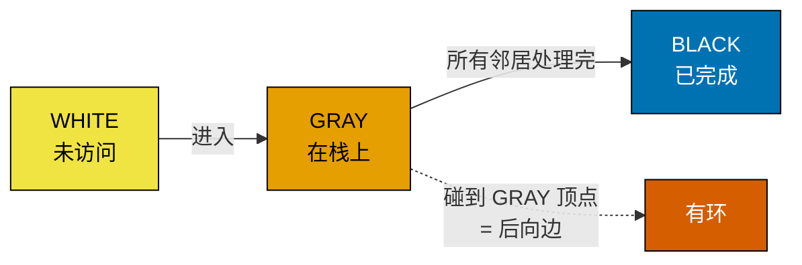

# 深度优先搜索

五行 Python，加上文件顶上把递归上限抬高一行。这就是整个算法。一个函数拿到顶点，把它标成已访问，然后对每个未访问的邻居调用自己。这一章想做的任何处理，都发生在进去的路上、回来的路上，或者两边都放。本部分后面每一个高级图算法，都是对这五行的定制：探哪些邻居、进入时记什么、退出时记什么、什么时候停。

深度优先遍历最早由 Charles Pierre Trémaux 在 1880 年代作为一种走迷宫的程序描述出来：他证明了边走边给每条通道做标记（并且拒绝再走进已经标记过的通道），一个探索者就能找到任何连通迷宫的出口。[^1] 现代讲法——带时间戳，加上本章引用的那些正确性证明——源自 Hopcroft 和 Tarjan 1973 年的论文，他们用 DFS 在线性时间内解决平面性测试，让这个算法成了正经的构件。[^2] 把 Hopcroft 和 Tarjan 那篇读一遍，比读任何讲这个主题的博客都值。

## 递归形式

图上的 DFS 需要两样东西：图的一种邻接视图（[图的表示](./00-graph-representation.md) 里的任何一种表示都行），以及一个记住哪些顶点已经见过的办法。在网格上，第二样会塌进第一样，因为你可以直接改格子来做标记。在通用图上，它是一个单独的 `visited` 集合。

```python
import sys
sys.setrecursionlimit(10**6)  # DSH-04：深图会撑爆默认的 1000 帧栈。

def dfs(graph, u, visited):
    visited.add(u)
    # 前序钩子：在进入子树之前处理 u。
    for v in graph[u]:
        if v not in visited:
            dfs(graph, v, visited)
    # 后序钩子：等整个子树都处理完之后，再处理 u。
```

函数调用栈*就是*搜索边界。这几行里没有任何一个叫“栈”的显式数据结构，可正在发生的一切就是栈：每次递归调用压一帧，每次返回弹一帧。这是对 DFS 最干净的读法，也是该背下来的那一种。

```python
def dfs_iter(graph, source, visited):
    stack = [source]
    while stack:
        u = stack.pop()
        if u in visited:
            continue
        visited.add(u)
        for v in graph[u]:
            if v not in visited:
                stack.append(v)
```

这两个函数访问的顶点集合相同，访问的顺序不同。递归 DFS 按 `graph[u]` 的迭代顺序访问邻居；迭代 DFS 因为栈是 LIFO，顺序正好反过来。对大多数 LeetCode 风格的题，顺序不影响结果：答案只取决于*哪些*顶点可达，而不取决于它们*何时*被到达。在顺序真正要紧的地方（拓扑排序用的后序完成时间、找环用的边分类），迭代版本需要额外一手。Sedgewick 的教科书专门用一整道习题，构造了一个 4 顶点图，在那里朴素的 `stack.pop` 之后接“标记 + 压入邻居”，产生的遍历*不是*一棵合法的 DFS 树。[^3] [拓扑排序](./05-topological-sort-dfs.md) 和 [图中的环检测](./06-cycle-detection-graphs.md) 都继承了这层微妙之处；本章剩下的部分，用更简单的 pop 版本就够了。

> [!IMPORTANT]
> 只要 Python 的递归深度是真问题，就伸手去拿迭代形式。CPython 默认的递归上限是 1,000 帧；在 200×200 的网格上，如果活跃区域像蛇一样穿过大部分格子，递归 DFS 会稳定地以 `RecursionError` 崩掉。修法是在模块顶上写一行 `sys.setrecursionlimit(10**6)`，或者换成上面的迭代版本。Java 和 C++ 的默认栈更大，但并不豁免；4 万个格子的网格照样能把它们撑爆。[^4]

## 三种风味：前序、后序、在栈上

递归处理器有两个天然的钩子：一行放在遍历邻居的循环之前，一行放在循环返回之后。不同的题挑不同的钩子。

**前序 DFS** 在进入时处理顶点，也就是在递归之前。这是“对每个可达顶点做点什么”的那一味：泛洪填充、标记与边界连通的格子、构造连通分量。本章下面的实例推演就是前序的。LC 130 在进入时把格子标成 `'#'`，向四个邻居递归，然后返回；回来的路上什么都不做。

**后序 DFS** 在沿着栈往上返回时处理顶点，也就是等它的整个子树都处理完之后。拓扑排序是标准案例：每个顶点在它的后代都发出完成时间之后，才发出自己的完成时间，把完成顺序反过来就得到这个 DAG 的一个合法拓扑序。树形 DP（[树形 DP](../../../dsa/part-9-dynamic-programming/13-tree-dp.md) 里那个树上最长路径的模式）也是后序的，因为一个节点上的答案取决于子节点返回的值。

**在栈上 DFS** 在“已访问”和“未访问”之外维护第三种状态：某个顶点*此刻正在递归栈上*。DFS 第一次撞上一个在栈上的邻居时，它就找到了一条后向边（back edge），而后向边就是环。标准实现用三种颜色（white 未访问、gray 在栈上、black 已完成），CLRS §20.3 的白路径定理让这个正确性证明成立。[^5] [图中的环检测](./06-cycle-detection-graphs.md) 把这一套讲透。



*CLRS 的三色 DFS 状态机。对 LC 130 这类网格题，一个标记同时顶替了 gray 和 black；只有当算法需要检测环时，这个区分才开始重要。*

风味划分还带出一组值得认识的词。在有向图里，每条 DFS 边恰好落入四类之一：*树边*（把 DFS 带进一个此前未访问顶点的那些边）、*后向边*（指向 gray 顶点；它们就是环）、*前向边*（指向 black 后代）、*横叉边*（指向 black 非后代）。无向图上的 DFS 只会产生树边和后向边；另外两种是有向图的产物。这套分类在 Part 8.6 会变成承重结构——那一章开始追问哪种边会破坏正确性；眼下知道名字就够了。

## 实际开销

| 变体 | 时间 | 空间 | 说明 |
|---|---|---|---|
| 邻接表 DFS，通用图 | O(V + E) | O(V) | 每个顶点被标记一次；每条边被检查一次（无向图两次）。CLRS 定理 20.7。[^6] |
| 邻接矩阵 DFS | O(V²) | O(V) | 无论度数多少，列出每个顶点的邻居都要 O(V)。 |
| 网格 DFS，m×n 个格子，四方向 | O(m·n) | O(m·n) | 每个格子最多被访问一次；递归栈深度最多是穿过网格的最长蛇形区域。 |

均摊论证和栈的 push/pop 是同一个。每个顶点恰好被加进 `visited` 集合一次。加进去之后，DFS 恰好扫一遍它的邻接表，再也不会回到它。总工作量是对所有顶点求和 `Σ (1 + deg(v))`，无向图等于 `V + 2E`，有向图等于 `V + E`。完毕。

空间上界是松的。一个满是小 `'X'`、只有角落里一个 `'O'` 的网格，递归栈深度是 1；一个 `'O'` 格子排成希尔伯特曲线那种蛇形的网格，递归栈深度是 m·n。表格里写的是最坏情况，正文说“与输入规模成线性”，因为真正把提交打挂的就是最坏情况。按最坏情况做规划；迭代形式能彻底绕开这个问题。

## 实例推演：LC 130 — Surrounded Regions

用我们自己的话讲这道题。一个二维棋盘里有 `'X'` 和 `'O'`。一个 `'O'` 区域如果被完全围住——区域里每个 `'O'` 沿任何邻居链、四个方向都被 `'X'` 堵死——就是被*捕获*（翻成 `'X'`）。一个 `'O'` 区域只要含有棋盘边界上的格子，就是*安全*的，因为这样的区域逃出了包围圈。

第一反应是直接去走每一个 `'O'` 区域，然后用某种办法判断它是否封闭。这个判断没有明显的局部形式：站在区域内部，你不向外探索就说不清它有没有碰到边界。解开这道题的归约是把问题反过来问。找出你*不想*翻转的区域（与边界连通的那些），把它们标记出来。DFS 没有走到的，按构造就是被围住的。

三趟搞定。第一趟走四条边界，从每个碰到的 `'O'` 发起一次 DFS，把每个可达格子标成哨兵 `'#'`。第二趟是隐式的，藏在第一趟里——它就是 DFS 干的活。第三趟扫全场：所有剩下的 `'O'` 都从边界不可达，翻成 `'X'`；每个 `'#'` 原本与边界连通，还原成 `'O'`。

```python
def solve(board):
    if not board or not board[0]:
        return
    m, n = len(board), len(board[0])

    def dfs(r, c):
        if r < 0 or r >= m or c < 0 or c >= n or board[r][c] != "O":
            return
        board[r][c] = "#"           # 标记与边界连通
        dfs(r + 1, c); dfs(r - 1, c)
        dfs(r, c + 1); dfs(r, c - 1)

    for r in range(m):
        dfs(r, 0); dfs(r, n - 1)
    for c in range(n):
        dfs(0, c); dfs(m - 1, c)

    for r in range(m):
        for c in range(n):
            if board[r][c] == "O":
                board[r][c] = "X"
            elif board[r][c] == "#":
                board[r][c] = "O"
```

**Solution** — Python ([Java](./02-dfs/lc-130/sol.java) · [C++](./02-dfs/lc-130/sol.cpp) · [Go](./02-dfs/lc-130/sol.go))

```python
# LC 130. Surrounded Regions
import sys
sys.setrecursionlimit(10**6)  # DSH-04：深网格的递归深度会逼近 n*m。


def solve(board: list[list[str]]) -> None:
    """LC 130 Surrounded Regions: capture every 'O' region not touching the border."""
    if not board or not board[0]:
        return
    m, n = len(board), len(board[0])

    def dfs(r: int, c: int) -> None:
        # 边界检查 + 只走还活着的 'O' 格子。
        if r < 0 or r >= m or c < 0 or c >= n or board[r][c] != "O":
            return
        board[r][c] = "#"  # 标记与边界连通
        dfs(r + 1, c)
        dfs(r - 1, c)
        dfs(r, c + 1)
        dfs(r, c - 1)

    # 扫四条边界，从每个碰到的 'O' 发起 DFS。
    for r in range(m):
        dfs(r, 0)
        dfs(r, n - 1)
    for c in range(n):
        dfs(0, c)
        dfs(m - 1, c)

    # 最后一趟：'#' 原本与边界连通（还原），'O' 是被围住的（捕获）。
    for r in range(m):
        for c in range(n):
            if board[r][c] == "O":
                board[r][c] = "X"
            elif board[r][c] == "#":
                board[r][c] = "O"
```

`dfs` 顶部的边界检查和 `!= "O"` 守卫，承担了全部终止递归的工作。越界、碰到 `'X'`、碰到已经标成 `'#'` 的格子：三种情况任一都直接返回，不再递归。那句 `board[r][c] = "#"` 既是已访问标记，也是正在构造的答案。没有单独的 `visited` 集合，因为网格本身就是已访问记录。

> **Interactive widget:** [DFS 探索 —— 5×5 网格上从边界发起的迭代 DFS](../../../dsa/widgets/w-26-graph-dfs.yml) —— 在网站上渲染；YAML 规格描述了各个关键帧。

*静态回退：在标准的 5×5 输入上，边界上的四个 `'O'` 给栈播种；DFS 标出七个与边界连通的格子；最后清扫时 (3,1) 和 (3,2) 两个内部格子从 `'O'` 翻成 `'X'`。*

组件演示的是迭代形式，因为显式栈才是看得见的状态；递归 DFS 把同样的信息藏在 Python 的调用栈里，画起来难得多。特别留意第 16、17 步：那是两次“弹出即跳过”的事件——栈把一个已经标记过的格子交给循环，而处理器顶部的已访问检查，是算法和死循环之间唯一的一道屏障。下一节的坑讲的就是这个守卫。

## 两个最容易踩的坑

> [!WARNING]
> **先递归，后标记。** 写递归最自然的顺序是“先做事，再递归”。在网格上这个顺序是错的。如果 `dfs(r, c)` 在把 `(r, c)` 标成 `'#'` *之前*就递归进 `dfs(r+1, c)`，邻居会立刻递归回 `(r, c)`（它还是 `'O'`），后者又递归回邻居，如此往复。Python 抛 `RecursionError`；Java 抛 `StackOverflowError`；C++ 段错误。本章和兄弟文件里的每一份实现都是先标记、后递归。把这两行顺序调过来，算法就永远转下去。[^7]

> [!WARNING]
> **在网格上额外背一个 `visited` 集合。** 这个诱惑是从通用图 DFS 迁移过来的，那里 `visited: set[int]` 是标准写法；但在网格上，格子里的哨兵 `'#'` 已经把活干了。额外一个 `visited: set[(int, int)]` 让内存翻倍，每次递归调用还多一次哈希查找。二者选一个，不要都上。本部分每一道网格题都是同样的道理，包括 [连通分量与泛洪填充](./03-connected-components.md) 里的 LC 200 和 LC 695。

还有第三个坑值得顺带一提：在迭代版本里，一个格子可能被不同邻居压进栈好几次，才轮到某次弹出真正访问它。这没问题，因为处理器顶部的已访问检查会跳过重复项，但它会把栈的水位顶高。如果内存真的很紧，就在压栈前加一道“这个格子还活着且没被标记吗”的判断，用一次稍微多余的检查换一个更小的栈。

## 题目梯度

### 核心（三题全做才算掌握本章）

- [LC 130 — Surrounded Regions](https://leetcode.com/problems/surrounded-regions/) [中等] • dfs-from-boundary ★
- [LC 417 — Pacific Atlantic Water Flow](https://leetcode.com/problems/pacific-atlantic-water-flow/) [中等] • dfs-from-boundary-multi-source
- [LC 1254 — Number of Closed Islands](https://leetcode.com/problems/number-of-closed-islands/) [中等] • dfs-from-boundary-then-count

### 进阶（可选）

- [LC 1971 — Find if Path Exists in Graph](https://leetcode.com/problems/find-if-path-exists-in-graph/) [简单] • dfs-reachability
- [LC 827 — Making A Large Island](https://leetcode.com/problems/making-a-large-island/) [困难] • dfs-component-sizing-then-flip

核心三题全是中等，因为本章教的这个“从边界 DFS”的标准模式，在它的原生形态上没有简单版或困难版的亲戚。进阶两题把跨度补上：LC 1971 是最温和的可达性检查（在一个显式边表给出的图里，两个顶点之间有没有路径？），LC 827 是两趟 DFS，一趟给每座岛标上面积，一趟评估翻转每个 `'0'` 格子，技巧在于给邻居的分量 id 去重。LC 200（Number of Islands）和 LC 547（Number of Provinces）不在这个梯度上；它们归 [连通分量与泛洪填充](./03-connected-components.md) 所有，那里泛洪填充这个基本操作是本章的主题，而不是边界 DFS 模式的载体。

## 后续衔接

接下来两章把 DFS 拆成两个特化。[连通分量与泛洪填充](./03-connected-components.md) 把本章的递归基本操作套进一个计数器，问有多少个连通区域、每个有多大；LC 200 和 LC 695 归那里。[拓扑排序（DFS）](./05-topological-sort-dfs.md) 拿走后序钩子，用它导出 DAG 上顶点的一个顺序，那是构建系统排序、课程安排、依赖解析的底层。

第三个后代是 [图中的环检测](./06-cycle-detection-graphs.md)，它加上在栈风味和白/灰/黑染色，用来找后向边。等环检测站稳了，讲 Tarjan 强连通分量算法的那一章会在同一趟 DFS 里*同时*复用后序时间戳和在栈跟踪；那个组合是全书里 DFS 用得最密的一处。

## 参考文献

[^1]: Donald E. Knuth, *The Art of Computer Programming, Volume 1*, 3rd ed., Addison-Wesley, 1997, §2.3.4.5 "Trees and Networks".
[^2]: John Hopcroft and Robert Tarjan, "Efficient Planarity Testing," *Journal of the ACM* 21(4), 1974. The companion paper "Algorithm 447: Efficient Algorithms for Graph Manipulation," *Communications of the ACM* 16(6), 1973, gives the modern DFS formulation with timestamps and edge classification. <https://doi.org/10.1145/362248.362272>
[^3]: Robert Sedgewick and Kevin Wayne, *Algorithms*, 4th ed., Addison-Wesley, 2011. §4.1 "Undirected Graphs", `DepthFirstSearch.java` and Web Exercise 29 (NonrecursiveDFS counterexample). <https://algs4.cs.princeton.edu/41graph/>
[^4]: Stack Overflow user post, "Maximum recursion depth exceeded while doing DFS in python3, not solved by increasing limit," 2020. Documents the LC-style symptom and the iterative-DFS workaround. <https://stackoverflow.com/questions/61829251/>
[^5]: Cormen, Leiserson, Rivest, Stein, *Introduction to Algorithms*, 4th ed., MIT Press, 2022, Chapter 20 "Elementary Graph Algorithms," §20.
[^6]: CLRS 4th ed., §20.3, Theorem 20.7. DFS runs in Θ(V + E). The walkccc CLRS solutions mirror reproduces the proof under the 3rd-edition numbering at <https://walkccc.me/CLRS/Chap22/22.3/>
[^7]: Youcademy, "Common Mistakes in DFS Implementation and How to Avoid Them," catalogs forgetting-to-mark-visited as the first canonical bug. <https://youcademy.org/common-mistakes-in-graph-dfs/>
