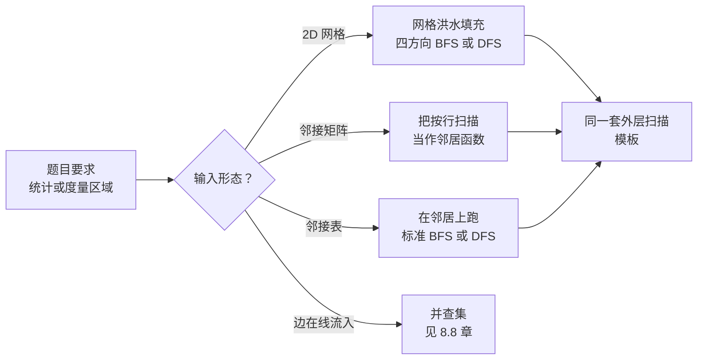

# 连通分量与洪水填充

一个 4×5 的网格，格子里是 `'1'` 和 `'0'`。`'1'` 是陆地，`'0'` 是水，每个格子与上下左右四个相邻格子连通。问：有多少个岛？大多数读者第一次见这道题是在 LeetCode 200，然后凭同一个直觉下手——从格子 `(0, 0)` 开始 BFS。这对一个岛是有效的。本章的玄机在第二个岛、第三个岛，以及一段干净的两行外层循环如何把你已经会的 BFS 变成计数算法。

前两章 [BFS](./01-bfs.md) 和 [DFS](./02-dfs.md) 练的是肌肉记忆：一个待探索边界或一个栈、一个已访问集合、一张可能根本不以邻接表形式存在的图。本章不引入新的遍历方式。它引入的是把这两者包住的*元模式*：扫描每个顶点；若未访问，计数器加一，并从它出发跑一次 BFS 或 DFS。正是外层扫描把“探索一个分量”变成了“找出所有分量”。

## 为什么显而易见的做法只算半个算法

拿一个有三个岛的 LC 200 网格。从 `(0, 0)` 跑一次 BFS。它正确地把第一个岛标记为已访问。然后呢？BFS 因为队列空了而结束；第二个和第三个岛原封未动，函数返回 1。

bug 不在 BFS 里。BFS 做的正是 BFS 该做的事：探索从起点可达的一切，然后停下。bug 在于算法对不可达的格子没有任何计划。一次遍历按定义只作用于一个分量。

```python
# 半个算法：返回 1 而不是 3。
def num_islands_broken(grid):
    rows, cols = len(grid), len(grid[0])
    bfs(grid, 0, 0, rows, cols)   # 标记了一个分量为已访问
    return 1                       # ……但一共有几个？
```

修法比 bug 还短。第一次 BFS 结束后，走一遍网格，对每个格子只问一个问题：*你是不是一个还没被访问过的 `'1'`？* 是，你就发现了一个新分量；计数器加一，从这里 BFS。每个未访问的 `'1'` 按定义都是一个此前遍历从未到达过的岛的种子。外层扫描保证覆盖，内层遍历保证单个分量内的正确性。

## 模式

两个阶段。外层扫描决定从哪里开始；内层遍历一直泛滥到队列空了为止。

```python
def num_islands(grid):
    if not grid or not grid[0]:
        return 0
    rows, cols = len(grid), len(grid[0])
    count = 0

    def bfs(sr, sc):
        q = deque([(sr, sc)])
        grid[sr][sc] = "0"          # 入队时标记已访问，而不是出队时
        while q:
            r, c = q.popleft()
            for dr, dc in ((1, 0), (-1, 0), (0, 1), (0, -1)):
                nr, nc = r + dr, c + dc
                if 0 <= nr < rows and 0 <= nc < cols and grid[nr][nc] == "1":
                    grid[nr][nc] = "0"
                    q.append((nr, nc))

    for r in range(rows):                 # 外层扫描
        for c in range(cols):
            if grid[r][c] == "1":         # 未访问的陆地 = 新分量
                count += 1
                bfs(r, c)
    return count
```

**Solution** — Python ([Java](./03-connected-components/lc-200/sol.java) · [C++](./03-connected-components/lc-200/sol.cpp) · [Go](./03-connected-components/lc-200/sol.go))

```python
# LC 200. Number of Islands
from collections import deque
from typing import List
import sys

# 300x300 网格是 LC 200 约束的上界；在全 1 网格上，递归 DFS 会递归
# 约 90,000 层深。Python 默认递归上限约 1000，因此迭代式 BFS 才是
# 安全默认。
# 只有确实必须用递归 DFS 时，才把这个上限调高。
sys.setrecursionlimit(10**6)


def num_islands(grid: List[List[str]]) -> int:
    """LC 200. Count maximal 4-connected components of '1' in the grid.

    Outer scan visits every cell once. When it lands on an unvisited '1',
    increment the component counter and run BFS to mark every reachable
    land cell as water. The outer scan is the algorithm; BFS is the engine.
    """
    if not grid or not grid[0]:
        return 0
    rows, cols = len(grid), len(grid[0])
    count = 0

    def bfs(sr: int, sc: int) -> None:
        q = deque([(sr, sc)])
        grid[sr][sc] = "0"          # 入队时标记已访问，而不是出队时
        while q:
            r, c = q.popleft()
            for dr, dc in ((1, 0), (-1, 0), (0, 1), (0, -1)):
                nr, nc = r + dr, c + dc
                if 0 <= nr < rows and 0 <= nc < cols and grid[nr][nc] == "1":
                    grid[nr][nc] = "0"
                    q.append((nr, nc))

    for r in range(rows):
        for c in range(cols):
            if grid[r][c] == "1":
                count += 1
                bfs(r, c)
    return count
```

那段代码里有三处值得注意。

已访问标记就是网格本身。把 `'1'` 改写成 `'0'` 省掉一次 `m*n` 的布尔数组分配，并把访问判断并进了已有的 `grid[r][c] == '1'` 谓词。如果调用方要求保留输入，就传副本，或者另外维护 `visited[r][c]` 数组。面试里把这个权衡说出来：*“我改动了网格来换 O(1) 额外空间；如果你要输入保持原样，我改成 visited 数组。”*

邻居偏移量是一个由 `(dr, dc)` 组成的四元组，用一个 `for` 循环迭代。别展开成四个独立的 `if` 块；你会漏掉一个，而这个 bug 只有在缺的那个方向真正起作用时才暴露。网格遍历的惯用法 `for dr, dc in [(0,1),(0,-1),(1,0),(-1,0)]` 在每种语言里都一样，变的只是外面的语法。

visited 是在格子*入队*时置位的，不是出队时。如果在出队时标记，同一个格子可能在轮到它处理之前被四个邻居推进队列四次；队列膨胀到 `O(rc)` 个重复项，算法慢一个常数因子。这是 LC 200 最常见的性能 bug。

> [!IMPORTANT]
> 触发这个模式的信号是：题目在给定局部相邻关系的前提下，要你**统计或度量区域**。*有多少个岛？有多少个省？最大的簇有多大？* 只要输入是网格、无向图或朋友关系矩阵，而问句是套在某个结构属性（数量、最大规模、总面积、周长）上的“多少”，算法就是上面这套外层扫描加泛滥的模板。[^1] 不是“两个格子之间的最短路径”（那是纯 BFS），不是“有没有环”（那是[环检测章节](./06-cycle-detection-graphs.md)），也不是“是否二分”（那是[二分图判定章节](./07-bipartite-check.md)）。

## 如何识别这个模式



*四种输入形态，一套模板。变的只有邻居函数；外层扫描和内层泛滥完全一样。*

上面这棵决策树就是本章的一张图。不管输入长什么样——网格、布尔矩阵、邻接表，还是一条条流进来的边——问题都是 `neighbours(v)` 返回什么。对 LC 200 来说，是*值为 `'1'` 的上下左右四个格子*。对 LC 547 来说，是*所有满足 `isConnected[i][j] == 1` 的列下标 `j`*。对 LC 305 来说，边一条一条到达，答案是并查集，那归[并查集章节](./08-union-find.md)管。

## 抛开图形状：LC 547

省份数量（Number of Provinces）给你一张 `n` × `n` 的布尔矩阵。若 `isConnected[i][j] == 1`，城市 `i` 和城市 `j` 属于同一个省。求有多少个省。约束：`1 <= n <= 200`。

第一反应是把这张矩阵当成网格在上面 BFS。这会得到胡话，因为矩阵不是世界，它是 `n` 个顶点的*邻接关系*。顶点 `i` 存在，顶点 `j` 存在，矩阵只告诉你它们连不连。`i` 的“邻居”是第 `i` 行里值为 1 的那些列下标 `j`。

看破这一点之后，算法就和 LC 200 一样，还是那三行。外层扫描让 `i` 从 0 走到 `n-1`。若 `i` 未访问，计数器加一，从 `i` 开始 BFS。BFS 从队列取出顶点 `u`，扫描矩阵第 `u` 行找未访问的列，把它们推进去。

```python
def find_circle_num(is_connected):
    n = len(is_connected)
    visited = [False] * n
    count = 0

    def bfs(start):
        q = deque([start])
        visited[start] = True
        while q:
            u = q.popleft()
            for v in range(n):
                if is_connected[u][v] == 1 and not visited[v]:
                    visited[v] = True
                    q.append(v)

    for i in range(n):
        if not visited[i]:
            count += 1
            bfs(i)
    return count
```

**Solution** — Python ([Java](./03-connected-components/lc-547/sol.java) · [C++](./03-connected-components/lc-547/sol.cpp) · [Go](./03-connected-components/lc-547/sol.go))

```python
# LC 547. Number of Provinces
from collections import deque
from typing import List


def find_circle_num(is_connected: List[List[int]]) -> int:
    """LC 547. Count connected components of an undirected graph
    given as an n-by-n adjacency matrix.

    Same outer-scan-and-flood template as LC 200; only the neighbor
    function changes. For city i, neighbors are j where
    is_connected[i][j] == 1 and j != i.
    """
    n = len(is_connected)
    visited = [False] * n
    count = 0

    def bfs(start: int) -> None:
        q = deque([start])
        visited[start] = True
        while q:
            u = q.popleft()
            for v in range(n):
                if is_connected[u][v] == 1 and not visited[v]:
                    visited[v] = True
                    q.append(v)

    for i in range(n):
        if not visited[i]:
            count += 1
            bfs(i)
    return count
```

相对 LC 200 有两处变化。`visited` 现在是一个 `bool[n]` 数组，因为按约定输入矩阵是只读的（而且改动对角线会让后续调用返回错误答案）。`neighbours(u)` 是 `for v in range(n): if is_connected[u][v] == 1`，内层循环里一次 `O(n)` 扫描。所以总时间是 `O(n²)`：光是读输入，你就被迫至少看一遍矩阵的每个格子。

对角线 `isConnected[i][i] == 1` 由题目保证，被 visited 判断忽略掉。矩阵是对称的，所以先访问 `(u, v)` 再访问 `(v, u)` 不会多做任何事；已访问集合吸收了这份冗余。不需要特判。

这就是本章的核心抽象，火力全开的样子。同一个 `count_components` 骨架，换掉 `neighbours()`，就得到正确答案。把它内化；[拓扑排序](./04-topological-sort-kahn.md)和[二分图判定](./07-bipartite-check.md)两章都会复用它。

## 度量而非计数：LC 695

网格和 LC 200 一样；问题从“有多少个岛？”变成“最大的岛有多大？”。外层扫描一模一样。唯一差别是内层 BFS *返回*什么：不再是空，而是它刚泛滥过的分量大小。

```python
def max_area_of_island(grid):
    if not grid or not grid[0]:
        return 0
    rows, cols = len(grid), len(grid[0])
    best = 0

    def bfs(sr, sc):
        q = deque([(sr, sc)])
        grid[sr][sc] = 0
        size = 0
        while q:
            r, c = q.popleft()
            size += 1
            for dr, dc in ((1, 0), (-1, 0), (0, 1), (0, -1)):
                nr, nc = r + dr, c + dc
                if 0 <= nr < rows and 0 <= nc < cols and grid[nr][nc] == 1:
                    grid[nr][nc] = 0
                    q.append((nr, nc))
        return size

    for r in range(rows):
        for c in range(cols):
            if grid[r][c] == 1:
                area = bfs(r, c)
                if area > best:
                    best = area
    return best
```

**Solution** — Python ([Java](./03-connected-components/lc-695/sol.java) · [C++](./03-connected-components/lc-695/sol.cpp) · [Go](./03-connected-components/lc-695/sol.go))

```python
# LC 695. Max Area of Island
from collections import deque
from typing import List


def max_area_of_island(grid: List[List[int]]) -> int:
    """LC 695. Return the area of the largest 4-connected island.

    Same outer scan as LC 200. The inner BFS now returns the number
    of land cells it visited so the outer scan can track a running max.
    """
    if not grid or not grid[0]:
        return 0
    rows, cols = len(grid), len(grid[0])
    best = 0

    def bfs(sr: int, sc: int) -> int:
        q = deque([(sr, sc)])
        grid[sr][sc] = 0
        size = 0
        while q:
            r, c = q.popleft()
            size += 1
            for dr, dc in ((1, 0), (-1, 0), (0, 1), (0, -1)):
                nr, nc = r + dr, c + dc
                if 0 <= nr < rows and 0 <= nc < cols and grid[nr][nc] == 1:
                    grid[nr][nc] = 0
                    q.append((nr, nc))
        return size

    for r in range(rows):
        for c in range(cols):
            if grid[r][c] == 1:
                area = bfs(r, c)
                if area > best:
                    best = area
    return best
```

骨架和 LC 200 的代码逐字节相同。两处 diff：内层 BFS 返回一个整数（格子数），每次出队把 `size` 加一；外层扫描把这个返回值与运行中的 `best` 比较。改了三行。

同一套模板还能处理“每个分量内数值之和”“代表顶点列表”“每个分量的周长”“用于去重的形状签名”（LC 694 Number of Distinct Islands）。内层遍历累积什么由你决定。外层扫描永远不变。

## 同一算法的另一副装扮：洪水填充

[洪水填充（Flood Fill，LC 733）](https://leetcode.com/problems/flood-fill/)给你一个网格、一个起点格子、一种新颜色。要求到达与起点原色相同的整片区域并给它们改色。把它当图问题读，它就是 LC 200 里的那段内层遍历——从指定的一个起点 BFS，邻居谓词是“与起点原色相同”。这里没有外层扫描，因为没有计数；种子由调用方给出。洪水填充就是本章模板的内层那一半，被当成公共 API 暴露出来。图形学文献从 1970 年代起就把这个算法叫 flood fill；教科书里说的也是同一个算法。[^2]

## 三种做法，一套模板

外层扫描固定；内层遍历可选。内层这一半你有三个选择。三者给出同样的答案，只是权衡不同。

### DFS（递归）

代码最短。任何语言都不超过十行。概念上干净：*访问我，再访问我那些未访问的邻居。* 代价是递归吃程序栈，而在一个 300×300、整体就是一块分量的网格上，递归 DFS 会递归到 90,000 层深。Python 默认递归上限约 1000。[^3] Java 默认线程栈约 25,000 帧。即使算法是对的，你也会在最坏情况的 LC 200 输入上收到 `RecursionError` 或 `StackOverflowError`。

修法是一行，Python 里写 `sys.setrecursionlimit(10**6)`，但它并不改变底层操作系统栈的大小；极端深度下仍然可能段错误。迭代式严格更安全。

### BFS（迭代式，显式队列）

就是上面的参考实现。代码比递归 DFS 略多（要分配队列、推入起点、循环到空），但队列在堆上，不在栈上，所以能扛住 LC 200 的最大输入。Python 用 `deque`，Java 用 `ArrayDeque`，C++ 用 `std::queue`，Go 拿切片当队列。对约束在几百乘几百量级的网格题，这是安全的默认选择。

### 并查集

对静态问题，BFS 和 DFS 更简单。并查集（Union-Find）的价值在于分量是*在线*增长的场景：一次来一条边，每次插入后都要报出当前分量数。LC 305 Number of Islands II 是标准例子：你收到一串 `addLand(r, c)` 操作，每次之后要返回当前分量数。每次从头重跑 BFS，`k` 次操作要 `O(k * mn)`，在题目的约束下太慢。带路径压缩和按秩合并的并查集把同样的工作做到 `O(k * α(mn))`，其中 α 是反阿克曼函数，对任何现实输入都小于 5。[^4] 证明和数据结构在[并查集章节](./08-union-find.md)；至于 LC 200 这种静态计数，BFS 才是对的工具。

## 实际开销

| 变体 | 时间 | 空间 | 说明 |
|---|---|---|---|
| 网格上的 BFS 或 DFS（LC 200、695） | O(m × n) | 最坏情况队列 O(m × n) | 每个格子最多入队一次；外层扫描为每个格子加一次 O(1) 判断。 |
| 邻接矩阵上的 BFS 或 DFS（LC 547） | O(n²) | visited 占 O(n)，队列 O(n) | 矩阵扫描是下界；每个表项都得读一遍。 |
| 邻接表上的 BFS 或 DFS | Θ(V + E) | O(V) | CLRS §20.2-20.3 的标准图遍历界。[^5] |
| 增量并查集（LC 305） | O(k × α(mn)) | O(m × n) | k = 操作次数；见并查集章节。 |

为什么这些界成立：由于已访问判断，每个顶点最多入队一次；每条边被检查常数次（无向边每条两次，每个端点各一次）。[^6] 外层扫描加了 `m*n` 次常数时间判断，不改变量级。Sedgewick 的 `CC.java` 文档直接给出了这个界：“本实现使用深度优先搜索；构造函数耗时 Θ(V + E)。”[^7]

空间界比看上去更紧。最坏情况下，网格盘成一整块巨大的分量，BFS 队列同时装着 `O(m*n)` 个格子。对典型输入它会停在 `O(min(m, n))`。面试里如果输入形态在讨论范围内，两个界都提一下。

## 三个最容易踩的坑

> [!WARNING]
> **把对角线也算作相邻。** 输入 `[["1","0","0","0","1"],["0","0","0","0","0"],["0","0","1","0","0"],["0","0","0","0","0"],["1","0","0","0","1"]]` 是对角线上的五个孤立格子。五个岛。把四个对角方向也算进去的解法返回 1，而不是 5。LC 200 规定“水平或垂直”；LC 695 明确说 1 不能对角相连。去读约束那一节。这类网格题默认是四方向，除非题名里写了 “diagonally”。

> [!WARNING]
> **递归 DFS 在全 1 的 300x300 网格上溢出。** 算法正确，解释器不高兴。Python 抛 `RecursionError`，JVM 抛 `StackOverflowError`。即使更小的网格都过了，LeetCode 也会在最坏用例上报 “Runtime Error”。要么改成迭代（推荐），要么在模块顶部调高递归上限，Python 用 `sys.setrecursionlimit(10**6)`，JVM 用 `-Xss`。Stack Overflow 上那个帖子 “Time limit exceeded with recursion, works on 90/91 test cases” 说的就是这个 bug，被采纳的答案是 “use BFS or set the recursion limit”。[^8]

> [!WARNING]
> **LC 463 的陷阱。** 岛屿的周长（Island Perimeter）看着像洪水填充题，因为它挂在 islands 标签下。它不是。只有一个岛；问的是它的周长。在单个分量上跑 BFS、在递归里数边界边，会写出一团 30 行的浆糊。闭式解只有六行：每个陆地格子给周长贡献 4，每一条共享的陆-陆边减 2。于是 `perimeter = 4 * land_cells - 2 * shared_edges`。一次线性扫描，O(mn) 时间，O(1) 空间。[^9] 先读题，再伸手拿模板。

第四个坑值得简单提一句：把 LC 547 误读成二维网格题，在 `isConnected` 的格子上做 BFS。矩阵是邻接关系，不是世界。顶点是那 `n` 座城市；“`i` 的邻居”是第 `i` 行，扫出其中的 1。

## 模式失效的场景

骨架能容纳几种有用的变体，形状不变。

**把外层扫描限制在边界。** LC 130 Surrounded Regions 和 LC 1254 Closed Islands 问的是*不*接触边界的那些分量。技巧：先从每个边界上的 `'O'` 开始 BFS，把这些格子标成“安全”，然后跑标准外层扫描，把其余的翻掉。变的是扫描的*起始集合*，内层 BFS 不动。

**多源 BFS。** LC 994 Rotting Oranges 和 LC 542 01 Matrix 在循环之前就把*每一个*起始格子一次性塞进队列，然后同步 BFS，让边界从多源前沿一圈圈向外扩。这是两步走的模式：先确定分量成员，再从它们出发做距离 BFS。机制属于[BFS 章节](./01-bfs.md)；它们复用了外层扫描的思路来枚举种子。

**在线加边。** 分量一条边一条边地长的时候，静态模板就不适用了。换成并查集。[并查集章节](./08-union-find.md)隔一章就到。

## 题目梯度

### 核心（三题全做才算掌握本章）

- [LC 200 — Number of Islands](https://leetcode.com/problems/number-of-islands/) [中等] • grid-flood-fill ★
- [LC 695 — Max Area of Island](https://leetcode.com/problems/max-area-of-island/) [中等] • grid-flood-fill
- [LC 547 — Number of Provinces](https://leetcode.com/problems/number-of-provinces/) [中等] • adjacency-matrix-cc

### 进阶（可选）

- [LC 463 — Island Perimeter](https://leetcode.com/problems/island-perimeter/) [简单] • grid-traversal-counting
- [LC 733 — Flood Fill](https://leetcode.com/problems/flood-fill/) [简单] • grid-flood-fill
- [LC 305 — Number of Islands II](https://leetcode.com/problems/number-of-islands-ii/) [困难] • union-find-incremental *(参考：仅 Python；Premium 专属——免费替代是用并查集模板做 LC 547)*

LC 200 是本章的招牌题（★）和标准实例。核心三题全是中等，因为这套模式的自然难度就落在那里；LC 463 以“看着像洪水填充，其实不是”这一课坐镇简单的进阶位，LC 733 是第二道简单进阶题，也是 §“同一算法的另一副装扮”里讲的内层遍历的公共 API 形态，而 LC 305 靠把同一个问题重新表述成在线算法坐镇困难位，它依赖的数据结构归再往后一章所有。

## 后续衔接

下一章[用 Kahn 算法做拓扑排序](./04-topological-sort-kahn.md)保留了外层扫描的思路，但把“未访问顶点”这个谓词换成“入度为零”。形状相同，不变式不同：每一步找出一个没有剩余入边的顶点，输出它，并把它的后继入度减一。图遍历的机制没变；顶点离开前沿的*顺序*承载了含义。

如果问题变成“还要加多少条边才能全连通？”或者“每次 addLand 之后有多少个分量？”，对的结构是并查集。[并查集章节](./08-union-find.md)带着反阿克曼证明和路径压缩的代码；对想看 LC 200 第三种解法的人来说，它也是自然的后续。

## 参考文献

[^1]: Sedgewick R., Wayne K., *Algorithms*, 4th ed., Addison-Wesley, 2011, 第 4.1 节 “Undirected Graphs” 中讲连通分量的小节。在线配套材料见 <https://algs4.cs.princeton.edu/41graph/>。

[^2]: Erickson J., *Algorithms*, 1st ed., 2019, 第 5 章 “Basic Graph Algorithms” 中讲 whatever-first search 与连通分量的小节。<https://jeffe.cs.illinois.edu/teaching/algorithms/book/05-graphs.pdf>。

[^3]: Stack Overflow, “Why don't functions recurse as many times as the limit I set with sys.setrecursionlimit()?” <https://stackoverflow.com/questions/7081448/why-dont-functions-recurse-as-many-times-as-the-limit-i-set-with-sys-setrecursi>。

[^4]: Tarjan R. E., “Efficiency of a good but not linear set union algorithm,” *Journal of the ACM*, 22(2):215-225, 1975.

[^5]: Cormen T. H., Leiserson C. E., Rivest R. L., Stein C., *Introduction to Algorithms*, 4th ed., MIT Press, 2022, 第 20 章 “Elementary Graph Algorithms”，第 20.2 节（BFS，线性时间分析）与第 20.3 节（DFS，Θ(V+E) 分析）。

[^6]: Hopcroft J. E., Tarjan R. E., “Efficient algorithms for graph manipulation,” *Communications of the ACM*, 16(6):372-378, 1973. 最早把图用线性时间 DFS 分解成连通分量的工作。Stanford 预印本见 <http://i.stanford.edu/TR/CS-TR-71-207.html>。

[^7]: Sedgewick R., Wayne K., `CC.java` API 文档，*Algorithms, 4th edition*，<https://algs4.cs.princeton.edu/code/javadoc/edu/princeton/cs/algs4/CC.html>。

[^8]: Stack Overflow, “Time limit exceeded with recursion, works on 90/91 test cases, fails on large input.” <https://stackoverflow.com/questions/66037170/time-limit-exceeded-with-recursion-works-on-90-91-test-cases-fails-on-large-in>。

[^9]: Huahua (Zhi Xi), “LC 463 Island Perimeter.” <https://zxi.mytechroad.com/blog/math/leetcode-463-island-perimeter/>。
