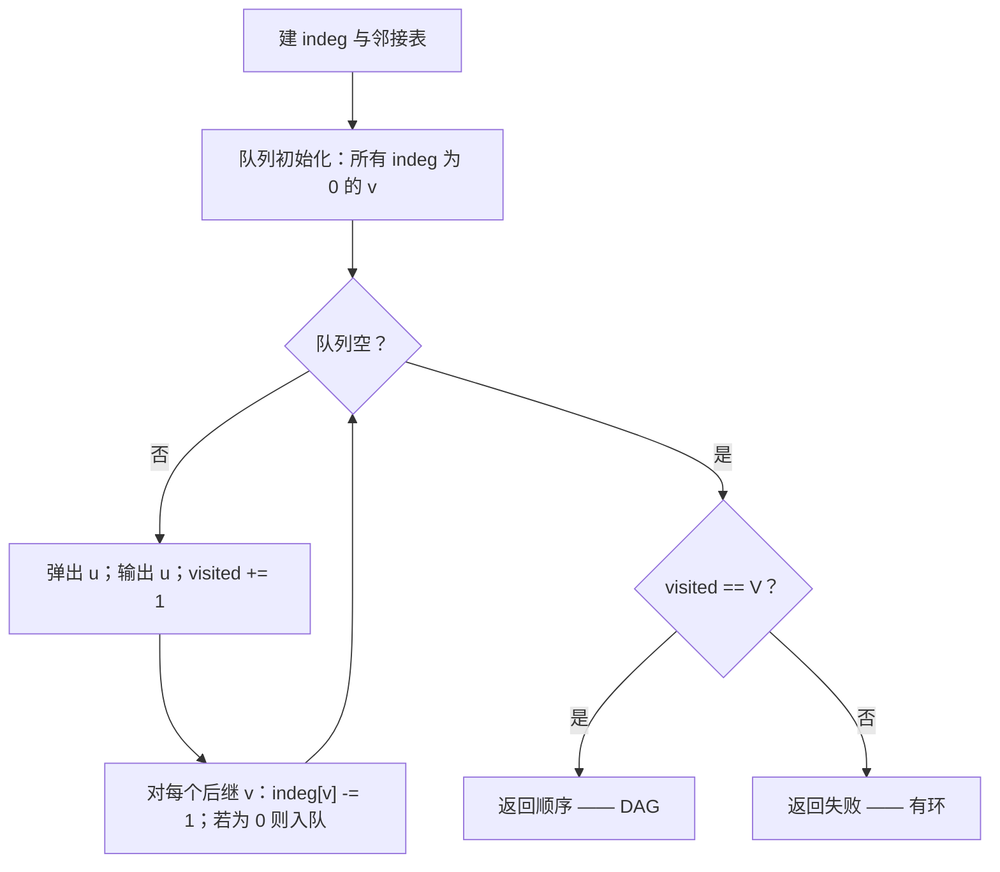
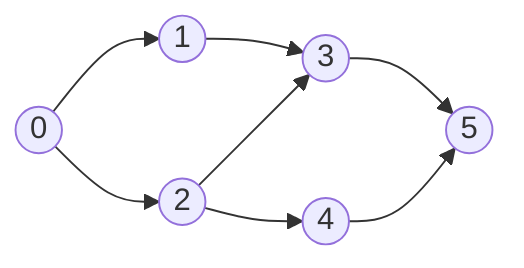

# 拓扑排序：Kahn 算法

LeetCode 207 给你一份课程目录和一张先修关系表。课程 1 要先修课程 0；课程 3 同时要先修 1 和 2。学生能把所有课都修完吗？只要依赖图是 DAG，答案就是能；只要图里藏着环，答案就是不能。两千门课、五千条先修关系，函数只需返回一个布尔值。

有两个算法能解这道题。两者都是线性时间，跑同样的输入也都成立。它们给出的顺序不同但同样合法，碰到有环输入时的失败方式也一致。那为什么写两章？因为读者要练的动作不一样。本章是 Kahn 算法：迭代、按入度驱动、基于队列。下一章是 DFS 后序：递归、按完成时间驱动、基于栈。只能学一个的话先学 Kahn。在 LeetCode 的输入规模下，它是面试里更稳妥的默认选择，而且入度这套心智模型正好贴合题目文本描述先修关系的说法。

## Kahn 算法到底做了什么

把依赖图看成一个有向图：边 `b -> a` 表示 *b 是 a 的前置课*。顶点的入度（indegree）是入边的条数，也就是尚未满足的先修课数量。入度为零的顶点没有未满足的先修课，它是*就绪*的。任取这样一个顶点，宣布它就是下一门课，然后假装你已经修完了它：从它出发的每条边都消失，这可能让下一轮多出新的入度为零顶点。

本章建立在这样一个归约之上。**拓扑序存在，当且仅当每一步的剩余子图里都至少有一个入度为零的顶点。** Kahn 算法把它变成构造性的做法：反复取出这样的顶点，把它的后继入度各减一。如果循环在绕完全部 `|V|` 个顶点之前就没有入度为零的顶点了，那剩下的顶点里藏着环——环上每个顶点都至少有一个先修课也在同一个环上，所以它们永远到不了入度零。

这双重用途是算法最不显眼的优点。一个循环同时产出拓扑序、精确地检测环，不需要任何额外记账。LeetCode 207 只是一个特例：把布尔值 `len(order) == numCourses` 当作要求的输出。

## 算法

三个阶段。建入度数组和邻接表。把所有入度已经为零的顶点塞进队列。然后抽干队列：弹出一个、输出它、把每个后继的入度减一，入度刚归零的后继入队。队列空就停。

```python
def can_finish(num_courses, prerequisites):
    indeg = [0] * num_courses
    adj = [[] for _ in range(num_courses)]
    for a, b in prerequisites:        # b -> a（b 是前置课）
        adj[b].append(a)
        indeg[a] += 1

    q = deque(v for v in range(num_courses) if indeg[v] == 0)
    visited = 0
    while q:
        u = q.popleft()
        visited += 1
        for v in adj[u]:
            indeg[v] -= 1
            if indeg[v] == 0:
                q.append(v)
    return visited == num_courses
```

**解法** — Python（[Java](./04-topological-sort-kahn/lc-207/sol.java) · [C++](./04-topological-sort-kahn/lc-207/sol.cpp) · [Go](./04-topological-sort-kahn/lc-207/sol.go)）

```python
# LC 207. Course Schedule
"""LC 207 Course Schedule — Kahn's algorithm reference."""
from collections import deque
from typing import List


def can_finish(num_courses: int, prerequisites: List[List[int]]) -> bool:
    """Return True iff all courses can be finished (the prereq graph is a DAG).

    Edge convention: prerequisites[i] = [a, b] means b must be taken before a,
    so the directed edge is b -> a in the dependency graph. Run a Kahn
    topological sort on (V, E) and report True iff we order all V vertices.
    """
    indeg = [0] * num_courses
    adj: List[List[int]] = [[] for _ in range(num_courses)]
    for a, b in prerequisites:
        adj[b].append(a)
        indeg[a] += 1

    q = deque(v for v in range(num_courses) if indeg[v] == 0)
    visited = 0
    while q:
        u = q.popleft()
        visited += 1
        for v in adj[u]:
            indeg[v] -= 1
            if indeg[v] == 0:
                q.append(v)
    return visited == num_courses
```

控制流里只有一个判断是关键的，就是减一之后的入度检查。*是等号，不是小于等于。* 输入里有重复的先修关系时，入度可能被减成负数；这时 `<= 0` 会在后续每次减一时都误判，把已经出过队的顶点重新塞回队列。已验证的 Java、C++、Go 版本一律用 `--indeg[v] == 0`。



*关于环的判定在终止处做，绝不在循环内部做。队列抽干只有两种原因：要么全部 V 个顶点都输出了（DAG），要么剩下的顶点卡在环上。*

## 实例推演：6 门课程的 LC 207

六门课程，七条先修关系：`0 -> 1`、`0 -> 2`、`1 -> 3`、`2 -> 3`、`2 -> 4`、`3 -> 5`、`4 -> 5`。箭头 `0 -> 1` 表示课程 0 是课程 1 的先修课。

初始入度：`[0, 1, 1, 2, 1, 2]`。只有顶点 0 就绪，所以队列起初是 `[0]`。



*组件 w-27 两栏共用的 6 节点 DAG。顶点 0 是唯一的源点，顶点 5 是唯一的汇点，中间三个下标存在多种合法顺序。*

弹出 0，输出 0。把 1 和 2 的入度各减一；两者都归零，都进队列。决定性的一刻落在第二次弹出：处理顶点 2 时，两个后继（3 和 4）各被减一，但只有 4 立刻就绪，3 还欠顶点 1 一个先修课。此后的交错顺序决定了输出是 `[0, 1, 2, 3, 4, 5]`、`[0, 2, 1, 4, 3, 5]`，还是另外三种合法顺序之一；FIFO 队列让这个选择变得确定，但没让它变成唯一标准。

组件把每一步都动画化了：左边是入度数组，中间是队列内容，底部是不断增长的输出序列。走两遍。第一遍看循环怎么跑；第二遍留意顶点 0 和顶点 5 在每个预设里都落在同一位置，而中间三个在换位。

> **交互组件：** [拓扑排序（Kahn 对比 DFS 后序）](../../../dsa/widgets/w-27-topological-sort-kahn.yml)（面板 `panel-kahn`）—— 在网站上渲染；YAML 规格文件描述了关键帧。

*静态兜底：在 16 步的轨迹里，入度依次塌缩 `[0,1,1,2,1,2] → [0,0,1,2,1,2] → [0,0,0,2,1,2] → [0,0,0,0,0,0]`；输出列表增长 `[] → [0] → [0,1] → [0,1,2,3,4,5]`；终止时记录 `|emitted| == |V|`，是合法拓扑序。*

## 实际开销

| 变体 | 时间 | 空间 | 说明 |
|---|---|---|---|
| DAG，邻接表 | O(V + E) | O(V) | 每个顶点入队、出队各一次；每条边松弛一次。 |
| 有环图，提前退出 | O(V + E) | O(V) | 同一个循环；环就是队列抽干后的剩余物。 |
| 输入为邻接*矩阵* | O(V²) | O(V) | 松弛邻居的循环即使对汇点也要扫一整行长度 V 的行。先转成邻接表。 |

每个顶点恰好入队一次，就在入度首次归零的那一刻，也恰好出队一次。每条有向边 `(u, v)` 恰好松弛一次，发生在算法处理 `u`、把 `indeg[v]` 减一的时候。总工作量是顶点记账的 `O(|V|)` 加上边记账的 `O(|E|)`。[^1] 这个界是紧的：任何拓扑排序算法都至少要把每条边读一遍，才能确认顺序尊重了它，所以 `Ω(V + E)` 是下界，而 Kahn 在一个常数因子内达到它。[^2]

空间开销主要是入度数组（`O(V)`）和队列，在输入没有边的极端情况下队列能同时装下 V 个顶点。邻接结构本身是 `O(V + E)`，但它已经算作输入。

## 模式失效的场景

招牌形状——给图、跑 Kahn、返回答案——覆盖了轮转里的大部分。三种变体改的是输入或终止条件。每一种都是一道独立的 LeetCode 题，每一种都在问：换个外壳，读者还认不认得出这是 Kahn。

### 反向图 Kahn 求“安全节点”

LC 802 问哪些顶点*没有任何*路径会走进环。自然的反转是把每条边翻向，然后从原图的终端顶点（原图出度为零，反向后入度为零）开始跑 Kahn。在反向图里被 Kahn 输出的每个顶点都是安全的，因为换回原方向，它没有任何后代落在环上。[^3]

```python
def eventual_safe_nodes(graph):
    n = len(graph)
    rev_indeg = [0] * n          # = 原图出度
    rev_adj = [[] for _ in range(n)]
    for u, succs in enumerate(graph):
        for v in succs:
            rev_adj[v].append(u)  # 反向边：v -> u
            rev_indeg[u] += 1
    q = deque(v for v in range(n) if rev_indeg[v] == 0)
    safe = [False] * n
    while q:
        u = q.popleft()
        safe[u] = True
        for v in rev_adj[u]:
            rev_indeg[v] -= 1
            if rev_indeg[v] == 0:
                q.append(v)
    return [v for v in range(n) if safe[v]]
```

**解法** — Python（[Java](./04-topological-sort-kahn/lc-802/sol.java) · [C++](./04-topological-sort-kahn/lc-802/sol.cpp) · [Go](./04-topological-sort-kahn/lc-802/sol.go)）

```python
# LC 802. Find Eventual Safe States
"""LC 802 Find Eventual Safe States — reverse-graph Kahn."""
from collections import deque
from typing import List


def eventual_safe_nodes(graph: List[List[int]]) -> List[int]:
    """Return all vertices from which every path terminates (no cycle reachable).

    Insight: a vertex is safe iff in the *reversed* graph it can be emitted
    by Kahn starting from terminal vertices (out-degree zero in the original,
    indegree zero after reversal). Reverse all edges, seed Kahn from
    original-terminal vertices, return the emitted set sorted.
    """
    n = len(graph)
    rev_indeg = [0] * n          # = 原图出度
    rev_adj: List[List[int]] = [[] for _ in range(n)]
    for u, succs in enumerate(graph):
        for v in succs:
            rev_adj[v].append(u)  # 反向边：v -> u
            rev_indeg[u] += 1     # u 的反转入度 = u 的原图出度

    q = deque(v for v in range(n) if rev_indeg[v] == 0)
    safe = [False] * n
    while q:
        u = q.popleft()
        safe[u] = True
        for v in rev_adj[u]:
            rev_indeg[v] -= 1
            if rev_indeg[v] == 0:
                q.append(v)
    return [v for v in range(n) if safe[v]]
```

反转就是 LC 802 的全部面试价值。不做反转，这题就退化成三色标记的 DFS，那是另一个算法，也属于另一章。

### 字符对建边（LC 269）

LC 269 给你一串字符串，它们按某个未知字母表做了字典序排序，要求给出与输入一致的、字符上的任意一个全序。图不是给你的，得自己建：两两比较相邻单词，找到第一个不同的位置，在那两个字符之间连一条有向边。然后在至多 26 个顶点的图上跑 Kahn，返回任意合法顺序。真正会咬人的边界情况是非法前缀：当 `words[i]` 是 `words[i+1]` 的严格更长前缀时（例如 `["abc", "ab"]`），不存在任何字符顺序能让 `"abc"` 排在 `"ab"` 前面，函数返回 `""`。[^4]

### 无向树叶子剥离的伪 Kahn（LC 310）

LC 310 要的是无向树的重心：那个（或那两个）作为根能让树高最小的顶点。窍门是一层层剥叶子。把所有权为 1 的顶点放进队列；弹出一个，把唯一邻居的度减一，邻居的度掉到 1 就把它推进队列；剩不到三个顶点时停。剩下的一个或两个就是重心。图是无向的，于是“入度”变成“度”，终止条件是 `<= 2` 而不是零——但循环体还是 Kahn 在 DAG 上跑的那个入度递减循环。

## 两个最容易踩的坑

> [!WARNING]
> **LC 207 上把边方向弄反。** 题面用英文把 `prerequisites[i] = [a, b]` 读作 *a 依赖 b*，而有向图的自然读法是*边从原因指向结果*，所以边是 `b -> a`。常见的 bug 是写成 `adj[a].append(b)` 并给 `indeg[b]` 加一，这就把依赖关系翻了过来，DAG 变环、环变 DAG。把约定钉在函数开头的一行注释里：`# b -> a`，和已验证的参考实现一致。提交前手推 `[[1, 0]]` 这个两门课的例子；如果代码返回 `False`，说明约定反了。[^5]

> [!WARNING]
> **visited 计数要在循环之后查，不能在循环里面。** 常见写法是每次出队就返回顺序列表（或 `True`），这会在有环输入上悄悄通过，因为队列可能在所有顶点输出之前就抽干了。环只在终止时才被检测出来：函数的*最后一行*是 `return visited == num_courses`。循环内部不允许提前返回。

第三个 bug 值得简单提一句，因为它专在 Java 和 C++ 提交里出现：忘了给邻接表预分配空间。`List<List<Integer>> adj = new ArrayList<>()` 造出来的是空的外层列表，接着 `adj.get(b).add(a)` 会抛 `IndexOutOfBoundsException`，因为 `b` 从没被分配过。插入之前一定要循环 `numCourses` 次加上空的内层列表。C++ 的写法 `std::vector<std::vector<int>> adj(numCourses)` 一行就办到了。

## 题目梯度

### 核心（三题全做才算掌握本章）

- [LC 207 — Course Schedule](https://leetcode.com/problems/course-schedule/) [中等] • topological-sort-kahn ★
- [LC 210 — Course Schedule II](https://leetcode.com/problems/course-schedule-ii/) [中等] • topological-sort-kahn
- [LC 802 — Find Eventual Safe States](https://leetcode.com/problems/find-eventual-safe-states/) [中等] • topological-sort-kahn-reverse-graph

### 进阶（可选）

- [LC 269 — Alien Dictionary](https://leetcode.com/problems/alien-dictionary/) [困难] • topological-sort-kahn-char-graph *（LeetCode Premium；输出顺序这一机制在核心题单里由 LC 210 覆盖）*
- [LC 310 — Minimum Height Trees](https://leetcode.com/problems/minimum-height-trees/) [中等] • topological-sort-kahn-leaf-trim

LC 207 是本章的招牌题，也是实例推演和组件动画演示的那一道。LC 210 是在 LC 207 上加一行：出队时往顺序列表里追加，长度等于 `numCourses` 时返回它。LC 802 是这个模式的第一个非平凡变体；反转那一步就是全部面试价值。

简单档位是刻意留空的。Kahn 算法没有公认的简单档 LeetCode 题；最接近的候选（LC 1971 可达性、LC 997 小镇法官）考的是入度/出度计数，而不是入度递减循环，教出来的是错的模式。

## 后续衔接

对偶的一章 [拓扑排序：DFS 后序](./05-topological-sort-dfs.md) 用不同的算法在同样的输入上解同样的题，并列对比的组件面板把两次运行都画在本章的 6 节点 DAG 上，中间三个位置的差异一眼可见。等读者两个算法都拿在手里，8.5 的结尾会给出“如何二选一”的决策表。

再往后，[图中的环检测](./06-cycle-detection-graphs.md) 把 Kahn 的输出计数判据当作三种标准环检测之一复用；BFS 这一侧的那套机械完全一样。

## 参考文献

[^1]: Arthur B. Kahn, "Topological sorting of large networks," *Communications of the ACM*, vol. 5, no. 11, pp. 558-562, November 1962. <https://doi.org/10.1145/368996.369025>.

[^2]: Wikipedia, "Topological sorting," §Algorithms. <https://en.wikipedia.org/wiki/Topological_sorting>.

[^3]: LeetCode, "802. Find Eventual Safe States." <https://leetcode.com/problems/find-eventual-safe-states/>.

[^4]: LeetCode, "269. Alien Dictionary." <https://leetcode.com/problems/alien-dictionary/>.

[^5]: LeetCode, "207. Course Schedule." <https://leetcode.com/problems/course-schedule/>.
