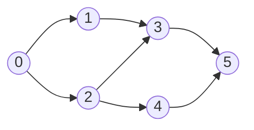

# 拓扑排序：DFS 后序反转

有两种算法能在 O(n) 时间内解掉 LC 207 *Course Schedule*。[拓扑排序：Kahn 算法](./04-topological-sort-kahn.md)在顶点的入度降到零时把它输出，每弹一次队列，答案就长一格。本章的算法反着来：它深度优先地走这张图，在每个顶点退出递归栈帧时把它输出，然后等递归全部结束*之后*，把攒下来的列表反过来，才得到拓扑序。

同一个问题，同样的复杂度，两套真正不同的心智模型。Kahn 版正向读图，DFS 版反向读图。两者都给出合法的拓扑序，但在本章动画用的那张标准 6 节点 DAG 上，它们选出的序*不一样*：起点相同、终点相同，中间有三个位置不同。这个分歧本身就是本章要讲的东西。拓扑序从来不止一个，某个算法报出哪个合法序，完全取决于它怎么走。

这一章之所以独立成篇而不是塞进一条脚注，是因为后序骨架不只是拓扑排序的另一条路。Tarjan 找桥、Hierholzer 构造欧拉路径、DAG 上的动态规划、函数图里的环长检测，都是同一个递归形状，只是在后序那一刻做的事不同。吃透这一章，等于用一套心智模型打开了五个有名字的图算法。

## 两种颜色为什么不够

多数读者带着无向图 DFS 的 `visited[]` 肌肉记忆来到这一章：每个顶点一个布尔值，进栈时置真，从不重置。这在树遍历里没问题，在有向图里做环检测就不行。

看这张图 `0 -> 1 -> 2 -> 0`。从 0 出发的 DFS 进入 0，置 `visited[0] = True`，然后下到 1，再到 2。在 2 这里遇到回到 0 的边，读到 `visited[0] = True`。于是自然得出结论：*“0 已经处理完，跳过就行”*。环就这样被悄悄漏掉，LeetCode 报错。

修法是 CLRS 里的三色不变式：[^1]

- **WHITE** 表示从未访问。
- **GRAY** 表示此刻正在递归栈上。这个顶点的 DFS 栈帧还挂在调用链的某处，仍在运行。
- **BLACK** 表示已完成。DFS 栈帧已经返回，它的每个后继也都完成了。

两色 DFS 把 GRAY 和 BLACK 混成了一个。三色 DFS 把它们分开，环检测就缩成一句：*DFS 一旦遇到 GRAY 的后继，这条边就是回边，图里有环。* GRAY 标识的是*当前路径*上的成员，BLACK 标识的是*已完成*。证据就是那条从 GRAY 指向 GRAY 的边。

同样这三个颜色，也是后序输出能成立的原因。DFS 退出一个顶点时，它的每个后继都是 BLACK，也就是说每个后继都在它之前输出过了。在 GRAY 转 BLACK 的那一刻把顶点追加到一个列表里，这个列表里的顶点就按完成时间排好了序：消费者在前，生产者在后。把这个列表反转，正是拓扑排序要的顺序：生产者在前。

## 算法

两件事，一个递归。外层循环对每个还是 WHITE 的顶点发起 DFS，免得漏掉不连通的块。内层 DFS 负责三色切换和后序追加。

```python
import sys
sys.setrecursionlimit(10000)

WHITE, GRAY, BLACK = 0, 1, 2

def can_finish(num_courses, prerequisites):
    adj = [[] for _ in range(num_courses)]
    for a, b in prerequisites:
        adj[b].append(a)                   # b 必须先于 a 完成；边方向 b -> a

    color = [WHITE] * num_courses

    def dfs(u):
        color[u] = GRAY                    # 进入：u 进入递归栈
        for v in adj[u]:
            if color[v] == GRAY:
                return False               # 回边 -> 有环
            if color[v] == WHITE and not dfs(v):
                return False
            # color[v] == BLACK: 交叉边/前向边，跳过即可
        color[u] = BLACK                   # 离开：后序时刻
        return True                        # LC 210 在这里 append(u)

    for u in range(num_courses):
        if color[u] == WHITE and not dfs(u):
            return False
    return True
```

**解法** — Python（[Java](./05-topological-sort-dfs/lc-207/sol.java) · [C++](./05-topological-sort-dfs/lc-207/sol.cpp) · [Go](./05-topological-sort-dfs/lc-207/sol.go)）

```python
# LC 207. Course Schedule
"""LC 207 Course Schedule, DFS post-order reverse topological sort."""
import sys
from typing import List

sys.setrecursionlimit(10000)  # DSH-04：LC 207 的隐藏用例包含深度 2000 的链

WHITE, GRAY, BLACK = 0, 1, 2


def can_finish(num_courses: int, prerequisites: List[List[int]]) -> bool:
    """Return True iff the prereq graph is a DAG. Edge convention: b -> a."""
    adj: List[List[int]] = [[] for _ in range(num_courses)]
    for a, b in prerequisites:
        adj[b].append(a)

    color = [WHITE] * num_courses

    def dfs(u: int) -> bool:
        color[u] = GRAY
        for v in adj[u]:
            if color[v] == GRAY:
                return False  # 回边 -> 有环
            if color[v] == WHITE and not dfs(v):
                return False
        color[u] = BLACK  # 后序时刻：LC 210 在这里把 u 追加到列表
        return True

    for u in range(num_courses):
        if color[u] == WHITE and not dfs(u):
            return False
    return True
```

`sys.setrecursionlimit(10000)` 这行不是装饰。LC 207 给出的界是 `numCourses <= 2000`，最坏输入就是那条链 `0 -> 1 -> 2 -> ... -> 1999`，而 DFS 的递归深度等于链长。Python 默认上限是 1000，不抬这个限制，提交就会在可见样例覆盖不到的隐藏用例上抛 `RecursionError`。[^2] Java 的进程栈不用管也能扛住 2000 层；Linux 上的 C++（默认 8 MB 栈）大约能扛 13 万帧；Go 的 goroutine 栈会动态增长。在 LC 这个量级上，Python 是唯一真的需要这层保险的语言，这也是图 DFS 提交里最常见的 Python 专属 bug。

边方向值得单独说一句。LC 207 的 `prerequisites[i] = [a, b]`，用英文读是*“a 依赖 b”*。有向图最自然的建模方式是“边从原因指向结果”，所以算法里写 `adj[b].append(a)`：`b -> a`，从先修课指向依赖它的课。这和本章 Kahn 版本用的是同一套约定。这里搞反，只要输入不对称，函数就会返回错误答案。

## 走一遍标准 DAG

还是 Kahn 算法那一章用的那张 6 节点 DAG：顶点 `0` 到 `5`，边 `0->1, 0->2, 1->3, 2->3, 2->4, 3->5, 4->5`。单一起点 0，单一终点 5，无环。Kahn 算法输出 `[0, 1, 2, 3, 4, 5]`，每一轮把一个入度归零的顶点出队。DFS 不一样。



*标准输入。从 0 出发的 DFS 最先找到 5（最深的汇点），并把它第一个写进后序列表；这个列表反过来就是拓扑序。*

外层循环走到顶点 0，它是 WHITE，于是调用 `DFS(0)`，把 0 标成 GRAY。遍历 `adj[0]` 找到 1，递归进入 `DFS(1)`，把 1 标成 GRAY。遍历 `adj[1]` 找到 3，递归进入 `DFS(3)`。把 3 标成 GRAY，找到 5，递归进入 `DFS(5)`。把 5 标成 GRAY。顶点 5 没有出边，`DFS(5)` 的循环直接走完，来到后序时刻。**5 是第一个完成的顶点。** 把 5 标成 BLACK，追加到后序列表，返回。

回到 `DFS(3)`。`DFS(3)` 的 for 循环只有一个邻居（5），所以 3 也来到后序时刻，追加 3。回到 `DFS(1)`，同样如此，追加 1。回到 `DFS(0)`，`adj[0]` 的第一轮走完了，进入第二轮，也就是 2。递归 `DFS(2)`，把 2 标成 GRAY。开始遍历：第一条边 `2 -> 3`，但 `color[3]` 已经是 BLACK，这是交叉边/前向边，跳过。下一条边 `2 -> 4`，递归进去，把 4 标成 GRAY，遇到 `4 -> 5`，5 是 BLACK，跳过。`DFS(4)` 走到末尾，追加 4。回到 `DFS(2)`，后序，追加 2。回到 `DFS(0)`，后序，追加 0。

后序列表：`[5, 3, 1, 4, 2, 0]`。反转：`[0, 2, 4, 1, 3, 5]`。**这就是 DFS 报出的拓扑序。**

> **Interactive widget:** [拓扑排序（Kahn 对 DFS 后序）](../../../dsa/widgets/w-27-topological-sort-kahn.yml)（panel `panel-dfs`）—— 在网站上渲染；YAML 规格描述了各个关键帧。

*静态兜底：panel-dfs 的轨迹共 23 步。后序列表一直到最深的栈帧结束才非空（第 9 步输出 5），之后每退出一次 DFS 就多一项，到第 20 步最外层 `DFS(0)` 返回时达到 `[5, 3, 1, 4, 2, 0]`。第 21 步原地反转这个列表。组件的 panel-kahn 面板在同一张 DAG 上跑 Kahn 算法，两个输出顺序可以同时摆在屏幕上。*

同一张 DAG，两种算法，两个都合法的拓扑序。Kahn 的 `[0, 1, 2, 3, 4, 5]` 符合英文直觉：大致按入度递增的顺序处理，入度相同的按插入顺序。DFS 的 `[0, 2, 4, 1, 3, 5]` 跟着递归走。顶点 0 先发起了对 1 的调用，这次调用在 2 的调用开始之前就把整棵子树（3 和 5）跑完了。于是 1、3、5 都*先于* 2 和 4 完成，说明 2 和 4 的完成时间更大，也就意味着它们在反转后的后序里*更靠前*。一句话讲完这个算法的逻辑。

## 为什么后序再反转是正确的

这个证明短得有点不好意思。拓扑序要求：对每条边 `(u, v)`，输出里 `u` 排在 `v` 之前。DFS 给出的不变式强到让这件事自动成立。

DFS 退出顶点 `u` 时，`u` 的每个后继都已经完成。这是机械保证的：`DFS(u)` 里的 for 循环不把它发起的每个递归调用都返回来，就走不到后序时刻。所以 `u` *晚于*它能到达的每个顶点完成。

在每个顶点的后序时刻把它追加到列表里，这个列表就按完成时间递增排列。最先追加的是某个汇点，最后追加的是某个源点。这个方向对拓扑排序来说是反的——拓扑排序要源点在前。反转列表，性质就翻过来：完成时间*最晚*的顶点跑到了最前面；对每条边 `(u, v)`，`u` 的栈帧晚于 `v` 的栈帧结束，所以 `u` 的完成时间更大，所以 `u` 在反转后的列表里更靠前。证毕。

CLRS 把这个底层性质叫括号定理：任意两个顶点的发现时间与完成时间像一对配平的括号那样嵌套，对树边和前向边则是严格包含。[^1] 定理的表述比本章需要的更一般；这里真正承重的是那条推论——“后序，再反转，就是一个拓扑排序”。Erickson 那本免费的 *Algorithms* 用更少的机器给出了同样的正确性论证。[^3]

这个算法顺带就是一个判环算法，因为回边是证明唯一会崩的情形。DFS 一旦遇到 GRAY 的后继，说明这个后继此刻还在递归栈上：栈帧没关，完成时间未知。那样输出列表里就会出现一个后继尚未完成的顶点，不变式被破坏。此时返回 false 是对的：图不是 DAG，拓扑序不存在。

## 实际开销

| 变体 | 时间 | 空间 | 说明 |
|---|---|---|---|
| 判环（LC 207） | O(V + E) | O(V) | 颜色数组 + 递归栈。上界与 Kahn 一致。 |
| 产出顺序（LC 210） | O(V + E) | O(V) | 多一个大小为 V 的后序列表。 |
| Tarjan 桥（LC 1192） | O(V + E) | O(V) | 两个数组（`disc`、`low`）替代一个（`color`）。 |
| Hierholzer 欧拉路径（LC 332） | O((V + E) log E) | O(V + E) | 为字典序对每个顶点的邻接表排序会多出 log E；不排序则是 O(V + E)。 |

每个顶点恰好进 DFS 一次（WHITE 转 GRAY 由 WHITE 判断把关），也恰好出一次（GRAY 转 BLACK 发生在返回路上）。每条有向边 `(u, v)` 恰好被检查一次，就在 `u` 的 DFS 栈帧遍历 `adj[u]` 的那一刻。总工作量是顶点记账的 O(|V|) 加上边的 O(|E|)，合计 O(V + E)。[^4]

对任何拓扑排序算法来说，这个界都是紧的。哪怕只是验证顺序是否满足每条边，也至少要读一遍所有边。DFS 后序在常数因子内达到了这个下界。

空间那一行值得多说一句。O(V) 这个界算的是颜色数组、后序列表和递归栈。在链 `0 -> 1 -> ... -> V-1` 上，递归栈会到深度 V。默认栈大小下，Java、C++、Go 在 V 到 10^4 ~ 10^5 这个量级都没问题；Python 只有加了 `sys.setrecursionlimit` 才行。百万顶点图上的生产代码会把递归改写成显式的 `(vertex, iterator-index)` 栈帧，改起来机械，但丑到面试解基本不这么干。

## 后序时刻的价值所在

这一章的重心在于 `color[u] = BLACK` 之后*接着*做什么。上面的拓扑排序里，它只是 `post.append(u)` 一行。在另外三个有名字的算法里，同一行做的事多得多，算法的价值也就在那里。

**Tarjan 找桥（LC 1192）。** 加两个整型数组：`disc[u]`（DFS 进入 `u` 时的全局计数器）和 `low[u]`（从以 `u` 为根的子树出发能到达的最小 `disc[w]`）。对每个树边子节点 `v`，递归返回后更新 `low[u] = min(low[u], low[v])`。对每条指向 `w` 的回边，更新 `low[u] = min(low[u], disc[w])`。for 循环结束后，边 `(u, v)` 是桥当且仅当 `low[v] > disc[u]`：从 `v` 的子树出发没有任何路径能爬到 `u` 之上，所以删掉这条边就把图切断了。[^5] `low[v]` 向 `low[u]` 的传播发生在递归调用*返回之后*。这就是本章铺好的那个后序时刻在干活。

**Hierholzer 欧拉路径（LC 332）。** 沿着还有的出发边贪心往下走，直到当前顶点没有出边；把这个走不通的顶点前插到结果列表里，然后回溯。所有 DFS 栈帧返回后，结果列表正着读就是欧拉路径。这里的后序作用在边上而不是顶点上：每条边被消费一次，消费它的顶点在退出时被记下来。*Reconstruct Itinerary* 要求字典序最小的变体，做法是给每个顶点的邻接表建小顶堆或先排序，让贪心下行时按字母序挑机场。

**函数图里的环长（LC 2360）。** 每个顶点至多一条出边。从每个未访问的顶点出发 DFS，沿这条唯一的链往前走，直到重新碰到某个顶点；如果碰到的顶点是 GRAY（还在本次 DFS 的递归栈上），环长就是 `current_timestamp - disc[seen]`。如果它是之前某次 DFS 留下的 BLACK，说明这里没有环起头。模式反复出现：按 DFS 轮次打时间戳、区分 GRAY 与 BLACK、后序收尾。同一副骨架，完成时刻做的事不同。

这不是三个各自从头讲的独立算法，而是同一个递归点上的三种动作。环检测那一章则是把回边这个证据本身当作承重物件来用。

## 两个最容易踩的坑

> [!WARNING]
> **后序正反搞混。** 典型错法是算法最后写 `return post_order`，而不是 `return list(reversed(post_order))`。后序列表是消费者在前、生产者在后：每个依赖方都排在它的先修课前面，跟 LC 210 判的正好*相反*。修法是在函数开头加一行，或者在返回处包一层。记法：最深的叶子最先完成，而拓扑序需要它们最后出现——反一下就翻了时间顺序。

> [!WARNING]
> **忘了在退出时把 GRAY 翻成 BLACK。** `DFS(u)` 里的 for 循环体要处理后继的三种情况：GRAY（有环）、WHITE（递归）、BLACK（跳过）。很容易把 GRAY 理解成“永久访问过”而省掉 BLACK 这次赋值。后果是：第二趟顶层 DFS 撞上前一棵已完成子树里的顶点，看它是 GRAY，就误报有环。不连通的测试用例会立刻把这个问题暴露出来。每个 DFS 栈帧结尾、`return True` 之前，这次翻转都是必须的。

还有第三个坑，简单提一句：Tarjan 找桥的变体里，对树边子节点错写成 `low[u] = min(low[u], disc[v])`，而不是 `low[u] = min(low[u], low[v])`。两种情况的不对称（树边子节点用 `low[v]`，回边目标用 `disc[w]`）正是 lowlink 算法的核心不变式。搞错之后，只要图里有来自远处后代的深回边，函数就会多报桥。webcoderspeed 那篇 LC 1192 讲解把这个列为最常见的“小用例过、大用例挂”故障模式。

## Kahn 与 DFS 之间如何选择

两种算法都是 O(V + E)，在 DAG 上都能给出合法的拓扑序。怎么选是工程问题，不是渐进复杂度问题。

| | Kahn 算法（见[拓扑排序：Kahn 算法](./04-topological-sort-kahn.md)） | DFS 后序反转（本章） |
|---|---|---|
| **心智模型** | BFS 风格：一次次把入度为零的顶点剥下来。 | 递归：退出时输出，最后反转。 |
| **环检测** | 比较已输出数量与 V。如果输出不足 V 个，剩下没处理的部分就是环。 | 三色不变式。DFS 中遇到 GRAY 后继就是回边证据。 |
| **迭代还是递归** | 迭代，用显式队列，没有递归深度顾虑。 | 默认递归；链长超过 1000 时 Python 需要 `sys.setrecursionlimit(10000)`。 |
| **顺序构造** | 运行中自然产生；顺序*就是*出队序列。 | 运行结束后反向构造；只有 DFS 全部结束、后序列表被反转，顺序才成形。 |
| **字典序** | 很简单：队列换成小顶堆，得到字典序最小的拓扑序；LC 269 *Alien Dictionary* 用得上。 | 能做但别扭：要给每个顶点的邻接表排序，再把整个输出反转。 |
| **逐顶点后序计算** | 别扭；Kahn 天然不知道某个顶点的后继什么时候做完。 | 原生支持：GRAY 转 BLACK *就是*“后继做完了”。Tarjan 的 `low[]`、DAG 动态规划、Hierholzer 的前插都住在这里。 |
| **代码量** | 多几行：显式的入度数组、队列、输出计数器。 | 更短：三个颜色、一个递归函数、结尾一次反转。 |
| **大规模生产代码** | 百万顶点图首选（没有递归深度问题），任何在意字典序的场合也首选。 | 当算法天然要扩展成逐顶点后序计算时首选（Tarjan 那一族算法、DAG 上的 DP）。 |

一条好用的启发式：如果问题是*“这是不是 DAG”*或者*“给我一个顺序”*，且不涉及逐顶点的后序计算，就用 [Kahn 算法](./04-topological-sort-kahn.md)。它迭代、白送字典序、不怕递归深度。如果算法天然要回答*“每个顶点从它的后代那里学到什么”*（桥、割点、DAG 上的最长路、DAG 上的动态规划、欧拉路径、强连通分量），就用 DFS 后序。后代信息本来就活在递归栈帧里，而后序时刻正是这些信息全都齐了的时刻。

## 题目梯度

### 核心（三题全做才算掌握本章）

- [LC 1192 — Critical Connections in a Network](https://leetcode.com/problems/critical-connections-in-a-network/) [困难] • dfs-postorder ★
- [LC 332 — Reconstruct Itinerary](https://leetcode.com/problems/reconstruct-itinerary/) [困难] • dfs-postorder
- [LC 2360 — Longest Cycle in a Graph](https://leetcode.com/problems/longest-cycle-in-a-graph/) [困难] • dfs-postorder

### 进阶（可选）

- [LC 444 — Sequence Reconstruction](https://leetcode.com/problems/sequence-reconstruction/) [中等] • dfs-postorder *（Premium；免费替代：[LC 210 — Course Schedule II](https://leetcode.com/problems/course-schedule-ii/)）*
- [LC 1059 — All Paths from Source Lead to Destination](https://leetcode.com/problems/all-paths-from-source-lead-to-destination/) [中等] • dfs-postorder *（Premium；免费替代：[LC 207 — Course Schedule](https://leetcode.com/problems/course-schedule/)）*

核心三题故意全是困难。纯 DFS 后序的应用（Tarjan 找桥、Hierholzer、用时间戳求环长）在结构上就是困难题，LC 在这个主题上没有拿得出手的简单题。LC 207 和 LC 210 归 [拓扑排序：Kahn 算法](./04-topological-sort-kahn.md) 那一章，在中等难度上练同一族题。本章的后序骨架和 8.4 的入度骨架合起来，把拓扑排序这个问题覆盖完了。

LC 1192 是本章的招牌题（★），因为它是“后序时刻为什么重要”最干净的演示：`low[v]` 是树边父节点要从子节点那里拿到的值，而这个值只有在递归调用返回*之后*才有。Tarjan 算法就是把拓扑排序骨架里的 `post.append(u)` 换成 `low[u] = min(low[u], low[v])`。

## 后续衔接

下一章[图的环检测](./06-cycle-detection-graphs.md)把本章的回边证据拿过去，把它当作承重物件。同样的三色不变式；不同的问题（*“有没有环”*和*“返回一个环”*）；再走一遍三种标准做法（[链表环检测](../part-5-linked-lists/03-cycle-detection.md)里的 Floyd 龟兔指针、本章的 DFS 三色判定、兄弟章节里的 Kahn 计数检查）。

[强连通分量](./02-dfs.md)是后序骨架的第二个大应用场景。Tarjan SCC 和 Kosaraju SCC 都要跑两趟 DFS，而第一趟得到的后序完成时间排序，正是让第二趟保持线性的东西。那个算法有一半就是上面的拓扑排序。

至于 DAG 上的动态规划（最长路、路径计数、带权的拓扑类问题），第 9 部分的章节会把这里产出的后序顺序当作松弛顺序。`u` 的栈帧返回时，所有 `v in adj[u]` 的 `answer[v]` 都已定稿；用它们算 `answer[u]`，是每个顶点 O(degree) 的操作。

## 参考文献

[^1]: Thomas H. Cormen, Charles E. Leiserson, Ronald L. Rivest, Clifford Stein, *Introduction to Algorithms*, 3rd edition (MIT Press, 2009), §22.3 "Depth-first search" and §22.4 "Topological sort".

[^2]: AlgoMaster, *Python for DSA*. <https://algomaster.io/learn/dsa/python-crash-course>.

[^3]: Jeff Erickson, *Algorithms*, Chapter 6 "Depth-First Search" §6.4 "Topological sort". <https://jeffe.cs.illinois.edu/teaching/algorithms/book/06-dfs.pdf>.

[^4]: cp-algorithms, *Topological Sorting*. <https://cp-algorithms.com/graph/topological-sort.html>.

[^5]: Robert Tarjan, "Depth-first search and linear graph algorithms," *SIAM Journal on Computing* 1(2):146-160, 1972.
