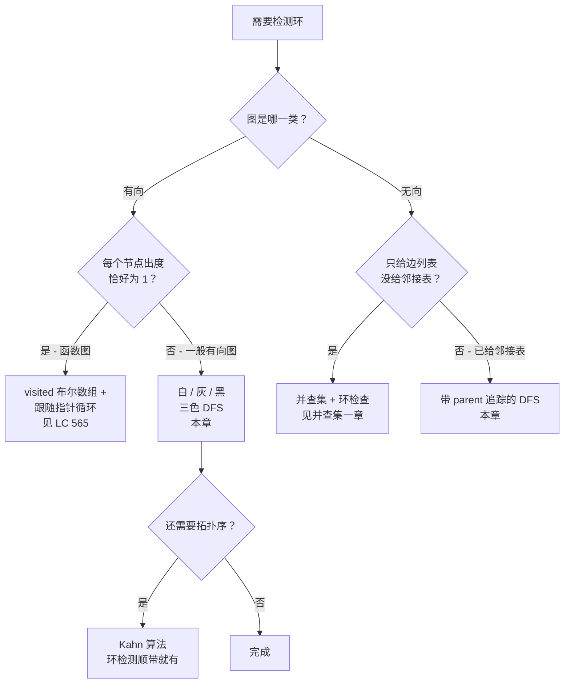
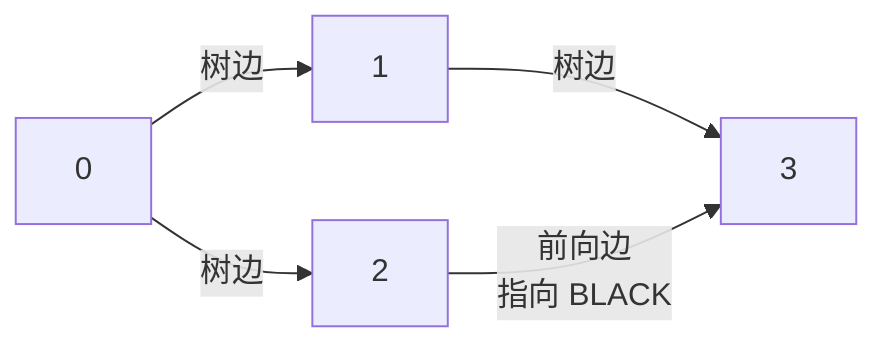

# 图中的环检测

四个节点、四条有向边：`0 → 1`、`0 → 2`、`1 → 3`、`2 → 3`。把它画出来，形状是个菱形。它没有环。可一个完全说得过去的环检测算法——DFS 加一个布尔 `visited[]` 数组——照样会在这张图上报出环来；每一个把链表那套 visited 集合惯用法搬到图上的面试题网站，都在发布这个 bug。

修法是再加一个状态，而理由要用一整章才讲得清。本章的另一半是同一个修法的反面：输入换成无向图时，那套花哨的三状态 DFS 会塌缩，但一个写得干净的单状态 DFS，只要你忘了传一个参数，*同样*会在每一张连通图上报出环。环检测是两个算法，两者只差四行；在错误的图类型上用错那一个，代价是静默的错误答案。

## 如何识别这个模式



*两个问题决定用哪个算法：图的类型，以及（有向图里）每个顶点是否恰好只有一条出边。*

信号在**图的类型**里，不在题目的味道里。输入有向、问题问的是「这张图无环吗」或者「这些课能不能修完」时，用白/灰/黑三色 DFS。输入无向、问题问的是「这些边能构成一棵树吗」或者「这个网络里有环吗」时，用带 parent 追踪的 DFS。读者容易跟本章混淆的相邻模式：[拓扑排序：Kahn 算法](./04-topological-sort-kahn.md) 也能白拿环检测，它是「入度为 0 的节点是不是全抽干了」的副产品；如果每个节点恰好只有一个后继、而你要 O(1) 额外空间，[链表环检测](../part-5-linked-lists/03-cycle-detection.md) 里 Floyd 龟兔赛跑的链表写法更短，也不用分配 visited 集合。

## 为什么最直觉的写法会报出不存在的环

拿开头那个菱形。`adj = {0: [1, 2], 1: [3], 2: [3], 3: []}`。这是一个无环的 DAG。现在照每一个两色 visited 集合教程的写法写下环检测：

```python
# 错误：bug 就在这里。有向图两色不够用。
def has_cycle_two_color(n, adj):
    visited = [False] * n
    def dfs(u):
        if visited[u]:
            return True            # 错误："visited" 把两种
        visited[u] = True          #       不同的状态混成了一个
        for v in adj[u]:
            if dfs(v):
                return True
        return False
    for u in range(n):
        if not visited[u] and dfs(u):
            return True
    return False
```

走一遍菱形。从 0 开始，标记已访问。递归进 1，标记。递归进 3，标记。3 没有邻居，返回 false。回到 1，返回 false。回到 0，递归进 2，标记。看 2 的邻居：3。`visited[3]` 是 true，算法返回 true。**在一张根本没有环的图上报出了环。**

bug 在于 `visited[3] == True` 本意是「3 在我当前的递归路径上」，实际含义却是「我以前见过 3」。这是两件不同的事。前者找的是回边（唯一能闭合环的边类型）；后者还会抓到前向边和横叉边（指向已经走完的子树的边），而这些在 DAG 里完全合法。[^1] 修法是给算法足够的状态，让它能区分「正在里面」和「已经走完」。

三色就是干这个的。WHITE 表示还没发现。GREY 表示在活跃的递归栈上：DFS 进了这个顶点，还没返回。BLACK 表示 DFS 已经处理完这个顶点，从它能到达的一切都探完了。指向 GREY 顶点的边是回边，也就是环的证据。指向 BLACK 顶点的边无害：BLACK 的意思是「我这块已经完事了，我当前路径上没有任何东西通到这里」。

```python
def has_cycle_directed(n, edges):
    adj = [[] for _ in range(n)]
    for u, v in edges:
        adj[u].append(v)

    WHITE, GREY, BLACK = 0, 1, 2
    color = [WHITE] * n

    def dfs(u):
        color[u] = GREY
        for v in adj[u]:
            if color[v] == GREY:        # 回边 -> 有环
                return True
            if color[v] == WHITE and dfs(v):
                return True
        color[u] = BLACK
        return False

    for u in range(n):
        if color[u] == WHITE and dfs(u):
            return True
    return False
```

再在菱形上跑一遍。访问 0：GREY。递归进 1：GREY。递归进 3：GREY → BLACK。回到 1：BLACK。回到 0。递归进 2：GREY。看 2 的邻居 3：是 BLACK 而不是 GREY，**不是回边**，不报环。2 → BLACK。0 → BLACK。返回 false。正确。



*这个菱形 DAG。C → D 是一条指向前向边，落到已经走完的 BLACK 顶点 3；三色算法正确把它归了类，不报环。两色算法看到 `visited[3] == True`，就报出环。*

## 另一半：无向图需要 parent 参数，而不是三色

换一种图。无向图有自己的两色 bug 版本，方向正好相反：这里塌缩成一个布尔是对的，坏在这个算法忘了另一块状态。

看一个三角形：`0 — 1 — 2 — 0`。三个顶点，三条无向边。这里有环。写下算法：

```python
# 错误：任何边数 >= 1 的连通图都会报出环。
def has_cycle_undirected_no_parent(n, edges):
    adj = [[] for _ in range(n)]
    for u, v in edges:
        adj[u].append(v)
        adj[v].append(u)         # 两个方向都加：无向边
    visited = [False] * n
    def dfs(u):
        if visited[u]:
            return True
        visited[u] = True
        for v in adj[u]:
            if dfs(v):
                return True
        return False
    return dfs(0)
```

在一棵只有一条边的树上跑：`n = 2`，`edges = [[0, 1]]`。访问 0，标记已访问。递归进 1，标记。看 1 的邻居：`adj[1] = [0]`（因为无向边 `(0, 1)` 让两个端点各自出现在对方的邻接表里）。`visited[0] == True`，返回 true。**在一张结构上只有一条边的图上，算法报出了环。**

bug 在于无向边在邻接表里走两个方向，所以 DFS 从 0 走到 1 时，会在 1 的邻居列表里看到 0，把它当成另一条通往已访问顶点的边。它分不清「这是我刚走过来的那条边」和「这是一条回边」。修法是加 parent 参数：

```python
def has_cycle_undirected(n, edges):
    adj = [[] for _ in range(n)]
    for u, v in edges:
        adj[u].append(v)
        adj[v].append(u)

    visited = [False] * n

    def dfs(u, parent):
        visited[u] = True
        for v in adj[u]:
            if not visited[v]:
                if dfs(v, u):
                    return True
            elif v != parent:           # 已访问且不是 parent -> 有环
                return True
        return False

    for u in range(n):
        if not visited[u] and dfs(u, -1):
            return True
    return False
```

parent 参数告诉递归「我刚跨过来的那条边不算数」。其他任何已访问的邻居都是回边的证据。CLRS §20.3 给出了这里依赖的结论：在无向图里，DFS 的每条边要么是树边，要么是回边，没有前向边和横叉边要操心。[^1] 所以一个布尔状态加一个 parent 参数，正好是恰当分量的簿记。

到这里有个合理的问题：为什么有向图要三个状态，无向图只要一个加个 parent？因为无向 DFS 里非树边只有回边（没有前向边，没有横叉边），所以任何已访问且非 parent 的邻居都一定是环的证据。有向 DFS 里，指向前向边和指向已经走完子树的横叉边都合法，算法必须认出它们无害、不能报警。BLACK 就是那个表示「无害」的状态。

## 实例推演：LC 1361 Validate Binary Tree Nodes

有些最干净的应用会把两半合起来。LC 1361 给你 `n` 个标号 `0..n-1` 的节点，以及两个数组 `leftChild[i]` 和 `rightChild[i]`（每项是节点 id 或 `-1`）。判断这个结构是不是一棵合法的二叉树。

n 个节点上的合法二叉树恰好是两件事：无环，且从唯一根出发只有一个连通分量。前一半是无向图式的环检测（从不同 parent 再次走到同一节点就失败）；后一半是直白的连通性。两者一趟 BFS 都能出来：

```python
from collections import deque

def validate_binary_tree_nodes(n, leftChild, rightChild):
    in_degree = [0] * n
    for c in leftChild:
        if c != -1:
            in_degree[c] += 1
    for c in rightChild:
        if c != -1:
            in_degree[c] += 1

    root = -1
    for i in range(n):
        if in_degree[i] == 0:
            if root != -1:
                return False        # 两个根
            root = i
        elif in_degree[i] > 1:
            return False            # 两个父亲 -> 有环或子树共享

    if root == -1:
        return False                # 每个节点都有父亲 -> 有环

    seen = [False] * n
    seen[root] = True
    visited_count = 1
    q = deque([root])
    while q:
        u = q.popleft()
        for v in (leftChild[u], rightChild[u]):
            if v == -1:
                continue
            if seen[v]:             # 又访问到 -> 有环
                return False
            seen[v] = True
            visited_count += 1
            q.append(v)
    return visited_count == n       # 都能从根到达？
```

**解法** — Python（[Java](./06-cycle-detection-graphs/lc-1361/sol.java) · [C++](./06-cycle-detection-graphs/lc-1361/sol.cpp) · [Go](./06-cycle-detection-graphs/lc-1361/sol.go)）

```python
# LC 1361. Validate Binary Tree Nodes
"""LC 1361. Each node has 0, 1, or 2 children given by leftChild[i] / rightChild[i]
(value -1 means no child). Return True iff the n nodes form a valid binary tree.

A valid binary tree on n nodes:
  1. exactly one root (in-degree 0); every other node has in-degree 1
  2. no cycle (BFS from root visits every node at most once)
  3. one connected component (BFS from root visits all n nodes)

Conditions 2 and 3 collapse into "BFS from the unique root visits exactly n
distinct nodes". The chapter teaches this as the canonical undirected-DFS
application; the directed framing here is structurally identical because
each edge is parent->child and the parent-tracking guard is replaced by the
"in-degree ≤ 1" precondition.
"""

from typing import List
from collections import deque


def validate_binary_tree_nodes(n: int, leftChild: List[int], rightChild: List[int]) -> bool:
    in_degree = [0] * n
    for c in leftChild:
        if c != -1:
            in_degree[c] += 1
    for c in rightChild:
        if c != -1:
            in_degree[c] += 1

    # 恰好一个根
    root = -1
    for i in range(n):
        if in_degree[i] == 0:
            if root != -1:
                return False
            root = i
        elif in_degree[i] > 1:
            return False
    if root == -1:
        return False

    # 从根 BFS；每个节点必须恰好被访问一次
    seen = [False] * n
    seen[root] = True
    visited_count = 1
    q = deque([root])
    while q:
        u = q.popleft()
        for v in (leftChild[u], rightChild[u]):
            if v == -1:
                continue
            if seen[v]:           # 环的证据
                return False
            seen[v] = True
            visited_count += 1
            q.append(v)
    return visited_count == n
```

入度那一趟强制了「每个节点最多一个父亲」和「恰好一个节点没有父亲」。这本身就能挡掉很多坏输入，但不是全部：它会漏掉完全独立于根所在分量的环。从唯一根出发的 BFS 同时抓环（从另一条路径重新进入 `seen` 节点）和不连通（`visited_count < n`）。两个检查，都不可省。

一个小例子。`n = 4`，`leftChild = [1, -1, 3, -1]`，`rightChild = [2, -1, -1, -1]`。入度：节点 0 没有，节点 1、2、3 各有一个父亲。根是 0。BFS 依次访问 0、1、2、3。四个都见过，没有重复访问。返回 true。

一个有环的例子。`n = 4`，`leftChild = [1, 0, 3, -1]`，`rightChild = [-1, -1, -1, -1]`。节点 0 指向 1，1 又指回 0。0 的入度是 1，1 的入度是 1，2 的入度是 0，3 的入度是 1。两个根？等等——只有节点 2 入度为零，所以根是 2。从 2 出发的 BFS 访问 2 和 3，然后 `visited_count = 2 != 4`，返回 false。{0, 1} 里的那个环从根不可达，连通性检查把它抓住了。

这段代码复用了本章的两个算法，只改了一处：因为每条边都是有向的（父 → 子），而一个孩子只能有一个父亲，无向版本里的 parent 追踪守卫就被入度前置条件替代了。除此之外，BFS 的主体与「另一半」那一节的无向 DFS 完全一致——再次访问到就是有环。

## 实际开销

| 变体 | 时间 | 空间 | 说明 |
|---|---|---|---|
| 有向图环检测（三色 DFS） | O(V + E) | O(V) | 每个顶点两个 DFS 状态字；没有按边的状态。 |
| 无向图环检测（带 parent 追踪的 DFS） | O(V + E) | O(V) | 同样的界；parent 参数在每层递归帧里占一个 int。 |
| 函数图（出度恰好为 1） | O(V) | O(V) | 每步都沿唯一指针走，内层循环消失。 |
| 环检测 + 重建环路径 | O(V + E) | O(V) | 维护一个 `edgeTo[]` 父指针数组；发现回边时沿它往回走。 |

摊还分析是标准做法。每次 DFS 状态迁移都是单调的（WHITE → GREY → BLACK，没有状态会被重访）。`for v in adj[u]` 循环按出边一条一次读取计费；对所有顶点求和，状态簿记是 O(V)，邻接扫描是 O(E)（无向图里是 O(2E) = O(E)，因为每条边出现在两个邻接表里）。Tarjan 1972 年的论文把这件事立成线性时间的基石，整个 DFS 家族都继承了它。[^2]

空间是 O(V) 的颜色（或 visited）数组，加上最坏 O(V) 的递归栈深度——链状图（`0 → 1 → 2 → ... → V-1`）会逼出深度 V。

## 变体：算法需要变形的场景

### 函数图让三色机制塌缩

每个顶点最多一条出边时（一个置换、一个「next 指针」数组、`edges[i] = j` 的形式），三色算法就是过度记账了。DFS 变成一个沿唯一后继走的 while 循环；如果存在环，那就是链最终撞进的那个闭环。一个 visited 布尔加一个按遍历计的步数计数器，一趟 O(n) 就能同时算出*有没有*环和环*有多长*。[^3] LC 565（Array Nesting）是标准的入口。

### 不止判断有无，还要报出环

三色 DFS 在找到第一条回边时短路返回，顺手把证据扔了。要返回*哪些*顶点构成环（LC 的「冗余连接」系列、「找出死锁」这类诊断），就在 DFS 过程中维护一个父指针数组 `edgeTo[]`。算法检出回边 `(u, v)` 且 `v` 是 GREY 时，沿 `edgeTo[u] → edgeTo[edgeTo[u]] → ...` 走到 `v`，然后前置 `v` 再反转，就是环。Sedgewick & Wayne 的 `algs4` 库在 `DirectedCycle.java` 里就是这么写的；指针回溯在原有 DFS 之上是 O(环长)。

### 自环与平行边

有向自环 `(u, u)` 本身就是长度 1 的环，三色算法免费抓到：DFS 访问 `u` 时看 `adj[u]`，立刻看到 `u` 是 GREY，报环，收工。

无向平行边更微妙。图在 `u` 和 `v` 之间有两条不同的边时，基础的 parent 追踪算法会漏掉由此产生的长度 2 环，因为通往 `v` 的父亲的第二条边看起来和「我来的那条边」毫无区别，被过滤掉了。修法是记录进入时的*边下标*，而不是 parent 顶点。Sedgewick & Wayne 的 `Cycle.java` 明确写了这一点，并在主 DFS 之前跑一趟 Θ(V + E) 的预处理，处理自环和平行边对。[^4] LC 的标准题集里不会出现这种情况，但这种「如果……呢」的追问在 Senior+ 面试里是加分的。

## 两个最容易踩的坑

> [!WARNING]
> **链状图上的栈溢出。** 一张结构上就是链的有向图——`0 → 1 → 2 → ... → 99999`——会逼出等于 V 的 DFS 递归深度。CPython 默认递归上限是 1000，它的目的是在耗尽 OS 栈之前抓住无限递归，不是用来支撑深图 DFS 的。[^5] 同一份代码在本地 n = 100 过得去，在 LC 隐藏用例上挂 `RecursionError`。修法：在模块顶部 `sys.setrecursionlimit(10**6)`，或改成显式栈的迭代 DFS，让栈帧活在堆上。Java 的 JVM 栈大小 `-Xss` 依平台而定，风险一样；迭代改法是可移植的答案。Go 自动增长的 goroutine 栈是少见的先天优势。

> [!WARNING]
> **忘了在每个连通分量上重启。** 内层 DFS 只走一个连通分量（有向图是一个弱连通分量）。图有多个分量时，外层 for 循环才是抓住「不在根分量里的环」的东西。本章两个算法都把 DFS 包在 `for u in range(n): if color[u] == WHITE: dfs(u)` 里，正是这个原因。只从顶点 0 跑 DFS 的提交，在一张「第一个分量是树、第二个分量是三角形」的图上会返回「无环」，然后在考这个点的隐藏用例上静默失败。

还有第三个值得点名的坑：在有向算法里写 `if color[v] != WHITE: return True`。这把 BLACK 和 GREY 混成一谈，退化成开头那个两色 bug。环的证据*只*是 GREY 邻居；BLACK 邻居是已经走完的子树，无害。把常量命名成 `ON_STACK` 而不是 `GREY`，对心智模型有帮助：算法真正在问的是「`v` 现在在我的递归栈上吗」，只有 ON_STACK 才回答是。

## 题目梯度

### 核心（三题全做才算掌握本章）

- [LC 565 — Array Nesting](https://leetcode.com/problems/array-nesting/) [中等] • directed-cycle-functional-graph
- [LC 1361 — Validate Binary Tree Nodes](https://leetcode.com/problems/validate-binary-tree-nodes/) [中等] • undirected-cycle-tree-validity ★
- [LC 261 — Graph Valid Tree](https://leetcode.com/problems/graph-valid-tree/) [中等] • undirected-cycle-tree-validity *（Premium；免费镜像：[LC 684 — Redundant Connection](https://leetcode.com/problems/redundant-connection/)）*

### 进阶（可选）

- [LC 1971 — Find if Path Exists in Graph](https://leetcode.com/problems/find-if-path-exists-in-graph/) [简单] • undirected-traversal-DFS
- [LC 802 — Find Eventual Safe States](https://leetcode.com/problems/find-eventual-safe-states/) [中等] • directed-cycle-three-color

LC 565 是最和缓的入口：置换的出度恰好是 1，三色机制塌缩成「沿链走，直到踏进已访问的地盘」。LC 1361 是本章的招牌题（★），也是实例推演。LC 261 藏在 LC Premium 后面；没订阅的读者可以在 LC 684 上练同一个算法（按并查集的框架，它的 PRIMARY 归属是 [并查集](./08-union-find.md)，但本章的 parent 追踪 DFS 解起来一样好）。两道进阶题把这一族往相邻方向推开：LC 1971 是同一套 parent 追踪 DFS 骨架，回答可达性而不是有无环（热身用）；LC 802 把三色 DFS 当成节点性质检验（「顶点安全，当且仅当它的 DFS 子树里没有 GREY 邻居」），是 LC 565「跟一条链」框架的自然中等进阶。

## 后续衔接

「是否无环」这个问题会不断以别的名字出现。[拓扑排序：Kahn 算法](./04-topological-sort-kahn.md) 和 [拓扑排序：DFS 后序](./05-topological-sort-dfs.md) 都把环检测当副产品送出：Kahn 在入度为零的队列提前抽干时返回一个部分序；DFS 后序检出环的时机跟本章三色算法完全一致，之后用每个顶点的*完成时间*产出顺序。[二分图判定](./07-bipartite-check.md) 复用同一套 DFS 骨架，但换了一种染色纪律：用两色而不是三色，违规条件是边两端出现*相同*颜色，而不是 GREY 出现在栈上。同样的递归形状，不同的不变式。

无向图环检测的另一条路是 [并查集](./08-union-find.md)：每条边变成一次 `union(u, v)`，环就是第一条两端已经共享根的边。本章的 parent 追踪 DFS 是 O(V + E)；带路径压缩的并查集是 O(E·α(V))，α 是反阿克曼函数（对任何可设想的 V 都实际是 5 以下的常数）。输入是边的流、需要增量查询时并查集占优；邻接表本来就有、还想顺便枚举环时 DFS 占优。

## 参考文献

[^1]: Cormen, Leiserson, Rivest, Stein, *Introduction to Algorithms*, 4th ed., MIT Press, 2022.

[^2]: Tarjan, R. E., "Depth-First Search and Linear Graph Algorithms," *SIAM Journal on Computing*, Vol. 1, Num. 2, pp. 146-160, June 1972. <https://dl.acm.org/doi/10.1137/0201010>.

[^3]: AlgoMonster / doocs leetcode wiki on functional-graph cycle detection, <https://doocs.github.io/leetcode/en/lc/2360/>.

[^4]: Sedgewick & Wayne, *Algorithms*, 4th edition, `Cycle.java` (undirected), Princeton University, <https://algs4.cs.princeton.edu/code/javadoc/edu/princeton/cs/algs4/Cycle.html>.

[^5]: Python 3 docs, `sys.setrecursionlimit`, https://docs.python.org/3/library/sys.html#sys.setrecursionlimit.
