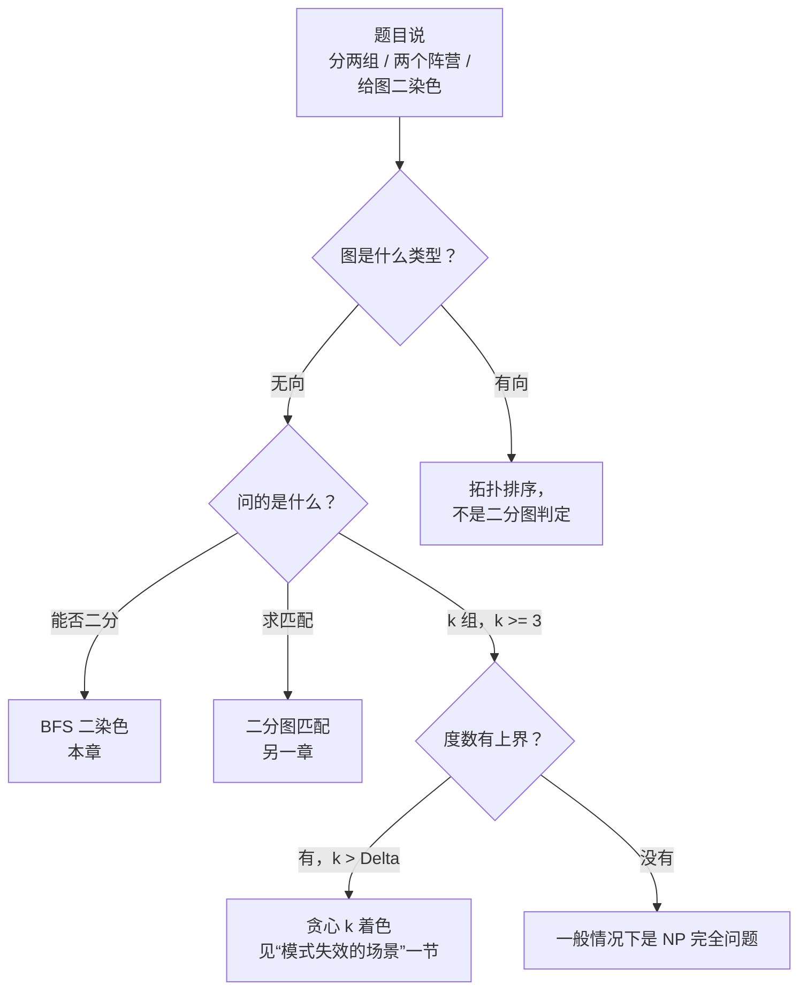
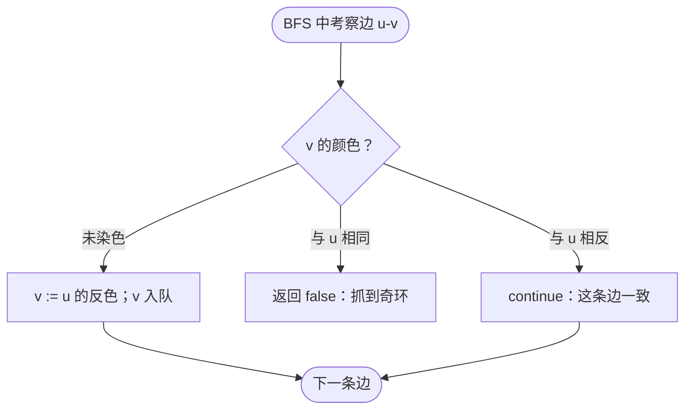
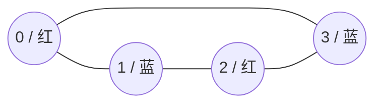
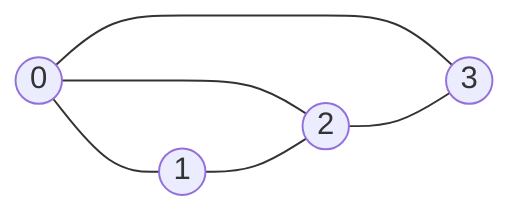

# 二分图判定

一个四节点的环：0-1-2-3-0。把节点 0 染成红色，它的邻居 1 必须是蓝色。与 1 相邻的顶点 2 只能是红色。再走到与 2 相邻的顶点 3，被迫是蓝色。收尾的边 3-0 两端落在划分的两侧。每条边都跨过分界，所以这张图是二分图。

现在把它改成三角形：0-1-2-0。0 红、1 蓝、2 红。收尾的边是 0-2，两端都是红色。二染色在第三条边上崩了。这张图不是二分图，而它唯一的毛病就是环的长度——三是奇数。这个观察就是本章要讲的全部内容。

## 如何识别这个模式



*动手写代码之前先走这棵决策树：二分图判定只适用于问“能否二分”的无向图。有向的同类问题走[拓扑排序](./04-topological-sort-kahn.md)；k ≥ 3 的 k 着色是另一个问题。*

## 为什么最直观的解法浪费了大部分工作

看到二分图判定，第一反应是枚举：把所有“顶点分到两侧”的方案都试一遍，只要有边两端落在同一侧就否掉这个方案，最后看是否存在活下来的方案。

```python
# 暴力：O(2^n * E) —— 这就是我们要替换掉的写法
def is_bipartite_brute(graph):
    n = len(graph)
    for mask in range(1 << n):
        # mask 的第 i 位 = 顶点 i 在哪一侧
        ok = True
        for u in range(n):
            for v in graph[u]:
                if ((mask >> u) & 1) == ((mask >> v) & 1):
                    ok = False
                    break
            if not ok:
                break
        if ok:
            return True
    return False
```

两个理由说明这是错误答案。其一，运行时间对 n 是指数的；LC 785 的 n ≤ 100 上限已经意味着 2^100 种分配，比可见宇宙的原子数还多。其二，这个算法根本不知道某个方案*为什么*失败，它只是在硬遍历。

修法是一趟遍历，边走边把划分建出来。把第一个顶点随便染成某一侧，压进队列；此后每跨过一条边，就把另一个端点涂成相反的颜色。如果遇到一条边两端已经被涂成同色，直接放弃：这条边就是“不存在二染色”的证明。如果走完都没有冲突，那你分到的颜色*就是*那个划分。

关键在于，“不存在二染色”有一个比暴力解法锐利得多的刻画：**一张图是二分图，当且仅当它没有奇数长度的环。**[^1] König 在 1916 年证明了这一点；证明很短，推论却极广。而 BFS 恰好能顺带检出奇环。走树状区域时，每条边都从一个 BFS 层指向下一层，颜色自然交替。一条边要违反这种交替，唯一的可能是它闭合了一个环，而能违反交替的环只有奇环——因为在偶环上颜色交换了偶数次，最后回到出发时的颜色。

## 模式

两层嵌套。外层循环保证每个顶点至少被访问一次，不让不连通的分量漏过去。对每个还没染色的起点跑一趟 BFS，边跑边涂。

```python
from collections import deque


def is_bipartite(graph):
    n = len(graph)
    color = [0] * n                       # 0 = 未访问，1 / -1 = 两个颜色类
    for start in range(n):
        if color[start] != 0:
            continue                      # 已被之前的分量涂过
        color[start] = 1
        q = deque([start])
        while q:
            u = q.popleft()
            for v in graph[u]:
                if color[v] == 0:
                    color[v] = -color[u]  # 沿这条边翻转颜色
                    q.append(v)
                elif color[v] == color[u]:
                    return False          # 同色边：出现奇环
    return True
```

**解答** — Python（[Java](./07-bipartite-check/lc-785/sol.java) · [C++](./07-bipartite-check/lc-785/sol.cpp) · [Go](./07-bipartite-check/lc-785/sol.go)）

```python
# LC 785. Is Graph Bipartite?
from collections import deque
from typing import List


def is_bipartite(graph: List[List[int]]) -> bool:
    """LC 785 — true iff `graph` admits a 2-coloring (no odd cycle)."""
    n = len(graph)
    color = [0] * n                       # 0 = 未访问，1 / -1 = 两个颜色类
    for start in range(n):
        if color[start] != 0:
            continue                      # 已被之前的分量涂过
        color[start] = 1
        q = deque([start])
        while q:
            u = q.popleft()
            for v in graph[u]:
                if color[v] == 0:
                    color[v] = -color[u]  # 沿这条边翻转颜色
                    q.append(v)
                elif color[v] == color[u]:
                    return False          # 同色边：出现奇环
    return True
```

函数体里有三处值得说。

颜色用的是 `1` 和 `-1`，而不是 `0` 和 `1`。这样 `color[v] = -color[u]` 一步就能翻转颜色；用 `0` 和 `1` 就得写成 `1 - color[u]` 或者跟 `1` 做异或，两者读起来也没问题，只是“涂成相反色”这层意图没那么直接。第三个值 `0` 表示“未访问”，`color[v] == 0` 这个判断把 BFS 的入口限定在还没碰过的顶点上。

每条边上的判断正好是三路分支。邻居 `v` 未染色，就把它涂成 `u` 的反色并入队。或者 `v` 已经染成与 `u` 相反的颜色，这条边一致，继续走。或者 `v` 已经和 `u` 同色——这是算法唯一返回 `false` 的路径。



*BFS 体内在每条边上做的判断。“与 u 相同”是唯一返回 false 的分支，另外两个分支让 BFS 继续走。*

外层那个 `for start in range(n)` 干的活比看上去多。LC 785 的题面明确写了“图可能不连通”。如果只从顶点 0 出发 BFS 就收工，1、2、3…… 这些分量全会被漏掉，而那些没访问到的分量里可能藏着奇环，于是你会错着返回 `True`。在连通图上，外层循环的开销是零（后面每次迭代都立刻被 `continue` 挡掉），所以没有任何理由不写它。[^2]

## 实例推演：四环与三角形上的 LC 785

拿 LC 785 的示例 2：`graph = [[1,3],[0,2],[1,3],[0,2]]`。这就是开头那个四环 0-1-2-3-0。



*四环 0-1-2-3-0 存在合法的二染色：{0, 2} 红，{1, 3} 蓝。每条边都跨过划分。*

从顶点 0 开始。0 染红，入队。弹出 0，遍历它的邻居：1 未染色，染蓝入队；3 未染色，染蓝入队。弹出 1，遍历邻居：0 已经是红色（与 1 相反，一致）；2 未染色，染红入队。弹出 3，遍历邻居：0 红（相反，一致）；2 红（相反，一致）。弹出 2，遍历邻居：1 蓝、3 蓝，都一致。队列空，无冲突。返回 `True`。

再看示例 1：`graph = [[1,2,3],[0,2],[0,1,3],[0,2]]`。里面藏着一个三角形（顶点 0-1-2-0）。



*示例 1 含有三角形 0-1-2-0。不存在满足所有边的二染色。*

从顶点 0 开始。0 染红，入队。弹出 0，遍历邻居：1 未染色，染蓝入队；2 未染色，染蓝入队；3 未染色，染蓝入队。弹出 1，遍历邻居：0 红（相反，没问题）；2 *蓝色，和 1 相同*。返回 `False`。三角形的第三条边触发了同色检查，结果与 König 定理的预言完全一致。

## 实际开销

| 变体 | 时间 | 空间 | 备注 |
|---|---|---|---|
| 最好情况（根附近立刻出现奇环） | O(V + E) | O(V) | 遇到第一条同色边就提前退出；渐进上界仍由最坏情况决定。 |
| 二分图（遍历整张图） | O(V + E) | O(V) | 沿用 CLRS §20.2 中 BFS 框架的 O(V + E) 上界。[^3] |
| 构造划分（集合 A、B） | O(V + E) | O(V) | 颜色数组本身就是那个划分，不额外花工夫。 |
| 暴力 | O(2^n · E) | O(n) | 错误答案，就是被我们替换掉的那个。 |

摊还分析很短。所有 BFS 跑下来，每个顶点恰好入队一次（`color[v] == 0` 这个判断把住了赋值这一关）。每条边被检查两次，无向邻接表表示下从两个端点各看一次，而每条边上的工作是 O(1) 的一次颜色比较。[^3] 针对不连通分量的外层循环，所有分量加起来最多多出 O(V) 次迭代。合计：O(V) + O(2E) · O(1) = O(V + E)。这个界是紧的：一条 V 个顶点、V - 1 条边的路径，要判定它是二分图也得花 Θ(V + E)，因为每条边都必须检查。

## 模式失效的场景

二染色这一档是特例。它的变体无非是把 BFS 换成 DFS、改输入形状，或者干脆越过两种颜色。

### 用 DFS 的替代方案

BFS 和 DFS 实现的是同一个证明：存在奇环，当且仅当二染色失败。DFS 用递归或显式栈，函数体变成“对每个邻居，用相反颜色递归下去，或者检查已有颜色是否对得上”。找到奇环时，两种算法给出的环见证不同。DFS 的见证是递归栈上从 `u` 回到 `v` 的那条路径，面试官有时会把它当作追问要你拿出来。线性时间的界两者相同。[^4] 在 Python 里默认选 BFS：递归深度限制（默认 1000）在对抗性构造的长链上会直接爆掉，而 `sys.setrecursionlimit` 是个你宁愿不需要的绕法。

### 边列表输入，下标从 1 开始

LC 886 *Possible Bipartition* 给的是 `dislikes = [[1,2],[1,3],[2,4]]`，问 n 个人能否分成两组，使任何一对互相讨厌的人都不在同一组。先从边列表建出邻接表，之后算法一字不改。坑在于输入是从 1 开始编号的：人是 1 到 n，所以 `color = [0] * n` 再用 `color[n]` 索引就越界了。要么把数组开成 `n + 1` 并忽略下标 0（更干净），要么在读入时就转成 0 开始。选一种；两种混着用就是静默错答案的来源。[^5]

### k ≥ 3 的 k 着色

二分图判定的直觉*并不能*推广。**3 着色（以及任何 k ≥ 3 的色数判定）在一般情况下是 NP 完全的**，它是 Karp 那 21 个原始问题之一。LC 1042 *Flower Planting With No Adjacent* 要求在最大度为 3 的图上做 4 着色，乍看像是二分图判定的推广。并不是。它之所以能线性时间求解，靠的是另一条理由：最大度为 3，每个顶点最多三个邻居，四种颜色里至少有一种在它的邻域中没被用到。贪心扫一趟，随手挑一个没用过的颜色就能往下走。题面里那句“保证有解”，其实是 [Brooks' theorem](https://en.wikipedia.org/wiki/Brooks%27_theorem) 的一个预先烤好的实例（对既非完全图、也非奇环的图，色数 ≤ Δ）。[^6]

LC 1042 里埋着的教训是边界。二分图判定（Δ ≥ 1，k = 2）和度数有界的贪心着色（k > Δ）都是线性的。夹在中间的那一切——没有度数约束的图 k 着色——是 NP 完全的。任意长度的奇环 Δ = 2 却要三种颜色，这正是 Brooks 定理挖出去的那个例外，也是二染色特殊的原因。

## 两个最容易踩的坑

> [!WARNING]
> **忘了对分量的外层循环。** 一张不连通的图上，某个分量里含奇环，而函数返回 `True`，因为从顶点 0 出发的 BFS 从没走到那个坏分量。LC 785 以抓这个 bug 出名；它的测试集里就有这种输入：官方示例 1 是全连通的，隐藏用例却不是。那四行外层循环在连通输入上一分钱不花，却决定了不连通输入上是绿还是红。

> [!WARNING]
> **每趟 BFS 开始时重置颜色数组。** 直觉是把每个分量独立对待，每趟 BFS 前把颜色清零。这样会重新进入已经涂过的顶点，要么绕成死循环，要么悄悄把算法变成平方级。颜色数组是*跨分量共享*的，`if color[start] == 0` 是唯一的闸门。一个分量涂完之后，它的顶点在余下的运行里保持有色，这正是外层循环只多出 O(V) 而不是 O(V²) 的原因。

还有第三个坑值得点名：把二分图判定和二分图*匹配*混为一谈。两者共享一个名字、一种图类型，除此之外几乎没有共同点。二分图判定回答的是“二分划分存不存在”。二分图匹配则是在已知它存在的前提下，找出没有公共端点的最大边集。匹配问题用 Hopcroft-Karp 或最大流来解，住在后面的章节里，不是面试官递给你 LC 785 时想问的东西。

## 题目梯度

### 核心（三题全做才算掌握本章）

- [LC 785 — Is Graph Bipartite?](https://leetcode.com/problems/is-graph-bipartite/) [中等] • bipartite-check ★
- [LC 886 — Possible Bipartition](https://leetcode.com/problems/possible-bipartition/) [中等] • bipartite-check
- [LC 1042 — Flower Planting With No Adjacent](https://leetcode.com/problems/flower-planting-with-no-adjacent/) [简单] • graph-coloring

### 进阶（可选）

- [LC 684 — Redundant Connection](https://leetcode.com/problems/redundant-connection/) [中等] • cycle-detection（Premium 题 *Graph Valid Tree* 的免费镜像）

LC 785 是本章的招牌题（★），也是实例推演一路走过的那道。LC 886 是同一个算法换了个名字；只有建图和从 1 开始的下标处理是新活。LC 1042 是简单位上的题，从相邻模式那扇门进来：不是二染色，但共用同一套“边涂边遍历”的骨架，也是标记这项技术到此为止的实用界碑。

本章没有公认的困难题，这是一个诚实的空缺，而不是筛选的结果。二分图判定自然的困难变体会飘向二分图*匹配*（用最大流做 König，后续章节）、奇环*横切*（NP 完全），或者边二分化（NP 完全）。LC 上碰到这块地盘的困难图论题，教的是真正不同的算法。

## 后续衔接

[环检测](./06-cycle-detection-graphs.md) 是对偶的那一篇：二分图判定*就是*奇环检测，只是换了一套词汇，讲环的那一章会把两者的关系讲正式。[并查集](./08-union-find.md) 支撑在线变体——边一条一条来，每插入一条就报告一次是否仍为二分图；技术叫“带奇偶的并查集”，用一条父边上的比特记录从节点到其代表元的路长为偶还是为奇。匹配问题（在已知图是二分图的前提下，找出没有公共端点的最大边集）则要等网络流那一章。

## 参考文献

[^1]: Wikipedia 贡献者，"Bipartite graph"，英文维基百科，§"Properties — Characterization"，<https://en.wikipedia.org/wiki/Bipartite_graph>。

[^2]: LeetCode 785，*Is Graph Bipartite?*，题面原文："There is an undirected graph with n nodes... The graph may not be connected, meaning there may be two nodes u and v such that there is no path between them." 经 leetcodethehardway.com 镜像核对：<https://leetcodethehardway.com/solutions/0700-0799/is-graph-bipartite-medium>。

[^3]: T. H. Cormen, C. E. Leiserson, R. L. Rivest, C. Stein，*Introduction to Algorithms*，第 4 版，MIT Press，2022，第 20 章 §20.2（Breadth-first search），定理 20.1——BFS 在邻接表输入上的运行时间为 O(V + E)。

[^4]: R. Sedgewick，*Algorithms in Java, Part 5: Graph Algorithms*，第 3 版，Addison Wesley，2004，pp. 109–111（基于 DFS 的二分图判定）。转引自 LC discuss 参考模板 "Graph coloring using BFS"，<https://leetcode.com/discuss/interview-question/1992272/graph-coloring-using-bfs>。

[^5]: P.-Y. Chen (walkccc)，*LeetCode Solutions*——LC 886 参考，<https://walkccc.me/LeetCode/problems/0886/>。

[^6]: Wikipedia 贡献者，"Brooks' theorem"，<https://en.wikipedia.org/wiki/Brooks%27_theorem>。
