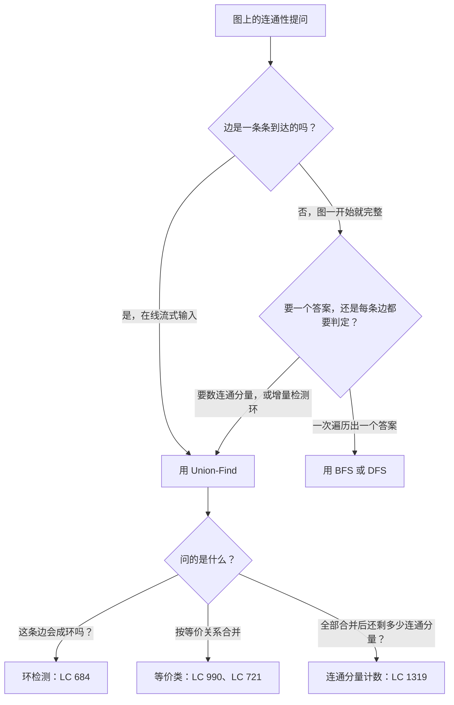
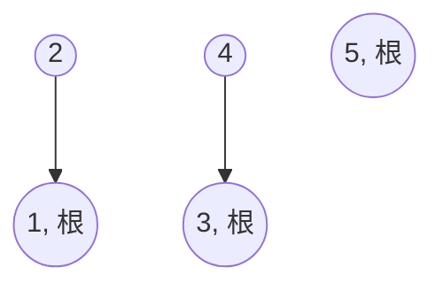

# Union-Find：父指针森林、路径压缩与按秩合并

拿边集 `[[1, 2], [1, 3], [2, 3]]` 来问：第三条边会不会把环闭合？画在纸上答案很明显：节点 2 和 3 通过 1 互相可达，所以加上边 `(2, 3)` 就闭上了这个环。现在换个问法：一百万条边一条条流进来，要求你在成环的那条到达的瞬间就把它标出来。每条边都跑一遍完整 BFS 或 DFS 是 `O(m²)` 的活儿，第一百万次查询就超时。正确答案由 Bernard Galler 和 Michael Fischer 在 1964 年发表，Robert Tarjan 在 1975 年把它收紧；四十年过去，它跑的还是每本教科书都称为“摊还常数时间”的东西。

这个数据结构只干一件事：把 `n` 个元素维护成不相交集合的划分，并快速回答两个问题。这两个元素在同一个集合里吗；如果不在，把它们所在的两个集合合并。就这些。面试里的信号词是 *online*，或者任何形如 *“对每条边做点什么”* 的说法。连通性问题若是一条边一条边地来、查询夹在添加之间，就用 Union-Find；图一开始就完整、只想遍历一遍，就用 BFS 或 DFS。

结构小到面试官可以让你十分钟内从零写出来，整章靠三条断言撑着——好陈述，却意外地难辩护。朴素的父指针森林每次操作 `O(n)`；加上按秩合并（union by rank）变成 `O(log n)`；再叠加路径压缩（path compression）变成 `O(α(n))`，其中 `α` 是反阿克曼函数，任何你能写出来的 `n` 都满足 `α(n) ≤ 4`。证明出自 Tarjan 1975 年发表在 *Journal of the ACM* 的论文[^4]，此后这个结构再没被超越[^1][^5]。

## 如何识别这个模式

三种具体的题型会触发 Union-Find。先分清你手上是哪种，它决定你该用哪套说法：



*图注：在线还是批处理，是判别依据。能一次性扫完整张图时，BFS 和 DFS 就够了；查询与合并交替出现时，Union-Find 才有它的位置。*

三条下游分支共用同一套数据结构，区别只在于最后看什么。环检测看的是第一条没能把两个不同集合合起来的边；等价类构建走遍每个元素、问它的代表是谁；连通分量计数数一数有多少个不同的代表。

## 要构建什么

Union-Find（也叫并查集，Disjoint Set Union，DSU）维护 `n` 个元素到不相交集合的划分，对外暴露三个操作[^1][^2]:

- `make_set(x)` 初始化单元素集合 `{x}`。多数实现把它折进构造函数，把每个元素都初始化成自己的根。
- `find(x)` 返回 `x` 所属集合的代表。两个元素同属一个集合，当且仅当它们的 `find` 结果相同。
- `union(x, y)` 合并 `x` 与 `y` 所在的两个集合。若它们本就在同一集合，什么也不做，并把这个事实报出来。

实现就是一片父指针森林。每个集合存成一棵树，树根代表整个集合，其他每个元素指向自己的父节点。整型数组 `parent[i]` 存元素 `i` 的父节点，约定根指向自己：`parent[root] == root`。没有子指针，没有边表，没有任何辅助结构。就一个数组。



*图注：合并 (1, 2) 与 (3, 4) 之后，森林里有两棵深度为 1 的树，外加 5 这个单点。按 1 开始的下标，`parent = [_, 1, 1, 3, 3, 5]`；下划线是没用到的 parent[0] 槽位。*

`find(x)` 就是沿着父指针往上走，直到走到父节点是自己的那个节点。`union(x, y)` 是两次 find 加一次父指针改接。到这儿，数据结构就是一个数组加两个短循环。

## Quick-find：先看错误答案

在谈启发式之前，先看最朴素的实现——Sedgewick 最先讲它，就是为了让“什么都不做”的代价变得看得见[^6]。彻底跳过父指针森林，用一个扁平数组，`id[i]` 直接就是所属集合的代表，不用走：

```python
# Quick-find：find 为 O(1)，union 为 O(n) —— 这就是要被替换掉的做法
class QuickFind:
    def __init__(self, n):
        self.id = list(range(n))

    def find(self, x):
        return self.id[x]                  # O(1)

    def union(self, x, y):
        rx, ry = self.id[x], self.id[y]
        if rx == ry:
            return False
        for i in range(len(self.id)):      # 每次 union 为 O(n)
            if self.id[i] == rx:
                self.id[i] = ry
        return True
```

find 是常数时间，听起来很美，直到你追一遍 `n` 次合并的序列。每次合并最多改写 `n` 个条目，整个序列是 `O(n²)`。LC 684 的输入规模是一千条边，那是一百万次操作，没问题；一百万条边的流就是一万亿次，这就是面试通过和 TLE 之间的差别。

修正之道是父指针森林。每次 `union` 只改接一个指针，而不是扫整个数组。代价转移到 `find` 上，它现在要沿树往上走，而不是返回一个缓存好的答案。这一走是短是长，就是全部的胜负所在。

## 森林、find 与 union

下面是不加优化的版本，也就是你忘了启发式时在面试里写出来的那个。`find` 沿父指针走到根；`union` 找出两个根，把一个挂到另一个下面：

```python
class DSU:
    def __init__(self, n):
        self.parent = list(range(n))           # 每个元素一开始自成一棵树

    def find(self, x):
        while self.parent[x] != x:             # 一路走到根
            x = self.parent[x]
        return x

    def union(self, x, y):
        rx, ry = self.find(x), self.find(y)
        if rx == ry:
            return False                       # 已经在同一集合
        self.parent[ry] = rx                   # 随便挂一个方向
        return True
```

它能跑，意思是它给出的答案是对的。麻烦在那行 `self.parent[ry] = rx`。永远把第二个根挂到第一个下面，看起来无害，但喂给它对抗序列 `union(0, 1), union(1, 2), union(2, 3), ...`，树就退化成链表：一条长度 `n` 的链。此时每次 `find` 都是 `O(n)`，运行时间回到 `O(n²)`。光靠路径压缩也救不了你；这条链是在 *union* 那一侧长出来的，在任何 find 跑起来之前就已经成型[^12]。

两处改动能治它。第一处决定 `union` 时往哪个方向挂，第二处在 `find` 时把树压平。

## 两个改变复杂度界的启发式

两个启发式都是局部的，都只多几行。合起来，它们把代价从平方级降到摊还常数级。

### 路径压缩：上行时压平

当 `find(x)` 从 `x` 沿一串中间节点走到根时，走完的那一刻，那些中间节点都已经知道答案了。为什么让下一次调用再走一遍同样的路？在回溯时把每个访问过的节点直接改接到根上。之后对其中任何一个再 find，都只需一跳[^1][^2]。

递归写法是这个想法最干净的表达：`find` 返回根，并在返回途中用这个根覆盖 `parent[x]`。

```python
def find(self, x):
    if self.parent[x] != x:
        self.parent[x] = self.find(self.parent[x])    # 改接这一下
    return self.parent[x]
```

在链 `4 → 3 → 2 → 1` 上跑一次 `find(4)` 之后，父指针变成 `parent[4] = 1`、`parent[3] = 1`、`parent[2] = 1`。树的深度在一次调用里从 4 掉到 1。之后对这四个节点中的任何一个 find 都只需一步。

迭代式两趟写法做同样的事，但不用递归——当树深到能把 Python 的 1000 帧栈或 C++ 默认的 8 MB 栈撑爆时，这一点很重要。先走到根，再从原始节点走一遍，重设每个父指针：

```python
def find(self, x):
    # 第一趟：找到根。
    root = x
    while self.parent[root] != root:
        root = self.parent[root]
    # 第二趟：把路径上每个节点都改接。
    while self.parent[x] != root:
        next_x = self.parent[x]
        self.parent[x] = root
        x = next_x
    return root
```

章节规模的输入（LC 684 的 `n` 上限是 1,000）用递归写法没问题。竞赛编程或生产环境，`n ≥ 10⁵` 时该交付的是迭代写法。CP-Algorithms 两种都写了，并指出迭代版只用常数辅助内存，而递归版每次调用要吃 `O(path_length)` 个栈帧[^2]。

路径减半（path halving）和路径分裂（path splitting）是单趟的替代方案，摊还界一样。减半把 find 路径上每隔一个的父指针改接到祖父；分裂对每个父指针都做同样的事。用哪个都行；教科书最先讲的都是完整压缩[^1]。

### 按秩合并：让树保持浅

路径压缩是事后压平。另一个启发式从一开始就不让链长出来。`union` 合并两棵树时，把矮的那棵挂到高的那棵的根下面。合并后的高度就是两个高度里较大的那个，而不是 1 加上被挂那棵的高度。

记账成本是每个元素多一个整数，叫 `rank`。初始所有元素秩为 0。合并规则是：

1. 比较两个根的秩。
2. 把秩小的根挂到秩大的根下面。
3. 秩相等时任选一个方向挂，并把新根的秩加一。

启发式相互作用之后，秩是树高的上界[^1]，不是精确高度；路径压缩可以在不降低秩的情况下把树缩小，这个微妙之处在证明里重要，在实现里从来不重要。更新 `rank` 的规则只在秩相等时触发，因为那是唯一可能让合并后的树真正长高的情形。

```python
def union(self, x, y):
    rx, ry = self.find(x), self.find(y)
    if rx == ry:
        return False
    # 把秩小的根挂到秩大的根下面。
    if self.rank[rx] < self.rank[ry]:
        rx, ry = ry, rx
    self.parent[ry] = rx
    if self.rank[rx] == self.rank[ry]:
        self.rank[rx] += 1
    return True
```

单独用按秩合并，每次操作是 `O(log n)`。证明很短：秩为 `r` 的根至少有 `2^r` 个后代[^1]，所以 `n` 个节点的树秩最多 `log₂ n`，一次 find 最多走这么多个父指针。

再叠上路径压缩，界进一步塌到反阿克曼。这个塌陷是下一节的事。

按大小合并（union by size）是同样有效的替代方案，它记的是子树大小而不是秩，把小的树并进大的。同样是 `O(α(n))` 的界，记账略不同[^1][^2]。CLRS 讲按秩合并，因为它和证明配合得更干净[^3]；Sedgewick 讲按大小合并，因为道理直觉（“大分量吸收小分量”）[^6]。选一个，然后保持一致。本章用秩，因为它对得上 CLRS 第 19 章的讲法[^3]。

## 整合起来

标准的 Union-Find 类二十行。return 语句之上的每一行都是两个启发式之一，其余全是记账。

```python
class DSU:
    def __init__(self, n):
        self.parent = list(range(n + 1))      # 从 1 开始下标；parent[0] 不用
        self.rank = [0] * (n + 1)

    def find(self, x):
        if self.parent[x] != x:
            self.parent[x] = self.find(self.parent[x])
        return self.parent[x]

    def union(self, x, y):
        rx, ry = self.find(x), self.find(y)
        if rx == ry:
            return False
        if self.rank[rx] < self.rank[ry]:
            rx, ry = ry, rx
        self.parent[ry] = rx
        if self.rank[rx] == self.rank[ry]:
            self.rank[rx] += 1
        return True


def find_redundant_connection(edges):
    """LC 684: process edges left to right; return the first one whose
    endpoints already share a root."""
    n = len(edges)
    dsu = DSU(n)
    for u, v in edges:
        if not dsu.union(u, v):
            return [u, v]
    return []
```

**Solution** — Python ([Java](./08-union-find/lc-684/sol.java) · [C++](./08-union-find/lc-684/sol.cpp) · [Go](./08-union-find/lc-684/sol.go))

```python
# LC 684. Redundant Connection
from typing import List


class DSU:
    def __init__(self, n: int) -> None:
        self.parent = list(range(n + 1))  # 从 1 开始下标；parent[0] 不用
        self.rank = [0] * (n + 1)

    def find(self, x: int) -> int:
        # 路径压缩（递归两趟写法）。
        if self.parent[x] != x:
            self.parent[x] = self.find(self.parent[x])
        return self.parent[x]

    def union(self, x: int, y: int) -> bool:
        rx, ry = self.find(x), self.find(y)
        if rx == ry:
            return False  # 已连通；加这条就会成环
        # 按秩合并：把矮的树挂到高的根下面。
        if self.rank[rx] < self.rank[ry]:
            rx, ry = ry, rx
        self.parent[ry] = rx
        if self.rank[rx] == self.rank[ry]:
            self.rank[rx] += 1
        return True


def find_redundant_connection(edges: List[List[int]]) -> List[int]:
    """LC 684: return the edge that, if removed, leaves a tree.
    If multiple, return the one occurring last in the input."""
    n = len(edges)  # n 个节点，n 条边（多出一条）
    dsu = DSU(n)
    for u, v in edges:
        if not dsu.union(u, v):
            return [u, v]
    return []
```

驱动函数三行，是 LC 684 的核心。按顺序处理每条边；第一次 `union` 返回 `False`，就是在宣布这条边的两个端点已经共用同一个根，也就是它们之间的路径已经存在，也就是新边把环闭合了。停，返回这条边。如果走完整张表都没有冗余边，输入本来就是一棵树，返回空答案。

有一个直觉值得点名，因为它专坑刚看过 LC 684 那只有向版兄弟题的读者：比较父指针而不是根。`parent[u] == parent[v]` 是错的，因为两个节点可以共根却不共直接父节点。任何时候都先对两边调 `find`，再比较。

## 实例推演：冗余连接

看清这套结构怎么运转，最干净的输入是五个节点五条边，最后一条把环闭合：

```text
n = 5
edges = [(1, 2), (3, 4), (2, 3), (1, 5), (4, 5)]
expected_redundant = [4, 5]
```

第一条边 `(1, 2)` 找到两个秩为 0 的根；一个随便胜出，另一个挂到它下面，胜者的秩升到 1。第二条边 `(3, 4)` 在另一对上重复同样的事，森林于是是两棵深度 1 的树加 5 这个单点。有意思的时刻是第三条边。

> **Interactive widget:** [Union-Find：带路径压缩与按秩合并的父指针森林](../../../dsa/widgets/w-28-union-find.yml)（panel `default`）—— 网站上有渲染版本；YAML 规格描述了各个关键帧。

*静态替代版：标准输入上的 23 步轨迹。第 12 步是等秩合并，造出本章第一棵深度 2 的树。第 18 步是招牌帧：`find(4)` 走 `4 → 3 → 1`，返回途中路径压缩把 `parent[4]` 从 3 直接改接到 1。第 21 步是环检测：`(4, 5)` 的两个端点都归结到根 1，于是这条边被判为冗余。*

第 18 步值得看两遍。那一步之前，根 1 下的树深度是 2：节点 2 和 5 在深度 1，节点 4 经节点 3 处在深度 2。第 18 步之后，树里每个非根节点都直接指向 1。之后对四个孩子里的任何一个 find 都只需一次父指针解引用。这就是“摊还常数”的工作定义——不是每次操作都快，而是一次昂贵的操作（第 18 步那次深度 2 的走）替它换来的、将来更便宜的操作先付了账。

动画还暴露了反例。把 `compression: off` 预设打开，第 18 步的压平就消失了；同一条深度 2 的链，下一次 find 每次都要走同样的两跳。把 `union_by: none` 打开，构建过程中树再也不平衡；在有序输入上做 `n` 次 union，树会长成链表，find 退化成 `O(n)`，压缩还没来得及帮忙。两个启发式都在干真活，单独哪一个都不够。

## 实际开销

| 变体 | 单次操作时间（摊还） | 空间 | 来源 |
|---|---|---|---|
| Quick-find | `union` 为 `O(n)`，`find` 为 `O(1)` | `O(n)` | Sedgewick algs4 §1.5[^6] |
| Quick-union（无秩、无压缩） | 最坏 `O(n)` | `O(n)` | [^1] |
| 仅按秩合并 | `O(log n)` | `O(n)` | 秩为 `r` 的根至少有 `2^r` 个后代[^1] |
| 仅路径压缩 | 平均每次 `find` 为 `O((1 + log_{2+f/n} n))` | `O(n)` | [^1] |
| **按秩合并 + 路径压缩** | **摊还 `O(α(n))`** | `O(n)` | **Tarjan 1975[^4]** |
| 下界（任何指针机算法） | 摊还 `Ω(α(n))` | — | Tarjan 1979[^5] |

表头附近那两个摊还界，就是合起来才能躲开的两种失效模式。Quick-find 把全部代价压进 `union`；父指针森林把它压进 `find`。组合后的结构把代价摊到各处，最坏情况永远落不下来。

### 为什么单次操作摊还到反阿克曼

Tarjan 1975 年的论文给出了本章压轴的界：在 `n` 个元素上任意 `m` 次 `find` 与 `union` 的序列，只要用按秩合并加路径压缩，总时间是 `O(m · α(n))`，其中 `α(n)` 是反阿克曼函数[^4]。Tarjan 1979 年的后续工作证明这也是下界：没有指针机算法能做得更好[^5]。所以这不是通往更紧界的垫脚石，这就是答案。

Tarjan 的论证讲的是秩的层级。按秩落进哪个桶给每个节点分组，桶由迭代的二的塔函数定义。节点的秩随新的合并增长，但它只能在累积的后代数里对数式增长，所以每个桶里的节点数几何式递减。每次 find 走过一些“秩与自己父节点同桶”的节点，外加每趟最多一条跨桶边。按桶的定义，跨桶边每次 find 合计 `O(α(n))`。桶内的遍历则经由路径压缩记账到节点自己头上，因为这个机制保证每次 find 经过某节点后，它父节点的秩严格增大；在整个操作序列上，每个节点最多被记账 `O(α(n))` 次，之后它父节点的秩就超过它自己所在桶的天花板，这笔账便往上挪。总工作量：`O(m · α(n))`[^4]。

`α(n)` 增长得慢到说它是常数几乎不算撒谎。Wikipedia 和 CP-Algorithms 都指出，对任何不超过约 `2^65535` 的 `n` 都有 `α(n) ≤ 4`，而这个数的位数比可观测宇宙里的原子数还多[^1][^2]。对任何你会写下、输入、分配或想象的 `n`，每次 Union-Find 操作按任何合理口径都是常数时间。

一个更简单的界 `O(m · log* n)`（用迭代对数）由 Hopcroft 和 Ullman 在 1973 年证明，一直是已知最好的，直到两年后被 Tarjan 收紧[^1]。本章引用 Tarjan 的界，因为它紧；历史上那个界之所以值得一提，只因为它的时间线说明了当年 `α(n)` 这个答案有多出人意料。

## 这个模式另外两个典型场景

LC 684 是最干净的入口，因为问题直接对映到 `union` 返回 `false`。另外两道经典题把同一套数据结构改造成更微妙的查询。

### LC 990：等式与不等式，两趟扫描

题目给你一串形如 `["a==b", "b!=c", "c==a"]` 的方程，问它们能不能同时成立。读法是：`==` 是等价关系——自反、对称、传递。每个 `==` 约束是一次 `union`。每个 `!=` 约束是一次查询，要求两个端点落在不同集合里[^8]。

窍门在于输入里方程的顺序会误导你。不能从左到右处理，因为后面的 `==` 可能把两个变量连起来，而前面的 `!=` 还没被问到它们。两趟：

```python
def equations_possible(equations):
    dsu = DSU(26)
    for eq in equations:
        if eq[1] == "=":
            dsu.union(ord(eq[0]) - ord("a"), ord(eq[3]) - ord("a"))
    for eq in equations:
        if eq[1] == "!":
            if dsu.find(ord(eq[0]) - ord("a")) == dsu.find(ord(eq[3]) - ord("a")):
                return False
    return True
```

```python
# LC 990. Satisfiability of Equality Equations
# 两趟写：先把所有 '==' 方程 union 起来；然后对每个 '!='，检查
# 两个端点是否不同根。任何 '!=' 两端同根就返回 False。
from typing import List


class DSU:
    def __init__(self, n: int) -> None:
        self.parent = list(range(n))
        self.rank = [0] * n

    def find(self, x: int) -> int:
        if self.parent[x] != x:
            self.parent[x] = self.find(self.parent[x])
        return self.parent[x]

    def union(self, x: int, y: int) -> bool:
        rx, ry = self.find(x), self.find(y)
        if rx == ry:
            return False
        if self.rank[rx] < self.rank[ry]:
            rx, ry = ry, rx
        self.parent[ry] = rx
        if self.rank[rx] == self.rank[ry]:
            self.rank[rx] += 1
        return True


def equations_possible(equations: List[str]) -> bool:
    """LC 990: return True iff the equations can be simultaneously satisfied."""
    dsu = DSU(26)  # 26 个小写字母作为节点编号
    # 第一趟：把所有由 '==' 连接的变量并起来。
    for eq in equations:
        if eq[1] == "=":
            dsu.union(ord(eq[0]) - ord("a"), ord(eq[3]) - ord("a"))
    # 第二趟：每个 '!=' 的两端必须在不同集合。
    for eq in equations:
        if eq[1] == "!":
            if dsu.find(ord(eq[0]) - ord("a")) == dsu.find(ord(eq[3]) - ord("a")):
                return False
    return True
```

第一趟建出方程要求的所有等价类。第二趟拿每个不等式去核对这个划分。任何 `!=` 发现两个变量在同一类里，方程就自相矛盾，答案是 `False`。总工作量 `O(n · α(26))`，常数因子把它压成朴素的 `O(n)`。数据结构和之前是同一个 `DSU` 类，只有驱动函数变了。

### LC 721：键是字符串时

到这里为止，每个集合元素都是整数，可以直接下标进父数组。LC 721 给你一串账户，每个是名字加若干邮箱，要求合并任何至少共用一个邮箱的两个账户[^9]。放进数据结构的自然元素是邮箱，而它是字符串。

办法是把数组换成哈希表，并显式写 `make_set` 处理首次出现。find 和 union 的逻辑一点不变；父映射是 `dict[str, str]` 而不是 `list[int]`：

```python
def accounts_merge(accounts):
    dsu = DSU()
    email_to_name = {}
    for account in accounts:
        name = account[0]
        first = account[1]
        dsu.make(first)
        email_to_name[first] = name
        for email in account[2:]:
            dsu.make(email)
            email_to_name[email] = name
            dsu.union(first, email)
    groups = defaultdict(list)
    for email in email_to_name:
        groups[dsu.find(email)].append(email)
    return [[email_to_name[root]] + sorted(emails) for root, emails in groups.items()]
```

```python
# LC 721. Accounts Merge
# 字符串键的 Union-Find：父映射是 dict[str, str]。每个邮箱是一个
# 节点；对每个账户，把它的所有邮箱并进同一个集合；最后按
# find 出来的根给邮箱分组，再挂回账户名。
from typing import List
from collections import defaultdict


class DSU:
    def __init__(self) -> None:
        self.parent: dict = {}
        self.rank: dict = {}

    def make(self, x: str) -> None:
        if x not in self.parent:
            self.parent[x] = x
            self.rank[x] = 0

    def find(self, x: str) -> str:
        if self.parent[x] != x:
            self.parent[x] = self.find(self.parent[x])
        return self.parent[x]

    def union(self, x: str, y: str) -> None:
        rx, ry = self.find(x), self.find(y)
        if rx == ry:
            return
        if self.rank[rx] < self.rank[ry]:
            rx, ry = ry, rx
        self.parent[ry] = rx
        if self.rank[rx] == self.rank[ry]:
            self.rank[rx] += 1


def accounts_merge(accounts: List[List[str]]) -> List[List[str]]:
    """LC 721: merge accounts that share at least one email; return the
    merged accounts with each email list sorted, owner name first."""
    dsu = DSU()
    email_to_name: dict = {}

    for account in accounts:
        name = account[0]
        first = account[1]
        dsu.make(first)
        email_to_name[first] = name
        for email in account[2:]:
            dsu.make(email)
            email_to_name[email] = name
            dsu.union(first, email)

    groups: dict = defaultdict(list)
    for email in email_to_name:
        groups[dsu.find(email)].append(email)

    return [[email_to_name[root]] + sorted(emails) for root, emails in groups.items()]
```

套路和 LC 990 同形：第一趟边读输入边 union；第二趟遍历每个元素、问它的代表是谁，从而得出答案。字符串键版本每次 `find` 多一层 `dict` 查找，界是 `O(n · k · α(n))`，`k` 是最长账户的长度；实际上哈希因子是常数，数据结构仍然是有效的线性。

最容易漏的一步是 `make_set`。整数键时，构造函数为每个合法下标预填 `parent[i] = i`，每个元素自动成为根。字符串键时，每个邮箱首次出现都要显式调一次 `make`，否则 `find` 第一次查它就抛 `KeyError`[^9]。

## 常见误区

> [!WARNING]
> **跳过按秩合并，Union-Find 就退化成平方算法。** 光有路径压缩不够。对抗序列 `union(0, 1), union(1, 2), union(2, 3), ..., union(n-2, n-1)`，如果每次 union 都单边把第二个根挂到第一个下面，就会造出长度 `n` 的链；压缩只在 find 之后才发作，而在这个构造序列里，链长成之前没有任何 find 跑过[^12]。永远比较秩（或大小），把矮的树挂到高的下面。dev.to 那篇 LC 684 讲解明确写着“只有会用带按秩合并的 Union-Find，这题才算 Medium”[^12]。

> [!WARNING]
> **比较直接父节点而不是根。** `if parent[x] == parent[y]: return False` 在任何深度 ≥ 2 的树上都会错：两个表亲可以隔着更长的链共根，直接父节点却不同。连通性判断*永远*是 `find(x) == find(y)`，这逼你先走到根再比较。

> [!WARNING]
> **递归 `find` 在 `n ≥ 10⁵` 时爆栈。** Python 默认递归上限是 1,000 帧；C++ 默认 8 MB 栈在典型帧大小下也就到这个量级的深度。LC 684 的 `n ≤ 1000` 远在界内，但把同样的代码搬到竞赛或 MST 负载、`n = 10⁶` 时，解释器会在算法开始跑之前就崩掉，二进制会段错误。两趟迭代写法（先走到根，再走一遍并改接）只用常数辅助内存，界同样是 `O(α(n))`[^2]。

> [!WARNING]
> **直接读 `parent` 数连通分量。** 一串合并之后，`len(set(parent))` 会少算：某个被并进更深树的节点，父指针可能还指着中间节点而不是根。真正的分量数是 `len({find(i) for i in range(n)})`——先把每个根显式求出来，再数[^10]。Wikipedia 把背后的不变量讲得很清楚：“一个节点一旦变成子节点，它的秩就再也不会被访问”，中间父指针同理[^1]。

## 题目梯度

### 核心（三题全做才算掌握本章）

- [LC 684 — Redundant Connection](https://leetcode.com/problems/redundant-connection/) [中等] • union-find-cycle-detection ★
- [LC 685 — Redundant Connection II](https://leetcode.com/problems/redundant-connection-ii/) [困难] • union-find-directed-twist *（参考实现：仅 Python）*
- [LC 990 — Satisfiability of Equality Equations](https://leetcode.com/problems/satisfiability-of-equality-equations/) [中等] • union-find-equivalence-classes *（参考实现：仅 Python）*

### 进阶（可选）

- [LC 721 — Accounts Merge](https://leetcode.com/problems/accounts-merge/) [中等] • union-find-string-keyed *（参考实现：仅 Python）*
- [LC 1319 — Number of Operations to Make Network Connected](https://leetcode.com/problems/number-of-operations-to-make-network-connected/) [中等] • union-find-component-count

LC 685 是 LC 684 的有向版兄弟题，也是本章最难的一题。分支讨论不平凡：一个节点可能有两个父节点，图可能有环，可能两者兼具，也可能只有环。数据结构一样；变的是先扫一遍找出任何入度为 2 的节点，然后在一个精心挑选的边子集上跑 LC 684 的逻辑。Algomap 的讲解把这个分支讨论写清楚了[^7]。

## 后续衔接

自然的下一步是 [Kruskal 最小生成树](./11-mst-kruskal.md)，那里 Union-Find 成了防止成环的引擎，嵌在一个排序驱动的贪心里：按权重顺序处理边，当且仅当 `union` 返回 `true` 时接受这条边。你刚读完的是数据结构，Kruskal 是建在它上面的算法[^4][^11]。对照那一章 [Prim 最小生成树](../../../dsa/part-8-graphs/12-mst-prim.md) 改用前沿驱动的堆，从不调用 Union-Find；两章连起来读，是感受同一个问题下“按边排序的贪心”与“按顶点前沿的贪心”差别的最干净办法。

无向图与有向图上基于 DFS 的环检测框架在 [图上的环检测](./06-cycle-detection-graphs.md)，那一章把本章列为图一条边一条边到达时的替代方案。图已经完整拼好时的连通分量问题，[连通分量与泛洪填充](./03-connected-components.md) 讲的是 BFS 与 DFS 的框架；而图是自己增量长出来的时候，你要拿的就是本章。

## 参考文献

[^1]: *Disjoint-set data structure*，Wikipedia，最后编辑于 2026 年 4 月 13 日。<https://en.wikipedia.org/wiki/Disjoint-set_data_structure>。

[^2]: *Disjoint Set Union*，CP-Algorithms，最后更新于 2026 年 3 月 29 日。<https://cp-algorithms.com/data_structures/disjoint_set_union.html>。

[^3]: Cormen, Leiserson, Rivest, Stein，*Introduction to Algorithms*，第 4 版，MIT Press，2022。

[^4]: R. E. Tarjan, "Efficiency of a Good But Not Linear Set Union Algorithm," *Journal of the ACM*, vol. 22, no. 2, pp. 215–225, April 1975. DOI: <https://doi.org/10.1145/321879.321884>.

[^5]: R. E. Tarjan, "A class of algorithms which require non-linear time to maintain disjoint sets," *Journal of Computer and System Sciences*, vol. 18, no. 2, pp. 110–127, 1979. DOI: <https://doi.org/10.1016/0022-0000(79)90042-4>.

[^6]: R. Sedgewick and K. Wayne，*Algorithms*，第 4 版，Addison-Wesley，2011。第 1.5 节 "Case Study: Union-Find"。参考实现（`QuickFindUF.java`、`QuickUnionUF.java`、`WeightedQuickUnionUF.java`、`QuickUnionPathCompressionUF.java`）见 <https://algs4.cs.princeton.edu/15uf/>。

[^7]: *Redundant Connection II*，algomap.io。<https://algomap.io/problems/redundant-connection-ii>。

[^8]: J. Plank, *"Satisfiability of Equality Equations,"* University of Tennessee Knoxville CS 课程讲义。<https://web.eecs.utk.edu/~jplank/topcoder-writeups/Leetcode/Satisfiability-of-Equality-Equations/index.html>。

[^9]: *721. Accounts Merge*，walkccc.me。<https://walkccc.me/LeetCode/problems/721/>。

[^10]: *1319. Number of Operations to Make Network Connected*，walkccc.me。<https://walkccc.me/LeetCode/problems/1319/>。

[^11]: *Minimum Spanning Tree — Kruskal with Disjoint Set Union*，CP-Algorithms。<https://cp-algorithms.com/graph/mst_kruskal_with_dsu.html>。

[^12]: *684. Redundant Connection*，dev.to (samuelhinchliffe)，2022 年 7 月 14 日。<https://dev.to/samuelhinchliffe/684-redundant-connection-33i5>。
