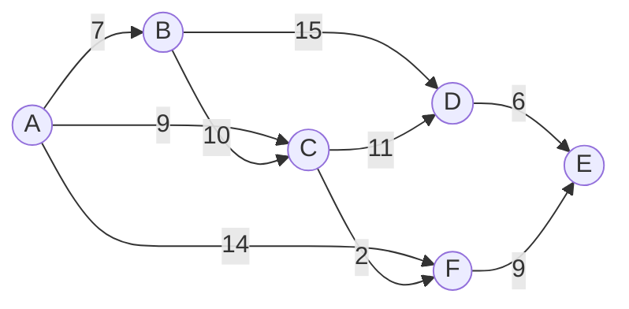

# Dijkstra 最短路径算法

六个城市，九条行驶时间非负的公路。信号从城市 A 出发，沿着每条出边同步扩散，跨过一条路要耗掉这条边权值那么多秒。问的是最后一个城市什么时候听到信号。暴力解法把 A 到其余每个城市的每一条简单路径都枚举出来取最小；在一个六顶点的图上，这已经是几千条路径，而 LC 743 的输入上限是一百个顶点，那就是天文数字。

本章的算法用 `O((V + E) log V)` 干完同一件事。1959 年 Edsger W. Dijkstra 把它发在 *Numerische Mathematik* 的三页纸上[^5]，而今天的实现比它的正确性证明还短。[^1] 诀窍只有一条不变量：当你从优先队列里取出最小的暂定距离时，*那个距离就是最终的*。后面任何松弛都改不动它。证明一段话，算法一个循环，而在面试轮次里写错它，这一轮就没了。

> [!IMPORTANT]
> Dijkstra 要求每条边的权值都非负。只要有哪怕一条负权边，算法就会悄无声息地给出错答案，不抛异常，不给警告。一次定型的不变量会失效，因为后面绕经一条负权边的走法，可能改进一个你已经定型的顶点。只要有任何边可能为负，直接跳到 [Bellman-Ford 与负环](./10-bellman-ford.md)。

## 它是什么

Dijkstra 算法计算加权有向图中单个源点到其余每个顶点的最短路径，前提是每条边的权值都非负。输出是一个数组 `dist[]`，其中 `dist[v]` 是源点到 `v` 的最短路径代价，`v` 不可达时是无穷大。

把它读成"把 FIFO 队列换成优先队列的 BFS"就对了。[BFS](./01-bfs.md) 在每条边权值都是 1 时算最短路径；FIFO 队列之所以恰好按距离非降序出队，是因为每走一步正好加 1。Dijkstra 把 FIFO 换成以暂定距离为键的最小优先队列，从而推广到任意非负权重。这时"弹最小"不再是队列纪律白送的副作用，而是这个数据结构的定义性契约。

## 基本操作

五个基本操作驱动整个算法，每一个都在 §2 的参考实现里明写着。先读操作，再读循环；循环只是把它们编排起来。

### 初始化

`dist[source] = 0`，其余每个 `dist[v] = INF`。把 `(0, source)` 压进一个空的最小堆。堆以暂定距离为键；距离相同时按节点 id 破平局没问题，但对正确性没有影响。

### 弹出

取出 `d` 最小的条目 `(d, u)`。最小堆的 `extractMin` 是 `O(log n)`，`n` 是堆的当前大小。这是算法唯一一个真正决定定型顺序的决策点。

### 惰性跳过（守卫 `if d > dist[u]: continue`）

如果弹出的距离 `d` 大于当前已知的 `dist[u]`，这个条目就是*过期的*：之前某次弹出已经用更小的距离把 `u` 定型了。丢掉这个条目，继续循环。没有这道守卫算法依然正确，但反复扫描过期邻居会把运行时间吹起来；有了它，每次弹出最多只做一轮完整的邻居扫描。

### 松弛

对每条出边 `(u, v)`，权值为 `w`，算出候选距离 `d + w`。如果 `d + w < dist[v]`，候选值就打败了 `v` 当前持有的值。更新 `dist[v] = d + w`，把新条目 `(d + w, v)` 压进堆。`v` 的旧条目（如果有）还留在堆里，等着被弹出时惰性跳过。

### 定型

当弹出的是一个没过期的 `(d, u)`，顶点 `u` 就*定型*了，它的距离从此不再改变。证明就是算法的核心断言：由权值非负，任何一条尚未被发现的、从源点到 `u` 的路径，都必须经过某个尚未定型的顶点 `v`，且 `dist[v] >= dist[u]`，再加上任何非负的剩余部分，总和必然 `>= dist[u]`。所以后面任何松弛都改进不了 `u`。CLRS 定理 22.6 把这个论证正式写了下来。[^1]

## 主循环

```python
import heapq

def dijkstra(adj, n, source):
    dist = [float("inf")] * n
    dist[source] = 0
    pq = [(0, source)]
    while pq:
        d, u = heapq.heappop(pq)
        if d > dist[u]:
            continue                   # 过期条目；u 已用更小的 dist 定型
        for v, w in adj[u]:
            nd = d + w
            if nd < dist[v]:
                dist[v] = nd
                heapq.heappush(pq, (nd, v))
    return dist
```

真正干活的是三行：弹出、惰性跳过守卫、松弛。其余的都是管线。这套编排就是 BFS——只要把 FIFO 换成堆，再把已访问判断从"压入之前"挪到"弹出之后"。

本章的招牌题在这个循环外面套了一次邻接表构建和最后一步归约。LC 743（Network Delay Time）给你一份边列表、一个源点 `k` 和一个节点数 `n`，问最后一个节点什么时候听到信号，也就是可达节点上的 `max(dist)`；只要有节点不可达就返回 `-1`。

```python
def network_delay_time(times, n, k):
    adj = [[] for _ in range(n + 1)]
    for u, v, w in times:
        adj[u].append((v, w))
    INF = float("inf")
    dist = [INF] * (n + 1)
    dist[k] = 0
    pq = [(0, k)]
    while pq:
        d, u = heapq.heappop(pq)
        if d > dist[u]:
            continue
        for v, w in adj[u]:
            nd = d + w
            if nd < dist[v]:
                dist[v] = nd
                heapq.heappush(pq, (nd, v))
    longest = max(dist[1:])
    return -1 if longest == INF else longest
```

**Solution** — Python ([Java](./09-dijkstra/lc-743/sol.java) · [C++](./09-dijkstra/lc-743/sol.cpp) · [Go](./09-dijkstra/lc-743/sol.go))

```python
# LC 743. Network Delay Time
import heapq
from typing import List


def network_delay_time(times: List[List[int]], n: int, k: int) -> int:
    """LC 743. Min time for all nodes to receive signal from k, or -1."""
    adj = [[] for _ in range(n + 1)]
    for u, v, w in times:
        adj[u].append((v, w))

    INF = float("inf")
    dist = [INF] * (n + 1)
    dist[k] = 0

    # 惰性删除优先队列：过期条目在被弹出时过滤掉。
    pq = [(0, k)]
    while pq:
        d, u = heapq.heappop(pq)
        if d > dist[u]:
            continue                   # u 已用更小的 dist 定型
        for v, w in adj[u]:
            nd = d + w
            if nd < dist[v]:
                dist[v] = nd
                heapq.heappush(pq, (nd, v))

    longest = max(dist[1:])            # 节点编号从 1 开始
    return -1 if longest == INF else longest
```

## 惰性删除：用重复入堆代替 decrease-key

CLRS 的 Dijkstra 伪代码在每次松弛改进了暂定距离时调用 `DECREASE-KEY(Q, v, dist[v])`。[^1] decrease-key 是一个堆操作：凭句柄定位已有的条目，调整它的键，成本 `O(log n)`。要在二叉堆上实现它，要么额外维护一张句柄映射，要么自己写一个带双向指针的堆。

Python 的 `heapq` 不提供 decrease-key，Java 的 `PriorityQueue` 不提供，C++ 的 `std::priority_queue` 不提供，Go 的 `container/heap` 也不提供。教科书的写法跟地球上每一个标准库都过不去。

对库友好的修法是**惰性删除**：永远不减小键。每次松弛成功就压一个新条目。当弹出的条目距离超过当前的 `dist[u]` 时，它就是过期的，跳过。Sedgewick 在 `algs4` 里把它记为标准实现，LC 743 的官方题解用的也是它。[^2]

```python
# 同一个松弛步骤的两种写法：
# 教科书（decrease-key）：      PQ.decrease_key(v, nd)
# 惰性（重复入堆）：            heapq.heappush(pq, (nd, v))
```

渐进上界还是 `O((V + E) log V)`。堆里任意时刻最多 `O(E)` 个条目（每次松弛成功一个），每次弹出是 `O(log E) = O(log V²) = O(log V)`，惰性跳过守卫用 `O(1)` 丢掉过期条目。常数因子大约是教科书版本的两倍，因为堆更胖，但代价只是每次弹出一行 `if`，而不是一百行 decrease-key 基础设施。

这笔交换划算到教科书写法实际上从不上生产。CLRS 讲 decrease-key，是因为 `O((V + E) log V)` 的证明在那个假设下最干净；Sedgewick 讲惰性删除，是因为他书里每一份能跑的 Dijkstra 实现都用它。[^2] 当你读到别人的 Dijkstra 里那句 `if d > dist[u]: continue`，你看到的就是惰性删除。

## 实例推演

一个 6 顶点的加权有向图，源点 A。



*六个顶点，九条有向边，权值全非负。从 A 出发的最短路径树最终用上 A->B（7）、A->C（9）、A->C->D（20）、A->C->F（11）和 A->C->F->E（20）；直连的 A->F（14）输给 A->C->F 这条绕路，看上去很自然的 A->B->D（22）输给 A->C->D（20）。*

构建阶段压入 `(0, A)`。第一次弹出得到 `(0, A)`，把 A 定型在 0，并松弛 A 的三条出边：dist[B] = 7，dist[C] = 9，dist[F] = 14。堆里现在是 `[(7, B), (9, C), (14, F)]`。

弹出 `(7, B)`。把 B 定型在 7。松弛 B->C（候选 17，当前 9，跳过）和 B->D（候选 22，当前 INF，压入 `(22, D)`）。堆：`[(9, C), (14, F), (22, D)]`。

弹出 `(9, C)`。把 C 定型在 9。松弛 C->D（候选 20，胜过 22，压入 `(20, D)`）和 C->F（候选 11，胜过 14，压入 `(11, F)`）。堆里现在有 D 的*两个*条目和 F 的*两个*条目。堆：`[(11, F), (14, F), (20, D), (22, D)]`。

弹出 `(11, F)`。把 F 定型在 11。松弛 F->E（压入 `(20, E)`）。

弹出 `(14, F)`。**惰性跳过触发了。** F 已经定型在 11，弹出的距离 14 是过期的。直接丢掉，不扫 F 的邻居。

弹出 `(20, D)`，把 D 定型在 20，松弛 D->E（候选 26，当前 20，跳过）。弹出 `(20, E)`，把 E 定型在 20。弹出 `(22, D)`，再次惰性跳过。堆空了，六个节点全部定型。

从 A 出发的最终距离：`[A:0, B:7, C:9, D:20, E:20, F:11]`。那两个过期条目 `(14, F)` 和 `(22, D)`，正是"重复入堆代替 decrease-key"的代价。下面的组件把每一步都做了动画；第 18 步和第 25 步的两次过期跳过，在这个输入上是确定的。

> **Interactive widget:** [Dijkstra 最短路径算法](../../../dsa/widgets/w-29-dijkstra.yml)（面板 `default`）—— 在网站上渲染；YAML 规格描述了各个关键帧。

*静态回退：优先队列、dist[] 数组和图状态在四个关键帧上的样子（初始化 / B 定型 / `(14, F)` 上第一次惰性跳过触发 / 六个节点全部定型）。惰性跳过事件是本章的核心教学时刻；减少动态效果的读者会在第三张静帧里看到那个过期条目被高亮。*

## 如何识别这个模式

不是每道加权图最短路径题都该用 Dijkstra。两个相邻的算法覆盖了 Dijkstra 处理不了的情形：

```mermaid
flowchart LR
    Start["加权图，<br/>需要 SSSP"] --> Sign{"所有边权<br/>都非负？"}
    Sign -->|"否"| BF["Bellman-Ford<br/>第 8.10 章"]
    Sign -->|"是"| Bin{"所有边权<br/>都属于 {0, 1}？"}
    Bin -->|"是"| ZeroOne["0-1 BFS 配 deque<br/>O&#40;V+E&#41;"]
    Bin -->|"否"| Heap["二叉堆 Dijkstra<br/>O&#40;&#40;V+E&#41; log V&#41;"]
```



*按权值集合分三支。Bellman-Ford 是下一章；0-1 BFS 这一支在下面作为 Dijkstra 的数据结构特化来讲。*

当题目在无权图上问*最少中转次数*的路径时，BFS 用 `O(V + E)` 就够了，Dijkstra 是杀鸡用牛刀。当题目允许负权，或者问的是负环，就交给 [Bellman-Ford 与负环](./10-bellman-ford.md)。K 次中转那道题（LC 787 *Cheapest Flights Within K Stops*）看着像 Dijkstra，其实不是。K 次中转的上限把它变成了一道受限最短路径问题，归第 8.10 章；标准 Dijkstra 会返回错答案，因为一次定型的不变量会失效。

## 实际开销

| 变体 | 时间 | 空间 | 说明 |
|---|---|---|---|
| 二叉堆 + 惰性删除（标准写法） | `O((V + E) log V)` | `O(V + E)` | §2 的参考实现。堆里最多 O(E) 个条目。 |
| 二叉堆 + decrease-key（教科书） | `O((V + E) log V)` | `O(V)` | 同样的上界，堆更小，但需要句柄映射。 |
| 斐波那契堆 + decrease-key | `O(E + V log V)` | `O(V)` | 理论上的改进。[^3] 常数太大，实践中照样用二叉堆。 |
| 稠密图上的数组优先队列 | `O(V²)` | `O(V)` | 在 `E = Θ(V²)` 时胜出。在 LC 上几乎从来不是正确选择。 |
| deque 版 0-1 BFS | `O(V + E)` | `O(V)` | 权重属于 {0, 1} 时的特化；下文详述。 |

摊还分析很直白。每个顶点恰好定型一次，贡献一次 `O(log V)` 的取最小。每条边在每个端点定型时最多松弛一次，贡献最多一次 `O(log V)` 的压入。合计 `O((V + E) log V)`。惰性删除变体最多多出 `O(E)` 个堆条目（每次松弛成功一个），每个的弹出丢弃成本是 `O(log V)`；上界把它们吸收了。CLRS §22.3 在 decrease-key 假设下逐字给出了这个证明，Sedgewick 的 `O(E log V)` 命题是惰性删除下同一个上界，只是措辞更紧。[^1][^2]

斐波那契堆版本把 `O(log V)` 的 decrease-key 换成摊还 `O(1)` 的 decrease-key，上界降到 `O(E + V log V)`。[^3] 现实中的常数会在面试里真正出现的每一种输入形态上抹掉这个优势；在 LC 的量级上，二叉堆的墙钟时间普遍更快。把斐波那契堆当成理论脚注就行。

## 模式失效的场景

有两处特化对面试轮次有用。两者都复用 §2 的循环，只换一个地方。

### 最小-最大路径：把 `+` 换成 `max`

LC 1631（*Path With Minimum Effort*）和 LC 778（*Swim in Rising Water*）问的是另一件事。在从起点到终点的所有路径里，每条路径都有一个最差的一步：相邻格子的最大高度差（LC 1631），或者路径上最高的那个格子（LC 778）。目标是把那个最差的一步压到最小。

Dijkstra 照样能用。松弛从 `dist[v] = dist[u] + w(u, v)` 变成 `dist[v] = max(dist[u], cost(u, v))`。一次定型的不变量依然成立，因为 `max` 对路径前缀单调非降：延长一条路径只会保持或抬高当前最大值。这和让 `+` 合法的性质是同一个，证明需要的也就这些。

```python
# LC 1631 的内层循环——只有松弛这一行和 §2 不同。
nd = max(d, abs(heights[r][c] - heights[nr][nc]))
if nd < dist[nr][nc]:
    dist[nr][nc] = nd
    heapq.heappush(pq, (nd, nr, nc))
```

值得留下的思维动作：**Dijkstra 对任何单调非降的路径评分函数都成立，不只是求和。** 求和与取最大是两个例子。反过来，取最小是单调*非增*的，不变量就断了。这也是 LC 1102（最大-最小路径）需要最大堆变体、而不是标准形态的原因。

### 二值权重：把堆换成 deque

当每条边的权值只取 0 或 1 时，堆就太重了。deque 技巧把它换成每次压入和弹出都是 `O(1)`。

不变量是 BFS 那条：deque 里的顶点始终只跨越 BFS 树中最多两个相邻层。[^4] 0 代价的松弛压到 deque 的*队首*，1 代价的压到*队尾*。队首始终是暂定距离最小的节点，所以从队首取就合法地代替了取最小。每个顶点最多出队两次，总成本 `O(V + E)`，比堆少一个 `log V` 的因子。

```python
from collections import deque

def zero_one_bfs(adj, n, source):
    dist = [float("inf")] * n
    dist[source] = 0
    dq = deque([source])
    while dq:
        u = dq.popleft()
        for v, w in adj[u]:
            nd = dist[u] + w
            if nd < dist[v]:
                dist[v] = nd
                if w == 0:
                    dq.appendleft(v)        # 0 代价走队首
                else:
                    dq.append(v)            # 1 代价走队尾
```

LC 1368（*Minimum Cost to Make at Least One Valid Path in a Grid*）是 LC 上标准的 0-1 BFS 题。每个格子带一个方向箭头；顺着箭头走代价 0，选任何其他方向代价 1。

**Solution** — Python ([Java](./09-dijkstra/lc-1368/sol.java) · [C++](./09-dijkstra/lc-1368/sol.cpp) · [Go](./09-dijkstra/lc-1368/sol.go))

```python
# LC 1368. Minimum Cost to Make at Least One Valid Path in a Grid
from collections import deque
from typing import List


def min_cost_grid_01_bfs(grid: List[List[int]]) -> int:
    """LC 1368. 0-1 BFS: free moves push-front, cost-1 moves push-back."""
    rows, cols = len(grid), len(grid[0])
    DIRS = {1: (0, 1), 2: (0, -1), 3: (1, 0), 4: (-1, 0)}   # LC 的编码方式

    INF = float("inf")
    dist = [[INF] * cols for _ in range(rows)]
    dist[0][0] = 0

    dq = deque([(0, 0)])
    while dq:
        r, c = dq.popleft()
        for d, (dr, dc) in DIRS.items():
            nr, nc = r + dr, c + dc
            if 0 <= nr < rows and 0 <= nc < cols:
                cost = 0 if grid[r][c] == d else 1
                nd = dist[r][c] + cost
                if nd < dist[nr][nc]:
                    dist[nr][nc] = nd
                    if cost == 0:
                        dq.appendleft((nr, nc))
                    else:
                        dq.append((nr, nc))
    return dist[rows - 1][cols - 1]
```

结论：0-1 BFS 是 Dijkstra 的数据结构特化，不是另一个算法。当优先级之间的差距被限制在 `+1` 以内时，堆就塌缩成一个 deque，`log V` 这个因子随之消失。

## 三个最容易踩的坑

> [!WARNING]
> **负权边会悄无声息地给出错答案。** Dijkstra 没有任何检测负权值的机制。如果 `times` 里有一条负权边，§2 的参考实现会返回垃圾结果，不抛异常。伸手去拿 Dijkstra 之前，先扫一遍边权看有没有负值；一旦找到，[Bellman-Ford](./10-bellman-ford.md) 才是对的工具。这个坑最常出现在 LC 787（*Cheapest Flights Within K Stops*）上：K 次中转的约束让自然的图编码里出现了等价于负代价的东西，试经典 Dijkstra 的读者会拿到错答案，还搞不清为什么。

> [!WARNING]
> **C++ 的 `std::priority_queue` 默认是最大堆。** 这跟 Python 的 `heapq`、Java 的 `PriorityQueue`、Go 的 `container/heap` 刚好相反，它们默认都是最小堆。作者把 Python 直接搬成 C++，拿到一个最大堆，交上去就是错答案。修法在第三个模板参数：`std::priority_queue<PI, std::vector<PI>, std::greater<PI>>`。§2.4 的参考实现用的就是这个声明。LC 743 上一个高赞讨论帖把这个列为 C++ 里最常见的 Dijkstra bug，没有之一。

> [!WARNING]
> **Java 在 `PriorityQueue<Integer>` 上的自动装箱把常数翻倍。** 每次 `offer` 和 `poll` 都要把 `int` 装箱成 `Integer`，读的时候再拆箱。在 LC 743 的热路径上，这点差别足以把一个正确的算法从通过推到超时，`n = 10^4` 的时候就会发生。修法是 `PriorityQueue<int[]>` 配 `Comparator.comparingInt(a -> a[0])`；§2.3 的参考实现用的就是这个惯用法。有用户实测在相同输入上比装箱版本快约 3 倍。

还有第四个坑值得一提：忘了那道惰性跳过守卫 `if d > dist[u]: continue`。没有它算法依然正确（非负权下松弛是幂等的），但在恶意构造的输入上，每次弹出的邻居扫描会对每个过期条目跑一遍，而不是对每个顶点跑一遍，运行时间会朝 `O((V + E)² / log V)` 膨胀。守卫就一行，留着。

## 题目梯度

### 核心（三题全做才算掌握本章）

- [LC 743 — Network Delay Time](https://leetcode.com/problems/network-delay-time/) [中等] • dijkstra-shortest-paths ★
- [LC 1631 — Path With Minimum Effort](https://leetcode.com/problems/path-with-minimum-effort/) [中等] • dijkstra-on-grid-min-max-path
- [LC 778 — Swim in Rising Water](https://leetcode.com/problems/swim-in-rising-water/) [困难] • dijkstra-on-grid-min-max-path

### 进阶（可选）

- [LC 1368 — Minimum Cost to Make at Least One Valid Path in a Grid](https://leetcode.com/problems/minimum-cost-to-make-at-least-one-valid-path-in-a-grid/) [困难] • 0-1-bfs

LC 743 是本章的招牌题（★），也是实例推演和组件动画演示的那道。LC 1631 是最温和的第二遍：同一个算法，松弛改一行。LC 778 是困难档的 LC 1631，同一道题有两条干净的解法（Dijkstra，或者在 `t` 上二分加 BFS 可达性），所以它是本章的深挖题。LC 1368 是 0-1 BFS 特化的试炼场；用 Dijkstra 解它也能过，但交上去的渐进复杂度就错了。

这个梯度里没有简单题。Dijkstra 天生是中等起步：把 LC 上所有带最短路径标签的题扫一遍，没有任何一道简单题以 Dijkstra 为主解法，因为 LC 的简单最短路径题都是无权图（归 [BFS](./01-bfs.md) 所有）。本章的 `ladder_curation_flag` 是 `no-easy-canonical`。

LC 787（*Cheapest Flights Within K Stops*）看着像 Dijkstra 题，其实不是；K 次中转的约束让它变成"Bellman-Ford 松弛 K 轮"的题，归第 8.10 章。在 LC 的测试集上，经典 Dijkstra 会返回错答案。

## 后续衔接

[Bellman-Ford 与负环](./10-bellman-ford.md) 是下一站。Bellman-Ford 处理 Dijkstra 处理不了的图（负权边、负环、K 次中转约束），代价是 `O(VE)` 而不是 `O((V + E) log V)`。这两个算法合起来，覆盖你在面试里会遇到的每一道加权单源最短路径题。

最小生成树那两章 [Kruskal MST](./11-mst-kruskal.md) 和 [Prim MST](../../../dsa/part-8-graphs/12-mst-prim.md) 复用 Dijkstra 的"优先队列 + 松弛"骨架，只换一处：松弛的键从"源点出发的路径距离"变成"从 MST 集合到该顶点的边权"。你在这里把惰性删除惯用法吃透了，在 Prim 里还会再用一次。MST 在概念上相邻但不同：Dijkstra 优化的是单源出发的路径距离，MST 优化的是生成树的总权重。

## 参考文献

[^1]: Cormen, Leiserson, Rivest, Stein, *Introduction to Algorithms*, 4th ed., MIT Press, 2022.

[^2]: Sedgewick and Wayne, *Algorithms*, 4th ed., Addison-Wesley, 2011. ISBN 978-0-321-57351-3. §4.4 Shortest Paths, online at <https://algs4.cs.princeton.edu/44sp/>.

[^3]: Fredman, M.L. and Tarjan, R.E., "Fibonacci heaps and their uses in improved network optimization algorithms," *Journal of the ACM* 34(3), 1987, pp. 596-615. <https://dl.acm.org/doi/10.1145/28869.28874>.

[^4]: himanshujaju, "0-1 BFS [Tutorial]", Codeforces blog entry 22276, 2015. <https://codeforces.com/blog/entry/22276>.

[^5]: Dijkstra, E.W., "A note on two problems in connexion with graphs," *Numerische Mathematik* 1 (1959), pp. 269-271. <https://link.springer.com/doi/10.1007/bf01386390>.
