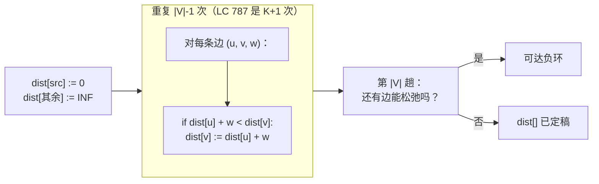
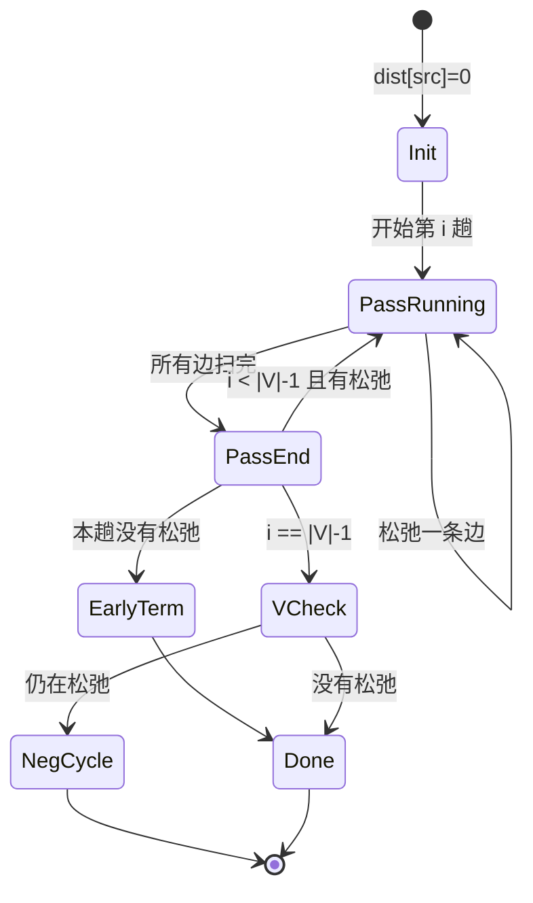

# Bellman-Ford 与负环

一张五个顶点、十条边的有向图。源点是 `0`。其中两条边的权重为负：`1 -> 4` 代价 `-4`，`3 -> 1` 代价 `-2`。从 `0` 跑 Dijkstra，它弹一次堆就把顶点 `1` 定死为距离 `6`，此后不再回头看它。你把同一张图手推一遍，会找到一条 `0 -> 2 -> 3 -> 1` 的路径，长度 `7 + (-3) + (-2) = 2`，比 Dijkstra 的答案小四。Dijkstra 没崩、没报警、没标记任何不确定。它把 `6` 当成金科玉律返回，然后继续往下走。

这就是本章。Bellman-Ford 之所以存在，是因为 Dijkstra 那条“最近的未访问顶点即已定稿”的不变量，一旦后面绕一条负权边就能改进你已经定稿的顶点，立刻失效。[^1] 修法是：什么也别定稿。把每条边松弛 `|V| - 1` 轮。第 `i` 趟之后，对任何从源点到 `v`、最多用 `i` 条边的最短路径，`dist[v]` 都是正确的；而简单无环最短路径最多用 `|V| - 1` 条边，所以 `|V| - 1` 趟足够。再多扫一趟，也就是第 `|V|` 趟，就是环检测器：如果还有边能松弛，说明从源点可达一个负环。[^1] [^2]

本章是 Part 8 两章最短路径里较难的那一章。负环检测器、按边数做归纳的证明、让 K 边界变精确的快照技巧，以及把 LC 787 的“最多 K 次中转”变成“最多 `K+1` 趟松弛”的约束编码推广，每一件都是活零件。在这里要花的功夫比 Dijkstra 多。下面那个组件就是本章，走两遍。

## 什么时候该伸手拿它，而不是 Dijkstra

三个信号指向 Bellman-Ford，而不是 [Dijkstra](./09-dijkstra.md) 那套堆驱动的贪心。

第一个是**负权边**。货币套汇、盈亏网络，以及一种成本可以补贴另一种的时间-成本权衡，都会让 Dijkstra 悄悄出错。只要输入里任何一条边的权重可能为负，Dijkstra 就是错的，该翻到本章。

第二个是**路径被边数限死，而不是被顶点数限死**。LC 787 里 `src` 到 `dst` 的“最多 `K` 次中转”是标准例子：约束落在跳数上，而 Bellman-Ford 那句“第 `i` 趟之后，任何最多 `i` 条边的路径上 `dist` 都正确”的引理，用一行代码就能对上这个约束。[^2] [^3]

第三个是**负环检测本身就是问题**。不是“求最短路径”，而是“存在有利可图的环吗？”货币套汇是教科书例子。跑 `|V| - 1` 趟，再检查第 `|V|` 趟；如果还能松弛，答案是存在。[^2]

三条都不沾，就用 Dijkstra。Bellman-Ford 是 `O(|V| * |E|)`，二叉堆 Dijkstra 是 `O((|V| + |E|) log |V|)`；[^1] 在非负权图上选 Bellman-Ford，等于白送一个 `log |V|` 的因子。

## 算法，分三块

形状很小。初始化 `dist[src] = 0`，其余全是无穷大。把图上每条边松弛一遍，重复 `|V| - 1` 次。再跑一趟检测负环。

```python
# 朴素 Bellman-Ford。返回 (dist, has_negative_cycle)。
import math

def bellman_ford(n, edges, src):
    INF = math.inf
    dist = [INF] * n
    dist[src] = 0
    for _ in range(n - 1):
        updated = False
        for u, v, w in edges:
            if dist[u] != INF and dist[u] + w < dist[v]:
                dist[v] = dist[u] + w
                updated = True
        if not updated:
            break  # 提前终止：本趟没有任何边被松弛，下一趟也不会有
    # 第 |V| 趟：检测从 src 可达的负环
    for u, v, w in edges:
        if dist[u] != INF and dist[u] + w < dist[v]:
            return dist, True
    return dist, False
```

那段代码里只有三件事是承重的。

松弛那一步 `if dist[u] + w < dist[v]: dist[v] = dist[u] + w` 就是整个算法，剩下的都是外壳。`dist[u] != INF` 这个守卫不是理论洁癖：在 Java 和 C++ 里，`INT_MAX + w` 会回绕成负数，比较就会悄悄松弛本该保持不可达的顶点。见陷阱 §7.4。

外层循环跑 `|V| - 1` 次，是因为*简单*最短路径（不重复顶点）最多用 `|V| - 1` 条边，而第 `i` 趟之后，每个顶点对任何最多 `i` 条边的路径都已经拿到正确距离。证明是对 `i` 的归纳；CLRS 第 4 版 §22.1 逐行推过。[^1] 少跑几趟，一些长的最短路径还没被找到。多跑几趟，就是在已经收敛的图上白做功。所以才有了 `updated` 标志这个提前终止优化，它把上界降到 `O(L * |E|)`，其中 `L` 是最短路径的最大边数。[^2]

第 `|V|` 趟是终止性证明，不是可选记账。如果 `|V| - 1` 趟之后还有边满足 `dist[u] + w < dist[v]`，那就没有哪条无环路径能解释这次松弛，于是从 `src` 可达一个总权重为负的环。[^2] 省掉这一趟，你就分不清“已收敛”和“还在松弛”；陷阱 §7.3 讲了这个坑。

## 为什么是 `|V| - 1`

第 1 趟找出所有只用一条边的最短路径：对 `src` 的每个直接邻居 `v`，把 `(src, v, w)` 松弛一次。第 2 趟找出所有最多两条边的最短路径，因为每条两边路径 `src -> u -> v` 都是在第 1 趟已经修正过的单边路径上延伸，而内层循环在第 2 趟里总会扫到边 `(u, v)`。归纳下去，第 `i` 趟正确处理所有最多 `i` 条边的最短路径。

`|V|` 个顶点上的简单路径最多 `|V| - 1` 条边。所以最坏情况下 `|V| - 1` 趟既充分又必要（一条链 `0 -> 1 -> 2 -> ... -> |V|-1`，边按*逆*拓扑序给出时，松弛波要从源点传到叶子上，必须用满 `|V| - 1` 趟）。



*两段式结构：`|V| - 1` 趟松弛，加一趟检测，用来证明收敛或者报告负环。*



*状态图把两个优化显式画出来了：`PassEnd -> EarlyTerm` 是“无松弛就跳过”，`PassEnd -> VCheck` 是从主循环通往环检测器的桥。*

## 实际开销

| 变体 | 时间 | 空间 | 说明 |
|---|---|---|---|
| 最坏情况（一般图） | `O(\|V\| * \|E\|)` | `O(\|V\|)` | `\|V\| - 1` 趟里每趟把每条边扫一遍。 |
| 带回提前终止的最好情况 | `O(\|E\|)` | `O(\|V\|)` | 一趟什么都没松弛；收敛标志跳出外层循环。 |
| 带回提前终止的实际情形 | `O(L * \|E\|)` | `O(\|V\|)` | `L` = 最短路径的最大边数。 |
| LC 787 的 K 边变体 | `O((K+1) * \|E\|)` | `O(\|V\|)` | K 次中转的界封住外层循环。 |
| 负环检测 | 额外 `O(\|E\|)` | `O(\|V\|)` | 在边表上多扫一趟。 |

`|V| * |E|` 这个上界是 CLRS 给出的稳定头条数字。[^1] 稠密图（`|E| = O(|V|^2)`）上它是 `O(|V|^3)`，稀疏图（`|E| = O(|V|)`）上是 `O(|V|^2)`。只要权重非负，Dijkstra 的 `O((|V| + |E|) log |V|)` 在两种形状上都赢过 Bellman-Ford；`log |V|` 是堆的代价，而 Bellman-Ford 是处处都在付。

## 带预算的 Bellman-Ford：LC 787

[*Cheapest Flights Within K Stops*](https://leetcode.com/problems/cheapest-flights-within-k-stops/) 给你 `n` 个城市、一份带价格的单向航班列表、一个源点、一个终点，还有一个整数 `k`。返回 `src` 到 `dst` 最多 `k` 次中转的最便宜价格，走不到就返回 `-1`。[^4] 这个归约只有一句话，但值得停一下。**`src` 与 `dst` 之间 `k` 次中转，意味着路径上最多 `k + 1` 条边。** 直飞是 `0` 次中转、`1` 条边。一次中转是 `2` 条边。所以 LC 787 的界是“从 `src` 出发最多 `k + 1` 条边的最便宜路径”，这正是 Bellman-Ford 跑 `k + 1` 趟算出来的东西。我们不需要 `|V| - 1` 趟，我们需要 `k + 1` 趟。

```python
def find_cheapest_price(n, flights, src, dst, k):
    INF = float('inf')
    dist = [INF] * n
    dist[src] = 0
    for _ in range(k + 1):
        snapshot = dist[:]   # 关键：读上一趟的 dist
        for u, v, w in flights:
            if snapshot[u] == INF:
                continue
            if snapshot[u] + w < dist[v]:
                dist[v] = snapshot[u] + w
    return -1 if dist[dst] == INF else int(dist[dst])
```

**解法** — Python（[Java](./10-bellman-ford/lc-787/sol.java) · [C++](./10-bellman-ford/lc-787/sol.cpp) · [Go](./10-bellman-ford/lc-787/sol.go)）

```python
# LC 787. Cheapest Flights Within K Stops
"""LC 787: Bellman-Ford with K+1 relaxation passes."""
from typing import List
import math


def find_cheapest_price(n: int, flights: List[List[int]], src: int, dst: int, k: int) -> int:
    """Cheapest src->dst path using at most k stops (k+1 edges).

    Each pass reads from `snapshot` (the previous-pass dist) and writes to
    `dist`. Without that double buffer, a single pass could relax a chain
    src -> a -> b in one iteration of the outer loop, silently violating
    the K-edge bound.
    """
    INF = math.inf
    dist = [INF] * n
    dist[src] = 0
    for _ in range(k + 1):
        snapshot = dist[:]  # 关键：读上一趟，写这一趟
        for u, v, w in flights:
            if snapshot[u] == INF:
                continue
            if snapshot[u] + w < dist[v]:
                dist[v] = snapshot[u] + w
    return -1 if dist[dst] == INF else int(dist[dst])
```

新增的就一行：每趟开头那句 `snapshot = dist[:]`。上一节的朴素 Bellman-Ford 读写同一个 `dist` 数组，因为它在意的只是 `|V| - 1` 趟之后的最终答案。LC 787 在意的是一个中间保证：第 `i` 趟之后，`dist[v]` 是从 `src` 出发、用*恰好*不超过 `i` 条边到达 `v` 的最便宜代价。去掉快照，外层循环的一次迭代就能顺着两条相邻边把 `src -> a -> b` 串起来，两次都看到活的 `dist`，于是算法返回的是 `i + 1` 条边的路径代价，却假装只用了 `i` 条。

## 实例推演：LC 787 的四城市样例

取 LC 787 的样例输入：`n = 4`，航班 `[[0,1,100], [1,2,100], [2,0,100], [1,3,600], [2,3,200]]`，`src = 0`，`dst = 3`，`k = 1`。[^4] 允许一次中转，所以最多两条边。

建表阶段。`dist = [0, INF, INF, INF]`。

第 1 趟。快照是 `[0, INF, INF, INF]`。`snapshot[u]` 有限的边只有从 `0` 出去的那条：`(0,1,100)`。第 1 趟之后 `dist = [0, 100, INF, INF]`。直飞可达，两跳的都还没有。

第 2 趟。快照是 `[0, 100, INF, INF]`。这回从 `1` 出去的边看到了有限的源：`(1,2,100)` 把 `dist[2]` 松弛到 `200`，`(1,3,600)` 把 `dist[3]` 松弛到 `700`。第 2 趟之后 `dist = [0, 100, 200, 700]`。路径 `0 -> 1 -> 3` 代价 `700`，两条边（一次中转）就找到了。

注意图上确实存在代价 `400` 的路径 `0 -> 1 -> 2 -> 3`，但它用三条边（两次中转），而 `k + 1 = 2` 趟根本没给它松弛的机会。**返回 `700`。** 这就是 LC 787 样例的正确答案，也让快照技巧做了实事：没有它，第 2 趟里对 `(1,2)` 的松弛会把 `dist[2]` 推到 `200`，同一趟稍后对 `(2,3)` 的松弛就会读到刚更新的 `dist[2]`，把 `dist[3]` 压到 `400`。这个值是错的，因为那条路径用了三条边。

组件动的是这段两边推演，外加一张更丰富的五顶点图，让你看着提前终止优化触发，以及第 `|V|` 趟是放行还是报警。

> **Interactive widget:** [Bellman-Ford 负环检测](../../../dsa/widgets/w-37-bellman-ford.yml)（面板 `default`）—— 在网站上渲染；YAML 规格描述了各个关键帧。

*静态回退版：在标准的 5 节点 CLRS 图上，跑到 `|V| - 1 = 4` 趟就终止，`dist = [0, 2, 7, 4, -2]`；第 3 趟什么都没松弛，所以聪明的实现在收敛时跳出循环，而教科书版本会把四趟跑满；第 V 趟也不松弛，确认从 `0` 不可达任何负环。*

## 检测负环

换个输入。取一张 4 顶点图，边为 `(0,1,1)`、`(1,2,2)`、`(2,3,-5)`、`(3,1,1)`。三角形 `1 -> 2 -> 3 -> 1` 加起来是 `2 + (-5) + 1 = -2`，一个从 `0` 经边 `(0,1,1)` 可达的负环。

跑朴素 Bellman-Ford。第 1 趟：`dist = [0, 1, 3, -2]`。第 2 趟：`dist = [0, -3, 1, -4]`。第 3 趟：`dist = [0, -5, -1, -6]`。每绕三角形一圈，环上每个顶点就低两个单位。`|V| - 1 = 3` 趟之后这些值看着像回事，其实根本没收敛；它们正朝 `-infinity` 线性发散。

第 `|V|` 趟，也就是第四趟，又松弛了边 `(1, 2, 2)`，把 `dist[2]` 从 `1` 压到 `-1`。**那一条仍在松弛的边就是证明。** 没有哪条无环路径还能继续改进 `dist[2]`，所以必须有环来解释它，而这个环的总权重必然是负的。这时返回负环标志，而不是 `dist`。

组件的第二个面板（`neg_cycle`）动的是这 20 步的完整推演；同一份代码在标准输入上打印出干净的 `dist`，在这里则在第 18 步停下，挂出朱红横幅。

> **Interactive widget:** [Bellman-Ford 负环检测](../../../dsa/widgets/w-37-bellman-ford.yml)（面板 `neg_cycle`）—— 在网站上渲染；YAML 规格描述了各个关键帧。

*静态回退版：4 顶点图，带负三角形 `1 -> 2 -> 3 -> 1`（和为 -2）。三趟之后 `dist` 是发散的——`[0, 1, 3, -2]`、`[0, -3, 1, -4]`、`[0, -5, -1, -6]`——而不是收敛。第 `|V|` 趟检出一条仍在松弛的边，于是返回负环标志，取代距离数组。*

## SPFA：带队列的 Bellman-Ford

教科书算法每一趟都扫全部边，哪怕大多数顶点的距离早就稳定了。最短路径更快算法（Shortest Path Faster Algorithm，SPFA）在 Codeforces 上流行起来，可追溯到 Moore 1959 年的变体：它维护一个队列，装“`dist` 刚刚变小的顶点”，只松弛这些顶点的出边。[^2] 最坏复杂度还是 `O(|V| * |E|)`，但在没有对抗性结构的图上，平均情况明显更快，常见是 4-10 倍。

算法：把 `src` 入队，然后重复：出队 `u`，松弛它的每条出边 `(u, v, w)`，如果 `v` 的距离掉了且 `v` 还不在队列里，就把 `v` 入队。队列空则结束。

SPFA 有两个值得记住的工程性质。它是**确定性的**，所以对抗性输入能逼出 `O(|V| * |E|)` 的最坏情况；一条 `0 -> 1 -> 2 -> ... -> |V|-1` 的链，配上让整个队列反复排空又灌满的边权，就是标准反例。负环检测也跟着变样：数每个顶点出队了多少次，只要有顶点出队超过 `|V|` 次，就说明可达负环。在西式技术面试里，朴素 Bellman-Ford 才是被期待的答案；SPFA 是面试官问“实践中能更快吗”时才该提的东西。

## 两个最容易踩的坑

> [!WARNING]
> **在 LC 787 里忘了快照。** 把教科书 Bellman-Ford 伪代码直接抄进 LC 787 内层循环的读者，在一趟里读写同一个活的 `dist`，返回的是 `k + 2` 或 `k + 3` 条边的路径，却假装用了 `k + 1` 条。修法是每趟开头一行：`snapshot = dist[:]`（Java 里是 `dist.clone()`，C++ 里是 `std::vector<int> snapshot = dist;`）。松弛从快照读，往活的 `dist` 写。教科书的 K 趟论证依赖这一点：每一趟都必须强制“这是加入的第 `i` 条边”，而这要求读上一趟的距离。[^3]

> [!WARNING]
> **省掉第 `|V|` 趟，还照样信输出。** 在存在可达负环的图上跑完 `|V| - 1` 趟之后，`dist[]` 里装的是看着像模像样的有限值，但它们没有收敛；再跑几趟就会把它们全推向 `-infinity`。省掉检测趟的读者会把这些值交给信任它们的使用方。修法是机械的：永远跑最后一趟；只要有边松弛，就返回负环信号（布尔值、前驱链，或者调用方需要的任何东西）。[^2] CP-Algorithms 说得准：“跑完第 `(n-1)` 阶段之后，如果再多跑一个阶段、至少又做了一次松弛，那么图里存在负权环。”

还有第三个坑值得点一句：在 C++ 或 Java 里算 `dist[u] + w` 时的整数溢出。`INT_MAX + 5` 会回绕成负数，松弛判断看到一个“更小”的值，就错误地松弛了。参考实现在求和之前用 `dist[u] != INF` 把松弛挡住；另一个办法是拿 `INT_MAX / 4` 当哨兵，加法就不可能溢出，或者提升到 `long long`。CP-Algorithms 建议在负环代码里用 `d[v] = max(-INF, d[u] + w)` 做钳制——那种代码里发散正是要点。[^2]

## 题目梯度

### 核心（三题全做才算掌握本章）

- [LC 787 — Cheapest Flights Within K Stops](https://leetcode.com/problems/cheapest-flights-within-k-stops/) [中等] • bellman-ford-k-edge-bound ★
- [LC 1786 — Number of Restricted Paths From First to Last Node](https://leetcode.com/problems/number-of-restricted-paths-from-first-to-last-node/) [中等] • bellman-ford-on-distance-DAG *（参考实现：仅 Python）*
- [LC 1928 — Minimum Cost to Reach Destination in Time](https://leetcode.com/problems/minimum-cost-to-reach-destination-in-time/) [困难] • bellman-ford-with-time-state *（参考实现：仅 Python）*

### 进阶（可选）

- [LC 882 — Reachable Nodes In Subdivided Graph](https://leetcode.com/problems/reachable-nodes-in-subdivided-graph/) [困难] • dijkstra-with-budget *（参考实现：仅 Python）*

LC 787 是本章的招牌题，也是实例推演和组件动的那道。LC 1786 把“松弛即 DP”这个框架一般化：Dijkstra 先算出到目标的最短距离，这些距离诱导出一个 DAG，再用一个 Bellman-Ford 味道的 DP 在 DAG 上数路径，对 `10^9 + 7` 取模。LC 1928 把 LC 787 的“第 `i` 趟对应已用 `i` 条边”推到 `(城市, 已用时间)` 这样的格子上，是本章最难的一块。LC 882 是相邻模式的困难题：不是纯 Bellman-Ford，但 LC 787 那套“带预算的松弛”心智模型可以整体搬到它的 Dijkstra 加最大步数解法上。

## 后续衔接

天生的兄弟是 [Dijkstra](./09-dijkstra.md)——所有边权非负、堆驱动的贪心压过逐趟扫描时，你伸手拿的就是它。两章最好成对读；面试时正确的算法，取决于输入的负权分布和约束形状。全对全的对应物 Floyd-Warshall 也处理负权边，它在后面一章；当你需要每对最短路径，而图又稠密到从每个顶点跑一遍 Bellman-Ford 并不更快时，接受的就是它 `O(|V|^3)` 的复杂度。

Bellman-Ford 本身就是按边数展开的动态规划，所以 Part 9 讲动态规划时直接复用“松弛即 DP”的框架来引入 DAG 上的最短路径变体，不必重推一遍归纳论证。

## 参考文献

[^1]: Cormen, Leiserson, Rivest, Stein, *Introduction to Algorithms*, 4th ed., MIT Press, 2022, Chapter 22 §22.1 "The Bellman-Ford algorithm", pp.

[^2]: Ivanov et al., "Bellman-Ford — finding shortest paths with negative weights," CP-Algorithms, last updated 2025-09-10. <https://cp-algorithms.com/graph/bellman_ford.html>.

[^3]: Wong, Ka Wai (@wkw), "0787 — Cheapest Flights Within K Stops (Medium)," LeetCodeTheHardWay, retrieved 2026-05-20. <http://leetcodethehardway.com/solutions/0700-0799/cheapest-flights-within-k-stops-medium>.

[^4]: leetcode.ca mirror of LC 787, "Cheapest Flights Within K Stops," retrieved 2026-05-20. <https://leetcode.ca/all/787.html>.
