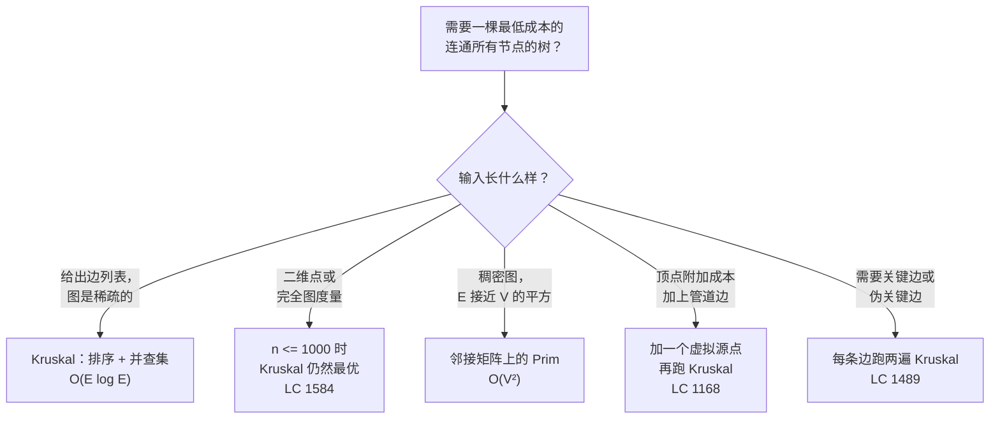
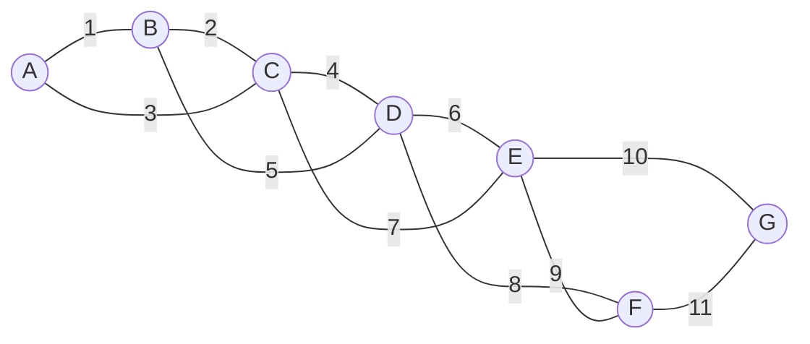
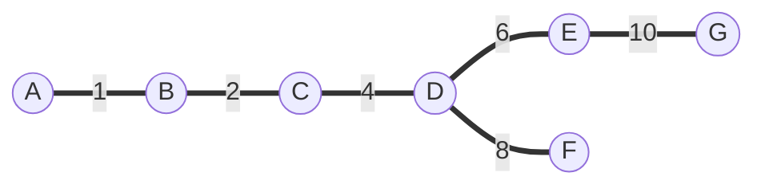

# 最小生成树：Kruskal 算法

1956 年，Joseph Kruskal 发表了一篇三页的论文，题为 *On the Shortest Spanning Subtree of a Graph and the Traveling Salesman Problem*。三页。算法本身两段英文就讲完了，正确性证明放在第三页。七十年后，每一套铺线缆的系统、每一条从相似度图里划出聚类的流水线、每一道问“用最低成本把所有东西连起来”的面试题——跑的都是 Kruskal 在贝尔实验室写下的那个循环。

本章的招牌题是 *Min Cost to Connect All Points*（LC 1584）。给你 2D 平面上的 `n` 个点，比如 `[[0,0], [2,2], [3,10], [5,2], [7,0]]`。任意两点之间的连接成本等于它们的曼哈顿距离。返回把所有点连成一体、任一点都能到任一点的最小总成本。上面这个五点的例子答案是 20。朴素直觉是贪心地把每个新点接到离它最近的已连通邻居上——感觉对，但遇到规模为四的输入就错了。正确答案是 Kruskal 算法，而且从《I Love Lucy》开播那年起，它就一直是正确答案。

## 这个模式用在哪

LeetCode 上四道招牌 MST 题里有三道是 Premium。唯一免费的 LC 1584 把图藏了起来：输入是一串点，不是一串边，读者得自己看出“连接成本 = 曼哈顿距离”这层关系把 `n` 个点变成了一张有 `n(n-1)/2` 条边的完全加权图。一旦看出来，这一族里的每个变体都套同一个流程图。



*MST 模式的决策流程。右侧四个框里有三个属于本章；稠密图那一格在 [最小生成树：Prim 算法](../../../dsa/part-8-graphs/12-mst-prim.md)，那里有逐项对比。*

## 为什么直觉解法是错的

在这道题上失败的贪心，也是让候选人丢分最多的那个贪心。挑最近的一对点连起来，然后挑离已建部分最近的未连点接上去，重复到全部连通。这听起来像 Prim，其实不是。Prim 维护一个*边界*（frontier）——所有横跨“已建树”与“图其余部分”之间切割的边——然后从中挑最轻的一条。“接最近的*点*”这个版本不维护边界，所以它经常挑到局部最优、全局灾难的边。

更糟的是，候选人还会在白板上写出*枚举所有生成树*的版本：

```python
# 暴力：枚举所有生成树。别真的跑这个。
from itertools import combinations

def mst_brute(n, edges):
    best = float('inf')
    for tree in combinations(edges, n - 1):
        if is_spanning_tree(tree, n):  # 连通性检查
            best = min(best, sum(w for _, _, w in tree))
    return best
```

候选树有 `C(E, n-1)` 棵。对 LC 1584 在 `n = 1000` 时是 `C(499500, 999)`，一个四千多位的数。循环里的连通性检查每次要花 `O(V + E)`。整体在最坏意义下是指数级的。你跑不完。

解法其实直白得离谱：按权重从小到大扫边，接受每一条不会成环的边。接受够 `n - 1` 条就停。

## 模式

Kruskal 算法就是一个带守卫的 for 循环：

```python
def min_cost_connect_points(points):
    n = len(points)
    if n <= 1:
        return 0
    edges = []
    for i in range(n):
        for j in range(i + 1, n):
            w = abs(points[i][0] - points[j][0]) + abs(points[i][1] - points[j][1])
            edges.append((w, i, j))
    edges.sort()
    dsu = DSU(n)
    total = accepted = 0
    for w, u, v in edges:
        if dsu.union(u, v):
            total += w
            accepted += 1
            if accepted == n - 1:
                break
    return total
```

**解** — Python（[Java](./11-mst-kruskal/lc-1584/sol.java) · [C++](./11-mst-kruskal/lc-1584/sol.cpp) · [Go](./11-mst-kruskal/lc-1584/sol.go)）

```python
# LC 1584. Min Cost to Connect All Points
from typing import List


class DSU:
    """Disjoint-set with path halving + union by rank."""

    def __init__(self, n: int) -> None:
        self.parent = list(range(n))
        self.rank = [0] * n

    def find(self, x: int) -> int:
        while self.parent[x] != x:
            self.parent[x] = self.parent[self.parent[x]]  # 路径减半
            x = self.parent[x]
        return x

    def union(self, a: int, b: int) -> bool:
        ra, rb = self.find(a), self.find(b)
        if ra == rb:
            return False
        if self.rank[ra] < self.rank[rb]:
            ra, rb = rb, ra
        self.parent[rb] = ra
        if self.rank[ra] == self.rank[rb]:
            self.rank[ra] += 1
        return True


def min_cost_connect_points(points: List[List[int]]) -> int:
    """LC 1584. Manhattan-distance MST via Kruskal."""
    n = len(points)
    if n <= 1:
        return 0
    edges = []
    for i in range(n):
        xi, yi = points[i]
        for j in range(i + 1, n):
            xj, yj = points[j]
            edges.append((abs(xi - xj) + abs(yi - yj), i, j))
    edges.sort()
    dsu = DSU(n)
    total = accepted = 0
    for w, u, v in edges:
        if dsu.union(u, v):
            total += w
            accepted += 1
            if accepted == n - 1:
                break
    return total
```

这个循环体里在做三件事，三件都关键。

`edges.sort()` 这一行干了整个算法的活。边一旦按权重排好，每次接受决定都是局部贪心的：拿下当前还安全的最便宜那条边。局部贪心能得出全局最优树的证明就是*切割性质*[^1]，下面讲。

`dsu.union(u, v)` 返回 `True`，说明 `u` 和 `v` 原本在不同连通分量，现在合并了；返回 `False`，说明它们本来就连着。第一种情况意味着接受 `(u, v)` 让生成森林多一条边且不成环；第二种情况意味着 `(u, v)` 会闭合一个环，拒绝。并查集让每次环检测只要 `O(α(V))`，实际上等于常数，而不是暴力环检测需要的 `O(V + E)` 的 BFS。[并查集](./08-union-find.md)是前置章节，上面的 `DSU` 类用的正是那里讲的路径减半加按秩合并。

`if accepted == n - 1: break` 是提前终止。`n` 个顶点的生成树恰好有 `n - 1` 条边，凑齐之后，剩下那些排好序的边必然全是成环的边，可以不用再看。在下面那张经典的七顶点图上，提前 break 把最重的那条边整个跳过了。

> [!IMPORTANT]
> 触发 Kruskal 的信号：输入直接给了你、或者你能轻易推出一张扁平的带权边列表，而问题问的是把所有东西连通的最低成本子图。还有两种让 Kruskal 更好用的追问场景：问题要你*围绕边*思考（留哪些、删哪些、哪条是关键边）而不是围绕顶点；成本里带一个顶点局部的分量，可以用虚拟源点的技巧建模。两种扩展都在下面的题目梯度里。

## 为什么成立：切割性质

Kruskal 算法的正确性靠的是 CLRS 第 21 章的一个定理。[^2] 随便选一种把顶点分成两个非空集合的办法——这叫一个切割。所有横跨这个切割的边（两个端点各在一个集合里）当中，最轻的那条必定属于*某一棵*最小生成树。

Kruskal 的循环就是切割性质的隐式应用。算法考察边 `(u, v)` 且 `find(u) ≠ find(v)` 时，两个端点在不同连通分量。存在一个切割把 `u` 所在的分量与图的其余部分分开，而 `(u, v)` 正是横跨该切割最轻的边。所有更便宜的边都已被处理过：要么被接受（那就落在两个分量之一内部），要么因两端点已在同一分量而被拒（那它就不可能横跨这个切割）。切割性质说取 `(u, v)` 是安全的。重复 `n - 1` 次，得到的树就是最优的。

CLRS 定理 21.1 的证明是一页纸的交换论证：假设某棵最优 MST `T*` 不含最轻的跨切割边 `e = (u, v)`。把 `e` 加进 `T*` 会形成一个环，这个环上必有另一条边 `e'` 同样横跨该切割。把 `e'` 换成 `e`：结果仍是生成树，而权重不大于 `T*`，因为按假设 `weight(e) ≤ weight(e')`。所以存在一棵包含 `e` 的最优 MST。

拒绝的那一侧是对称的，靠的是*环性质*：任何环上最重的那条边不可能出现在任何 MST 里。Kruskal 拒绝一条边时，它将要闭合的那个环上其他每条边都已在部分 MST 中，且都不比它重，所以被拒的这条就是该环上最重的。丢掉是安全的。

## 实例推演：经典的七顶点图



*七个顶点、十一条边、权重互不相同。四条较便宜的边（A-C 3、B-D 5、C-E 7、E-F 9）会成环，将被拒绝。*

排序后：`A-B 1, B-C 2, A-C 3, C-D 4, B-D 5, D-E 6, C-E 7, D-F 8, E-F 9, E-G 10, F-G 11`。

按排好的列表走一遍。前两条边（A-B、B-C）连的是新分量，都接受。第三条 A-C 3，发现 `find(A) = find(C) = A`——已经在同一分量里。**拒绝。** 这正是算法显身手的时刻：朴素的“排完序取三条”会取走 A-C，从而错过经过 B 的那条更便宜的路径。

C-D 4 接受。B-D 5 拒绝（B 和 D 都能回溯到根 A）。D-E 6 接受。C-E 7 拒绝。D-F 8 接受。E-F 9 拒绝。E-G 10 接受，这是第六条边。提前 break 触发，F-G 11 根本没被看过。

六次接受，四次拒绝，十一条边里看了十条，总权重 31。MST 是 `{A-B 1, B-C 2, C-D 4, D-E 6, D-F 8, E-G 10}`。



*最小生成树。Kruskal 和 Prim 产出的都是这同样的六条边；下一章会把 Prim 走到同一答案的过程动画化。*

> **Interactive widget:** [MST: Kruskal + Prim (side-by-side)](../../../dsa/widgets/w-30-mst-kruskal-prim.yml)（面板 `panel-kruskal`）——在网站上渲染；YAML 规格描述了各个关键帧。

*静态回退：经典图上的 23 步推演。六次接受（绿色），四次拒绝（朱红），一条边因提前 break 被跳过（天蓝）。最终 mst_weight = 31，accepted = 6 = n - 1。*

## 实际开销

| 变体 | 时间 | 空间 | 说明 |
|---|---|---|---|
| 排序 + 带路径减半与按秩合并的 DSU | O(E log E) | O(V + E) | 标准实现。排序占主导；DSU 循环是 O(E α(V))，次线性。 |
| 排序 + 朴素环检测（每条边一次 BFS） | O(E (V + E)) | O(V + E) | 学并查集之前你会写出来的版本。渐进复杂度上是灾难；只为对照才提。 |
| 最好情况（边已有序、权重为整数） | O(E α(V)) | O(V + E) | 权重落在计数排序的范围内时可用。实践中少见。 |
| n = 1000 时的 LC 1584 | 约 500,000 条边，排序主导，约 10^7 次操作 | 边元组约占 12 MB | 轻松低于任何 LC 时限。Prim 的 O(V²) = 10^6 只快一个常数；两种都能过。 |

时间界有两半，面试官两半都会追问。*为什么瓶颈是排序？* 基于比较的排序下界是 `Ω(E log E)`，而排序后的并查集循环是 `O(E α(V))`，对任何比宇宙原子数还小的 `V` 来说，这个量相对 `E log E` 都是次线性的。*为什么并查集该用 α(V) 这个数？* Tarjan 在 1975 年证明，路径压缩加按秩合并在一串 `m` 次操作上摊还 `O(m α(n))`，其中 α 是反阿克曼函数，对你见得到的任何输入 α(n) ≤ 4。[^3]

在基于比较的假设下，`O(E log E)` 这个界本质上是紧的。Cheriton 和 Tarjan 在 1976 年用一个更精巧的算法把它压到 `O(E log log V)`；面试里没人实现它，LeetCode 也从不考。`O(E log E)` 的 Kruskal 就是实用答案。

## 值得知道的变体

本章的 CORE 题（LC 1584）只是 MST 的一种形状。题目梯度里还有三种形状，各练一块不同的肌肉。

### 带虚拟源点的 MST（LC 1168）

题意：每户人家要么花 `wells[i]` 自己打一口井，要么花 `pipes[i][j]` 接到别人家的水。求让所有人家都通水的最小总成本。这个“每户二选一（打井还是接管）”的结构看着像 DP 题，实际上是个 MST。

加一个虚拟顶点 0。对每户 `i`，加一条边 `(0, i, wells[i])`。原有的管道边原样保留。在扩增后的图上跑 Kruskal。MST 恰好有 `n` 条边（它生成的是 `n + 1` 个顶点），每户人家最终都连到顶点 0：要么直接走自己那条井边，解释为“在 `i` 家打井”；要么经过更便宜的管道间接连通，解释为“把 `i` 接到别人家的水上”。MST 在所有这类混合方案上同时把总成本最小化。[^4]

诀窍全在建模那一步。扩增图一建好，Kruskal 一个字都不用改。看出“顶点局部的成本可以归约成一条虚拟源点的边”，就是整道面试题。

### 不连通图的契约（LC 1135）

LC 1135 问的和 LC 1584 是同一件事，但输入可能不连通，契约是“若所有城市无法全部连通则返回 -1”。LC 1584 参考实现里的提前 break 在这里不安全：图不连通时循环会以 `accepted < n - 1` 结束，此时算法应当报失败，而不是返回一个部分森林的权重。

改法：删掉 `if accepted == n - 1: break` 那一行，把所有边走完。循环之后判断 `accepted == n - 1`，否则返回 `-1`。

### 关键边与伪关键边（LC 1489）

一条边是*关键边*，指把它从图中删掉会让 MST 权重变大（或直接断开连通）。一条边是*伪关键边*，指它出现在*某些* MST 里但不在全部里；等价地说，强制把它包含进来，MST 权重仍等于基线，而把它排除掉，权重也不会变大。

算法是每条边跑两遍 Kruskal。先算出基线 MST 权重 `W*`。对每条边 `e`：跑一遍排除 `e` 的 Kruskal，如果新权重超过 `W*`（或根本不存在生成树），`e` 是关键边；否则再跑一遍强制先接受 `e` 的 Kruskal，如果结果等于 `W*`，`e` 是伪关键边。总代价 `O(E^2 α(V))`。[^5]

环性质和切割性质在这里同时登场：关键边是 MST 上的桥，没有别的边能以同样的权重顶替它；伪关键边是非桥，只是它的权重档位在跨切割处存在并列的同类边。

## 两个最容易踩的坑

> [!WARNING]
> **忘了按秩合并，或者忘了路径压缩。** 作者们照抄一个“朴素”并查集，两种优化只做了其中一种，于是算法从每次 find 摊还 `O(E α(V))` 退化成整体 `O(E log V)` 甚至 `O(E V)`，取决于缺的是哪一个。LC 1584 在 `n = 1000` 时差距看着不大，但构造出来的对抗性链条能把合并深度推到 V，在较大的用例上 TLE。两种优化都要用。参考实现里的 `DSU` 类用的是路径减半（路径压缩的迭代形式）加按秩合并。

> [!WARNING]
> **Java 和 C++ 里权重累加的整数溢出。** LC 1584 有 `n ≤ 1000`，坐标在 `[-10^6, 10^6]`，单条边权重可达 `4 × 10^6`，999 条 MST 边加起来可达约 `4 × 10^9`，超过 `Integer.MAX_VALUE = 2.147 × 10^9`。累加变量要用 `long`（Java）或 `long long`（C++），只在返回时转成 `int`，并且先确认 LC 的契约保证答案不超过 `INT_MAX`。`lc-1584/sol.java` 的 Java 参考实现用的正是这个写法；把声明改成 `long total` 就是全部修复。Python 不受影响（任意精度整数）；Go 的 `int` 在你会部署的所有平台上都是 64 位，但 `int32` 会溢出。

还有第三个坑值得补一句：递归地写 `find`。教科书写法 `find(x) = parent[x] == x ? x : (parent[x] = find(parent[x]))` 很优雅，递归深度也有界；但迭代版路径减半能拿到同样的摊还界，而且不递归，不会在对抗性链条上撞到 Python 的递归上限。一开始就选迭代版，然后一直用它。

## 题目梯度

### 核心（全做才算掌握本章）

- [LC 1584 — Min Cost to Connect All Points](https://leetcode.com/problems/min-cost-to-connect-all-points/) [中等] • mst-kruskal-union-find ★

### 进阶（可选）

- [LC 1135 — Connecting Cities With Minimum Cost](https://leetcode.com/problems/connecting-cities-with-minimum-cost/) [中等] • mst-kruskal-union-find *(LeetCode Premium)*
- [LC 1168 — Optimize Water Distribution in a Village](https://leetcode.com/problems/optimize-water-distribution-in-a-village/) [困难] • mst-virtual-source-node *(LeetCode Premium)*
- [LC 1489 — Find Critical and Pseudo-Critical Edges in MST](https://leetcode.com/problems/find-critical-and-pseudo-critical-edges-in-minimum-spanning-tree/) [困难] • mst-kruskal-with-edge-fix

LC 1584 是本章的招牌题（★），也是实例推演用的题。LeetCode 上的 MST 模式偏中等和困难，没有一道公认的简单档 MST 题，所以难度跨度是靠“核心 + 进阶”两层一起撑起来的，光靠核心撑不住。LC 1135 承担教科书的显式图框架（Premium 解锁，免费的对照题是 LC 1584）。LC 1168 承担虚拟源点的建模技巧。LC 1489 承担困难档，并且同时练到切割性质和环性质。

## 后续衔接

姊妹篇是 [最小生成树：Prim 算法](../../../dsa/part-8-graphs/12-mst-prim.md)，它在同一张经典七顶点图上演示另一种算法：用最小堆做边界扩张，而不是排序边。两者产出同一棵六条边的树（边权互不相同则 MST 唯一，见 Sedgewick 练习 4.3.2[^6]）。在 Kruskal 和 Prim 之间做选择的那张决策表在 8.12 末尾；看完两种算法跑起来之后去读它。

为 Kruskal 提供依据的那个贪心正确性模式——切割性质与环性质——是*拟阵贪心*的经典范例。等你读到动态规划那几章，对比会非常鲜明：贪心在 MST 上成立，是因为这个问题有拟阵结构；贪心在大多数背包形状的问题上失败，是因为它们没有。

## 参考文献

[^1]: Joseph B. Kruskal, *On the Shortest Spanning Subtree of a Graph and the Traveling Salesman Problem*, Proceedings of the American Mathematical Society 7(1): 48-50, 1956. DOI [10.1090/S0002-9939-1956-0078686-7](https://doi.org/10.1090/S0002-9939-1956-0078686-7).

[^2]: Cormen, Leiserson, Rivest, Stein, *Introduction to Algorithms*, 4th ed., MIT Press 2022，第 21 章 §21.1（定理 21.1，切割性质与通用的安全边 MST 论证）与 §21.2（MST-KRUSKAL 伪代码 + 定理 21.2，`O(E log E)` 界）。

[^3]: Robert E. Tarjan, *Efficiency of a Good But Not Linear Set Union Algorithm*, Journal of the ACM 22(2): 215-225, 1975.

[^4]: GeeksforGeeks, *Minimum cost to provide water to all villages*, [https://www.geeksforgeeks.org/dsa/minimum-cost-to-provide-water/](https://www.geeksforgeeks.org/dsa/minimum-cost-to-provide-water/).

[^5]: LeetCode 1489 官方题解，镜像于 [https://www.stealthinterview.ai/blog/leetcode-1489-find-critical-and-pseudo-critical-edges-in-minimum-spanning-tree](https://www.stealthinterview.ai/blog/leetcode-1489-find-critical-and-pseudo-critical-edges-in-minimum-spanning-tree).

[^6]: Sedgewick and Wayne, *Algorithms*, 4th ed., Addison-Wesley 2011, §4.3 练习 4.3.2, [https://algs4.cs.princeton.edu/43mst/](https://algs4.cs.princeton.edu/43mst/).
