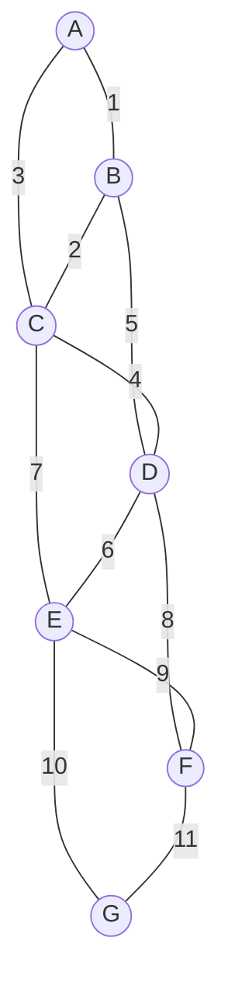

# 最小生成树：Prim 算法

一千个二维点。题目要求找出把这些点全部连通的最便宜线段网络，任意两点之间的连接成本都是曼哈顿距离。把这五十万条隐式边排好序再喂给 Kruskal？可行，但你在 MST 算法还没开始跑之前，就为了把边列表造出来先付了 `O(n² log n)`。还有更好的答案，它有个 1957 年的名字，不过算法本身比这个名字更老。

本章是这一对章节的后半篇。[最小生成树：Kruskal 算法](./11-mst-kruskal.md)讲的是以边为驱动的视角：把所有边排一次序，顺着列表走，只要一条边的两个端点落在不同连通分量就接受它。本章是以顶点为驱动的视角。选一个起始顶点，从它长出一棵树；每一步都吸收横跨“树内顶点与其余所有顶点”这条边界的最便宜那条边。最终得到的是同一棵 MST（边权互不相同时，两种算法产出的都是那棵唯一的树[^1]），但走的路不同，付出的开销形状也不同。

## 正确性相同，形态不同

两个算法都是同一个事实的推论：**切割性质（cut property）**——把顶点任意划分成两个非空集合，横跨这个划分的最轻边一定可以安全地加进某棵 MST。[^1] Kruskal 在全球范围应用这条性质：它尝试的每条边，都是横跨“它将要合并的那两个分量之间的切割”的最轻边。Prim 在局部应用：每一步的切割是固定的（树内 vs 树外），算法吸收横跨它的最轻边。

这个差别要看你观察两个算法把时间花在哪里，才有意义。Kruskal 事先把图中每条边排好序。如果图以 `m` 条边的列表给出，那就是一次 `O(m log m)` 的排序，最贵的一步到此为止。Prim 从不全局排序；它从优先队列里一条一条取出最轻的*横跨*边，一次吸收一条。这个 PQ 很小，上界是任意时刻活着的边界边数量，每次取出是 `O(log m)`。开销形状因此变了：Kruskal 的 `log` 因子在完整边列表上只付一次；Prim 每吸收一次就付一次 `log`，付在活的边界上。

开销形状正是两种算法都存在的原因。稀疏图上（`m` 接近 `n`），两者只差常数因子。稠密图上（`m` 接近 `n²`），或者边根本还没被实体化的隐式完全图上，开销形状就分道扬镳了。本章末尾的决策表写清了各自赢在哪里。

## 模式

随便挑一个起始顶点。维护一个树内顶点集合，初始只有起点；再维护一个装 `(weight, vertex)` 的最小堆，代表从树内集合伸到外面的边。每轮迭代弹出堆里的最小值。如果它指向的顶点已经在树里，这条记录就是过期的，跳过。否则吸收该顶点，把它的权重累加进总数，再把所有连向“还没进树”的邻居的出边压进堆。等所有顶点都被吸收，就停。

```python
def prim(n, adj, start=0):
    in_mst = [False] * n
    pq = [(0, start)]            # (weight, vertex)
    total = 0
    edges_added = 0
    while pq and edges_added < n:
        w, u = heapq.heappop(pq)
        if in_mst[u]:
            continue              # 过期记录：跳过
        in_mst[u] = True
        total += w
        edges_added += 1
        for v, weight in adj[u]:
            if not in_mst[v]:
                heapq.heappush(pq, (weight, v))
    return total
```

循环体里有两个点值得细看。

堆里装的是*顶点*记录，不是*边*记录。每条形如 `(weight, vertex)`，`weight` 是当前已知的、从树连到该顶点的最便宜那条边的代价。同一个顶点可以带着不同权重在堆里出现多次；最便宜的那条会最先浮出来，其余都是我们忽略的重复项。这是 Prim 的惰性变体。即时变体用带 decrease-key 的索引堆，保证树外每个顶点只有一条记录，但 Python 的 `heapq`、Java 的 `PriorityQueue`、Go 的 `container/heap`、C++ 的 `std::priority_queue` 都不支持 `O(log n)` 的 decrease-key，所以白板上你写的就是惰性版。[^2]

`if in_mst[u]: continue` 这行是承重的那一行。少了它，算法会把同一个顶点吸收两次，总数就算错了。代价倒不重——每条重复记录弹出丢弃都是 `O(log m)`——但这个判断不能省。

还有一个小的归约值得点名。Prim 的循环在每个顶点都进了树时终止，此时选中的边构成一棵生成树（`n-1` 条边连接 `n` 个顶点；因为没有顶点被吸收两次，按构造不会有环）。这些边的权重之和就是函数的返回值。至于 Prim 找到的是不是*最小*生成树，这来自切割性质而不是算法的结构：每次吸收时，选中的边都是横跨（树内、树外）这条切割的最便宜边，而切割性质说任何这样的边都可以安全地加进某棵 MST。由归纳法，Prim 加的每条边都是安全的，所以最终的树是一棵 MST。[^1]

## 实例推演：经典的 7 顶点图

七个顶点，标签 A 到 G；十一条边，权重是互不相同的整数，保证 MST 唯一：



*本章的经典输入。7 个顶点、11 条边；和 [Kruskal 那一章](./11-mst-kruskal.md)锚定的是同一张图。权重互不相同保证 MST 唯一，因此两种算法产出同一棵树。*

从顶点 A 开始跑 Prim。第一次扫边界，把 `(1, B)` 和 `(3, C)` 压进堆。弹出最小的是 `(1, B)`，于是 B 经由边 A-B 被吸收，权重 1。这和 Kruskal 会选的第一条边完全一样，因为 A-B 本来就是全局最便宜的边。

这个一致是这张图的巧合；到第二次挑选时，两个算法就可能分岔了。这里没有分岔。从 B 扫边界，压进 `(2, C)` 和 `(5, D)`；堆里还留着先前那条过期的 `(3, C)`。弹出最小的是 `(2, C)`，于是 C 经由 B-C 被吸收。Kruskal 的第二次接受也会是 B-C，理由和 A-B 排第一一样：B-C 是全局次便宜的边，而且它的两个端点在当时属于不同分量。

两个算法一直保持一致，因为在这张图上，每一步“全局次便宜”同时就是“边界上最便宜”。它们明显不同的地方在*被拒*的边上。Kruskal 查询 A-C（权重 3），对两个端点做并查集查找，发现它们在同一个分量 {A, B, C} 里，于是以成环为由拒绝这条边。Prim 的堆在下一次弹出时也会浮出 (3, C)，但拒绝机制不同：C 已经在 `in_mst` 里，这条记录作为过期项被跳过，并查集根本没参与。

同一条边，两种理由被扔出去。切割性质能同时解释两者：A-C 不横跨树内与树外之间的切割（两个端点都坐在树内一侧），所以它不可能是安全的。

> **Interactive widget:** [MST：Kruskal + Prim（并排对比）](../../../dsa/widgets/w-30-mst-kruskal-prim.yml)（面板 `panel-prim`）—— 在网站上渲染；YAML 规格描述了各个关键帧。

*静态回退：Prim 按 A、B、C、D、E、F、G 的顺序吸收顶点；接受边 A-B（1）、B-C（2）、C-D（4）、D-E（6）、D-F（8）、E-G（10），总权重 31；途中遇到四条过期的堆记录（A-C 3、B-D 5、C-E 7、E-F 9）并把它们跳过。*

## 开销形状从何而来

每个顶点恰好被吸收一次，所以有 `n` 次取最小操作。每条边最多入堆两次（当它的另一端进树时，从每个端点各入一次），所以最多 `2m` 次压入。用二叉堆时，取最小和压入都是 `O(log m)`，总工作量是 `O((n + m) log m)`。[^2] 图连通时 `m ≥ n - 1`，这个界化简为 `O(m log m)`。而 `m ≤ n²` 意味着 `log m ≤ 2 log n`，所以这个界在常数范围内也等于 `O(m log n)`。

| 变体 | 时间 | 空间 | 何时用 |
|---|---|---|---|
| 惰性 Prim，二叉堆，邻接表 | `O(m log m)` | `O(m)` | 面试里你会写的版本。因为有过期记录，PQ 可能长到 `O(m)`；每条记录压入或弹出仍是 `O(log m)`。[^2] |
| 即时 Prim，带 decrease-key 的索引二叉堆 | `O(m log n)` | `O(n)` | Sedgewick 教的那个变体。需要索引式 PQ；标准库不提供。[^2] |
| 稠密 Prim，邻接矩阵，线性扫描 | `O(n²)` | `O(n)` | 图稠密（`m` 接近 `n²`）或是隐式图时的正确答案。不用堆。维护数组 `min_edge[v]`，存从 `v` 到任意树内顶点的最便宜边；每轮线性扫描找最小的那个，标记进树，再线性更新新顶点的邻居们的 `min_edge`。[^3] |
| 即时 Prim，斐波那契堆 | `O(m + n log n)` | `O(n)` | 基本上只存在于理论里。Fredman 和 Tarjan 1987 年的结果；几乎没有任何生产代码或面试答案用斐波那契堆。[^4] |

面试轮换里真正要紧的界是 `O(m log n)`。稠密图变体在图以隐式方式给出时才要紧；下一节的招牌题就是标准案例。

## 图是隐式的：LC 1584

[LC 1584 — Min Cost to Connect All Points](https://leetcode.com/problems/min-cost-to-connect-all-points/)给你 `n` 个二维点，最多一千个，要求用曼哈顿距离找出把它们全部连通的最便宜线段集合。这张图是完全图：每一对点之间都有一条边，权重是 `|x₁ - x₂| + |y₁ - y₂|`。`n = 1000` 时，那是大约五十万条没人建过的边。

自然的 Prim 实现是懒式地构建邻接表。每次吸收时，扫一遍其余所有点，现场算距离，如果目标点还没进树就压进堆。没有边列表，也不预先算邻接表：

```python
def min_cost_connect_points(points):
    n = len(points)
    if n <= 1:
        return 0
    in_mst = [False] * n
    pq = [(0, 0)]              # (weight, vertex)
    total = 0
    edges_added = 0
    while pq and edges_added < n:
        w, u = heapq.heappop(pq)
        if in_mst[u]:
            continue
        in_mst[u] = True
        total += w
        edges_added += 1
        for v in range(n):
            if not in_mst[v]:
                d = abs(points[u][0] - points[v][0]) + abs(points[u][1] - points[v][1])
                heapq.heappush(pq, (d, v))
    return total
```

**解** — Python（[Java](./12-mst-prim/lc-1584/sol.java) · [C++](./12-mst-prim/lc-1584/sol.cpp) · [Go](./12-mst-prim/lc-1584/sol.go)）

```python
# LC 1584. Min Cost to Connect All Points
import heapq
from typing import List


def min_cost_connect_points(points: List[List[int]]) -> int:
    """LC 1584 - Manhattan-distance MST via lazy Prim."""
    n = len(points)
    if n <= 1:
        return 0
    in_mst = [False] * n
    pq: list[tuple[int, int]] = [(0, 0)]   # (weight, vertex)
    total = 0
    edges_added = 0
    while pq and edges_added < n:
        w, u = heapq.heappop(pq)
        if in_mst[u]:
            continue                        # 过期记录
        in_mst[u] = True
        total += w
        edges_added += 1
        for v in range(n):
            if not in_mst[v]:
                d = abs(points[u][0] - points[v][0]) + abs(points[u][1] - points[v][1])
                heapq.heappush(pq, (d, v))
    return total
```

这个解在时限内能过。堆会长到大约 `n²` 条记录，每次操作是 `O(log n²) = O(log n)`，所以总工作量约 `O(n² log n)`。`n = 1000` 时大约是一千万次堆操作。在这个负载下，Java 的 `PriorityQueue` 是四种语言里最慢的，但仍然轻松低于 LC 的天花板。

还有更快的答案，而且在稠密输入上，它才是正确的那个。

### 稠密 Prim：从 O(n² log n) 到 O(n²)

扔开堆。维护一个数组 `min_edge[v]`，存从 `v` 到当前任意树内顶点的最便宜边权；除了起点，每个顶点都初始化为无穷大。每轮迭代做两趟线性扫描：

1. 找出 `min_edge[u]` 最小的未选顶点 `u`。这就是最便宜的横跨边，也就是 Prim 的堆本来会浮出来的同一条边，不需要优先队列。
2. 把 `u` 标记进树。对其余每个未选顶点 `v`，如果边 `(u, v)` 比当前的 `min_edge[v]` 更便宜，就更新它。

`n` 轮，每轮 `O(n)` 的工作，总共 `O(n²)`。没有堆操作，没有过期记录，没有 `log n` 因子。`n = 1000` 时是一百万次操作，对比堆变体的一千万次，同一个问题上快了一个数量级。[^3]

只要 `m` 接近 `n²`，或者边是从输入推导出来的（几何问题、两两相似度分数、全对全成本），稠密变体就是正确选择。稀疏的显式图上，堆变体是正确选择。介于两者之间的情形，两种都行，由常数因子来裁决。

## 两个最容易踩的坑

> [!WARNING]
> **把权重累加到堆里，Prim 就变成了 Dijkstra。** 两种算法的骨架几乎一模一样：起始顶点、边界堆、每轮吸收一个顶点。唯一的结构差异在于发现一条边界边时压进去的是什么。Dijkstra 压 `(distance_from_start + edge_weight, neighbour)`，因为它跟踪的是到该邻居的路径代价。Prim 压 `(edge_weight, neighbour)`，因为它跟踪的是通向该邻居的*那一条边*的代价。刚做完一道 Dijkstra 的手部肌肉记忆，会让你写出一棵最短路径树而不是 MST：节点一样，边不一样，总数是错的。要背的那句是：**Dijkstra 累加，Prim 不累加。**

> [!WARNING]
> **忘了跳过过期记录。** 惰性 Prim 允许同一个顶点带着多个权重待在堆里。第一次弹出会正确地吸收它；之后每一次为它弹出的记录都是必须丢弃的重复项。弹出之后如果没有紧跟着 `if in_mst[u]: continue`，算法会把同一个顶点吸收多次，累加总数会超过真实 MST 权重。这个检查的代价是每次弹出一次布尔查询；忘了它的代价是静默的错误，因为算法照样会终止，还给回一个*看起来*合理的数字。

## 题目梯度

### 核心（全做才算掌握本章）

- [LC 1584 — Min Cost to Connect All Points](https://leetcode.com/problems/min-cost-to-connect-all-points/) [中等] • mst-prim-dense ★

### 进阶（可选）

- [LC 1135 — Connecting Cities With Minimum Cost](https://leetcode.com/problems/connecting-cities-with-minimum-cost/) [中等] • mst-sparse *(LeetCode Premium；免费对照题在 LC 1584)*
- [LC 1489 — Find Critical and Pseudo-Critical Edges in MST](https://leetcode.com/problems/find-critical-and-pseudo-critical-edges-in-minimum-spanning-tree/) [困难] • mst-edge-classification

MST 标签下没有公认的 Easy 题；最小的非平凡 MST 实例至少要有三个顶点，以及至少一次并列或成环的决策，这就落到了 Medium。本章的梯度是刻意收窄的：LC 1584 是唯一一道 Prim 比 Kruskal 更自然的题（稠密图那个情形），而两道进阶题主要住在 [Kruskal 那一章](./11-mst-kruskal.md)里。用哪种框架做都行。

## Kruskal vs Prim：决策表

只要边权互不相同，两种算法在任何输入上都产出同一棵 MST。[^1] 在两者之间做选择是个开销问题，不是正确性问题。

| 问题 | 用 Kruskal | 用 Prim |
|---|---|---|
| 图的稠密度 | 稀疏（`m` 接近 `n`） | 稠密（`m` 接近 `n²`） |
| 图的表示形式 | 直接给出边列表 | 邻接表、邻接矩阵，或者隐式（例如带度量距离的二维点） |
| 实体化边的代价 | 免费；边已经在手 | 昂贵：建出来要 `O(n²)` |
| 主导数据结构 | 带路径压缩的并查集 | 最小堆（惰性）或邻接矩阵扫描（稠密） |
| 一般情况的时间 | `O(m log m)`，由排序主导[^5] | 惰性堆 `O(m log n)`，稠密矩阵 `O(n²)`[^2] |
| 不连通的输入 | 终止时用 `accepted < n - 1` 判定 | 用“顶点还没吸完堆就空了”判定 |
| 负边权 | 可用 | 可用（切割性质对任意实数权重都成立，这点和 Dijkstra 不同） |
| 最干净利落的面试答案出现在 | 边列表是自然输入时 | 顶点集合是自然输入时，尤其边是推导出来的时候 |
| 招牌题 | `connections[i] = [u, v, cost]`（LC 1135 的形状） | `points[i] = [x, y]`（LC 1584 的形状） |

精炼版是：输入给你边，就排序跑 Kruskal。输入给你顶点、边是隐式的，就从任意起始顶点长一棵树跑 Prim。两种算法并不对立。它们是同一个定理（切割性质）落在两种不同开销形状上的实现。

## 后续衔接

Prim 和 Dijkstra 共享一套骨架：起始顶点、以边界值为键的最小堆、每轮吸收一个顶点。Dijkstra 的键是到源点的路径距离；Prim 的键是到树的那条边权。[^2] 把 [Dijkstra 算法](./09-dijkstra.md)和 [Kruskal 算法](./11-mst-kruskal.md)放在一起读，足够把两者都吃透。这一族里的第三个算法，也是接下来最自然的去处，是切割性质的另一个大客户：贪心正确性论证，第 10 部分会再谈。

## 关于命名

Prim 算法大多数时候以 Robert C. Prim 命名，他在 1957 年作为贝尔实验室一篇电话网络设计论文的一部分发表了它。[^6] 同一个算法早在 1930 年就由捷克数学家 Vojtěch Jarník 发表过，发表在一份捷克语期刊上，几十年后才传到英语读者手里。Edsger Dijkstra 在 1959 年独立重新发现了它，就在引入他最短路径算法的那同一篇论文里。[^7] 三十年里三次独立发现；在更老的文献里，这个算法有时会带上三个人的名字（“Jarník-Prim-Dijkstra”）。面试里的叫法永远是“Prim's”。

## 参考文献

[^1]: Cormen, Leiserson, Rivest, Stein, *Introduction to Algorithms*, 4th ed., MIT Press, 2022，第 21 章 §21.2（“The algorithms of Kruskal and Prim”），定理 21.1（切割性质的安全边引理）。

[^2]: Sedgewick & Wayne, *Algorithms*, 4th ed., Addison-Wesley, 2011, §4.3 “Minimum Spanning Trees”, <https://algs4.cs.princeton.edu/43mst/>.

[^3]: CP-Algorithms, “Minimum spanning tree, Prim's algorithm”, <https://cp-algorithms.com/graph/mst_prim.html>.

[^4]: Fredman, Michael L., and Robert E. Tarjan, “Fibonacci heaps and their uses in improved network optimization algorithms,” *Journal of the ACM* 34(3):596–615, 1987.

[^5]: Wikipedia, “Prim's algorithm”, <https://en.wikipedia.org/wiki/Prim%27s_algorithm>

[^6]: Prim, Robert C., “Shortest connection networks and some generalizations,” *Bell System Technical Journal* 36(6):1389–1401, 1957.

[^7]: Dijkstra, E. W., “A note on two problems in connexion with graphs,” *Numerische Mathematik* 1:269–271, 1959.
