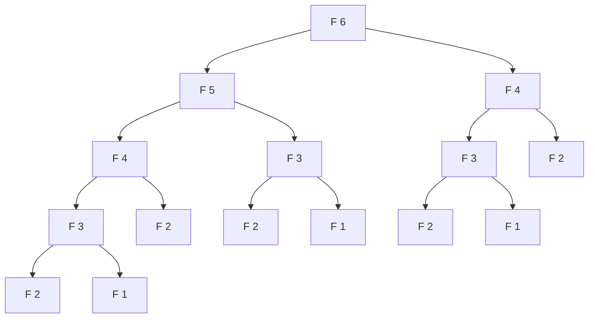
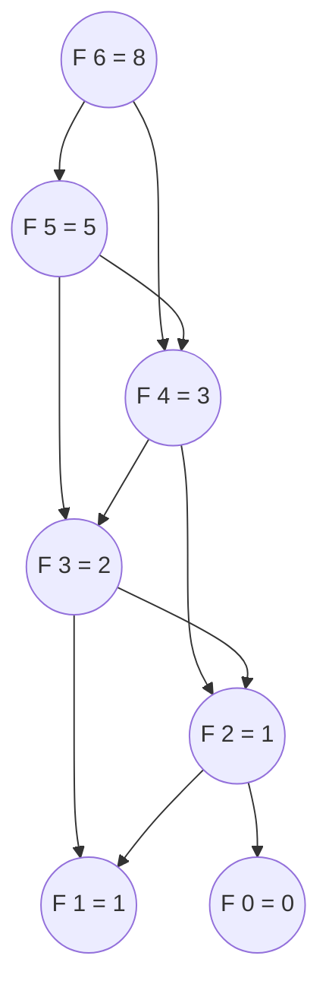

# 动态规划：从递归到记忆化

朴素的 `fib(43)` 要跑大约 4.33 亿次递归调用。函数只有四行。形状是 `F(n) = F(n-1) + F(n-2)`，基准情形在 0 和 1，返回两者之和。读完这四行，你会预期它们的运行时间与 `n` 成正比。实际却是与 `phi^n` 成正比，其中 `phi` 约等于 `1.618`。加一个以 `n` 为键的哈希表，八个字符的代码在递归之前查一次缓存，同一个函数的时间就掉回与 `n` 成正比。同样的算法。同样的答案。八个数量级的速度差。

动态规划就是当递归的调用树带着这类冗余时，你该做的那一步工程动作。教科书上的说法来自 1957 年的 Bellman，叫*最优性原理*：一个问题的最优解，由同形式的更小子问题的最优解拼成。[^2] CLRS §14.3 点明了 Bellman 原理要求的两个条件：*最优子结构*（小答案能拼成大答案）与*重叠子问题*（同一个小答案被不止一个大问题需要）。[^3] 两个都成立时，递归本身写得没问题，加上记忆化只是机械动作。本章整篇要教的就是这个动作。

## 动态规划到底是什么

把名字剥掉。动态规划就是递归加一个缓存，前提是递归的子问题会重复。内容就这么多。「动态规划」这个标签是历史产物（Bellman 在 RAND 内部选它，理由是政治而不是技术）[^2]，反而掩盖了这个动作其实很小。

两个属性必须同时成立，这个动作才可用。

**最优子结构。** 规模 `n` 的最优答案，由规模 `< n` 的最优答案拼成。对斐波那契这是废话：`F(n) = F(n-1) + F(n-2)` 按定义就是那个子结构。对最短路径它是一个定理（最短路径的前缀本身也是最短路径）。对最长公共子序列，子结构是对「最后一个字符是否相等」做情况分析。

**重叠子问题。** 同一个子问题标识在递归树里再次出现，出现在两个或更多分支里。朴素的 `fib(6)` 会调用 `fib(4)` 两次（一次在去 `fib(5)` 的路上，一次直接调），`fib(3)` 四次，`fib(2)` 五次。没有重叠，动态规划什么也买不到；缓存永远不会命中。



*`fib(6)` 的朴素递归树。`F(4)` 出现两次，`F(3)` 四次，`F(2)` 五次，`F(1)` 四次。这种指数级分叉就是缓存要拦下的灾难。*

信号是*重复*，不是递归。归并排序是递归的，也有最优子结构（排序 `[1..n]` 归约为排序 `[1..k]` 和 `[k+1..n]`），但两半共享零个子问题；右半部分从不需要左半部分算出的答案。Wikipedia 把这个区别说得很直白：归并排序和快速排序不算动态规划。[^1] 如果你的递归树里子问题不重复，那就去用分治，把缓存省了。

归并排序这个例子之所以是有用的反面教材，正因为它和 DP 的句法形状一样。两次递归调用，一个合并步骤，一个基准情形。DP 是否适用，线索不在句法里，而在子问题的*身份*上。同一组 `(args)` 会在调用树里两个不同的父节点下出现吗？会，就记忆化。不会，你手上是分治。

## 纯递归的代价

把斐波那契递推式按最直白的方式写出来，它就能跑：

```python
def fib(n: int) -> int:
    if n < 2:
        return n
    return fib(n - 1) + fib(n - 2)
```

`fib(10)` 在微秒级返回 `55`。`fib(30)` 在 2024 年的笔记本上大约一秒返回 `832040`。`fib(43)` 要花掉大半分钟，跑大约 4.33 亿次函数调用。`fib(50)` 没救；调用次数接近一百亿。

运行时间的递推式是 `T(n) = T(n-1) + T(n-2) + Theta(1)`，和斐波那契数列本身是同一个递推式。闭式解是 `T(n) = Theta(phi^n)`，其中 `phi = (1 + sqrt(5))/2 ~ 1.618`。[^3] 树的每一层大致把上一层的叶子数翻一倍；三十层深是 `1.618^30`，约 160 万叶子；四十三层深是 `1.618^43`，约 4.33 亿。

受伤的不是深度。`fib(n)` 调用树的深度就是 `n`，因为最深的路径沿着 `n -> n-1 -> n-2 -> ... -> 0` 走。栈空间保持线性。受伤的是*节点数*，而节点数是指数级的，因为树在每个内部节点都扇出，同一个子问题在许多地方被重算。`fib(2)` 在 `fib(6)` 里被算五次，在 `fib(10)` 里二十八次，在 `fib(43)` 里 4.33 亿次。[^1] 从零重算一次 `fib(2)` 很快；做 4.33 亿次就不快。

在控件里看递归跑起来。重复出现的那些子树，就是看得见的开销。

## 转换步骤

四步把朴素递归变成记忆化递归。这套流程是机械的，不需要创造力；照着步骤走，函数就变快。

**1. 认出递归函数的签名。** 函数接收的参数就是 *DP 状态*——一个子问题的唯一标识。对斐波那契，签名是 `fib(n: int)`，状态就是单个整数 `n`。对最长公共子序列是 `(i, j)`。对零钱兑换是 `(amount)`。签名*就是*状态；把两者当成同一个东西。

**2. 认出基准情形。** 那些可以直接知道、递归在这里终止不再往下的子问题。对斐波那契，`fib(0) = 0`、`fib(1) = 1`。基准情形通常一目了然，但如果你写不干净，多半是状态定义不对；回第 1 步。

**3. 按状态缓存返回值。** 加一个以状态为键的字典。递归调用返回之后，先把答案写进缓存再返回。

**4. 递归之前先查缓存。** 函数开头用状态去查缓存。命中就立刻返回。没命中就照原样计算。

第 3、4 步合起来，让每个唯一子问题只算一次。除此之外递归没有任何变化。基准情形没变。合并步骤没变。新增的只有查缓存和写缓存。

```python
def fib(n: int) -> int:
    memo: dict[int, int] = {0: 0, 1: 1}

    def solve(k: int) -> int:
        if k in memo:
            return memo[k]
        memo[k] = solve(k - 1) + solve(k - 2)
        return memo[k]

    return solve(n)
```

**解法** — Python（[Java](./00-dp-recursion-to-memo/lc-509/sol.java) · [C++](./00-dp-recursion-to-memo/lc-509/sol.cpp) · [Go](./00-dp-recursion-to-memo/lc-509/sol.go)）

```python
# LC 509. Fibonacci Number
import sys
from functools import lru_cache


def fib(n: int) -> int:
    """LC 509: top-down memoization with an explicit dict.

    Time O(n), space O(n) for the memo plus O(n) recursion depth.
    """
    memo: dict[int, int] = {0: 0, 1: 1}

    def solve(k: int) -> int:
        if k in memo:
            return memo[k]
        memo[k] = solve(k - 1) + solve(k - 2)
        return memo[k]

    return solve(n)


# 惯用写法：用 @lru_cache。同一个递推式，装饰器本身
# 就是那个缓存。同一个算法有两种拼法；挑团队读起来
# 更顺的那种。
@lru_cache(maxsize=None)
def fib_cached(n: int) -> int:
    if n < 2:
        return n
    return fib_cached(n - 1) + fib_cached(n - 2)


# DSH-04（DSA Handbook 的代码惯用法）：任何朴素递归可能接近 1000 帧的
# DP 章节，都在模块顶层把 CPython 默认的 1000 帧递归上限调高一次。
# 只设一次；绝不放在函数里。
sys.setrecursionlimit(10_000)
```

> **Interactive widget:** [DP 表填充](../../../dsa/widgets/w-31-dp-table-fill.yml)（面板 `panel-a`）—— 在网站上渲染；YAML 规格描述了各个关键帧。

*静态版本：`fib(6)` 上的 24 步追踪。递归树先深度优先长到最左的叶子，命中基准情形，算出 `F(2) = 1`，之后每个祖先的每个右子节点都命中缓存，整棵子树被剪掉。`fib(6)` 一共十一个树节点；其中五个是缓存命中，省掉了五棵指数级子树。*

每个记忆化 DP 都共享三样东西。一张*基准映射*（这里是 `{0: 0, 1: 1}`——两个已知答案预先放进缓存）。一个*递推关系*（`solve(k - 1) + solve(k - 2)`，把规模 `k` 拆成更小规模的那个关系）。一次*带缓存的返回*（开头的 `if k in memo` 检查，返回前的 `memo[k] = ...` 赋值）。Skiena 的 *Algorithm Design Manual* §10.3 把这叫「三步配方」，并把它当作 DP 的通用形状。[^4]

### 为什么记忆化不破坏正确性

缓存可以跳过工作。它不可以改答案。它不改的论证很短，但值得完整讲一次，因为后面每一章 DP 都建立在它上面。

三个观察。第一，递归函数是*纯*的：对输入没有副作用，不读外部可变状态，不做 I/O。给定输入 `k`，返回值完全由 `k` 决定。这就是 Wikipedia 所说的*引用透明*（referential transparency）：「调用该函数，与把这次函数调用替换成它的返回值，效果完全相同。」[^5]

第二，函数是纯的，就意味着*`k` 处的值是固定的*。`fib(2)` 只有一个正确答案，就是 `1`。缓存里存的就是这个答案。下次递归来问 `fib(2)`，从缓存返回 `1` 与从零重算 `fib(2)` 完全等价。两条路径产出的输出按构造相同。

第三，两条路径产出这个输出的*代价不同*。从零重算要遍历该调用下面的整棵子树。从缓存返回只是一次哈希表查找。把重算换成缓存查找、而两者输出相同，正是这一步转换让算法成立。编译器把 `2 + 2` 常量折叠成 `4` 用的是同一个观察：替换保持语义，因为 `+` 是纯的。

两个值得点名的推论。第一个：这个论证是自顶向下记忆化（递归加缓存）与自底向上打表（迭代加表，下一章的主题）之间的形式联系。两者对每个状态算出同一个 DP 值；区别只在访问状态的*顺序*。记忆化是惰性的，递归要哪个就访问哪个。打表是急切的，顺序在开头就定好，保证每个状态的依赖都在它自己之前填好。两者在正确性上等价；它们互相交换的是递归栈开销、书写难易和常数因子速度。

第二个推论：如果递归函数*不*纯（读一个隐藏的全局变量、修改参数、返回一个内容取决于调用历史的新列表），缓存就会返回错答案。下面的常见陷阱一节会点名真实会出问题的场合。

## 实际开销

`fib(n)` 的唯一子问题数是 `n + 1`（子问题 `F(0), F(1), ..., F(n)`）。记忆化保证每个唯一子问题只算一次，递归调用之上每次 `O(1)` 工作。[^1] 总时间 `O(n)`。没有缓存时，调用树有 `Theta(phi^n)` 个节点；有缓存时，递归 *DAG* 有 `n + 1` 个节点。[^3] 形状从树变成了 DAG——同样的边，同样的依赖，没有重复顶点。



*同一个递归画成记忆化 DAG。每个子问题是一个唯一节点，只算一次，被所有祖先复用。`fib(6)` 一共七个节点，而原来的树有十四个。*

空间开销是缓存表的 `O(n)` 加上递归栈的 `O(n)`。两者相加是 `O(n)`。[自底向上打表](./01-dp-bottom-up-tabulation.md) 去掉递归栈，做到扁平的 `O(n)` 内存。针对斐波那契的双变量滚动技巧能到 `O(1)`，因为每次计算只需要 `F(k-1)` 和 `F(k-2)`，但那是斐波那契特有的化简，不是通用的 DP 动作。

`O(n)` 这个时间界，是一个更一般结果的最简单情形。对任何唯一子问题数为 `S`、每个子问题的合并工作为 `W` 的 DP，记忆化的总量是 `O(S * W)`。[^1] CLRS §14.3 把这叫「动态规划要素」定理，并用它把矩阵连乘界定在 `O(n^3)`、编辑距离界定在 `O(mn)`，等等。[^3] 界的形状每次都一样：数状态，乘以每个状态的工作量。

| 变体 | 时间 | 空间 |
|---|---|---|
| 朴素递归（无缓存） | `Theta(phi^n)`，指数级 | 递归栈 `O(n)` |
| 自顶向下记忆化 | `O(n)` | 缓存 `O(n)` + 栈 `O(n)` = `O(n)` |
| 自底向上打表（下一章） | `O(n)` | 表 `O(n)` |
| 自底向上双变量滚动 | `O(n)` | `O(1)` |

## 递推式形态变化时

斐波那契形状的 DP（单整数状态、固定元数的递推、加法合并）是最简单的。同一章级模式有三个小变体出现在题目梯度里；认出它们就是这个技能的大部分。

**合并运算符变了。** 当递推式是 `f(n) = min(f(n-1), f(n-2)) + cost(n)` 而不是 `f(n) = f(n-1) + f(n-2)` 时，除了运算符，算法一模一样。打家劫舍（LC 198）和零钱兑换（LC 322）都是这个形状；各自在 Part 9 后面锚定自己的模式章。状态仍然是单个整数；缓存仍然是一维表；递归仍然下降一步或两步。变的只是你合并子问题答案的方式，从 `+` 换成 `min` 或 `max`。

**状态由输出位置推导，而不是由输入推导。** 有些 DP 用*输出*序列中的位置而不是输入来索引缓存。丑数 II 是典型案例：状态是输出下标，位置 `k` 处的递推式通过三个「扩张」指针（`*2`、`*3`、`*5`）从更早的输出位置读取，答案是三个指针扩张后的未来中的最小值。缓存是一个按 `k` 索引的一维数组，但*递推式*是靠指针扩张从更早的输出位置读取算出来的，而不是靠直接的子问题标识。[^6]

**返回类型是结构性的，不是标量。** 大多数 DP 返回一个数。有些返回列表、树或一组对象。不同的二叉搜索树 II 返回键落在某个区间内的全部 BST 的列表；递推式枚举根的选择，并在左/右子区间上递归；缓存里放的是 `TreeNode` 引用的列表。「相信递归 + 记忆化」的框架照样适用，但缓存的对象是可变的，这本身就是个陷阱（下面会点名）。[^7]

本章不在这里深入这些。每一个要么锚定后面的一章，要么作为梯度练习出现；动作顺序是「先认出形状」，再「把递推式记忆化」。

## 常见陷阱

> [!WARNING]
> **彻底忘了缓存。** 发现你写的是纯递归而不是 DP，最快的办法是提交，看 LeetCode 在 `n = 35` 附近超时，然后在回家路上一路盯着调用树。Wikipedia 的 DP 条目把这个记作通过斐波那契教 DP 时的经典陷阱：同样的子问题被「一遍又一遍」地求解。[^1] 修法就是开头的查缓存加返回前的写缓存。要么用显式字典，要么用 Python 惯用的 `@functools.lru_cache` 装饰器（生产代码库通常这么写），要么在另外三门语言里用 `HashMap` / `unordered_map` / `map[int]int`。

> [!WARNING]
> **撞上 Python 默认的递归上限。** `n` 接近 1000 的纯斐波那契会抛 `RecursionError: maximum recursion depth exceeded`。按 `sys` 文档，CPython 默认是 1000 帧。[^8] 按 DSA Handbook 的代码惯用法约定，在模块顶层设一次 `sys.setrecursionlimit(10_000)`。如果 `n` 还可能更大，优先用[自底向上打表](./01-dp-bottom-up-tabulation.md) 里的迭代写法，它根本没有递归栈。

> [!WARNING]
> **函数其实不纯，却跨调用复用缓存。** Java 和 C++ 里的 `static` 或实例字段缓存会跨调用存活。对斐波那契无害（这个函数跨调用确实纯）。对缓存以相对状态为键的 DP——某些零钱兑换变体是这么写的——缓存里留着上一次调用的旧答案，下一次调用就返回错误结果。修法：每次调用都新建一个缓存。原则：缓存是 `(输入 -> 输出)` 的映射；如果函数依赖隐藏的可变状态，这个缓存在构造上就是错的。

> [!WARNING]
> **从记忆化函数里返回可变结构。** `@lru_cache` 装饰器缓存的是返回对象的*引用*，不是副本。如果你的记忆化函数返回一个列表，调用方改了它，下一次缓存命中就返回被改过的列表。这个 bug 很隐蔽，通常只在大规模下才看得见。对答案是一串树（LC 95）或一串序列（LC 1143 重建）的 DP，要么返回不可变副本，要么把只读写进调用方的契约。

## 题目梯度

### 核心（三题全做才算掌握本章）

- [LC 509 — Fibonacci Number](https://leetcode.com/problems/fibonacci-number/) [简单] • dp-memoization-fibonacci-shape ★
- [LC 1137 — N-th Tribonacci Number](https://leetcode.com/problems/n-th-tribonacci-number/) [简单] • dp-memoization-fibonacci-shape
- [LC 264 — Ugly Number II](https://leetcode.com/problems/ugly-number-ii/) [中等] • dp-multi-pointer-on-recurrence

### 进阶（可选）

- [LC 95 — Unique Binary Search Trees II](https://leetcode.com/problems/unique-binary-search-trees-ii/) [中等] • dp-recursion-with-structural-memo

梯度横跨简单 + 简单 + 中等 + 中等，没有困难题；「相信递归加记忆化」这个模式的招牌困难题是 LC 312 戳气球，锁在后面的区间 DP 那一章。这个难度上自然的困难题类比（LC 70 / 198 / 322）同样锁在后面，因为它们各自锚定自己的模式章。

## 后续衔接

自底向上打表是同一个算法从另一个方向写。每个子问题仍然只算一次；区别在顺序。[自底向上打表：从记忆化到迭代 DP](./01-dp-bottom-up-tabulation.md) 把斐波那契的记忆化重新推导成一个扁平的 for 循环，去掉递归栈，让状态之间的依赖从控制流问题变成布局问题。Part 9 后面每一章 DP，都在同一套转换步骤上处理更难的递推式。

## 参考文献

[^1]: Wikipedia, *Dynamic programming*, https://en.wikipedia.org/wiki/Dynamic_programming

[^2]: Bellman, R., *Dynamic Programming*, Princeton University Press, 1957.

[^3]: Cormen, T.H., Leiserson, C.E., Rivest, R.L., Stein, C., *Introduction to Algorithms*, 4th ed., MIT Press, 2022, Chapter 14 "Dynamic Programming", §14.

[^4]: Skiena, S., *The Algorithm Design Manual*, 3rd ed., Springer, 2020, Chapter 10 "Dynamic Programming", §10.

[^5]: Wikipedia, *Memoization*, https://en.wikipedia.org/wiki/Memoization

[^6]: LeetCode 264 *Ugly Number II*, accessed via the walkccc community mirror at https://walkccc.me/LeetCode/problems/264/. Tags listed: Dynamic Programming, Hash Table, Heap (Priority Queue), Math.

[^7]: LeetCode 95 *Unique Binary Search Trees II*, accessed via the walkccc community mirror at https://walkccc.me/LeetCode/problems/95/.

[^8]: Python documentation, `sys.setrecursionlimit`, https://docs.python.org/3/library/sys.html#sys.setrecursionlimit.
