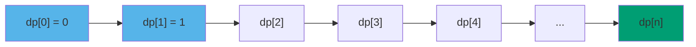
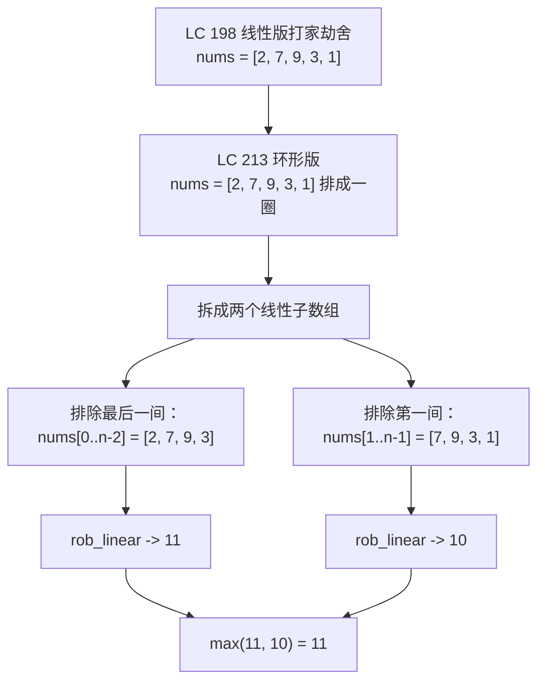

# DP：自底向上制表

CPython 的默认递归上限是 1000。LeetCode 上一道典型一维 DP 题的输入上限是 10⁴。你在[DP：从递归到记忆化](./00-dp-recursion-to-memo.md)末尾写完的那个记忆化 Fibonacci，是对的，渐近意义上也快，但它在 `fib(2500)` 上会抛 `RecursionError`，连一个隐藏用例都没碰到就挂了。能扛住整套测试的改写版本，就是本章要教的这个：递推式不变，不要递归，一个从左往右填的数组。

有意思的地方在于这个改写有多机械。一旦你能说清子问题之间的依赖关系，以及它们必须按什么顺序求值，从记忆化递归到迭代制表的转换就是四个动作加一个循环体。更难的是接下来那一步：发现你刚建好的表除了最后两格，其余全都要扔掉，把数组塌缩成一对标量，空间从 O(n) 降到 O(1)。对题集里每一道状态窗口恒定的一维递推式，面试官都期待你做这次塌缩，它也是本章的拱心石。

## 为什么迭代版在生产里胜过递归版

记忆化是对的。迭代版也是对的。面试官要你改写，理由在三个层面的开销画面上。

第一是栈深度。Python 的递归上限默认是 1000；JVM 的默认线程栈是 512 KB，按局部变量的多少大概能放 5–15 千帧；Go 的 goroutine 栈从 8 KB 起步、按需增长，但每次增长都要付真实的时间。一个以 `i = 0, 1, ..., n` 索引的递推式，朴素递归会在第一个基本情况触发之前把函数压深 `n` 层。`n = 10⁴` 时，Python 版不等返回就抛异常，缓存里有什么都没用。[^1]

第二是常数因子。函数调用有开销——建栈帧、绑定参数、搬运返回值——而记忆化版每一步都要付这份开销，哪怕每次调用都命中缓存。迭代版每步只付一个循环变量和一个数组下标。在 Python 上差距大约是 3×；在带 JIT 的语言上会缩到 1.5× 左右，但方向从不反转。[^2]

第三是自底向上能做、自顶向下做不到的空间优化。表按已知顺序填好之后，你可以指着任意一格问：它最后一次被读是什么时候？对递推式 `dp[i] = f(dp[i-1], dp[i-2])` 来说，答案是“两轮迭代之后”。此后这一格就是死数据。只有知道哪些格已经死了，你才敢拿两个标量顶掉整个数组。自顶向下的记忆化则把每个结果无限期存着，因为它根本不知道递归什么时候会再来问一次。

所以这个改写不是钻牛角尖。正是它把一份正确的算法送进整套测试里跑得动，而且常数小到让那个在 `n = 10⁴` 上超时的 Python 解法改成毫秒级返回。

## 四步转换

随便拿一个记忆化递推式。转成迭代制表就是四个动作，按顺序来。

### 第一步：命名依赖 DAG

记忆化里每一次函数调用产出的值，都依赖另外一组调用。把它画成有向图：一个子问题一个节点，从每个子问题连一条边到它直接依赖的那些子问题。对 Fibonacci，`fib(i)` 依赖 `fib(i-1)` 和 `fib(i-2)`，所以图有 `n+1` 个节点（`fib(0)` 到 `fib(n)`），边是 `i → i-1`、`i → i-2`。这个图按构造就是无环的：每条依赖都指向严格更小的下标。



*每一格都指向它所依赖的两格；这张图是 DAG，而这也是制表的前提条件。*

无环这个性质，是后面整套流程成立的原因。依赖图里要是有环，就没有任何一种求值顺序能保证每个依赖都已经算好。CLRS 第 14 章把这个框架作为自底向上 DP 的形式前提引入：算法需要“一种填表顺序，使得每当我们要计算某个子问题的值时，它所依赖的所有更小的子问题都已经算完。”[^3]

### 第二步：选一个拓扑序

DAG 上的拓扑序，是一条尊重每条边的线性序列：每个节点都出现在它所依赖的节点之后。大多数一维 DP 递推式的顺序都显然：下标从小到大。按 `i = 0, 1, 2, ..., n` 迭代，等你算 `dp[i]` 时，`dp[i-1]` 和 `dp[i-2]` 早就填好了。

以 `(i, j)` 索引的二维递推式，多数情况下顺序也一样显然：按行还是按列，看递推式怎么写。只有依赖图真的不规则时，才需要去“找”这个顺序——而那正是自底向上失去吸引力的场景（下面还会讲）。

### 第三步：用循环替换递归

按第二步的拓扑序开一个循环。循环体里求递推式：从已填好的格里读，往当前格里写。基本情况在循环开始之前填好。

对 Fibonacci，循环体只有一行：

```text
dp[0] = 0
dp[1] = 1
for i from 2 to n:
    dp[i] = dp[i-1] + dp[i-2]
return dp[n]
```

递推式和记忆化版一模一样。变的只是求值策略。

### 第四步：用数组替换缓存

9.0 里那个 memo 之所以用字典，是因为递归可能以任意顺序问任意子问题，字典的灵活性刚好吃得下。而循环只读 `dp[i-1]` 和 `dp[i-2]`，两个都是整数下标，顺序也是已知的。用一个以子问题整数下标索引的平坦数组，严格更便宜。

```python
def fib(n):
    if n < 2:
        return n
    dp = [0] * (n + 1)
    dp[1] = 1
    for i in range(2, n + 1):
        dp[i] = dp[i - 1] + dp[i - 2]
    return dp[n]
```

这就是教科书上的自底向上写法：O(n) 时间，O(n) 空间。递归没了，栈没了，函数调用开销没了。剩下的就是一个循环和一个数组——而原来会超时的输入，现在几微秒就跑完。

## 实例推演：LC 213 House Robber II

房子排成一个圈。你挑一部分下手；相邻两间不能都抢，而因为这排房子首尾相接，第一间和最后一间也算相邻。求能抢到的最大金额。[^4]

递推式就是标准的“抢或不抢”：`dp[i] = max(dp[i-1], dp[i-2] + houses[i])`，但 `houses[0]` 与 `houses[n-1]` 之间那条环形相邻关系，把线性写法打破了。抢了第一间，就不能抢最后一间；放过第一间，最后一间就又回到选项里。

归约就是在这一个决策上分情况。对 `houses[0..n-2]`（最后一间被排除的情形）跑一遍线性打家劫舍，再对 `houses[1..n-1]`（第一间被排除的情形）跑一遍，取较大者。两趟子过程都是干净的线性 DP，没有环形约束，每一趟都是我们刚搭好的滚动对制表。

```python
def rob(nums):
    n = len(nums)
    if n == 0:
        return 0
    if n == 1:
        return nums[0]
    if n == 2:
        return max(nums[0], nums[1])
    return max(_rob_linear(nums[:-1]), _rob_linear(nums[1:]))


def _rob_linear(houses):
    prev2, prev1 = 0, 0
    for x in houses:
        prev2, prev1 = prev1, max(prev1, prev2 + x)
    return prev1
```

**解法** — Python（[Java](./01-dp-bottom-up-tabulation/lc-213/sol.java) · [C++](./01-dp-bottom-up-tabulation/lc-213/sol.cpp) · [Go](./01-dp-bottom-up-tabulation/lc-213/sol.go)）

```python
# LC 213. House Robber II
from typing import List


def rob(nums: List[int]) -> int:
    """LC 213 House Robber II. Circular -> two linear sub-passes, max of both."""
    n = len(nums)
    if n == 0:
        return 0
    if n == 1:
        return nums[0]
    if n == 2:
        return max(nums[0], nums[1])
    # 先排除最后一间，再排除第一间；两趟里环形相邻关系都被打破
    return max(_rob_linear(nums[:-1]), _rob_linear(nums[1:]))


def _rob_linear(houses: List[int]) -> int:
    """Linear House Robber I via rolling-pair tabulation, O(1) space.

    Recurrence: dp[i] = max(dp[i-1], dp[i-2] + houses[i]).
    Only the last two values matter, so carry (prev2, prev1).
    """
    prev2, prev1 = 0, 0
    for x in houses:
        prev2, prev1 = prev1, max(prev1, prev2 + x)
    return prev1
```

`n <= 2` 这个分支比看上去重要。你要是信了归约而不检查，`nums = [5]` 会算出 `max(_rob_linear([]), _rob_linear([]))`，也就是 `max(0, 0) = 0`，而正确答案是 `5`。两个子数组都是空的，两趟线性都返回 0，于是这个函数在每个单元素环上都悄悄少算。Stack Overflow 上就有人针对这份标准解法报过这个 bug，修法正是那三行守卫。[^5]



*每一趟子过程都丢掉一间边界房子，环形相邻关系因此被打破；答案是两个线性结果的较大者。*

拿 `nums = [2, 7, 9, 3, 1]` 完整走一遍。排除最后一间那趟跑 `_rob_linear([2, 7, 9, 3])`：从 `(prev2, prev1) = (0, 0)` 出发，滚动对依次走过 `(0, 2)`、`(2, 7)`、`(7, 11)`、`(11, 11)`，返回 11。排除第一间那趟跑 `_rob_linear([7, 9, 3, 1])`，返回 10。最终答案：`max(11, 10) = 11`。两趟线性扫描，各自 O(n) 时间和 O(1) 空间，合计 O(n) 时间、O(1) 空间。

## 跟踪表格填充

下面的组件演示的是最内层那个基本动作——`n = 8` 的自底向上 Fibonacci，因为 Fibonacci 是 DP 里最干净的两状态递推式，而并排的滚动对视图能让“空间塌缩”这个论证直接以像素的形式看见。同一个组件的 9.0 面板展示的是同一输入用记忆化递归求解的过程；在这两个面板之间来回切换，就是这一课。

> **交互组件：** [DP 表格填充](../../../dsa/widgets/w-31-dp-table-fill.yml)（面板 `panel-b`）——在网站上渲染；YAML 规格文件描述了各个关键帧。

*静态回退：dp[0..8] 初始为空；基本情况 dp[0] = 0 和 dp[1] = 1 先填入；循环从左往右填 dp[2] 到 dp[8]，每一格读它左边紧邻的两格。数组下方有一条两格的滚动对条带，跟踪每一步的 (dp[i-1], dp[i])。完整数组和两格条带最后都停在 21。*

要盯住的是读取前沿之后那些格子的下场。等循环算到 `dp[5]`，它读的是 `dp[4]` 和 `dp[3]`，`dp[2]`、`dp[1]`、`dp[0]` 再也不会被碰。这三格是死内存。完整的 `dp` 数组照样存着它们，下面的滚动对条带不存。这幅图就是下一节要落实成代码改动的东西。

## 滚动对压缩：从 O(n) 空间到 O(1) 空间

整数组写法正确，也好读。它同时也是严格多于算法所需的内存。对任何状态只依赖常数个近期格子的递推式，读取前沿之后的死格子都可以丢掉，整个数组可以换成一组固定大小的标量，数量正好等于依赖窗口。

对 Fibonacci 递推式，窗口是两格：`dp[i-1]` 和 `dp[i-2]`。把它们分别用 `prev1` 和 `prev2` 带着，同步更新：

```python
def fib(n):
    if n < 2:
        return n
    prev2, prev1 = 0, 1                # dp[0], dp[1]
    for _ in range(2, n + 1):
        prev2, prev1 = prev1, prev2 + prev1
    return prev1
```

同一个算法，同一个答案，O(n) 时间，O(1) 空间。这次空间削减在渐近意义上是常数因子级别的改进，在实践里却是硬需求：`n = 10⁹` 用 O(n) 数组根本不可能，用两个标量却轻而易举。CLRS 在 §14.3 把它称为“时间与空间之间的权衡”，并指出渐近时间仍是 O(n)，变的只是空间的常数。[^3]

这次压缩带来一个风险，值得说清楚：它让回溯变得不可能。如果题目还问“抢了*哪几间*”，滚动对已经把逐格的决策丢掉了，想还原答案就得留整张表。纯求值的题（LC 198、213、740、1937，几乎每道一维 DP 的简单与中等题）压了没事。要重建方案的问题（LC 72 编辑距离、LC 300 LIS 需要还原对齐的那种形式）得留着数组。

Python 里的滚动对更新用元组赋值，右值会先整个求值完，*然后*才往两个左值变量写。正是这个原子性挡住了下面“常见陷阱”一节要讲的差一错位坑。Java、C++、Go 没有元组赋值，等价写法是先把新值算进一个局部变量，再移位：

```java
int curr = Math.max(prev1, prev2 + nums[i]);
prev2 = prev1;
prev1 = curr;
```

形状相同，语法不同。顺序写错，踩的是同一个坑。

## 实际开销

| 变体 | 时间 | 空间 | 说明 |
|---|---|---|---|
| 朴素递归（9.0 的起点） | O(φ^n) ≈ O(1.618^n) | O(n) 调用栈 | 指数爆炸；n = 50 之前就挂[^6] |
| 记忆化递归（9.0 的终点） | O(n) | O(n) 备忘录 + O(n) 调用栈 | 正确，但 Python 里 n ≈ 1000 就撞栈上限[^1] |
| 自底向上整表 | O(n) | O(n) | 教科书标准形 |
| **自底向上滚动对** | **O(n)** | **O(1)** | 面试默认答案 |
| 打家劫舍 II 环形版 | O(n) | O(1) | 两趟线性子过程，各自是滚动对[^4] |

四行自底向上的渐近时间都是 O(n)；变的是常数和空间。对 Fibonacci 的滚动对写法，常数大约是每步两次加法加一次赋值。这就是地板了。

## 制表失效的场景

自底向上并不总是正解。这套流程的前提是你动手之前就知道子问题的拓扑序，而有些递推式，那个顺序真的很难枚举出来。

矩阵链乘是教科书级的反例。递推式是 `m[i][j] = min over k of (m[i][k] + m[k+1][j] + cost)`，它依赖 `[i, j]` 内部每一条更短的子链。自底向上版必须按链长递增的顺序填表：一个嵌套循环，外层下标是 `len = 2, 3, ..., n`，内层下标是 `(i, j) = (i, i + len - 1)`，把嵌套顺序摆对是要费点脑子的。自顶向下的记忆化没有这个约束：递归按答案需要的顺序惰性地探索子问题，缓存负责不重算。Erickson 把这种情况称为“先记忆化，再制表”这条纪律的标准案例，因为它让你先在好写的那个版本上证明正确性，然后再谈优化。[^7]

判断信号：递推式你两分钟能写出来，拓扑序三分钟还列不出来，那就交记忆化版。自底向上是一笔税，只有顺序显然、或者常数因子的收益很关键时才值得交。

## 两个最容易踩的坑

> [!WARNING]
> **滚动对的更新顺序。** 把 `prev2 = prev1; prev1 = max(prev1, prev2 + nums[i]);` 写成两条语句，`prev2` 在被旧 `prev1` 覆盖之后才被读到，于是整条式子实际算的是 `max(prev1, prev1 + nums[i]) = prev1 + nums[i]`。这个 bug 能通过大多数短用例，因为“贪心全抢”的答案常常恰好就是最优。要么用 Python 的原子元组赋值（`prev2, prev1 = prev1, max(prev1, prev2 + x)`），要么在 Java、C++、Go 里先把新值算进局部变量再移位。LeetCode 讨论区有好几个关于打家劫舍 O(1) 空间写法的帖子记录了这个顺序 bug。[^5]

> [!WARNING]
> **把迭代方向弄反。** 如果你把自顶向下的递推式 `f(i) = max(f(i+1), f(i+2) + nums[i])`（“从第 i 间出发，跳到 i+1，或者抢了它再跳到 i+2”）原样搬进自底向上的代码、不做改写，循环读的就是 `dp[i+1]` 和 `dp[i+2]`，而不是 `dp[i-1]` 和 `dp[i-2]`。一个从左往右的循环这时读的是没初始化的格子，答案错得悄无声息。把迭代方向写进递推式里重写：“我在 `dp[0..i-1]` 都已知之后才填 `dp[i]`”，于是 `dp[i] = max(dp[i-1], dp[i-2] + nums[i])`。OpenDSA 的 DP 章节专门带读者走了一遍这个变换，因为它是整套流程里唯一没有机械翻译办法的一块。[^8]

第三个坑没那么戏剧化，但值得点出来：在 LC 740 Delete and Earn 里，实现者认出了“在相邻数值上做打家劫舍”，却跳过了“按值装桶”这一步变换。把输入排序去重，`nums = [2, 2, 3, 3, 3, 4]` 得到 `[2, 3, 4]`，在 `[2, 3, 4]` 上做打家劫舍返回 6。正确答案是 9（三个 3 全拿，2 和 4 因此全被排除）。修法是先建一个按*值*索引的稠密数组 `earn[v] = v * count(v)`，然后在 `earn[]` 上跑滚动对。相邻关系在整数值这个维度上，不在输入位置的维度上。

## 题目梯度

### 核心（三题全做才算掌握本章）

- [LC 213 — House Robber II](https://leetcode.com/problems/house-robber-ii/) [中等] • dp-1d-rolling ★
- [LC 740 — Delete and Earn](https://leetcode.com/problems/delete-and-earn/) [中等] • dp-1d-rolling
- [LC 1937 — Maximum Number of Points with Cost](https://leetcode.com/problems/maximum-number-of-points-with-cost/) [中等] • dp-1d-rolling *(参考实现：仅 Python)*

LC 213 是本章的招牌题（★），也是最干净地展示“在滚动对这个基本操作上叠一层结构转折”的例子。LC 740 练的是元技能：在不像的表面形式下认出一维 DP 的形状。LC 1937 把滚动对从“前两格”推广到“前一行”，预演了滚动行这个变体——它会在 [DP：网格上的二维问题](./06-lcs.md) 里正式落地。

三题都是中等。本章带着 `single-difficulty-band` 这个选题标记，因为“状态窗口恒定的一维线性 DP 递推式、用自底向上制表求解”这类题在 LC 上的标准面试载体全是中等；显然的简单候选（LC 70、LC 509）归 9.0 和 9.2，而困难的一维 DP 题要么引入位掩码状态，要么需要线段树维护，要么递推式已经实质上属于后面的章节。

## 后续衔接

支撑这里每一趟子过程的线性打家劫舍基本操作，会在[DP：一维数组上的经典模式](./02-dp-1d.md)里从第一性原理讲起，和爬楼梯、求最大子数组和的 Kadane 算法，以及线性 DP 食谱里剩下的那些一起。滚动行的推广——“除了上一行，别的都扔掉”——是通往[DP：网格上的二维问题](./06-lcs.md)的桥，那里每一行是一次完整扫描，递推式只碰常数个近期行。这条路的另一端是编辑距离和 LCS，分别在 [DP：最长公共子序列](./06-lcs.md) 与 [DP：编辑距离](./07-edit-distance.md)：那是需要完整回溯的二维表，滚动行这一手在那里不再可用，因为表本身就是构造产物。

## 参考文献

[^1]: CPython 里 Python 的 `sys.setrecursionlimit` 默认是 1000；一个以 `i = 0..n` 索引的记忆化递推式，会在第一个基本情况触发前递归 `n` 层，所以任何 `n > ~990` 的输入都会抛 `RecursionError`，缓存里存了什么无关。文档：<https://docs.python.org/3/library/sys.html#sys.setrecursionlimit>。

[^2]: OpenDSA（弗吉尼亚理工），*Data Structures & Algorithms*，§5.10“Dynamic Programming”，<https://opendsa-server.cs.vt.edu/ODSA/Books/eu_book/html/DynamicProgramming.html>。

[^3]: Cormen、Leiserson、Rivest、Stein，*Introduction to Algorithms*，第 4 版，MIT Press，2022，第 14 章“Dynamic Programming”，§14.3。

[^4]: LC 213 House Robber II 的题面与难度经 leetcode.ca 镜像核对，<https://leetcode.ca/all/213.html>。

[^5]: Stack Overflow 问题 72597591，*LeetCode question: House Robber II The code does not return correct output*，<https://stackoverflow.com/questions/72597591/leetcode-question-house-robber-ii-the-code-does-not-return-correct-output>。

[^6]: Erickson，*Algorithms*，第 3 章“Dynamic Programming”，<https://jeffe.cs.illinois.edu/teaching/algorithms/book/03-dynprog.pdf>。

[^7]: AlgoMaster，*House Robber II* 讲解，<https://algomaster.io/learn/dsa/house-robber-ii>。

[^8]: OpenDSA（弗吉尼亚理工），§5.10.2，出处同 [^2]。
