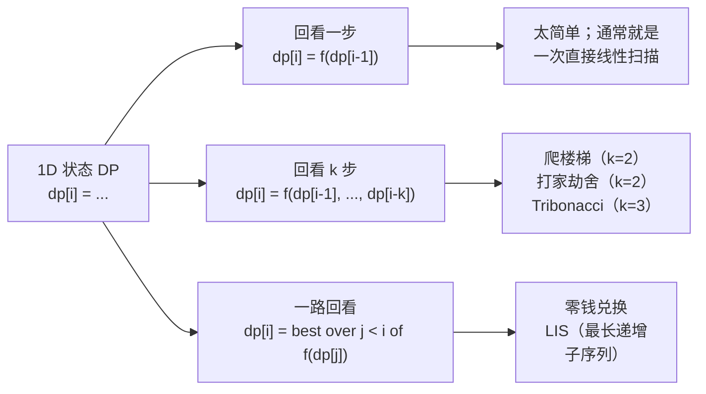
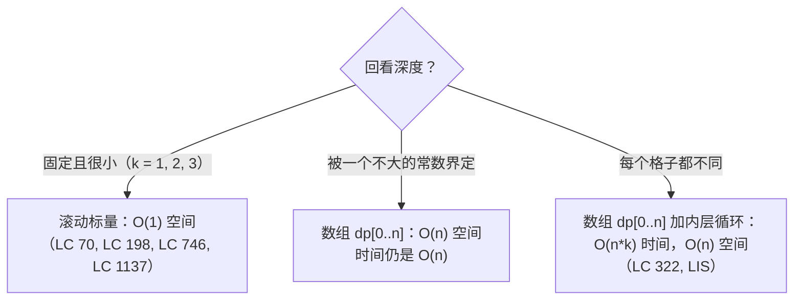

# 一维状态上的动态规划

1957 年，Richard Bellman 写下了一句话，后来成了最优性原理（principle of optimality）：最优策略具有这样的性质——不管初始状态和初始决策是什么，其余的决策相对于第一个决策所导致的状态，必须仍然构成一个最优策略。剥掉修辞，工程含义只有一句：**如果位置 `i` 的最优答案是由更早位置的最优答案拼出来的，那你就可以从左往右算，除了递推式逼着你回看的那几步，再也不用往回看。**

这一句话就是整章的内容。下面每个算法都是一维的格子数组，每个格子问的是“到这里为止我能做到的最好是什么”，用一到两个更早的格子算出自己，然后忘掉更早的一切。爬楼梯、打家劫舍、使用最小花费爬楼梯三者的差别，归结为三个旋钮：合并方式（`+`、`max` 还是 `min`）、格子自身贡献什么（一个计数、一份被拿走的收益、一笔付出的代价）、递推往回看多远。把这三个旋钮拧对，一百道 LeetCode 题会塌缩成同一个形状。

## “1D 状态”到底指什么

当每个子问题只用一个整数下标就能确定，这个 DP 解就具有*一维状态*。表是 `dp[0..n]`，递推只读前面几个条目，答案从最后一格落出来（或者倒数第二格；差一位的问题后面会讲）。这是最简单的非平凡 DP，也是面试轮转里干活最多的那一个。[^1]

题目描述里的信号非常明确。输入是一条线性序列：一个值数组、一串代价、`n` 级台阶。约束是局部的：不能选相邻两个、任意一步可跨一级或两级、每种选择都要付当前代价。要求的输出是单个最优值：最大、最小或计数。三个信号同时出现时，先写 `dp[i]`，再问递推式是什么。这类题里至少有一半贪心会失败，剩下的用不带记忆化的递归会超时。[^2]

[从递归到记忆化](./00-dp-recursion-to-memo.md) 引入了“重叠子问题的递归”这个框架；[自底向上制表](./01-dp-bottom-up-tabulation.md) 走完了从 memo 到迭代数组的转换。本章从已经拿到手的迭代形式出发，问的是另一个问题：一旦你决定用一维状态，递推式究竟长什么样，以及怎么一眼把几种变体分开。

## 三种回看形状



*几乎所有一维状态递推都落在这三种深度里。“回看 k 步”这一族中 `k = 2` 的情况占了本章的大头。“一路回看”这一族是从一维 DP 通往更贵的 O(n²) 形状的桥；它后面会出现在 [零钱兑换](./05-knapsack-unbounded.md) 和 [最长递增子序列](./08-lis-quadratic.md) 里。*

只看一步的格子，通常不值得叫 DP。那个递推就是一个滚动聚合量，一个累加器就够了。回看 `k` 步、`k` 是小常数的格子才是甜点区：递推的记忆量刚好够编码一次局部选择，整张表能压成固定个数的标量。一路回看的格子才是真正带内层循环的 DP，时间变成 O(n²)，优化的故事也难讲。本章讲的是中间那一列。

## 爬楼梯（LC 70）

题库里最干净的一维 DP。你站在 `n` 级台阶底下，每一步可以爬一级或两级，问有多少种不同的走法能到顶。

递推式来自一个观察。踏入第 `n` 级的最后一步，要么是一级（此前是某个止于 `n-1` 的走法序列），要么是两级（此前是某个止于 `n-2` 的序列）。这两种情况不重叠，因为最后一步不同，所以 `n` 处的计数是两者之和：

```text
ways[n] = ways[n - 1] + ways[n - 2]
```

这就是下标平移一位的斐波那契递推。[^3] 初始条件在后面 §“常见陷阱”里单独占一段；这里先取 `ways[0] = ways[1] = 1`。实现只有五行：

```python
def climb_stairs(n: int) -> int:
    a, b = 1, 1                      # a = ways[i-2], b = ways[i-1]
    for _ in range(n):
        a, b = b, a + b
    return b
```

`a` 和 `b` 就是滚动标量。迭代 `n` 次之后，`b` 里是 `ways[n]`。整张表 `ways[0..n]` 从来没被真正建出来，因为比 `i - 2` 更深的格子一次都不会被读。空间是两个整数。

LC 70 是本章的温柔入口。它教会你这个形状（递推、初始条件、滚动压缩），但不逼你为每个格子做决定。这里没有选择：两个前驱都把各自的计数贡献出来，合并方式是 `+`。这是一道计数题，不是优化题。本章剩下的部分，讲的是每个格子都必须*做选择*时会发生什么。

## 打家劫舍（LC 198）

原型题。房子排成一排，每栋里有一些钱，同一晚抢了相邻的两栋就会触发警报。挑一个互不相邻的子集，使总额最大。

```python
def rob(nums):
    prev2, prev1 = 0, 0
    for x in nums:
        prev2, prev1 = prev1, max(prev1, prev2 + x)
    return prev1
```

**解法** — Python（[Java](./02-dp-1d/lc-198/sol.java) · [C++](./02-dp-1d/lc-198/sol.cpp) · [Go](./02-dp-1d/lc-198/sol.go)）

```python
# LC 198. House Robber
def rob(nums: list[int]) -> int:
    """LC 198 House Robber: max sum of non-adjacent elements.
    Two-options-per-cell DP: at each house, take + dp[i-2] OR skip = dp[i-1].
    O(n) time, O(1) space (rolling pair).
    """
    prev2, prev1 = 0, 0
    for x in nums:
        prev2, prev1 = prev1, max(prev1, prev2 + x)
    return prev1
```

这个递推背后有一句话能说清。在第 `i` 栋房子上，你有两个选项。**抢它**，那么第 `i-1` 栋就不能碰，到 `i` 为止的钱是 `dp[i-2] + nums[i]`。**跳过它**，那么到 `i` 为止的钱和到 `i-1` 为止一样，即 `dp[i-1]`。最优的 `dp[i]` 取两者中更好的那个：

```text
dp[i] = max(dp[i - 1], dp[i - 2] + nums[i])
```

这就是经典的*取或不取*（take-or-skip）一维递推。Demaine、Ku 和 Solomon 在 MIT 6.006 里用保龄球问题（Bowling）讲它：每个瓶子带一个分值，击倒瓶子 `i` 就失去瓶子 `i-1`，目标是击倒总分最大。[^4] 把瓶子改名叫房子，递推完全一样。Kleinberg 和 Tardos 用同一个形状，名字叫*加权区间调度*（weighted interval scheduling）。[^5]

有两件事让打家劫舍区别于爬楼梯，也让它拿到原型的位置。

第一，格子自身的值只进入一个分支。`nums[i]` 出现在“抢”的分支里，在“跳过”的分支里完全不出现。正是这种不对称，让算法从计数变成*优化*。合并方式也随之变成 `max`。

第二，贪心会失败。第一次看这道题时，最自然的冲动是取交替子集——偶数下标或奇数下标，哪个和更大取哪个。对 `nums = [2, 1, 1, 2]`，按奇偶贪心返回 3（要么 `[2, 1]` 要么 `[1, 2]`），但最优选法是*抢、跳、跳、抢*，和为 4。[^6] AlgoMaster 的打家劫舍讲解正是用这个反例开场。最优子集*不是*周期性的，只有递推式看得到这一点。每当你想在“取或不取”的题上写下“隔一个取一个”，递推式就是那个纠偏。

空间压缩和爬楼梯是同一招。`dp[i]` 只读 `dp[i-1]` 和 `dp[i-2]`，更早的都不读，所以两个标量足够。Python 的元组交换是最干净的表达；在 Java、C++ 和 Go 里，你得先把 `cur` 算进一个新变量再移位，因为这几种语言的求值顺序是先更新左边再算右边，那里一旦写反，每一次迭代都会悄悄把递推式算错。

## 使用最小花费爬楼梯（LC 746）

LC 70 的 min 合并表亲，每一级台阶都带价格。输入 `cost[0..n-1]` 是站在第 `i` 级台阶上要付的钱。你可以从第 0 级或第 1 级起步。从任何一级出发，可以跨一级或两级。终点是第 `n-1` 级*上方*的地面，也就是位置 `n`。求最小总花费。

递推是到达方式两种取最小值：

```text
dp[i] = min(dp[i - 1] + cost[i - 1], dp[i - 2] + cost[i - 2])     for i >= 2
dp[0] = dp[1] = 0
return dp[n]
```

两件事要记住。合并方式是 `min` 而不是 `max`。答案是 `dp[n]` 而不是 `dp[n-1]`，因为终点在最后一个付费台阶之后一位。[^7]

```python
def min_cost(cost):
    n = len(cost)
    a, b = 0, 0                       # dp[0] = dp[1] = 0
    for i in range(2, n + 1):
        a, b = b, min(b + cost[i - 1], a + cost[i - 2])
    return b
```

LC 746 在难度曲线上夹在 LC 70 和 LC 198 之间。远看像 LC 70：同样的楼梯，同样的一步或两步。它带着 LC 198 那种逐格决策的形状，只是把 `max` 换成 `min`，把白送的一级计数换成要付钱的一级代价。三道题，一个递推模板，三个旋钮拧的位置不同。

## 窗口变大时：滚动还是数组

上面三道题的回看深度都固定为 2，所以两个滚动标量就够。一般形式是：回看深度固定为 `k`，就用 `k` 个标量。Tribonacci（LC 1137）是上一档：`T(n) = T(n-1) + T(n-2) + T(n-3)` 跑在三个滚动整数上。[^8]

当回看深度不再是常数，你就该用数组形式了。零钱兑换要求凑出 `amount` 的最少硬币数；`dp[a]` 处的递推要看每一种面额 `c` 对应的 `dp[a - c]`。窗口大小等于硬币集合的大小，而硬币集合不受常数限制。整张 `dp[0..amount]` 表都得留在内存里；滚动毫无收益，因为每个条目都可能被再次访问。[零钱兑换](./05-knapsack-unbounded.md) 会把这种情况讲全。

分界线很具体。回看深度固定为 `k = O(1)`，压成 `k` 个标量。回看深度可变，保留数组。把两者搞混，你要么在本该 O(1) 空间的问题上白白花掉 O(n)，要么更糟——去滚一个根本没有固定形状的窗口，最后读到没初始化的格子。



*滚动压缩成立的前提是依赖窗口固定且很小。一旦窗口逐格变化或者随输入增长，数组就得回来。*

## 实际开销

| 变体            | 时间      | 空间     | 备注                                                                 |
|--------------------|-----------|-----------|-----------------------------------------------------------------------|
| 制表数组    | O(n)      | O(n)      | 最直白的实现；每个下标一个格子。               |
| 滚动标量    | O(n)      | O(1)      | 回看深度固定为 2；只会读到最后两个格子。[^9]      |
| 记忆化递归 | O(n)      | O(n)      | 自顶向下的等价写法；调用栈付掉空间成本。              |
| 朴素递归    | O(2^n)    | O(n) 栈 | 不做记忆化时的结果；调用树把所有东西重新探索一遍。[^10] |

每个格子算一次，读两个更早的格子，所以单格工作是常数，总工作是 Θ(n)。空间从 Θ(n) 降到 Θ(1) 才是承重的优化：它和把课本上的斐波那契递推变成两变量循环是同一招，而且能推广到任何回看深度是固定小常数的一维 DP。[^11]

## 常见陷阱

> [!WARNING]
> **爬楼梯里写成 `f(0) = 0`。** 这个差一位的 bug 咬过每一个第一次写这个递推的人。设 `f(0) = 0` 会得到 `f(2) = f(1) + f(0) = 1`，这是错的；正确答案是 2（一级加一级，或两级一步）。约定是“什么都不做”恰好有一种做法，所以 `f(0) = 1`。在相信你写的任何爬楼梯代码之前，先用 `n = 2` 验一遍。[^3]

> [!WARNING]
> **使用最小花费爬楼梯里返回 `dp[n-1]`。** 终点在最后一个付费台阶之后一位。对 `cost = [10, 15, 20]`，这个 bug 返回的是 20（走到第 2 级的代价），而不是 15（从第 1 级跨两级到地面）。修法是把表开成 `dp[0..n]` 并返回 `dp[n]`。LeetCode 的题面在这一点上不幸很容易读错；LC-Feedback 的 issue #440 整条讨论串里，测试者先一口咬定官方答案是错的，后来才意识到终点在数组末尾之外。[^7]

还有第三个坑，严格说不算陷阱，但值得一句话。在 Java、C++ 和 Go 里，滚动的那一对变量必须经由临时变量更新，不能原地写。写成 `prev1 = max(prev1, prev2 + x); prev2 = prev1` 会在下一次迭代把递推毁掉，因为第二条语句读到的是刚被更新的 `prev1`。Python 的元组交换靠先求整个右边避开了这个坑；另外三种语言需要一个显式的 `cur` 变量。上面的参考实现用的是安全写法。

## 题目梯度

### 核心（全做才算掌握本章）

- [LC 70 — Climbing Stairs](https://leetcode.com/problems/climbing-stairs/) [简单] • dp-1d-fibonacci-counting ★
- [LC 198 — House Robber](https://leetcode.com/problems/house-robber/) [中等] • dp-1d-take-or-skip

### 进阶（可选）

- [LC 746 — Min Cost Climbing Stairs](https://leetcode.com/problems/min-cost-climbing-stairs/) [简单] • dp-1d-min-cost-step

一维 DP 家族里的 Hard 题，按设计放在接下来三章。[解码方法与单词拆分](./03-dp-decode-word-break.md) 负责“带合法性校验的计数”形状（LC 91、LC 139）。[分割与子集和](./04-knapsack-01.md) 负责数值目标上的布尔可行性形状。[零钱兑换](./05-knapsack-unbounded.md) 负责无界回看形状。读完本章再跟着任意一条交叉引用走，两章之内你就会碰到一道 Hard 级一维 DP。

## 后续衔接

从这里往外有三条分支。

当递推必须给每个选项加一道合法性校验（位置 `i` 处的子串是合法编码*并且* `dp[i-2]` 可达，前缀是合法单词*并且*剩下的部分能干净切分），形状仍然是一维，但每个“选项”都带一个谓词。[解码方法与单词拆分](./03-dp-decode-word-break.md) 就是“带合法性校验的计数”这一味，也是通向更刁钻一维题的入口。

当格子的值可以被取任意多次而不是只取一次，回看就不再固定为 `k = 2`，而是摊到整个面额集合上。[零钱兑换](./05-knapsack-unbounded.md) 是经典的无界回看题，这个形状在 [最长递增子序列](./08-lis-quadratic.md) 里再次出现——那里每个格子都要扫过所有更小的下标。

当输入变成二维——两个字符串、一个网格，或一个字符串加一个模式——同样的取或不取决策就出现在二维表上。[最长公共子序列](./06-lcs.md) 是最干净的入口；递推是 `dp[i][j] = max(dp[i-1][j], dp[i][j-1], dp[i-1][j-1] + 1 if match else 0)`，你一眼就能认出取与不取这两个分支。

## 参考文献

[^1]: Bellman, R., *Dynamic Programming*, Princeton University Press, 1957。最优性原理的表述出自 Bellman 原话；转引自 [Bellman equation, Wikipedia](https://en.wikipedia.org/wiki/Bellman_equation)。

[^2]: takeUforward (Striver), *Dynamic Programming Introduction Tutorial*, [takeuforward.org/data-structure/dynamic-programming-introduction](https://web.archive.org/web/20260710113910/https://takeuforward.org/data-structure/dynamic-programming-introduction)

[^3]: walkccc, *LeetCode Solutions*, [Problem 70 Climbing Stairs](https://walkccc.me/LeetCode/problems/70/)

[^4]: Demaine, E.; Ku, J.; Solomon, J., MIT 6.006 *Introduction to Algorithms*（2020 春季学期），第 15 讲“Dynamic Programming, Part 1: SRTBOT, Fib, DAGs, Bowling”，[MIT OpenCourseWare](https://ocw.mit.edu/courses/6-006-introduction-to-algorithms-spring-2020/resources/lecture-15-dynamic-programming-part-1-srtbot-fib-dags-bowling/)。

[^5]: Kleinberg, J.; Tardos, É., *Algorithm Design*, Pearson, 2005, Chapter 6 §6.1（Weighted Interval Scheduling）。

[^6]: AlgoMaster.io, ["House Robber"](https://algomaster.io/learn/dsa/house-robber)，访问于 2026-05-20。`[2, 1, 1, 2] → 4` 这个奇偶贪心反例的出处。

[^7]: LC-Feedback issue #440, ["746. Min Cost Climbing Stairs, wrong testcase"](https://github.com/LeetCode-Feedback/LeetCode-Feedback/issues/440)

[^8]: walkccc, *LeetCode Solutions*, [Problem 1137 N-th Tribonacci Number](https://walkccc.me/LeetCode/problems/1137/)，访问于 2026-05-20。核实了回看深度固定为 3 时的三滚动标量写法。

[^9]: Cormen, Leiserson, Rivest, Stein, *Introduction to Algorithms*, 4th ed., MIT Press, 2022, Chapter 14 §14.2（matrix-chain template）。

[^10]: Erickson, J., *Algorithms*, 免费在线教材, [jeffe.cs.illinois.edu/teaching/algorithms](https://jeffe.cs.illinois.edu/teaching/algorithms/)

[^11]: CP-Algorithms, ["Dynamic programming"](https://cp-algorithms.com/dynamic_programming/intro-to-dp.html)
