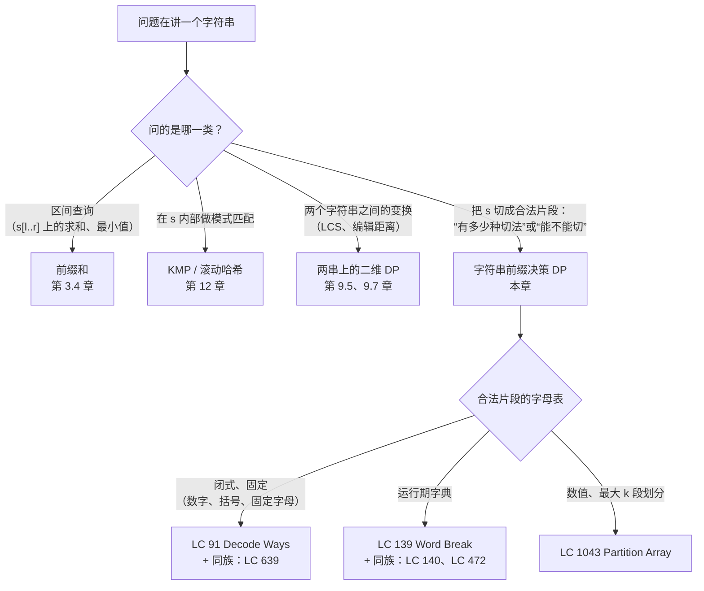
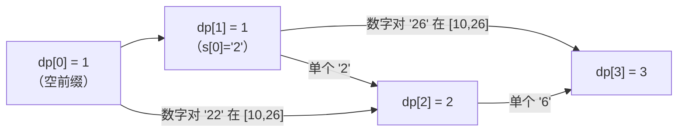
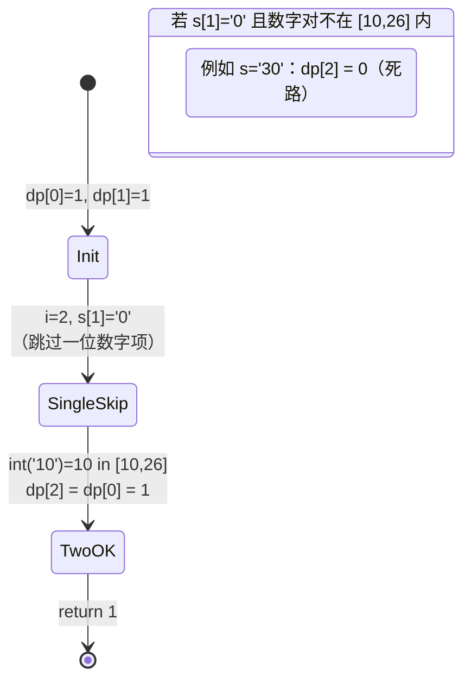

# Decode Ways 与 Word Break：字符串前缀决策 DP

LC 91 *Decode Ways* 在 LeetCode 上的通过率停在 35% 上下[^1]。三分之二的尝试都是错的。题面看着短：给一个像 `"226"` 的数字串，在 `1→A, 2→B, ..., 26→Z` 的映射下数出有多少种解码方式，看破之后递推式就两行。真正咬人的是 `'0'` 规则：`'0'` 自己不对应任何字母，所以它必须往回粘到一个 `'1'` 或 `'2'` 上；就这一条约束，足以把最自然的那套递推式在 `"10"`、`"06"`、`"30"` 这类输入上打得粉碎。

LC 139 *Word Break* 问的东西听起来不一样。给定 `s = "leetcode"` 和 `wordDict = ["leet", "code"]`，`s` 能不能切成一串字典里的词？递推式形状相同。站在字符串的位置 `i` 上，回看每一个 `j < i`、且前缀 `s[:j]` 已经有答案的位置。对每个这样的 `j`，问一句：切片 `s[j:i]` 是不是一个合法片段。再把所有 `j` 的结果聚合起来。就这样。Decode Ways 的合法片段是 `1..9` 的单个数字和 `10..26` 的数字对；Word Break 的合法片段是字典里有的东西。一套模板，两套字母表。

本章把这套模板叫作**字符串前缀决策 DP**。

## 如何识别这个模式



*本章的触发条件是：一个字符串问题，问的是合法切分有多少种，或者能不能切成合法片段。不会是区间聚合，也不会是变换。一旦走对了分支，题目之间变的只有“什么算合法片段”。*

## 暴力解法为何不够

Decode Ways 最直觉的第一版会把每一种切法都枚举出来。切掉一位数字，递归；切掉两位数字，递归；把计数加起来。

```python
# 暴力：O(2^n)——这是我们要替换掉的东西
def num_decodings_brute(s):
    if not s:
        return 1
    if s[0] == "0":
        return 0
    total = num_decodings_brute(s[1:])                 # 取一位数字
    if len(s) >= 2 and 10 <= int(s[:2]) <= 26:
        total += num_decodings_brute(s[2:])            # 取两位数字
    return total
```

任何输入都正确，长度一上来就灾难。递归树大致是斐波那契形状（每个节点最多两个孩子），所以调用次数是 `O(phi^n)`。`n = 35` 时大约三千万次调用；`n = 100`（Decode Ways 的上界）时，宇宙热寂会先到。

浪费用手就能看出来。拿 `"22622"` 跑一遍递归。字符串 `"622"` 会在算法从 `"22622"` 切掉一位数字往下递归时算一遍，*也*会在算法切掉两位数字（`"22"`）再对 `"622"` 递归时再算一遍。同一个后缀，两条到达路径，两棵完整的子树展开。推广到每个位置，这场爆炸就是算法对每个长度为 `k` 的后缀把同一个子问题算 `O(phi^k)` 次。

修法就是 Part 9 每一章都在做的那一步：别重算。每个后缀的答案第一次算出来就存住，之后永远复用。递归树塌成一个 `n + 1` 个节点的 DAG（每个后缀长度一个节点），运行时间降到 `O(n)`。[Part 9.0——从递归到记忆化](./00-dp-recursion-to-memo.md) 讲了这次提升的形式化过程；这里直接上自底向上的写法，面试答案要的就是这个。

## 递推式，只写一遍

LC 91 和 LC 139 要的都是一个按**前缀长度**索引的 `dp` 数组。`dp[i]` 是前缀 `s[:i]`（前 `i` 个字符）的答案，`dp[0]` 是空前缀。

Decode Ways 里 `dp[i]` 数的是解码方案数：

```text
dp[i] = (dp[i-1]   if s[i-1] != '0'        else 0)            # 取 1 位数字
      + (dp[i-2]   if 10 <= int(s[i-2:i]) <= 26  else 0)      # 取 2 位数字
```

Word Break 里 `dp[i]` 是布尔值：前缀 `s[:i]` 能不能切分？

```text
dp[i] = 对 j in [max(0, i - L_max), i) 做 OR
        (dp[j] AND s[j:i] in dictionary)
```

同一个形状。站在前缀长度 `i`，回看那些可能是上一个边界的前缀长度 `j`，要求切片 `s[j:i]` 是合法片段之一，然后合并。Decode Ways 的“合并”是求和（解码方案数），Word Break 的“合并”是取或（是否存在一种切分）。[^2]

Word Break 上初学者唯一会写错的就是 base case 这一行。`dp[0] = True`。空前缀可以切成零个字典词，就像空乘积是 `1`、空求和是 `0`。把 `dp[0]` 设成 `False`，递推式会把一切都传成 `False`。CLRS 对“单格 base 子问题”的说法——平凡情形取什么值能让递推走通就取什么值，不多不少——说的就是这件事。[^3]

## Decode Ways：模式

```python
def num_decodings(s: str) -> int:
    n = len(s)
    if n == 0 or s[0] == "0":
        return 0
    # 滚动窗口：跨迭代只保留 prev2 = dp[i-2] 和 prev1 = dp[i-1]。
    prev2, prev1 = 1, 1
    for i in range(2, n + 1):
        cur = 0
        if s[i - 1] != "0":                            # 一位数字解码
            cur += prev1
        two = int(s[i - 2 : i])                        # 两位数字解码
        if 10 <= two <= 26:
            cur += prev2
        prev2, prev1 = prev1, cur
    return prev1
```

**解法** — Python（[Java](./03-dp-decode-word-break/lc-91/sol.java) · [C++](./03-dp-decode-word-break/lc-91/sol.cpp) · [Go](./03-dp-decode-word-break/lc-91/sol.go)）

```python
# LC 91. Decode Ways


def num_decodings(s: str) -> int:
    """LC 91 Decode Ways. Return the number of ways to decode digit string s.

    dp[i] = number of decodings of the prefix s[:i].
    Rolling-window: only prev2 = dp[i-2] and prev1 = dp[i-1] live across iters.
    """
    n = len(s)
    if n == 0 or s[0] == "0":
        return 0
    prev2, prev1 = 1, 1
    for i in range(2, n + 1):
        cur = 0
        # 一位数字解码：s[i-1] 取 '1'..'9'。
        if s[i - 1] != "0":
            cur += prev1
        # 两位数字解码：s[i-2:i] 取 '10'..'26'。
        two = int(s[i - 2 : i])
        if 10 <= two <= 26:
            cur += prev2
        prev2, prev1 = prev1, cur
    return prev1
```

两行就把活干完了。`if s[i-1] != "0"` 是那道 `'0'` 闸门：当前字符是 `'0'` 时，它没法单独当字母，所以一位数字这条分支贡献为零。`if 10 <= two <= 26` 是两位数字的闸门：数字对必须落在一个合法的字母映射里。只要出了 `[10, 26]`（`"00"`、`"06"`、`"30"`、`"99"`），两位数字分支就死了。如果某个 `i` 上两条分支都失败，`dp[i] = 0`，这个零会往后传——这是正确行为：任何以无法挂靠的 `'0'` 结尾的前缀，都没有解码方式。

从完整的 `dp[]` 数组塌成两个整数是白捡的，和 [1D DP：斐波那契式](./02-dp-1d.md) 在爬楼梯、打家劫舍上做过的同一次提升一样。`dp[i]` 永远只读 `dp[i-1]` 和 `dp[i-2]`，更老的值全是死的。留两个活值、扔掉数组，空间开销从 `O(n)` 降到 `O(1)`，算法一点没变。[^4]

> [!IMPORTANT]
> **相信那个零。** `dp[i]` 是 `0` 的时候，前缀 `s[:i]` 就是真的切不出来。别加那种“两条分支都失败就做点别的”的鬼逻辑。下游迭代会看到 `prev1 = 0`，把这个零正常传下去。`num_decodings("100")` 返回 `0`，因为 `"00"` 后缀没有解码方式，这就是正确答案。

## Word Break：同一套模板，运行期字母表

```python
def word_break(s: str, word_dict: list[str]) -> bool:
    n = len(s)
    words = set(word_dict)
    max_w = max((len(w) for w in words), default=0)
    dp = [False] * (n + 1)
    dp[0] = True
    for i in range(1, n + 1):
        lo = max(0, i - max_w)
        for j in range(lo, i):
            if dp[j] and s[j:i] in words:
                dp[i] = True
                break
    return dp[n]
```

**解法** — Python（[Java](./03-dp-decode-word-break/lc-139/sol.java) · [C++](./03-dp-decode-word-break/lc-139/sol.cpp) · [Go](./03-dp-decode-word-break/lc-139/sol.go)）

```python
# LC 139. Word Break


def word_break(s: str, word_dict: list[str]) -> bool:
    """LC 139 Word Break. Bottom-up O(n * L_max).

    dp[i] = True iff some j < i has dp[j] True AND s[j:i] is in the dict.
    The L_max bound on the inner loop cuts O(n^2) -> O(n * L_max).
    """
    n = len(s)
    words = set(word_dict)
    max_w = max((len(w) for w in words), default=0)
    dp = [False] * (n + 1)
    dp[0] = True
    for i in range(1, n + 1):
        lo = max(0, i - max_w)
        for j in range(lo, i):
            if dp[j] and s[j:i] in words:
                dp[i] = True
                break
    return dp[n]
```

三个细节值得占位置。

第 4 行那次哈希集合转换不是可选项。Python 里对 `list` 做 `in`，每次探测是 `O(|wordDict|)`；对 `set` 是 `O(L)`，`L` 是子串长度。LC 139 的压力测试里，这个差别就是 TLE 和 AC 的差别。Java、C++、Go 有对应的坑：`List.contains` 是线性的，`HashSet.contains` 是摊还常数。配套文件都在函数开头就先转换。省掉这一步，运行时间变成 `O(n^2 * |wordDict| * L)`，在 LC 139 的 `n = 300`、`|wordDict| = 1000` 下大致是 `10^10`，会超时。[^5]

内层循环上那个 `max_w` 上界，是把 Word Break 从 `O(n^3)` 拉到 `O(n * L_max)` 的那步优化。字典里没有比 `L_max` 更长的词，所以任何 `i - j > L_max` 的 `j` 都不可能给出匹配的切片。把 `j` 限制在 `[i - L_max, i)` 是精确的，不是近似。按 LC 139 的约束 `n ≤ 300`、`L_max ≤ 20`，整个函数跑下来内层循环大约 6,000 次迭代。很舒服。

第一次命中就 `break`，是或聚合在实际中变快的原因。一旦某个 `(j, 切片)` 对确认了 `dp[i] = True`，后面再换 `j` 也改不了答案，直接退出。

### 为什么 dp[0] = True：走一遍追踪

拿 `s = "leetcode"`、`dict = {"leet", "code"}` 跑一遍已验证的 Python 参考实现。切片 `"leet"` 落在 `s[0:4]`；切片 `"code"` 落在 `s[4:8]`。

| `i` | 前缀 `s[:i]` | 命中的 `j` | `dp[i]` |
|---|---|---|---|
| 0 | `""`             | （base case）                              | `True`  |
| 1 | `"l"`            | 无                                         | `False` |
| 2 | `"le"`           | 无                                         | `False` |
| 3 | `"lee"`          | 无                                         | `False` |
| 4 | `"leet"`         | `j = 0`：`dp[0]=True` 且 `"leet"` 在字典里  | `True`  |
| 5 | `"leetc"`        | 无                                         | `False` |
| 6 | `"leetco"`       | 无                                         | `False` |
| 7 | `"leetcod"`      | 无                                         | `False` |
| 8 | `"leetcode"`     | `j = 4`：`dp[4]=True` 且 `"code"` 在字典里  | `True`  |

`dp[4]` 那个 `True` 是从 `dp[0]` 的 `True` 买来的。把 `dp[0]` 设成 `False`，`dp[4]` 就垮；`dp[4]` 一垮，`dp[8]` 跟着垮；`dp[8]` 一垮，函数在任何输入上都返回 `False`。base case 不是装饰。它是算法一开始唯一的那个 `True`，之后每一个 `True` 都链回到它身上。

## 实例推演：“226” 上的 Decode Ways

三次迭代。初始 `prev2 = 1`、`prev1 = 1`（空前缀和单字符两个 base case）。

**`i = 2`，当前字符 `'2'`，数字对 `"22"`。** `s[1] = '2'` 非零，所以 `cur += prev1 = 1`。`int("22") = 22` 落在 `[10, 26]` 内，所以 `cur += prev2 = 1`。`cur = 2`。`"22"` 的两种解码是 `"BB"`（两次一位数字）和 `"V"`（一次两位数字）。滚动：`prev2 = 1`，`prev1 = 2`。

**`i = 3`，当前字符 `'6'`，数字对 `"26"`。** `s[2] = '6'` 非零，所以 `cur += prev1 = 2`。`int("26") = 26` 落在 `[10, 26]` 内（正好在边界上），所以 `cur += prev2 = 1`。`cur = 3`。`"226"` 的三种解码是 `"BBF"`（`2-2-6`）、`"VF"`（`22-6`）、`"BZ"`（`2-26`）。滚动：`prev2 = 2`，`prev1 = 3`。

返回 `prev1 = 3`。对上了。



*每个 `dp[i]` 聚合一个或两个前驱。落在 `dp[3]` 上的箭头，就是后缀 `'6'` 的两种解析方式：作为独立字母 `'F'` 从 `dp[2]` 来，或者作为 `"26"` 的一部分从 `dp[1]` 来。递推式的聚合步骤，就是每个节点上那次加法。*

`'0'` 规则就是让同一套递推式在对抗性输入上哑火的原因。跑一遍 `"10"` 就能看见：



*Decode Ways 在 `'0'` 上的决策分支。当 `s[i-1] = '0'` 时，一位数字项被跳过，唯一的去路是两位数字项，而它必须落在 `[10, 26]` 里。`"10"` 活下来，因为 `int("10") = 10`；`"30"` 死掉，因为 `int("30") = 30` 出了范围，`dp[2] = 0` 从那里开始往后传。*

## 实际开销

| 题目 | 时间 | 空间 | 说明 |
|---|---|---|---|
| Decode Ways（滚动窗口） | `O(n)` | `O(1)` | 一遍扫描；常数极小；面试里该写的形态 |
| Decode Ways（完整 dp[]） | `O(n)` | `O(n)` | 初读更清楚；渐进复杂度相同 |
| Word Break（自底向上，`L_max` 上界） | `O(n * L_max)` | `O(n + sum \|w\|)` | `L_max` 上界很关键；没有它内层循环就是 `O(n)` |
| Word Break（自底向上，无 `L_max` 上界） | `O(n^3)` 最坏 | `O(n + sum \|w\|)` | 内层循环里构造子串；LC 官方题解解法 3[^6] |
| 朴素递归（两者皆然） | `O(2^n)` | `O(n)` 栈 | 错误答案；被我们替换掉的那个 |

Decode Ways 的 `O(n)` 直接从依赖 DAG 掉出来：每个 `dp[i]` 最多读两个前驱，每次转移是 `O(1)`，边数总和最多 `2n`。Word Break 的 `O(n * L_max)` 来自内层循环的上界，加上每次迭代的子串哈希开销——最坏是 `O(L_max)`，实际短切片上是个很小的常数。[^6]

Word Break 复杂度表里还藏着一条微妙的线：子串哈希的最坏开销让严格上界是 `O(n * L_max^2)`，而不是 `O(n * L_max)`。在 LC 的英文字母约束下 `L_max ≤ 20`，常数小到没人愿意去追那个平方因子。用一次 `Trie` 走位取代子串构造，每字符一步，上界就干净地变成 `O(n * L_max)`。[Tries](../part-6-trees-heaps/08-tries.md) 就是叠在本章之上的那层优化。

## 两个最容易踩的坑

> [!WARNING]
> **把 `'0'` 当成一个能单独成立的一位数字解码。** 去掉 `s[i-1] != '0'` 这道闸门，当前字符是 `'0'` 时 `dp[i]` 就会错误地继承 `dp[i-1]`。`num_decodings("10")` 会返回 `2` 而不是 `1`（算法以为 `"1"` 接 `"0"` 是一种解码，可 `'0'` 根本没有字母映射）。在 `"100"` 上返回 `1` 而不是 `0`（它继承了错误的 `dp[2]=2` 继续往前跑）。修法就是那道闸门。两位数字分支本来就不会把单独一个 `'0'` 放进来，因为 `10 <= int(s[i-2:i]) <= 26` 排掉了 `0..9` 这个区间。AlgoMaster 的讲解和 LC 91 的官方题解都把这个标成该题最常见的一类 bug。[^7]

> [!WARNING]
> **Word Break 里把 `dp[0]` 设成 `False`。** 空前缀这个 base case 必须是 `True`。设成 `False`，或聚合就永远找不到一个起始的 `True` 可以链下去，于是每个 `i` 上 `dp[i] = False`，函数在任何输入上都返回 `False`，包括那些答案明显是 `True` 的输入。有帮助的数学类比：空乘积是 `1`；空求和是 `0`；对字典做空的与或聚合，取什么值能让递推走通就取什么值。这里就是 `True`。CLRS 的单格 base 惯例直接点了这种情形。[^3]

第三个值得点名的 bug：把 `wordDict` 的集合转换写在内层循环里，而不是开头做一次。集合转换是 `O(|wordDict| * L_avg)`；做 `n^2` 次，算法就从 `O(n * L_max)` 变成 `O(n^3 * |wordDict| * L_avg)`，在 LC 139 的隐藏测试上 TLE。转换一次就够。

## 模式失效的场景

形状不变。变的是聚合函数和合法片段的字母表。

### 枚举所有切分：LC 140 Word Break II

LC 140 要的是 `s` 所有合法切分形成的*每一句*话。还是那套前缀 DP 搭的脚手架，但每个前缀上的值从布尔变成了部分句子的列表。输出本身的下界就是合法切分数量，而在 `"aaaaa...aab"` 配 `dict = {"a","aa","aaa",...}` 这种对抗性输入上，它是 `n` 的指数。没有任何记忆化能突破这个下界，最坏情况算法就是 `O(2^n)`。[^8] 自然写法是在后缀上做自顶向下记忆化，返回一个 `List<String>` 沿递归往上拼。自底向上在这里没用，因为瓶颈是输出枚举，不是子问题重复。

### 多源切分：LC 472 Concatenated Words

LC 472 给你一个单词数组，问哪些词是同一数组里*其他*词（至少两个）拼接出来的。内层循环就是 Word Break，只不过字典换成“除了这个词以外的所有词”。按长度排序，让短词先成为长词的积木，然后对每个词跑一遍 LC 139。上界是 `O(n * L^3)`，其中 `n` 是词数、`L` 是最长词长。[^9] Trie 变体把它降到 `O(n * L^2)`：用 Trie 沿 `s[j:i]` 走位取代子串哈希，和朴素 Word Break 的 Trie 优化是同一个想法。

### 数值前缀 DP：LC 1043 Partition Array for Maximum Sum

LC 1043 把数组（不是字符串）划分成若干长度不超过 `k` 的连续块，每块换成分值 `block.length * max(block)`，要求总和最大。还是前缀 DP 的形状：`dp[i]` 站在数组长度 `i` 上，回看块长 `1..k`，然后聚合。聚合是对块长选择取 `max`，每次转移的代价是 `max(arr[i-j..i)) * j`，而不是一次字典查找。LC 1043 在本章的意义在于推广：前缀决策 DP 和历史字符串、字典都没绑死；它是一种形状，凡是可以把“长度 `i` 的答案”拆成“选一个收尾块，对剩下的部分递归”的序列，都套得上。

## 题目梯度

### 核心（三题全做才算掌握本章）

- [LC 91 — Decode Ways](https://leetcode.com/problems/decode-ways/) [中等] • string-prefix-decision-dp ★
- [LC 139 — Word Break](https://leetcode.com/problems/word-break/) [中等] • string-prefix-decision-dp
- [LC 1043 — Partition Array for Maximum Sum](https://leetcode.com/problems/partition-array-for-maximum-sum/) [中等] • prefix-decision-dp-over-array

### 进阶（可选）

- [LC 140 — Word Break II](https://leetcode.com/problems/word-break-ii/) [困难] • string-prefix-decision-dp + memoized-backtracking
- [LC 472 — Concatenated Words](https://leetcode.com/problems/concatenated-words/) [困难] • string-prefix-decision-dp + outer-iteration

LC 91 是本章的招牌题（★）：字母表最干净、闭式且固定，还有滚动窗口那次 `O(1)` 提升。LC 139 叠上了运行期字典和 `L_max` 上界。LC 1043 把同一形状搬到数值数组上、配上算术转移，正是它让这个模式成为一种*形状*，而不是一个字符串技巧。这个模式标志性的 Easy 题（LC 70 爬楼梯、LC 198 打家劫舍）归 [1D DP：斐波那契式](./02-dp-1d.md) 的 CORE 所有；`ladder_curation_flag: complete` 记录的是：本章这三道中等题正好占住自然的难度带，困难那一级由两道进阶题供给。

## 后续衔接

预算这个维度进状态，是在 [0/1 背包与完全背包](./04-knapsack-01.md)。`dp[i][b]` 说的是“用前 `i` 件物品、剩余预算 `b` 能拿到的最好价值”，还是同一套回看式递推，只是多了一个维度。对 `j` 的回看变成对 `(j, 这件物品拿没拿)` 的回看；前缀 DP 的形状就是二维形式的种子。

一根字符串变成两根，是在 [最长公共子序列](./06-lcs.md)。`dp[i][j]` 回答的是前缀对 `(s[:i], t[:j])` 上的问题；递推式的三种情形（`s[i-1] == t[j-1]` 匹配延长，或者在左边跳一个字符，或者在右边跳一个字符）依旧是对更小的前缀回看再聚合，只是索引从一个变成两个。编辑距离（第 9.7 章）再加上第三种操作。把本章吃透之后，这个形状一眼就能认出来。

当合法片段的字母表本身就是一本需要亚线性匹配的字典时，[Tries](../part-6-trees-heaps/08-tries.md) 用逐字符走位取代子串哈希探测，把 Word Break 的上界干净地拉回 `O(n * L_max)`。这也是 LC 472 和 LC 139 压力测试都在用的那层优化。

## 参考文献

[^1]: LeetCode 第 91 题 *Decode Ways*。按 LC 讨论区各家汇总（krishnadey30 语料），通过率在 35% 附近。<https://leetcode.com/problems/decode-ways/>。

[^2]: Erickson, Jeff. *Algorithms*，第 1 版，2019 年 6 月，第 3 章 §3.5 “Splittable strings”（文本切分，*interpunctio verborum*）。免费 PDF：<https://jeffe.cs.illinois.edu/teaching/algorithms/book/03-dynprog.pdf>。

[^3]: Cormen, Leiserson, Rivest, Stein，*Introduction to Algorithms*，第 4 版，MIT Press，2022，第 14 章“Dynamic Programming”，§14.1（钢条切割、base case 惯例）与 §14.3（最优二叉搜索树的单格 base 子问题）。

[^4]: LeetCode 官方题解，第 91 题 *Decode Ways*，解法 4（滚动窗口 `O(1)` 空间）。<https://leetcode.com/problems/decode-ways/editorial/>。

[^5]: LeetCode 讨论区，LC 139 上反复出现的“用 `List` 就 TLE、用 `HashSet` 就 AC”现象。

[^6]: LeetCode 官方题解，第 139 题 *Word Break*，解法 1-4（暴力递归、记忆化、BFS、自底向上）。<https://leetcode.com/problems/word-break/editorial/>。

[^7]: AlgoMaster.io，“Decode Ways” 题解。<https://algomaster.io/learn/dsa/decode-ways>。

[^8]: walkccc.me LeetCode 题解，第 140 题 *Word Break II*。<https://walkccc.me/LeetCode/problems/140/>。

[^9]: walkccc.me LeetCode 题解，第 472 题 *Concatenated Words*。<https://walkccc.me/LeetCode/problems/472/>。
