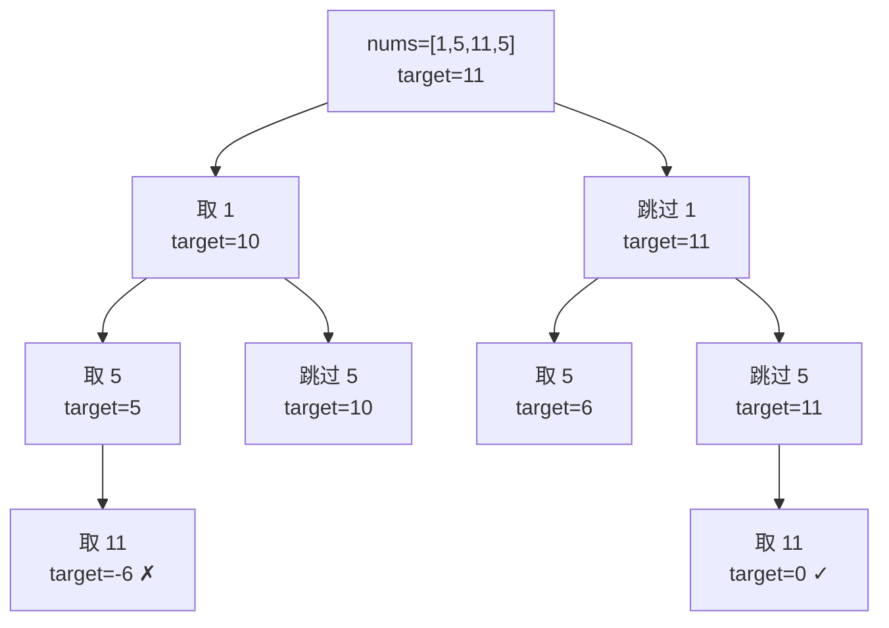

# 0/1 背包

Karp 在 1972 年列出的 21 个 NP 完全问题里，PARTITION 排在第七位：给你一堆正整数，能否把它们分成两组、使两组的和相等？五十四年后，这个问题落在 LeetCode 416 上，难度中等。两百个数字，每个不超过一百。从渐进意义上说，判定版本依然 NP 完全，但*实践*中的答案是：一个布尔一维数组、两层嵌套循环，以及一行绝对必须朝正确方向跑的代码。

这个方向就是本章的全部内容。内层循环从右往左扫，算法给出正确答案：每个物品最多只对表格贡献一次，这正是 0/1 的承诺。从左往右扫，同一份代码算的就是另一个问题，也就是完全背包，而且在每一处“正确答案本应让某个物品用零次”的输入上都会给出错误答案。下一章 [完全背包与多重背包](./05-knapsack-unbounded.md) 正是从左往右的版本。循环体一模一样，只差一个方向。

## 0/1 背包到底是什么

一个有限的物品列表。每个物品有一个重量。背包有一个容量。你要么取一次这个物品、付掉它的重量，要么跳过它。不能取一部分，也不能取两次。用来框定这个问题的问题是“是否存在一个子集，其总重量恰好等于目标值”，或者某个接近的变体。

LC 416 *Partition Equal Subset Sum*（分割等和子集）是最干净的实例。给定 `nums = [1, 5, 11, 5]`，总和是 22，所以每一半必须凑到 11。每个 `nums[i]` 是一个物品，重量等于价值、都等于 `nums[i]`。容量是 11。问题是 `nums` 的某个子集能否恰好凑出 11。（子集 `{11}` 就行。答案：可以。）

对每个物品的决策是二元的，而且不可撤销。取它：剩余容量减去该物品的重量。跳过它：剩余容量不变。DP 跟踪的状态空间是 `(已考虑的物品, 剩余容量)`，递推式就是经典的“跳过 或 取”：

```text
dp[i][j] = dp[i-1][j]                            if nums[i] > j     (必须跳过)
        = dp[i-1][j] OR dp[i-1][j - nums[i]]    otherwise          (跳过 或 取)
```

二维形式是 CLRS §14 和 Erickson §3.6 给出的教科书形态。[^2] 一维形式才是我们实际写的代码。

## 暴力解法为何不够

枚举每个子集。求和。看是否命中目标。

```python
# 暴力：O(2^n) — 这就是我们要替换掉的东西
def can_partition_brute(nums):
    total = sum(nums)
    if total & 1:
        return False
    target = total // 2
    n = len(nums)
    for mask in range(1 << n):
        s = sum(nums[i] for i in range(n) if mask & (1 << i))
        if s == target:
            return True
    return False
```

任何输入下都正确。但在 LC 416 给定的上界 `n ≤ 200` 下，循环要跑 `2^200` 次，大约 `10^60` 次操作。函数还没返回，太阳就先烧完了。即便加上剪枝（降序排序，剩余和追不上时提前剪掉），最坏情况仍是指数级。

DP 把指数换成 `O(n × W)`，其中 W 是容量。对 LC 416 来说就是 `200 × 10001 ≈ 2 × 10^6` 次布尔运算，稳稳落在 LeetCode 五秒的限制之内。[^3] 这个运行时间是“伪多项式”：对 W 的*值*是多项式，对 W 的*位数*却是指数，所以 DP 只在 W 较小时管用，而问题在一般情况下仍是 NP 完全。[^4]

## 一维表格的填法

分配一个长度为 `target + 1` 的布尔数组 `dp`。初始化 `dp[0] = True`：空子集的和为零，无论已经考虑过哪些物品。其余格子初始为 `False`。对每个物品 `x`，让 `j` 从 `target` 递减到 `x`，更新 `dp[j] = dp[j] OR dp[j - x]`。一旦 `dp[target]` 翻成 `True`，答案就是 `True`。

```python
def can_partition(nums):
    total = sum(nums)
    if total & 1:
        return False
    target = total // 2

    dp = [False] * (target + 1)
    dp[0] = True

    for x in nums:
        # 从右往左，使每个物品最多贡献一次。
        for j in range(target, x - 1, -1):
            dp[j] = dp[j] or dp[j - x]
        if dp[target]:
            return True
    return dp[target]
```

**解法** — Python（[Java](./04-knapsack-01/lc-416/sol.java) · [C++](./04-knapsack-01/lc-416/sol.cpp) · [Go](./04-knapsack-01/lc-416/sol.go)）

```python
# LC 416. Partition Equal Subset Sum
from typing import List


def can_partition(nums: List[int]) -> bool:
    """LC 416: can nums be split into two equal-sum subsets?"""
    total = sum(nums)
    if total & 1:
        return False
    target = total // 2

    # 当且仅当已见物品的某个子集恰好凑出 j 时，dp[j] 为 True。
    dp = [False] * (target + 1)
    dp[0] = True  # 空子集之和为 0

    for x in nums:
        # 容量从右往左遍历，使每个物品最多贡献一次。
        # 从左往右会在同一趟里重复使用 x，破坏 0/1 语义。
        for j in range(target, x - 1, -1):
            dp[j] = dp[j] or dp[j - x]
        if dp[target]:
            return True
    return dp[target]
```

在走推演之前，有三行代码值得单独看。

`dp[0] = True` 是空前缀的种子。每当物品 `x` 到达某个 `j ≥ x` 的格子，递推式就会读 `dp[j - x]`；在第一个物品上，之前唯一的 True 格子就是 `dp[0]`，正是它让 `dp[x]` 在该物品重量恰好等于 `x` 时翻转。去掉这个种子，所有格子永远是 `False`。DP 会跑完全程，并对每个输入返回 `False`。

`if total & 1: return False` 是整个算法里最便宜的正确性捷径。总和为奇数不可能切成两个相等的整数半，算法无事可做。[^5] 没有这一行，DP 仍会跑满 `O(n × target)` 的工作量，并因为 `target`（向下取整后）不可达而正确返回 `False`，可你花了半份预算去证明一件奇偶位免费就能决定的事。

`for j in range(target, x - 1, -1)` 就是本章的主角。下一节讲它为什么必须朝那个方向跑。

## 内层循环为何从右往左扫

一维 DP 是对二维形式的空间优化。概念上我们有按“已考虑前 `i` 个物品”索引的行 `dp[i][·]`；一维布局复用一行，就地覆盖。递推式读 `dp[i-1][j]` 和 `dp[i-1][j - x]`，两个都来自*上一*行。

内层循环从右往左扫时，右边的格子（`dp[j - x]`）在这一趟里还没被覆盖，仍然是上一行的值。这正是递推式需要的。一维更新是正确的。

内层循环从左往右扫时，右边的格子（`dp[j - x]`）在本次遍历中已经被覆盖过了。它现在装的是*当前*行的值，也就是假定物品 `x` 已经被取走算出来的值。读它，就允许 `x` 在某一次外层迭代里被取第二次。这已经不是 0/1，而是完全背包。

两个输入就能把这件事钉死。取 `nums = [3]`、`target = 6`。诚实的答案是 `False`：`[3]` 没有任何子集能凑出 6。两个方向各跑一遍：

```python
# 从右往左（正确，0/1）：
# x = 3 之后：dp = [T, F, F, T, F, F, F]
# dp[6] = False；正确。

# 从左往右（错误，实际在解完全背包）：
# 步骤 j=3：dp[3] = dp[3] or dp[0] = True。dp = [T, F, F, T, F, F, F]
# 步骤 j=4：dp[4] = dp[4] or dp[1] = False。
# 步骤 j=5：dp[5] = dp[5] or dp[2] = False。
# 步骤 j=6：dp[6] = dp[6] or dp[3] = True ← 用了两次 x=3！
# dp[6] = True；错误（这需要取两次 3）。
```

同一份代码，同一份数据，两个不同的答案，差别只是一个 `range` 参数的方向。Aditya Verma 的面试 DP 笔记把这一点标为 0/1 与完全背包的经典区别；LC 416 的讨论帖里这个 bug 反复被踩到，因为那个方向看起来像风格选择，其实不是。[^6]

下面把两者放在一起，差异一眼可见：

```python
# 0/1 背包 — 每个物品最多一次
for x in items:
    for j in range(target, x - 1, -1):       # 从右往左
        dp[j] = dp[j] or dp[j - x]

# 完全背包 — 每个物品任意次
for x in items:
    for j in range(x, target + 1):           # 从左往右
        dp[j] = dp[j] or dp[j - x]
```

只改两行，其余完全相同。下面的动画面板会停在递推式读取 `dp[j - x]` 的那一刻，让差异显形：从右往左那一趟，源格子仍是上一行的值；从左往右那一趟，它早就被覆盖了。

## 实例推演：LC 416 上的 `nums = [1, 5, 11, 5]`

总和是 22（偶数）。目标 11。分配长度为 12 的 `dp`，`dp[0] = True`。

**物品 0，x = 1。** 内层循环扫 `j = 11, 10, ..., 2`。每个格子读 `dp[j - 1]`，这些在初始状态下全是 `False`，所以没有翻转。到 `j = 1` 时，`dp[1] = dp[1] or dp[0] = True`。这一趟之后的状态：子集 `{1}` 可达 1。

**物品 1，x = 5。** 内层循环扫 `j = 11, 10, ..., 5`。在 `j = 6` 时，格子读 `dp[1]`，它是上一轮外层迭代留下的 `True`——右往左的约定在这里兑现。`dp[6]` 翻成 `True`。在 `j = 5` 时读 `dp[0] = True`，于是 `dp[5]` 翻转。这一趟之后 `dp = [T, T, F, F, F, T, T, F, F, F, F, F]`。子集 `{5}` 和 `{1, 5}` 分别可达 5 和 6。

**物品 2，x = 11。** 内层循环只扫 `j = 11`。格子读 `dp[0] = True`。`dp[11]` 翻成 `True`。提前返回触发：`dp[target]` 现在是 `True`，答案是 `True`，物品 3（末尾那个 `5`）从未被处理。

> **交互组件：** [背包 DP 表格填充（0/1 与完全背包）](../../../dsa/widgets/w-32-knapsack-fill.yml)（面板 `panel-01`）— 在网站上渲染；YAML 规范描述了关键帧。

*静态兜底：dp 依次经历四个状态。初始 `[T,F,F,F,F,F,F,F,F,F,F,F]`。x=1 之后：`[T,T,F,F,F,F,F,F,F,F,F,F]`。x=5 之后：`[T,T,F,F,F,T,T,F,F,F,F,F]`。x=11 之后：`[T,T,F,F,F,T,T,F,F,F,F,T]`。`dp[11]` 在处理第三个物品时靠读取种子 `dp[0]` 翻转；提前返回根本没碰物品 3 就给出了 `True`。*

这段推演也展示了奇偶校验帮你省掉了什么。用同一个算法跑 `nums = [1, 2, 3, 5]`。总和 11，奇数。校验立刻返回 `False`，不分配、不循环。DP 本来会做 `4 × 6 = 24` 次格子更新，最终也一样返回 `False`，但答案其实由一位二进制就决定了。

## 取或不取的视角

表格里的每一次翻转，都是从递归形态投影出来的一个“取”决策。下面的树展示同一输入上的递归，`target` 随着物品被取走而递减：



*每个分支都是对每个物品的一次取或跳过；只要某条路径命中 target = 0，LC 416 就成功。DP 通过在 `(已考虑的物品, 剩余容量)` 上建索引来合并重叠子问题，而不是记住抵达每个状态的那条路径。*

DP 就是同一个递归，只改两点：递归换成对物品的循环，结果表自底向上填充，使每个格子只被计算一次。二维形式把这种对应关系摆得明明白白；一维形式是在二维形式上再叠一层优化。

## 实际开销

| 变体 | 时间 | 空间 | 说明 |
|---|---|---|---|
| 朴素递归（枚举每个子集） | O(2^n) | O(n) | 错误答案；这就是我们要替换掉的东西 |
| 二维 DP，完整表格 | O(n × W) | O(n × W) | 教科书形态；显然正确 |
| 一维 DP，就地扫描 | O(n × W) | O(W) | 本章；必须从右往左 |
| 位集技巧 | O(n × W / 64) | O(W / 64) | LC 416 高赞提交 |

对 LC 416，一维 DP 大约跑 2 × 10^6 次布尔运算，在 LeetCode 的限制内很宽裕。[^3] 这个运行时间是*伪多项式*：`O(n × W)` 对 W 的值是多项式，对位数 `log W` 却是指数。把 W 用一元编码写出来，DP 就是线性的；用二进制编码写出来，DP 对输入规模就是指数的。[^4] 正是这个差距，让 0/1 背包的判定版本留在 Karp 的 NP 完全清单上，而 DP 能在毫秒内解掉任何面试规模的实例。[^1]

## 重新表述：当题目不提“背包”

这个模式最深的回报，是在初看不像背包的题目里认出 0/1 背包。三个有名的重述覆盖了面试轮换里的大部分。

### LC 494 Target Sum：带符号求和归约为子集计数

LC 494 问的是：给 `nums` 的元素分配 `+` 和 `-`，有多少种方式能让带符号之和等于 `target`。重述只要一段代数。设 `P` 为取正号元素之和，`N` 为取负号元素之和。那么 `P + N = total`、`P - N = target`，于是 `P = (total + target) / 2`。带符号表达式的计数就变成了“数一数 `nums` 中凑成 `P` 的子集有多少个”，这正是 0/1 背包的经典子集计数变体。递推式形状不变，只是布尔 OR 换成了整数加法。

```python
def find_target_sum_ways(nums, target):
    total = sum(nums)
    if (total + target) & 1 or abs(target) > total:
        return 0
    p = (total + target) // 2
    dp = [0] * (p + 1)
    dp[0] = 1
    for x in nums:
        for j in range(p, x - 1, -1):
            dp[j] += dp[j - x]
    return dp[p]
```

巧妙之处在代数。DP 还是同样的循环、同样的方向。两个守卫 `(total + target) & 1` 和 `abs(target) > total` 是奇偶校验的兄弟：便宜的正确性捷径，在重述处理不了的输入上直接跳过整个 DP。

### LC 1049 Last Stone Weight II：求最小差，而非均分

LC 1049 要求两两粉碎石头后剩下的最小正值。重述：把石头分成两组，使两组的正差最小。最小差等于 `total - 2 × S`，其中 `S` 是不超过 `total / 2` 的最大子集和。把布尔 0/1 DP 跑到 `target = total // 2`，然后从 `target` 往下走 `dp`，找最大的那个 `True` 格子。返回 `total - 2 × S`。

形态上属于优化变体：纯布尔可达性不是答案，但可达性是积木。跑同一套 DP，然后从表里挖答案。

### LC 474 Ones and Zeroes：容量是个元组

每个输入字符串有两个重量：0 的个数和 1 的个数。容量是二元组 `(m, n)`（最多 m 个 0、最多 n 个 1）。递推还是取或不取，只是在一维空间优化里对两个维度都做降序迭代：

```python
def find_max_form(strs, m, n):
    dp = [[0] * (n + 1) for _ in range(m + 1)]
    for s in strs:
        zeros = s.count('0')
        ones = len(s) - zeros
        for i in range(m, zeros - 1, -1):     # 外层降序
            for j in range(n, ones - 1, -1):  # 内层降序
                if dp[i - zeros][j - ones] + 1 > dp[i][j]:
                    dp[i][j] = dp[i - zeros][j - ones] + 1
    return dp[m][n]
```

两个维度，两趟从右往左。两者都必须降序，理由和一维版本相同：递推式读的是上一轮迭代的格子，读的时候它必须还没被动过。

## 两个最容易踩的坑

> [!WARNING]
> **内层循环从左往右迭代。** 这是 LC 416 提交里最常见的 bug，也是失败模式最隐蔽的一个。算法会跑完全程，在“某个物品可以被重复拿来凑目标”的输入上返回错误答案，实际上悄悄解的是完全背包。修复只差一个字符：Python 里写 `range(target, x - 1, -1)`，Java/C++/Go 里写 `j >= x; j--`。如果你的代码写的是 `range(x, target + 1)` 而题目是 0/1，你就中了这个 bug。

> [!WARNING]
> **忘记 `dp[0] = True`。** 这个种子不是优化，它是空子集的入口，后面每一次翻转都传递地依赖它。没有它，DP 分配的是一整片 False，每次 `dp[j] = dp[j] or dp[j - x]` 读到的两个格子都是 False，循环在每个输入上都返回 `False`。这个 bug 静默且致命。CI 的标准测试门会在第一个期望答案为 `True` 的输入上把它逮住。

第三个值得简短提一句：把“恰好达到 k”和“最多达到 k”搞混。本章的布尔 OR 变体回答的是“是否存在和为恰好 k 的子集”。教科书的取值变体 `dp[i][j] = max(dp[i-1][j], dp[i-1][j - w[i]] + v[i])` 回答的是“容量不超过 j 时的最大价值”。两个递推式是两回事，题目措辞决定用哪个。[^2]

## 题目梯度

### 核心（三题全做才算掌握本章）

- [LC 416 — Partition Equal Subset Sum](https://leetcode.com/problems/partition-equal-subset-sum/) [中等] • knapsack-01-subset-sum ★
- [LC 494 — Target Sum](https://leetcode.com/problems/target-sum/) [中等] • knapsack-01-count-subsets
- [LC 879 — Profitable Schemes](https://leetcode.com/problems/profitable-schemes/) [困难] • knapsack-01-3d-two-constraints

### 进阶（可选）

- [LC 474 — Ones and Zeroes](https://leetcode.com/problems/ones-and-zeroes/) [中等] • knapsack-01-2d-axes
- [LC 1049 — Last Stone Weight II](https://leetcode.com/problems/last-stone-weight-ii/) [中等] • knapsack-01-min-difference

LC 416 是本章的招牌题（★），也是一维 DP 的参考实例。核心三题练的是三种承重变体：纯布尔可达（LC 416）、整数加法的计数（LC 494），以及带两个同时约束的三维扩展（LC 879）。0/1 背包在 LeetCode 上没有公认的简单难度题；凡是它打了标签的、有意义的子集和 / 取或不取变体，都是中等或更难。核心 + 进阶覆盖中等与困难，简单位是空的——原因是主题本身，不是疏忽。

## 后续衔接

下一章 [完全背包与多重背包](./05-knapsack-unbounded.md) 是同一个算法，只是内层循环从左往右。每个物品可以取任意次，经典实例是 LC 322 *Coin Change*。本页的组件还有第二个面板对应完全背包变体；在两个面板之间点一下，就能看到同一行 dp 在每个方向下如何演化。

对于状态是 `(A 的前缀, B 的前缀)` 而不是 `(已考虑的物品, 容量)` 的双串 DP，自然的后续是 [LCS、编辑距离、回文](./06-lcs.md)。那里的二维表格填充沿用本章的语汇——在上一行的格子上递推、就地复用一个行、扫描方向有讲究——只是套在不同的状态形状上。

## 参考文献

[^1]: Karp, Richard M., "Reducibility Among Combinatorial Problems," in *Complexity of Computer Computations*, Plenum Press, 1972, pp. 85-103. KNAPSACK and PARTITION listed among the 21 NP-complete problems. <https://link.springer.com/chapter/10.1007/978-1-4684-2001-2_9>

[^2]: Cormen, Leiserson, Rivest, Stein, *Introduction to Algorithms*, 4th ed., MIT Press, 2022, Chapter 14 (Dynamic Programming). Erickson, Jeff, *Algorithms*, §3.6 (Subset Sum), <https://jeffe.cs.illinois.edu/teaching/algorithms/book/03-dynprog.pdf>

[^3]: walkccc, "416. Partition Equal Subset Sum," <https://walkccc.me/LeetCode/problems/0416/>.

[^4]: Wikipedia, "Knapsack problem," <https://en.wikipedia.org/wiki/Knapsack_problem>

[^5]: Design Gurus, "Equal Subset Sum Partition," <https://designgurus.io/course-play/grokking-dynamic-programming/doc/solution-equal-subset-sum-partition>.

[^6]: Aditya Verma, "DP Notes," <https://www.scribd.com/document/842860835/dp-notes-aditya-verma>.
