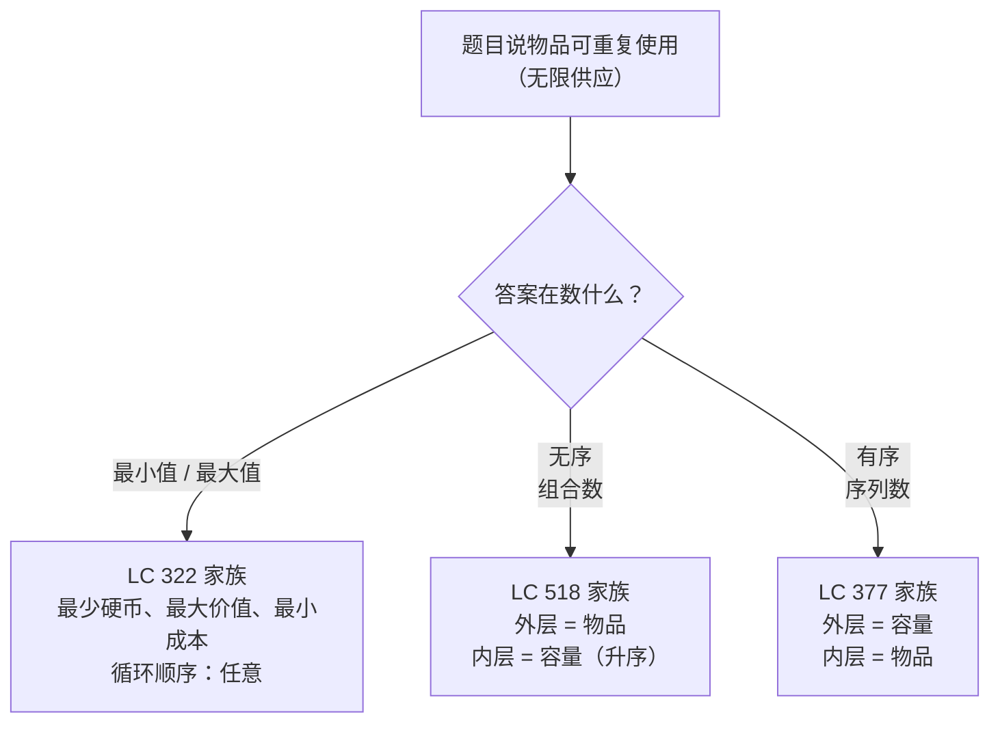

# 无界背包：物品可以被反复选择

上一章的 0/1 背包 DP 与 `coins = [1, 2, 5], amount = 11 → 3` 的解法之间，只差一个字符：内层循环的方向反过来。按 `for a in range(W, c-1, -1)` 扫，每件物品最多被装一次；按 `for a in range(c, W+1)` 扫，同一件物品就会被装到容量允许的次数。这一处翻转就是本章的全部内容。

它解锁的这类问题，恰恰是多数候选人以为需要另学一套算法的那类：凑到目标金额的最少硬币数、用硬币凑出零钱的无序方案数、和为某个数的有序序列数、可重复使用的套餐组合下的最小花费。它们的递推式与 0/1 背包接近到这种程度——本章主要的活儿，是别让这两个东西在你脑子里糊成一团。

## 如何识别这个模式

指向无界背包的信号，是题干里同时出现三样东西：一个一维且有上界的目标、一小组带有会消耗该目标的“重量”的物品，以及明确允许每件物品随便取多少次。面试题里泄底的那句话在这一族里几乎逐字相同：“you have an infinite number of each kind of coin”（LC 322[^2]），或者“you could use any of the special offers as many times as you want”（LC 638）。0/1 变体换上来的是*每件物品最多用一次*；这个对照是有意为之的。



*聚合运算符和循环嵌套这两件事合起来，才能确定问题属于无界背包的哪个子模式。计数类问题上一旦把循环顺序搞错，算法会给出一个语法上合法、结果却错误的答案。*

## 与 0/1 背包的区别

[0/1 背包那一章](./04-knapsack-01.md)搭了一个一维空间优化 DP，`dp[a]` 存容量 `a` 下能达到的最优价值。两章的递推式形状相同：

```text
dp[a] = aggregate over each item i of (dp[a - w_i] + value_i)
```

差别在于 `dp[a - w_i]` 读到的是*上一件物品*的状态还是*当前物品*的状态。在 0/1 背包里，每件物品最多用一次，所以当你决定要不要把物品 `i` 装进容量为 `a` 的背包时，比较对象是只用*更早的*物品能达到的最优价值，绝不会是一个已经用过物品 `i` 的状态。算法靠内层循环从右往左扫来保证这一点：`dp[a - w_i]` 在 `dp[a]` 被覆盖*之前*读出，读到的就是上一行的值。[^1]

在无界背包里，你*想要*反复用物品 `i`。决定 `dp[a]` 该是多少时，候选项里包含“我刚用物品 `i` 走到了容量 `a - w_i`，再用一次就到 `a`”。这一项对应的正是内层循环已经为物品 `i` 更新过之后再读 `dp[a - w_i]`。从左往右扫就让这次读取看到刚写进去的值，于是算法会把物品 `i` 装到装不下为止。[^1]

下面的 widget 把两块面板渲染在同一组标准输入上，方向翻转就是主角的视觉呈现。同样的数组、同样的物品集合、同样的递推式主体。只有内层扫描方向不同，答案随之改变。

> **Interactive widget:** [背包 DP 填表（0/1 对比无界）](../../../dsa/widgets/w-32-knapsack-fill.yml)（面板 `panel-unbounded`）— 在网站上渲染；YAML 规格描述了各个关键帧。

*静态回放：一行格子 `dp[0..11]`，初始为 `[0, INF, INF, ...]`。硬币 1 从左到右填满这些格子，接着硬币 2 扫过一遍、能改小的地方就改小，然后硬币 5 登场——这是戏剧性的一幕：`dp[5]` 从 3 掉到 1，`dp[10]` 从 3 掉到 2，因为 `dp[5] = 1` 已经写好了，现在反哺回来。最终 `dp[11] = 3`，就是答案（5 + 5 + 1）。*

## 机制：从左到右填充 dp[a]

招牌题是 LC 322 *Coin Change*：给定硬币面额与目标金额，返回凑出该金额的最少硬币数，凑不出则返回 `-1`。[^2] 每种硬币都可以重复使用。样例：`coins = [1, 2, 5]`、`amount = 11`。答案 3，取法 `5 + 5 + 1`。

写代码之前，先在纸上把递推走一遍。`dp[a]` 将存凑出金额 `a` 的最少硬币数。基本情况 `dp[0] = 0`（零枚硬币凑零元）。其余格子初始化为无穷大。填 `dp[a]` 时逐个试硬币 `c`：若 `c <= a`，则 `dp[a - c] + 1` 是一个候选（在凑出 `a - c` 的最优办法上再加一枚硬币 `c`）。在所有硬币的候选中取最小。

标准输入下的完整表格，按 `a = 1..11` 扫，每一列给出考虑完每种硬币之后 `dp[a]` 的取值：

| `a` | `c=1` 之后 | `c=2` 之后 | `c=5` 之后 | 推理 |
|---|---|---|---|---|
| 0 | 0 | 0 | 0 | 基本情况 |
| 1 | 1 | 1 | 1 | 只有 `1` 装得下 |
| 2 | 2 | 1 | 1 | 一枚 2 元胜过两枚 1 元 |
| 3 | 3 | 2 | 2 | `1 + 2` |
| 4 | 4 | 2 | 2 | `2 + 2` |
| 5 | 5 | 3 | 1 | 一枚 5 元胜过 `2 + 2 + 1` |
| 6 | 6 | 3 | 2 | `5 + 1` |
| 7 | 7 | 4 | 2 | `5 + 2` |
| 8 | 8 | 4 | 3 | `5 + 2 + 1` |
| 9 | 9 | 5 | 3 | `5 + 2 + 2` |
| 10 | 10 | 5 | 2 | `5 + 5` |
| 11 | 11 | 6 | 3 | `5 + 5 + 1` ← 答案 |

“`c = k` 之后”这几列体现的是硬币在外层的扫法，但就 LC 322 而言顺序其实无所谓，因为 `min` 满足交换律；把 `a` 放外层、`c` 放内层，最后得到的还是同一列。[^3] 这种宽容只属于 min 聚合的情形；后面两个计数变体可没这么好说话。

代码很短。每个金额走一遍，每个金额对每种硬币走一遍，循环体三行：

```python
INF = float('inf')

def coin_change(coins, amount):
    dp = [0] + [INF] * amount
    for a in range(1, amount + 1):
        for c in coins:
            if c <= a and dp[a - c] + 1 < dp[a]:
                dp[a] = dp[a - c] + 1
    return dp[amount] if dp[amount] != INF else -1
```

**Solution** — Python ([Java](./05-knapsack-unbounded/lc-322/sol.java) · [C++](./05-knapsack-unbounded/lc-322/sol.cpp) · [Go](./05-knapsack-unbounded/lc-322/sol.go))

```python
# LC 322. Coin Change
# [1,2,5]/11=3, [2]/3=-1, [1]/0=0 all PASS.
from typing import List

INF = float('inf')


def coin_change(coins: List[int], amount: int) -> int:
    """Minimum number of coins summing to `amount`, or -1 if not reachable.
    Each coin may be reused unlimited times.
    """
    dp = [0] + [INF] * amount
    for a in range(1, amount + 1):
        for c in coins:
            if c <= a and dp[a - c] + 1 < dp[a]:
                dp[a] = dp[a - c] + 1
    return dp[amount] if dp[amount] != INF else -1
```

两个工程细节，都与溢出有关。Python 的 `float('inf')` 能干净地吞掉算术运算：`INF + 1` 仍然是 `INF`。Java 不行，官方题解里的惯用写法是 `int INF = amount + 1;`。[^4] 可行路径上的硬币数最多是 `amount`（全是 1 元硬币，前提是有的话），所以 `amount + 1` 无疑是不可达的，*而且* 加法也稳稳落在 `int` 范围内。C++ 和 Go 出于同样的理由用同一个哨兵值。你要是用 `Integer.MAX_VALUE`，`dp[a-c] + 1` 会溢出成 `Integer.MIN_VALUE`，这个负数接着变成新的最小值，把下游每一个格子都污染掉。

## 实际开销

| 变体 | 时间 | 空间 | 备注 |
|---|---|---|---|
| LC 322 最少硬币（一维 DP） | O(n × W) | O(W) | 每个金额走一遍，每种硬币走一遍 |
| LC 322（二维 DP，空间优化前） | O(n × W) | O(n × W) | 教科书的起点 |
| LC 518 / 377 计数 | O(n × W) | O(W) | 同样的形状，求和聚合 |

其中 `n` 是不同物品（硬币）的数量，`W` 是容量（金额）。一维 DP 填 `W + 1` 个格子，每个格子最多对 `n` 件物品做聚合。维基百科的 *Knapsack problem* 条目直接给出了这个界：每个格子最多考察 `n` 件物品，最多 `W` 个格子，所以总工作量为 O(nW)。[^5]

这个界是*伪多项式*的。`W` 需要 O(log W) 个比特来编码，所以当 `W` 天文数字般大时，算法相对输入长度是指数级的；但就 LC 的取值范围而言是实用的（按 LC 322 的约束，`amount ≤ 10⁴`[^2]）。底层背包问题的判定版本是弱 NP 完全的[^5]；零钱兑换问题继承了这一点，同样是弱 NP 难的。DP 就是利用数值 `W` 很小这一点的标准绕法。

## 计数无序组合：LC 518

LC 518 *Coin Change II* 问的是用 `coins` 凑出 `amount` 有多少种方法，把每种组合当作一个多重集。[^6] 样例：`coins = [1, 2, 5]`、`amount = 5`。和为 5 的多重集有四个：`{5}`、`{2, 2, 1}`、`{2, 1, 1, 1}`、`{1, 1, 1, 1, 1}`。答案 4。注意 `{2, 2, 1}` 与 `{2, 1, 2}` 是同一个多重集；LC 518 只算一次。

递推主体从 `min` 换成 `+=`，基本情况从 `dp[0] = 0` 换成 `dp[0] = 1`。新的基本情况是一条组合恒等式：空多重集是凑出零的一种合法方式。忘了它，`dp[a]` 对每个 `a > 0` 都会停在零，因为递推式 `dp[a] += dp[a - c]` 只是把零加到零上。

```python
def change(amount, coins):
    dp = [0] * (amount + 1)
    dp[0] = 1                           # 空多重集是一种合法方式
    for c in coins:                     # 外层 = 硬币 -> 组合
        for a in range(c, amount + 1):
            dp[a] += dp[a - c]
    return dp[amount]
```

**Solution** — Python ([Java](./05-knapsack-unbounded/lc-518/sol.java) · [C++](./05-knapsack-unbounded/lc-518/sol.cpp) · [Go](./05-knapsack-unbounded/lc-518/sol.go))

```python
# LC 518. Coin Change II
# OUTER loop = coins is mandatory; counts unordered combinations.
from typing import List


def change(amount: int, coins: List[int]) -> int:
    dp = [0] * (amount + 1)
    dp[0] = 1                           # 空多重集是一种合法方式
    for c in coins:                     # 外层 = 硬币 -> 组合
        for a in range(c, amount + 1):
            dp[a] += dp[a - c]
    return dp[amount]
```

`for c in coins` 放在外层，这一行承担了全部组合数学的活儿。想知道为什么，就用手算走一遍 `coins = [1, 2], amount = 3`。初始 `dp = [1, 0, 0, 0]`。

外层迭代 `c = 1`。内层扫描对 `a = 1, 2, 3` 把 `dp[a - 1]` 加到 `dp[a]` 上：

- `dp[1] += dp[0]` → `dp[1] = 1`
- `dp[2] += dp[1]` → `dp[2] = 1`
- `dp[3] += dp[2]` → `dp[3] = 1`

第一轮外层迭代之后，`dp = [1, 1, 1, 1]`。每个格子记录的是只用 1 元硬币的那唯一一种组合：全 1 的多重集。

外层迭代 `c = 2`：

- `dp[2] += dp[0]` → `dp[2] = 2`。新增的方式是 `{2}`。
- `dp[3] += dp[1]` → `dp[3] = 2`。新增的方式是 `{2, 1}`。

最终 `dp[3] = 2`。两种组合：`{1, 1, 1}` 与 `{2, 1}`。正确。

外层固定为硬币这条纪律的意义在于：算法处理完硬币 `c` 之后，就再也不回头。等到内层循环为硬币 2 跑起来时，多重集 `{1, 1, 1}` 已经记在 `dp[3] = 1` 里了；`dp[3] += dp[1]` 加上的 `dp[1] = 1` 表示“到目前为止处理过的硬币 {1, 2} 凑出 1 的方式数”，再追加一枚 2 元硬币，就延伸成一个新的组合。多重集 `{2, 1}` 只被记录一次。序列里 2 和 1 谁先谁后无关紧要，因为算法根本不问这个；它只会往一个已经规范化的小多重集上追加*当前*硬币。

把循环嵌套反过来，这个性质就崩了。

## 计数有序序列：LC 377

LC 377 *Combination Sum IV* 问的是：用 `nums` 里的值（顺序有意义、可重复取）凑成 `target` 有多少个序列。[^7] LC 的标题有误导性，题名里的“combinations”是错的。题干澄清了 *“different sequences are counted as different combinations,”*，而这正是排列的定义。[^7] 样例：`nums = [1, 2, 3]`、`target = 4`。七个序列：`(1,1,1,1)`、`(1,1,2)`、`(1,2,1)`、`(2,1,1)`、`(2,2)`、`(1,3)`、`(3,1)`。答案 7。

递推主体与 LC 518 完全相同：`dp[a] += dp[a - n]`。基本情况也相同：`dp[0] = 1`。唯一变的一行是循环嵌套。现在外层遍历 `a`，内层遍历 `nums`。

```python
def combination_sum4(nums, target):
    dp = [0] * (target + 1)
    dp[0] = 1                           # 空序列是一种合法方式
    for a in range(1, target + 1):      # 外层 = 金额 -> 排列
        for n in nums:
            if n <= a:
                dp[a] += dp[a - n]
    return dp[target]
```

**Solution** — Python ([Java](./05-knapsack-unbounded/lc-377/sol.java) · [C++](./05-knapsack-unbounded/lc-377/sol.cpp) · [Go](./05-knapsack-unbounded/lc-377/sol.go))

```python
# LC 377. Combination Sum IV
# OUTER loop = amounts; counts ordered sequences (the problem statement
# explicitly says "different sequences are counted as different combinations").
from typing import List


def combination_sum4(nums: List[int], target: int) -> int:
    dp = [0] * (target + 1)
    dp[0] = 1                           # 空序列是一种合法方式
    for a in range(1, target + 1):      # 外层 = 金额 -> 排列
        for n in nums:
            if n <= a:
                dp[a] += dp[a - n]
    return dp[target]
```

在 `nums = [1, 2], target = 3` 上走一遍，就能看出差别。

`a = 1`：试 `n = 1`，`dp[1] += dp[0] = 1` → `dp[1] = 1`。试 `n = 2`，但 2 > 1，跳过。之后：`dp = [1, 1, 0, 0]`。

`a = 2`：试 `n = 1`，`dp[2] += dp[1] = 1` → `dp[2] = 1`。试 `n = 2`，`dp[2] += dp[0] = 1` → `dp[2] = 2`。之后：`dp = [1, 1, 2, 0]`。和为 2 的两个序列是 `(1, 1)` 和 `(2)`。

`a = 3`：试 `n = 1`，`dp[3] += dp[2] = 2` → `dp[3] = 2`。这两个序列是“任何和为 2 的序列再补一个 1”，得到 `(1, 1, 1)` 和 `(2, 1)`。试 `n = 2`，`dp[3] += dp[1] = 1` → `dp[3] = 3`。新序列是“任何和为 1 的序列再补一个 2”，得到 `(1, 2)`。最终 `dp[3] = 3`。

目标 3 的三个序列：`(1, 1, 1)`、`(2, 1)`、`(1, 2)`。同一个多重集 `{2, 1}` 被算了*两次*：一次作为序列 `(2, 1)`，一次作为 `(1, 2)`。这种重复计数恰恰说明算法是对的；LC 377 要的就是有序序列，而外层遍历金额正是让它发生的原因。

结构上的差别在于哪个维度“只介绍一次”、哪个维度“每一步都重新考虑”。在 LC 518 里，物品只被介绍一次（外层循环），然后摊到所有金额上（内层循环）。每个多重集都是把当前物品追加到更早物品的状态上得到的，所以顺序由循环固定下来。在 LC 377 里，每个金额都会重新考虑每件物品（外层循环 = 金额），所以算法能把 `(1, 2)` 延伸成 `(1, 2, 1)`，另外把 `(2, 1)` 延伸成 `(2, 1, 1)`，并把它们视为不同的东西。

## 模式失效的场景

LC 983 *Minimum Cost For Tickets* 是 min 聚合的变体，其中每个“硬币”不是数值重量，而是一个固定的结构变换。题目是：给定出行日期列表和三种票（1 天、7 天、30 天）及其价格，求最小总花费。[^8]

对每个出行日 `i`，递推式是 `dp[i] = min(dp[i-1] + costs[0], dp[i-7] + costs[1], dp[i-30] + costs[2])`。三种“硬币”，重量为 1、7、30，代价为 `costs[0..2]`。“物品”现在是有结构的而非标量（买一张 30 天票，跟买三十张 1 天票在结构上不同），但递推的形状没变。同样的 min 聚合、同样的从左到右扫描、同样的 O(W) 空间，其中 `W` 是最后一个出行日。把它框成“带三个固定偏移物品的背包”，就是破题的关键。

LC 638 *Shopping Offers* 是多维版本的表亲。状态是一个剩余需求向量，涉及 `n ≤ 6` 件物品、`needs[i] ≤ 10`，小到可以把整个状态压进一个 24 位整数做记忆化。每个“优惠”都是一次从需求状态里做的向量减法。DP 仍然跑在 `(状态, 选哪个优惠)` 上；只是状态从一个标量长成了一个边界很紧的向量。bitmask 打包是编码层面的优化，不改变算法。先按 `tuple(needs)` 作键把递推写清楚，等递推明确之后再换 bitmask。

## 三个最容易踩的坑

> [!WARNING]
> **把 0/1 背包的内层循环方向照抄过来。** 先学 0/1 背包的读者会把无界版本的内层循环写成降序（`for a in range(amount, c-1, -1)`），于是 LC 322 静默返回错误的最小值，因为每种硬币都被当成了一次性。降序扫描对 0/1 是对的——那里必须禁止复用；升序扫描对无界是对的——那里复用正是目的。CP-Algorithms 把这条规则写得很明确：完全背包的内层循环按*递增*顺序，0/1 按*递减*。[^1] 记忆法：0/1 往下，无限往上。

> [!WARNING]
> **LC 518 / LC 377 的循环顺序互换。** 两个问题共用递推式 `dp[a] += dp[a - x]` 和基本情况 `dp[0] = 1`。只有循环嵌套不同：外层 = 物品数无序组合，外层 = 金额数有序序列。照抄错模板既不会有编译错误，也不会有运行时报错。这个 bug 只在输入能区分组合与排列时才浮现。对 `coins = [1, 2], amount = 2`，两种嵌套都返回 2；两个看起来都对，都能过小规模单测。到金额 3 时答案就分叉了（2 对 3），到金额 4 时是（3 对 5）。把规则背下来：外层 = 物品数组合；外层 = 金额数排列。

> [!CAUTION]
> **在 Java 里用 `Integer.MAX_VALUE` 当不可达哨兵。** Java 的整数溢出是静默的。把 `dp[a]` 初始化为 `Integer.MAX_VALUE`，那么只要 `dp[a - c]` 不可达，`dp[a - c] + 1` 就会溢出成 `Integer.MIN_VALUE`，这个负值接着变成新的最小值，并像一个合法计数一样往下传播。修法是官方题解的惯用写法 `int INF = amount + 1;`。[^4] 任何可行路径上的最多硬币数是 `amount`（全是 1 元硬币），所以 `amount + 1` 无疑是不可达的，`dp[a-c] + 1` 也稳稳落在 `int` 内。

还有第四个值得提一句的小坑：最少硬币用 `dp[0] = 0`，计数类变体用 `dp[0] = 1`。不同的题族、不同的基本情况，数组初始化模式却一样。搞混了没有提示，算法一路跑完，返回一个错误的数字，而修法只改一个字符。

## 题目梯度

### 核心（三题全做才算掌握本章）

- [LC 322 — Coin Change](https://leetcode.com/problems/coin-change/) [中等] • unbounded-knapsack-min ★
- [LC 518 — Coin Change II](https://leetcode.com/problems/coin-change-ii/) [中等] • unbounded-knapsack-count-combinations
- [LC 377 — Combination Sum IV](https://leetcode.com/problems/combination-sum-iv/) [中等] • unbounded-knapsack-count-permutations

### 进阶（可选）

- [LC 983 — Minimum Cost For Tickets](https://leetcode.com/problems/minimum-cost-for-tickets/) [中等] • unbounded-knapsack-min-fixed-shifts
- [LC 638 — Shopping Offers](https://leetcode.com/problems/shopping-offers/) [中等] • unbounded-knapsack-multi-state

LC 322 是本章的招牌题，也是最干净的 min 聚合演示。核心的三道题把递推式上三个承重的变体都练到了：最少硬币（LC 322，`min` 配 `+1`）、无序计数（LC 518，`+=` 且外层 = 物品）、有序计数（LC 377，`+=` 且外层 = 金额）。五道题全落在中等，原因是无界背包这个模式在面试轮换里既没有公认的简单题也没有困难题，想要就得从相邻章节借；LC 70（Climbing Stairs）在结构上就是 `nums = [1, 2]` 的 LC 377，但因为承担前置角色而归在 [斐波那契式 DP](./01-dp-bottom-up-tabulation.md) 名下，LC 416（Partition Equal Subset Sum）则归 [0/1 背包](./04-knapsack-01.md)。题目注册表里本章的 `single-difficulty-band` 标注记录了这个事实：它是模式的属性，不是内容的缺口。

## 后续衔接

接下来的章节就不再是一维的了。[最长公共子序列](./06-lcs.md)是第一个两维填表、且两个维度都不是“容量”的例子，内层循环方向的故事也不再提供信息，因为递推式按构造就是从*已经在*上一行的格子里读。[编辑距离](./07-edit-distance.md)进一步推广到两个字符串加三种编辑操作，每种操作在表里标出一条不同的路径。你在这里练出来的纪律（先写递推式、证明哪个维度能做空间优化、挑出能让依赖读取成立的那个循环方向）会一直带着走。

LC 279 *Perfect Squares* 是离 LC 322 最近的后续题，这里没给它单独的梯度位。把完全平方数 1、4、9、16、…… 当成硬币，算法就退化成面额集合随 `n` 增长的 LC 322。如果循环顺序的规则还让你觉得悬，值得花一个晚上练它。

## 参考文献

[^1]: CP-Algorithms，"Knapsack Problem"，"0-1 Knapsack" 与 "Complete Knapsack" 两节。<https://cp-algorithms.com/dynamic_programming/knapsack.html>。

[^2]: doocs/leetcode 镜像，LC 322 Coin Change README_EN。难度 中等。约束：`1 <= coins.length <= 12`、`1 <= coins[i] <= 2³¹ - 1`、`0 <= amount <= 10⁴`。<https://github.com/doocs/leetcode/blob/main/solution/0300-0399/0322.Coin%20Change/README_EN.md>。

[^3]: walkccc，"LeetCode Solutions" 322. Coin Change。<https://walkccc.me/LeetCode/problems/322/>。

[^4]: walkccc，"LeetCode Solutions" 322. Coin Change，Java 标签页。`Arrays.fill(dp, 1, dp.length, amount + 1)` 这个写法是这一族问题的标准题解哨兵值。<https://walkccc.me/LeetCode/problems/322/>。

[^5]: Wikipedia，"Knapsack problem"，"Computational complexity" 与 "Dynamic programming in-advance algorithm" 两节。<https://en.wikipedia.org/wiki/Knapsack_problem>。

[^6]: doocs/leetcode 镜像，LC 518 Coin Change II README_EN。难度 中等。约束："answer is guaranteed to fit into a signed 32-bit integer."<https://github.com/doocs/leetcode/blob/main/solution/0500-0599/0518.Coin%20Change%20II/README_EN.md>。

[^7]: doocs/leetcode 镜像，LC 377 Combination Sum IV README_EN。难度 中等。题干引文："different sequences are counted as different combinations."<https://github.com/doocs/leetcode/blob/main/solution/0300-0399/0377.Combination%20Sum%20IV/README_EN.md>。

[^8]: doocs/leetcode 镜像，LC 983 Minimum Cost For Tickets README_EN。难度 中等。约束：`1 <= days.length <= 365`；票种 {1 天, 7 天, 30 天}。<https://github.com/doocs/leetcode/blob/main/solution/0900-0999/0983.Minimum%20Cost%20For%20Tickets/README_EN.md>。
